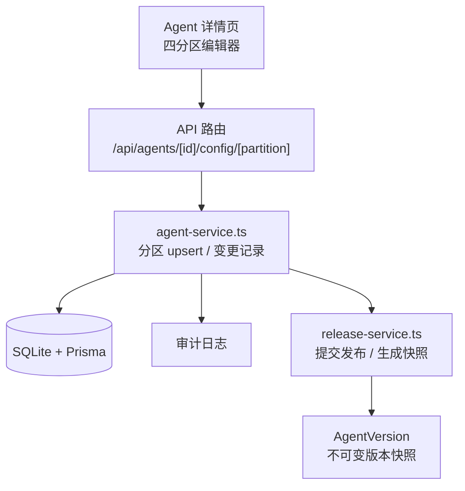
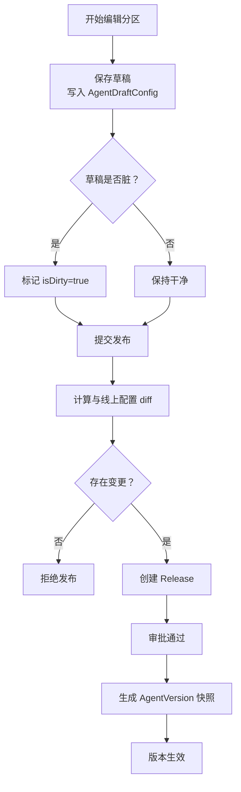
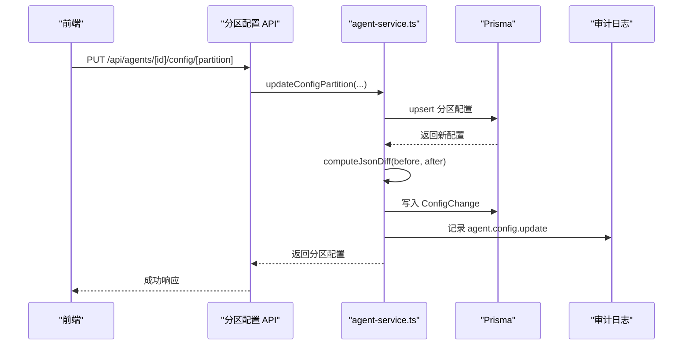
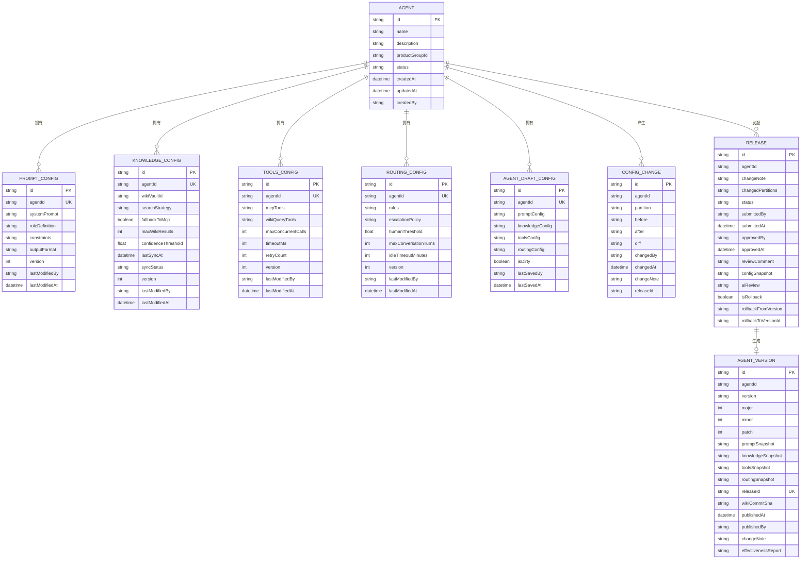
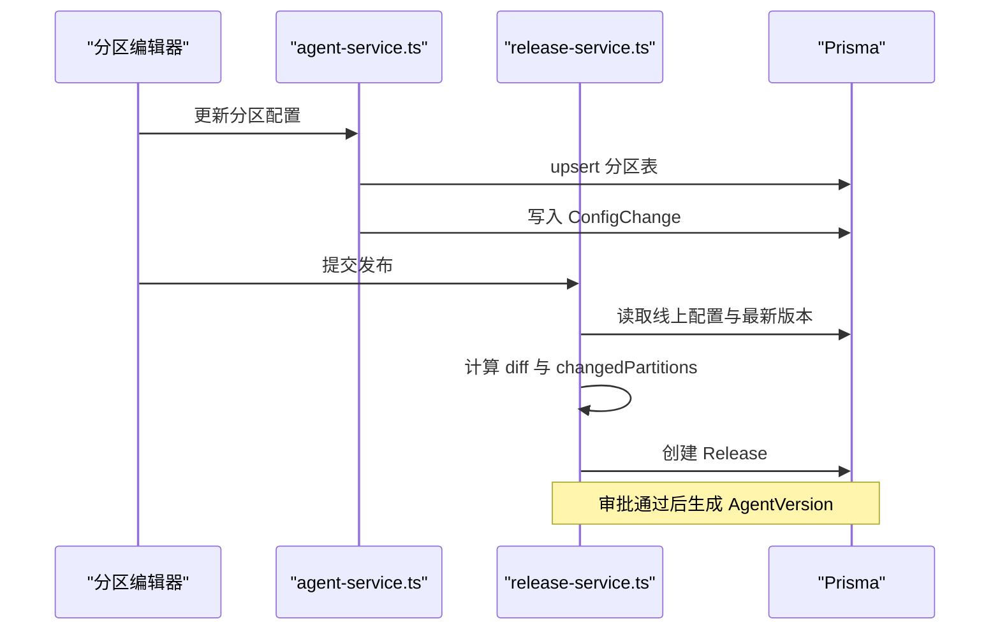

# Agent 核心实体

<cite>
**本文引用的文件**   
- [schema.prisma](file://packages/db/prisma/schema.prisma)
- [migration.sql](file://packages/db/prisma/migrations/20261005033611_init_sqlite/migration.sql)
- [schemas.ts](file://apps/web/lib/schemas.ts)
- [agent-service.ts](file://apps/web/lib/services/agent-service.ts)
- [release-service.ts](file://apps/web/lib/services/release-service.ts)
- [agent-detail.tsx](file://apps/web/app/(dashboard)/agents/[id]/agent-detail.tsx)
- [mock-server.ts](file://apps/web/demo/mock-server.ts)
- [README.md](file://README.md)
</cite>

## 目录
1. [引言](#引言)
2. [项目结构定位](#项目结构定位)
3. [核心实体总览](#核心实体总览)
4. [四分区架构设计](#四分区架构设计)
5. [详细表结构与字段含义](#详细表结构与字段含义)
6. [AgentDraftConfig 草稿机制与变更追踪](#agentdraftconfig-草稿机制与变更追踪)
7. [配置依赖关系与数据流转](#配置依赖关系与数据流转)
8. [业务查询模式与使用示例](#业务查询模式与使用示例)
9. [性能与一致性考量](#性能与一致性考量)
10. [故障排查要点](#故障排查要点)
11. [结论](#结论)

## 引言
本文聚焦 Agent 改进平台中的核心数据模型：`Agent`、`PromptConfig`、`KnowledgeConfig`、`ToolsConfig`、`RoutingConfig`、`AgentDraftConfig`，以及与之配套的 `ConfigChange`、`Release`、`AgentVersion`。目标是解释四分区架构的设计意图、字段语义、草稿机制、配置变更追踪方式，并给出面向实际业务的查询和使用思路。

该项目是一个面向专有云工单场景的 Agent 持续改进平台：产品组可以分别维护 Prompt、知识库、工具、路由四类配置，通过审批流程发布不可变版本快照，并支持分区级和整版本回滚。

**章节来源**
- [README.md:50-62](file://README.md#L50-L62)
- [README.md:277-288](file://README.md#L277-L288)

## 项目结构定位
Agent 核心实体位于数据库层，由 Prisma schema 定义，并通过服务层暴露 API；前端页面在 Agent 详情页提供四分区编辑器、试聊 Playground、版本历史与回滚入口。

**图表来源**
- [agent-service.ts:341-565](file://apps/web/lib/services/agent-service.ts#L341-L565)
- [release-service.ts:119-149](file://apps/web/lib/services/release-service.ts#L119-L149)
- [schema.prisma:66-99](file://packages/db/prisma/schema.prisma#L66-L99)

**章节来源**
- [README.md:76-135](file://README.md#L76-L135)
- [README.md:296-317](file://README.md#L296-L317)

## 核心实体总览
Agent 是改进主体，每个 Agent 拥有四个可独立编辑的配置分区，以及一个草稿环境。发布后生成不可变版本快照；每次分区写入都会记录变更轨迹。

| 实体 | 职责 | 关键关联 |
|---|---|---|
| `Agent` | 产品 Agent 主实体，承载名称、描述、产品组、生命周期状态 | 关联 Prompt/Knowledge/Tools/Routing 配置、草稿、反馈、发布、版本、技能绑定、Wiki、变更轨迹、试聊 trace、评测用例 |
| `PromptConfig` | 系统提示词、角色定义、约束条件、输出格式 | 一对一关联 Agent |
| `KnowledgeConfig` | 知识库检索策略、MCP 兜底、结果数量、置信度阈值、同步状态 | 可选关联 WikiVault |
| `ToolsConfig` | MCP 工具清单、Wiki 查询工具、并发与时限重试参数 | 一对一关联 Agent |
| `RoutingConfig` | 路由规则、升级策略、人工介入阈值、会话轮次与空闲超时 | 一对一关联 Agent |
| `AgentDraftConfig` | 当前编辑态的四分区草稿，标记是否脏数据 | 一对一关联 Agent |
| `ConfigChange` | 分区级变更前后值与 diff，用于审计与回滚留痕 | 关联 Agent |
| `Release` | 发布申请，包含变更分区、配置快照、AI 评测结果 | 关联 Agent、AgentVersion |
| `AgentVersion` | 不可变版本快照，含 SemVer 与四分区快照 | 关联 Release |

**章节来源**
- [schema.prisma:66-99](file://packages/db/prisma/schema.prisma#L66-L99)
- [schema.prisma:105-182](file://packages/db/prisma/schema.prisma#L105-L182)
- [schema.prisma:188-205](file://packages/db/prisma/schema.prisma#L188-L205)
- [schema.prisma:257-318](file://packages/db/prisma/schema.prisma#L257-L318)

## 四分区架构设计
四分区将 Agent 的可变能力拆成四个相对独立的维度：

| 分区 | 设计意图 | 典型使用者 | 运行时影响 |
|---|---|---|---|
| Prompt | 控制模型“看到的话”：角色、约束、输出格式 | 产品运营、Prompt 工程师 | 直接影响 LLM 回答风格与结构化程度 |
| Knowledge | 控制模型“看到的上下文”：Wiki 蒸馏知识、检索策略、置信度门限 | 领域专家、知识库管理员 | 决定答案是否引用内部知识、是否走 MCP 活数据 |
| Tools | 控制模型“能调用的能力”：MCP 工具、Wiki 查询工具、调用限额 | 工程团队、集成负责人 | 决定 Agent 能否执行外部动作或查询实时数据 |
| Routing | 控制“任务如何分发”：分类、分流、升级策略、会话上限 | 平台治理者、SRE | 决定请求进入哪个模型/策略、何时转人工 |

这种拆分的好处是：

1. **改动边界清晰**：改提示词不影响工具清单，改路由不影响知识库内容。
2. **审批粒度更细**：发布时可以只声明受影响的分区，diff 也更精准。
3. **回滚更安全**：支持分区级回滚，避免一次修复引入其他分区风险。
4. **效果归因更容易**：反馈可以标注目标分区，便于评估某类改进是否有效。

**章节来源**
- [README.md:277-288](file://README.md#L277-L288)
- [schemas.ts:23-60](file://apps/web/lib/schemas.ts#L23-L60)

## 详细表结构与字段含义

### Agent
`Agent` 是改进闭环的中心实体，代表一个可被持续迭代的产品 Agent。

| 字段 | 类型 | 含义 |
|---|---|---|
| `id` | String | 主键 |
| `name` | String | Agent 名称 |
| `description` | String? | 描述 |
| `productGroupId` | String | 所属产品组 |
| `status` | String | 生命周期状态，默认 `DRAFT` |
| `createdAt` / `updatedAt` | DateTime | 创建与更新时间 |
| `createdBy` | String | 创建人标识 |
| 四分区配置 | `PromptConfig?` 等 | 一对零或一关系 |
| `draftConfig` | `AgentDraftConfig?` | 草稿环境 |
| 关联实体 | Feedback / Release / Version / SkillBinding / Wiki / ConfigChange / Trace / EvalCase | 业务闭环相关资产 |

**设计说明**  
`status` 使用字符串而非枚举列，是因为 SQLite 连接器限制；值域校验由前端 Zod schema 承担。索引覆盖 `productGroupId` 与 `status`，便于按产品组和状态筛选 Agent 列表。

**章节来源**
- [schema.prisma:66-99](file://packages/db/prisma/schema.prisma#L66-L99)
- [schemas.ts:7-17](file://apps/web/lib/schemas.ts#L7-L17)

### PromptConfig
`PromptConfig` 管理 Agent 的系统提示词与输出约束。

| 字段 | 类型 | 含义 |
|---|---|---|
| `id` | String | 主键 |
| `agentId` | String | 唯一关联 Agent |
| `systemPrompt` | String | 必填系统提示词 |
| `roleDefinition` | String? | 可选角色定义 |
| `constraints` | String | 约束数组的 JSON 文本，默认空数组 |
| `outputFormat` | String? | 可选输出格式要求 |
| `version` | Int | 配置版本号，递增 |
| `lastModifiedBy` / `lastModifiedAt` | String? / DateTime | 最后修改人与时间 |

**设计说明**  
`constraints` 原为 `String[]`，迁移到 SQLite 后改为 JSON 文本；读写经 `packJson` / `unpackJsonArray` 收口，解析失败时回退默认值，不抛错。

**章节来源**
- [schema.prisma:105-117](file://packages/db/prisma/schema.prisma#L105-L117)
- [migration.sql:47-58](file://packages/db/prisma/migrations/20261005033611_init_sqlite/migration.sql#L47-L58)
- [agent-service.ts:77-86](file://apps/web/lib/services/agent-service.ts#L77-L86)

### KnowledgeConfig
`KnowledgeConfig` 管理 Agent 的知识检索行为。

| 字段 | 类型 | 含义 |
|---|---|---|
| `id` | String | 主键 |
| `agentId` | String | 唯一关联 Agent |
| `wikiVaultId` | String? | 可选绑定的 Wiki Vault |
| `searchStrategy` | String | 检索策略，默认 `WIKI_FIRST` |
| `fallbackToMcp` | Boolean | 是否回退到 MCP 活数据，默认开启 |
| `maxWikiResults` | Int | 最大 Wiki 结果数，默认 5 |
| `confidenceThreshold` | Float | 置信度阈值，默认 0.6 |
| `lastSyncAt` | DateTime? | 最后同步时间 |
| `syncStatus` | String | 同步状态，默认 `SYNCED` |
| `version` | Int | 配置版本号 |
| `lastModifiedBy` / `lastModifiedAt` | String? / DateTime | 最后修改人与时间 |

**设计说明**  
`searchStrategy` 与 `syncStatus` 原为枚举，现以字符串存储；Zod schema 限定合法值。`wikiVaultId` 与 `WikiVault` 建立外键，删除 Vault 时设为 null。

**章节来源**
- [schema.prisma:119-136](file://packages/db/prisma/schema.prisma#L119-L136)
- [migration.sql:61-76](file://packages/db/prisma/migrations/20261005033611_init_sqlite/migration.sql#L61-L76)
- [schemas.ts:30-36](file://apps/web/lib/schemas.ts#L30-L36)

### ToolsConfig
`ToolsConfig` 管理 Agent 可调用的工具集合与调用参数。

| 字段 | 类型 | 含义 |
|---|---|---|
| `id` | String | 主键 |
| `agentId` | String | 唯一关联 Agent |
| `mcpTools` | String | MCP 工具配置的 JSON 文本 |
| `wikiQueryTools` | String | Wiki 查询工具配置的 JSON 文本 |
| `maxConcurrentCalls` | Int | 最大并发调用数，默认 3 |
| `timeoutMs` | Int | 超时毫秒数，默认 30000 |
| `retryCount` | Int | 重试次数，默认 2 |
| `version` | Int | 配置版本号 |
| `lastModifiedBy` / `lastModifiedAt` | String? / DateTime | 最后修改人与时间 |

**设计说明**  
两个工具列均为 JSON 文本；更新时若未传入则保留默认空数组。Zod schema 允许部分字段更新，保持向后兼容。

**章节来源**
- [schema.prisma:138-152](file://packages/db/prisma/schema.prisma#L138-L152)
- [migration.sql:79-91](file://packages/db/prisma/migrations/20261005033611_init_sqlite/migration.sql#L79-L91)
- [schemas.ts:38-44](file://apps/web/lib/schemas.ts#L38-L44)

### RoutingConfig
`RoutingConfig` 管理任务路由、升级策略与会话控制。

| 字段 | 类型 | 含义 |
|---|---|---|
| `id` | String | 主键 |
| `agentId` | String | 唯一关联 Agent |
| `rules` | String | 路由规则的 JSON 文本 |
| `escalationPolicy` | String? | 升级策略的 JSON 文本 |
| `humanThreshold` | Float | 人工介入阈值，默认 0.3 |
| `maxConversationTurns` | Int | 最大对话轮次，默认 10 |
| `idleTimeoutMinutes` | Int | 空闲超时分钟数，默认 5 |
| `version` | Int | 配置版本号 |
| `lastModifiedBy` / `lastModifiedAt` | String? / DateTime | 最后修改人与时间 |

**设计说明**  
`rules` 与 `escalationPolicy` 原为 Json，现以 JSON 文本存储；`escalationPolicy` 可为 null。Zod schema 对阈值做 0~1 范围校验。

**章节来源**
- [schema.prisma:154-168](file://packages/db/prisma/schema.prisma#L154-L168)
- [migration.sql:94-106](file://packages/db/prisma/migrations/20261005033611_init_sqlite/migration.sql#L94-L106)
- [schemas.ts:46-52](file://apps/web/lib/schemas.ts#L46-L52)

### AgentDraftConfig
`AgentDraftConfig` 是 Agent 的编辑草稿环境，保存尚未发布的四分区配置。

| 字段 | 类型 | 含义 |
|---|---|---|
| `id` | String | 主键 |
| `agentId` | String | 唯一关联 Agent |
| `promptConfig` | String? | 草稿态 Prompt 配置 JSON |
| `knowledgeConfig` | String? | 草稿态 Knowledge 配置 JSON |
| `toolsConfig` | String? | 草稿态 Tools 配置 JSON |
| `routingConfig` | String? | 草稿态 Routing 配置 JSON |
| `isDirty` | Boolean | 是否有未提交的改动 |
| `lastSavedBy` | String? | 最后保存人 |
| `lastSavedAt` | DateTime? | 最后保存时间 |

**设计说明**  
该表与 `Agent` 是一对一关系，字段与原 Json 对应，但统一转为 JSON 文本。`isDirty` 表示草稿是否脏数据；`lastSavedBy` / `lastSavedAt` 用于展示最近编辑信息。

**章节来源**
- [schema.prisma:170-182](file://packages/db/prisma/schema.prisma#L170-L182)
- [migration.sql:109-120](file://packages/db/prisma/migrations/20261005033611_init_sqlite/migration.sql#L109-L120)

### ConfigChange
`ConfigChange` 记录分区级配置变更，是回滚与审计的重要依据。

| 字段 | 类型 | 含义 |
|---|---|---|
| `id` | String | 主键 |
| `agentId` | String | 关联 Agent |
| `partition` | String | 分区名，如 `PROMPT`、`PROMPT_ROLLBACK` |
| `before` | String? | 变更前 JSON 文本 |
| `after` | String | 变更后 JSON 文本 |
| `diff` | String | 结构化 diff，包含 added / changed / removed |
| `changedBy` | String | 变更人 |
| `changedAt` | DateTime | 变更时间 |
| `changeNote` | String? | 变更说明 |
| `releaseId` | String? | 关联发布单（如有） |

**设计说明**  
`partition` 使用文本列而非枚举，因为回滚会写入带后缀的值；`before` 可为 null，例如首次写入或回滚场景。

**章节来源**
- [schema.prisma:188-205](file://packages/db/prisma/schema.prisma#L188-L205)
- [agent-service.ts:571-614](file://apps/web/lib/services/agent-service.ts#L571-L614)

## AgentDraftConfig 草稿机制与变更追踪

### 草稿机制设计意图
四分区编辑器的核心体验是：**编辑任一分区不会立即影响线上配置**。用户先保存草稿，再提交发布；发布通过后才生成不可变版本快照对外生效。

草稿机制的关键点：

1. **分区隔离**：每个分区有独立配置表，草稿也按四分区字段保存。
2. **脏标记**：`isDirty` 表示草稿是否发生过未提交改动。
3. **编辑痕迹**：`lastSavedBy` / `lastSavedAt` 记录最近保存人和时间。
4. **发布前校验**：提交发布时会比较最新线上配置与当前候选配置，若无差异则拒绝发布。
5. **发布后快照**：发布成功后生成 `AgentVersion`，四分区快照不可变。

**图表来源**
- [schema.prisma:170-182](file://packages/db/prisma/schema.prisma#L170-L182)
- [release-service.ts:119-149](file://apps/web/lib/services/release-service.ts#L119-L149)
- [mock-server.ts:1028-1070](file://apps/web/demo/mock-server.ts#L1028-L1070)

### 配置变更追踪实现原理
配置变更追踪由 `recordConfigChange` 负责，主要步骤如下：

1. 从 Actor 上下文获取操作人。
2. 计算 before 与 after 的 JSON diff。
3. 写入 `ConfigChange`，包含分区、前后值、diff、变更人、变更说明。
4. 同时写入审计日志，记录变更摘要。
5. 返回结构化变更记录，供前端展示 diff。

**图表来源**
- [agent-service.ts:364-549](file://apps/web/lib/services/agent-service.ts#L364-L549)
- [agent-service.ts:571-614](file://apps/web/lib/services/agent-service.ts#L571-L614)

**章节来源**
- [agent-service.ts:571-614](file://apps/web/lib/services/agent-service.ts#L571-L614)
- [README.md:52-55](file://README.md#L52-L55)

## 配置依赖关系与数据流转

### 实体关系图

**图表来源**
- [schema.prisma:66-99](file://packages/db/prisma/schema.prisma#L66-L99)
- [schema.prisma:105-182](file://packages/db/prisma/schema.prisma#L105-L182)
- [schema.prisma:188-205](file://packages/db/prisma/schema.prisma#L188-L205)
- [schema.prisma:257-318](file://packages/db/prisma/schema.prisma#L257-L318)

### 数据流转过程
1. **编辑阶段**：前端调用分区配置接口，后端 upsert 对应分区表，并写入 `ConfigChange`。
2. **草稿阶段**：`AgentDraftConfig` 保存未发布的四分区 JSON；`isDirty` 标记是否脏数据。
3. **发布阶段**：`release-service.ts` 比较线上配置与候选配置，若无变更直接拒绝；否则创建 `Release`，包含变更分区与配置快照。
4. **审批阶段**：审批通过后生成 `AgentVersion`，四分区快照不可变。
5. **回滚阶段**：支持分区级回滚与整版本回滚，均生成新版本，不删除历史记录。

**图表来源**
- [agent-service.ts:364-549](file://apps/web/lib/services/agent-service.ts#L364-L549)
- [release-service.ts:119-149](file://apps/web/lib/services/release-service.ts#L119-L149)

**章节来源**
- [README.md:52-55](file://README.md#L52-L55)
- [README.md:286-288](file://README.md#L286-L288)

## 业务查询模式与使用示例

### 查询某个 Agent 的完整配置
适用场景：查看 Agent 详情、渲染四分区编辑器、对比线上配置与草稿。

推荐查询方式：
- 通过 `getAgent` 获取 Agent 基本信息。
- include `promptConfig`、`knowledgeConfig`、`toolsConfig`、`routingConfig`。
- 如需草稿，额外 include `draftConfig`。

注意：
- 某些分区可能为空，需要处理 null。
- JSON 字段需经 `unpackJson` / `unpackJsonArray` 解析。

**章节来源**
- [agent-service.ts:250-272](file://apps/web/lib/services/agent-service.ts#L250-L272)
- [agent-service.ts:341-358](file://apps/web/lib/services/agent-service.ts#L341-L358)

### 查询某个分区的最新配置
适用场景：Playground 试聊、发布前 diff、回滚预览。

推荐查询方式：
- 根据 `agentId` 查询对应分区表。
- 使用 `toXxxConfigResponse` 转换响应结构。
- 注意 `version` 与 `lastModifiedAt` 可用于缓存失效。

**章节来源**
- [agent-service.ts:77-122](file://apps/web/lib/services/agent-service.ts#L77-L122)

### 查询配置变更历史
适用场景：审计、回滚分析、发布前 AI 摘要。

推荐查询方式：
- 按 `agentId` 与 `partition` 过滤 `ConfigChange`。
- 可按 `changedAt` 排序。
- 解析 `diff` 字段展示具体变更。

**章节来源**
- [schema.prisma:188-205](file://packages/db/prisma/schema.prisma#L188-L205)
- [agent-service.ts:571-614](file://apps/web/lib/services/agent-service.ts#L571-L614)

### 查询某个 Agent 的版本历史
适用场景：查看已发布版本、回滚到指定版本、查看效果报告。

推荐查询方式：
- 按 `agentId` 查询 `AgentVersion`。
- 按 `publishedAt` 倒序。
- 限制返回最近若干条（服务层默认取 5）。

**章节来源**
- [agent-service.ts:254-271](file://apps/web/lib/services/agent-service.ts#L254-L271)
- [schema.prisma:294-318](file://packages/db/prisma/schema.prisma#L294-L318)

### 查询待审批发布
适用场景：发布审批页、审批流看板。

推荐查询方式：
- 按 `agentId` 与 `status=PENDING` 查询 `Release`。
- include `version` 字段，区分 PENDING 与已发布状态。

**章节来源**
- [agent-service.ts:254-265](file://apps/web/lib/services/agent-service.ts#L254-L265)
- [schema.prisma:257-288](file://packages/db/prisma/schema.prisma#L257-L288)

## 性能与一致性考量

### JSON 字段与 SQLite 限制
由于 SQLite 不支持原生 Json、enum、标量数组，项目采用以下策略：

| 原始类型 | 存储方式 | 读写方式 |
|---|---|---|
| Json | String | `packJson` / `unpackJson` |
| String[] | String | `packJson` / `unpackJsonArray` |
| Enum | String | Zod schema 校验 |

优点：
- 兼容 SQLite 单文件运行形态。
- 解析失败时回退默认值，不中断业务流程。

风险：
- 无法利用数据库层 enum 约束。
- JSON 字段不适合复杂查询，应优先用业务逻辑层校验。

**章节来源**
- [schema.prisma:1-9](file://packages/db/prisma/schema.prisma#L1-L9)
- [schemas.ts:23-60](file://apps/web/lib/schemas.ts#L23-L60)

### 分区 upsert 与版本递增
每个分区更新都使用 upsert，未传字段保留旧值；`version` 在更新时递增。这保证了：

1. 向后兼容：新增字段不会破坏旧客户端。
2. 可观测性：可通过 version 判断配置是否变化。
3. 可回滚：配合 `ConfigChange` 与 `AgentVersion` 实现精确回滚。

**章节来源**
- [agent-service.ts:364-549](file://apps/web/lib/services/agent-service.ts#L364-L549)

### 发布 diff 与无变更保护
发布流程会计算候选配置与线上配置的 diff，若无变更直接拒绝。这避免：

- 无效发布单堆积。
- 无意义版本快照。
- 审批资源浪费。

**章节来源**
- [release-service.ts:119-149](file://apps/web/lib/services/release-service.ts#L119-L149)
- [mock-server.ts:1028-1070](file://apps/web/demo/mock-server.ts#L1028-L1070)

## 故障排查要点

### 分区配置更新失败
常见原因：
- Agent 不存在。
- 权限不足。
- JSON 字段解析异常。

排查建议：
- 确认 `agentId` 存在。
- 检查 Actor 上下文是否正确。
- 检查 JSON 字段是否符合预期结构。

**章节来源**
- [agent-service.ts:364-378](file://apps/web/lib/services/agent-service.ts#L364-L378)

### 发布被拒绝
常见原因：
- 没有任何配置变更。
- 候选配置与线上配置一致。

排查建议：
- 检查当前编辑分区是否真正修改。
- 查看 `changedPartitions` 是否为空。
- 查看 `configSnapshot` 与线上配置 diff。

**章节来源**
- [release-service.ts:119-125](file://apps/web/lib/services/release-service.ts#L119-L125)
- [mock-server.ts:1038-1042](file://apps/web/demo/mock-server.ts#L1038-L1042)

### 草稿未生效
常见原因：
- 草稿未保存。
- `isDirty=false`。
- 未提交发布或未审批通过。

排查建议：
- 检查 `AgentDraftConfig` 是否存在。
- 检查 `isDirty` 与 `lastSavedAt`。
- 确认发布流程是否完成。

**章节来源**
- [schema.prisma:170-182](file://packages/db/prisma/schema.prisma#L170-L182)
- [README.md:52-55](file://README.md#L52-L55)

### 配置变更无法追溯
常见原因：
- 未调用 `recordConfigChange`。
- `partition` 值不规范。
- `before` 或 `after` 为空导致 diff 不完整。

排查建议：
- 检查 `ConfigChange` 表是否有记录。
- 检查 `partition` 是否为 `PROMPT`、`KNOWLEDGE`、`TOOLS`、`ROUTING` 或回滚后缀。
- 检查 `diff.added` / `changed` / `removed` 是否合理。

**章节来源**
- [agent-service.ts:571-614](file://apps/web/lib/services/agent-service.ts#L571-L614)
- [agent-service.test.ts:343-388](file://apps/web/lib/__tests__/agent-service.test.ts#L343-L388)

## 结论
Agent 核心实体的设计围绕“可编辑、可发布、可回滚、可追溯”展开：

- `Agent` 是改进主体。
- `PromptConfig`、`KnowledgeConfig`、`ToolsConfig`、`RoutingConfig` 构成四分区配置，职责清晰、边界明确。
- `AgentDraftConfig` 提供草稿环境，支持脏标记与编辑痕迹。
- `ConfigChange` 提供分区级变更追踪，支撑审计与回滚。
- `Release` 与 `AgentVersion` 提供发布审批与不可变版本快照。

在实际业务中，建议：

1. 编辑时优先写分区配置，确保 `ConfigChange` 记录完整。
2. 发布前检查 diff，避免无变更发布。
3. 回滚时区分分区级与整版本回滚。
4. 查询时注意 JSON 字段解析与 null 分支。
5. 结合反馈、trace、eval-case 形成完整的 Agent 改进闭环。