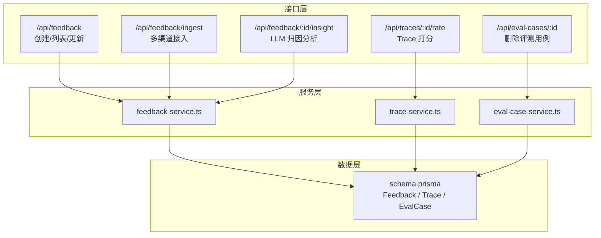
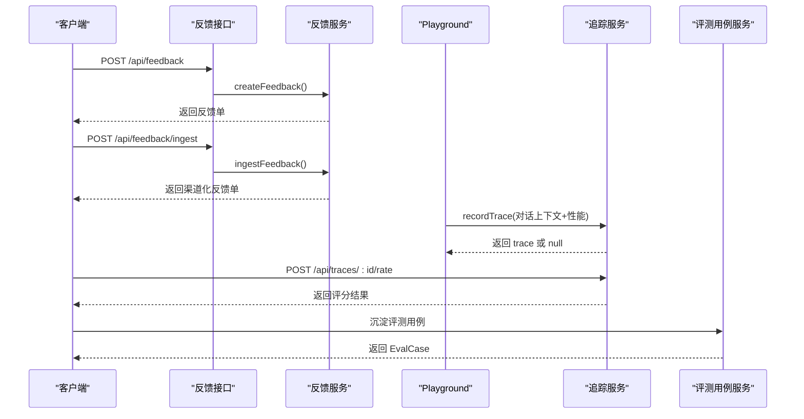
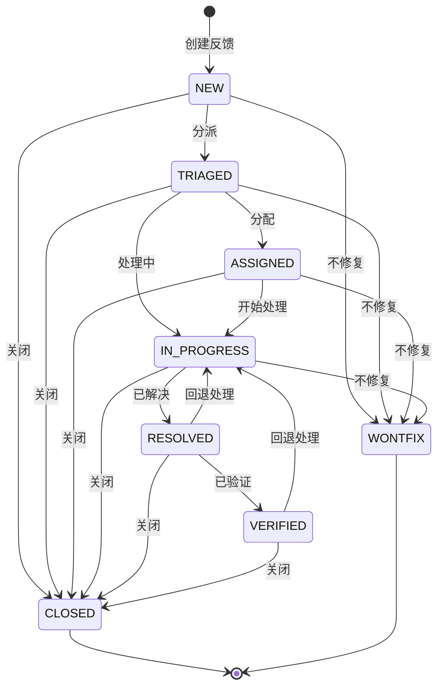
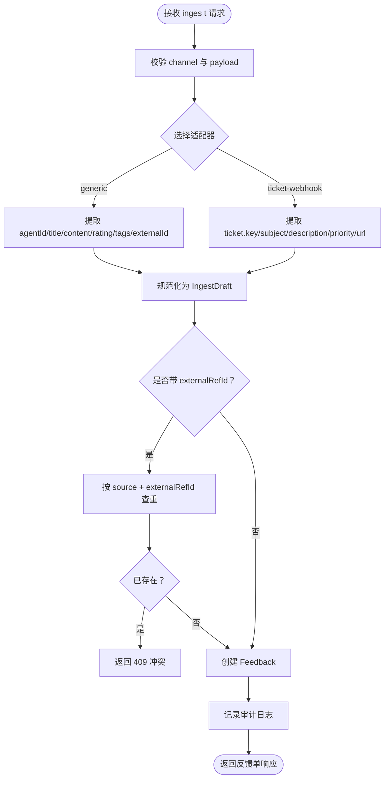
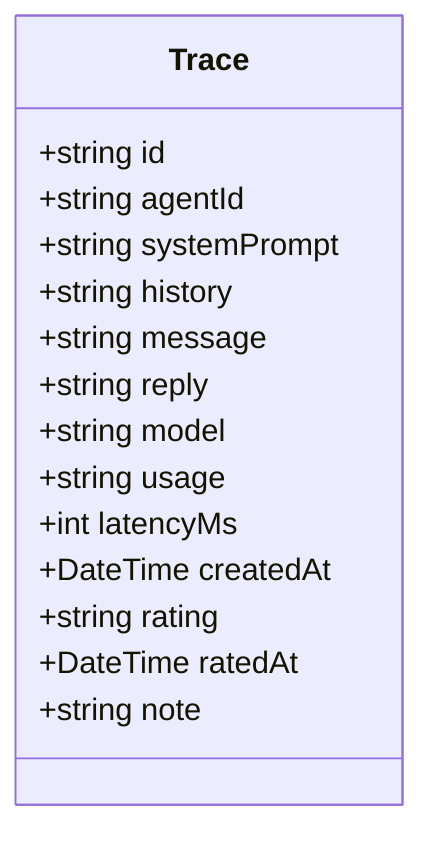
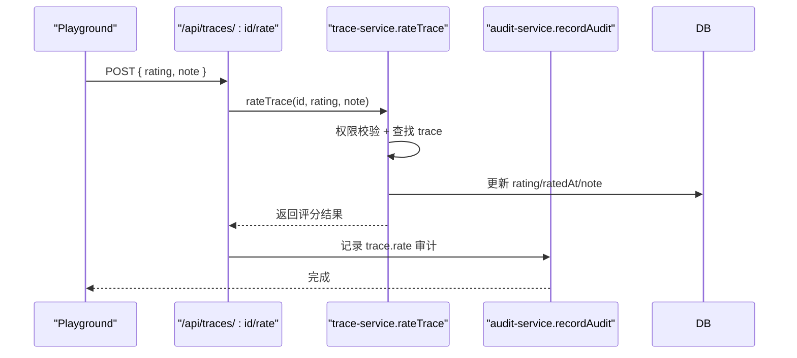
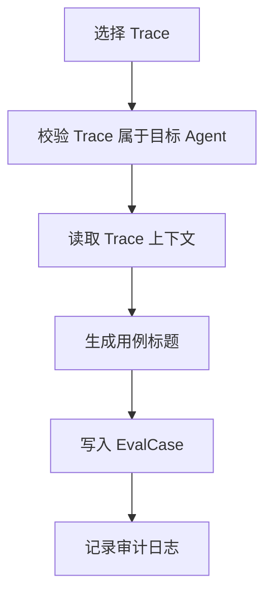
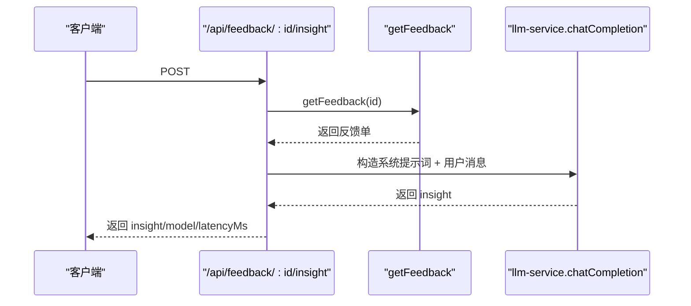
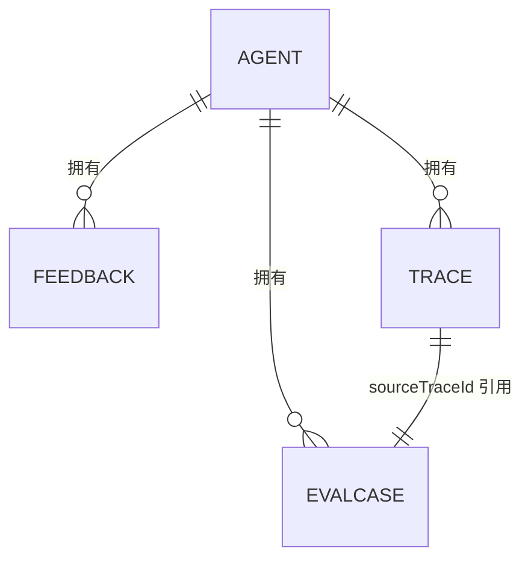
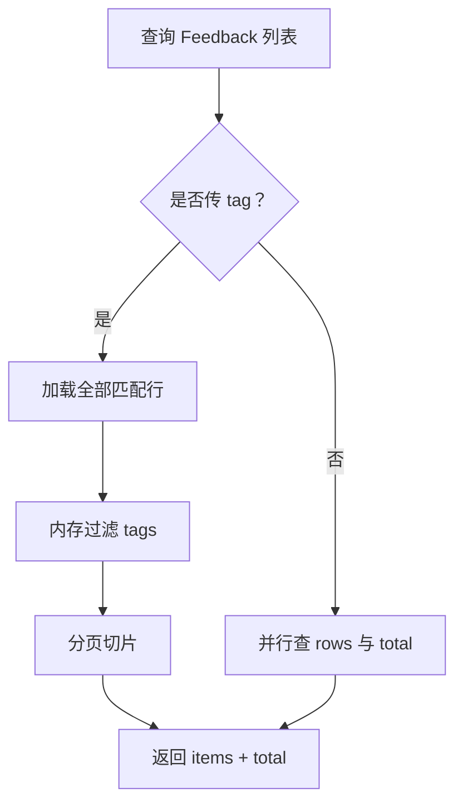

# 反馈与追踪实体

<cite>
**本文引用的文件**   
- [schema.prisma](file://packages/db/prisma/schema.prisma)
- [feedback-service.md](file://docs/distilled/feedback-service.md)
- [route.ts（反馈列表）](file://apps/web/app/api/feedback/route.ts)
- [route.ts（多渠道接入）](file://apps/web/app/api/feedback/ingest/route.ts)
- [route.ts（反馈洞察）](file://apps/web/app/api/feedback/[id]/insight/route.ts)
- [route.ts（Trace 打分）](file://apps/web/app/api/traces/[id]/rate/route.ts)
- [route.ts（删除评测用例）](file://apps/web/app/api/eval-cases/[id]/route.ts)
- [schemas.ts](file://apps/web/lib/schemas.ts)
- [feedback-service.ts](file://apps/web/lib/services/feedback-service.ts)
- [trace-service.ts](file://apps/web/lib/services/trace-service.ts)
- [eval-case-service.ts](file://apps/web/lib/services/eval-case-service.ts)
</cite>

## 目录
1. [引言](#引言)
2. [项目结构定位](#项目结构定位)
3. [核心实体总览](#核心实体总览)
4. [架构概览](#架构概览)
5. [详细组件分析](#详细组件分析)
6. [依赖关系分析](#依赖关系分析)
7. [性能与查询优化](#性能与查询优化)
8. [故障排查指南](#故障排查指南)
9. [结论](#结论)

## 引言
本文围绕“反馈、试聊追踪、评测用例”三类实体展开，目标是帮助读者理解：
- Feedback 表如何承载多渠道反馈收集、状态流转和外部工单幂等接入。
- Trace 表如何记录一次试聊的完整上下文、模型回复与性能指标，并支持轻量打分。
- EvalCase 表如何从 Trace 沉淀为可回放、可断言回归的评测用例。
- 上层 API 路由与服务层如何协作，形成“收集 → 处理 → 评估 → 改进”的闭环。

## 项目结构定位
反馈与追踪相关代码分布在三层：
- 数据层：Prisma Schema 定义 Feedback、Trace、EvalCase 三张表及索引。
- 接口层：Next.js Route Handler 暴露 REST 端点，负责参数校验、身份解析与错误包装。
- 服务层：业务逻辑集中在 feedback-service、trace-service、eval-case-service，封装状态机、适配器、权限校验与审计日志。

**图表来源**
- [route.ts（反馈列表）:11-74](file://apps/web/app/api/feedback/route.ts#L11-L74)
- [route.ts（多渠道接入）:7-32](file://apps/web/app/api/feedback/ingest/route.ts#L7-L32)
- [route.ts（反馈洞察）:7-58](file://apps/web/app/api/feedback/[id]/insight/route.ts#L7-L58)
- [route.ts（Trace 打分）:8-43](file://apps/web/app/api/traces/[id]/rate/route.ts#L8-L43)
- [route.ts（删除评测用例）:6-23](file://apps/web/app/api/eval-cases/[id]/route.ts#L6-L23)
- [feedback-service.ts:1-337](file://apps/web/lib/services/feedback-service.ts#L1-L337)
- [trace-service.ts:1-118](file://apps/web/lib/services/trace-service.ts#L1-L118)
- [eval-case-service.ts:1-131](file://apps/web/lib/services/eval-case-service.ts#L1-L131)
- [schema.prisma:208-251](file://packages/db/prisma/schema.prisma#L208-L251)
- [schema.prisma:552-596](file://packages/db/prisma/schema.prisma#L552-L596)

**章节来源**
- [route.ts（反馈列表）:11-74](file://apps/web/app/api/feedback/route.ts#L11-L74)
- [route.ts（多渠道接入）:7-32](file://apps/web/app/api/feedback/ingest/route.ts#L7-L32)
- [route.ts（反馈洞察）:7-58](file://apps/web/app/api/feedback/[id]/insight/route.ts#L7-L58)
- [route.ts（Trace 打分）:8-43](file://apps/web/app/api/traces/[id]/rate/route.ts#L8-L43)
- [route.ts（删除评测用例）:6-23](file://apps/web/app/api/eval-cases/[id]/route.ts#L6-L23)
- [feedback-service.ts:1-337](file://apps/web/lib/services/feedback-service.ts#L1-L337)
- [trace-service.ts:1-118](file://apps/web/lib/services/trace-service.ts#L1-L118)
- [eval-case-service.ts:1-131](file://apps/web/lib/services/eval-case-service.ts#L1-L131)
- [schema.prisma:208-251](file://packages/db/prisma/schema.prisma#L208-L251)
- [schema.prisma:552-596](file://packages/db/prisma/schema.prisma#L552-L596)

## 核心实体总览
Feedback、Trace、EvalCase 共同构成“问题发现 → 对话复现 → 回归验证”的数据基座。

| 实体 | 设计意图 | 关键字段 | 典型用途 |
|---|---|---|---|
| Feedback | 承载用户或系统上报的问题工单，支持多渠道接入与显式状态机流转 | agentId、source、title、content、rating、tags、severity、status、assignedTo、resolvedAt、externalRefId、targetPartition | 工单管理、质量度量、配置改进归因 |
| Trace | 记录 Playground 中一次真实 LLM 调用的完整上下文与性能指标 | agentId、systemPrompt、history、message、reply、model、usage、latencyMs、rating | 试聊复盘、沉淀评测用例、效果对比 |
| EvalCase | 把有价值的 Trace 沉淀为可回放、可断言的回归用例 | agentId、sourceTraceId、expectation、assertions、systemPrompt、history、message、referenceReply | 发布前 AI 评测、回归测试、效果评估 |

**章节来源**
- [schema.prisma:208-251](file://packages/db/prisma/schema.prisma#L208-L251)
- [schema.prisma:552-596](file://packages/db/prisma/schema.prisma#L552-L596)

## 架构概览
反馈与追踪的整体流程如下：
- 人工通过 Web 表单提交 Feedback；机器通过 /api/feedback/ingest 接入外部工单。
- Playground 调用 Agent 时记录 Trace；用户可对 Trace 打 👍/👎。
- 被标记为 DOWN 的 Trace 可沉淀为 EvalCase，作为后续发布的回归语料。
- Feedback 可通过 LLM 生成归因分析，辅助定位 Prompt/Knowledge/Tools/Routing 分区问题。

**图表来源**
- [route.ts（反馈列表）:31-49](file://apps/web/app/api/feedback/route.ts#L31-L49)
- [route.ts（多渠道接入）:15-32](file://apps/web/app/api/feedback/ingest/route.ts#L15-L32)
- [feedback-service.ts:135-174](file://apps/web/lib/services/feedback-service.ts#L135-L174)
- [feedback-service.ts:244-294](file://apps/web/lib/services/feedback-service.ts#L244-L294)
- [trace-service.ts:63-91](file://apps/web/lib/services/trace-service.ts#L63-L91)
- [route.ts（Trace 打分）:14-43](file://apps/web/app/api/traces/[id]/rate/route.ts#L14-L43)
- [eval-case-service.ts:85-122](file://apps/web/lib/services/eval-case-service.ts#L85-L122)

## 详细组件分析

### Feedback 实体与状态机
Feedback 表用于持久化反馈工单，字段设计兼顾“人工作业”和“机器接入”：
- source 使用文本存储渠道名，便于扩展新渠道而不改 schema。
- tags、sessionData、externalRefId/Url 等 JSON 字段以字符串形式落库，读写经 packJson/unpackJson 收口。
- status 走显式状态机，CLOSED/WONTFIX 为终态，不可再转。
- externalRefId 作为同渠道幂等键，防止 webhook 重试重复建单。

**图表来源**
- [feedback-service.ts:16-30](file://apps/web/lib/services/feedback-service.ts#L16-L30)
- [feedback-service.md:25-52](file://docs/distilled/feedback-service.md#L25-L52)

#### Feedback 字段含义与数据示例
- id：主键。
- agentId：关联 Agent。
- source：来源渠道，默认 MANUAL，多渠道接入时为 channel 名。
- title/content：标题与内容。
- rating：POSITIVE/NEGATIVE/NEUTRAL。
- tags：标签数组，JSON 文本。
- severity：CRITICAL/MAJOR/MINOR/SUGGESTION。
- status：NEW/TRIAGED/ASSIGNED/IN_PROGRESS/RESOLVED/VERIFIED/CLOSED/WONTFIX。
- assignedTo/assignedAt：分配人与时间。
- resolvedAt/resolvedBy/resolution：解决信息。
- externalRefId/externalRefUrl：外部工单号与链接。
- targetPartition：PROMPT/KNOWLEDGE/TOOLS/ROUTING，指向可能出问题的配置分区。
- submittedBy/submittedAt：提交人与时间。
- verifiedAt/verifiedBy/verificationNote：验证信息与备注。

示例（概念性描述）：
- 一条来自 ticket-webhook 的 P1 工单，severity 映射为 MAJOR，status 初始为 NEW，externalRefId 为工单 key。
- 人工处理后 status 转为 ASSIGNED，随后 IN_PROGRESS、RESOLVED、VERIFIED，最终 CLOSED。

**章节来源**
- [schema.prisma:211-251](file://packages/db/prisma/schema.prisma#L211-L251)
- [feedback-service.ts:53-81](file://apps/web/lib/services/feedback-service.ts#L53-L81)
- [feedback-service.ts:135-174](file://apps/web/lib/services/feedback-service.ts#L135-L174)
- [feedback-service.ts:244-294](file://apps/web/lib/services/feedback-service.ts#L244-L294)
- [feedback-service.ts:296-336](file://apps/web/lib/services/feedback-service.ts#L296-L336)
- [feedback-service.md:15-54](file://docs/distilled/feedback-service.md#L15-L54)

### 多渠道反馈接入
/ api/feedback/ingest 面向机器接入，channel 决定适配器：
- generic：外部系统自行映射字段，支持 externalId/externalUrl 做幂等。
- ticket-webhook：适配典型工单字段 ticket.key/subject/description/priority/url，并把 priority 映射到 severity。

**图表来源**
- [route.ts（多渠道接入）:7-32](file://apps/web/app/api/feedback/ingest/route.ts#L7-L32)
- [feedback-service.ts:185-242](file://apps/web/lib/services/feedback-service.ts#L185-L242)
- [feedback-service.ts:244-294](file://apps/web/lib/services/feedback-service.ts#L244-L294)

**章节来源**
- [route.ts（多渠道接入）:7-32](file://apps/web/app/api/feedback/ingest/route.ts#L7-L32)
- [feedback-service.ts:185-294](file://apps/web/lib/services/feedback-service.ts#L185-L294)
- [schemas.ts:95-134](file://apps/web/lib/schemas.ts#L95-L134)

### Trace 试聊记录机制
Trace 表记录一次 Playground 对话的完整上下文与性能指标：
- systemPrompt：组装后的系统提示词。
- history：调用前的会话历史，user/assistant 消息数组。
- message：本轮用户消息。
- reply：模型回复。
- model：使用的模型名称。
- usage：token 用量，JSON 文本。
- latencyMs：延迟毫秒数。
- rating/ratedAt/note：轻量打分与备注。

**图表来源**
- [schema.prisma:556-575](file://packages/db/prisma/schema.prisma#L556-L575)
- [trace-service.ts:24-41](file://apps/web/lib/services/trace-service.ts#L24-L41)

#### Trace 打分流程
打分是 Playground 内联的轻量反馈，写入 trace 本身并记审计。DOWN 评分常被用作沉淀评测用例的首选素材。

**图表来源**
- [route.ts（Trace 打分）:8-43](file://apps/web/app/api/traces/[id]/rate/route.ts#L8-L43)
- [trace-service.ts:98-117](file://apps/web/lib/services/trace-service.ts#L98-L117)

**章节来源**
- [schema.prisma:556-575](file://packages/db/prisma/schema.prisma#L556-L575)
- [trace-service.ts:1-118](file://apps/web/lib/services/trace-service.ts#L1-L118)
- [route.ts（Trace 打分）:8-43](file://apps/web/app/api/traces/[id]/rate/route.ts#L8-L43)

### EvalCase 评测用例管理
EvalCase 从 Trace 沉淀而来，保存输入上下文与参考回复，并可附加确定性断言：
- expectation：期望行为描述，供 AI 评测判官参考。
- assertions：contains/not_contains/regex 三种断言类型，最多 5 条。
- systemPrompt/history/message/referenceReply：复用 Trace 的输入与输出。
- status：当前实现固定 ACTIVE。

**图表来源**
- [eval-case-service.ts:85-122](file://apps/web/lib/services/eval-case-service.ts#L85-L122)

#### EvalCase 断言配置
断言由 schemas.ts 校验：
- contains：关键词包含。
- not_contains：关键词不包含。
- regex：正则表达式，需可编译。

**章节来源**
- [schema.prisma:577-596](file://packages/db/prisma/schema.prisma#L577-L596)
- [eval-case-service.ts:19-75](file://apps/web/lib/services/eval-case-service.ts#L19-L75)
- [eval-case-service.ts:85-131](file://apps/web/lib/services/eval-case-service.ts#L85-L131)
- [schemas.ts:306-338](file://apps/web/lib/schemas.ts#L306-L338)

### 反馈洞察与 LLM 归因
/ api/feedback/:id/insight 读取反馈详情后调用 LLM 生成归因分析与改进建议，不写库，服务于“反馈 → 归因 → 改配置”的叙事。

**图表来源**
- [route.ts（反馈洞察）:7-58](file://apps/web/app/api/feedback/[id]/insight/route.ts#L7-L58)
- [feedback-service.ts:129-133](file://apps/web/lib/services/feedback-service.ts#L129-L133)

**章节来源**
- [route.ts（反馈洞察）:7-58](file://apps/web/app/api/feedback/[id]/insight/route.ts#L7-L58)

## 依赖关系分析
Feedback、Trace、EvalCase 都依赖 Agent，并通过 Prisma 外键关联：
- Agent 聚合 feedbacks、traces、evalCases。
- EvalCase.sourceTraceId 指向 Trace.id，但数据库层未强制外键约束，语义由服务层保证。
- Feedback.targetPartition 仅存分区枚举文本，无引用校验。

**图表来源**
- [schema.prisma:66-99](file://packages/db/prisma/schema.prisma#L66-L99)
- [schema.prisma:211-251](file://packages/db/prisma/schema.prisma#L211-L251)
- [schema.prisma:556-596](file://packages/db/prisma/schema.prisma#L556-L596)

**章节来源**
- [schema.prisma:66-99](file://packages/db/prisma/schema.prisma#L66-L99)
- [schema.prisma:211-251](file://packages/db/prisma/schema.prisma#L211-L251)
- [schema.prisma:556-596](file://packages/db/prisma/schema.prisma#L556-L596)

## 性能与查询优化
- Feedback 列表查询：
  - 按 agentId/status/severity/rating/tag 过滤，按 submittedAt 倒序分页。
  - SQLite 不支持标量列表 has 过滤，tags 过滤在内存中进行；演示规模下 total 取过滤后口径。
  - 非 tag 过滤使用 Promise.all 并行查询 rows 与 count。
- Trace 查询：
  - 按 agentId、createdAt 建立索引，适合按 Agent 和时间范围检索。
- EvalCase 查询：
  - 按 agentId、createdAt 建立索引，适合按 Agent 列出用例。

**图表来源**
- [feedback-service.ts:85-127](file://apps/web/lib/services/feedback-service.ts#L85-L127)

**章节来源**
- [feedback-service.ts:85-127](file://apps/web/lib/services/feedback-service.ts#L85-L127)
- [schema.prisma:248-250](file://packages/db/prisma/schema.prisma#L248-L250)
- [schema.prisma:574](file://packages/db/prisma/schema.prisma#L574)
- [schema.prisma:595](file://packages/db/prisma/schema.prisma#L595)

## 故障排查指南
- 反馈状态转移报错：
  - 现象：更新反馈报非法状态转移。
  - 排查：检查 ALLOWED_TRANSITIONS，确认 from/to 是否合法；CLOSED/WONTFIX 为终态。
- 多渠道接入重复：
  - 现象：ingest 返回 409。
  - 排查：检查 channel + externalRefId 是否已存在；webhook 重试保护触发。
- Trace 打分失败：
  - 现象：打分接口返回不存在。
  - 排查：确认 traceId 是否存在；评分需要 feedback:write 权限。
- 评测用例沉淀失败：
  - 现象：无法沉淀或不属于该 Agent。
  - 排查：确认 trace.agentId 与目标 agentId 一致；trace 必须存在。

**章节来源**
- [feedback-service.ts:32-41](file://apps/web/lib/services/feedback-service.ts#L32-L41)
- [feedback-service.ts:258-270](file://apps/web/lib/services/feedback-service.ts#L258-L270)
- [trace-service.ts:98-117](file://apps/web/lib/services/trace-service.ts#L98-L117)
- [eval-case-service.ts:85-96](file://apps/web/lib/services/eval-case-service.ts#L85-L96)

## 结论
Feedback、Trace、EvalCase 三者分别承担“问题工单”“对话复现”“回归评测”的职责：
- Feedback 通过显式状态机和多渠道适配器，支撑从人工到系统的统一反馈入口。
- Trace 以最小侵入方式记录试聊上下文与性能指标，并为评测用例提供数据源。
- EvalCase 将高价值 Trace 沉淀为可回放、可断言的回归用例，支撑发布前 AI 评测。
结合索引设计与服务层校验，系统在可扩展性与可观测性之间取得平衡，适合持续改进 Agent 配置与效果。