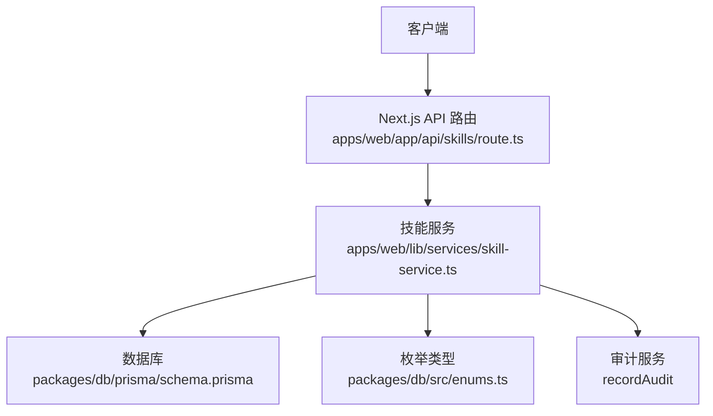
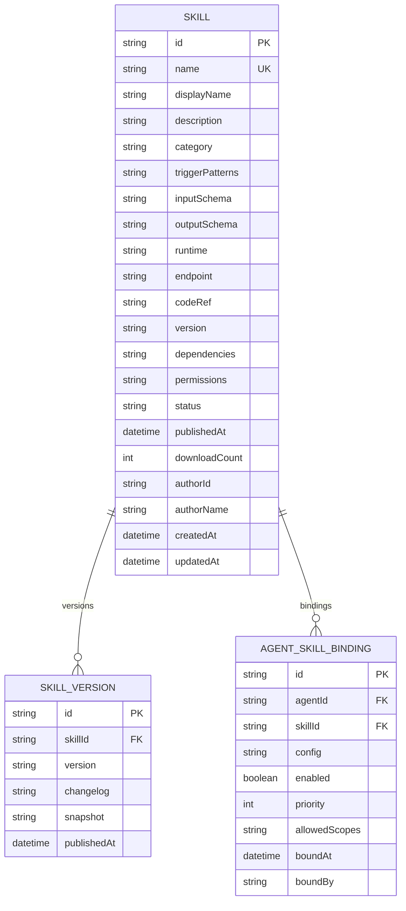
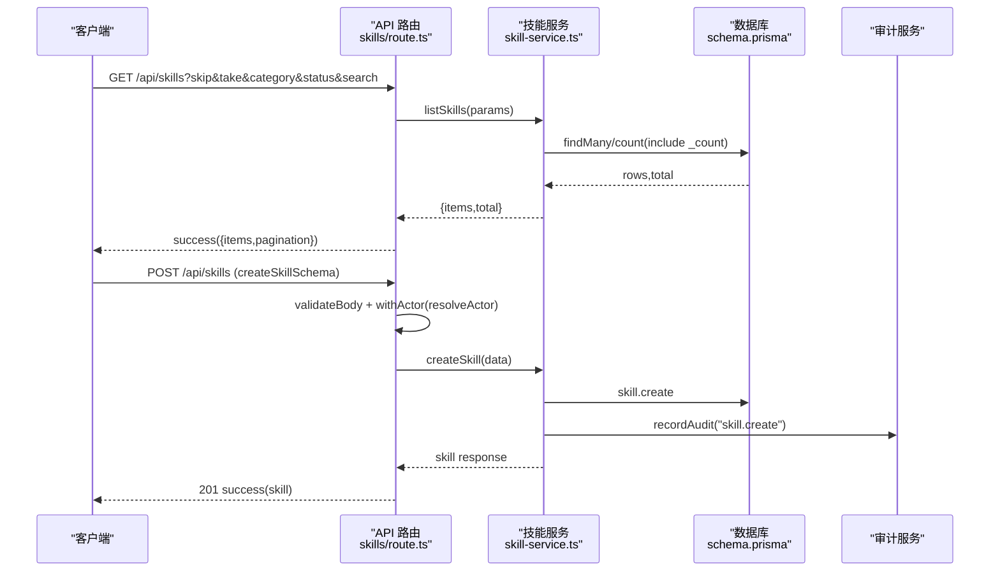
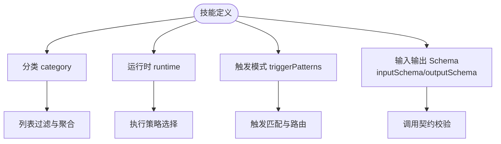
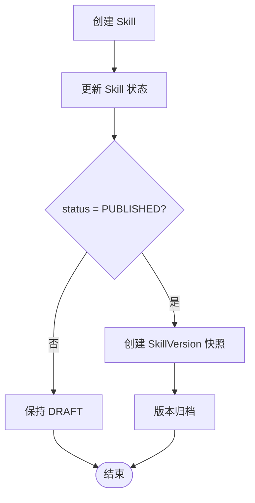
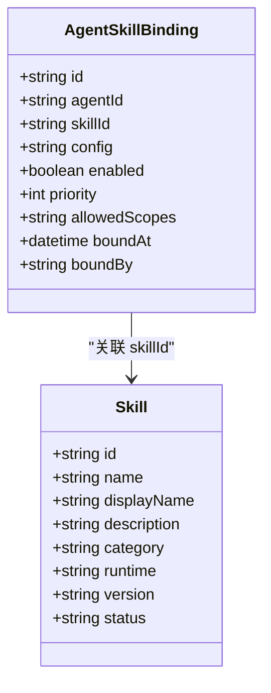
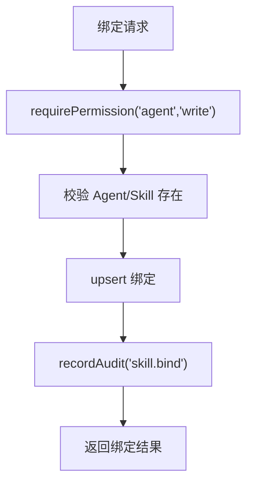
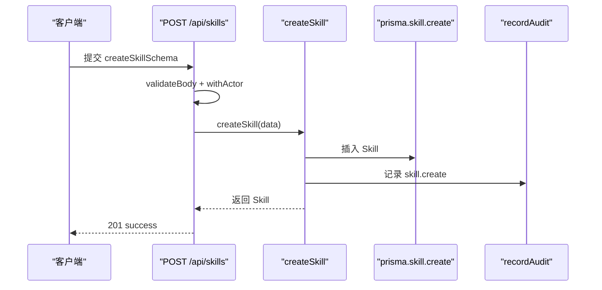

# 技能系统实体

<cite>
**本文引用的文件**   
- [schema.prisma](file://packages/db/prisma/schema.prisma)
- [enums.ts](file://packages/db/src/enums.ts)
- [skill-service.ts](file://apps/web/lib/services/skill-service.ts)
- [route.ts（skills 列表与创建）](file://apps/web/app/api/skills/route.ts)
- [schemas.ts](file://apps/web/lib/schemas.ts)
- [seed.mjs](file://packages/db/prisma/seed.mjs)
</cite>

## 目录
1. [引言](#引言)
2. [项目结构与定位](#项目结构与定位)
3. [核心实体与表结构](#核心实体与表结构)
4. [架构总览](#架构总览)
5. [详细组件分析](#详细组件分析)
6. [依赖解析与冲突处理](#依赖解析与冲突处理)
7. [权限控制与绑定配置](#权限控制与绑定配置)
8. [注册、发布与绑定流程](#注册发布与绑定流程)
9. [数据示例与查询模式](#数据示例与查询模式)
10. [性能与可维护性建议](#性能与可维护性建议)
11. [故障排查](#故障排查)
12. [结论](#结论)

## 引言
本文聚焦“技能系统”的领域模型与实现：Skill、SkillVersion、AgentSkillBinding 三个核心实体的设计意图、字段语义、分类体系、触发模式、输入输出 Schema、版本管理、绑定机制，以及技能插件在系统中的注册、发布和绑定流程。文档同时给出架构图、类图、时序图和流程图，帮助读者从高层到代码层逐步理解。

## 项目结构与定位
技能系统在项目中由三层协作完成：
- 持久层：Prisma schema 定义 Skill、SkillVersion、AgentSkillBinding 等实体及索引。
- 服务层：skill-service.ts 提供技能 CRUD、绑定、解绑、查询等能力，并负责权限校验、审计记录、JSON 序列化与响应转换。
- 接口层：Next.js API route 暴露 REST 接口，负责参数解析、请求体校验、Actor 注入与错误包装。

**图表来源**
- [route.ts（skills 列表与创建）:1-31](file://apps/web/app/api/skills/route.ts#L1-L31)
- [skill-service.ts:1-26](file://apps/web/lib/services/skill-service.ts#L1-L26)
- [schema.prisma:324-391](file://packages/db/prisma/schema.prisma#L324-L391)
- [enums.ts:104-128](file://packages/db/src/enums.ts#L104-L128)

**章节来源**
- [schema.prisma:324-391](file://packages/db/prisma/schema.prisma#L324-L391)
- [skill-service.ts:1-26](file://apps/web/lib/services/skill-service.ts#L1-L26)
- [route.ts（skills 列表与创建）:1-31](file://apps/web/app/api/skills/route.ts#L1-L31)

## 核心实体与表结构
本节解释 Skill、SkillVersion、AgentSkillBinding 的设计意图与字段含义。

### Skill（技能主数据）
- 标识与元信息：id、name（唯一）、displayName、description。
- 分类与状态：category（技能分类）、status（DRAFT/PUBLISHED/DEPRECATED/ARCHIVED）。
- 运行时契约：runtime（HTTP/FUNCTION/MCP/WORKFLOW）、endpoint（HTTP 场景）、codeRef（代码引用）。
- 触发与依赖：triggerPatterns（字符串数组 JSON）、dependencies（依赖技能名数组 JSON）、permissions（权限约束 JSON）。
- 输入输出 Schema：inputSchema、outputSchema（JSON 文本），用于描述技能调用时的入参与返回结构。
- 版本与作者：version（当前版本）、authorId/authorName（创建者快照）、createdAt/updatedAt。
- 统计与时间：downloadCount、publishedAt。
- 关联：bindings（AgentSkillBinding 集合）、versions（SkillVersion 集合）。
- 索引：[category, status] 组合索引，便于按分类与状态过滤。

设计要点：
- category/status 使用 String 列 + Zod 校验，兼容 SQLite 无 enum 的限制。
- triggerPatterns/dependencies/permissions/inputSchema/outputSchema 统一以 JSON 文本存储，通过 packJson/unpackJson 收口。
- name 唯一，避免同名技能冲突；status=ARCHIVED 表示软删，保留历史引用不断链。

**章节来源**
- [schema.prisma:324-357](file://packages/db/prisma/schema.prisma#L324-L357)
- [enums.ts:104-128](file://packages/db/src/enums.ts#L104-L128)
- [skill-service.ts:28-50](file://apps/web/lib/services/skill-service.ts#L28-L50)

### SkillVersion（技能版本快照）
- 标识与关联：id、skillId（外键指向 Skill）。
- 版本信息：version（语义化版本号）、changelog（变更说明）。
- 快照：snapshot（JSON 文本），保存该版本的完整 Skill 快照，保证历史一致性。
- 发布时间：publishedAt。
- 约束：[skillId, version] 唯一，防止同一技能重复版本；按 skillId 索引加速查询。

设计要点：
- snapshot 是“不可变”的历史切片，即使 Skill 主数据后续改名或修改，已发布版本仍保持原貌。
- publishedAt 默认 now()，但当前 updateSkill 不写 publishedAt，因此运行时创建的 PUBLISHED 技能可能为 null。

**章节来源**
- [schema.prisma:359-371](file://packages/db/prisma/schema.prisma#L359-L371)
- [seed.mjs:198-203](file://packages/db/prisma/seed.mjs#L198-L203)

### AgentSkillBinding（Agent 与技能的绑定关系）
- 标识与关联：id、agentId（外键指向 Agent）、skillId（外键指向 Skill）。
- 绑定配置：config（JSON 文本，可选）、enabled（是否启用）、priority（优先级，数值越大越优先）。
- 权限范围：allowedScopes（字符串数组 JSON，运行时 binding 默认空数组）。
- 审计信息：boundBy（绑定人 id）、boundAt（绑定时间）。
- 约束：[agentId, skillId] 唯一，防止重复绑定；按 agentId 与 skillId 分别建索引。

设计要点：
- enabled/priority/config 允许对同一绑定进行幂等 upsert，重复绑定会合并 config 并重新启用。
- 绑定读取时 include skill 摘要（id/name/displayName），展示无需二次读 Skill 主数据。
- allowedScopes 预留权限作用域扩展点，当前未在服务层做强校验。

**章节来源**
- [schema.prisma:373-391](file://packages/db/prisma/schema.prisma#L373-L391)
- [skill-service.ts:52-72](file://apps/web/lib/services/skill-service.ts#L52-L72)

### 实体关系图

**图表来源**
- [schema.prisma:324-391](file://packages/db/prisma/schema.prisma#L324-L391)

## 架构总览
技能系统的职责边界清晰：
- API 路由负责参数解析、分页、请求体验证、Actor 注入与错误包装。
- 服务层封装业务逻辑：权限校验、存在性检查、JSON 序列化、审计记录、响应转换。
- 数据库层通过 Prisma 提供类型安全的 ORM 访问，并通过索引优化常见查询。

**图表来源**
- [route.ts（skills 列表与创建）:7-30](file://apps/web/app/api/skills/route.ts#L7-L30)
- [skill-service.ts:74-179](file://apps/web/lib/services/skill-service.ts#L74-L179)
- [schema.prisma:324-357](file://packages/db/prisma/schema.prisma#L324-L357)

**章节来源**
- [route.ts（skills 列表与创建）:1-31](file://apps/web/app/api/skills/route.ts#L1-L31)
- [skill-service.ts:74-179](file://apps/web/lib/services/skill-service.ts#L74-L179)

## 详细组件分析

### Skill 分类体系与触发模式
- 分类（category）：KNOWLEDGE_QUERY、DATA_FETCH、ACTION、TRANSFORM、GENERAL。用于列表过滤与组织技能生态。
- 触发模式（triggerPatterns）：字符串数组，用于匹配用户输入或上下文事件，驱动技能选择。
- 运行时（runtime）：HTTP、FUNCTION、MCP、WORKFLOW，决定技能执行方式。
- 输入输出 Schema（inputSchema/outputSchema）：JSON 结构，描述调用契约，供上游编排与下游校验。

**图表来源**
- [enums.ts:104-120](file://packages/db/src/enums.ts#L104-L120)
- [skill-service.ts:28-50](file://apps/web/lib/services/skill-service.ts#L28-L50)

**章节来源**
- [enums.ts:104-120](file://packages/db/src/enums.ts#L104-L120)
- [skill-service.ts:28-50](file://apps/web/lib/services/skill-service.ts#L28-L50)

### 版本管理与发布
- 版本唯一性：[skillId, version] 唯一，确保同一技能不会重复发布相同版本。
- 快照语义：snapshot 保存该版本的完整 Skill 对象，历史不变。
- 发布动作：当前 updateSkill 允许设置 status=PUBLISHED，但不写入 publishedAt；因此运行时发布的技能 publishedAt 可能为空。
- 版本查询：getSkill 包含 versions 最新 10 条，按 publishedAt 倒序。

**图表来源**
- [schema.prisma:359-371](file://packages/db/prisma/schema.prisma#L359-L371)
- [skill-service.ts:182-207](file://apps/web/lib/services/skill-service.ts#L182-L207)
- [seed.mjs:198-203](file://packages/db/prisma/seed.mjs#L198-L203)

**章节来源**
- [schema.prisma:359-371](file://packages/db/prisma/schema.prisma#L359-L371)
- [skill-service.ts:182-207](file://apps/web/lib/services/skill-service.ts#L182-L207)
- [seed.mjs:198-203](file://packages/db/prisma/seed.mjs#L198-L203)

### 绑定机制与优先级
- 幂等绑定：bindSkill 使用 upsert，重复绑定合并 config 并重新启用 enabled=true。
- 优先级排序：binding.priority 越大越优先；列表与详情均按 priority 倒序。
- 绑定快照：toBindingResponse 包含 skill 摘要（id/name/displayName），展示免二次读。
- 解绑行为：unbindSkill 静默成功，即使绑定不存在也返回 deleted=true。

**图表来源**
- [schema.prisma:373-391](file://packages/db/prisma/schema.prisma#L373-L391)
- [skill-service.ts:52-72](file://apps/web/lib/services/skill-service.ts#L52-L72)

**章节来源**
- [skill-service.ts:223-277](file://apps/web/lib/services/skill-service.ts#L223-L277)

## 依赖解析与冲突处理
- 依赖字段：Skill.dependencies 是字符串数组 JSON，表示该技能依赖的其他技能名称。
- 冲突检测：当前 bindSkill 仅校验 Skill 存在，不做依赖解析与冲突处理；若未来需要，可在服务层增加依赖图遍历与循环依赖检测。
- 现状：dependencies 字段可用于展示与外部工具解析，但服务层未实现自动解析与冲突解决。

建议实现方向：
- 构建依赖有向图，检测环依赖。
- 在 bindSkill 前校验依赖是否存在且未被归档。
- 在 publish 时校验依赖版本兼容性。

**章节来源**
- [schema.prisma:324-357](file://packages/db/prisma/schema.prisma#L324-L357)
- [skill-service.ts:223-254](file://apps/web/lib/services/skill-service.ts#L223-L254)

## 权限控制与绑定配置
- 权限模型：Skill 管理归 settings.admin；Agent 绑定归 agent.write。
- 权限校验：service 层通过 requirePermission 强制校验，未授权直接拒绝。
- 绑定配置：config 为任意 JSON，允许传入运行期参数；enabled/priority 控制启用与顺序；allowedScopes 预留权限作用域扩展点。

**图表来源**
- [skill-service.ts:223-254](file://apps/web/lib/services/skill-service.ts#L223-L254)

**章节来源**
- [skill-service.ts:223-254](file://apps/web/lib/services/skill-service.ts#L223-L254)

## 注册、发布与绑定流程
### 注册技能
- 接口：POST /api/skills
- 校验：createSkillSchema（name/displayName/description/category/triggerPatterns/inputSchema/outputSchema/runtime/endpoint）
- 权限：settings.admin
- 行为：创建 Skill，记录审计，返回 toSkillResponse

**图表来源**
- [route.ts（skills 列表与创建）:18-30](file://apps/web/app/api/skills/route.ts#L18-L30)
- [skill-service.ts:144-179](file://apps/web/lib/services/skill-service.ts#L144-L179)
- [schemas.ts:159-169](file://apps/web/lib/schemas.ts#L159-L169)

**章节来源**
- [route.ts（skills 列表与创建）:18-30](file://apps/web/app/api/skills/route.ts#L18-L30)
- [skill-service.ts:144-179](file://apps/web/lib/services/skill-service.ts#L144-L179)
- [schemas.ts:159-169](file://apps/web/lib/schemas.ts#L159-L169)

### 发布技能
- 接口：PUT /api/skills/:id（updateSkill）
- 校验：updateSkillSchema（displayName/description/category/triggerPatterns/inputSchema/outputSchema/runtime/endpoint/status）
- 权限：settings.admin
- 行为：更新 Skill，记录审计；注意 publishedAt 不在此处写入。

**章节来源**
- [skill-service.ts:182-207](file://apps/web/lib/services/skill-service.ts#L182-L207)
- [schemas.ts:171-181](file://apps/web/lib/schemas.ts#L171-L181)

### 绑定技能
- 接口：POST /api/agents/:id/skills（bindSkill）
- 校验：bindSkillSchema（skillId/config）
- 权限：agent.write
- 行为：幂等 upsert，合并 config，记录审计，返回绑定结果。

**章节来源**
- [skill-service.ts:223-254](file://apps/web/lib/services/skill-service.ts#L223-L254)
- [schemas.ts:183-186](file://apps/web/lib/schemas.ts#L183-L186)

## 数据示例与查询模式
以下示例基于 schema 与服务层响应结构，不包含具体代码内容。

- 技能列表查询
  - 参数：skip、take、category、status、search
  - 返回：{ items: SkillWithCount[], total: number }
  - 过滤：category/status 传 "ALL" 视为不过滤；search 内存过滤 name/displayName/description。

- 技能详情查询
  - 返回：Skill 本体 + bindings（含 skill 摘要与 agent 摘要）+ versions（最新 10 条）+ _count（bindings/versions 数量）

- 绑定列表查询
  - 返回：BindingWithSkill[]，按 priority 倒序，包含 skill 摘要

- 绑定操作
  - bindSkill：幂等 upsert，合并 config，enabled=true
  - unbindSkill：静默成功，返回 { deleted: true }

**章节来源**
- [skill-service.ts:74-142](file://apps/web/lib/services/skill-service.ts#L74-L142)
- [skill-service.ts:267-277](file://apps/web/lib/services/skill-service.ts#L267-L277)

## 性能与可维护性建议
- 列表搜索：SQLite 不支持 insensitive 模式，search 走内存过滤，大数据量下性能下降。建议引入全文索引或搜索引擎。
- 详情聚合：getSkill 包含 bindings 与 versions，注意 N+1 风险；当前通过 include 一次性加载，但仍需关注数据规模。
- 版本快照：snapshot 较大，频繁查询应选择性投影字段。
- 绑定索引：已有 [agentId] 与 [skillId] 索引，满足常见查询；如需反向查询（skill → agents），建议新增中间表或缓存。

[本节为通用指导，不直接分析具体文件]

## 故障排查
- 同名 Skill 冲突：createSkill 检测到 name 已存在抛出 ConflictError。
- 权限不足：requirePermission 失败直接拒绝。
- 绑定不存在：unbindSkill 静默成功，前端需区分“已解绑”与“本来没绑”。
- publishedAt 为空：updateSkill 不写 publishedAt，运行时创建的 PUBLISHED 技能可能为空。

**章节来源**
- [skill-service.ts:157-159](file://apps/web/lib/services/skill-service.ts#L157-L159)
- [skill-service.ts:256-265](file://apps/web/lib/services/skill-service.ts#L256-L265)
- [skill-service.ts:182-207](file://apps/web/lib/services/skill-service.ts#L182-L207)

## 结论
技能系统通过 Skill、SkillVersion、AgentSkillBinding 三张表构建了完整的技能生命周期与绑定机制。分类体系与触发模式支持灵活的技能发现与路由；输入输出 Schema 提供稳定的调用契约；版本快照保证历史一致性；绑定机制支持幂等配置与优先级排序。当前实现侧重简洁与可扩展性，依赖解析与冲突处理尚未在服务层实现，可作为后续增强点。权限控制与审计记录保障了操作安全与可追溯性。