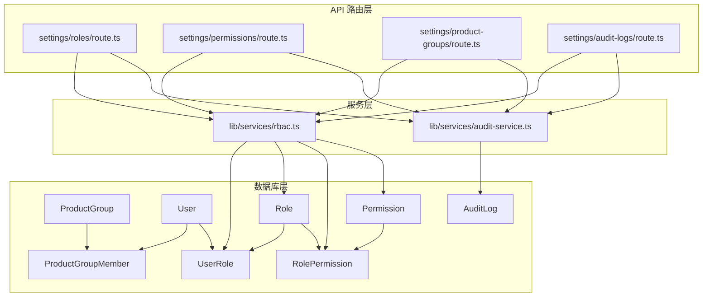
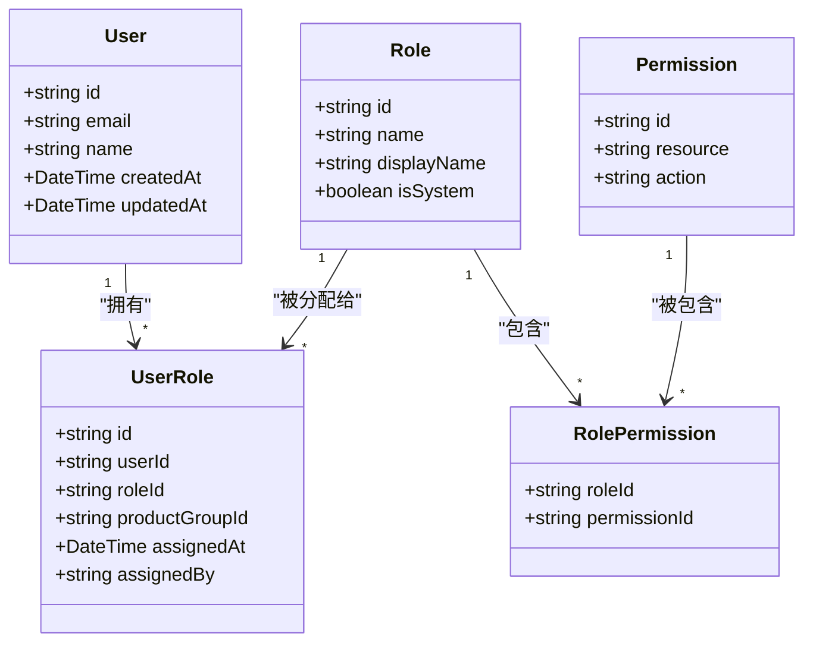
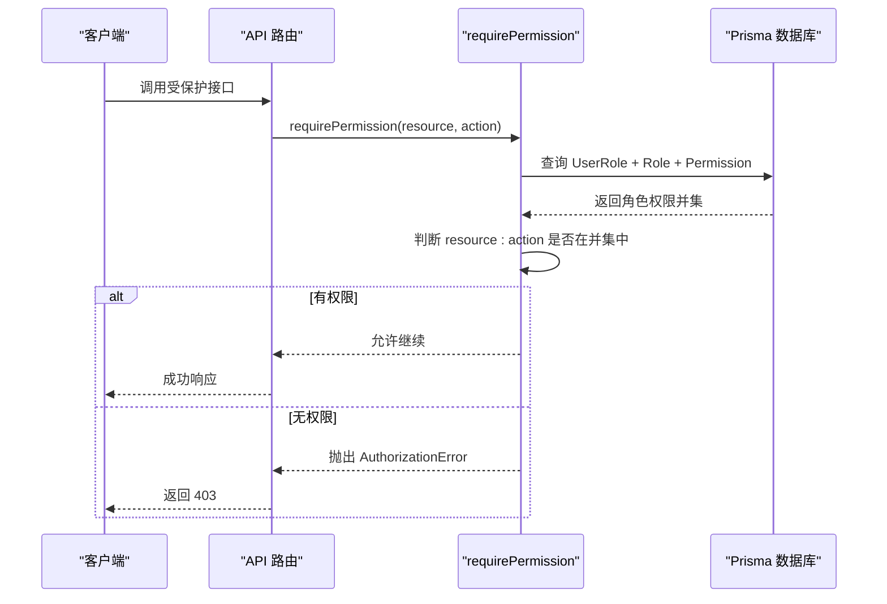
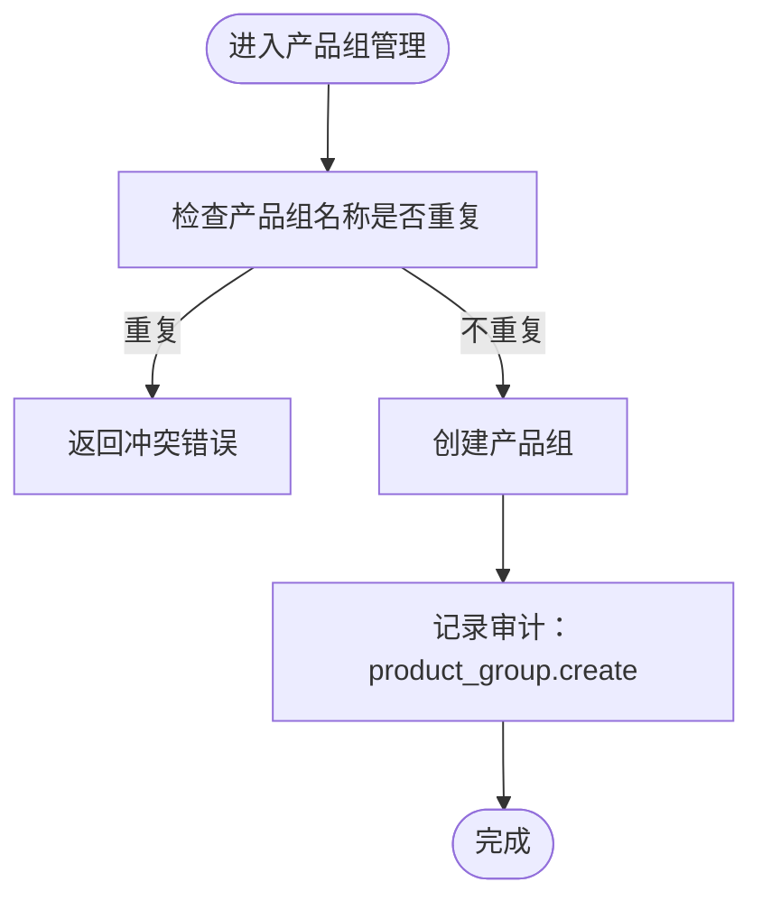
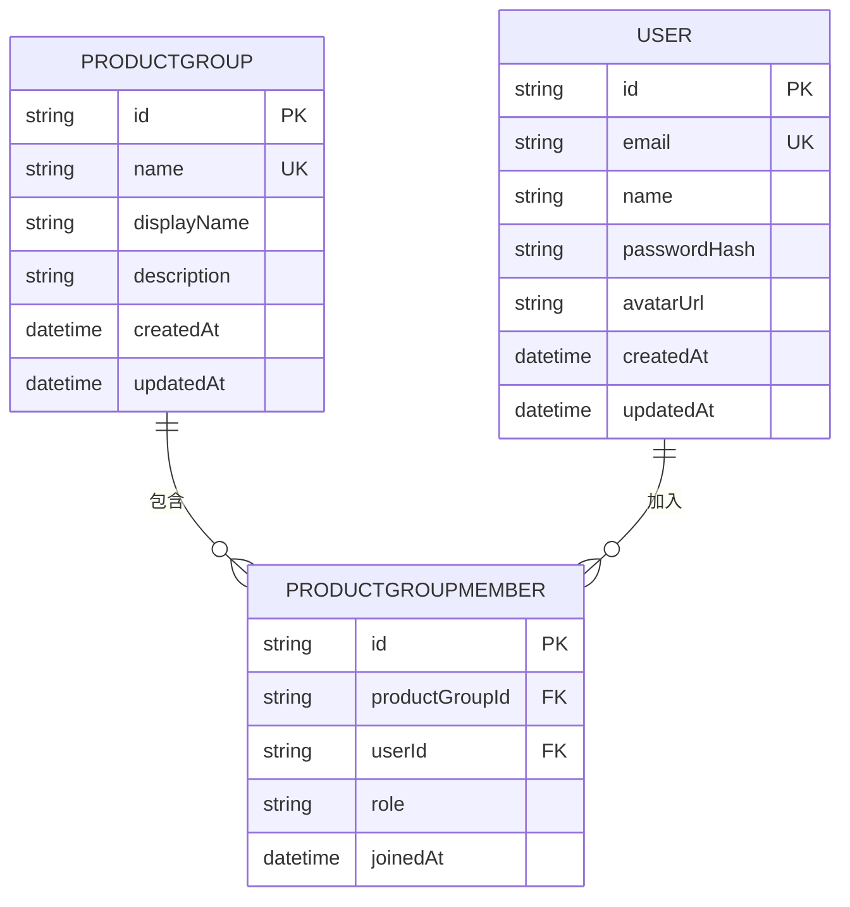
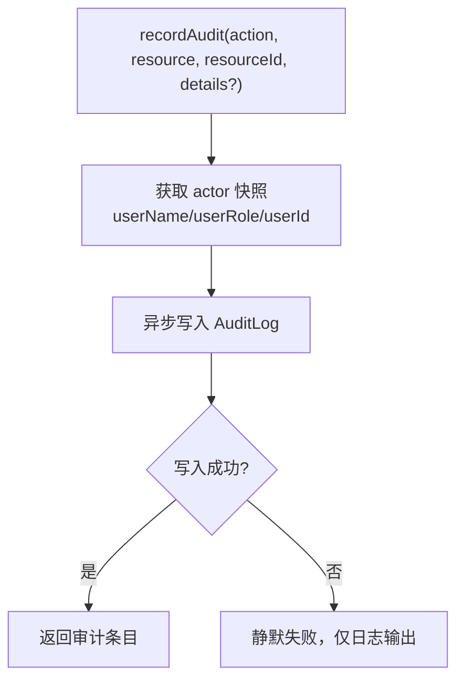
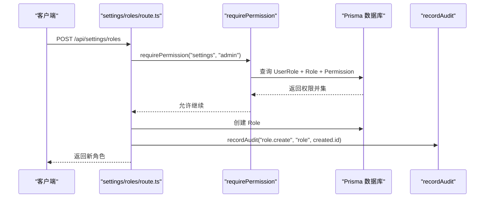
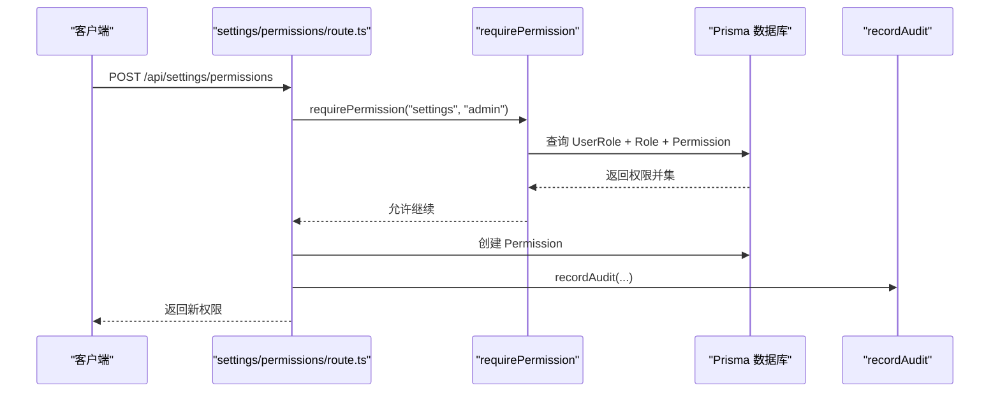
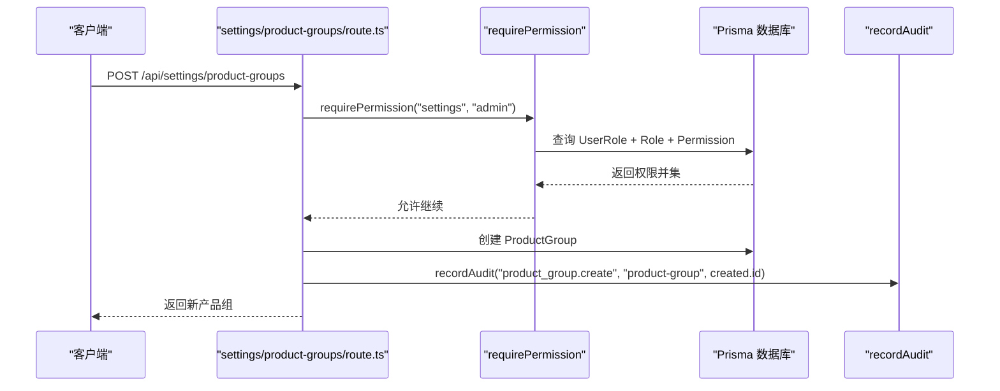

# 权限安全实体

<cite>
**本文引用的文件**   
- [schema.prisma](file://packages/db/prisma/schema.prisma)
- [migration.sql](file://packages/db/prisma/migrations/20261005033611_init_sqlite/migration.sql)
- [seed-data.mjs](file://packages/db/prisma/seed-data.mjs)
- [rbac.ts](file://apps/web/lib/services/rbac.ts)
- [audit-service.ts](file://apps/web/lib/services/audit-service.ts)
- [settings/roles/route.ts](file://apps/web/app/api/settings/roles/route.ts)
- [settings/permissions/route.ts](file://apps/web/app/api/settings/permissions/route.ts)
- [settings/product-groups/route.ts](file://apps/web/app/api/settings/product-groups/route.ts)
- [settings/audit-logs/route.ts](file://apps/web/app/api/settings/audit-logs/route.ts)
- [helpers/seed-db.ts](file://apps/web/lib/__tests__/helpers/seed-db.ts)
</cite>

## 目录
1. [引言](#引言)
2. [项目结构中的权限与安全位置](#项目结构中的权限与安全位置)
3. [核心数据模型与字段含义](#核心数据模型与字段含义)
4. [RBAC 访问控制模型](#rbac-访问控制模型)
5. [产品组多租户隔离与成员管理](#产品组多租户隔离与成员管理)
6. [审计日志记录格式与查询优化](#审计日志记录格式与查询优化)
7. [关键业务流程时序图](#关键业务流程时序图)
8. [约束、级联删除与一致性处理](#约束级联删除与一致性处理)
9. [性能与扩展建议](#性能与扩展建议)
10. [故障排查指南](#故障排查指南)
11. [结论](#结论)

## 引言
本文聚焦权限与安全相关实体的设计说明，覆盖用户、角色、权限、角色-权限关联、用户-角色关联、产品组、产品组成员以及审计日志等表结构。文档解释 RBAC（基于角色的访问控制）模型如何组织角色、权限和用户之间的关系，说明产品组如何实现多租户隔离与成员管理，并给出审计日志的记录格式、查询优化策略和典型使用示例。同时梳理级联删除、唯一约束和外键约束的处理逻辑，帮助读者从数据层到服务层完整理解权限分配、访问控制和审计追踪流程。

## 项目结构中的权限与安全位置
权限与安全能力分布在数据库 Schema、API 路由和服务层三个层面：
- 数据库层：Prisma Schema 定义 User、Role、Permission、RolePermission、UserRole、ProductGroup、ProductGroupMember、AuditLog 等实体及其关系。
- API 路由层：settings 下的 roles、permissions、product-groups、audit-logs 路由负责校验、鉴权、持久化和审计记录。
- 服务层：RBAC 服务提供统一授权判断；审计服务提供追加式审计写入。

**图表来源**
- [schema.prisma:24-59](file://packages/db/prisma/schema.prisma#L24-L59)
- [schema.prisma:486-550](file://packages/db/prisma/schema.prisma#L486-L550)
- [rbac.ts:21-51](file://apps/web/lib/services/rbac.ts#L21-L51)
- [audit-service.ts:43-85](file://apps/web/lib/services/audit-service.ts#L43-L85)
- [settings/roles/route.ts:44-67](file://apps/web/app/api/settings/roles/route.ts#L44-L67)
- [settings/permissions/route.ts:25-27](file://apps/web/app/api/settings/permissions/route.ts#L25-L27)
- [settings/product-groups/route.ts:27-63](file://apps/web/app/api/settings/product-groups/route.ts#L27-L63)
- [settings/audit-logs/route.ts:7-32](file://apps/web/app/api/settings/audit-logs/route.ts#L7-L32)

**章节来源**
- [schema.prisma:24-59](file://packages/db/prisma/schema.prisma#L24-L59)
- [schema.prisma:486-550](file://packages/db/prisma/schema.prisma#L486-L550)
- [rbac.ts:1-52](file://apps/web/lib/services/rbac.ts#L1-L52)
- [audit-service.ts:1-85](file://apps/web/lib/services/audit-service.ts#L1-L85)
- [settings/roles/route.ts:1-68](file://apps/web/app/api/settings/roles/route.ts#L1-L68)
- [settings/permissions/route.ts:1-27](file://apps/web/app/api/settings/permissions/route.ts#L1-L27)
- [settings/product-groups/route.ts:1-64](file://apps/web/app/api/settings/product-groups/route.ts#L1-L64)
- [settings/audit-logs/route.ts:1-33](file://apps/web/app/api/settings/audit-logs/route.ts#L1-L33)

## 核心数据模型与字段含义
本节按实体逐一说明设计意图与关键字段。

### ProductGroup（产品组）
- id：主键，CUID 生成。
- name：产品组名称，唯一。
- displayName：展示名。
- description：可选描述。
- createdAt / updatedAt：时间戳。
- 关系：与 Agent、ProductGroupMember 一对多。

设计意图：产品组是多租户隔离的基本单位，Agent 通过 productGroupId 归属某个产品组，成员通过 ProductGroupMember 加入产品组并拥有组内角色。

**章节来源**
- [schema.prisma:24-34](file://packages/db/prisma/schema.prisma#L24-L34)

### ProductGroupMember（产品组成员）
- id：主键。
- productGroupId：外键指向 ProductGroup。
- userId：外键指向 User。
- role：组内角色，默认 MEMBER，兼容原 GroupRole。
- joinedAt：加入时间。
- 唯一约束：(productGroupId, userId)。

设计意图：实现“用户-产品组”的隶属关系，支持不同产品组中同一用户拥有不同组角色。

**章节来源**
- [schema.prisma:36-47](file://packages/db/prisma/schema.prisma#L36-L47)

### User（用户）
- id：主键。
- email：唯一邮箱。
- name：可选显示名。
- passwordHash：可选密码哈希。
- avatarUrl：头像地址。
- createdAt / updatedAt：时间戳。
- 关系：与 UserRole、ProductGroupMember 一对多。

设计意图：系统用户基础信息，作为 RBAC 与产品组成员的基础主体。

**章节来源**
- [schema.prisma:49-60](file://packages/db/prisma/schema.prisma#L49-L60)

### Role（角色）
- id：主键。
- name：角色名称，唯一。
- displayName：展示名。
- description：可选描述。
- isSystem：是否系统内置角色。
- 关系：与 RolePermission、UserRole 一对多。

设计意图：抽象权限集合，供用户通过 UserRole 获得一组 Permission。

**章节来源**
- [schema.prisma:486-495](file://packages/db/prisma/schema.prisma#L486-L495)

### Permission（权限）
- id：主键。
- resource：资源标识，如 settings、audit、agent 等。
- action：动作标识，如 admin、read、create 等。
- description：可选描述。
- 唯一约束：(resource, action)。

设计意图：最小粒度的操作许可，组合成角色权限集。

**章节来源**
- [schema.prisma:497-506](file://packages/db/prisma/schema.prisma#L497-L506)

### RolePermission（角色-权限关联）
- roleId：外键指向 Role。
- permissionId：外键指向 Permission。
- 复合主键：(roleId, permissionId)。

设计意图：多对多解耦，一个角色可拥有多个权限，一个权限可被多个角色共享。

**章节来源**
- [schema.prisma:508-515](file://packages/db/prisma/schema.prisma#L508-L515)

### UserRole（用户-角色关联）
- id：主键。
- userId：外键指向 User。
- roleId：外键指向 Role。
- productGroupId：可选，限定该角色在特定产品组的范围。
- assignedAt / assignedBy：分配时间与分配人。
- 唯一约束：(userId, roleId, productGroupId)。

设计意图：将用户与角色绑定，并可限定到产品组维度，形成“用户-角色-产品组”三元授权上下文。

**章节来源**
- [schema.prisma:517-528](file://packages/db/prisma/schema.prisma#L517-L528)

### AuditLog（审计日志）
- id：主键。
- action：动作字符串，如 agent.create、role.update。
- resource：资源类型，如 agent、role、product-group。
- resourceId：资源实例 ID。
- details：可选 JSON 文本，记录变更细节。
- userId：可选，仅作查询别名，不建外键。
- userName：固化操作者名称快照。
- userRole：固化操作者角色快照。
- ipAddress / userAgent：可选请求上下文。
- createdAt：审计时间。
- 索引：(resource, resourceId)、(userId, createdAt)、(action, createdAt)、createdAt。

设计意图：append-only 行为审计流，回答“谁在何时对什么资源做了什么”，便于问责与合规审查。

**章节来源**
- [schema.prisma:530-550](file://packages/db/prisma/schema.prisma#L530-L550)

## RBAC 访问控制模型
RBAC 的核心是“用户 → 角色 → 权限”的授权链。当前实现遵循以下原则：
- 授权事实源：数据库中的 UserRole、Role、RolePermission、Permission。
- actor.id 解析后查 UserRole，再展开 Role 与 Permission，取所有角色的权限并集。
- system 用户豁免：actor.id === "system" 时跳过权限检查。
- 匿名或未知用户：找不到 UserRole 则拒绝访问。
- 权限粒度：以 resource + action 为最小单元，例如 settings.admin、audit.read。

**图表来源**
- [schema.prisma:49-60](file://packages/db/prisma/schema.prisma#L49-L60)
- [schema.prisma:486-528](file://packages/db/prisma/schema.prisma#L486-L528)

RBAC 授权流程如下：

**图表来源**
- [rbac.ts:21-51](file://apps/web/lib/services/rbac.ts#L21-L51)
- [settings/roles/route.ts:44-67](file://apps/web/app/api/settings/roles/route.ts#L44-L67)
- [settings/permissions/route.ts:25-27](file://apps/web/app/api/settings/permissions/route.ts#L25-L27)
- [settings/product-groups/route.ts:27-63](file://apps/web/app/api/settings/product-groups/route.ts#L27-L63)
- [settings/audit-logs/route.ts:7-32](file://apps/web/app/api/settings/audit-logs/route.ts#L7-L32)

**章节来源**
- [rbac.ts:1-52](file://apps/web/lib/services/rbac.ts#L1-L52)
- [settings/roles/route.ts:44-67](file://apps/web/app/api/settings/roles/route.ts#L44-L67)
- [settings/permissions/route.ts:25-27](file://apps/web/app/api/settings/permissions/route.ts#L25-L27)
- [settings/product-groups/route.ts:27-63](file://apps/web/app/api/settings/product-groups/route.ts#L27-L63)
- [settings/audit-logs/route.ts:7-32](file://apps/web/app/api/settings/audit-logs/route.ts#L7-L32)

## 产品组多租户隔离与成员管理
产品组（ProductGroup）是业务域隔离的单位。Agent 通过 productGroupId 归属某产品组，从而天然实现按产品组的数据隔离。成员管理通过 ProductGroupMember 维护用户与产品组的关系，并携带组内角色（MEMBER、LEAD 等）。

典型数据示例（来自种子数据）：
- 产品组：ECS 产品组、RDS 产品组。
- 成员：user-chen、user-wang、user-zhang 属于 ECS 产品组；user-li、user-liu 属于 RDS 产品组。
- 用户角色：admin、product、cre 等角色通过 UserRole 分配给用户。

**图表来源**
- [settings/product-groups/route.ts:27-63](file://apps/web/app/api/settings/product-groups/route.ts#L27-L63)

产品组与成员的关联关系如下：

**图表来源**
- [schema.prisma:24-47](file://packages/db/prisma/schema.prisma#L24-L47)

**章节来源**
- [schema.prisma:24-47](file://packages/db/prisma/schema.prisma#L24-L47)
- [seed-data.mjs:94-131](file://packages/db/prisma/seed-data.mjs#L94-L131)
- [settings/product-groups/route.ts:1-64](file://apps/web/app/api/settings/product-groups/route.ts#L1-L64)

## 审计日志记录格式与查询优化
审计日志采用 append-only 模式，记录体包含 action、resource、resourceId、userName、userRole、userId（仅查询别名）、details 等字段。写入语义为 fire-and-forget：不阻塞业务写操作，失败只记日志。

查询优化策略：
- 数据库层为 AuditLog 建立多个索引：(resource, resourceId)、(userId, createdAt)、(action, createdAt)、createdAt。
- API 层支持分页与过滤：action、resource、resourceId、userName（兼容 userId 查询别名）。

**图表来源**
- [audit-service.ts:43-85](file://apps/web/lib/services/audit-service.ts#L43-L85)

审计日志查询路由示例：
- GET /api/settings/audit-logs?action=...&resource=...&resourceId=...&userName=...

**章节来源**
- [schema.prisma:530-550](file://packages/db/prisma/schema.prisma#L530-L550)
- [audit-service.ts:1-85](file://apps/web/lib/services/audit-service.ts#L1-L85)
- [settings/audit-logs/route.ts:1-33](file://apps/web/app/api/settings/audit-logs/route.ts#L1-L33)

## 关键业务流程时序图

### 创建角色并记录审计

**图表来源**
- [settings/roles/route.ts:44-67](file://apps/web/app/api/settings/roles/route.ts#L44-L67)
- [rbac.ts:21-51](file://apps/web/lib/services/rbac.ts#L21-L51)
- [audit-service.ts:43-85](file://apps/web/lib/services/audit-service.ts#L43-L85)

### 创建权限并记录审计

**图表来源**
- [settings/permissions/route.ts:25-27](file://apps/web/app/api/settings/permissions/route.ts#L25-L27)
- [rbac.ts:21-51](file://apps/web/lib/services/rbac.ts#L21-L51)
- [audit-service.ts:43-85](file://apps/web/lib/services/audit-service.ts#L43-L85)

### 创建产品组并记录审计

**图表来源**
- [settings/product-groups/route.ts:27-63](file://apps/web/app/api/settings/product-groups/route.ts#L27-L63)
- [rbac.ts:21-51](file://apps/web/lib/services/rbac.ts#L21-L51)
- [audit-service.ts:43-85](file://apps/web/lib/services/audit-service.ts#L43-L85)

## 约束、级联删除与一致性处理
- 唯一约束：
  - ProductGroup.name 唯一。
  - Permission.resource + action 唯一。
  - UserRole.userId + roleId + productGroupId 唯一。
  - ProductGroupMember.productGroupId + userId 唯一。
- 外键约束：
  - ProductGroupMember.productGroupId → ProductGroup.id。
  - ProductGroupMember.userId → User.id。
  - UserRole.userId → User.id。
  - UserRole.roleId → Role.id。
  - RolePermission.roleId → Role.id。
  - RolePermission.permissionId → Permission.id。
- 级联删除：
  - WikiPage.vaultId 与 WikiIngestJob.vaultId 显式设置 onDelete: Cascade，体现“删除知识库库即删除页面与任务”的语义。
  - 其他实体未显式配置级联删除，默认 RESTRICT，避免误删导致数据不一致。

一致性处理要点：
- 产品组创建前检查 name 唯一性，避免重复。
- 权限与角色创建需具备 settings.admin 权限。
- 审计日志写入失败不影响业务写操作，保证业务幂等性与可用性。

**章节来源**
- [schema.prisma:24-47](file://packages/db/prisma/schema.prisma#L24-L47)
- [schema.prisma:486-550](file://packages/db/prisma/schema.prisma#L486-L550)
- [schema.prisma:421-454](file://packages/db/prisma/schema.prisma#L421-L454)
- [schema.prisma:456-480](file://packages/db/prisma/schema.prisma#L456-L480)
- [settings/product-groups/route.ts:27-63](file://apps/web/app/api/settings/product-groups/route.ts#L27-L63)
- [settings/roles/route.ts:44-67](file://apps/web/app/api/settings/roles/route.ts#L44-L67)
- [settings/permissions/route.ts:25-27](file://apps/web/app/api/settings/permissions/route.ts#L25-L27)

## 性能与扩展建议
- 查询优化：
  - 利用 AuditLog 的多索引进行高效过滤与排序。
  - 在 RBAC 授权时尽量复用已加载的用户角色与权限缓存，减少多次数据库往返。
- 写入优化：
  - 审计日志保持 append-only，避免频繁更新历史。
  - 批量创建角色-权限、用户-角色时考虑批量插入以减少事务开销。
- 扩展方向：
  - 引入更细粒度的资源维度（如 tenantId、groupId）以增强多租户隔离。
  - 为审计日志增加持久化队列与监控告警，防止静默丢失。

[本节为通用指导，不直接分析具体文件]

## 故障排查指南
常见问题与建议：
- 权限不足：
  - 检查 UserRole 是否正确分配，Role 是否包含所需 Permission。
  - 确认 requirePermission 的 resource 与 action 是否与 Permission 一致。
- 审计缺失：
  - 确认 recordAudit 是否被调用，fire-and-forget 语义下需等待 flushAudit 或在测试环境中验证。
  - 检查审计日志索引与查询参数是否匹配。
- 产品组冲突：
  - 创建产品组时若 name 重复会返回冲突错误，需更换名称。
- 成员重复：
  - ProductGroupMember 的 (productGroupId, userId) 唯一约束会阻止重复加入。

**章节来源**
- [rbac.ts:21-51](file://apps/web/lib/services/rbac.ts#L21-L51)
- [audit-service.ts:43-85](file://apps/web/lib/services/audit-service.ts#L43-L85)
- [settings/product-groups/route.ts:27-63](file://apps/web/app/api/settings/product-groups/route.ts#L27-L63)
- [schema.prisma:46-47](file://packages/db/prisma/schema.prisma#L46-L47)

## 结论
本项目的权限与安全体系以 Prisma Schema 为基础，结合 RBAC 服务层与审计服务层，形成了清晰的用户-角色-权限授权链与 append-only 审计流。产品组作为多租户隔离单位，配合成员管理与角色分配，支撑了按产品域的资源隔离。审计日志通过索引优化与分页查询满足问责需求。建议在后续迭代中加强审计持久化监控、细化资源维度，并持续优化 RBAC 查询性能与一致性保障。