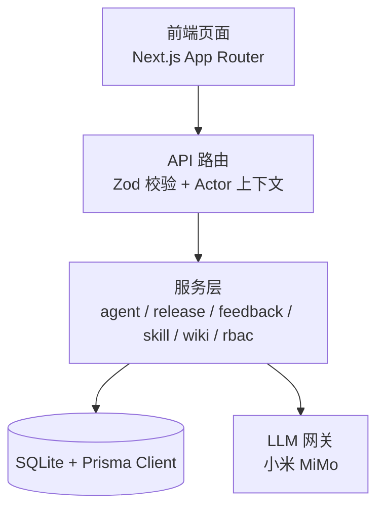
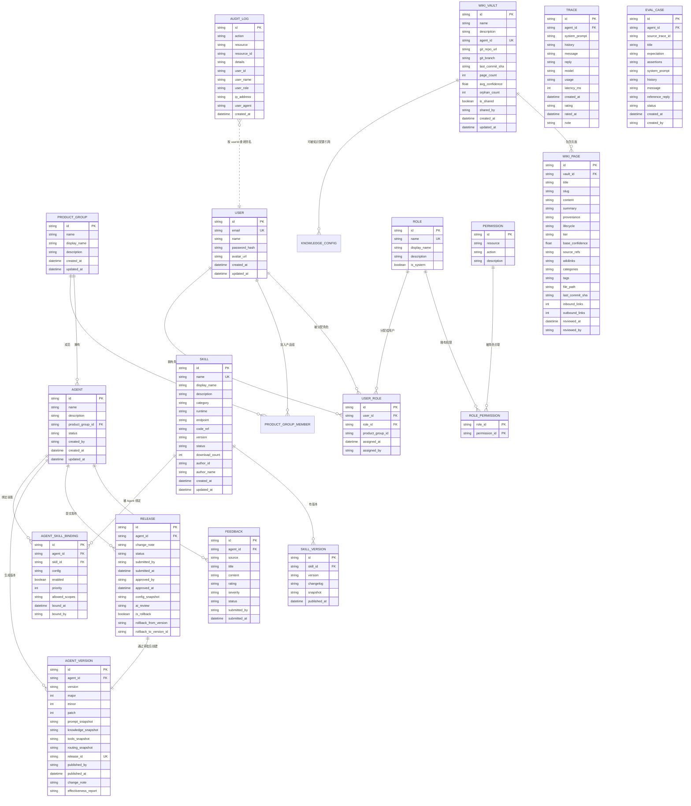
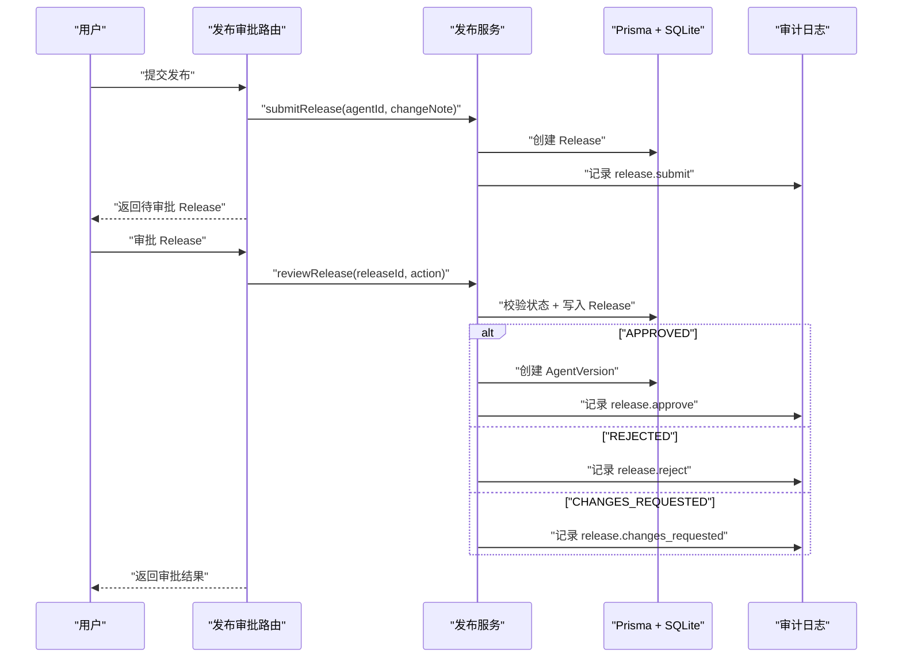
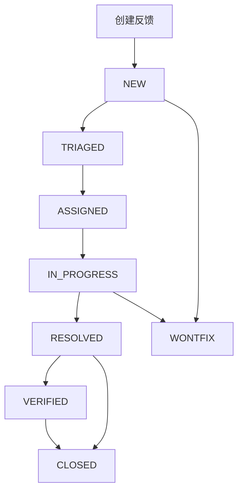

# 核心实体详解

<cite>
**本文引用的文件**   
- [schema.prisma](file://packages/db/prisma/schema.prisma)
- [enums.ts](file://packages/db/src/enums.ts)
- [README.md](file://README.md)
- [migration.sql](file://packages/db/prisma/migrations/20261005033611_init_sqlite/migration.sql)
- [release-service.ts](file://apps/web/lib/services/release-service.ts)
- [releases.test.ts](file://apps/web/app/api/__tests__/releases.test.ts)
- [release-service.test.ts](file://apps/web/lib/__tests__/release-service.test.ts)
- [feedback-service-component.md](file://docs/skills/agent-up-services/references/feedback-service-component.md)
- [feedback-service-troubleshooting.md](file://docs/skills/agent-up-services/references/feedback-service-troubleshooting.md)
- [skill-service-component.md](file://docs/skills/agent-up-services/references/skill-service-component.md)
- [wiki-service-component.md](file://docs/skills/agent-up-services/references/wiki-service-component.md)
- [permissions route.ts](file://apps/web/app/api/settings/permissions/route.ts)
- [roles route.ts](file://apps/web/app/api/settings/roles/route.ts)
</cite>

## 目录
1. [引言](#引言)
2. [项目结构与数据层定位](#项目结构与数据层定位)
3. [核心实体总览](#核心实体总览)
4. [组织与用户模型](#组织与用户模型)
5. [Agent 与四分区配置](#agent-与四分区配置)
6. [发布审批 Release](#发布审批-release)
7. [版本快照 AgentVersion](#版本快照-agentversion)
8. [技能插件 Skill](#技能插件-skill)
9. [知识库 WikiVault 与 WikiPage](#知识库-wikivault-与-wikipage)
10. [反馈 Feedback](#反馈-feedback)
11. [权限 Role / Permission / UserRole](#权限-role-permission-userrole)
12. [审计、试聊与评测相关实体](#审计试聊与评测相关实体)
13. [实体关系与级联策略](#实体关系与级联策略)
14. [查询模式与业务示例](#查询模式与业务示例)
15. [性能与约束设计分析](#性能与约束设计分析)
16. [故障排查要点](#故障排查要点)
17. [结论](#结论)

## 引言
本文件聚焦 AgentUp 的数据库核心实体，目标是让读者既能理解每个表的设计意图，也能在实际业务中正确读写这些实体。文档覆盖以下关键领域：

- Agent 的四分区配置（Prompt / Knowledge / Tools / Routing）
- Release 发布审批流
- AgentVersion 版本快照
- Skill 技能插件及其绑定
- WikiVault 知识库容器与 WikiPage 页面
- Feedback 反馈记录与状态机
- User、Role、Permission、UserRole 等权限控制实体
- 审计日志、试聊 Trace、评测用例等辅助实体

整体系统采用 Next.js App Router + Prisma + SQLite；枚举值从数据库迁移到 TypeScript 常量对象，由 Zod 在运行时校验。

**章节来源**
- [README.md:1-10](file://README.md#L1-L10)
- [README.md:64-74](file://README.md#L64-L74)
- [schema.prisma:1-18](file://packages/db/prisma/schema.prisma#L1-L18)

## 项目结构与数据层定位
AgentUp 的数据定义集中在 `packages/db` 下，使用 Prisma Schema 描述所有实体；SQLite 是默认持久化后端。API 路由负责协议适配，服务层实现业务逻辑，Prisma Client 统一访问数据库。

**图表来源**
- [README.md:137-153](file://README.md#L137-L153)

**章节来源**
- [README.md:76-135](file://README.md#L76-L135)
- [README.md:137-153](file://README.md#L137-L153)

## 核心实体总览
下图给出核心实体的关系概览。为便于阅读，图中省略了部分只读或辅助字段，仅保留主键、外键和关键业务字段。

**图表来源**
- [schema.prisma:24-60](file://packages/db/prisma/schema.prisma#L24-L60)
- [schema.prisma:66-99](file://packages/db/prisma/schema.prisma#L66-L99)
- [schema.prisma:211-251](file://packages/db/prisma/schema.prisma#L211-L251)
- [schema.prisma:257-318](file://packages/db/prisma/schema.prisma#L257-L318)
- [schema.prisma:324-391](file://packages/db/prisma/schema.prisma#L324-L391)
- [schema.prisma:397-480](file://packages/db/prisma/schema.prisma#L397-L480)
- [schema.prisma:486-550](file://packages/db/prisma/schema.prisma#L486-L550)
- [schema.prisma:556-596](file://packages/db/prisma/schema.prisma#L556-L596)

## 组织与用户模型
### ProductGroup 与 ProductGroupMember
- **ProductGroup** 表示一个产品组，用于隔离不同团队维护的 Agent。
- **ProductGroupMember** 表示某个用户属于某个产品组，并带有组内角色。
- 关键字段：
  - `id`：唯一标识，使用 cuid 生成。
  - `name`：产品组名称，唯一。
  - `displayName`：展示名。
  - `description`：可选描述。
  - `role`：组内角色，默认 MEMBER，支持 LEAD/MEMBER。
  - `joinedAt`：加入时间。
- 约束：
  - `(productGroupId, userId)` 唯一，避免重复加入。
  - 外键指向 User 和 ProductGroup。

**章节来源**
- [schema.prisma:24-47](file://packages/db/prisma/schema.prisma#L24-L47)
- [enums.ts:13-17](file://packages/db/src/enums.ts#L13-L17)

### User
- **User** 是平台用户主数据。
- 关键字段：
  - `email`：唯一邮箱，作为登录身份。
  - `passwordHash`：密码哈希，演示环境真实落库。
  - `avatarUrl`：头像地址。
  - `createdAt/updatedAt`：审计与排序常用。
- 关联：
  - 通过 UserRole 与 Role 建立 RBAC 关系。
  - 通过 ProductGroupMember 加入产品组。

**章节来源**
- [schema.prisma:49-60](file://packages/db/prisma/schema.prisma#L49-L60)

## Agent 与四分区配置
### Agent
Agent 是平台的核心业务实体，代表一个可改进、可发布、可回滚的智能体。

- 关键字段：
  - `name`：Agent 名称。
  - `description`：可选描述。
  - `productGroupId`：所属产品组。
  - `status`：Agent 生命周期状态，默认 DRAFT，支持 ACTIVE/ARCHIVED。
  - `createdBy`：创建者。
  - `promptConfig/knowledgeConfig/toolsConfig/routingConfig`：四分区配置。
  - `draftConfig`：草稿区配置，允许编辑时不污染线上配置。
- 索引：
  - 按 `productGroupId` 和 `status` 建索引，加速列表与筛选。

**章节来源**
- [schema.prisma:66-99](file://packages/db/prisma/schema.prisma#L66-L99)
- [enums.ts:19-24](file://packages/db/src/enums.ts#L19-L24)

### PromptConfig
- 保存 Agent 的系统提示词、角色定义、约束、输出格式。
- 关键字段：
  - `systemPrompt`：必填。
  - `roleDefinition`：可选角色定义。
  - `constraints`：JSON 文本数组，默认空数组。
  - `outputFormat`：可选输出格式。
  - `version`：分区内部版本号。
  - `lastModifiedBy/lastModifiedAt`：变更追踪。

**章节来源**
- [schema.prisma:105-117](file://packages/db/prisma/schema.prisma#L105-L117)

### KnowledgeConfig
- 管理 Agent 的知识检索策略，包括是否优先 Wiki、是否兜底 MCP、最大结果数、置信度阈值等。
- 关键字段：
  - `wikiVaultId`：可选关联 WikiVault。
  - `searchStrategy`：默认 WIKI_FIRST。
  - `fallbackToMcp`：是否启用 MCP 兜底。
  - `maxWikiResults`：默认 5。
  - `confidenceThreshold`：默认 0.6。
  - `syncStatus`：同步状态，默认 SYNCED。
  - `version`：分区版本。

**章节来源**
- [schema.prisma:119-136](file://packages/db/prisma/schema.prisma#L119-L136)
- [enums.ts:26-41](file://packages/db/src/enums.ts#L26-L41)

### ToolsConfig
- 管理 MCP 工具与 Wiki 查询工具的调用参数。
- 关键字段：
  - `mcpTools`：JSON 文本。
  - `wikiQueryTools`：JSON 文本。
  - `maxConcurrentCalls`：默认 3。
  - `timeoutMs`：默认 30000。
  - `retryCount`：默认 2。

**章节来源**
- [schema.prisma:138-152](file://packages/db/prisma/schema.prisma#L138-L152)

### RoutingConfig
- 管理路由规则、升级策略、会话上限与空闲超时。
- 关键字段：
  - `rules`：JSON 文本。
  - `escalationPolicy`：可选升级策略。
  - `humanThreshold`：默认 0.3。
  - `maxConversationTurns`：默认 10。
  - `idleTimeoutMinutes`：默认 5。

**章节来源**
- [schema.prisma:154-168](file://packages/db/prisma/schema.prisma#L154-L168)

### AgentDraftConfig
- 保存 Agent 的草稿配置，允许编辑任意分区而不影响线上生效配置。
- 关键字段：
  - `promptConfig/knowledgeConfig/toolsConfig/routingConfig`：均为 JSON 文本。
  - `isDirty`：标记草稿是否被修改。
  - `lastSavedBy/lastSavedAt`：最后保存人与时间。

**章节来源**
- [schema.prisma:170-182](file://packages/db/prisma/schema.prisma#L170-L182)

### ConfigChange
- 记录分区配置的变更历史，支持分区级回滚与审计。
- 关键字段：
  - `partition`：变更分区，如 PROMPT_ROLLBACK。
  - `before/after/diff`：JSON 文本，记录变更前、变更后与差异。
  - `changedBy/changedAt`：审计信息。
  - `releaseId`：可选关联发布单。

**章节来源**
- [schema.prisma:188-205](file://packages/db/prisma/schema.prisma#L188-L205)

## 发布审批 Release
Release 是 Agent 配置改进进入生产前的审批载体。

- 关键字段：
  - `agentId`：所属 Agent。
  - `changeNote`：变更说明，必填。
  - `changedPartitions`：JSON 文本，记录变更分区。
  - `status`：默认 PENDING，支持 APPROVED/REJECTED/CHANGES_REQUESTED。
  - `submittedBy/submittedAt`：提交人时间与提交人。
  - `approvedBy/approvedAt/reviewComment`：审批信息与意见。
  - `configSnapshot`：JSON 文本，发布前配置快照。
  - `aiReview`：JSON 文本，AI 评测结果。
  - `isRollback`：是否为整版本回滚单。
  - `rollbackFromVersion/rollbackToVersionId`：回滚来源与目标。
  - `version`：审批通过后生成的 AgentVersion。

- 约束与行为：
  - 已处理的 Release 再次审批会冲突。
  - CHANGES_REQUESTED 必须填写 reviewComment。
  - AI 评测 FAILED 时，批准也必须填写 reviewComment。
  - 只有 APPROVED 才生成不可变 Version。

**图表来源**
- [schema.prisma:257-288](file://packages/db/prisma/schema.prisma#L257-L288)
- [release-service.ts:147-179](file://apps/web/lib/services/release-service.ts#L147-L179)
- [releases.test.ts:111-151](file://apps/web/app/api/__tests__/releases.test.ts#L111-L151)

**章节来源**
- [schema.prisma:257-288](file://packages/db/prisma/schema.prisma#L257-L288)
- [enums.ts:95-102](file://packages/db/src/enums.ts#L95-L102)
- [release-service.ts:147-179](file://apps/web/lib/services/release-service.ts#L147-L179)
- [releases.test.ts:111-151](file://apps/web/app/api/__tests__/releases.test.ts#L111-L151)

## 版本快照 AgentVersion
AgentVersion 是发布审批通过后生成的不可变版本快照。

- 关键字段：
  - `agentId`：所属 Agent。
  - `version`：语义化版本字符串。
  - `major/minor/patch`：语义化版本拆分。
  - `promptSnapshot/knowledgeSnapshot/toolsSnapshot/routingSnapshot`：四分区快照，JSON 文本。
  - `releaseId`：唯一关联 Release。
  - `wikiCommitSha`：可选 Wiki 提交 SHA。
  - `publishedAt/publishedBy`：发布时间与发布人。
  - `changeNote`：发布变更说明。
  - `effectivenessReport`：可选效果报告，JSON 文本。

- 约束：
  - `(agentId, version)` 唯一。
  - 按 `agentId` 和 `publishedAt` 建索引，便于版本历史查询。

**章节来源**
- [schema.prisma:294-318](file://packages/db/prisma/schema.prisma#L294-L318)
- [release-service.test.ts:128-150](file://apps/web/lib/__tests__/release-service.test.ts#L128-L150)

## 技能插件 Skill
Skill 是可复用的技能组件，可被多个 Agent 绑定。

- 关键字段：
  - `name`：唯一技能名。
  - `displayName`：展示名。
  - `description`：描述。
  - `category`：分类，默认 GENERAL。
  - `triggerPatterns`：JSON 文本数组。
  - `inputSchema/outputSchema`：JSON 文本，输入输出契约。
  - `runtime`：运行方式，默认 HTTP。
  - `endpoint/codeRef`：HTTP 端点或代码引用。
  - `version`：默认 1.0.0。
  - `dependencies/permissions`：依赖与权限声明，JSON 文本。
  - `status`：默认 DRAFT。
  - `publishedAt/downloadCount`：发布时间与下载次数。
  - `authorId/authorName`：作者快照。

- 关联：
  - `AgentSkillBinding`：Agent 与 Skill 的绑定关系。
  - `SkillVersion`：Skill 的版本快照。

**章节来源**
- [schema.prisma:324-357](file://packages/db/prisma/schema.prisma#L324-L357)
- [enums.ts:104-128](file://packages/db/src/enums.ts#L104-L128)
- [skill-service-component.md:22-46](file://docs/skills/agent-up-services/references/skill-service-component.md#L22-L46)

### SkillVersion
- 记录 Skill 的每次发布快照。
- 关键字段：
  - `skillId`：所属 Skill。
  - `version`：版本字符串。
  - `changelog`：可选变更记录。
  - `snapshot`：JSON 文本，完整快照。
  - `publishedAt`：发布时间。
- 约束：`(skillId, version)` 唯一。

**章节来源**
- [schema.prisma:359-371](file://packages/db/prisma/schema.prisma#L359-L371)

### AgentSkillBinding
- 表示某个 Agent 绑定了某个 Skill。
- 关键字段：
  - `agentId/skillId`：双向外键。
  - `config`：可选绑定配置，JSON 文本。
  - `enabled`：是否启用，默认 true。
  - `priority`：优先级，默认 0。
  - `allowedScopes`：作用域，JSON 文本。
  - `boundAt/boundBy`：绑定时间与绑定人。
- 约束：`(agentId, skillId)` 唯一。

**章节来源**
- [schema.prisma:373-391](file://packages/db/prisma/schema.prisma#L373-L391)

## 知识库 WikiVault 与 WikiPage
### WikiVault
- 知识库容器，可独立存在，也可与某个 Agent 关联。
- 关键字段：
  - `name`：知识库名称。
  - `description`：可选描述。
  - `agentId`：可选关联 Agent。
  - `gitRepoUrl/gitBranch`：Git 仓库与分支。
  - `lastCommitSha`：最后提交 SHA。
  - `pageCount/avgConfidence/orphanCount`：统计字段。
  - `isShared/sharedBy`：是否共享及共享人。
  - `createdAt/updatedAt`：时间戳。

**章节来源**
- [schema.prisma:397-419](file://packages/db/prisma/schema.prisma#L397-L419)

### WikiPage
- 知识库中的具体页面。
- 关键字段：
  - `vaultId`：所属 Vault。
  - `title/slug/content/summary`：页面标题、路径、内容、摘要。
  - `provenance/lifecycle/tier`：来源、生命周期、层级。
  - `baseConfidence`：基础置信度。
  - `sourceRefs/wikilinks/categories/tags`：JSON 文本数组。
  - `filePath`：物理文件路径。
  - `lastCommitSha/inboundLinks/outboundLinks`：Git 与链接统计。
  - `reviewedAt/reviewedBy`：审核信息。
- 级联删除：删除 Vault 时，其 Page 一并删除。

**章节来源**
- [schema.prisma:421-454](file://packages/db/prisma/schema.prisma#L421-L454)
- [migration.sql:279-304](file://packages/db/prisma/migrations/20261005033611_init_sqlite/migration.sql#L279-L304)
- [wiki-service-component.md:17-28](file://docs/skills/agent-up-services/references/wiki-service-component.md#L17-L28)

### WikiIngestJob
- 知识库导入任务。
- 关键字段：
  - `vaultId`：所属 Vault。
  - `jobType/sourceType/sourceId/sourceContent/sourceUrl`：任务来源。
  - `generatedPageIds`：生成的页面 ID 列表，JSON 文本。
  - `status/result/error`：任务状态与结果。
  - `startedAt/completedAt/triggeredBy`：执行信息。

**章节来源**
- [schema.prisma:456-480](file://packages/db/prisma/schema.prisma#L456-L480)

## 反馈 Feedback
Feedback 是用户或系统对 Agent 输出的评价与问题记录。

- 关键字段：
  - `agentId`：所属 Agent。
  - `source`：来源渠道，默认 MANUAL。
  - `title/content`：标题与内容。
  - `sessionData`：可选会话数据，JSON 文本。
  - `rating`：评分，POSITIVE/NEGATIVE/NEUTRAL。
  - `tags`：标签数组，JSON 文本。
  - `severity`：严重程度，默认 MINOR。
  - `status`：状态，默认 NEW。
  - `assignedTo/assignedAt/resolvedAt/resolvedBy/resolution`：处理信息。
  - `releaseId/targetPartition`：关联发布与目标分区。
  - `externalRefId/externalRefUrl`：外部工单号与链接。
  - `submittedBy/submittedAt/verifiedAt/verifiedBy/verificationNote`：提交与验证信息。

- 状态机：
  - 非法状态转移会被拒绝，例如直接从 NEW 跳到 RESOLVED。
  - CLOSED/WONTFIX 为终态，不可再流转。

**图表来源**
- [enums.ts:82-93](file://packages/db/src/enums.ts#L82-L93)
- [feedback-service-component.md:31-48](file://docs/skills/agent-up-services/references/feedback-service-component.md#L31-L48)

**章节来源**
- [schema.prisma:211-251](file://packages/db/prisma/schema.prisma#L211-L251)
- [enums.ts:52-93](file://packages/db/src/enums.ts#L52-L93)
- [feedback-service-component.md:31-48](file://docs/skills/agent-up-services/references/feedback-service-component.md#L31-L48)

## 权限 Role / Permission / UserRole
RBAC 模型由 Role、Permission、RolePermission、UserRole 组成。

### Role
- 角色定义，支持系统内置角色。
- 关键字段：
  - `name`：唯一角色名。
  - `displayName`：展示名。
  - `description`：可选描述。
  - `isSystem`：是否系统角色。

**章节来源**
- [schema.prisma:486-495](file://packages/db/prisma/schema.prisma#L486-L495)

### Permission
- 最小权限单元，由 resource + action 构成。
- 关键字段：
  - `resource`：资源类型。
  - `action`：动作类型。
  - `description`：可选描述。
- 约束：`(resource, action)` 唯一。

**章节来源**
- [schema.prisma:497-506](file://packages/db/prisma/schema.prisma#L497-L506)

### RolePermission
- 多对多中间表，连接 Role 与 Permission。
- 复合主键：`(roleId, permissionId)`。

**章节来源**
- [schema.prisma:508-515](file://packages/db/prisma/schema.prisma#L508-L515)

### UserRole
- 将用户与角色关联，支持按产品组授权。
- 关键字段：
  - `userId/roleId`：用户与角色。
  - `productGroupId`：可选产品组范围。
  - `assignedAt/assignedBy`：授权时间与授权人。
- 约束：`(userId, roleId, productGroupId)` 唯一。

**章节来源**
- [schema.prisma:517-528](file://packages/db/prisma/schema.prisma#L517-L528)

### RBAC 查询示例
- 获取所有权限及其被多少角色授权：
  - 使用 `permission.findMany({ include: { _count: { select: { roles: true } } } })`。
- 获取角色及其权限列表：
  - 使用 `role.findMany({ include: { permissions: { include: { permission: { select: { id, resource, action } } } }, _count: { select: { members: true } } } })`。

**章节来源**
- [permissions route.ts:10-27](file://apps/web/app/api/settings/permissions/route.ts#L10-L27)
- [roles route.ts:9-46](file://apps/web/app/api/settings/roles/route.ts#L9-L46)

## 审计、试聊与评测相关实体
### AuditLog
- 所有写操作的 append-only 审计日志。
- 关键字段：
  - `action/resource/resourceId`：操作类型、资源类型、资源 ID。
  - `details`：JSON 文本，扩展信息。
  - `userId/userName/userRole`：操作者信息，userId 仅作查询别名。
  - `ipAddress/userAgent/createdAt`：网络与时间信息。

**章节来源**
- [schema.prisma:530-550](file://packages/db/prisma/schema.prisma#L530-L550)

### Trace
- 试聊对话轨迹，记录系统提示、历史消息、用户消息、模型回复、用量与时延。
- 关键字段：
  - `agentId/systemPrompt/history/message/reply/model/usage/latencyMs`。
  - `rating/ratedAt/note`：打分与备注。

**章节来源**
- [schema.prisma:556-575](file://packages/db/prisma/schema.prisma#L556-L575)

### EvalCase
- 评测用例，可从 Trace 沉淀，供发布前 AI 评测回放。
- 关键字段：
  - `agentId/sourceTraceId/title/expectation/assertions/systemPrompt/history/message/referenceReply/status/createdBy`。

**章节来源**
- [schema.prisma:577-596](file://packages/db/prisma/schema.prisma#L577-L596)

## 实体关系与级联策略
- **强外键关系**：
  - Agent → ProductGroup
  - Agent → Feedback / Release / AgentVersion / AgentSkillBinding / ConfigChange / Trace / EvalCase
  - Release → AgentVersion
  - Skill → SkillVersion / AgentSkillBinding
  - WikiVault → WikiPage（级联删除）
  - Role → RolePermission → Permission
  - User → UserRole → Role
- **弱外键或别名关系**：
  - AuditLog.userId 不是外键，仅为查询别名。
  - WikiVault.agentId 可选，允许知识库独立于 Agent。
- **级联删除**：
  - WikiPage.vaultId 使用 `onDelete: Cascade`，删除 Vault 时 Page 一并删除。
- **唯一约束**：
  - AgentVersion.(agentId, version)
  - SkillVersion.(skillId, version)
  - AgentSkillBinding.(agentId, skillId)
  - Permission.(resource, action)
  - UserRole.(userId, roleId, productGroupId)
  - ProductGroupMember.(productGroupId, userId)

**章节来源**
- [schema.prisma:24-596](file://packages/db/prisma/schema.prisma#L24-L596)
- [migration.sql:279-304](file://packages/db/prisma/migrations/20261005033611_init_sqlite/migration.sql#L279-L304)

## 查询模式与业务示例
以下示例以“如何查”为主，不直接粘贴 SQL，而是给出查询思路与对应实体。

### 查询某 Agent 的所有反馈并按严重程度排序
- 思路：
  - 按 `agentId` 过滤 Feedback。
  - 可按 `severity` 与 `status` 组合筛选。
  - 可使用索引 `[agentId, status]` 与 `[severity, status]`。
- 适用场景：
  - 反馈看板、严重问题告警、分诊队列。

**章节来源**
- [schema.prisma:211-251](file://packages/db/prisma/schema.prisma#L211-L251)

### 查询某 Agent 的版本历史并查看最新一次发布的配置快照
- 思路：
  - 先查 AgentVersion，按 `agentId` 与 `publishedAt` 排序。
  - 取最新一条的 `promptSnapshot/knowledgeSnapshot/toolsSnapshot/routingSnapshot`。
  - 若需要 diff，可对比相邻两个版本的快照。
- 适用场景：
  - 版本回滚、变更审计、效果归因。

**章节来源**
- [schema.prisma:294-318](file://packages/db/prisma/schema.prisma#L294-L318)

### 查询某 Skill 被哪些 Agent 绑定
- 思路：
  - 通过 `AgentSkillBinding` 按 `skillId` 查询。
  - 可结合 `enabled/priority/config` 判断当前生效情况。
- 注意：
  - 当绑定数量大时，应分页并限制返回字段。

**章节来源**
- [schema.prisma:373-391](file://packages/db/prisma/schema.prisma#L373-L391)

### 查询某 Vault 下的页面并按生命周期过滤
- 思路：
  - 按 `vaultId` 过滤 WikiPage。
  - 可按 `lifecycle/tier` 过滤。
  - 可使用索引 `[vaultId, lifecycle]` 与 `[vaultId, tier]`。
- 适用场景：
  - 知识库管理、页面审核、知识质量统计。

**章节来源**
- [schema.prisma:421-454](file://packages/db/prisma/schema.prisma#L421-L454)

### 查询某用户的角色与权限
- 思路：
  - 通过 `UserRole` 找到用户拥有的角色。
  - 再通过 `RolePermission` 找到角色拥有的权限。
  - 最终得到 `(resource, action)` 集合用于鉴权。
- 适用场景：
  - 设置页角色管理、API 权限校验。

**章节来源**
- [schema.prisma:486-528](file://packages/db/prisma/schema.prisma#L486-L528)
- [roles route.ts:9-46](file://apps/web/app/api/settings/roles/route.ts#L9-L46)

## 性能与约束设计分析
- **SQLite 与枚举替代方案**：
  - 原 enum 列改为 String，值域校验由 Zod 承担。
  - 好处：开发简单、无需数据库级枚举；风险：需保证应用层校验一致。
- **JSON 文本字段**：
  - 大量复杂结构使用 JSON 文本存储，读写经 packJson/unpackJson 收口。
  - 优点：灵活；缺点：无法利用数据库索引进行结构化查询，需在应用层做过滤。
- **索引设计**：
  - 高频查询字段如 `agentId/status`、`vaultId/lifecycle`、`agentId/publishedAt` 均建索引。
  - 审计日志按 `resource/resourceId`、`userId/createdAt`、`action/createdAt`、`createdAt` 建索引，便于审计查询。
- **唯一约束**：
  - 防止重复绑定、重复版本、重复权限、重复成员关系。
- **级联删除**：
  - WikiPage 随 Vault 删除，符合“知识库即目录”的物理语义。

**章节来源**
- [schema.prisma:1-18](file://packages/db/prisma/schema.prisma#L1-L18)
- [schema.prisma:97-99](file://packages/db/prisma/schema.prisma#L97-L99)
- [schema.prisma:203-205](file://packages/db/prisma/schema.prisma#L203-L205)
- [schema.prisma:248-251](file://packages/db/prisma/schema.prisma#L248-L251)
- [schema.prisma:286-288](file://packages/db/prisma/schema.prisma#L286-L288)
- [schema.prisma:316-318](file://packages/db/prisma/schema.prisma#L316-L318)
- [schema.prisma:356-357](file://packages/db/prisma/schema.prisma#L356-L357)
- [schema.prisma:388-391](file://packages/db/prisma/schema.prisma#L388-L391)
- [schema.prisma:418-419](file://packages/db/prisma/schema.prisma#L418-L419)
- [schema.prisma:451-454](file://packages/db/prisma/schema.prisma#L451-L454)
- [schema.prisma:478-480](file://packages/db/prisma/schema.prisma#L478-L480)
- [schema.prisma:505-506](file://packages/db/prisma/schema.prisma#L505-L506)
- [schema.prisma:527-528](file://packages/db/prisma/schema.prisma#L527-L528)
- [schema.prisma:546-550](file://packages/db/prisma/schema.prisma#L546-L550)

## 故障排查要点
### 反馈状态转移异常
- 现象：更新反馈报 422 非法状态转移。
- 原因：状态机不允许跳跃，例如 NEW→RESOLVED。
- 排查：
  - 对照合法转移路径。
  - 确认终态 CLOSED/WONTFIX 不可再转。
  - 检查 tag 过滤是否误传 ALL。

**章节来源**
- [feedback-service-troubleshooting.md:15-38](file://docs/skills/agent-up-services/references/feedback-service-troubleshooting.md#L15-L38)
- [feedback-service-component.md:31-48](file://docs/skills/agent-up-services/references/feedback-service-component.md#L31-L48)

### 发布审批失败
- 现象：审批时报冲突或要求填写审批意见。
- 原因：
  - Release 已处理。
  - CHANGES_REQUESTED 未填 reviewComment。
  - AI 评测 FAILED 时批准未填 reviewComment。
- 排查：
  - 检查 Release.status。
  - 检查 aiReview.status。
  - 检查 reviewComment 是否为空。

**章节来源**
- [release-service.ts:151-179](file://apps/web/lib/services/release-service.ts#L151-L179)
- [releases.test.ts:111-151](file://apps/web/app/api/__tests__/releases.test.ts#L111-L151)

### 知识库页面删除异常
- 现象：删除 Vault 后页面仍存在或报错。
- 原因：
  - 物理删除语义要求级联删除。
  - 若走文件系统递归删除，需确保数据库外键级联一致。
- 排查：
  - 检查 WikiPage.vaultId 外键是否配置 CASCADE。
  - 检查服务层删除逻辑是否同时清理元数据与物理文件。

**章节来源**
- [schema.prisma:421-426](file://packages/db/prisma/schema.prisma#L421-L426)
- [migration.sql:279-304](file://packages/db/prisma/migrations/20261005033611_init_sqlite/migration.sql#L279-L304)
- [wiki-service-component.md:17-28](file://docs/skills/agent-up-services/references/wiki-service-component.md#L17-L28)

## 结论
AgentUp 的核心实体围绕“Agent 持续改进”展开：以 Agent 为中心，通过四分区配置实现精细化治理，通过 Release 与 AgentVersion 实现可审计、可回滚的版本管理，通过 Skill 与 Wiki 提供可复用能力与知识支撑，通过 Feedback 形成闭环改进，并通过 RBAC 与审计保障安全与合规。

在设计上，项目选择 SQLite + Prisma + JSON 文本 + TypeScript 枚举重建的方式，兼顾演示期快速迭代与运行时一致性；在业务上，强调“配置即资产、版本即事实、审批即门禁、回滚即保险”。对于后续演进，建议逐步强化结构化查询能力、完善权限粒度、增强效果评估指标，并保持 schema 与服务层、测试的一致性。