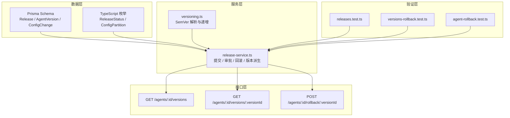
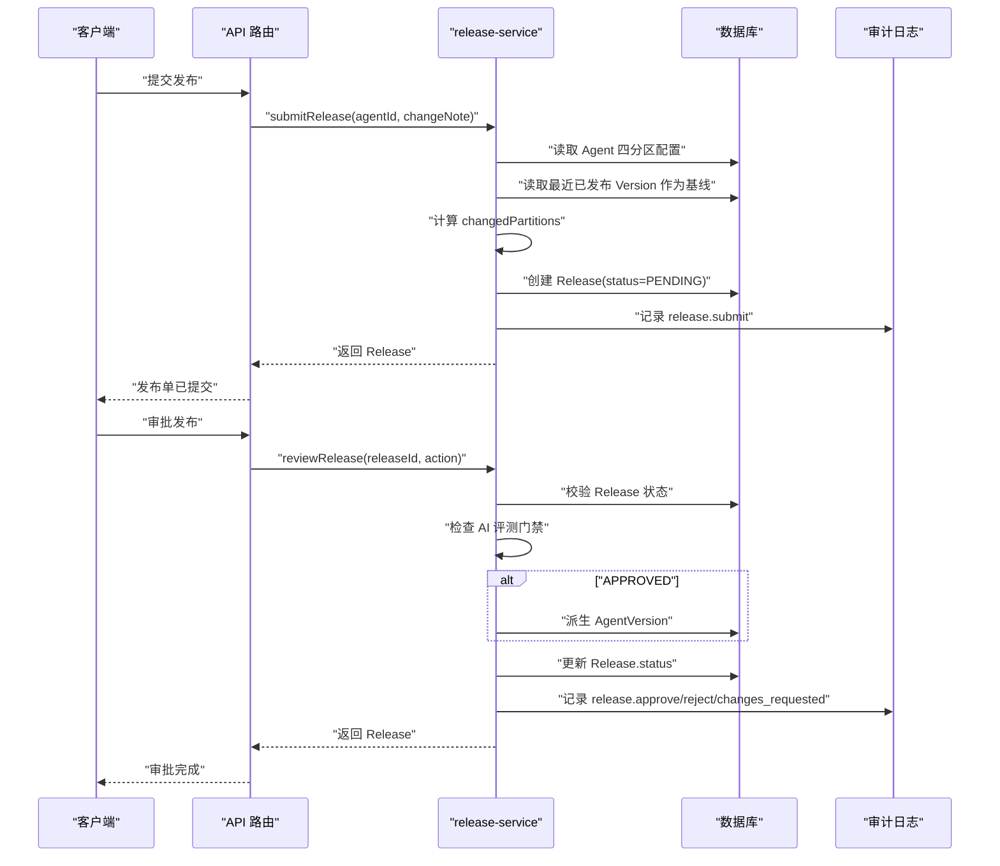
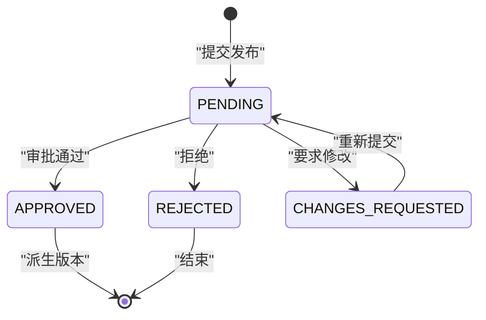
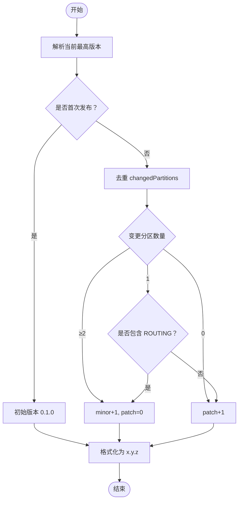
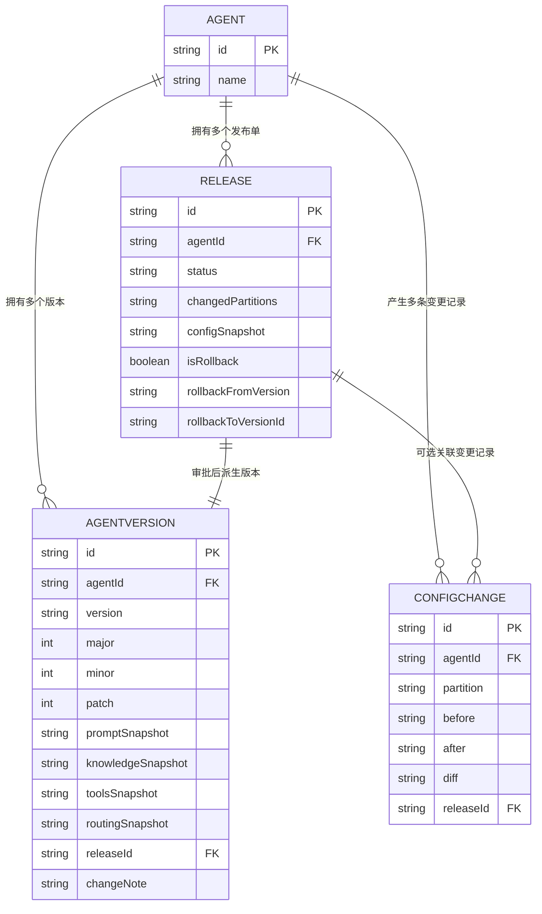

# 版本控制实体

<cite>
**本文引用的文件**   
- [schema.prisma](file://packages/db/prisma/schema.prisma)
- [enums.ts](file://packages/db/src/enums.ts)
- [release-service.ts](file://apps/web/lib/services/release-service.ts)
- [versioning.ts](file://apps/web/lib/versioning.ts)
- [versions/route.ts](file://apps/web/app/api/agents/[id]/versions/route.ts)
- [versions/[versionId]/route.ts](file://apps/web/app/api/agents/[id]/versions/[versionId]/route.ts)
- [rollback/[versionId]/route.ts](file://apps/web/app/api/agents/[id]/rollback/[versionId]/route.ts)
- [releases.test.ts](file://apps/web/app/api/__tests__/releases.test.ts)
- [agent-service.test.ts](file://apps/web/lib/__tests__/agent-service.test.ts)
- [versions-rollback.test.ts](file://apps/web/app/api/__tests__/versions-rollback.test.ts)
- [agent-rollback.test.ts](file://apps/web/app/api/__tests__/agent-rollback.test.ts)
- [release-service.md](file://docs/distilled/release-service.md)
</cite>

## 目录
1. [引言](#引言)
2. [项目结构定位](#项目结构定位)
3. [核心实体总览](#核心实体总览)
4. [架构与数据流概览](#架构与数据流概览)
5. [Release：发布审批模型](#release发布审批模型)
6. [AgentVersion：版本快照与语义化版本](#agentversion版本快照与语义化版本)
7. [ConfigChange：配置变更追踪与回滚记录](#configchange配置变更追踪与回滚记录)
8. [依赖关系分析](#依赖关系分析)
9. [性能与可观测性](#性能与可观测性)
10. [故障排查指南](#故障排查指南)
11. [结论](#结论)

## 引言
本文聚焦 Agent 平台的版本控制相关实体，围绕 Release、AgentVersion、ConfigChange 三个核心表展开。目标是帮助读者理解：
- 发布审批的数据模型设计；
- Release 的状态流转与审批留痕；
- AgentVersion 的版本快照机制和语义化版本规则；
- ConfigChange 的变更前后的差异记录与回滚支持；
- 如何通过查询模式追溯版本历史并执行回滚操作。

## 项目结构定位
版本控制能力横跨数据库 Schema、服务层逻辑、API 路由以及测试用例：
- 数据模型定义位于 Prisma Schema；
- 枚举值在独立的 TypeScript 文件中重建；
- 发布、版本派生、回滚等核心流程集中在 release-service；
- 语义化版本计算由 versioning 模块提供；
- 版本列表、单版本详情、整版本回滚通过 Next.js API Route 暴露；
- 行为契约由单元测试覆盖。

**图表来源**
- [schema.prisma:257-318](file://packages/db/prisma/schema.prisma#L257-L318)
- [enums.ts:95-102](file://packages/db/src/enums.ts#L95-L102)
- [release-service.ts:77-217](file://apps/web/lib/services/release-service.ts#L77-L217)
- [versioning.ts:28-69](file://apps/web/lib/versioning.ts#L28-L69)
- [versions/route.ts:18-31](file://apps/web/app/api/agents/[id]/versions/route.ts#L18-L31)
- [versions/[versionId]/route.ts:15-39](file://apps/web/app/api/agents/[id]/versions/[versionId]/route.ts#L15-L39)
- [rollback/[versionId]/route.ts:21-36](file://apps/web/app/api/agents/[id]/rollback/[versionId]/route.ts#L21-L36)

**章节来源**
- [schema.prisma:257-318](file://packages/db/prisma/schema.prisma#L257-L318)
- [enums.ts:95-102](file://packages/db/src/enums.ts#L95-L102)
- [release-service.ts:77-217](file://apps/web/lib/services/release-service.ts#L77-L217)
- [versioning.ts:28-69](file://apps/web/lib/versioning.ts#L28-L69)
- [versions/route.ts:18-31](file://apps/web/app/api/agents/[id]/versions/route.ts#L18-L31)
- [versions/[versionId]/route.ts:15-39](file://apps/web/app/api/agents/[id]/versions/[versionId]/route.ts#L15-L39)
- [rollback/[versionId]/route.ts:21-36](file://apps/web/app/api/agents/[id]/rollback/[versionId]/route.ts#L21-L36)

## 核心实体总览
本节从“业务意图 + 字段含义 + 关联关系”角度解释三个关键实体。

### Release：发布审批单
Release 是 Agent 配置变更进入生产前的审批载体。它保存提交人、变更说明、实际发生变化的分区、审批状态、审批人与时间、配置快照、AI 评测结果快照，以及整版本回滚标记。

| 字段 | 类型 | 业务含义 |
|---|---|---|
| id | String | 发布单主键 |
| agentId | String | 所属 Agent |
| changeNote | String | 提交说明 |
| changedPartitions | String | JSON 文本，记录真正发生变更的四分区集合 |
| status | String | 发布状态，默认 PENDING |
| submittedBy | String | 提交人 |
| submittedAt | DateTime | 提交时间 |
| approvedBy | String? | 审批人 |
| approvedAt | DateTime? | 审批时间 |
| reviewComment | String? | 审批意见 |
| configSnapshot | String? | JSON 文本，四分区完整配置快照 |
| aiReview | String? | JSON 文本，AI 评测结果快照 |
| isRollback | Boolean | 是否为整版本回滚单 |
| rollbackFromVersion | String? | 回滚来源版本号 |
| rollbackToVersionId | String? | 回滚目标 Version 的主键 |
| version | AgentVersion? | 审批通过后派生的版本快照 |

**设计要点**
- status 使用字符串列，真实值域由 TypeScript 枚举约束；
- changedPartitions 与 configSnapshot 解耦：前者描述“哪些分区变了”，后者保存“提交时的完整配置”；
- aiReview 用于断言门禁：当 AI 评测为 FAILED 时，批准必须填写 reviewComment；
- 回滚单与普通发布单共用同一张表，通过 isRollback、rollbackFromVersion、rollbackToVersionId 区分。

**章节来源**
- [schema.prisma:257-288](file://packages/db/prisma/schema.prisma#L257-L288)
- [enums.ts:95-102](file://packages/db/src/enums.ts#L95-L102)
- [release-service.ts:77-149](file://apps/web/lib/services/release-service.ts#L77-L149)
- [release-service.ts:159-217](file://apps/web/lib/services/release-service.ts#L159-L217)

### AgentVersion：版本快照
AgentVersion 是已发布版本的不可变快照。每个版本包含语义化版本号和四分区配置快照，并通过 releaseId 与 Release 建立一对一关系。

| 字段 | 类型 | 业务含义 |
|---|---|---|
| id | String | 版本主键 |
| agentId | String | 所属 Agent |
| version | String | 语义化版本字符串 |
| major | Int | 主版本号 |
| minor | Int | 次版本号 |
| patch | Int | 修订号 |
| promptSnapshot | String | JSON 文本，Prompt 分区快照 |
| knowledgeSnapshot | String | JSON 文本，Knowledge 分区快照 |
| toolsSnapshot | String | JSON 文本，Tools 分区快照 |
| routingSnapshot | String | JSON 文本，Routing 分区快照 |
| releaseId | String | 关联 Release 主键 |
| wikiCommitSha | String? | 知识库提交标识（可选） |
| publishedAt | DateTime | 发布时间 |
| publishedBy | String | 发布者 |
| changeNote | String | 版本说明 |
| effectivenessReport | String? | JSON 文本，效果报告快照 |

**设计要点**
- 四分区快照以 JSON 文本存储，避免 SQLite 不支持 Json 的问题；
- version 与 agentId 唯一，保证同一 Agent 下版本不重复；
- 版本号不是简单自增，而是基于当前最高版本和 changedPartitions 计算；
- 回滚不会覆盖旧版本，而是继续生成更高版本号，保持历史不可变。

**章节来源**
- [schema.prisma:294-318](file://packages/db/prisma/schema.prisma#L294-L318)
- [release-service.ts:235-265](file://apps/web/lib/services/release-service.ts#L235-L265)
- [versioning.ts:28-69](file://apps/web/lib/versioning.ts#L28-L69)

### ConfigChange：配置变更追踪
ConfigChange 记录 Agent 配置的每次变更，包括变更前 after、变更后 before、diff 摘要、变更人、变更时间、变更说明，以及可选的 releaseId。

| 字段 | 类型 | 业务含义 |
|---|---|---|
| id | String | 变更记录主键 |
| agentId | String | 所属 Agent |
| partition | String | 分区名称，回滚场景可能带后缀 |
| before | String? | JSON 文本，变更前配置 |
| after | String | JSON 文本，变更后配置 |
| diff | String | JSON 文本，差异摘要 |
| changedBy | String | 变更人 |
| changedAt | DateTime | 变更时间 |
| changeNote | String? | 变更说明 |
| releaseId | String? | 关联发布单（可选） |

**设计要点**
- partition 使用字符串而非严格枚举，因为回滚会写入如 PROMPT_ROLLBACK 这类扩展值；
- before 可为 null，表示首次写入或无历史；
- diff 用于快速查看新增、删除、修改的键；
- 该表适合按 agentId 和 partition 做审计查询，也支持按 changedAt 排序回溯。

**章节来源**
- [schema.prisma:188-205](file://packages/db/prisma/schema.prisma#L188-L205)
- [agent-service.test.ts:355-388](file://apps/web/lib/__tests__/agent-service.test.ts#L355-L388)

## 架构与数据流概览
版本控制的核心流程分为三类：
1. 提交发布：对比当前配置与上一已发布版本，生成 Release；
2. 审批发布：校验状态与门禁，批准后派生 AgentVersion；
3. 回滚：整版本回滚或单分区回滚，生成新的 Release 与 Version。

**图表来源**
- [release-service.ts:77-149](file://apps/web/lib/services/release-service.ts#L77-L149)
- [release-service.ts:159-217](file://apps/web/lib/services/release-service.ts#L159-L217)

## Release：发布审批模型

### 状态流转
Release 的状态由代码中的合法值集合约束，并在审批流程中转换：

**图表来源**
- [release-service.ts:36-41](file://apps/web/lib/services/release-service.ts#L36-L41)
- [release-service.ts:159-217](file://apps/web/lib/services/release-service.ts#L159-L217)

### 审批门禁
- 已处理的 Release 再次审批会报错；
- CHANGES_REQUESTED 必须填写 reviewComment；
- 若 aiReview.status 为 FAILED，则 APPROVED 必须填写 reviewComment；
- 审批通过后，事务内同时创建 AgentVersion，保证 Release 与 Version 一致性。

**章节来源**
- [release-service.ts:159-217](file://apps/web/lib/services/release-service.ts#L159-L217)
- [releases.test.ts:218-279](file://apps/web/app/api/__tests__/releases.test.ts#L218-L279)

### 数据示例
以下示例展示 Release 的典型数据结构（字段名与类型对应 schema 定义）：

| 场景 | 关键字段取值 |
|---|---|
| 普通提交 | status="PENDING", changedPartitions=["PROMPT"], configSnapshot 含四分区 |
| 审批通过 | status="APPROVED", approvedBy=用户ID, approvedAt=时间, version 存在 |
| 拒绝 | status="REJECTED", reviewComment=拒绝原因 |
| 要求修改 | status="CHANGES_REQUESTED", reviewComment=修改意见 |
| 整版本回滚 | isRollback=true, rollbackFromVersion="0.1.0", rollbackToVersionId=目标版本ID |

**章节来源**
- [schema.prisma:257-288](file://packages/db/prisma/schema.prisma#L257-L288)
- [release-service.ts:307-347](file://apps/web/lib/services/release-service.ts#L307-L347)

## AgentVersion：版本快照与语义化版本

### 语义化版本规则
版本号的计算集中在 versioning 模块，核心规则如下：
- 首次发布版本为 0.1.0；
- ROUTING 分区变更视为影响面更广，升级 minor；
- 任意两个及以上分区变更升级 minor；
- 单个非 ROUTING 分区变更升级 patch；
- 四个分区全部变更仍只升级 minor，不自动升级 major；
- 非法或空版本被视为首次发布。

**图表来源**
- [versioning.ts:28-69](file://apps/web/lib/versioning.ts#L28-L69)

### 版本快照机制
AgentVersion 保存四分区快照，而不是仅保存增量。这样做的优势是：
- 任意历史版本可直接恢复；
- 不需要维护复杂的增量合并逻辑；
- 回滚时直接复制目标版本的 snapshot；
- 版本历史可比较相邻版本的 diff。

**章节来源**
- [schema.prisma:294-318](file://packages/db/prisma/schema.prisma#L294-L318)
- [release-service.ts:235-265](file://apps/web/lib/services/release-service.ts#L235-L265)
- [versioning.ts:28-69](file://apps/web/lib/versioning.ts#L28-L69)

### 查询模式
- 获取某 Agent 的所有版本：按 publishedAt 倒序；
- 获取单个版本详情：按 versionId 查询，并可懒加载效果报告；
- 版本历史对比：通过相邻版本的四分区快照计算 diff。

**章节来源**
- [versions/route.ts:18-31](file://apps/web/app/api/agents/[id]/versions/route.ts#L18-L31)
- [versions/[versionId]/route.ts:15-39](file://apps/web/app/api/agents/[id]/versions/[versionId]/route.ts#L15-L39)

## ConfigChange：配置变更追踪与回滚记录

### 变更记录结构
ConfigChange 记录每次配置变更的 before、after 与 diff。其中：
- before 可为 null；
- partition 可能包含 _ROLLBACK 后缀；
- diff 是结构化差异摘要，便于前端展示新增、删除、修改；
- releaseId 可选，用于把变更记录与发布单关联。

**章节来源**
- [schema.prisma:188-205](file://packages/db/prisma/schema.prisma#L188-L205)
- [agent-service.test.ts:355-388](file://apps/web/lib/__tests__/agent-service.test.ts#L355-L388)

### 回滚支持
回滚有两种粒度：
- 单分区回滚：针对某个 partition 恢复到指定 Version 的快照；
- 整版本回滚：一次性恢复全部 4 个分区，并生成一个 APPROVED 的 Release 和新 Version。

整版本回滚的关键行为：
1. 校验目标 Version 属于当前 Agent；
2. 用目标 Version 的四分区快照覆盖 Agent 当前 active config；
3. 创建 isRollback=true 的 Release；
4. 立即派生新 Version，版本号继续自增；
5. 记录 agent.rollback 审计。

**章节来源**
- [rollback/[versionId]/route.ts:21-36](file://apps/web/app/api/agents/[id]/rollback/[versionId]/route.ts#L21-L36)
- [release-service.ts:275-347](file://apps/web/lib/services/release-service.ts#L275-L347)
- [versions-rollback.test.ts:131-187](file://apps/web/app/api/__tests__/versions-rollback.test.ts#L131-L187)
- [agent-rollback.test.ts:149-169](file://apps/web/app/api/__tests__/agent-rollback.test.ts#L149-L169)

### 查询模式
- 按 agentId 和 partition 查询变更记录；
- 按 changedAt 排序回溯变更时间线；
- 通过 releaseId 关联发布单，查看某次发布涉及的配置变更；
- 对 _ROLLBACK 类 partition 做专项审计。

**章节来源**
- [schema.prisma:188-205](file://packages/db/prisma/schema.prisma#L188-L205)
- [agent-service.test.ts:365-388](file://apps/web/lib/__tests__/agent-service.test.ts#L365-L388)

## 依赖关系分析
Release、AgentVersion、ConfigChange 之间的依赖关系如下：

**图表来源**
- [schema.prisma:66-99](file://packages/db/prisma/schema.prisma#L66-L99)
- [schema.prisma:188-205](file://packages/db/prisma/schema.prisma#L188-L205)
- [schema.prisma:257-318](file://packages/db/prisma/schema.prisma#L257-L318)

**章节来源**
- [schema.prisma:66-99](file://packages/db/prisma/schema.prisma#L66-L99)
- [schema.prisma:188-205](file://packages/db/prisma/schema.prisma#L188-L205)
- [schema.prisma:257-318](file://packages/db/prisma/schema.prisma#L257-L318)

## 性能与可观测性
- 版本历史接口全量返回：GET /agents/:id/versions 不分页，随着版本累积响应体持续增长；
- 版本数只增不减：回滚也会生成新版本，长期运行的 Agent 版本历史会持续膨胀；
- 审计日志：发布、审批、回滚均记录审计，便于合规与排障；
- 配置快照以 JSON 文本存储，读写需序列化/反序列化，但能兼容 SQLite；
- 已知问题文档指出：乱序审批可能导致版本时间线与配置内容时间线错位，这是快照与版本号解耦带来的权衡。

**章节来源**
- [release-service.md:128-134](file://docs/distilled/release-service.md#L128-L134)
- [versions/route.ts:18-31](file://apps/web/app/api/agents/[id]/versions/route.ts#L18-L31)
- [release-service.ts:235-265](file://apps/web/lib/services/release-service.ts#L235-L265)

## 故障排查指南
常见问题与定位建议：

| 现象 | 可能原因 | 排查方式 |
|---|---|---|
| 审批失败且状态仍为 PENDING | AI 评测 FAILED 但未填写 reviewComment | 检查 release.aiReview.status 与 reviewComment |
| 无法提交发布 | 当前配置与上一已发布版本无差异 | 检查 changedPartitions 是否为空 |
| 回滚后版本号未回退 | 回滚生成新版本而非覆盖旧版本 | 确认版本历史不可变设计 |
| 版本历史很大 | 版本只增不减且接口不分页 | 评估分页或归档策略 |
| 变更记录缺失 | 未调用记录变更逻辑或 partition 命名异常 | 检查 partition 是否包含 _ROLLBACK 后缀 |

**章节来源**
- [releases.test.ts:218-279](file://apps/web/app/api/__tests__/releases.test.ts#L218-L279)
- [release-service.ts:77-149](file://apps/web/lib/services/release-service.ts#L77-L149)
- [release-service.ts:275-347](file://apps/web/lib/services/release-service.ts#L275-L347)
- [agent-service.test.ts:355-388](file://apps/web/lib/__tests__/agent-service.test.ts#L355-L388)

## 结论
Release、AgentVersion、ConfigChange 共同构成 Agent 平台版本控制的基石：
- Release 负责发布审批与门禁，确保变更可控；
- AgentVersion 提供不可变的版本快照与语义化版本管理；
- ConfigChange 提供细粒度的配置变更审计与回滚支撑；
- 回滚操作通过生成新 Release 与新 Version 实现，既保留历史又恢复运行态；
- 未来可考虑版本历史分页、更严格的 SemVer 治理、以及更丰富的 diff 可视化。