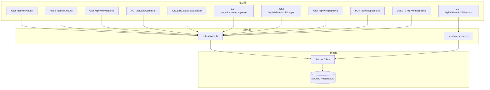
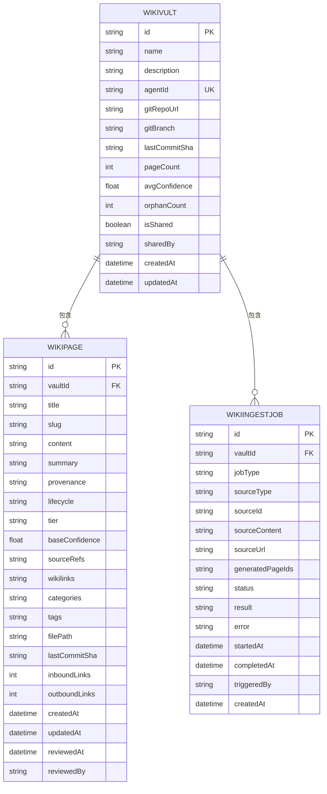
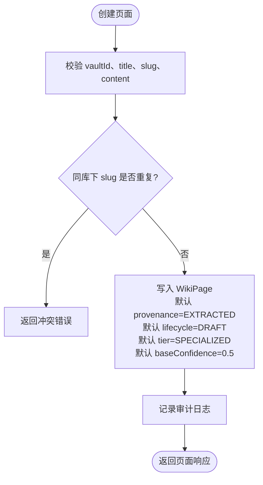
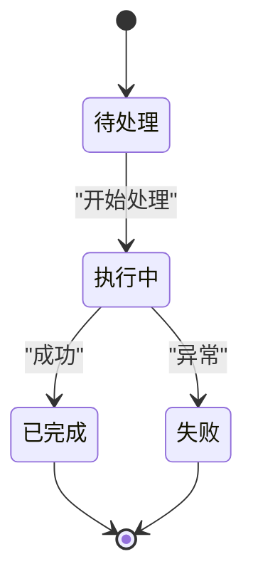
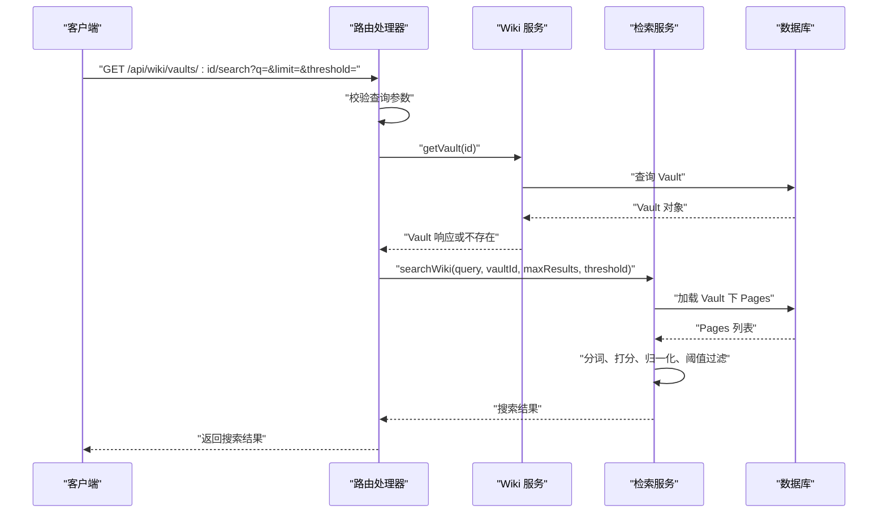
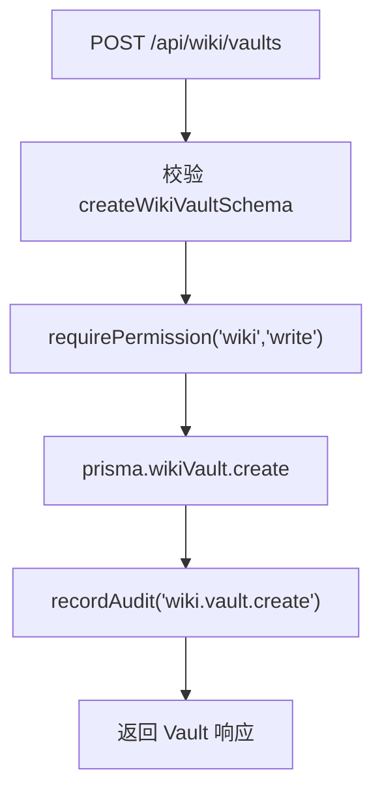
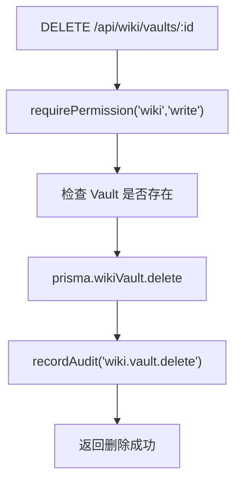
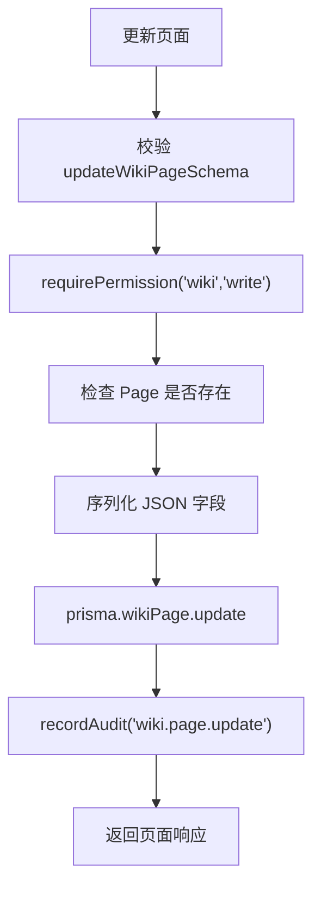
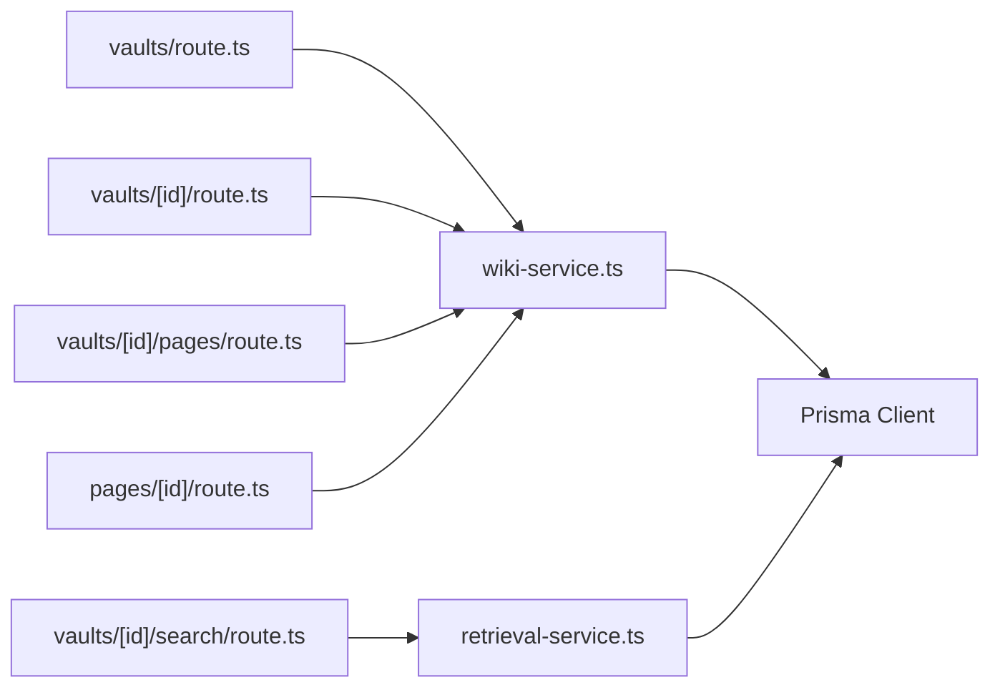
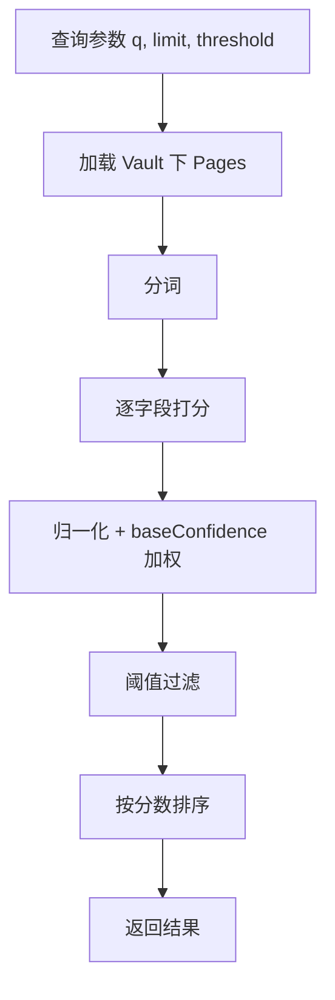

# 知识库实体

<cite>
**本文引用的文件**   
- [schema.prisma](file://packages/db/prisma/schema.prisma)
- [wiki-service.ts](file://apps/web/lib/services/wiki-service.ts)
- [schemas.ts](file://apps/web/lib/schemas.ts)
- [retrieval-service.ts](file://apps/web/lib/services/retrieval-service.ts)
- [vaults/route.ts](file://apps/web/app/api/wiki/vaults/route.ts)
- [vaults/[id]/route.ts](file://apps/web/app/api/wiki/vaults/[id]/route.ts)
- [vaults/[id]/pages/route.ts](file://apps/web/app/api/wiki/vaults/[id]/pages/route.ts)
- [pages/[id]/route.ts](file://apps/web/app/api/wiki/pages/[id]/route.ts)
- [vaults/[id]/search/route.ts](file://apps/web/app/api/wiki/vaults/[id]/search/route.ts)
- [migration.sql](file://packages/db/prisma/migrations/20261005033611_init_sqlite/migration.sql)
- [prisma-persistence-batch2.md](file://docs/superpowers/plans/2026-09-11-prisma-persistence-batch2.md)
</cite>

## 目录
1. [引言](#引言)
2. [项目结构](#项目结构)
3. [核心实体与表设计](#核心实体与表设计)
4. [架构总览](#架构总览)
5. [详细组件分析](#详细组件分析)
6. [依赖关系分析](#依赖关系分析)
7. [性能与向量检索优化](#性能与向量检索优化)
8. [故障排查指南](#故障排查指南)
9. [结论](#结论)

## 引言
本文聚焦知识库相关实体，围绕 `WikiVault`、`WikiPage`、`WikiIngestJob` 三个核心数据模型展开，解释其字段含义、设计意图、生命周期管理、Git 同步能力、共享权限控制、异步批量导入机制，以及当前实现中的向量检索语义和性能优化策略。文档同时给出 API 调用路径、查询模式和典型使用流程，帮助读者从“数据模型 → 服务层 → 接口层”完整理解知识库系统的运行方式。

## 项目结构
知识库功能主要分布在以下位置：
- 数据库模型定义位于 Prisma Schema。
- 业务逻辑集中在 `lib/services/wiki-service.ts`。
- 输入校验集中在 `lib/schemas.ts`。
- Next.js Route Handler 暴露 REST 风格接口。
- 检索能力由 `lib/services/retrieval-service.ts` 提供。

**图表来源**
- [vaults/route.ts:7-29](file://apps/web/app/api/wiki/vaults/route.ts#L7-L29)
- [vaults/[id]/route.ts:7-37](file://apps/web/app/api/wiki/vaults/[id]/route.ts#L7-L37)
- [vaults/[id]/pages/route.ts:7-33](file://apps/web/app/api/wiki/vaults/[id]/pages/route.ts#L7-L33)
- [pages/[id]/route.ts:7-37](file://apps/web/app/api/wiki/pages/[id]/route.ts#L7-L37)
- [vaults/[id]/search/route.ts:8-34](file://apps/web/app/api/wiki/vaults/[id]/search/route.ts#L8-L34)
- [wiki-service.ts:65-297](file://apps/web/lib/services/wiki-service.ts#L65-L297)
- [retrieval-service.ts:59-101](file://apps/web/lib/services/retrieval-service.ts#L59-L101)

**章节来源**
- [vaults/route.ts:1-30](file://apps/web/app/api/wiki/vaults/route.ts#L1-L30)
- [vaults/[id]/route.ts:1-38](file://apps/web/app/api/wiki/vaults/[id]/route.ts#L1-L38)
- [vaults/[id]/pages/route.ts:1-34](file://apps/web/app/api/wiki/vaults/[id]/pages/route.ts#L1-L34)
- [pages/[id]/route.ts:1-38](file://apps/web/app/api/wiki/pages/[id]/route.ts#L1-L38)
- [vaults/[id]/search/route.ts:1-35](file://apps/web/app/api/wiki/vaults/[id]/search/route.ts#L1-L35)

## 核心实体与表设计
### WikiVault：知识库容器
`WikiVault` 表示一个知识库容器，用于聚合一组页面、索引任务和相关配置。关键字段包括：
- `id`：主键。
- `name`、`description`：知识库名称与描述。
- `agentId`：可选绑定到某个 Agent，便于按 Agent 过滤。
- `gitRepoUrl`、`gitBranch`、`lastCommitSha`：Git 仓库地址、分支和最近提交哈希，用于 Git 同步场景。
- `pageCount`、`avgConfidence`、`orphanCount`：统计字段，分别表示页面数量、平均置信度和孤立页面数量。
- `isShared`、`sharedBy`：共享开关与共享来源标识。
- `createdAt`、`updatedAt`：创建与更新时间。
- 关联：`pages`、`ingestJobs`、`knowledgeConfig`。
- 索引：`isShared` 上建索引，便于快速筛选共享库。

设计要点：
- `agentId` 唯一约束保证每个 Agent 最多绑定一个知识库。
- `isShared` 支持跨 Agent 的共享知识库。
- Git 字段为后续同步机制预留，但当前代码未直接实现拉取或推送逻辑。
- 删除时通过外键级联删除页面和任务，保持文件系统递归删除语义。

**图表来源**
- [schema.prisma:397-419](file://packages/db/prisma/schema.prisma#L397-L419)
- [schema.prisma:421-454](file://packages/db/prisma/schema.prisma#L421-L454)
- [schema.prisma:456-480](file://packages/db/prisma/schema.prisma#L456-L480)

**章节来源**
- [schema.prisma:397-419](file://packages/db/prisma/schema.prisma#L397-L419)
- [migration.sql:279-304](file://packages/db/prisma/migrations/20261005033611_init_sqlite/migration.sql#L279-L304)
- [prisma-persistence-batch2.md:103-129](file://docs/superpowers/plans/2026-09-11-prisma-persistence-batch2.md#L103-L129)

### WikiPage：页面内容与管理元数据
`WikiPage` 表示知识库中的一个页面，承载正文内容与版本、来源、分类等元数据。关键字段包括：
- `title`、`slug`、`content`、`summary`：标题、唯一路径、正文、摘要。
- `provenance`：数据来源类型（如提取、合成、作者编写等）。
- `lifecycle`：生命周期状态（草稿、审核中、已验证、陈旧、废弃等）。
- `tier`：重要性层级（核心、专用、边缘案例等）。
- `baseConfidence`：基础置信度，参与检索加权。
- `sourceRefs`、`wikilinks`、`categories`、`tags`：来源引用、内部链接、分类、标签，均以 JSON 文本存储。
- `filePath`、`lastCommitSha`：文件路径与最后提交哈希，对应 Git 同步。
- `inboundLinks`、`outboundLinks`：入链、出链计数。
- `createdAt`、`updatedAt`、`reviewedAt`、`reviewedBy`：时间戳与审核信息。
- 唯一约束：`(vaultId, slug)` 保证同库内 slug 唯一。
- 索引：`(vaultId, lifecycle)`、`(vaultId, tier)` 加速按生命周期和层级筛选。

设计要点：
- 枚举值在迁移中从数据库枚举改为字符串列，以兼容 SQLite 并开放集合值域。
- JSON 数组字段统一以字符串形式持久化，服务层进行序列化与反序列化。
- 删除页面仅影响自身；删除 Vault 则级联删除所有页面和任务。

**图表来源**
- [wiki-service.ts:211-258](file://apps/web/lib/services/wiki-service.ts#L211-L258)
- [schemas.ts:217-230](file://apps/web/lib/schemas.ts#L217-L230)

**章节来源**
- [schema.prisma:421-454](file://packages/db/prisma/schema.prisma#L421-L454)
- [wiki-service.ts:211-258](file://apps/web/lib/services/wiki-service.ts#L211-L258)
- [schemas.ts:217-230](file://apps/web/lib/schemas.ts#L217-L230)

### WikiIngestJob：异步批量导入任务
`WikiIngestJob` 表示知识库内容的异步处理任务，常用于批量导入、解析、生成页面等场景。关键字段包括：
- `jobType`、`sourceType`、`sourceId`、`sourceContent`、`sourceUrl`：任务类型、来源类型、来源标识、来源内容与 URL。
- `generatedPageIds`：本次任务生成的页面 ID 列表（JSON 文本）。
- `status`：任务状态（默认 PENDING），用于跟踪执行进度。
- `result`、`error`：结果与错误信息（JSON 文本或字符串）。
- `startedAt`、`completedAt`、`triggeredBy`、`createdAt`：时间与触发者信息。
- 索引：`(vaultId, status)`、`(jobType, status)` 加速按库与任务类型筛选。

设计要点：
- 任务与 Vault 强关联，删除 Vault 会级联删除任务。
- 当前代码未暴露任务创建与执行的 REST 接口，但测试用例展示了任务的基本结构与级联删除行为。
- 任务状态机可扩展为 PENDING → RUNNING → COMPLETED/FAILED，配合 UI 展示进度。

**图表来源**
- [schema.prisma:456-480](file://packages/db/prisma/schema.prisma#L456-L480)
- [wiki-service.test.ts:64-73](file://apps/web/lib/__tests__/wiki-service.test.ts#L64-L73)

**章节来源**
- [schema.prisma:456-480](file://packages/db/prisma/schema.prisma#L456-L480)
- [wiki-service.test.ts:64-73](file://apps/web/lib/__tests__/wiki-service.test.ts#L64-L73)

## 架构总览
知识库系统采用分层架构：
- 接口层：Next.js Route Handler 接收请求，参数校验，调用服务层。
- 服务层：`wiki-service.ts` 负责 Vault/Page 的 CRUD、权限检查、审计记录；`retrieval-service.ts` 负责检索与打分。
- 数据层：Prisma Client 访问数据库，维护外键、索引、级联删除。

**图表来源**
- [vaults/[id]/search/route.ts:8-34](file://apps/web/app/api/wiki/vaults/[id]/search/route.ts#L8-L34)
- [wiki-service.ts:88-94](file://apps/web/lib/services/wiki-service.ts#L88-L94)
- [retrieval-service.ts:59-101](file://apps/web/lib/services/retrieval-service.ts#L59-L101)

**章节来源**
- [vaults/[id]/search/route.ts:1-35](file://apps/web/app/api/wiki/vaults/[id]/search/route.ts#L1-L35)
- [wiki-service.ts:88-94](file://apps/web/lib/services/wiki-service.ts#L88-L94)
- [retrieval-service.ts:59-101](file://apps/web/lib/services/retrieval-service.ts#L59-L101)

## 详细组件分析
### 知识库容器的管理设计
#### 创建与列出
- 创建 Vault：POST `/api/wiki/vaults`，校验名称、描述、Agent 绑定、Git 地址、分支、共享标志。
- 列出 Vault：GET `/api/wiki/vaults`，支持分页、按 Agent 过滤、按共享标志过滤。

**图表来源**
- [vaults/route.ts:17-29](file://apps/web/app/api/wiki/vaults/route.ts#L17-L29)
- [wiki-service.ts:96-119](file://apps/web/lib/services/wiki-service.ts#L96-L119)
- [schemas.ts:192-199](file://apps/web/lib/schemas.ts#L192-L199)

**章节来源**
- [vaults/route.ts:1-30](file://apps/web/app/api/wiki/vaults/route.ts#L1-L30)
- [wiki-service.ts:96-119](file://apps/web/lib/services/wiki-service.ts#L96-L119)
- [schemas.ts:192-199](file://apps/web/lib/schemas.ts#L192-L199)

#### 更新与删除
- 更新 Vault：PUT `/api/wiki/vaults/:id`，支持修改名称、描述、Git 地址、分支、共享标志。
- 删除 Vault：DELETE `/api/wiki/vaults/:id`，级联删除页面与任务。

**图表来源**
- [vaults/[id]/route.ts:29-37](file://apps/web/app/api/wiki/vaults/[id]/route.ts#L29-L37)
- [wiki-service.ts:135-144](file://apps/web/lib/services/wiki-service.ts#L135-L144)

**章节来源**
- [vaults/[id]/route.ts:1-38](file://apps/web/app/api/wiki/vaults/[id]/route.ts#L1-L38)
- [wiki-service.ts:121-144](file://apps/web/lib/services/wiki-service.ts#L121-L144)

#### Git 同步机制
- 字段设计：`gitRepoUrl`、`gitBranch`、`lastCommitSha` 表明系统预留了 Git 同步能力。
- 当前实现：代码中未发现实际的 Git 拉取、合并、推送逻辑，这些字段主要用于未来集成或外部工具同步。
- 建议扩展：可引入后台任务定期拉取仓库变更，对比 `lastCommitSha`，增量更新页面并记录审计日志。

**章节来源**
- [schema.prisma:397-419](file://packages/db/prisma/schema.prisma#L397-L419)

#### 共享权限控制
- 共享标志：`isShared` 表示该 Vault 是否为共享知识库。
- 过滤查询：列出 Vault 时支持 `shared=true` 过滤，便于前端展示共享库。
- 权限检查：所有写操作均通过 `requirePermission('wiki', 'write')` 校验，确保只有具备权限的用户可修改。

**章节来源**
- [schema.prisma:397-419](file://packages/db/prisma/schema.prisma#L397-L419)
- [wiki-service.ts:65-86](file://apps/web/lib/services/wiki-service.ts#L65-L86)

### WikiPage 的生命周期管理
#### 内容版本控制
- 字段设计：`content`、`summary`、`filePath`、`lastCommitSha` 支持内容存储与 Git 关联。
- 版本历史：当前未实现显式版本表，可通过 Git 提交历史或外部版本系统管理。
- 审核流程：`reviewedAt`、`reviewedBy` 支持人工审核标记。

#### 元数据管理
- 来源与可信度：`provenance`、`baseConfidence` 表示数据来源与基础可信度。
- 分类与标签：`categories`、`tags`、`wikilinks` 支持页面组织与互链。
- 层级与状态：`tier`、`lifecycle` 支持页面重要性与生命周期管理。

**图表来源**
- [pages/[id]/route.ts:14-27](file://apps/web/app/api/wiki/pages/[id]/route.ts#L14-L27)
- [wiki-service.ts:261-284](file://apps/web/lib/services/wiki-service.ts#L261-L284)
- [schemas.ts:232-243](file://apps/web/lib/schemas.ts#L232-L243)

**章节来源**
- [pages/[id]/route.ts:1-38](file://apps/web/app/api/wiki/pages/[id]/route.ts#L1-L38)
- [wiki-service.ts:261-284](file://apps/web/lib/services/wiki-service.ts#L261-L284)
- [schemas.ts:232-243](file://apps/web/lib/schemas.ts#L232-L243)

### WikiIngestJob 的异步处理机制
#### 批量导入任务
- 任务结构：`jobType`、`sourceType`、`sourceId`、`sourceContent`、`sourceUrl` 描述任务来源与内容。
- 生成页面：`generatedPageIds` 记录本次任务生成的页面 ID。
- 状态跟踪：`status`、`startedAt`、`completedAt`、`error` 支持任务进度与错误追踪。

#### 当前实现
- 未暴露任务创建与执行的 REST 接口。
- 测试用例展示了任务的基本结构与级联删除行为。

**章节来源**
- [schema.prisma:456-480](file://packages/db/prisma/schema.prisma#L456-L480)
- [wiki-service.test.ts:64-73](file://apps/web/lib/__tests__/wiki-service.test.ts#L64-L73)

## 依赖关系分析

**图表来源**
- [vaults/route.ts:1-30](file://apps/web/app/api/wiki/vaults/route.ts#L1-L30)
- [vaults/[id]/route.ts:1-38](file://apps/web/app/api/wiki/vaults/[id]/route.ts#L1-L38)
- [vaults/[id]/pages/route.ts:1-34](file://apps/web/app/api/wiki/vaults/[id]/pages/route.ts#L1-L34)
- [pages/[id]/route.ts:1-38](file://apps/web/app/api/wiki/pages/[id]/route.ts#L1-L38)
- [vaults/[id]/search/route.ts:1-35](file://apps/web/app/api/wiki/vaults/[id]/search/route.ts#L1-L35)
- [wiki-service.ts:1-297](file://apps/web/lib/services/wiki-service.ts#L1-L297)
- [retrieval-service.ts:59-101](file://apps/web/lib/services/retrieval-service.ts#L59-L101)

**章节来源**
- [wiki-service.ts:1-297](file://apps/web/lib/services/wiki-service.ts#L1-L297)
- [retrieval-service.ts:59-101](file://apps/web/lib/services/retrieval-service.ts#L59-L101)

## 性能与向量检索优化
### 当前检索实现
- 检索入口：`GET /api/wiki/vaults/:id/search`。
- 参数校验：`q`、`limit`、`threshold`，其中 `threshold` 为置信度门限。
- 检索流程：
  - 加载 Vault 下的所有页面。
  - 对每个页面进行分词、打分、归一化。
  - 结合 `baseConfidence` 计算最终置信度。
  - 过滤低于阈值的候选，返回 Top-N 结果。

**图表来源**
- [vaults/[id]/search/route.ts:8-34](file://apps/web/app/api/wiki/vaults/[id]/search/route.ts#L8-L34)
- [retrieval-service.ts:59-101](file://apps/web/lib/services/retrieval-service.ts#L59-L101)
- [schemas.ts:245-250](file://apps/web/lib/schemas.ts#L245-L250)

**章节来源**
- [vaults/[id]/search/route.ts:1-35](file://apps/web/app/api/wiki/vaults/[id]/search/route.ts#L1-L35)
- [retrieval-service.ts:59-101](file://apps/web/lib/services/retrieval-service.ts#L59-L101)
- [schemas.ts:245-250](file://apps/web/lib/schemas.ts#L245-L250)

### 优化建议
- 向量索引：当前为 BM25 类轻量检索，未来可引入向量数据库或全文索引提升大规模数据检索性能。
- 缓存策略：对热门 Vault 的检索结果进行缓存，减少重复计算。
- 分页与流式：对大 Vault 的分页加载与流式返回可降低内存压力。
- 异步预处理：在页面更新时预计算嵌入向量或倒排索引，避免实时全量扫描。

## 故障排查指南
### 常见问题
- Vault 不存在：GET/PUT/DELETE Vault 时若 ID 无效，返回 404。
- Page 不存在：GET/PUT/DELETE Page 时若 ID 无效，返回 404。
- Slug 冲突：创建 Page 时若同库下 slug 重复，返回冲突错误。
- 权限不足：写操作需具备 `wiki.write` 权限，否则拒绝。
- 检索参数非法：搜索接口参数不合法时返回验证错误。

### 排查步骤
1. 检查请求参数是否符合 schema 校验规则。
2. 确认用户具备相应权限。
3. 检查数据库中是否存在对应 Vault/Page。
4. 查看审计日志确认操作记录。
5. 对于检索问题，检查 `baseConfidence` 与 `threshold` 设置是否合理。

**章节来源**
- [wiki-service.ts:121-144](file://apps/web/lib/services/wiki-service.ts#L121-L144)
- [wiki-service.ts:211-258](file://apps/web/lib/services/wiki-service.ts#L211-L258)
- [vaults/[id]/search/route.ts:8-34](file://apps/web/app/api/wiki/vaults/[id]/search/route.ts#L8-L34)

## 结论
知识库系统通过 `WikiVault`、`WikiPage`、`WikiIngestJob` 三个核心实体实现了知识库容器管理、页面生命周期管理与异步任务处理。当前实现提供了完整的 CRUD 接口、权限控制、审计记录与轻量检索能力。Git 同步字段为未来扩展预留空间，向量检索目前基于 BM25 类算法，可通过缓存、索引与异步预处理进一步优化性能。整体架构清晰，适合中小规模知识库场景，并为后续演进提供了良好基础。