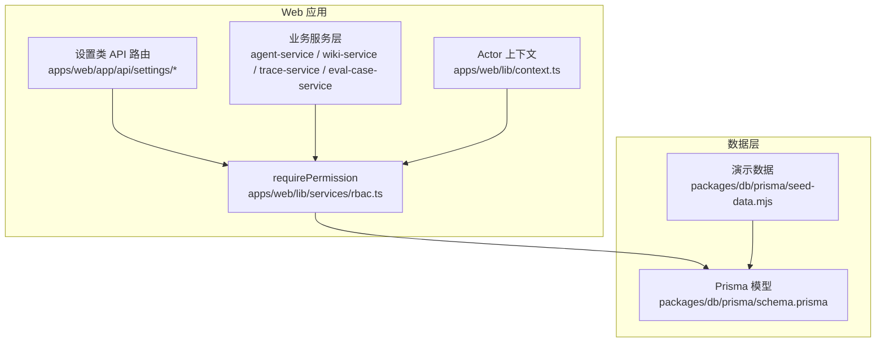
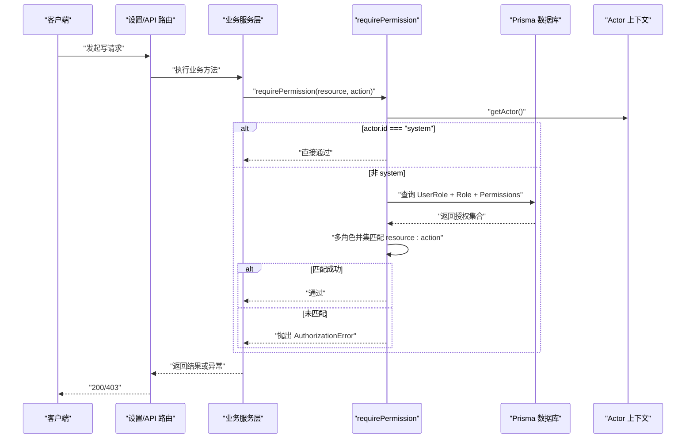
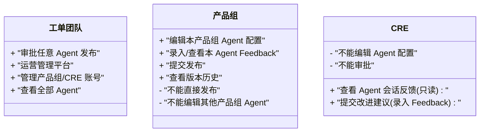
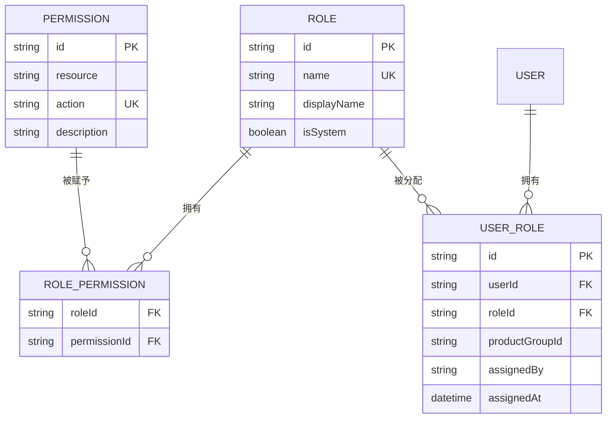
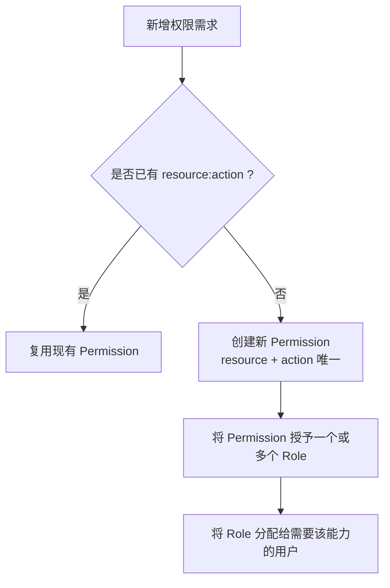
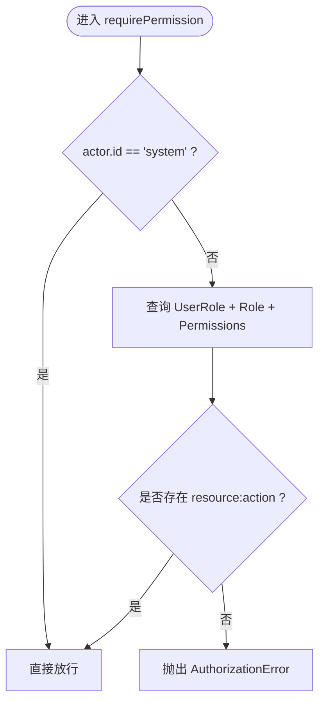
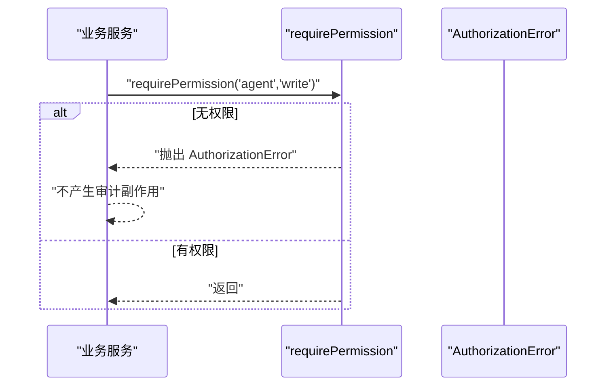
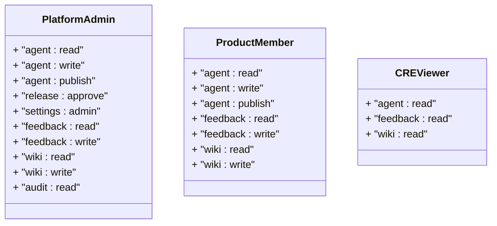
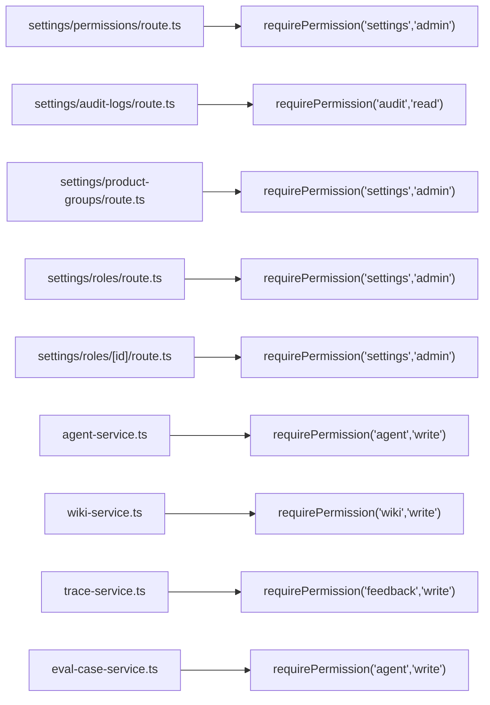

# RBAC 权限模型

<cite>
**本文引用的文件**   
- [apps/web/lib/services/rbac.ts](file://apps/web/lib/services/rbac.ts)
- [apps/web/lib/context.ts](file://apps/web/lib/context.ts)
- [packages/db/prisma/schema.prisma](file://packages/db/prisma/schema.prisma)
- [packages/db/prisma/seed-data.mjs](file://packages/db/prisma/seed-data.mjs)
- [apps/web/app/api/__tests__/rbac.test.ts](file://apps/web/app/api/__tests__/rbac.test.ts)
- [apps/web/app/api/settings/permissions/route.ts](file://apps/web/app/api/settings/permissions/route.ts)
- [apps/web/app/api/settings/audit-logs/route.ts](file://apps/web/app/api/settings/audit-logs/route.ts)
- [apps/web/app/api/settings/product-groups/route.ts](file://apps/web/app/api/settings/product-groups/route.ts)
- [apps/web/app/api/settings/roles/[id]/route.ts](file://apps/web/app/api/settings/roles/[id]/route.ts)
- [apps/web/app/api/settings/roles/route.ts](file://apps/web/app/api/settings/roles/route.ts)
- [apps/web/lib/services/agent-service.ts](file://apps/web/lib/services/agent-service.ts)
- [apps/web/lib/services/trace-service.ts](file://apps/web/lib/services/trace-service.ts)
- [apps/web/lib/services/wiki-service.ts](file://apps/web/lib/services/wiki-service.ts)
- [apps/web/lib/services/eval-case-service.ts](file://apps/web/lib/services/eval-case-service.ts)
- [docs/superpowers/specs/2026-07-06-agent-improvement-platform-mvp-design.md](file://docs/superpowers/specs/2026-07-06-agent-improvement-platform-mvp-design.md)
</cite>

## 目录
1. [引言](#引言)
2. [项目结构](#项目结构)
3. [核心组件](#核心组件)
4. [架构总览](#架构总览)
5. [详细组件分析](#详细组件分析)
6. [依赖关系分析](#依赖关系分析)
7. [性能考虑](#性能考虑)
8. [故障排查指南](#故障排查指南)
9. [结论](#结论)
10. [附录](#附录)

## 引言
本文件面向开发者与平台运营人员，系统化说明 agent-up 项目的 RBAC（基于角色的访问控制）权限模型。文档围绕三角色模型（工单团队、产品组、CRE）、实体关系（UserRole、Role、Permission）、资源与操作命名规范、系统豁免机制（system actor）、权限检查流程、错误处理策略、性能优化建议以及权限分配示例与最佳实践展开。

## 项目结构
RBAC 相关代码主要分布在以下位置：
- 权限服务层：apps/web/lib/services/rbac.ts
- 请求级身份上下文：apps/web/lib/context.ts
- 数据库模型定义：packages/db/prisma/schema.prisma
- 演示数据与默认角色/权限：packages/db/prisma/seed-data.mjs
- 设置类 API 路由（使用 requirePermission）：settings/* 下的 route.ts
- 业务服务层（在写操作中调用 requirePermission）：agent-service.ts、wiki-service.ts、trace-service.ts、eval-case-service.ts
- 单元测试：apps/web/app/api/__tests__/rbac.test.ts
- 三角色设计说明：docs/superpowers/specs/2026-07-06-agent-improvement-platform-mvp-design.md

**图示来源**
- [apps/web/lib/services/rbac.ts:1-52](file://apps/web/lib/services/rbac.ts#L1-L52)
- [apps/web/lib/context.ts:1-97](file://apps/web/lib/context.ts#L1-L97)
- [packages/db/prisma/schema.prisma:486-528](file://packages/db/prisma/schema.prisma#L486-L528)
- [packages/db/prisma/seed-data.mjs:28-92](file://packages/db/prisma/seed-data.mjs#L28-L92)

**章节来源**
- [apps/web/lib/services/rbac.ts:1-52](file://apps/web/lib/services/rbac.ts#L1-L52)
- [apps/web/lib/context.ts:1-97](file://apps/web/lib/context.ts#L1-L97)
- [packages/db/prisma/schema.prisma:486-528](file://packages/db/prisma/schema.prisma#L486-L528)
- [packages/db/prisma/seed-data.mjs:28-92](file://packages/db/prisma/seed-data.mjs#L28-L92)

## 核心组件
- 权限服务 requirePermission：统一入口，负责从当前 Actor 解析其 UserRole → Role → RolePermission → Permission，并执行多角色并集授权判断；对 system actor 直接豁免；未匹配则抛出 AuthorizationError。
- Actor 上下文：提供 resolveActor、withActor、getActor，管理请求级身份来源（签名令牌优先，明文头仅在信任开关开启时采纳），并提供 AsyncLocalStorage 贯穿异步续体。
- Prisma 模型：Role、Permission、RolePermission、UserRole 构成 RBAC 四元关系；AuditLog 记录审计轨迹。
- 演示数据：预置三个系统角色（platform_admin、product_member、cre_viewer）及一组标准权限（agent、release、settings、feedback、wiki、audit）。

**章节来源**
- [apps/web/lib/services/rbac.ts:1-52](file://apps/web/lib/services/rbac.ts#L1-L52)
- [apps/web/lib/context.ts:1-97](file://apps/web/lib/context.ts#L1-L97)
- [packages/db/prisma/schema.prisma:486-528](file://packages/db/prisma/schema.prisma#L486-L528)
- [packages/db/prisma/seed-data.mjs:28-92](file://packages/db/prisma/seed-data.mjs#L28-L92)

## 架构总览
RBAC 的运行时决策链如下：
- 请求进入后，由 context.ts 解析 Actor（优先签名令牌，其次可信明文头，否则匿名）。
- 业务服务或设置 API 在写路径中调用 requirePermission(resource, action)。
- requirePermission 读取当前 Actor.id，若为 system 直接放行；否则查询该用户的所有 UserRole，并沿 Role → RolePermission → Permission 进行并集匹配。
- 匹配成功则继续执行业务逻辑；失败则抛出 AuthorizationError，上层统一转为 403。

**图示来源**
- [apps/web/lib/services/rbac.ts:21-51](file://apps/web/lib/services/rbac.ts#L21-L51)
- [apps/web/lib/context.ts:65-90](file://apps/web/lib/context.ts#L65-L90)
- [apps/web/app/api/settings/permissions/route.ts:1-27](file://apps/web/app/api/settings/permissions/route.ts#L1-L27)

## 详细组件分析

### 三角色模型与职责划分
三角色模型来源于 MVP 设计文档，明确三类角色的能力边界：
- 工单团队（平台管理员）：拥有最高权限，可审批任意 Agent 发布、运营管理平台、管理产品组与 CRE 账号、查看全部 Agent。
- 产品组：编辑本产品组的 Agent 配置、录入/查看本 Agent 的 Feedback、提交发布、查看版本历史；不能直接发布，不能编辑其他产品组的 Agent。
- CRE：查看 Agent 会话反馈（只读）、提交改进建议（手动录入 Feedback）；不能编辑 Agent 配置，不能审批。

**图示来源**
- [docs/superpowers/specs/2026-07-06-agent-improvement-platform-mvp-design.md:152-162](file://docs/superpowers/specs/2026-07-06-agent-improvement-platform-mvp-design.md#L152-L162)

**章节来源**
- [docs/superpowers/specs/2026-07-06-agent-improvement-platform-mvp-design.md:152-162](file://docs/superpowers/specs/2026-07-06-agent-improvement-platform-mvp-design.md#L152-L162)

### 实体关系与多角色并集授权
数据库层面采用经典的 RBAC 四表模型：
- Role：角色定义，包含 isSystem 标记。
- Permission：权限原子单元，唯一键为 (resource, action)。
- RolePermission：角色到权限的多对多映射。
- UserRole：用户到角色的多对多映射，支持 productGroupId 作用域。

**图示来源**
- [packages/db/prisma/schema.prisma:486-528](file://packages/db/prisma/schema.prisma#L486-L528)

多角色并集授权机制：
- requirePermission 会一次性拉取当前用户的所有 UserRole，并遍历每个 Role 的 permissions，只要任一角色包含目标 resource:action，即视为授权通过。
- 测试用例验证了“两个角色各自的权限都算数”的行为。

**章节来源**
- [packages/db/prisma/schema.prisma:486-528](file://packages/db/prisma/schema.prisma#L486-L528)
- [apps/web/lib/services/rbac.ts:28-43](file://apps/web/lib/services/rbac.ts#L28-L43)
- [apps/web/app/api/__tests__/rbac.test.ts:84-97](file://apps/web/app/api/__tests__/rbac.test.ts#L84-L97)

### 资源与操作的命名规范与分类体系
- 资源（resource）：以领域对象为单位，如 agent、release、settings、feedback、wiki、audit。
- 操作（action）：以动作语义为单位，如 read、write、publish、approve、admin。
- 权限原子单元：Permission 表以 (resource, action) 作为唯一键，确保幂等与去重。
- 演示数据中的权限清单体现了系统内已定义的领域与操作组合。

**图示来源**
- [packages/db/prisma/schema.prisma:497-506](file://packages/db/prisma/schema.prisma#L497-L506)
- [packages/db/prisma/seed-data.mjs:28-39](file://packages/db/prisma/seed-data.mjs#L28-L39)

**章节来源**
- [packages/db/prisma/schema.prisma:497-506](file://packages/db/prisma/schema.prisma#L497-L506)
- [packages/db/prisma/seed-data.mjs:28-39](file://packages/db/prisma/seed-data.mjs#L28-L39)

### 系统豁免机制（system actor）与安全考虑
- system actor：当 getActor().id === "system" 时，requirePermission 直接放行，用于进程内自发动作（后台重算、懒生成、审计等）。
- Actor 上下文：resolveActor 优先校验签名会话令牌；在未启用信任明文头的生产环境，x-actor-* 头不会成为可信身份来源；缺省上下文为 SYSTEM_ACTOR，避免后台直调服务时被误判为匿名。
- 安全要点：
  - 令牌校验失败绝不回落到明文头，防止伪造。
  - 匿名主体 role 不是 platform_admin，避免“未认证 = 超管”。
  - 明文头仅在显式信任开关开启时使用，生产需 AUTH_TRUST_ACTOR_HEADERS=1。

**图示来源**
- [apps/web/lib/services/rbac.ts:21-51](file://apps/web/lib/services/rbac.ts#L21-L51)
- [apps/web/lib/context.ts:32-46](file://apps/web/lib/context.ts#L32-L46)
- [apps/web/lib/context.ts:65-90](file://apps/web/lib/context.ts#L65-L90)

**章节来源**
- [apps/web/lib/services/rbac.ts:1-20](file://apps/web/lib/services/rbac.ts#L1-L20)
- [apps/web/lib/context.ts:1-46](file://apps/web/lib/context.ts#L1-L46)
- [apps/web/lib/context.ts:65-90](file://apps/web/lib/context.ts#L65-L90)

### 权限检查流程与错误处理
- 检查流程：
  - 服务层在写操作前调用 requirePermission(resource, action)。
  - 若 Actor 为 system，直接通过。
  - 否则查询并匹配多角色并集。
  - 未匹配则抛出 AuthorizationError。
- 错误处理：
  - AuthorizationError 携带 actorId 与 required 信息，便于上层统一转换为 403 响应。
  - 测试覆盖“无权限 → AuthorizationError”和“同用户另一资源权限不受影响”的场景。

**图示来源**
- [apps/web/lib/services/rbac.ts:45-51](file://apps/web/lib/services/rbac.ts#L45-L51)
- [apps/web/app/api/__tests__/rbac.test.ts:73-82](file://apps/web/app/api/__tests__/rbac.test.ts#L73-L82)
- [apps/web/app/api/__tests__/rbac.test.ts:113-122](file://apps/web/app/api/__tests__/rbac.test.ts#L113-L122)

**章节来源**
- [apps/web/lib/services/rbac.ts:21-51](file://apps/web/lib/services/rbac.ts#L21-L51)
- [apps/web/app/api/__tests__/rbac.test.ts:73-82](file://apps/web/app/api/__tests__/rbac.test.ts#L73-L82)
- [apps/web/app/api/__tests__/rbac.test.ts:113-122](file://apps/web/app/api/__tests__/rbac.test.ts#L113-L122)

### 权限矩阵与默认角色
演示数据定义了三个系统角色及其权限集合：
- platform_admin（平台管理员）：拥有全部权限（agent/read/write/publish、release/approve、settings/admin、feedback/read/write、wiki/read/write、audit/read）。
- product_member（产品组成员）：具备 agent 读写与 publish、feedback 读写、wiki 读写。
- cre_viewer（CRE 查看者）：具备 agent/read、feedback/read、wiki/read。

**图示来源**
- [packages/db/prisma/seed-data.mjs:41-92](file://packages/db/prisma/seed-data.mjs#L41-L92)

**章节来源**
- [packages/db/prisma/seed-data.mjs:41-92](file://packages/db/prisma/seed-data.mjs#L41-L92)

### 权限分配示例与最佳实践
- 示例一：为产品组成员授予 agent:write
  - 步骤：创建 Permission(agent, write)（若不存在）→ 将该 Permission 授予 role-product → 将 role-product 分配给产品组成员。
- 示例二：为 CRE 授予 feedback:write
  - 步骤：创建 Permission(feedback, write) → 将该 Permission 授予 role-cre → 将 role-cre 分配给 CRE 成员。
- 最佳实践：
  - 始终在服务层写操作前调用 requirePermission，避免绕过。
  - 使用最小权限原则：仅授予完成工作所需的最小权限集合。
  - 利用多角色并集：将通用能力拆分为多个细粒度角色，按需组合。
  - 保持 resource:action 命名一致，便于审计与排障。
  - 谨慎使用 system actor：仅用于后台自发动作，不在用户请求路径中伪造。

**章节来源**
- [apps/web/lib/services/rbac.ts:1-20](file://apps/web/lib/services/rbac.ts#L1-L20)
- [packages/db/prisma/seed-data.mjs:28-92](file://packages/db/prisma/seed-data.mjs#L28-L92)

## 依赖关系分析
- 设置类 API 路由依赖 requirePermission 保护敏感操作：
  - settings/permissions/route.ts：POST 创建权限需 settings:admin。
  - settings/audit-logs/route.ts：GET 审计日志需 audit:read。
  - settings/product-groups/route.ts：POST 创建产品组需 settings:admin。
  - settings/roles/route.ts 与 settings/roles/[id]/route.ts：角色管理需 settings:admin。
- 业务服务层在写路径中调用 requirePermission：
  - agent-service.ts：更新 Agent 需 agent:write。
  - wiki-service.ts：写入 Wiki 需 wiki:write。
  - trace-service.ts：写入 Trace/Feedback 需 feedback:write。
  - eval-case-service.ts：评测用例变更需 agent:write。

**图示来源**
- [apps/web/app/api/settings/permissions/route.ts:1-27](file://apps/web/app/api/settings/permissions/route.ts#L1-L27)
- [apps/web/app/api/settings/audit-logs/route.ts:14](file://apps/web/app/api/settings/audit-logs/route.ts#L14)
- [apps/web/app/api/settings/product-groups/route.ts:33](file://apps/web/app/api/settings/product-groups/route.ts#L33)
- [apps/web/app/api/settings/roles/route.ts:50](file://apps/web/app/api/settings/roles/route.ts#L50)
- [apps/web/app/api/settings/roles/[id]/route.ts:45](file://apps/web/app/api/settings/roles/[id]/route.ts#L45)
- [apps/web/lib/services/agent-service.ts:279](file://apps/web/lib/services/agent-service.ts#L279)
- [apps/web/lib/services/wiki-service.ts:104](file://apps/web/lib/services/wiki-service.ts#L104)
- [apps/web/lib/services/trace-service.ts:105](file://apps/web/lib/services/trace-service.ts#L105)
- [apps/web/lib/services/eval-case-service.ts:97](file://apps/web/lib/services/eval-case-service.ts#L97)

**章节来源**
- [apps/web/app/api/settings/permissions/route.ts:1-27](file://apps/web/app/api/settings/permissions/route.ts#L1-L27)
- [apps/web/app/api/settings/audit-logs/route.ts:14](file://apps/web/app/api/settings/audit-logs/route.ts#L14)
- [apps/web/app/api/settings/product-groups/route.ts:33](file://apps/web/app/api/settings/product-groups/route.ts#L33)
- [apps/web/app/api/settings/roles/route.ts:50](file://apps/web/app/api/settings/roles/route.ts#L50)
- [apps/web/app/api/settings/roles/[id]/route.ts:45](file://apps/web/app/api/settings/roles/[id]/route.ts#L45)
- [apps/web/lib/services/agent-service.ts:279](file://apps/web/lib/services/agent-service.ts#L279)
- [apps/web/lib/services/wiki-service.ts:104](file://apps/web/lib/services/wiki-service.ts#L104)
- [apps/web/lib/services/trace-service.ts:105](file://apps/web/lib/services/trace-service.ts#L105)
- [apps/web/lib/services/eval-case-service.ts:97](file://apps/web/lib/services/eval-case-service.ts#L97)

## 性能考虑
- 单次批量查询：requirePermission 使用一次 prisma.userRole.findMany 并 include 关联表，减少多次往返。
- 内存匹配：在 Node 侧对 grants 数组进行 some 匹配，时间复杂度近似 O(U×P)，其中 U 为用户角色数，P 为角色权限数；通常较小，开销可控。
- 缓存建议：
  - 对高频用户的 UserRole 与 RolePermissions 做短期缓存（例如按 actor.id 缓存数秒至分钟级），降低重复查询压力。
  - 注意缓存失效策略：角色/权限变更后需及时清理对应缓存。
- 索引建议：
  - UserRole.userId 已参与查询条件，建议在数据库层确保该列有合适索引（Prisma 外键通常自带索引）。
  - RolePermission.roleId 与 permissionId 复合主键已存在，利于快速查找。

[本节为通用性能指导，不直接分析具体文件]

## 故障排查指南
- 现象：调用 requirePermission 抛出 AuthorizationError
  - 可能原因：
    - 当前 Actor 未持有目标 resource:action。
    - 当前 Actor 为 anonymous（未认证且未信任明文头）。
    - 后台直调未设置 withActor 作用域，但 getActor 默认返回 system，因此不会抛错；若期望走权限检查，需显式设置 withActor。
  - 排查步骤：
    - 确认 Actor 是否正确解析（context.ts 的 resolveActor 与 trustUnsignedActorHeaders）。
    - 检查 UserRole 与 RolePermission 是否已正确创建。
    - 核对 resource:action 是否与 Permission 定义一致。
- 现象：设置类 API 返回 403
  - 可能原因：缺少 settings:admin 或 audit:read 等权限。
  - 排查步骤：
    - 检查当前用户是否被分配了相应 Role。
    - 检查 Role 是否包含对应 Permission。
- 现象：后台任务行为异常
  - 可能原因：误用 system actor 导致绕过权限检查。
  - 排查步骤：
    - 确认后台任务是否确实应豁免（如审计、重算）。
    - 如需权限检查，请显式设置 withActor 并使用真实用户身份。

**章节来源**
- [apps/web/lib/services/rbac.ts:21-51](file://apps/web/lib/services/rbac.ts#L21-L51)
- [apps/web/lib/context.ts:53-90](file://apps/web/lib/context.ts#L53-L90)
- [apps/web/app/api/__tests__/rbac.test.ts:99-110](file://apps/web/app/api/__tests__/rbac.test.ts#L99-L110)

## 结论
本项目采用经典 RBAC 模型，结合 Actor 上下文与 requirePermission 统一入口，实现了清晰、可扩展的权限控制。三角色模型明确了工单团队、产品组与 CRE 的职责边界；多角色并集授权增强了灵活性；system actor 豁免机制兼顾了后台任务的运行效率与安全隔离。通过统一的 resource:action 命名与演示数据，权限矩阵清晰可见，便于运维与审计。建议在后续演进中引入缓存与更细粒度的作用域控制，进一步提升性能与安全性。

[本节为总结性内容，不直接分析具体文件]

## 附录
- 关键实现路径参考：
  - 权限检查入口：apps/web/lib/services/rbac.ts
  - Actor 上下文：apps/web/lib/context.ts
  - 数据库模型：packages/db/prisma/schema.prisma
  - 演示数据与默认角色：packages/db/prisma/seed-data.mjs
  - 设置类 API 路由：apps/web/app/api/settings/*
  - 业务服务层调用点：apps/web/lib/services/agent-service.ts、wiki-service.ts、trace-service.ts、eval-case-service.ts
  - 单元测试：apps/web/app/api/__tests__/rbac.test.ts
  - 三角色设计说明：docs/superpowers/specs/2026-07-06-agent-improvement-platform-mvp-design.md

[本节为索引性内容，不直接分析具体文件]