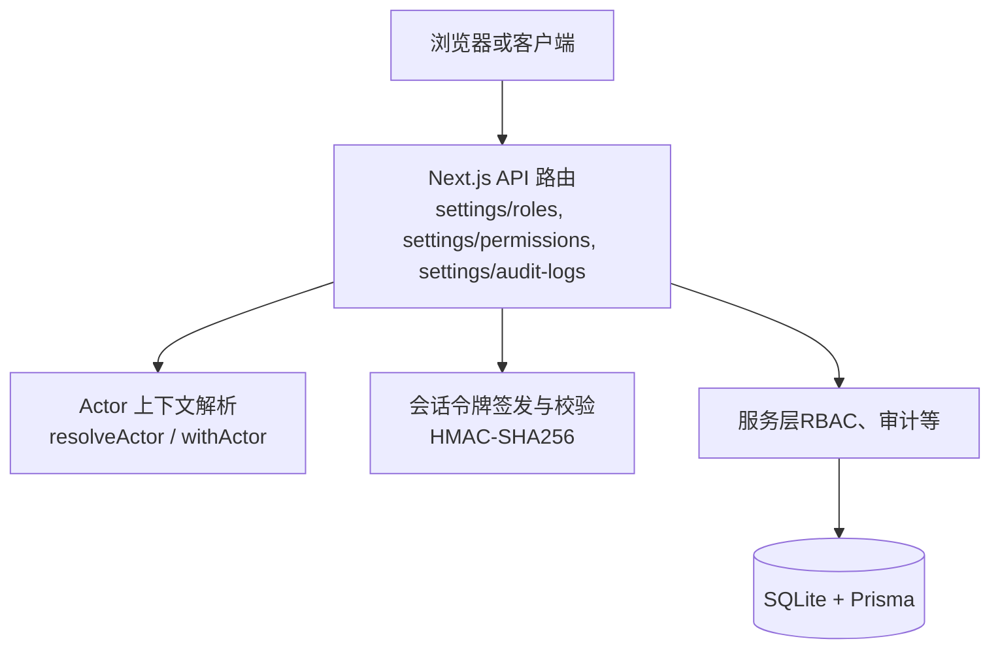
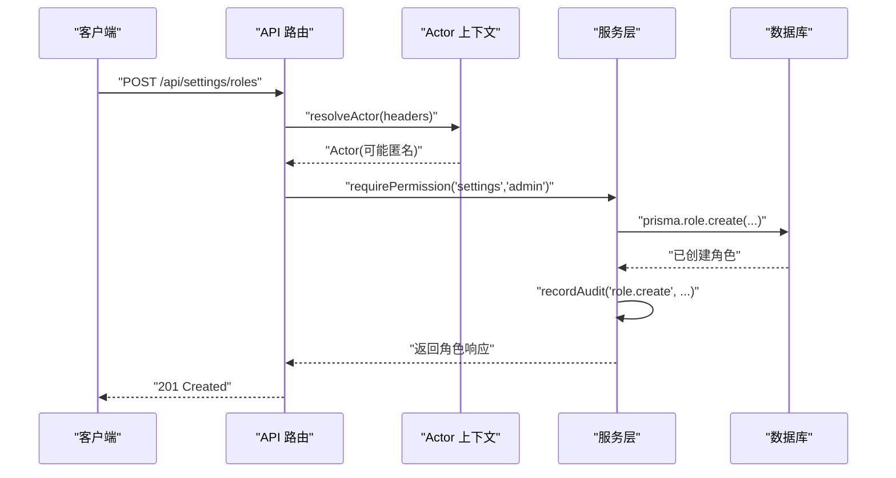
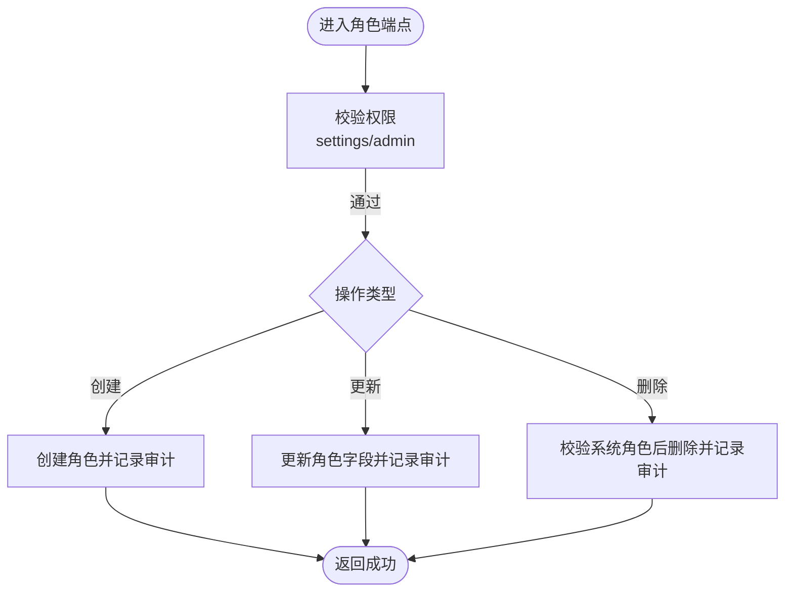
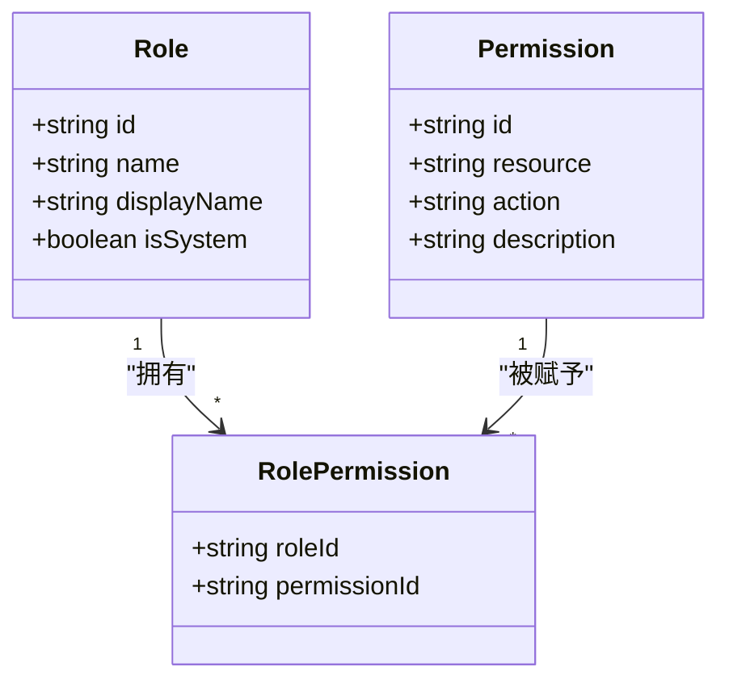
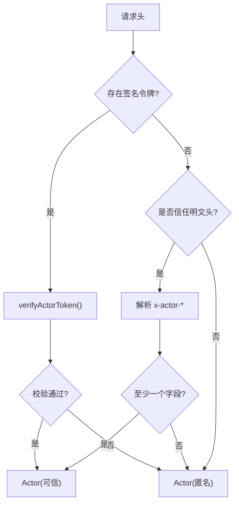
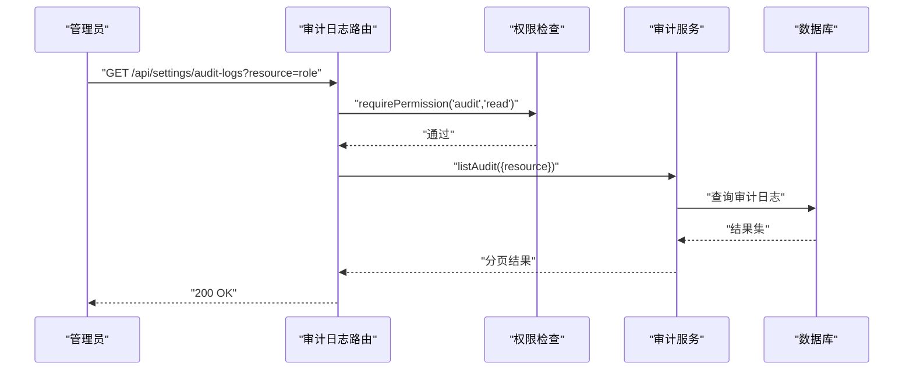
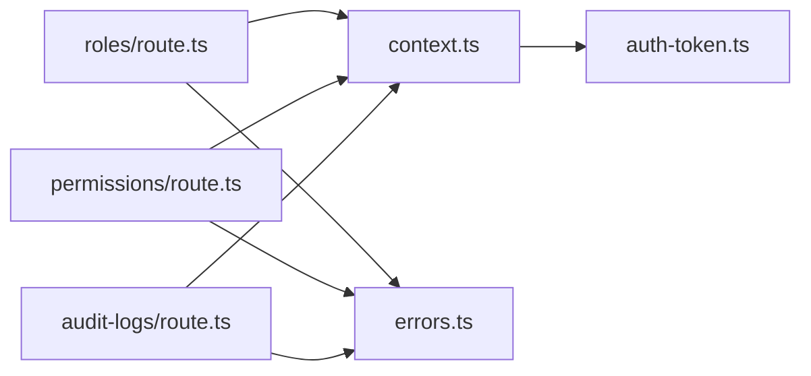

# 安全配置与管理

<cite>
**本文引用的文件**   
- [README.md](file://README.md)
- [.env.example](file://.env.example)
- [apps/web/lib/auth-token.ts](file://apps/web/lib/auth-token.ts)
- [apps/web/lib/context.ts](file://apps/web/lib/context.ts)
- [apps/web/lib/errors.ts](file://apps/web/lib/errors.ts)
- [apps/web/app/api/settings/roles/route.ts](file://apps/web/app/api/settings/roles/route.ts)
- [apps/web/app/api/settings/roles/[id]/route.ts](file://apps/web/app/api/settings/roles/[id]/route.ts)
- [apps/web/app/api/settings/permissions/route.ts](file://apps/web/app/api/settings/permissions/route.ts)
- [apps/web/app/api/settings/audit-logs/route.ts](file://apps/web/app/api/settings/audit-logs/route.ts)
- [packages/db/prisma/schema.prisma](file://packages/db/prisma/schema.prisma)
</cite>

## 目录
1. [引言](#引言)
2. [项目结构](#项目结构)
3. [核心组件](#核心组件)
4. [架构总览](#架构总览)
5. [详细组件分析](#详细组件分析)
6. [依赖关系分析](#依赖关系分析)
7. [性能与可扩展性](#性能与可扩展性)
8. [故障排查指南](#故障排查指南)
9. [结论](#结论)
10. [附录：模板与清单](#附录模板与清单)

## 引言
本文件面向“安全配置与管理”主题，聚焦角色管理 API、权限定义与资源映射、访问控制策略、环境变量与密钥管理、审计日志与安全基线。当前仓库实现了三角色模型（平台管理员、产品组、CRE）的 RBAC 数据层与设置端点，会话令牌采用 HMAC-SHA256 签名，生产环境强制校验密钥；所有写操作通过审计日志记录。文档同时给出部署安全清单、运维安全建议与安全审计流程，帮助在现有基础上补齐授权拦截、密码策略、会话超时、IP 白名单、监控告警与合规检查等能力。

## 项目结构
本项目为 Next.js 全栈应用，API 路由位于 `apps/web/app/api`，业务逻辑与服务层位于 `apps/web/lib/services`，数据库模型由 Prisma 管理于 `packages/db/prisma/schema.prisma`。安全相关能力集中在以下位置：
- 身份与会话：`apps/web/lib/auth-token.ts`、`apps/web/lib/context.ts`
- 统一错误体系：`apps/web/lib/errors.ts`
- 设置与 RBAC 端点：`apps/web/app/api/settings/*`
- 数据模型：`packages/db/prisma/schema.prisma`

**图示来源**
- [apps/web/app/api/settings/roles/route.ts:1-68](file://apps/web/app/api/settings/roles/route.ts#L1-L68)
- [apps/web/app/api/settings/permissions/route.ts:1-66](file://apps/web/app/api/settings/permissions/route.ts#L1-L66)
- [apps/web/app/api/settings/audit-logs/route.ts:1-33](file://apps/web/app/api/settings/audit-logs/route.ts#L1-L33)
- [apps/web/lib/context.ts:1-97](file://apps/web/lib/context.ts#L1-L97)
- [apps/web/lib/auth-token.ts:1-164](file://apps/web/lib/auth-token.ts#L1-L164)
- [packages/db/prisma/schema.prisma:486-550](file://packages/db/prisma/schema.prisma#L486-L550)

**章节来源**
- [README.md:76-135](file://README.md#L76-L135)

## 核心组件
- 会话令牌与会话 Cookie：基于 HMAC-SHA256 的不透明令牌，支持 Cookie 与请求头两种传输方式；生产环境启动期强制校验 `AUTH_SECRET`。
- Actor 上下文：从签名令牌或受信任明文头解析用户身份，并通过 AsyncLocalStorage 贯穿异步调用链，避免审计署名错乱。
- 统一错误体系：结构化错误类型与 HTTP 状态码映射，避免字符串匹配脆弱判断。
- 设置端点：角色 CRUD、权限定义、审计日志查询，均要求具备相应权限并记录审计。

**章节来源**
- [apps/web/lib/auth-token.ts:1-164](file://apps/web/lib/auth-token.ts#L1-L164)
- [apps/web/lib/context.ts:1-97](file://apps/web/lib/context.ts#L1-L97)
- [apps/web/lib/errors.ts:1-95](file://apps/web/lib/errors.ts#L1-L95)
- [apps/web/app/api/settings/roles/route.ts:1-68](file://apps/web/app/api/settings/roles/route.ts#L1-L68)
- [apps/web/app/api/settings/permissions/route.ts:1-66](file://apps/web/app/api/settings/permissions/route.ts#L1-L66)
- [apps/web/app/api/settings/audit-logs/route.ts:1-33](file://apps/web/app/api/settings/audit-logs/route.ts#L1-L33)

## 架构总览
系统以“请求 → API 路由 → Actor 上下文 → 服务层 → 数据库”为主线，安全关键路径如下：
- 登录与会话：服务端签发 HMAC 令牌，写入 Cookie 或返回给非浏览器客户端。
- 鉴权与授权：每个写操作先解析 Actor，再执行权限检查（当前占位），最后落库并记录审计。
- 审计追踪：所有写操作通过审计服务记录动作、资源、主体、时间戳等。

**图示来源**
- [apps/web/app/api/settings/roles/route.ts:44-67](file://apps/web/app/api/settings/roles/route.ts#L44-L67)
- [apps/web/lib/context.ts:61-85](file://apps/web/lib/context.ts#L61-L85)

## 详细组件分析

### 角色管理 API（CRUD）
- 列表与创建：`GET /api/settings/roles` 返回角色及其权限集合；`POST /api/settings/roles` 创建新角色，需具备 `settings/admin` 权限，并记录审计。
- 更新与删除：`PUT /api/settings/roles/:id` 更新显示名与描述；`DELETE /api/settings/roles/:id` 删除角色，系统角色不可删除。
- 权限批量分配：当前端点未提供批量分配接口；可在服务层扩展事务，按角色 ID 批量插入 `RolePermission` 关联表，并在每次变更后记录审计。

**图示来源**
- [apps/web/app/api/settings/roles/route.ts:39-67](file://apps/web/app/api/settings/roles/route.ts#L39-L67)
- [apps/web/app/api/settings/roles/[id]/route.ts:38-84](file://apps/web/app/api/settings/roles/[id]/route.ts#L38-L84)

**章节来源**
- [apps/web/app/api/settings/roles/route.ts:1-68](file://apps/web/app/api/settings/roles/route.ts#L1-L68)
- [apps/web/app/api/settings/roles/[id]/route.ts:1-85](file://apps/web/app/api/settings/roles/[id]/route.ts#L1-L85)

### 权限管理接口（定义与资源映射）
- 权限定义：`GET /api/settings/permissions` 列出权限及被角色授予次数；`POST /api/settings/permissions` 新增权限，禁止重复 `resource+action`。
- 资源映射：权限以 `resource` 与 `action` 组合标识资源与动作，后续可结合 RBAC 策略进行细粒度访问控制。
- 访问控制策略：当前路由内使用 `requirePermission("settings","admin")` 作为占位策略；实际策略应扩展为基于角色-权限表的动态判定。

**图示来源**
- [packages/db/prisma/schema.prisma:486-515](file://packages/db/prisma/schema.prisma#L486-L515)
- [apps/web/app/api/settings/permissions/route.ts:10-23](file://apps/web/app/api/settings/permissions/route.ts#L10-L23)

**章节来源**
- [apps/web/app/api/settings/permissions/route.ts:1-66](file://apps/web/app/api/settings/permissions/route.ts#L1-L66)
- [packages/db/prisma/schema.prisma:486-515](file://packages/db/prisma/schema.prisma#L486-L515)

### 访问控制策略与 Actor 上下文
- Actor 解析优先级：签名令牌 > 受信任明文头 > 匿名。
- 明文头信任开关：`AUTH_TRUST_ACTOR_HEADERS` 控制是否接受 `x-actor-*` 头；生产默认拒绝，仅在可信网关后显式开启。
- 异步上下文：通过 `withActor` 包裹业务逻辑，确保审计署名正确。

**图示来源**
- [apps/web/lib/context.ts:53-80](file://apps/web/lib/context.ts#L53-L80)
- [apps/web/lib/auth-token.ts:120-143](file://apps/web/lib/auth-token.ts#L120-L143)

**章节来源**
- [apps/web/lib/context.ts:1-97](file://apps/web/lib/context.ts#L1-L97)
- [apps/web/lib/auth-token.ts:1-164](file://apps/web/lib/auth-token.ts#L1-L164)

### 审计日志与安全审计
- 审计读取：`GET /api/settings/audit-logs` 支持分页与过滤（action/resource/resourceId/user）。
- 审计写入：所有写操作通过 `recordAudit` 记录动作、资源、主体、时间戳等。
- 审计权限：当前仅允许具备 `audit/read` 权限的角色查看审计日志。

**图示来源**
- [apps/web/app/api/settings/audit-logs/route.ts:7-32](file://apps/web/app/api/settings/audit-logs/route.ts#L7-L32)

**章节来源**
- [apps/web/app/api/settings/audit-logs/route.ts:1-33](file://apps/web/app/api/settings/audit-logs/route.ts#L1-L33)

### 安全配置选项与环境变量
- 数据库连接：`DATABASE_URL`（SQLite 单文件）。
- 认证与会话：
  - `AUTH_SECRET`：生产必填，缺失时服务启动即退出。
  - `AUTH_SESSION_TTL_HOURS`：会话有效期（小时），默认 24。
  - `AUTH_TRUST_ACTOR_HEADERS`：是否采纳明文 `x-actor-*` 头，生产默认拒绝。
- LLM 集成（可选）：`MIMO_API_KEY`、`MIMO_BASE_URL`、`MIMO_MODEL`。

**章节来源**
- [.env.example:1-24](file://.env.example#L1-L24)
- [README.md:425-444](file://README.md#L425-L444)

### 安全策略配置（密码策略、会话超时、IP 白名单）
- 密码策略：当前演示账号口令为硬编码 MOCK；未来应引入 scrypt 哈希存储与最小复杂度策略。
- 会话超时：通过 `AUTH_SESSION_TTL_HOURS` 控制；生产 Cookie 追加 `Secure` 属性。
- IP 白名单：当前未实现；建议在网关层或中间件层对 `/api/settings/*` 实施源地址限制。

**章节来源**
- [apps/web/lib/auth-token.ts:148-163](file://apps/web/lib/auth-token.ts#L148-L163)
- [README.md:478-488](file://README.md#L478-L488)

### 安全监控配置、告警规则与合规性检查
- 监控指标：建议采集审计日志写入速率、异常错误率、会话签发失败率、LLM 调用失败率。
- 告警规则：
  - 审计日志长时间无写入（可能审计链路失效）。
  - 生产环境 `AUTH_SECRET` 缺失导致启动失败。
  - 频繁 403/401 访问设置端点（越权尝试）。
- 合规检查：定期导出审计日志，核对敏感操作（角色/权限变更）是否经审批与留痕。

[本节为通用指导，不直接分析具体文件]

## 依赖关系分析
- API 路由依赖 Actor 上下文与权限检查；权限检查目前为占位，需扩展至基于 `RolePermission` 的动态判定。
- 审计服务依赖 Actor 上下文获取署名主体。
- 会话令牌模块依赖环境变量 `AUTH_SECRET` 与 `AUTH_SESSION_TTL_HOURS`。

**图示来源**
- [apps/web/app/api/settings/roles/route.ts:1-68](file://apps/web/app/api/settings/roles/route.ts#L1-L68)
- [apps/web/app/api/settings/permissions/route.ts:1-66](file://apps/web/app/api/settings/permissions/route.ts#L1-L66)
- [apps/web/app/api/settings/audit-logs/route.ts:1-33](file://apps/web/app/api/settings/audit-logs/route.ts#L1-L33)
- [apps/web/lib/context.ts:1-97](file://apps/web/lib/context.ts#L1-L97)
- [apps/web/lib/auth-token.ts:1-164](file://apps/web/lib/auth-token.ts#L1-L164)
- [apps/web/lib/errors.ts:1-95](file://apps/web/lib/errors.ts#L1-L95)

**章节来源**
- [apps/web/lib/context.ts:1-97](file://apps/web/lib/context.ts#L1-L97)
- [apps/web/lib/auth-token.ts:1-164](file://apps/web/lib/auth-token.ts#L1-L164)
- [apps/web/lib/errors.ts:1-95](file://apps/web/lib/errors.ts#L1-L95)

## 性能与可扩展性
- 审计日志查询支持分页，避免全量扫描。
- 权限判定可扩展为缓存角色-权限映射，减少频繁数据库查询。
- 会话令牌校验为轻量 HMAC 计算，开销低；建议在高并发场景下复用密钥对象。

[本节为通用指导，不直接分析具体文件]

## 故障排查指南
- 生产环境启动失败：检查 `AUTH_SECRET` 是否配置且非空；缺失将触发启动期硬失败。
- 审计署名为匿名：确认 Actor 上下文是否正确注入；检查 `AUTH_TRUST_ACTOR_HEADERS` 在生产环境是否误开。
- 设置端点 403/401：确认当前 Actor 是否具备所需权限；当前策略为占位，需扩展 RBAC。
- 会话无法清除：检查 Set-Cookie 属性是否与签发一致（Path/SameSite/Secure）。

**章节来源**
- [apps/web/lib/auth-token.ts:34-54](file://apps/web/lib/auth-token.ts#L34-L54)
- [apps/web/lib/context.ts:53-80](file://apps/web/lib/context.ts#L53-L80)
- [apps/web/lib/errors.ts:64-95](file://apps/web/lib/errors.ts#L64-L95)

## 结论
当前仓库已实现 RBAC 的数据层与基础设置端点，会话令牌与 Actor 上下文提供了身份与审计的基础能力。下一步重点在于：
- 完善 RBAC 动态授权策略，替代占位的 `requirePermission`。
- 引入密码策略与会话安全增强（如刷新令牌、撤销机制）。
- 在网关层实现 IP 白名单与速率限制。
- 建立监控告警与合规审计流程，确保审计链路可靠。

[本节为总结，不直接分析具体文件]

## 附录：模板与清单

### 安全配置模板（环境变量）
- 数据库：`DATABASE_URL=file:./dev.db`
- 认证：`AUTH_SECRET=<openssl rand -hex 32>`、`AUTH_SESSION_TTL_HOURS=24`、`AUTH_TRUST_ACTOR_HEADERS=0`
- LLM（可选）：`MIMO_API_KEY=tp-...`、`MIMO_BASE_URL=https://token-plan-cn.xiaomimimo.com/v1`、`MIMO_MODEL=mimo-v2.5-pro`

**章节来源**
- [.env.example:1-24](file://.env.example#L1-L24)

### 部署安全清单
- 生产必须配置 `AUTH_SECRET`，否则服务启动即退出。
- 关闭 `AUTH_TRUST_ACTOR_HEADERS`（除非通过可信网关鉴权）。
- 为 `/api/settings/*` 启用 IP 白名单与速率限制。
- 启用审计日志持久化与外部告警。
- 定期轮换密钥与会话 TTL 评估。

**章节来源**
- [apps/web/lib/auth-token.ts:34-54](file://apps/web/lib/auth-token.ts#L34-L54)
- [apps/web/lib/context.ts:53-80](file://apps/web/lib/context.ts#L53-L80)

### 运维安全指南
- 审计日志：定期导出并审查敏感操作（角色/权限变更）。
- 会话安全：生产 Cookie 必须带 `Secure`；避免在非 HTTPS 环境下发 Cookie。
- 错误处理：统一错误体不泄露堆栈；监控 500 错误率。
- 合规检查：核对权限分配与审计记录一致性，确保无越权风险。

**章节来源**
- [apps/web/lib/errors.ts:64-95](file://apps/web/lib/errors.ts#L64-L95)
- [apps/web/lib/auth-token.ts:148-163](file://apps/web/lib/auth-token.ts#L148-L163)