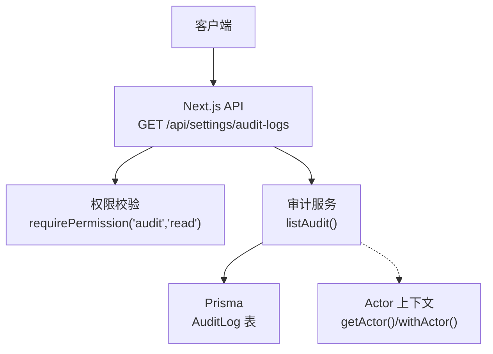
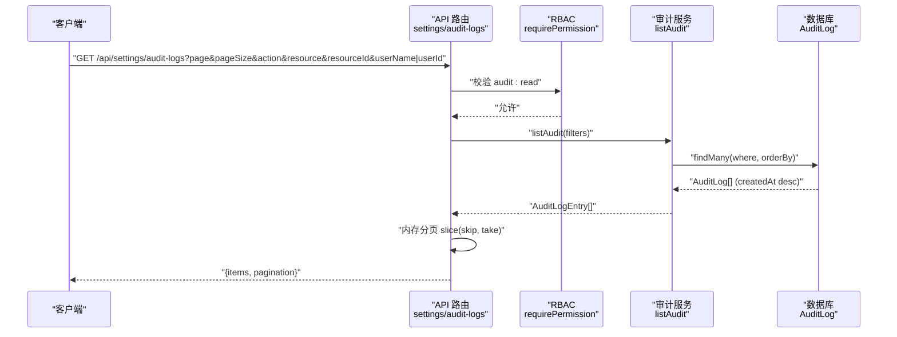
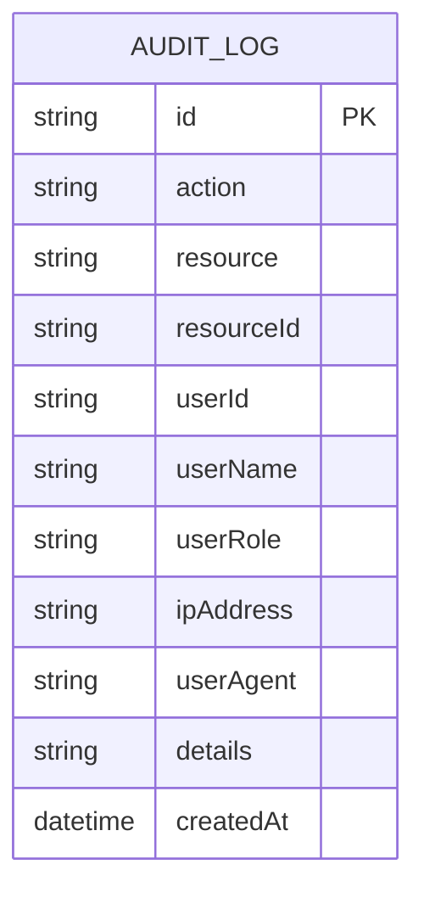
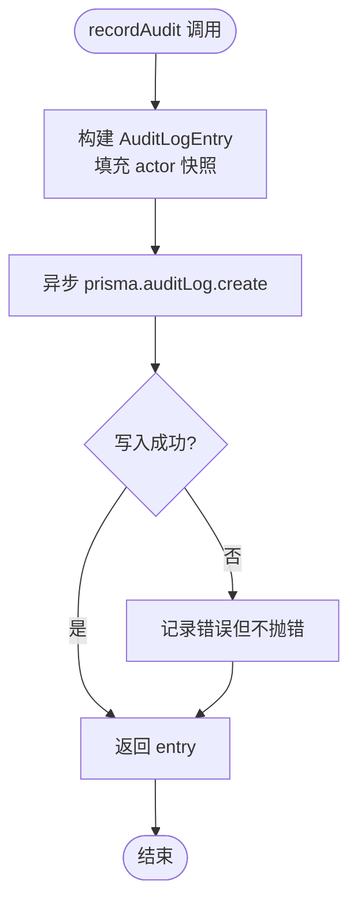
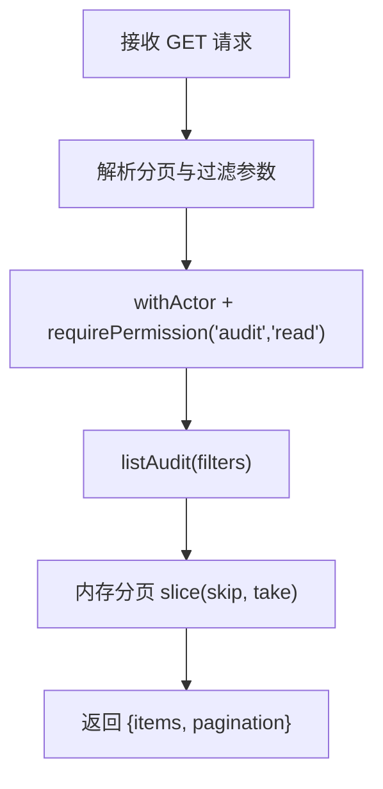
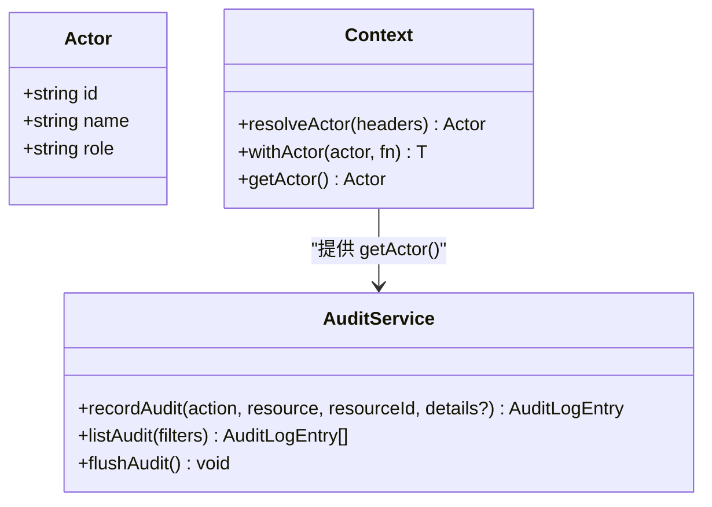
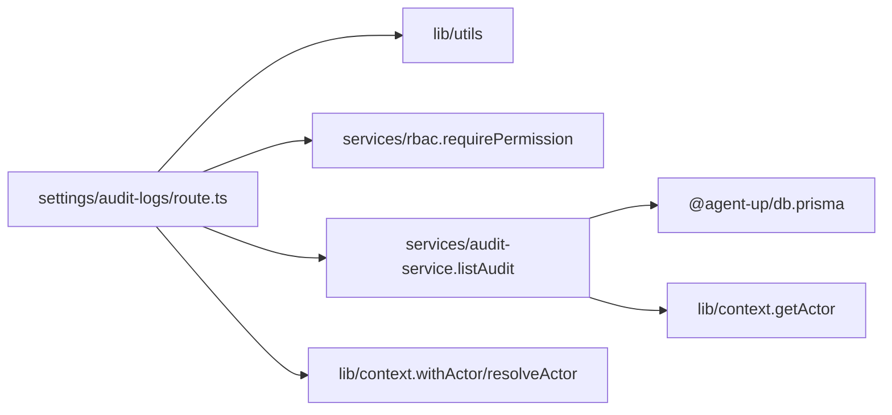

# 审计日志系统

<cite>
**本文引用的文件**   
- [apps/web/app/api/settings/audit-logs/route.ts](file://apps/web/app/api/settings/audit-logs/route.ts)
- [apps/web/lib/services/audit-service.ts](file://apps/web/lib/services/audit-service.ts)
- [packages/db/prisma/schema.prisma](file://packages/db/prisma/schema.prisma)
- [apps/web/lib/context.ts](file://apps/web/lib/context.ts)
- [apps/web/lib/__tests__/audit-service.test.ts](file://apps/web/lib/__tests__/audit-service.test.ts)
- [apps/web/app/api/__tests__/settings-audit-logs.test.ts](file://apps/web/app/api/__tests__/settings-audit-logs.test.ts)
- [docs/skills/agent-up-services/references/audit-service-component.md](file://docs/skills/agent-up-services/references/audit-service-component.md)
</cite>

## 目录
1. [简介](#简介)
2. [项目结构](#项目结构)
3. [核心组件](#核心组件)
4. [架构总览](#架构总览)
5. [详细组件分析](#详细组件分析)
6. [依赖关系分析](#依赖关系分析)
7. [性能与可扩展性](#性能与可扩展性)
8. [合规性与安全](#合规性与安全)
9. [故障排查指南](#故障排查指南)
10. [结论](#结论)

## 简介
本技术文档围绕仓库中的审计日志子系统，系统性说明其 append-only（仅追加）设计、不可篡改记录机制、操作追踪能力、合规与安全策略、查询接口与分页、以及分析与告警扩展点。该子系统以 Prisma + SQLite 为持久层，通过 Next.js API Route 暴露审计日志查询接口，并通过服务层统一封装审计写入与读取逻辑。

## 项目结构
审计日志相关代码主要分布在以下位置：
- API 路由：`apps/web/app/api/settings/audit-logs/route.ts`
- 审计服务：`apps/web/lib/services/audit-service.ts`
- 数据库模型：`packages/db/prisma/schema.prisma`
- 身份上下文：`apps/web/lib/context.ts`
- 测试用例：`apps/web/lib/__tests__/audit-service.test.ts`、`apps/web/app/api/__tests__/settings-audit-logs.test.ts`
- 组件参考文档：`docs/skills/agent-up-services/references/audit-service-component.md`

**图表来源**
- [apps/web/app/api/settings/audit-logs/route.ts:7-32](file://apps/web/app/api/settings/audit-logs/route.ts#L7-L32)
- [apps/web/lib/services/audit-service.ts:87-119](file://apps/web/lib/services/audit-service.ts#L87-L119)
- [packages/db/prisma/schema.prisma:530-550](file://packages/db/prisma/schema.prisma#L530-L550)
- [apps/web/lib/context.ts:82-90](file://apps/web/lib/context.ts#L82-L90)

**章节来源**
- [apps/web/app/api/settings/audit-logs/route.ts:1-33](file://apps/web/app/api/settings/audit-logs/route.ts#L1-L33)
- [apps/web/lib/services/audit-service.ts:1-120](file://apps/web/lib/services/audit-service.ts#L1-L120)
- [packages/db/prisma/schema.prisma:530-550](file://packages/db/prisma/schema.prisma#L530-L550)
- [apps/web/lib/context.ts:1-97](file://apps/web/lib/context.ts#L1-L97)

## 核心组件
- 审计数据模型 AuditLog：定义审计事件的最小字段集，包括动作、资源、资源标识、用户快照、IP、User-Agent、时间戳等，并提供多维度索引。
- 审计服务 audit-service：提供 recordAudit（追加写入）、listAudit（过滤与排序）、flushAudit（等待异步写入完成）。
- API 路由 settings/audit-logs：实现 GET 接口，负责参数解析、权限校验、调用 listAudit、分页返回。
- Actor 上下文 context：提供请求级主体解析与注入，确保审计署名来自可信来源或系统默认值。

**章节来源**
- [packages/db/prisma/schema.prisma:530-550](file://packages/db/prisma/schema.prisma#L530-L550)
- [apps/web/lib/services/audit-service.ts:13-24](file://apps/web/lib/services/audit-service.ts#L13-L24)
- [apps/web/lib/services/audit-service.ts:43-85](file://apps/web/lib/services/audit-service.ts#L43-L85)
- [apps/web/lib/services/audit-service.ts:87-119](file://apps/web/lib/services/audit-service.ts#L87-L119)
- [apps/web/app/api/settings/audit-logs/route.ts:7-32](file://apps/web/app/api/settings/audit-logs/route.ts#L7-L32)
- [apps/web/lib/context.ts:22-36](file://apps/web/lib/context.ts#L22-L36)
- [apps/web/lib/context.ts:65-90](file://apps/web/lib/context.ts#L65-L90)

## 架构总览
审计日志采用“业务写成功后异步记录”的 append-only 模式：
- 写入路径：业务服务在成功变更后调用 recordAudit；recordAudit 生成唯一 ID、填充 Actor 快照、异步写入 Prisma；失败静默处理，不影响主流程。
- 读取路径：GET /api/settings/audit-logs 经 RBAC 校验后调用 listAudit，按 createdAt 倒序并支持 action/resource/resourceId/user 过滤，再由路由层进行内存分页。

**图表来源**
- [apps/web/app/api/settings/audit-logs/route.ts:7-32](file://apps/web/app/api/settings/audit-logs/route.ts#L7-L32)
- [apps/web/lib/services/audit-service.ts:87-119](file://apps/web/lib/services/audit-service.ts#L87-L119)
- [packages/db/prisma/schema.prisma:530-550](file://packages/db/prisma/schema.prisma#L530-L550)

## 详细组件分析

### 审计数据模型 AuditLog
AuditLog 是审计事实的唯一存储单元，关键字段如下：
- id：唯一标识，由记录侧生成。
- action：动作名（如 agent.update、role.create），用于分类与检索。
- resource：资源类型（如 agent、role、product-group）。
- resourceId：被操作的资源实例 ID。
- userId：actor.id（可为 null），作为查询别名列，不建外键。
- userName：用户名快照，避免随主数据变更而漂移。
- userRole：角色快照，便于权限回溯。
- ipAddress、userAgent：可选的环境信息。
- details：可选 JSON 文本，使用 packJson/unpackJson 收口。
- createdAt：审计时间戳。

索引策略：
- 复合索引 (resource, resourceId)
- 复合索引 (userId, createdAt)
- 复合索引 (action, createdAt)
- 单列索引 (createdAt)

**图表来源**
- [packages/db/prisma/schema.prisma:530-550](file://packages/db/prisma/schema.prisma#L530-L550)

**章节来源**
- [packages/db/prisma/schema.prisma:530-550](file://packages/db/prisma/schema.prisma#L530-L550)

### 审计服务 audit-service
职责与行为：
- recordAudit：构造 AuditLogEntry，异步写入 Prisma，失败静默吞掉，保证业务不受影响。
- listAudit：根据 action/resource/resourceId/user 过滤，按 createdAt 倒序、id 倒序稳定排序，返回标准化条目。
- flushAudit：供测试等待所有 fire-and-forget 写入完成。

关键设计要点：
- append-only：只追加新行，不更新或删除历史。
- 不可篡改：无删除/修改入口；details 通过 packJson/unpackJson 容错处理。
- 非阻塞写入：pendingWrites 集合跟踪 Promise，flushAudit 聚合等待。
- Actor 快照：userName/userRole 固化，避免后续主数据变化导致审计漂移。

**图表来源**
- [apps/web/lib/services/audit-service.ts:43-85](file://apps/web/lib/services/audit-service.ts#L43-L85)

**章节来源**
- [apps/web/lib/services/audit-service.ts:1-120](file://apps/web/lib/services/audit-service.ts#L1-L120)
- [docs/skills/agent-up-services/references/audit-service-component.md:31-49](file://docs/skills/agent-up-services/references/audit-service-component.md#L31-L49)

### API 路由 settings/audit-logs
功能：
- 解析分页参数 page/pageSize/skip/take。
- 通过 withActor(resolveActor(...)) 注入 Actor 上下文。
- 校验 requirePermission("audit", "read")。
- 调用 listAudit 并传入 action/resource/resourceId/user 过滤条件。
- 对结果执行内存分页，返回 items 与 pagination。

注意：
- 当前 listAudit 不支持 skip/take 分页，分页在路由层通过数组切片实现。
- user 参数兼容 userName 与 userId 两种查询别名。

**图表来源**
- [apps/web/app/api/settings/audit-logs/route.ts:7-32](file://apps/web/app/api/settings/audit-logs/route.ts#L7-L32)
- [apps/web/lib/services/audit-service.ts:87-119](file://apps/web/lib/services/audit-service.ts#L87-L119)

**章节来源**
- [apps/web/app/api/settings/audit-logs/route.ts:1-33](file://apps/web/app/api/settings/audit-logs/route.ts#L1-L33)

### Actor 上下文与审计署名
Actor 解析优先级：
1. 签名会话令牌（cookie 或头 x-actor-token），经 verifyActorToken 校验。
2. 明文头 x-actor-id/x-actor-name/x-actor-role，仅在显式信任时采纳。
3. 均不可信 → ANONYMOUS_ACTOR。

系统主体 SYSTEM_ACTOR：
- id="system"，name="系统"，role="platform_admin"，用于后台自发动作。

审计署名规则：
- getActor() 返回当前 Actor；若无请求作用域则回退到 SYSTEM_ACTOR。
- recordAudit 将 userName/userRole 固化，userId 落库为 actor.id（可为 null）。

**图表来源**
- [apps/web/lib/context.ts:22-36](file://apps/web/lib/context.ts#L22-L36)
- [apps/web/lib/context.ts:65-90](file://apps/web/lib/context.ts#L65-L90)
- [apps/web/lib/services/audit-service.ts:43-85](file://apps/web/lib/services/audit-service.ts#L43-L85)

**章节来源**
- [apps/web/lib/context.ts:1-97](file://apps/web/lib/context.ts#L1-L97)
- [apps/web/lib/services/audit-service.ts:43-85](file://apps/web/lib/services/audit-service.ts#L43-L85)

## 依赖关系分析
- API 路由依赖：
  - utils：success/handleApiError/parsePagination/paginationMeta
  - services：listAudit、requirePermission
  - context：withActor、resolveActor
- 审计服务依赖：
  - @agent-up/db：prisma、packJson/unpackJson
  - context：getActor
- 数据库依赖：
  - Prisma 生成的 client 访问 AuditLog 表

**图表来源**
- [apps/web/app/api/settings/audit-logs/route.ts:1-6](file://apps/web/app/api/settings/audit-logs/route.ts#L1-L6)
- [apps/web/lib/services/audit-service.ts:1-3](file://apps/web/lib/services/audit-service.ts#L1-L3)

**章节来源**
- [apps/web/app/api/settings/audit-logs/route.ts:1-33](file://apps/web/app/api/settings/audit-logs/route.ts#L1-L33)
- [apps/web/lib/services/audit-service.ts:1-120](file://apps/web/lib/services/audit-service.ts#L1-L120)

## 性能与可扩展性
- Append-only 优势：
  - 写入简单、顺序追加，降低锁竞争与碎片化。
  - 无需删除/更新，避免复杂事务与一致性开销。
- 当前瓶颈：
  - listAudit 全量加载后内存分页，未使用数据库层 skip/take。
  - 大表场景下，过滤+排序可能成为热点。
- 优化建议：
  - 在 listAudit 中引入数据库分页（skip/take），减少内存占用与网络传输。
  - 针对高频过滤维度建立覆盖索引（例如 action+createdAt、resource+resourceId+createdAt）。
  - 考虑冷热分层：近期日志走热存储，历史归档至冷存储或对象存储。
  - 批量写入：若业务侧产生大量审计事件，可合并批次写入以降低 I/O。

[本节为通用指导，不直接分析具体文件]

## 合规性与安全
- 数据保留策略：
  - 当前实现未内置自动清理或保留期管理；建议在外部调度任务中基于 createdAt 归档/删除旧日志，以满足法规要求。
- 隐私保护：
  - 审计详情 details 可能包含敏感信息，应限制访问权限并脱敏展示。
  - ipAddress/userAgent 属于个人信息，需遵循最小必要原则与访问控制。
- 法律合规：
  - 审计日志作为问责证据，应保持不可篡改与可追溯；当前无删除/修改入口符合此目标。
  - 建议增加导出审计报告的完整性校验（如哈希签名），满足审计取证需求。

[本节为通用指导，不直接分析具体文件]

## 故障排查指南
常见问题与定位方法：
- 审计记录未出现：
  - 检查 recordAudit 是否被调用；确认业务分支在成功路径上触发。
  - 使用 flushAudit 等待异步写入完成后再断言。
  - 查看控制台错误输出（非 test 环境会打印审计写入失败日志）。
- 查询结果为空：
  - 核对过滤参数 action/resource/resourceId/user 是否与期望一致。
  - 注意 user 参数兼容 userName 与 userId 两种别名。
- 分页异常：
  - 当前分页在路由层内存切片，请确认 page/pageSize/skip/take 计算正确。
- 审计失败不影响业务：
  - 这是预期行为；如需强一致审计，应在业务层重试或补偿，但需谨慎评估幂等性。

**章节来源**
- [apps/web/lib/services/audit-service.ts:62-85](file://apps/web/lib/services/audit-service.ts#L62-L85)
- [apps/web/lib/__tests__/audit-service.test.ts:14-42](file://apps/web/lib/__tests__/audit-service.test.ts#L14-L42)
- [apps/web/app/api/__tests__/settings-audit-logs.test.ts:19-66](file://apps/web/app/api/__tests__/settings-audit-logs.test.ts#L19-L66)

## 结论
审计日志系统以 append-only 为核心设计，通过 Prisma 持久化 AuditLog 表，结合 Next.js API 路由提供安全的查询能力。服务层保证审计写入的非阻塞与静默失败，避免影响主业务流程；Actor 上下文确保审计署名的可信与稳定。当前实现已具备基础的操作追踪与合规支撑能力，但在大数据量下的分页与索引优化方面仍有提升空间。建议在生产环境中完善数据保留策略、隐私脱敏与报告完整性校验，以满足更严格的合规与安全要求。