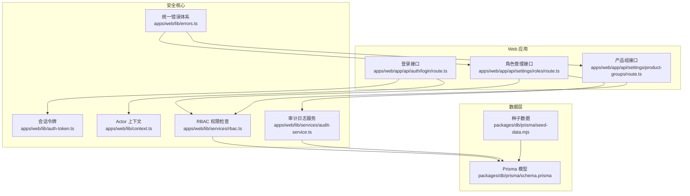
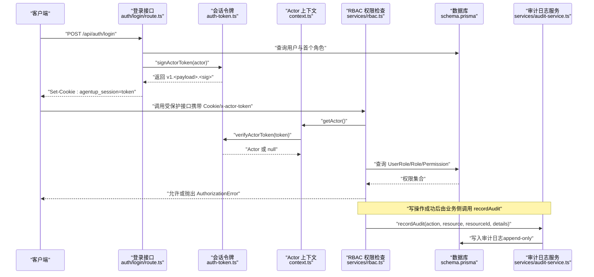
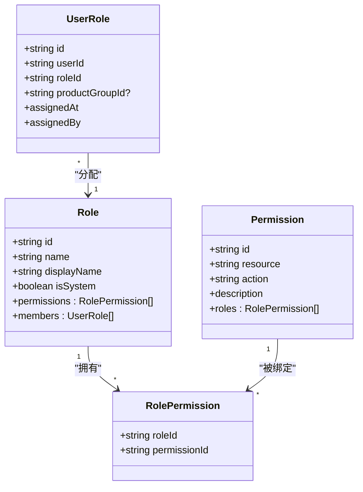
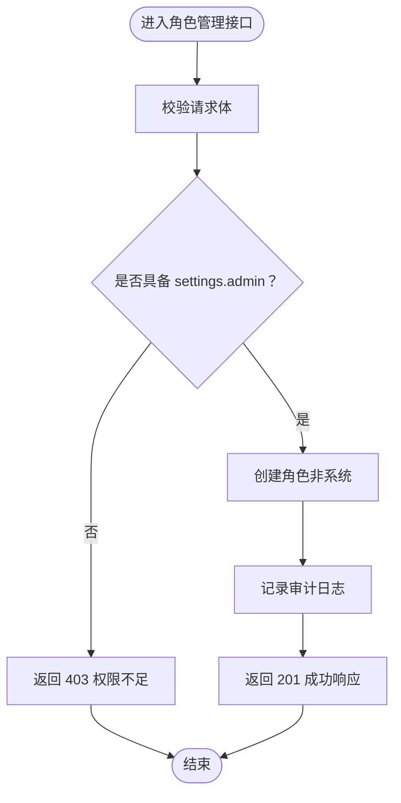
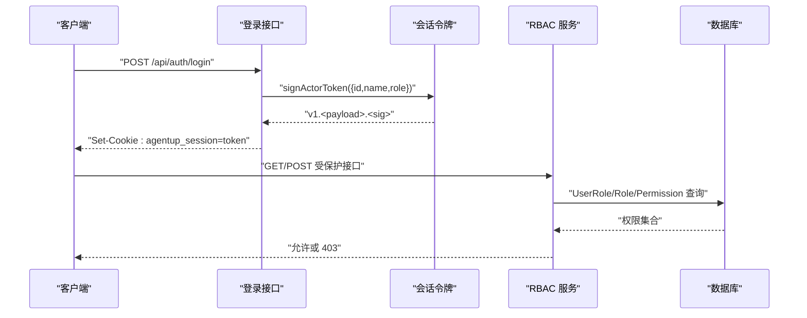
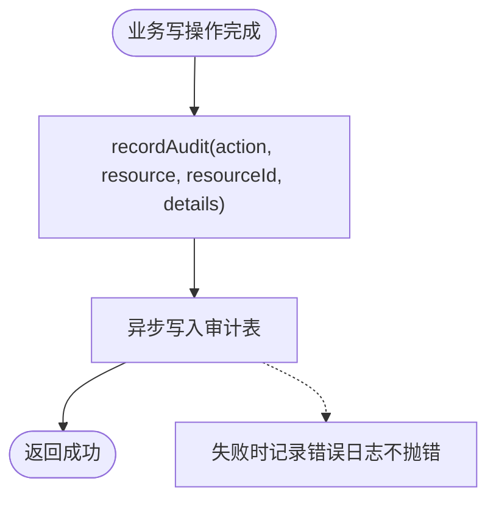
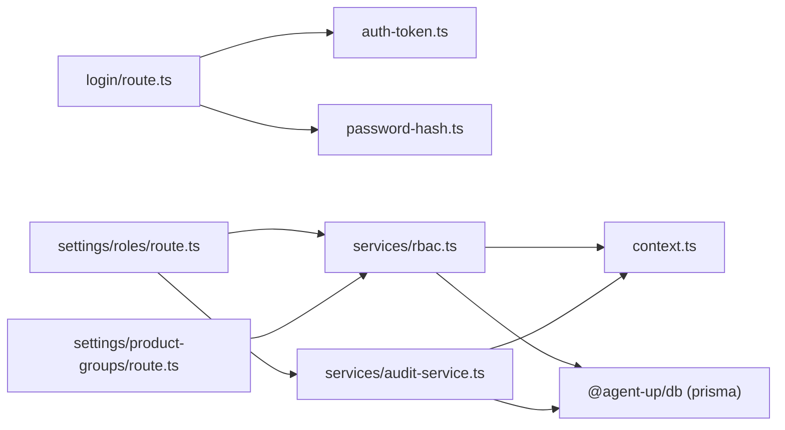

# 权限与安全

<cite>
**本文引用的文件**   
- [apps/web/lib/auth-token.ts](file://apps/web/lib/auth-token.ts)
- [apps/web/lib/context.ts](file://apps/web/lib/context.ts)
- [apps/web/lib/errors.ts](file://apps/web/lib/errors.ts)
- [apps/web/lib/services/rbac.ts](file://apps/web/lib/services/rbac.ts)
- [apps/web/lib/services/audit-service.ts](file://apps/web/lib/services/audit-service.ts)
- [packages/db/prisma/schema.prisma](file://packages/db/prisma/schema.prisma)
- [apps/web/app/api/auth/login/route.ts](file://apps/web/app/api/auth/login/route.ts)
- [apps/web/app/api/settings/roles/route.ts](file://apps/web/app/api/settings/roles/route.ts)
- [apps/web/app/api/settings/product-groups/route.ts](file://apps/web/app/api/settings/product-groups/route.ts)
- [packages/db/prisma/seed-data.mjs](file://packages/db/prisma/seed-data.mjs)
</cite>

## 目录
1. [引言](#引言)
2. [项目结构](#项目结构)
3. [核心组件](#核心组件)
4. [架构总览](#架构总览)
5. [详细组件分析](#详细组件分析)
6. [依赖关系分析](#依赖关系分析)
7. [性能与可扩展性](#性能与可扩展性)
8. [故障排查指南](#故障排查指南)
9. [结论](#结论)
10. [附录：API 端点与错误码规范](#附录api-端点与错误码规范)

## 引言
本文件面向“权限与安全”子系统，系统性说明 RBAC（基于角色的访问控制）模型、认证授权流程、审计日志体系以及安全配置与防护措施。系统采用“三角色”模型（工单团队、产品组、CRE），通过角色-权限关系实现细粒度资源访问控制；会话令牌使用 HMAC-SHA256 签名，Actor 上下文贯穿请求生命周期；审计日志采用 append-only 设计，确保可追溯与合规。

## 项目结构
权限与安全相关代码主要分布在以下位置：
- 认证与会话：`apps/web/lib/auth-token.ts`、`apps/web/app/api/auth/login/route.ts`
- Actor 上下文解析：`apps/web/lib/context.ts`
- RBAC 权限检查：`apps/web/lib/services/rbac.ts`
- 审计日志服务：`apps/web/lib/services/audit-service.ts`
- 数据模型与种子数据：`packages/db/prisma/schema.prisma`、`packages/db/prisma/seed-data.mjs`
- 设置类 API（角色、产品组等）：`apps/web/app/api/settings/roles/route.ts`、`apps/web/app/api/settings/product-groups/route.ts`
- 统一错误体系：`apps/web/lib/errors.ts`

**图示来源**
- [apps/web/app/api/auth/login/route.ts:1-69](file://apps/web/app/api/auth/login/route.ts#L1-L69)
- [apps/web/app/api/settings/roles/route.ts:1-68](file://apps/web/app/api/settings/roles/route.ts#L1-L68)
- [apps/web/app/api/settings/product-groups/route.ts:1-29](file://apps/web/app/api/settings/product-groups/route.ts#L1-L29)
- [apps/web/lib/auth-token.ts:1-164](file://apps/web/lib/auth-token.ts#L1-L164)
- [apps/web/lib/context.ts:1-97](file://apps/web/lib/context.ts#L1-L97)
- [apps/web/lib/services/rbac.ts:1-52](file://apps/web/lib/services/rbac.ts#L1-L52)
- [apps/web/lib/services/audit-service.ts:1-120](file://apps/web/lib/services/audit-service.ts#L1-L120)
- [packages/db/prisma/schema.prisma:486-550](file://packages/db/prisma/schema.prisma#L486-L550)
- [packages/db/prisma/seed-data.mjs:71-131](file://packages/db/prisma/seed-data.mjs#L71-L131)

**章节来源**
- [apps/web/lib/auth-token.ts:1-164](file://apps/web/lib/auth-token.ts#L1-L164)
- [apps/web/lib/context.ts:1-97](file://apps/web/lib/context.ts#L1-L97)
- [apps/web/lib/services/rbac.ts:1-52](file://apps/web/lib/services/rbac.ts#L1-L52)
- [apps/web/lib/services/audit-service.ts:1-120](file://apps/web/lib/services/audit-service.ts#L1-L120)
- [packages/db/prisma/schema.prisma:486-550](file://packages/db/prisma/schema.prisma#L486-L550)

## 核心组件
- 会话令牌（HMAC-SHA256）：提供签发、校验、Cookie 头读取、生产环境密钥自检。
- Actor 上下文：解析可信身份（签名令牌优先），支持显式信任的明文头，默认匿名降级。
- RBAC 权限检查：以数据库中的角色-权限关系为唯一事实源，按资源+动作进行授权判断。
- 审计日志服务：append-only 写入，fire-and-forget 不阻塞业务，记录操作者、时间、资源与详情。
- 统一错误体系：结构化错误码与状态码映射，避免堆栈泄漏。

**章节来源**
- [apps/web/lib/auth-token.ts:1-164](file://apps/web/lib/auth-token.ts#L1-L164)
- [apps/web/lib/context.ts:1-97](file://apps/web/lib/context.ts#L1-L97)
- [apps/web/lib/services/rbac.ts:1-52](file://apps/web/lib/services/rbac.ts#L1-L52)
- [apps/web/lib/services/audit-service.ts:1-120](file://apps/web/lib/services/audit-service.ts#L1-L120)
- [apps/web/lib/errors.ts:1-95](file://apps/web/lib/errors.ts#L1-L95)

## 架构总览
下图展示从登录到权限检查与审计的关键交互路径。

**图示来源**
- [apps/web/app/api/auth/login/route.ts:1-69](file://apps/web/app/api/auth/login/route.ts#L1-L69)
- [apps/web/lib/auth-token.ts:1-164](file://apps/web/lib/auth-token.ts#L1-L164)
- [apps/web/lib/context.ts:1-97](file://apps/web/lib/context.ts#L1-L97)
- [apps/web/lib/services/rbac.ts:1-52](file://apps/web/lib/services/rbac.ts#L1-L52)
- [apps/web/lib/services/audit-service.ts:1-120](file://apps/web/lib/services/audit-service.ts#L1-L120)
- [packages/db/prisma/schema.prisma:486-550](file://packages/db/prisma/schema.prisma#L486-L550)

## 详细组件分析

### 三角色模型与权限矩阵
- 三角色定义（种子数据）：
  - 管理员角色：具备管理权限（如 settings.admin）。
  - 产品组成员角色：具备对 Agent、Feedback、Wiki 的读写能力。
  - CRE 查看者角色：具备 Agent、Feedback、Wiki 的只读能力。
- 权限矩阵要点：
  - 资源维度：agent、feedback、wiki、settings 等。
  - 动作维度：read、write、publish、admin 等。
  - 继承机制：多角色取并集；system actor（进程内自发动作）豁免权限检查。

**图示来源**
- [packages/db/prisma/schema.prisma:486-528](file://packages/db/prisma/schema.prisma#L486-L528)
- [packages/db/prisma/seed-data.mjs:71-131](file://packages/db/prisma/seed-data.mjs#L71-L131)

**章节来源**
- [packages/db/prisma/schema.prisma:486-528](file://packages/db/prisma/schema.prisma#L486-L528)
- [packages/db/prisma/seed-data.mjs:71-131](file://packages/db/prisma/seed-data.mjs#L71-L131)

### 角色管理与权限分配
- 角色列表与创建：
  - GET /api/settings/roles：返回角色及其权限集合与成员数。
  - POST /api/settings/roles：需 settings.admin 权限，创建非系统角色，并记录审计日志。
- 产品组管理：
  - GET /api/settings/product-groups：列出产品组及成员/Agent 计数。
  - POST /api/settings/product-groups：创建产品组，结合 RBAC 与审计。

**图示来源**
- [apps/web/app/api/settings/roles/route.ts:1-68](file://apps/web/app/api/settings/roles/route.ts#L1-L68)
- [apps/web/lib/services/rbac.ts:1-52](file://apps/web/lib/services/rbac.ts#L1-L52)
- [apps/web/lib/services/audit-service.ts:1-120](file://apps/web/lib/services/audit-service.ts#L1-L120)

**章节来源**
- [apps/web/app/api/settings/roles/route.ts:1-68](file://apps/web/app/api/settings/roles/route.ts#L1-L68)
- [apps/web/app/api/settings/product-groups/route.ts:1-29](file://apps/web/app/api/settings/product-groups/route.ts#L1-L29)

### 认证与授权流程
- 登录流程：
  - 验证邮箱与口令，查询用户与其首个角色。
  - 使用 HMAC-SHA256 签发会话令牌，并通过 Set-Cookie 下发。
- 授权流程：
  - 请求携带 `x-actor-token` 或 `agentup_session` Cookie。
  - 解析 Actor（优先签名令牌，失败则匿名）。
  - RBAC 根据 Actor.id 查 UserRole→Role→Permission，匹配 resource+action。
  - 未授权抛 AuthorizationError（403）。

**图示来源**
- [apps/web/app/api/auth/login/route.ts:1-69](file://apps/web/app/api/auth/login/route.ts#L1-L69)
- [apps/web/lib/auth-token.ts:1-164](file://apps/web/lib/auth-token.ts#L1-L164)
- [apps/web/lib/services/rbac.ts:1-52](file://apps/web/lib/services/rbac.ts#L1-L52)

**章节来源**
- [apps/web/app/api/auth/login/route.ts:1-69](file://apps/web/app/api/auth/login/route.ts#L1-L69)
- [apps/web/lib/auth-token.ts:1-164](file://apps/web/lib/auth-token.ts#L1-L164)
- [apps/web/lib/services/rbac.ts:1-52](file://apps/web/lib/services/rbac.ts#L1-L52)

### 审计日志系统
- Append-only 设计：审计记录不可修改，仅追加写入。
- Fire-and-forget：审计失败不影响主业务流程，仅记录错误日志。
- 内容字段：action、resource、resourceId、userName、userRole、userId、details、createdAt。
- 查询接口：支持按 action/resource/resourceId/user 过滤，按时间与 id 倒序。

**图示来源**
- [apps/web/lib/services/audit-service.ts:1-120](file://apps/web/lib/services/audit-service.ts#L1-L120)
- [packages/db/prisma/schema.prisma:530-550](file://packages/db/prisma/schema.prisma#L530-L550)

**章节来源**
- [apps/web/lib/services/audit-service.ts:1-120](file://apps/web/lib/services/audit-service.ts#L1-L120)
- [packages/db/prisma/schema.prisma:530-550](file://packages/db/prisma/schema.prisma#L530-L550)

### 安全最佳实践与威胁建模
- 令牌安全：
  - 使用 HMAC-SHA256 签名，版本前缀预留算法演进空间。
  - 生产环境强制要求 AUTH_SECRET，缺失则启动期拒绝运行。
  - Cookie 属性 HttpOnly、SameSite=Lax，生产环境启用 Secure。
- 身份解析：
  - 签名令牌优先；验签失败绝不回落到明文头。
  - 明文头仅在显式信任开关开启时使用（默认非生产环境）。
- 权限最小化：
  - 仅对“改变配置与记录归属”的写操作实施 RBAC 强制检查。
  - system actor 豁免，但仅限进程内自发动作。
- 审计合规：
  - 所有关键写操作记录审计日志，便于溯源与合规审查。
  - 审计失败不阻断业务，但需监控告警。

**章节来源**
- [apps/web/lib/auth-token.ts:1-164](file://apps/web/lib/auth-token.ts#L1-L164)
- [apps/web/lib/context.ts:1-97](file://apps/web/lib/context.ts#L1-L97)
- [apps/web/lib/services/rbac.ts:1-52](file://apps/web/lib/services/rbac.ts#L1-L52)
- [apps/web/lib/services/audit-service.ts:1-120](file://apps/web/lib/services/audit-service.ts#L1-L120)

## 依赖关系分析
- 模块耦合：
  - login route 依赖 auth-token 与 password-hash。
  - RBAC 依赖 context 与 prisma。
  - audit-service 依赖 context 与 prisma。
  - settings roles/groups 依赖 RBAC 与 audit-service。
- 外部依赖：
  - node:crypto 用于 HMAC 与随机 ID。
  - Prisma 作为 ORM 访问 SQLite。

**图示来源**
- [apps/web/app/api/auth/login/route.ts:1-69](file://apps/web/app/api/auth/login/route.ts#L1-L69)
- [apps/web/lib/auth-token.ts:1-164](file://apps/web/lib/auth-token.ts#L1-L164)
- [apps/web/lib/services/rbac.ts:1-52](file://apps/web/lib/services/rbac.ts#L1-L52)
- [apps/web/lib/services/audit-service.ts:1-120](file://apps/web/lib/services/audit-service.ts#L1-L120)
- [apps/web/app/api/settings/roles/route.ts:1-68](file://apps/web/app/api/settings/roles/route.ts#L1-L68)
- [apps/web/app/api/settings/product-groups/route.ts:1-29](file://apps/web/app/api/settings/product-groups/route.ts#L1-L29)

**章节来源**
- [apps/web/app/api/auth/login/route.ts:1-69](file://apps/web/app/api/auth/login/route.ts#L1-L69)
- [apps/web/lib/auth-token.ts:1-164](file://apps/web/lib/auth-token.ts#L1-L164)
- [apps/web/lib/services/rbac.ts:1-52](file://apps/web/lib/services/rbac.ts#L1-L52)
- [apps/web/lib/services/audit-service.ts:1-120](file://apps/web/lib/services/audit-service.ts#L1-L120)
- [apps/web/app/api/settings/roles/route.ts:1-68](file://apps/web/app/api/settings/roles/route.ts#L1-L68)
- [apps/web/app/api/settings/product-groups/route.ts:1-29](file://apps/web/app/api/settings/product-groups/route.ts#L1-L29)

## 性能与可扩展性
- 令牌校验：
  - 使用恒定时间比较防止时序攻击；base64url 编码减少体积。
- RBAC 查询：
  - 单次查询包含 UserRole→Role→Permission，避免多次往返。
  - 建议对 userRole.role.permissions.permission 建立索引以提升查询性能。
- 审计写入：
  - fire-and-forget 降低请求延迟；可通过批量写入优化吞吐。
- 扩展建议：
  - 引入缓存层缓存角色-权限映射（按 userId 或角色 id）。
  - 将审计写入改为队列化（如消息队列）提升可靠性。

[本节为通用指导，无需特定文件引用]

## 故障排查指南
- 登录成功但无法签发会话令牌：
  - 现象：sessionIssued=false，审计署名落为 anonymous。
  - 原因：AUTH_SECRET 未配置。
  - 处理：在开发环境配置 AUTH_SECRET；生产环境缺失会在启动期直接退出。
- 登出后仍保持登录态：
  - 现象：登出接口返回成功但 Cookie 未清除。
  - 原因：Set-Cookie 属性（Path/SameSite/Secure）不一致。
  - 处理：确保 clearSessionCookieValue 与 sessionCookieValue 的属性一致。
- 权限不足（403）：
  - 现象：调用设置类接口返回 AuthorizationError。
  - 原因：当前 Actor 缺少对应 resource+action 权限。
  - 处理：为用户分配相应角色，或在 RBAC 中增加权限。
- 审计日志缺失：
  - 现象：业务成功但审计无记录。
  - 原因：异步写入失败或被丢弃。
  - 处理：检查审计写入错误日志；确认 flushAudit 在测试环境中已调用。

**章节来源**
- [apps/web/app/api/auth/login/route.ts:41-66](file://apps/web/app/api/auth/login/route.ts#L41-L66)
- [apps/web/lib/auth-token.ts:145-163](file://apps/web/lib/auth-token.ts#L145-L163)
- [apps/web/lib/services/rbac.ts:21-51](file://apps/web/lib/services/rbac.ts#L21-L51)
- [apps/web/lib/services/audit-service.ts:34-84](file://apps/web/lib/services/audit-service.ts#L34-L84)

## 结论
本权限与安全体系通过 HMAC-SHA256 会话令牌、Actor 上下文解析与 RBAC 权限检查，构建了强身份与细粒度授权能力；配合 append-only 审计日志，满足可追溯与合规需求。建议在后续迭代中引入权限缓存与审计队列化，进一步提升性能与可靠性。

[本节为总结性内容，无需特定文件引用]

## 附录：API 端点与错误码规范
- 登录
  - POST /api/auth/login
  - 请求体：email、password
  - 响应：userId、username、name、sessionIssued；Set-Cookie: agentup_session
  - 错误：401（邮箱或密码错误）、422（邮箱格式不正确）
- 角色管理
  - GET /api/settings/roles
  - POST /api/settings/roles（需 settings.admin）
  - 响应：角色信息、权限集合、成员数
  - 错误：403（权限不足）、422（入参校验失败）
- 产品组管理
  - GET /api/settings/product-groups
  - POST /api/settings/product-groups
  - 响应：产品组信息与计数
  - 错误：403（权限不足）、422（入参校验失败）
- 审计日志
  - GET /api/settings/audit-logs（由 audit-service.listAudit 支持）
  - 过滤器：action、resource、resourceId、user
  - 响应：审计条目列表

**章节来源**
- [apps/web/app/api/auth/login/route.ts:1-69](file://apps/web/app/api/auth/login/route.ts#L1-L69)
- [apps/web/app/api/settings/roles/route.ts:1-68](file://apps/web/app/api/settings/roles/route.ts#L1-L68)
- [apps/web/app/api/settings/product-groups/route.ts:1-29](file://apps/web/app/api/settings/product-groups/route.ts#L1-L29)
- [apps/web/lib/services/audit-service.ts:87-120](file://apps/web/lib/services/audit-service.ts#L87-L120)
- [apps/web/lib/errors.ts:1-95](file://apps/web/lib/errors.ts#L1-L95)