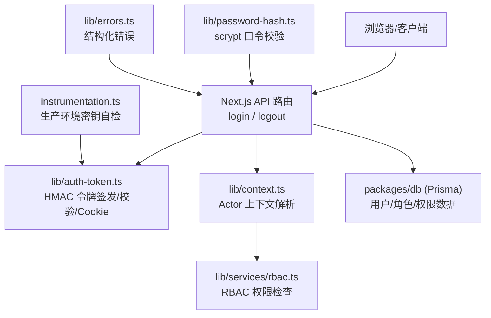
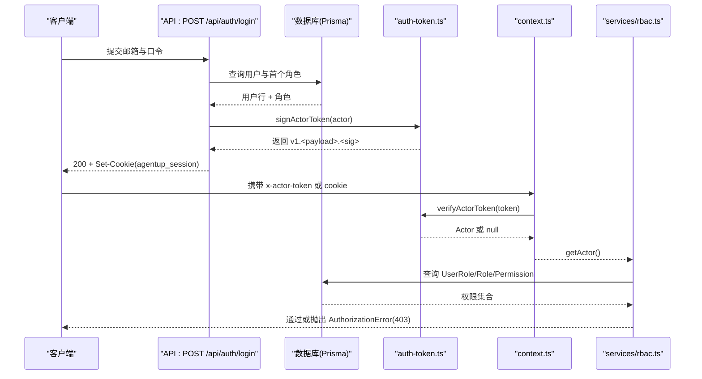
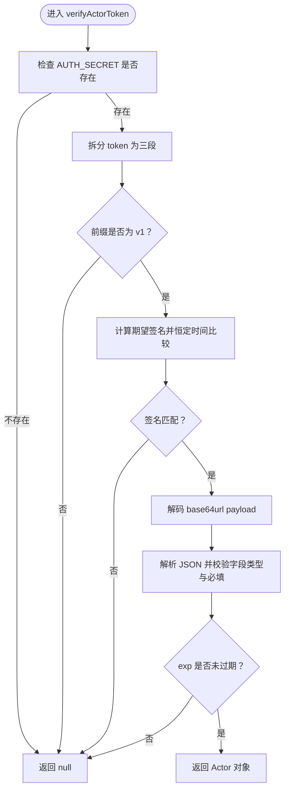
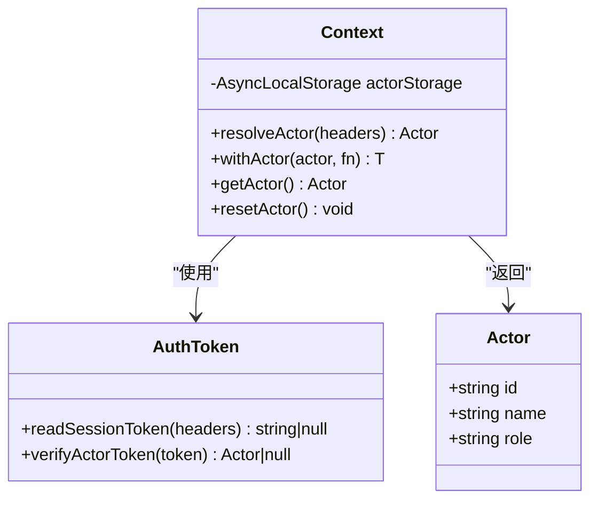
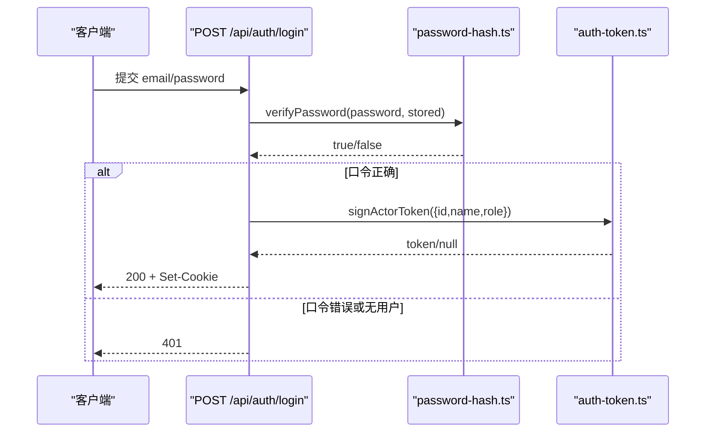
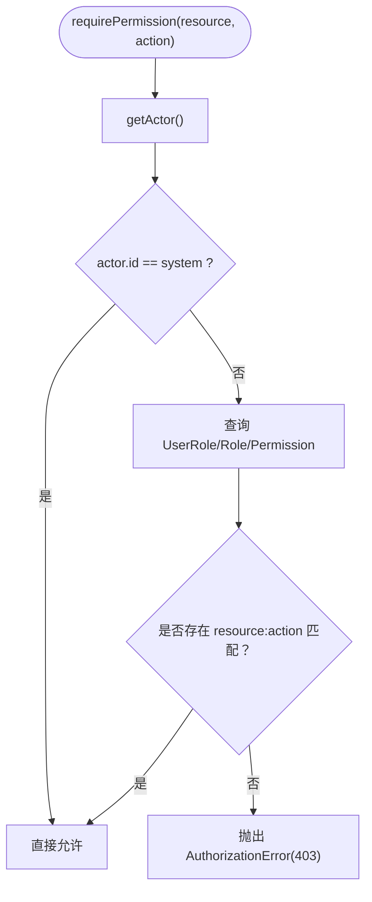
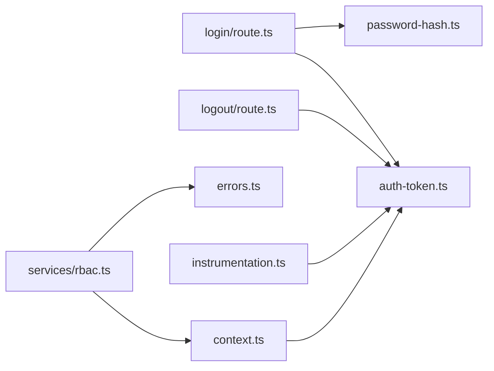

# 认证与授权

<cite>
**本文引用的文件**   
- [apps/web/lib/auth-token.ts](file://apps/web/lib/auth-token.ts)
- [apps/web/app/api/auth/login/route.ts](file://apps/web/app/api/auth/login/route.ts)
- [apps/web/app/api/auth/logout/route.ts](file://apps/web/app/api/auth/logout/route.ts)
- [apps/web/lib/context.ts](file://apps/web/lib/context.ts)
- [apps/web/lib/services/rbac.ts](file://apps/web/lib/services/rbac.ts)
- [apps/web/instrumentation.ts](file://apps/web/instrumentation.ts)
- [apps/web/lib/password-hash.ts](file://apps/web/lib/password-hash.ts)
- [apps/web/lib/errors.ts](file://apps/web/lib/errors.ts)
- [apps/web/lib/__tests__/auth-token.test.ts](file://apps/web/lib/__tests__/auth-token.test.ts)
- [apps/web/lib/__tests__/context.test.ts](file://apps/web/lib/__tests__/context.test.ts)
- [apps/web/app/api/__tests__/rbac.test.ts](file://apps/web/app/api/__tests__/rbac.test.ts)
</cite>

## 目录
1. [简介](#简介)
2. [项目结构](#项目结构)
3. [核心组件](#核心组件)
4. [架构总览](#架构总览)
5. [详细组件分析](#详细组件分析)
6. [依赖关系分析](#依赖关系分析)
7. [性能与安全特性](#性能与安全特性)
8. [故障排查指南](#故障排查指南)
9. [结论](#结论)
10. [附录：配置与环境变量](#附录配置与环境变量)

## 简介
本技术文档围绕项目的认证与授权体系展开，重点覆盖以下方面：
- HMAC-SHA256 签名会话令牌的生成、校验与生命周期管理。
- Actor 上下文解析流程：用户身份识别、角色信息提取与信任边界控制。
- 安全头验证机制：请求签名验证、时间戳过期校验与防重放策略说明。
- 登录、会话管理与登出流程。
- RBAC 权限模型与权限缓存/查询路径。
- 错误处理模式、安全威胁防护与常见问题排查建议。

该实现采用“最小依赖”的安全设计：令牌使用 node:crypto 的 HMAC-SHA256 签名，口令哈希使用 scrypt；不引入 JWT 库，避免额外依赖带来的攻击面与维护成本。

## 项目结构
认证与授权相关代码集中在 Next.js Web 应用内，主要模块如下：
- 令牌与 Cookie 工具：apps/web/lib/auth-token.ts
- Actor 上下文与异步作用域：apps/web/lib/context.ts
- 登录与登出接口：apps/web/app/api/auth/login/route.ts、apps/web/app/api/auth/logout/route.ts
- RBAC 权限服务：apps/web/lib/services/rbac.ts
- 启动期安全检查：apps/web/instrumentation.ts
- 口令哈希：apps/web/lib/password-hash.ts
- 统一错误类型与响应映射：apps/web/lib/errors.ts

**图示来源**
- [apps/web/lib/auth-token.ts:1-164](file://apps/web/lib/auth-token.ts#L1-L164)
- [apps/web/app/api/auth/login/route.ts:1-69](file://apps/web/app/api/auth/login/route.ts#L1-L69)
- [apps/web/app/api/auth/logout/route.ts:1-18](file://apps/web/app/api/auth/logout/route.ts#L1-L18)
- [apps/web/lib/context.ts:1-97](file://apps/web/lib/context.ts#L1-L97)
- [apps/web/lib/services/rbac.ts:1-51](file://apps/web/lib/services/rbac.ts#L1-L51)
- [apps/web/instrumentation.ts:1-23](file://apps/web/instrumentation.ts#L1-L23)
- [apps/web/lib/password-hash.ts:1-78](file://apps/web/lib/password-hash.ts#L1-L78)
- [apps/web/lib/errors.ts:57-94](file://apps/web/lib/errors.ts#L57-L94)

**章节来源**
- [apps/web/lib/auth-token.ts:1-164](file://apps/web/lib/auth-token.ts#L1-L164)
- [apps/web/app/api/auth/login/route.ts:1-69](file://apps/web/app/api/auth/login/route.ts#L1-L69)
- [apps/web/app/api/auth/logout/route.ts:1-18](file://apps/web/app/api/auth/logout/route.ts#L1-L18)
- [apps/web/lib/context.ts:1-97](file://apps/web/lib/context.ts#L1-L97)
- [apps/web/lib/services/rbac.ts:1-51](file://apps/web/lib/services/rbac.ts#L1-L51)
- [apps/web/instrumentation.ts:1-23](file://apps/web/instrumentation.ts#L1-L23)
- [apps/web/lib/password-hash.ts:1-78](file://apps/web/lib/password-hash.ts#L1-L78)
- [apps/web/lib/errors.ts:57-94](file://apps/web/lib/errors.ts#L57-L94)

## 核心组件
- 会话令牌与 Cookie：提供 HMAC-SHA256 签名令牌签发、校验、读取与 Set-Cookie 生成，支持显式头优先于 Cookie 的取值策略。
- Actor 上下文：基于 AsyncLocalStorage 的请求级 actor 传播，优先级为“签名令牌 > 受控明文头 > 匿名”，并支持系统主体豁免。
- 登录/登出：邮箱+口令登录，返回用户信息与会话 Cookie；登出幂等清除 Cookie。
- RBAC 权限：从数据库加载用户角色与权限，按资源:动作进行授权判断，失败关闭。
- 启动期自检：生产环境缺失 AUTH_SECRET 时直接退出进程，防止静默降级导致审计失效。
- 口令哈希：scrypt 存储格式，带参数范围钳制与内存上限保护。
- 错误处理：统一 AppError 子类与 toErrorBody 映射，AuthorizationError 对应 403。

**章节来源**
- [apps/web/lib/auth-token.ts:1-164](file://apps/web/lib/auth-token.ts#L1-L164)
- [apps/web/lib/context.ts:1-97](file://apps/web/lib/context.ts#L1-L97)
- [apps/web/app/api/auth/login/route.ts:1-69](file://apps/web/app/api/auth/login/route.ts#L1-L69)
- [apps/web/app/api/auth/logout/route.ts:1-18](file://apps/web/app/api/auth/logout/route.ts#L1-L18)
- [apps/web/lib/services/rbac.ts:1-51](file://apps/web/lib/services/rbac.ts#L1-L51)
- [apps/web/instrumentation.ts:1-23](file://apps/web/instrumentation.ts#L1-L23)
- [apps/web/lib/password-hash.ts:1-78](file://apps/web/lib/password-hash.ts#L1-L78)
- [apps/web/lib/errors.ts:57-94](file://apps/web/lib/errors.ts#L57-L94)

## 架构总览
下图展示一次典型登录后访问受保护资源的调用链：

**图示来源**
- [apps/web/app/api/auth/login/route.ts:18-67](file://apps/web/app/api/auth/login/route.ts#L18-L67)
- [apps/web/lib/auth-token.ts:68-118](file://apps/web/lib/auth-token.ts#L68-L118)
- [apps/web/lib/context.ts:65-90](file://apps/web/lib/context.ts#L65-L90)
- [apps/web/lib/services/rbac.ts:21-51](file://apps/web/lib/services/rbac.ts#L21-L51)

## 详细组件分析

### 会话令牌与 Cookie（HMAC-SHA256）
- 令牌格式：v1.<base64url(payload)>.<base64url(sig)>，前缀版本号便于未来算法升级。
- 载荷字段：id、name、role、iat、exp，其中 exp 用于过期校验。
- 签名算法：HMAC-SHA256，密钥来自环境变量 AUTH_SECRET。
- 读取优先级：显式头 x-actor-token 优先于 Cookie agentup_session。
- Cookie 属性：Path=/、HttpOnly、SameSite=Lax，生产环境追加 Secure；Max-Age 由 AUTH_SESSION_TTL_HOURS 决定，默认 24 小时。
- 登出：Set-Cookie 将 Max-Age 置 0，且 Path/SameSite/Secure 必须与签发一致，否则浏览器无法正确删除。

**图示来源**
- [apps/web/lib/auth-token.ts:87-118](file://apps/web/lib/auth-token.ts#L87-L118)

**章节来源**
- [apps/web/lib/auth-token.ts:14-18](file://apps/web/lib/auth-token.ts#L14-L18)
- [apps/web/lib/auth-token.ts:21-26](file://apps/web/lib/auth-token.ts#L21-L26)
- [apps/web/lib/auth-token.ts:61-81](file://apps/web/lib/auth-token.ts#L61-L81)
- [apps/web/lib/auth-token.ts:120-163](file://apps/web/lib/auth-token.ts#L120-L163)
- [apps/web/lib/__tests__/auth-token.test.ts:132-160](file://apps/web/lib/__tests__/auth-token.test.ts#L132-L160)

### Actor 上下文解析与信任边界
- 身份来源优先级：
  1) 签名会话令牌（cookie 或 x-actor-token），唯一不可伪造来源。
  2) 明文 x-actor-id/name/role 头，仅在显式信任开关开启时使用。
  3) 均不可信 → ANONYMOUS_ACTOR。
- 明文头信任开关：AUTH_TRUST_ACTOR_HEADERS=1 强制开启；=0 强制关闭；未设置时非 production 默认开启，production 默认关闭。
- 异步作用域：使用 AsyncLocalStorage 在 await 后仍保持 actor 上下文，避免审计署名错乱。
- 系统主体：system 主体用于后台自发动作，具有 platform_admin 角色但不来自外部请求。

**图示来源**
- [apps/web/lib/context.ts:22-90](file://apps/web/lib/context.ts#L22-L90)
- [apps/web/lib/auth-token.ts:137-143](file://apps/web/lib/auth-token.ts#L137-L143)

**章节来源**
- [apps/web/lib/context.ts:1-97](file://apps/web/lib/context.ts#L1-L97)
- [apps/web/lib/__tests__/context.test.ts:114-183](file://apps/web/lib/__tests__/context.test.ts#L114-L183)
- [apps/web/lib/__tests__/context.test.ts:185-223](file://apps/web/lib/__tests__/context.test.ts#L185-L223)

### 登录流程与会话管理
- 输入校验：邮箱格式与必填项校验，错误返回 422 或 401。
- 口令校验：使用 scrypt 存储格式，verifyPassword 对异常输入一律返回 false，失败关闭。
- 令牌签发：根据用户与其首个角色构造 Actor，调用 signActorToken；若未配置 AUTH_SECRET，开发环境记录告警日志，生产环境由 instrumentation 阻止启动。
- 会话下发：成功时返回 Set-Cookie(agentup_session)，包含 HttpOnly、SameSite=Lax、Path=/，生产环境追加 Secure。

**图示来源**
- [apps/web/app/api/auth/login/route.ts:18-67](file://apps/web/app/api/auth/login/route.ts#L18-L67)
- [apps/web/lib/password-hash.ts:53-77](file://apps/web/lib/password-hash.ts#L53-L77)
- [apps/web/lib/auth-token.ts:68-81](file://apps/web/lib/auth-token.ts#L68-L81)

**章节来源**
- [apps/web/app/api/auth/login/route.ts:1-69](file://apps/web/app/api/auth/login/route.ts#L1-L69)
- [apps/web/lib/password-hash.ts:1-78](file://apps/web/lib/password-hash.ts#L1-L78)
- [apps/web/lib/auth-token.ts:68-81](file://apps/web/lib/auth-token.ts#L68-L81)

### 登出机制
- 登出接口总是返回 200，并清除 Cookie；不校验令牌、不查库，确保幂等。
- 原因：当令牌过期或非法时，仍需能清理本地 Cookie，避免前端卡在“本地有 cookie 但服务端不认”的状态。

**章节来源**
- [apps/web/app/api/auth/logout/route.ts:1-18](file://apps/web/app/api/auth/logout/route.ts#L1-L18)
- [apps/web/lib/auth-token.ts:160-163](file://apps/web/lib/auth-token.ts#L160-L163)

### RBAC 权限模型与查询路径
- 权威数据源：数据库中的 UserRole → Role → Permission 关系。
- 令牌中的 role 仅用于审计展示，不作为授权依据。
- 系统主体豁免：actor.id === "system" 直接放行。
- 多角色取并集：任一角色拥有所需 resource:action 即允许。
- 失败关闭：未找到 UserRole 或未授权则抛 AuthorizationError(403)。

**图示来源**
- [apps/web/lib/services/rbac.ts:21-51](file://apps/web/lib/services/rbac.ts#L21-L51)

**章节来源**
- [apps/web/lib/services/rbac.ts:1-51](file://apps/web/lib/services/rbac.ts#L1-L51)
- [apps/web/app/api/__tests__/rbac.test.ts:59-97](file://apps/web/app/api/__tests__/rbac.test.ts#L59-L97)

### 启动期自检与密钥管理
- instrumentation.register 在服务进程启动时执行一次，动态导入 auth-token 模块。
- 生产环境缺失 AUTH_SECRET 时主动 process.exit(1)，避免“看起来运行正常但签不出令牌”的静默降级。
- 构建与静态导出不会触发 register，保证构建产物可跨环境迁移。

**章节来源**
- [apps/web/instrumentation.ts:1-23](file://apps/web/instrumentation.ts#L1-L23)
- [apps/web/lib/auth-token.ts:34-54](file://apps/web/lib/auth-token.ts#L34-L54)

### 口令哈希与防暴力破解
- 使用 scrypt，存储格式含 N、r、p、salt、hash，便于未来上调成本参数。
- verifyPassword 对任何异常输入返回 false，并对成本参数做范围钳制，防止恶意篡改导致的内存耗尽。
- maxmem 限制防御 DoS；timingSafeEqual 防止时序侧信道。

**章节来源**
- [apps/web/lib/password-hash.ts:1-78](file://apps/web/lib/password-hash.ts#L1-L78)

### 错误处理模式
- AppError 子类：ValidationError(422)、ConflictError(409)、AuthorizationError(403)、NotFoundError(404)。
- toErrorBody：将未知错误统一映射为 500，脱敏消息，避免泄露堆栈。

**章节来源**
- [apps/web/lib/errors.ts:57-94](file://apps/web/lib/errors.ts#L57-L94)
- [apps/web/lib/__tests__/errors.test.ts:1-40](file://apps/web/lib/__tests__/errors.test.ts#L1-L40)

## 依赖关系分析
- auth-token.ts 被 login route、logout route、context.ts 引用。
- context.ts 被 rbac.ts 通过 getActor 使用。
- instrumentation.ts 在运行时动态导入 auth-token.ts 以执行自检。
- password-hash.ts 被 login route 调用以校验口令。
- errors.ts 被 rbac.ts 抛出 AuthorizationError 并使用。

**图示来源**
- [apps/web/app/api/auth/login/route.ts:1-69](file://apps/web/app/api/auth/login/route.ts#L1-L69)
- [apps/web/app/api/auth/logout/route.ts:1-18](file://apps/web/app/api/auth/logout/route.ts#L1-L18)
- [apps/web/lib/context.ts:1-97](file://apps/web/lib/context.ts#L1-L97)
- [apps/web/lib/services/rbac.ts:1-51](file://apps/web/lib/services/rbac.ts#L1-L51)
- [apps/web/instrumentation.ts:1-23](file://apps/web/instrumentation.ts#L1-L23)
- [apps/web/lib/password-hash.ts:1-78](file://apps/web/lib/password-hash.ts#L1-L78)
- [apps/web/lib/errors.ts:57-94](file://apps/web/lib/errors.ts#L57-L94)

**章节来源**
- [apps/web/app/api/auth/login/route.ts:1-69](file://apps/web/app/api/auth/login/route.ts#L1-L69)
- [apps/web/app/api/auth/logout/route.ts:1-18](file://apps/web/app/api/auth/logout/route.ts#L1-L18)
- [apps/web/lib/context.ts:1-97](file://apps/web/lib/context.ts#L1-L97)
- [apps/web/lib/services/rbac.ts:1-51](file://apps/web/lib/services/rbac.ts#L1-L51)
- [apps/web/instrumentation.ts:1-23](file://apps/web/instrumentation.ts#L1-L23)
- [apps/web/lib/password-hash.ts:1-78](file://apps/web/lib/password-hash.ts#L1-L78)
- [apps/web/lib/errors.ts:57-94](file://apps/web/lib/errors.ts#L57-L94)

## 性能与安全特性
- 令牌校验复杂度：O(n) 字符串拆分与 base64url 解码，常量时间比较签名，避免时序攻击。
- 口令哈希：scrypt 参数 N=2^16、r=8、p=1，单次约 100-200ms，适合登录路径；maxmem 限制防御内存耗尽。
- Cookie 安全：HttpOnly、SameSite=Lax，生产环境 Secure；Path=/ 与 SameSite 一致性保障登出幂等。
- 防重放：当前令牌不含一次性随机数或请求指纹，因此不单独提供防重放能力；如需防重放，应在业务层结合时间窗口与请求指纹扩展令牌载荷。
- 跨域安全：Cookie 的 SameSite=Lax 适用于常见跨站场景；如需严格跨域，应配合 CORS 白名单与 Secure Cookie。

[本节为通用指导，不直接分析具体文件]

## 故障排查指南
- 生产环境无法启动：检查 AUTH_SECRET 是否配置；instrumentation 会在缺失时主动退出进程。
- 登录成功但无会话：确认 AUTH_SECRET 已配置；开发环境会输出告警日志，生产环境应已在启动期拦截。
- 登出无效：检查 Set-Cookie 的 Path、SameSite、Secure 是否与签发一致；浏览器按“名字 + Path + Domain”判定同一 Cookie。
- 令牌验不过：检查 token 格式、签名是否匹配、exp 是否过期；若更换密钥，旧令牌将失效。
- 明文头被忽略：确认 AUTH_TRUST_ACTOR_HEADERS 开关；production 默认不信任明文头。
- 权限不足：确认数据库中 UserRole/Role/Permission 是否正确关联；system 主体豁免，其他用户需具备所需 resource:action。

**章节来源**
- [apps/web/instrumentation.ts:1-23](file://apps/web/instrumentation.ts#L1-L23)
- [apps/web/lib/auth-token.ts:148-163](file://apps/web/lib/auth-token.ts#L148-L163)
- [apps/web/lib/context.ts:54-59](file://apps/web/lib/context.ts#L54-L59)
- [apps/web/lib/services/rbac.ts:21-51](file://apps/web/lib/services/rbac.ts#L21-L51)

## 结论
本项目采用轻量而严谨的认证与授权方案：
- 使用 HMAC-SHA256 签名令牌替代 JWT，减少依赖并明确职责边界。
- 通过 Actor 上下文与 AsyncLocalStorage 实现请求级身份传播，结合 RBAC 数据库权威数据源进行授权。
- 在生产环境通过启动期自检确保密钥配置，避免静默降级导致审计失效。
- 口令哈希使用 scrypt 并加入参数范围与内存上限保护，提升安全性与鲁棒性。
- 错误处理统一化，AuthorizationError 明确表达权限不足语义。

建议在后续演进中：
- 如需防重放，可在令牌载荷中加入一次性随机数或请求指纹，并结合时间窗口校验。
- 对高频读操作可考虑角色-权限缓存策略，但需保证缓存失效与一致性。
- 在跨域场景中完善 CORS 与 Cookie 安全策略，确保 SameSite 与 Secure 的正确组合。

[本节为总结性内容，不直接分析具体文件]

## 附录：配置与环境变量
- AUTH_SECRET：HMAC 签名密钥，生产环境必需。
- AUTH_SESSION_TTL_HOURS：会话有效期（小时），默认 24。
- AUTH_TRUST_ACTOR_HEADERS：是否信任明文 x-actor-* 头；1 开启，0 关闭，未设置时非 production 默认开启。
- NODE_ENV：区分开发与生产环境，影响 Secure Cookie 与明文头信任策略。

[本节为配置说明，不直接分析具体文件]