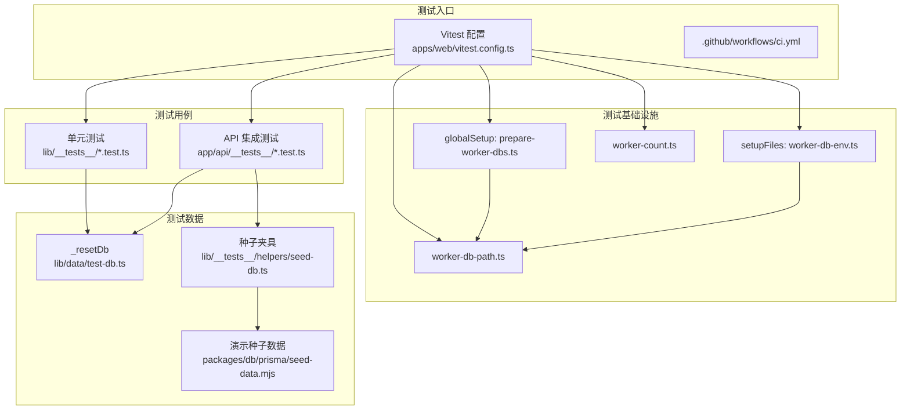
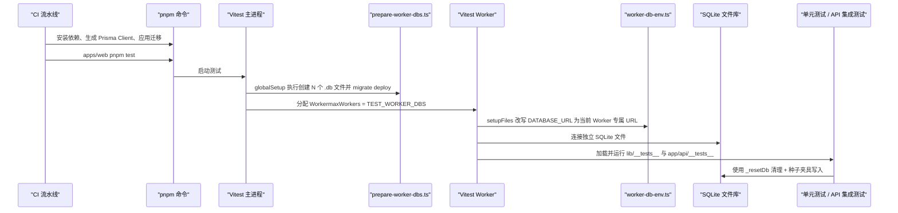
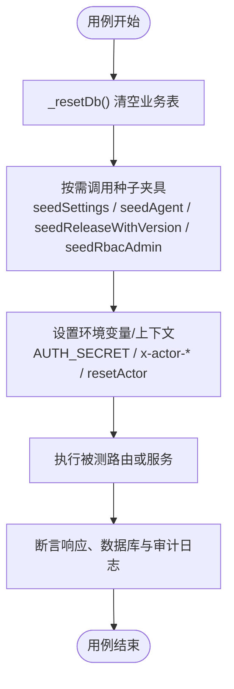
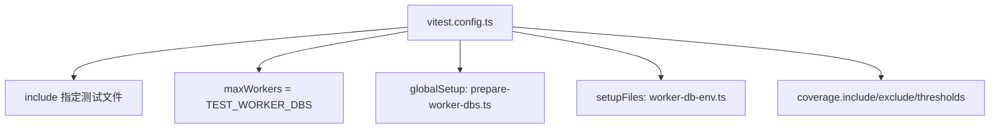
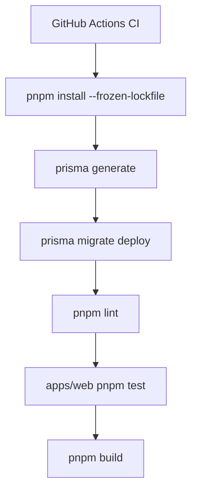
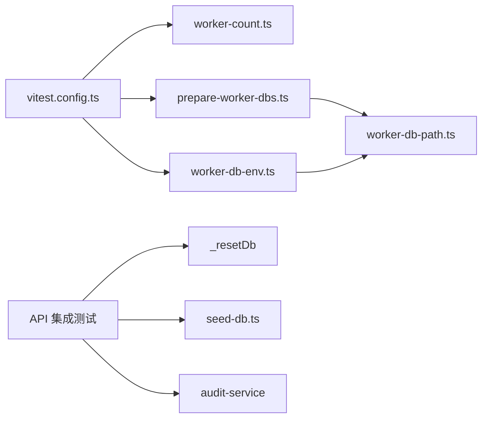

# 测试策略

<cite>
**本文引用的文件**   
- [vitest.config.ts](file://apps/web/vitest.config.ts)
- [ci.yml](file://.github/workflows/ci.yml)
- [prepare-worker-dbs.ts](file://apps/web/lib/__tests__/setup/prepare-worker-dbs.ts)
- [worker-db-env.ts](file://apps/web/lib/__tests__/setup/worker-db-env.ts)
- [worker-count.ts](file://apps/web/lib/__tests__/setup/worker-count.ts)
- [worker-db-path.ts](file://apps/web/lib/__tests__/setup/worker-db-path.ts)
- [test-db.ts](file://apps/web/lib/data/test-db.ts)
- [seed-db.ts](file://apps/web/lib/__tests__/helpers/seed-db.ts)
- [agents.test.ts](file://apps/web/app/api/__tests__/agents.test.ts)
- [auth-login.test.ts](file://apps/web/app/api/__tests__/auth-login.test.ts)
- [seed-data.mjs](file://packages/db/prisma/seed-data.mjs)
</cite>

## 目录
1. [引言](#引言)
2. [项目结构](#项目结构)
3. [核心组件](#核心组件)
4. [架构总览](#架构总览)
5. [详细组件分析](#详细组件分析)
6. [依赖关系分析](#依赖关系分析)
7. [性能与并发](#性能与并发)
8. [故障排查指南](#故障排查指南)
9. [结论](#结论)
10. [附录：测试编写规范与最佳实践](#附录测试编写规范与最佳实践)

## 引言
本测试策略文档面向 agent-up 项目的全部测试资产，覆盖约 371 个用例的组织方式、执行流程与质量门禁。重点包括：
- 单元测试（`apps/web/lib/__tests__/`）与 API 集成测试（`apps/web/app/api/__tests__/`）的职责边界与协作方式。
- 测试数据管理：`_resetDb` 清库机制、种子数据夹具与隔离策略。
- Vitest 配置、覆盖率收集与持续集成流水线。
- Mock 策略、调试技巧、性能测试方法与 TDD 工作流建议。

## 项目结构
测试相关代码集中在 `apps/web` 下，分为两类：
- 单元测试：位于 `apps/web/lib/__tests__/`，主要验证服务层、工具函数、鉴权、检索等无网络依赖或可被模拟的模块。
- API 集成测试：位于 `apps/web/app/api/__tests__/`，直接调用 Next.js Route Handler，校验路由契约、权限、审计日志与数据库状态。

**图示来源**
- [vitest.config.ts:1-64](file://apps/web/vitest.config.ts#L1-L64)
- [prepare-worker-dbs.ts:1-39](file://apps/web/lib/__tests__/setup/prepare-worker-dbs.ts#L1-L39)
- [worker-db-env.ts:1-18](file://apps/web/lib/__tests__/setup/worker-db-env.ts#L1-L18)
- [worker-count.ts:1-3](file://apps/web/lib/__tests__/setup/worker-count.ts#L1-L3)
- [worker-db-path.ts:1-22](file://apps/web/lib/__tests__/setup/worker-db-path.ts#L1-L22)
- [test-db.ts:1-45](file://apps/web/lib/data/test-db.ts#L1-L45)
- [seed-db.ts:1-209](file://apps/web/lib/__tests__/helpers/seed-db.ts#L1-L209)
- [seed-data.mjs:1-800](file://packages/db/prisma/seed-data.mjs#L1-L800)

**章节来源**
- [vitest.config.ts:1-64](file://apps/web/vitest.config.ts#L1-L64)
- [ci.yml:1-58](file://.github/workflows/ci.yml#L1-L58)

## 核心组件
- Vitest 配置：定义测试环境、包含路径、Worker 数量、全局初始化、覆盖率阈值与别名。
- Worker 数据库隔离：通过 `globalSetup` 为每个 Worker 准备独立 SQLite 文件，并在 `setupFiles` 中注入对应 `DATABASE_URL`。
- `_resetDb` 清库：按外键依赖顺序清空业务表，保证测试间数据隔离。
- 种子夹具：提供 RBAC、Agent、Release、Audit 等常用测试数据构造方法。
- 演示种子数据：作为生产演示与迁移基线的单一事实源，供测试夹具参考。

**章节来源**
- [vitest.config.ts:1-64](file://apps/web/vitest.config.ts#L1-L64)
- [prepare-worker-dbs.ts:1-39](file://apps/web/lib/__tests__/setup/prepare-worker-dbs.ts#L1-L39)
- [worker-db-env.ts:1-18](file://apps/web/lib/__tests__/setup/worker-db-env.ts#L1-L18)
- [test-db.ts:1-45](file://apps/web/lib/data/test-db.ts#L1-L45)
- [seed-db.ts:1-209](file://apps/web/lib/__tests__/helpers/seed-db.ts#L1-L209)
- [seed-data.mjs:1-800](file://packages/db/prisma/seed-data.mjs#L1-L800)

## 架构总览
下图展示从 CI 到 Vitest Worker 再到数据库与测试用例的完整链路。

**图示来源**
- [ci.yml:1-58](file://.github/workflows/ci.yml#L1-L58)
- [vitest.config.ts:1-64](file://apps/web/vitest.config.ts#L1-L64)
- [prepare-worker-dbs.ts:1-39](file://apps/web/lib/__tests__/setup/prepare-worker-dbs.ts#L1-L39)
- [worker-db-env.ts:1-18](file://apps/web/lib/__tests__/setup/worker-db-env.ts#L1-L18)

## 详细组件分析

### 测试分类与职责
- 单元测试（`lib/__tests__/`）
  - 目标：验证服务层、工具函数、鉴权、检索、版本控制等逻辑。
  - 特点：尽量不发起真实外部请求；必要时使用 mock。
- API 集成测试（`app/api/__tests__/`）
  - 目标：验证 Next.js Route Handler 的请求/响应契约、参数校验、错误码、权限与审计日志。
  - 特点：直接导入 route 处理器，构造 `NextRequest`，断言状态码与响应体。

示例参考：
- [agents.test.ts:1-212](file://apps/web/app/api/__tests__/agents.test.ts#L1-L212)
- [auth-login.test.ts:1-110](file://apps/web/app/api/__tests__/auth-login.test.ts#L1-L110)

**章节来源**
- [agents.test.ts:1-212](file://apps/web/app/api/__tests__/agents.test.ts#L1-L212)
- [auth-login.test.ts:1-110](file://apps/web/app/api/__tests__/auth-login.test.ts#L1-L110)

### 测试数据管理与隔离策略
- `_resetDb` 清库机制
  - 按外键依赖顺序 `deleteMany` 所有业务表，避免 SQLite 不支持 `TRUNCATE` 的问题。
  - 在 `beforeEach` 中调用，确保每个用例前数据库为空且一致。
- 种子夹具
  - `seedSettings`：最小 RBAC 与产品组、用户、Agent 数据。
  - `seedAgent`：快速创建 Agent 与其产品组。
  - `seedReleaseWithVersion`：创建 Release 与 AgentVersion，满足发布链路测试。
  - `seedAuditLogs`：直插审计日志，便于审计查询测试。
  - `seedRbacAdmin`：RBAC 管理员角色与全量权限，配合 `adminActorHeaders`。
- 演示种子数据
  - `packages/db/prisma/seed-data.mjs` 是演示数据的单一事实源，测试夹具与其保持命名一致性以便对照。

**图示来源**
- [test-db.ts:1-45](file://apps/web/lib/data/test-db.ts#L1-L45)
- [seed-db.ts:1-209](file://apps/web/lib/__tests__/helpers/seed-db.ts#L1-L209)
- [agents.test.ts:1-212](file://apps/web/app/api/__tests__/agents.test.ts#L1-L212)
- [auth-login.test.ts:1-110](file://apps/web/app/api/__tests__/auth-login.test.ts#L1-L110)

**章节来源**
- [test-db.ts:1-45](file://apps/web/lib/data/test-db.ts#L1-L45)
- [seed-db.ts:1-209](file://apps/web/lib/__tests__/helpers/seed-db.ts#L1-L209)
- [seed-data.mjs:1-800](file://packages/db/prisma/seed-data.mjs#L1-L800)

### Vitest 配置与覆盖率
- 环境与包含范围
  - 环境：`node`。
  - 包含：`lib/__tests__/**/*.test.ts` 与 `app/api/__tests__/**/*.test.ts`。
- Worker 与隔离
  - `maxWorkers` 等于 `TEST_WORKER_DBS`（默认 4），每个 Worker 拥有独立 SQLite 文件。
  - `globalSetup` 负责删除旧 `.db` 文件并执行 `prisma migrate deploy`。
  - `setupFiles` 在每个 Worker 内重写 `DATABASE_URL`。
- 覆盖率
  - Provider：`v8`。
  - Reporter：`text`、`text-summary`、`html`。
  - Include：核心 lib 文件与 `app/api/**/route.ts`。
  - Exclude：`lib/__tests__/**`。
  - Thresholds：lines/functions/statements ≥ 80%，branches ≥ 70%。

**图示来源**
- [vitest.config.ts:1-64](file://apps/web/vitest.config.ts#L1-L64)
- [worker-count.ts:1-3](file://apps/web/lib/__tests__/setup/worker-count.ts#L1-L3)

**章节来源**
- [vitest.config.ts:1-64](file://apps/web/vitest.config.ts#L1-L64)

### 持续集成流程
- 触发条件：push 到 main 与所有 pull_request。
- 关键步骤：
  - 安装依赖（锁定 pnpm 版本）。
  - 生成 Prisma Client。
  - 应用 Prisma 迁移（SQLite 基线）。
  - Lint。
  - 运行测试（`cd apps/web && pnpm test`）。
  - 构建。
- 数据库：使用 `DATABASE_URL=file:./ci.db`，无需外部数据库服务。

**图示来源**
- [ci.yml:1-58](file://.github/workflows/ci.yml#L1-L58)

**章节来源**
- [ci.yml:1-58](file://.github/workflows/ci.yml#L1-L58)

### Mock 策略
- 外部服务
  - LLM 端点通过 `fetch` 模拟，不在 CI 中发起真实请求。
  - 对需要外部行为的模块优先使用 `vi.mock`/`vi.spyOn`（仓库目前较少使用，需谨慎引入）。
- 数据库隔离
  - 通过 Worker 级独立 SQLite 文件实现强隔离，避免跨用例污染。
- 文件系统
  - 测试应使用临时文件或内存态；如需持久化，应在 `afterAll` 清理。

[本节为通用指导，不直接分析具体文件]

### 调试技巧
- 单文件运行：`pnpm exec vitest run <path>`。
- 聚焦用例：使用 `it.only` 或 `describe.only` 缩小范围。
- 查看覆盖率报告：本地运行后打开 HTML 报告定位未覆盖分支。
- 检查 Worker 隔离：确认 `VITEST_POOL_ID` 与 `DATABASE_URL` 是否指向预期 `.db` 文件。

[本节为通用指导，不直接分析具体文件]

### 性能测试方法
- 利用现有 4 个 Worker 并行执行，缩短整体耗时。
- 将 IO 密集的用例分散到不同 Worker，避免同一 `.db` 文件竞争。
- 对热点路由进行批量断言，减少重复建库成本。
- 使用 `--reporter=verbose` 定位慢用例。

[本节为通用指导，不直接分析具体文件]

## 依赖关系分析
- 配置文件依赖
  - `vitest.config.ts` 依赖 `worker-count.ts` 与 `prepare-worker-dbs.ts`、`worker-db-env.ts`。
  - `prepare-worker-dbs.ts` 与 `worker-db-env.ts` 共用 `worker-db-path.ts` 计算路径。
- 测试用例依赖
  - API 集成测试普遍依赖 `_resetDb` 与种子夹具。
  - 部分用例依赖上下文与审计服务以验证身份与审计行为。

**图示来源**
- [vitest.config.ts:1-64](file://apps/web/vitest.config.ts#L1-L64)
- [prepare-worker-dbs.ts:1-39](file://apps/web/lib/__tests__/setup/prepare-worker-dbs.ts#L1-L39)
- [worker-db-env.ts:1-18](file://apps/web/lib/__tests__/setup/worker-db-env.ts#L1-L18)
- [worker-db-path.ts:1-22](file://apps/web/lib/__tests__/setup/worker-db-path.ts#L1-L22)
- [test-db.ts:1-45](file://apps/web/lib/data/test-db.ts#L1-L45)
- [seed-db.ts:1-209](file://apps/web/lib/__tests__/helpers/seed-db.ts#L1-L209)

**章节来源**
- [vitest.config.ts:1-64](file://apps/web/vitest.config.ts#L1-L64)
- [prepare-worker-dbs.ts:1-39](file://apps/web/lib/__tests__/setup/prepare-worker-dbs.ts#L1-L39)
- [worker-db-env.ts:1-18](file://apps/web/lib/__tests__/setup/worker-db-env.ts#L1-L18)
- [worker-db-path.ts:1-22](file://apps/web/lib/__tests__/setup/worker-db-path.ts#L1-L22)
- [test-db.ts:1-45](file://apps/web/lib/data/test-db.ts#L1-L45)
- [seed-db.ts:1-209](file://apps/web/lib/__tests__/helpers/seed-db.ts#L1-L209)

## 性能与并发
- 并发模型：Vitest 使用 Node Worker，最多 4 个 Worker，每个 Worker 拥有独立 SQLite 文件，避免锁竞争。
- 数据库迁移：仅在 `globalSetup` 阶段执行一次，避免重复开销。
- 建议
  - 将长耗时用例拆分到不同 Worker 分组。
  - 避免在 `beforeEach` 中进行昂贵 I/O。
  - 使用最小种子数据，仅构造断言所需字段。

[本节为通用指导，不直接分析具体文件]

## 故障排查指南
- 无法连接数据库
  - 检查 `DATABASE_URL` 是否由 `worker-db-env.ts` 正确注入。
  - 确认 `prepare-worker-dbs.ts` 已成功执行 `prisma migrate deploy`。
- 测试互相污染
  - 确认每个用例在 `beforeEach` 中调用 `_resetDb()`。
  - 检查是否混用全局种子数据而未重置。
- 覆盖率不达标
  - 核对 `vitest.config.ts` 的 `coverage.include` 是否包含被测文件。
  - 针对低覆盖率分支补充用例，而非下调阈值。
- CI 失败
  - 确认已执行 `prisma generate` 与 `prisma migrate deploy`。
  - 检查 `DATABASE_URL` 是否为 `file:./ci.db`。

**章节来源**
- [worker-db-env.ts:1-18](file://apps/web/lib/__tests__/setup/worker-db-env.ts#L1-L18)
- [prepare-worker-dbs.ts:1-39](file://apps/web/lib/__tests__/setup/prepare-worker-dbs.ts#L1-L39)
- [test-db.ts:1-45](file://apps/web/lib/data/test-db.ts#L1-L45)
- [vitest.config.ts:1-64](file://apps/web/vitest.config.ts#L1-L64)
- [ci.yml:1-58](file://.github/workflows/ci.yml#L1-L58)

## 结论
本项目采用“Worker 级 SQLite 隔离 + `_resetDb` 清库 + 种子夹具”的组合策略，既保证了测试的稳定性与可重复性，又兼顾了执行效率。Vitest 配置与 CI 流水线共同构成质量门禁，覆盖率阈值与 include/exclude 规则确保核心代码与路由得到充分覆盖。遵循本文档的测试编写规范与最佳实践，可进一步提升测试的可维护性与扩展性。

[本节为总结性内容，不直接分析具体文件]

## 附录：测试编写规范与最佳实践
- 命名约定
  - 文件名：`<feature>.test.ts`。
  - 描述块：使用领域语言描述功能，如“GET /api/agents”。
  - 用例名：动词+期望结果，如“returns paginated list”。
- 断言模式
  - 先断言状态码，再断言响应体关键字段。
  - 对副作用（如审计日志）在 flush 后断言。
- 数据准备
  - 统一在 `beforeEach` 调用 `_resetDb()`。
  - 使用种子夹具构造最小必要数据。
- Mock 原则
  - 优先隔离外部依赖；对外部 HTTP 调用使用 fetch mock。
  - 谨慎使用 `vi.mock`，避免过度抽象导致测试脆弱。
- TDD 流程
  - 先写失败用例，再实现最小可用逻辑，最后重构与补测。
- 调试与性能
  - 使用 `it.only` 聚焦问题。
  - 关注 Worker 隔离与数据库迁移阶段耗时。
  - 定期审查覆盖率报告，补齐分支覆盖。

[本节为通用指导，不直接分析具体文件]