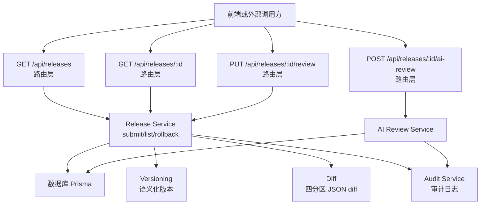
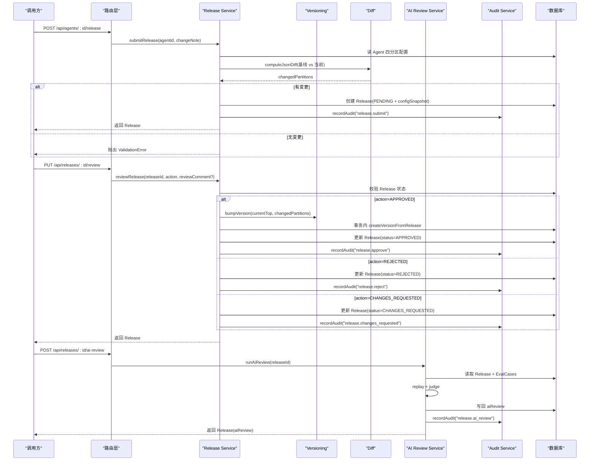
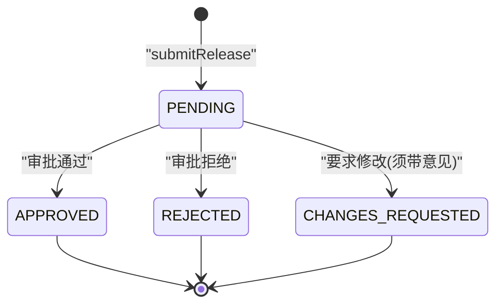
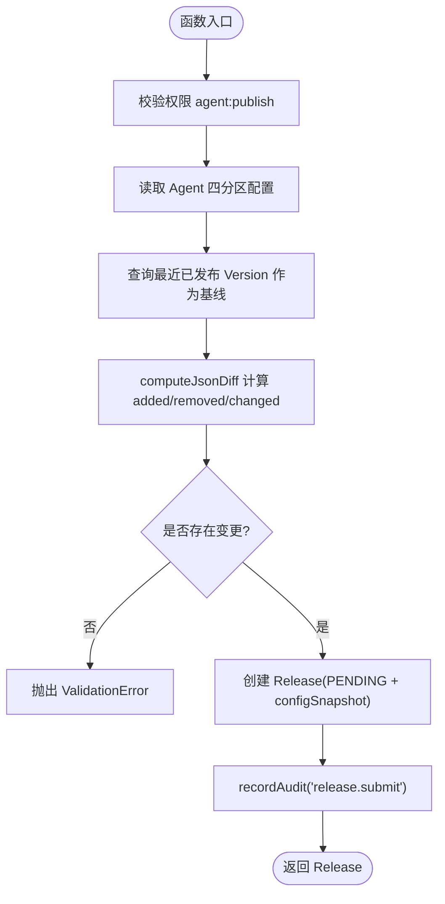
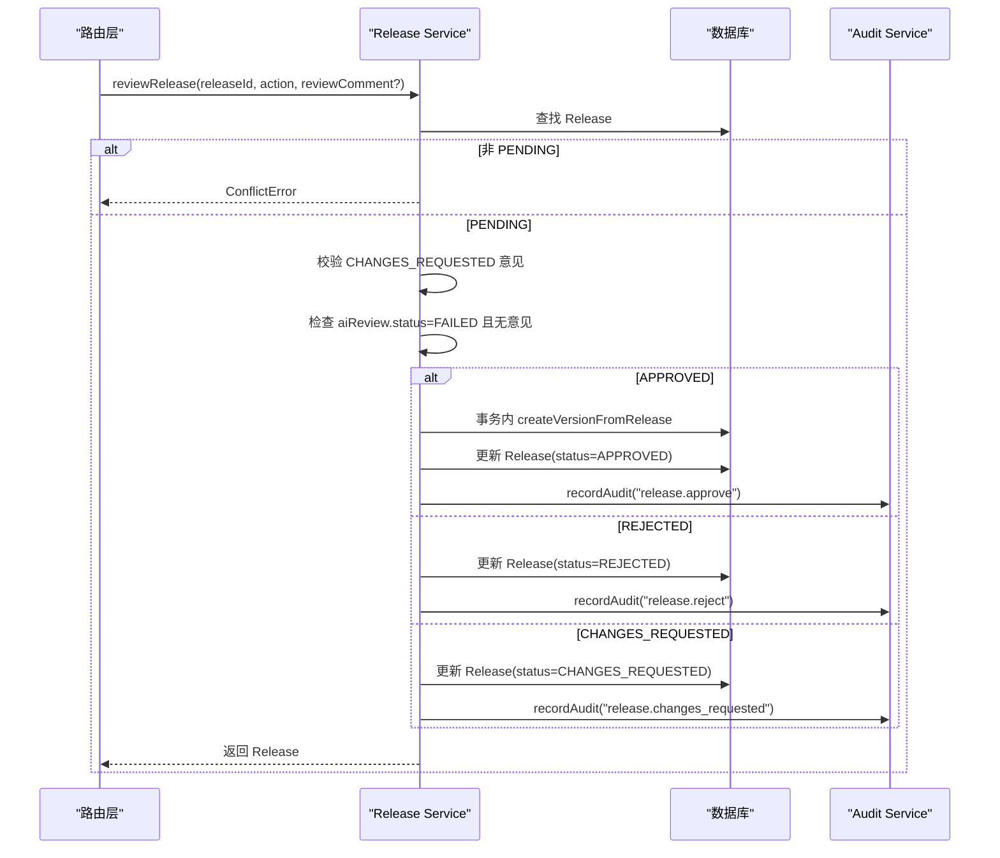
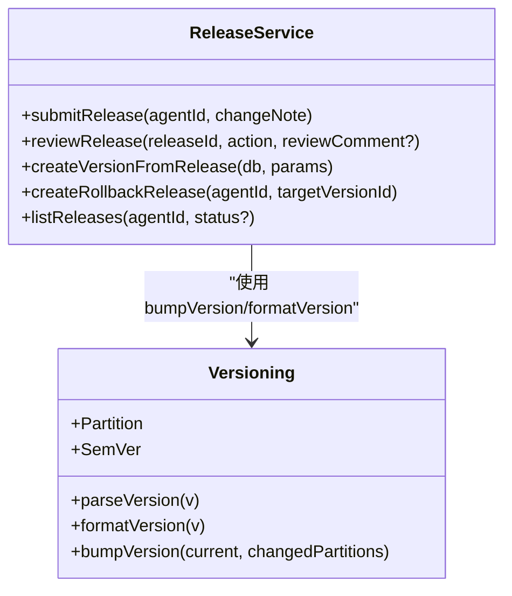
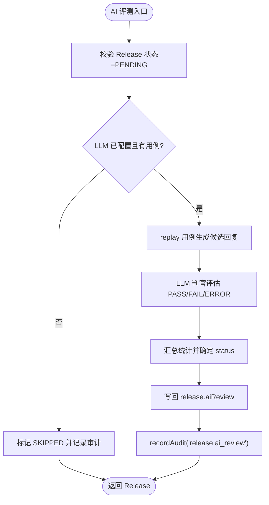
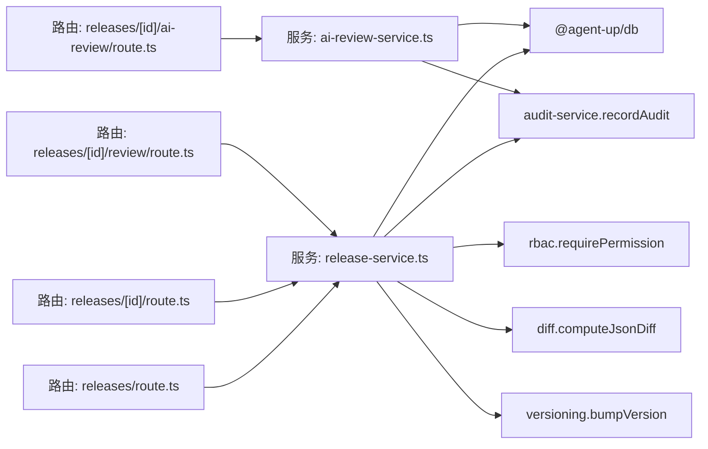

# 发布审批流程

<cite>
**本文引用的文件**   
- [release-service.ts](file://apps/web/lib/services/release-service.ts)
- [versioning.ts](file://apps/web/lib/versioning.ts)
- [diff.ts](file://apps/web/lib/diff.ts)
- [ai-review-service.ts](file://apps/web/lib/services/ai-review-service.ts)
- [audit-service.ts](file://apps/web/lib/services/audit-service.ts)
- [releases/route.ts](file://apps/web/app/api/releases/route.ts)
- [releases/[id]/route.ts](file://apps/web/app/api/releases/[id]/route.ts)
- [releases/[id]/review/route.ts](file://apps/web/app/api/releases/[id]/review/route.ts)
- [releases/[id]/ai-review/route.ts](file://apps/web/app/api/releases/[id]/ai-review/route.ts)
- [releases.test.ts](file://apps/web/app/api/__tests__/releases.test.ts)
</cite>

## 目录
1. [引言](#引言)
2. [项目结构](#项目结构)
3. [核心组件](#核心组件)
4. [架构总览](#架构总览)
5. [详细组件分析](#详细组件分析)
6. [依赖关系分析](#依赖关系分析)
7. [性能与一致性考量](#性能与一致性考量)
8. [故障排查指南](#故障排查指南)
9. [结论](#结论)
10. [附录：API 调用示例与最佳实践](#附录api-调用示例与最佳实践)

## 引言
本文面向 Agent 配置发布与审批的技术实现，聚焦以下目标：
- Release 状态机设计：PENDING、APPROVED、REJECTED、CHANGES_REQUESTED 四种状态及其转换规则。
- 提交发布的完整流程：四分区 diff 计算、基线版本对比、变更分区识别、发布请求创建。
- 审批流程实现：权限验证、AI 评测门禁、审批意见要求、事务一致性保证。
- 审计日志集成：记录所有审批操作的可追溯性。
- API 调用示例、错误处理策略与常见场景最佳实践。

## 项目结构
发布审批相关代码集中在 Next.js 路由层与服务层：
- 路由层：`apps/web/app/api/releases/**` 暴露发布列表、详情、审批、AI 评测等接口。
- 服务层：`apps/web/lib/services/release-service.ts` 承载发布状态机、diff 基线、版本号计算、回滚逻辑。
- 辅助模块：`versioning.ts`（语义化版本）、`diff.ts`（JSON diff）、`ai-review-service.ts`（AI 评测）、`audit-service.ts`（审计日志）。

**图表来源**
- [releases/route.ts:7-46](file://apps/web/app/api/releases/route.ts#L7-L46)
- [releases/[id]/route.ts:14-59](file://apps/web/app/api/releases/[id]/route.ts#L14-L59)
- [releases/[id]/review/route.ts:11-28](file://apps/web/app/api/releases/[id]/review/route.ts#L11-L28)
- [releases/[id]/ai-review/route.ts:13-26](file://apps/web/app/api/releases/[id]/ai-review/route.ts#L13-L26)
- [release-service.ts:77-149](file://apps/web/lib/services/release-service.ts#L77-L149)
- [release-service.ts:159-217](file://apps/web/lib/services/release-service.ts#L159-L217)
- [ai-review-service.ts:222-329](file://apps/web/lib/services/ai-review-service.ts#L222-L329)
- [audit-service.ts:43-84](file://apps/web/lib/services/audit-service.ts#L43-L84)

**章节来源**
- [releases/route.ts:1-47](file://apps/web/app/api/releases/route.ts#L1-L47)
- [releases/[id]/route.ts:1-60](file://apps/web/app/api/releases/[id]/route.ts#L1-L60)
- [releases/[id]/review/route.ts:1-29](file://apps/web/app/api/releases/[id]/review/route.ts#L1-L29)
- [releases/[id]/ai-review/route.ts:1-27](file://apps/web/app/api/releases/[id]/ai-review/route.ts#L1-L27)

## 核心组件
- Release Service：负责提交发布、审批、生成不可变 Version、整版本回滚、列出发布。
- Versioning：定义 Partition 类型与 SemVer 升版规则。
- Diff：提供 computeJsonDiff，用于分区级变更判定。
- AI Review Service：对 PENDING Release 运行评测用例，产出 PASSED/FAILED/SKIPPED 并写回 release.aiReview。
- Audit Service：append-only 审计日志，fire-and-forget 写入，不阻塞业务。

**章节来源**
- [release-service.ts:36-41](file://apps/web/lib/services/release-service.ts#L36-L41)
- [release-service.ts:77-149](file://apps/web/lib/services/release-service.ts#L77-L149)
- [release-service.ts:159-217](file://apps/web/lib/services/release-service.ts#L159-L217)
- [release-service.ts:235-265](file://apps/web/lib/services/release-service.ts#L235-L265)
- [release-service.ts:275-354](file://apps/web/lib/services/release-service.ts#L275-L354)
- [versioning.ts:18-69](file://apps/web/lib/versioning.ts#L18-L69)
- [diff.ts:9-34](file://apps/web/lib/diff.ts#L9-L34)
- [ai-review-service.ts:222-329](file://apps/web/lib/services/ai-review-service.ts#L222-L329)
- [audit-service.ts:43-84](file://apps/web/lib/services/audit-service.ts#L43-L84)

## 架构总览
发布审批的核心链路如下：
- 提交发布：校验权限 → 读取 Agent 四分区配置 → 以最近已发布 Version 为基线做 diff → 若存在变更则创建 PENDING Release 并记录审计。
- 审批发布：校验权限 → 校验状态与意见 → 若 APPROVED 则在事务内生成不可变 Version → 更新 Release 状态并记录审计。
- AI 评测：仅允许对 PENDING Release 运行；结果作为软门禁，FAILED 时批准必须填写意见。
- 审计日志：所有关键动作（提交、批准、拒绝、要求修改、回滚、AI 评测）均记录到 auditLog。

**图表来源**
- [release-service.ts:77-149](file://apps/web/lib/services/release-service.ts#L77-L149)
- [release-service.ts:159-217](file://apps/web/lib/services/release-service.ts#L159-L217)
- [release-service.ts:235-265](file://apps/web/lib/services/release-service.ts#L235-L265)
- [ai-review-service.ts:222-329](file://apps/web/lib/services/ai-review-service.ts#L222-L329)
- [audit-service.ts:43-84](file://apps/web/lib/services/audit-service.ts#L43-L84)

## 详细组件分析

### Release 状态机设计
状态集合：PENDING、APPROVED、REJECTED、CHANGES_REQUESTED。
- 初始态：submitRelease 创建 PENDING。
- 终态：APPROVED、REJECTED、CHANGES_REQUESTED 均为终态，重复审批抛 ConflictError。
- 转换规则：
  - PENDING → APPROVED：审批通过，生成不可变 Version。
  - PENDING → REJECTED：审批拒绝，不生成 Version。
  - PENDING → CHANGES_REQUESTED：要求修改，必须带 reviewComment。

**图表来源**
- [release-service.ts:36-41](file://apps/web/lib/services/release-service.ts#L36-L41)
- [release-service.ts:159-179](file://apps/web/lib/services/release-service.ts#L159-L179)

**章节来源**
- [release-service.ts:36-41](file://apps/web/lib/services/release-service.ts#L36-L41)
- [release-service.ts:159-179](file://apps/web/lib/services/release-service.ts#L159-L179)

### 提交发布流程：四分区 diff 与基线对比
- 权限校验：requirePermission("agent", "publish")。
- 读取 Agent 四分区配置：prompt/knowledge/tools/routing。
- 基线选择：按 publishedAt 倒序取第一条 agentVersion，取其四分区快照作为 baseline。
- 分区变更判定：computeJsonDiff(before, after)，added/removed/changed 任一非空即视为该分区变更。
- 若无任何分区变更：抛出 ValidationError。
- 创建 Release：status=PENDING，configSnapshot 固化四分区快照，记录审计。

**图表来源**
- [release-service.ts:77-149](file://apps/web/lib/services/release-service.ts#L77-L149)
- [diff.ts:9-34](file://apps/web/lib/diff.ts#L9-L34)

**章节来源**
- [release-service.ts:77-149](file://apps/web/lib/services/release-service.ts#L77-L149)
- [diff.ts:9-34](file://apps/web/lib/diff.ts#L9-L34)

### 审批流程：权限、AI 门禁、意见要求与事务一致性
- 权限校验：requirePermission("release", "approve")。
- 状态校验：仅 PENDING 可审批；其他状态抛 ConflictError。
- 意见校验：CHANGES_REQUESTED 必须带 reviewComment。
- AI 门禁：若 release.aiReview.status=FAILED，则 APPROVED 必须带 reviewComment。
- 事务一致性：APPROVED 时在 prisma.$transaction 内先 createVersionFromRelease，再更新 Release 状态。
- 审计记录：根据 action 记录 release.approve/reject/changes_requested。

**图表来源**
- [release-service.ts:159-217](file://apps/web/lib/services/release-service.ts#L159-L217)
- [audit-service.ts:43-84](file://apps/web/lib/services/audit-service.ts#L43-L84)

**章节来源**
- [release-service.ts:159-217](file://apps/web/lib/services/release-service.ts#L159-L217)

### 版本号计算与不可变 Version
- 版本号来源：基于 agent 当前最高版本（compareSemVer 数值比较）+ changedPartitions。
- 升版规则：
  - 首次发布：0.1.0。
  - ROUTING 分区变更或 ≥2 个分区变更：minor++，patch=0。
  - 单个非路由分区变更：patch++。
  - 永不自动 major。
- createVersionFromRelease：将 configSnapshot 的四个分区落盘为不可变快照，并关联 releaseId。

**图表来源**
- [versioning.ts:18-69](file://apps/web/lib/versioning.ts#L18-L69)
- [release-service.ts:235-265](file://apps/web/lib/services/release-service.ts#L235-L265)

**章节来源**
- [versioning.ts:18-69](file://apps/web/lib/versioning.ts#L18-L69)
- [release-service.ts:235-265](file://apps/web/lib/services/release-service.ts#L235-L265)

### AI 评测门禁
- 入口：POST /api/releases/:id/ai-review。
- 约束：仅 PENDING Release 可运行；若 LLM 未配置或无 EvalCases，结果为 SKIPPED。
- 评测过程：用 release.configSnapshot.prompt 组装 systemPrompt，逐条 replay 评测用例，LLM 判官给出 PASS/FAIL/ERROR。
- 结果写回：release.aiReview.status ∈ {PASSED, FAILED, SKIPPED}。
- 门禁行为：FAILED 时 APPROVED 必须带 reviewComment；否则抛 ValidationError。

**图表来源**
- [ai-review-service.ts:222-329](file://apps/web/lib/services/ai-review-service.ts#L222-L329)
- [audit-service.ts:43-84](file://apps/web/lib/services/audit-service.ts#L43-L84)

**章节来源**
- [ai-review-service.ts:222-329](file://apps/web/lib/services/ai-review-service.ts#L222-L329)

### 审计日志集成
- 记录点：
  - release.submit
  - release.approve
  - release.reject
  - release.changes_requested
  - agent.rollback
  - release.ai_review
- 特性：
  - append-only，fire-and-forget，失败不阻塞业务。
  - details 包含 agentId、reviewComment、aiReviewStatus、回滚版本信息等。
  - 测试中可通过 flushAudit 等待异步写入完成。

**章节来源**
- [audit-service.ts:43-84](file://apps/web/lib/services/audit-service.ts#L43-L84)
- [release-service.ts:147-148](file://apps/web/lib/services/release-service.ts#L147-L148)
- [release-service.ts:204-214](file://apps/web/lib/services/release-service.ts#L204-L214)
- [release-service.ts:340-347](file://apps/web/lib/services/release-service.ts#L340-L347)
- [ai-review-service.ts:265-327](file://apps/web/lib/services/ai-review-service.ts#L265-L327)

## 依赖关系分析
- 路由层依赖服务层：
  - GET /api/releases → listReleases（路由层内联过滤与分页）。
  - GET /api/releases/:id → 详情与 baseline 快照。
  - PUT /api/releases/:id/review → reviewRelease。
  - POST /api/releases/:id/ai-review → runAiReview。
- 服务层依赖：
  - @agent-up/db：Prisma 客户端与类型。
  - context：getActor/withActor。
  - errors：业务异常类型。
  - rbac：requirePermission。
  - audit-service：recordAudit。
  - diff：computeJsonDiff。
  - versioning：bumpVersion/formatVersion/Partition。
  - agent-service：toXxxConfigResponse/updateXxxConfig。

**图表来源**
- [releases/route.ts:1-47](file://apps/web/app/api/releases/route.ts#L1-L47)
- [releases/[id]/route.ts:1-60](file://apps/web/app/api/releases/[id]/route.ts#L1-L60)
- [releases/[id]/review/route.ts:1-29](file://apps/web/app/api/releases/[id]/review/route.ts#L1-L29)
- [releases/[id]/ai-review/route.ts:1-27](file://apps/web/app/api/releases/[id]/ai-review/route.ts#L1-L27)
- [release-service.ts:1-32](file://apps/web/lib/services/release-service.ts#L1-L32)
- [ai-review-service.ts:15-28](file://apps/web/lib/services/ai-review-service.ts#L15-L28)

**章节来源**
- [release-service.ts:1-32](file://apps/web/lib/services/release-service.ts#L1-L32)
- [ai-review-service.ts:15-28](file://apps/web/lib/services/ai-review-service.ts#L15-L28)

## 性能与一致性考量
- 提交发布：
  - diff 计算复杂度与分区字段规模线性相关；四分区较小对象，开销可控。
  - 基线查询按 publishedAt 倒序取第一条，索引友好。
- 审批发布：
  - 事务内生成 Version 与更新 Release，保证原子性。
  - 版本号计算基于全量版本列表排序，注意长期增长后的性能影响。
- AI 评测：
  - 逐用例 replay + judge，可能多次 LLM 调用；单用例失败不中断整体。
  - 长文本截断控制上下文大小。
- 审计日志：
  - fire-and-forget，避免阻塞主流程；测试环境可通过 flushAudit 同步。

[本节为通用指导，不直接分析具体文件]

## 故障排查指南
- 提交报“没有任何配置变更，无法提交发布”：
  - 检查 diff 三桶是否全空；确认基线是否为最近已发布版本。
- 审批报“该 Release 已处理”：
  - 状态非 PENDING；重复审批抛 ConflictError。
- CHANGES_REQUESTED 报 422：
  - reviewComment 为空或纯空白。
- AI 评测 FAILED 后批准被拒：
  - 需填写 reviewComment 说明采纳理由或人工复核结论。
- 版本号与预期不符：
  - 对照 bumpVersion 规则：ROUTING 变更或 ≥2 分区升 minor；单分区升 patch；不自动 major。
- 审计日志缺失：
  - recordAudit 为 fire-and-forget，失败只记日志；测试中需 flushAudit。

**章节来源**
- [release-service.ts:123-125](file://apps/web/lib/services/release-service.ts#L123-L125)
- [release-service.ts:167-172](file://apps/web/lib/services/release-service.ts#L167-L172)
- [release-service.ts:173-179](file://apps/web/lib/services/release-service.ts#L173-L179)
- [versioning.ts:46-69](file://apps/web/lib/versioning.ts#L46-L69)
- [audit-service.ts:62-84](file://apps/web/lib/services/audit-service.ts#L62-L84)

## 结论
本系统通过 Release 状态机与不可变 Version 机制，实现了 Agent 配置的发布与回滚闭环。提交阶段通过四分区 diff 精确识别变更，审批阶段结合权限、AI 门禁与事务一致性保障安全上线。审计日志贯穿全流程，确保可追溯性与合规性。建议在大规模版本历史下关注版本号查询与列表接口的性能优化，并在生产环境中强化审计日志的监控与告警。

[本节为总结性内容，不直接分析具体文件]

## 附录：API 调用示例与最佳实践

### API 定义概览
- POST /api/agents/:id/release
  - 功能：提交发布
  - 请求体：{ changeNote: string }
  - 成功：201，返回 Release（status=PENDING）
  - 失败：404（Agent 不存在）、422（changeNote 为空或无变更）
- PUT /api/releases/:id/review
  - 功能：审批发布
  - 请求体：{ action: "APPROVED"|"REJECTED"|"CHANGES_REQUESTED", reviewComment?: string }
  - 成功：200，返回 Release
  - 失败：409（重复审批）、422（意见缺失或 AI 门禁未满足）
- POST /api/releases/:id/ai-review
  - 功能：运行 AI 评测
  - 成功：200，返回 Release(aiReview)
  - 失败：409（非 PENDING）
- GET /api/releases
  - 功能：分页列出 Release
  - 查询参数：page、pageSize、skip、take、status、agentId
  - 成功：200，返回 { items, pagination }
- GET /api/releases/:id
  - 功能：获取 Release 详情与 baseline 快照
  - 成功：200，返回 Release + baseline

**章节来源**
- [releases/route.ts:7-46](file://apps/web/app/api/releases/route.ts#L7-L46)
- [releases/[id]/route.ts:14-59](file://apps/web/app/api/releases/[id]/route.ts#L14-L59)
- [releases/[id]/review/route.ts:11-28](file://apps/web/app/api/releases/[id]/review/route.ts#L11-L28)
- [releases/[id]/ai-review/route.ts:13-26](file://apps/web/app/api/releases/[id]/ai-review/route.ts#L13-L26)

### 错误处理策略
- NotFoundError：资源不存在（Agent/Release/Version），返回 404。
- ValidationError：输入校验失败（无变更、意见缺失、AI 门禁未满足），返回 422。
- ConflictError：状态冲突（重复审批、非 PENDING 运行评测），返回 409。
- 路由层统一 handleApiError 包装业务异常。

**章节来源**
- [release-service.ts:78-88](file://apps/web/lib/services/release-service.ts#L78-L88)
- [release-service.ts:164-179](file://apps/web/lib/services/release-service.ts#L164-L179)
- [ai-review-service.ts:236-239](file://apps/web/lib/services/ai-review-service.ts#L236-L239)

### 常见场景最佳实践
- 提交前运行 AI 评测：
  - 建议对 PENDING Release 先调用 /api/releases/:id/ai-review，查看 PASSED/FAILED 结论。
  - 若 FAILED，在审批时务必填写 reviewComment 说明人工复核结论。
- 多分区变更：
  - 同时变更多个分区会触发 minor 升级；谨慎管理变更范围，避免版本号膨胀。
- 回滚操作：
  - 整版本回滚直接创建 APPROVED Release 并派生新 Version；审计 action=agent.rollback。
  - 回滚后再次提交可能被拒（当前配置与快照一致），需先编辑草稿再提交。
- 审计追踪：
  - 使用 /api/settings/audit-logs 查询关键动作；测试中调用 flushAudit 确保异步写入完成。

**章节来源**
- [releases/[id]/ai-review/route.ts:13-26](file://apps/web/app/api/releases/[id]/ai-review/route.ts#L13-L26)
- [release-service.ts:275-354](file://apps/web/lib/services/release-service.ts#L275-L354)
- [audit-service.ts:87-119](file://apps/web/lib/services/audit-service.ts#L87-L119)