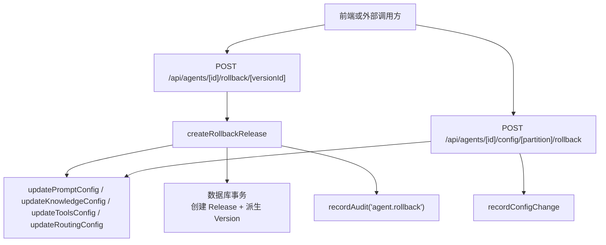
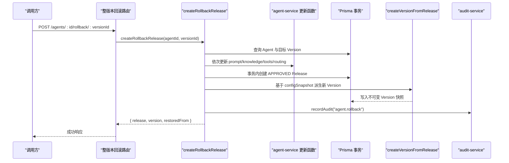
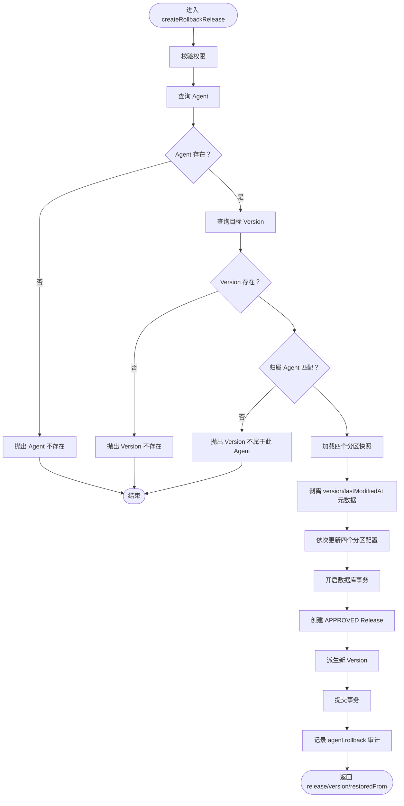
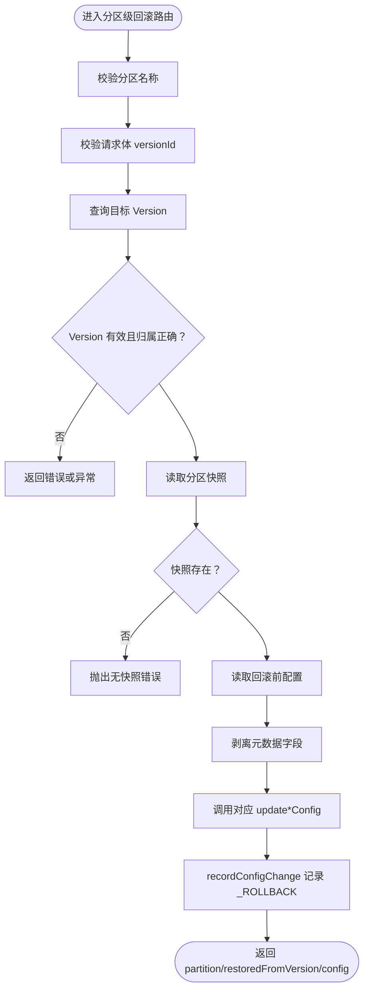
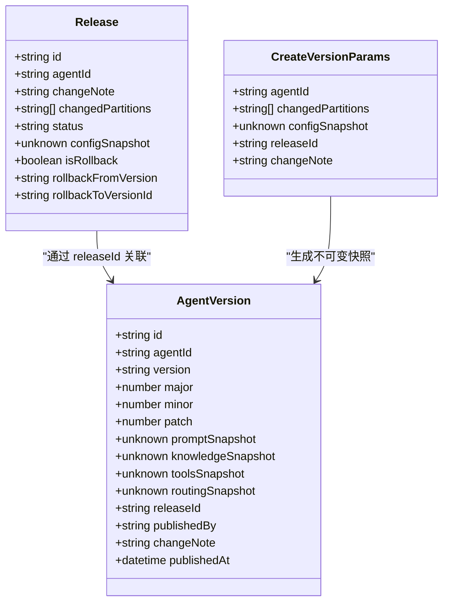
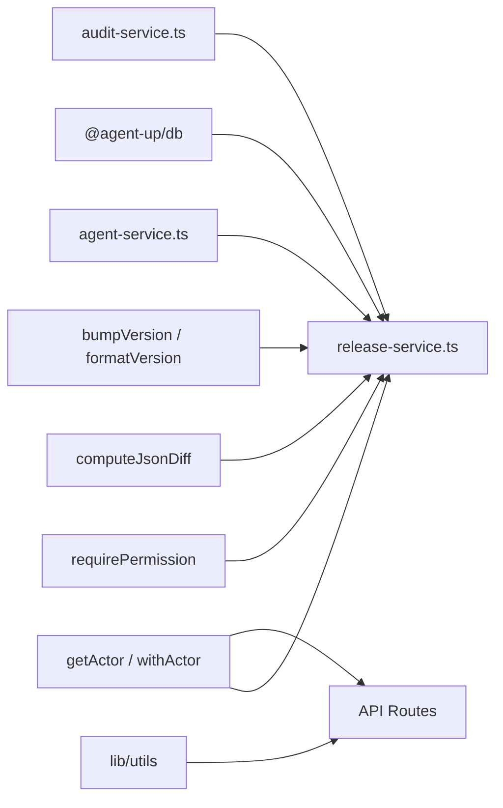
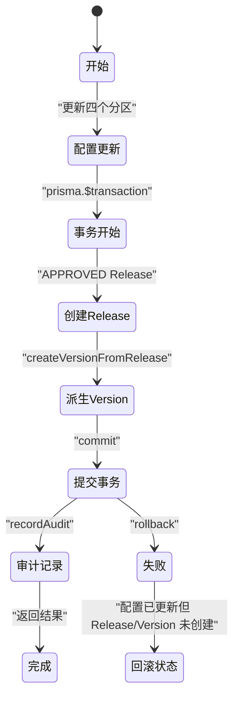

# 回滚机制

<cite>
**本文引用的文件**   
- [release-service.ts](file://apps/web/lib/services/release-service.ts)
- [agent-service.ts](file://apps/web/lib/services/agent-service.ts)
- [整版本回滚路由](file://apps/web/app/api/agents/[id]/rollback/[versionId]/route.ts)
- [分区级回滚路由](file://apps/web/app/api/agents/[id]/config/[partition]/rollback/route.ts)
- [版本历史接口](file://apps/web/app/api/agents/[id]/versions/route.ts)
- [版本回滚测试](file://apps/web/app/api/__tests__/versions-rollback.test.ts)
- [Agent 回滚测试](file://apps/web/app/api/__tests__/agent-rollback.test.ts)
</cite>

## 目录
1. [引言](#引言)
2. [项目结构与入口](#项目结构与入口)
3. [核心概念：双粒度回滚](#核心概念双粒度回滚)
4. [架构总览](#架构总览)
5. [详细组件分析](#详细组件分析)
6. [依赖关系分析](#依赖关系分析)
7. [性能与一致性特征](#性能与一致性特征)
8. [API 调用示例与错误处理](#api-调用示例与错误处理)
9. [最佳实践、风险控制与故障恢复](#最佳实践风险控制与故障恢复)
10. [结论](#结论)

## 引言
本文聚焦 Agent 配置系统的回滚机制，重点解释“双粒度回滚”设计：  
- **整版本回滚**：通过 `createRollbackRelease` 把目标 Version 的四个分区快照同时还原到 Agent 当前配置，并立即生成一个状态为 APPROVED 的 Release，再派生新 Version。  
- **分区级回滚**：只针对单个分区（prompt / knowledge / tools / routing）从指定 Version 的快照中恢复该分区配置。

文档会说明完整流程、事务保证、审计记录、与正常发布的区别、安全考虑、最佳实践和故障恢复策略。

## 项目结构与入口
回滚能力由 Next.js API Route 暴露，并由服务层实现核心逻辑：



**图表来源**  
- [整版本回滚路由:1-37](file://apps/web/app/api/agents/[id]/rollback/[versionId]/route.ts#L1-L37)  
- [分区级回滚路由:1-118](file://apps/web/app/api/agents/[id]/config/[partition]/rollback/route.ts#L1-L118)  
- [release-service.ts:267-354](file://apps/web/lib/services/release-service.ts#L267-L354)  
- [agent-service.ts:551-565](file://apps/web/lib/services/agent-service.ts#L551-L565)

**章节来源**  
- [整版本回滚路由:1-37](file://apps/web/app/api/agents/[id]/rollback/[versionId]/route.ts#L1-L37)  
- [分区级回滚路由:1-118](file://apps/web/app/api/agents/[id]/config/[partition]/rollback/route.ts#L1-L118)

## 核心概念：双粒度回滚
系统提供两种回滚粒度：

| 粒度 | 入口 | 作用范围 | 是否创建 Release | 是否派生 Version | 审计动作 |
|---|---|---|---:|---:|---|
| 整版本回滚 | `POST /api/agents/[id]/rollback/[versionId]` | 全部四个分区 | 是，且直接标记为 APPROVED | 是，立即派生新 Version | `agent.rollback` |
| 分区级回滚 | `POST /api/agents/[id]/config/[partition]/rollback` | 仅指定分区 | 否 | 否 | `recordConfigChange`，变更类型含 `_ROLLBACK` |

### 为什么需要双粒度
- 整版本回滚用于“紧急恢复”：当多个分区组合出现线上问题时，快速回到某个已知稳定的历史快照。  
- 分区级回滚用于“局部修复”：例如知识检索策略或工具配置出错，但 Prompt 或路由规则仍稳定时，只恢复单个分区。

**章节来源**  
- [release-service.ts:267-354](file://apps/web/lib/services/release-service.ts#L267-L354)  
- [分区级回滚路由:34-118](file://apps/web/app/api/agents/[id]/config/[partition]/rollback/route.ts#L34-L118)

## 架构总览
整版本回滚的核心目标是：**在最小时间内恢复稳定配置，同时保留不可变的历史追踪**。



**图表来源**  
- [整版本回滚路由:21-36](file://apps/web/app/api/agents/[id]/rollback/[versionId]/route.ts#L21-L36)  
- [release-service.ts:275-354](file://apps/web/lib/services/release-service.ts#L275-L354)  
- [release-service.ts:235-265](file://apps/web/lib/services/release-service.ts#L235-L265)

## 详细组件分析

### 整版本回滚：`createRollbackRelease`
`createRollbackRelease` 是回滚机制的核心实现。它完成以下关键步骤：

1. **权限校验**：要求具备发布审批相关权限。  
2. **目标版本验证**：检查 Agent 是否存在、目标 Version 是否存在、目标 Version 是否属于该 Agent。  
3. **四分区同步还原**：读取目标 Version 的四个分区快照，剥离元数据字段后覆盖 Agent 当前 active 配置。  
4. **事务化 Release 与 Version 生成**：在同一数据库事务中创建 APPROVED 状态的 Release，并立即派生新 Version。  
5. **审计记录**：记录 `agent.rollback`，包含回滚来源版本、目标 Version ID、新 Version ID 和新版本号。  
6. **返回结果**：返回 Release、Version 以及 `restoredFrom` 信息。



**图表来源**  
- [release-service.ts:275-354](file://apps/web/lib/services/release-service.ts#L275-L354)

#### 关键实现要点
- **四分区同时还原**：使用固定分区顺序 `PROMPT`、`KNOWLEDGE`、`TOOLS`、`ROUTING`，确保组合一致性。  
- **元数据剥离**：从快照中移除 `version` 和 `lastModifiedAt`，避免把历史元数据写回当前 active 配置。  
- **APPROVED Release**：回滚被视为紧急恢复，因此跳过正常提交的 PENDING 审批流，直接标记为 APPROVED。  
- **立即派生 Version**：通过 `createVersionFromRelease` 生成不可变快照，版本号基于当前最高版本和 changedPartitions 计算。  
- **审计完整性**：审计中包含回滚来源版本、目标 Version ID、新 Version ID、新版本号以及四个分区列表。

**章节来源**  
- [release-service.ts:267-354](file://apps/web/lib/services/release-service.ts#L267-L354)

### 分区级回滚：单分区恢复
分区级回滚不创建 Release，也不派生 Version，而是复用 Agent 配置的更新流程：

1. **参数校验**：验证分区名称合法、请求体包含 `versionId`。  
2. **目标版本校验**：确认 Version 存在且属于该 Agent。  
3. **读取分区快照**：从对应分区快照列中取出配置。  
4. **保存 before 状态**：记录回滚前的配置。  
5. **覆盖当前分区**：调用对应的 `update*Config` 函数。  
6. **记录配置变更**：通过 `recordConfigChange` 记录回滚操作，变更类型包含 `_ROLLBACK`。



**图表来源**  
- [分区级回滚路由:42-118](file://apps/web/app/api/agents/[id]/config/[partition]/rollback/route.ts#L42-L118)

**章节来源**  
- [分区级回滚路由:16-118](file://apps/web/app/api/agents/[id]/config/[partition]/rollback/route.ts#L16-L118)

### Version 生成与不可变快照
`createVersionFromRelease` 负责从 Release 的配置快照生成不可变的 Version：

- 查询该 Agent 所有已发布 Version，按 SemVer 数值比较找出最高版本。  
- 根据 `changedPartitions` 计算下一个版本号。  
- 将四个分区的快照写入 `agentVersion`，并关联 `releaseId`。  
- 记录发布者信息和变更说明。



**图表来源**  
- [release-service.ts:219-265](file://apps/web/lib/services/release-service.ts#L219-L265)

**章节来源**  
- [release-service.ts:219-265](file://apps/web/lib/services/release-service.ts#L219-L265)

## 依赖关系分析
回滚机制涉及多层依赖：



**图表来源**  
- [release-service.ts:1-33](file://apps/web/lib/services/release-service.ts#L1-L33)  
- [整版本回滚路由:1-5](file://apps/web/app/api/agents/[id]/rollback/[versionId]/route.ts#L1-L5)  
- [分区级回滚路由:1-15](file://apps/web/app/api/agents/[id]/config/[partition]/rollback/route.ts#L1-L15)

**章节来源**  
- [release-service.ts:1-33](file://apps/web/lib/services/release-service.ts#L1-L33)

## 性能与一致性特征

### 事务保证
整版本回滚的关键一致性保障来自数据库事务：

- **Release 创建与 Version 派生同事务**：确保即使 Version 生成失败，也不会留下孤立的 Release。  
- **配置更新在事务外执行**：当前实现先更新四个分区配置，再在事务中创建 Release 和 Version。这意味着如果事务失败，配置可能已经更新但 Release/Version 未创建。这是需要注意的一致性边界。



**图表来源**  
- [release-service.ts:294-338](file://apps/web/lib/services/release-service.ts#L294-L338)

### 性能考虑
- **四分区串行更新**：每个分区调用一次 `update*Config`，可能存在多次数据库写入。  
- **Version 查询开销**：每次派生 Version 都需要查询该 Agent 的所有 Version 以计算最高版本。  
- **审计记录异步性**：审计通常不影响主流程，但大量回滚操作会产生审计日志写入压力。

**章节来源**  
- [release-service.ts:294-338](file://apps/web/lib/services/release-service.ts#L294-L338)

## API 调用示例与错误处理

### 整版本回滚 API
**请求**  
```
POST /api/agents/{agentId}/rollback/{versionId}
```

**成功响应结构**  
- `release`：包含回滚 Release 信息，状态为 APPROVED，带有 `isRollback`、`rollbackFromVersion`、`rollbackToVersionId`。  
- `version`：新派生的 Version，包含四个分区快照。  
- `restoredFrom`：包含目标 Version 的 id 和 version。

**错误处理**  
- `NotFoundError`：Agent 不存在或 Version 不存在。  
- `ValidationError`：Version 不属于该 Agent。  
- 权限错误：用户不具备发布审批权限。

**章节来源**  
- [整版本回滚路由:21-36](file://apps/web/app/api/agents/[id]/rollback/[versionId]/route.ts#L21-L36)  
- [release-service.ts:275-354](file://apps/web/lib/services/release-service.ts#L275-L354)

### 分区级回滚 API
**请求**  
```
POST /api/agents/{agentId}/config/{partition}/rollback
{
  "versionId": "目标 Version 的 id"
}
```

**成功响应结构**  
- `partition`：被回滚的分区名称。  
- `restoredFromVersion`：来源 Version 的版本号。  
- `config`：回滚后的分区配置。

**错误处理**  
- 无效分区：返回 400 错误。  
- `NotFoundError`：Version 不存在。  
- `ValidationError`：Version 不属于该 Agent 或分区快照缺失。

**章节来源**  
- [分区级回滚路由:42-118](file://apps/web/app/api/agents/[id]/config/[partition]/rollback/route.ts#L42-L118)

### 版本历史 API
**请求**  
```
GET /api/agents/{agentId}/versions
```

**功能**  
- 返回 Agent 的所有已发布 Version，按发布时间倒序。  
- 每个 Version 包含四个分区的快照，供前端展示和回滚选择。  
- 懒加载 effectivenessReport：若报告缺失且超过时间窗口，则计算并缓存。

**章节来源**  
- [版本历史接口:18-53](file://apps/web/app/api/agents/[id]/versions/route.ts#L18-L53)

## 最佳实践、风险控制与故障恢复

### 最佳实践
1. **优先使用整版本回滚进行紧急恢复**：当多个分区组合出现问题时，整版本回滚能确保配置组合的一致性。  
2. **谨慎使用分区级回滚**：仅在确定单个分区配置出错时使用，避免破坏其他分区的稳定组合。  
3. **记录回滚原因**：虽然整版本回滚会自动记录审计，但建议在团队沟通渠道中说明回滚原因和影响范围。  
4. **回滚后验证**：回滚完成后应验证 Agent 的核心功能是否正常，必要时进行监控观察。  
5. **避免频繁回滚**：频繁回滚可能表明上游问题未根本解决，应结合根因分析。

### 风险控制
1. **权限控制**：整版本回滚要求发布审批权限，防止误操作。  
2. **版本归属校验**：确保只能回滚属于当前 Agent 的版本。  
3. **元数据剥离**：避免历史元数据污染当前配置。  
4. **审计追踪**：所有回滚操作都有审计记录，便于事后追溯。

### 故障恢复策略
1. **配置更新成功但事务失败**：由于当前实现先更新配置再创建 Release/Version，如果事务失败，可能出现配置已更新但 Release/Version 未创建。此时需要：
   - 检查数据库事务日志。
   - 手动补录 Release 和 Version。
   - 重新触发回滚流程。
2. **部分分区更新失败**：如果某个分区更新失败，可能导致配置不一致。建议：
   - 检查各分区更新函数的错误处理。
   - 必要时手动修复受影响分区。
   - 重新执行整版本回滚以确保一致性。
3. **审计记录丢失**：虽然审计记录通常不影响主流程，但如果审计写入失败，应检查审计服务状态并补录审计。

**章节来源**  
- [release-service.ts:294-354](file://apps/web/lib/services/release-service.ts#L294-L354)

## 结论
回滚机制通过双粒度设计提供了灵活的配置恢复能力：

- **整版本回滚**适用于紧急恢复场景，通过四分区同步还原、APPROVED Release 和立即派生 Version，确保快速恢复的同时保持历史可追溯。  
- **分区级回滚**适用于局部修复场景，通过复用配置更新流程，避免不必要的 Release 和 Version 生成。

系统设计强调了权限控制、版本校验、元数据管理和审计追踪，但在事务一致性方面仍有改进空间。建议在生产环境中谨慎使用回滚功能，并结合监控和告警机制确保系统稳定性。