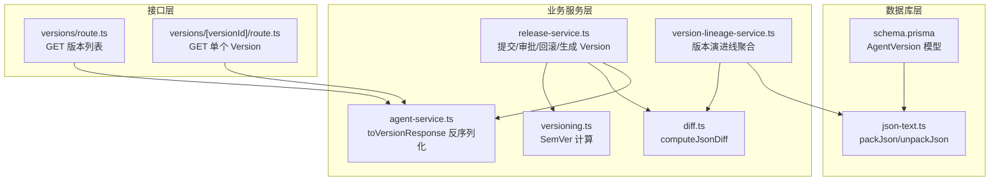
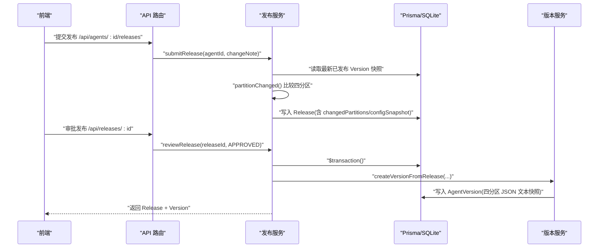
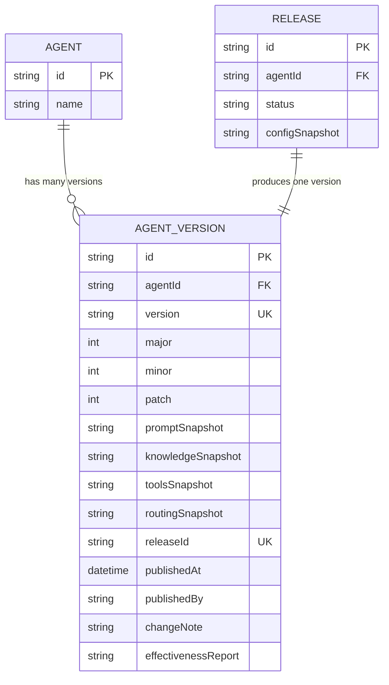
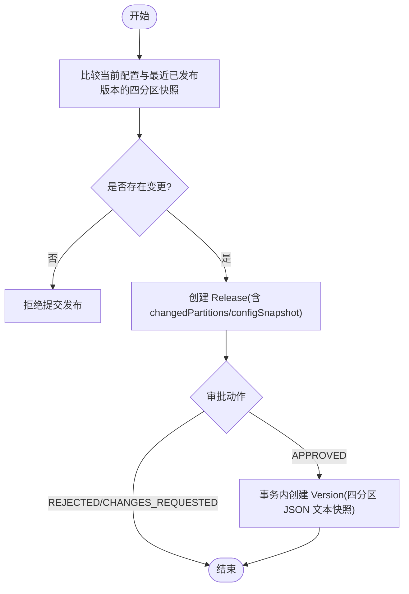
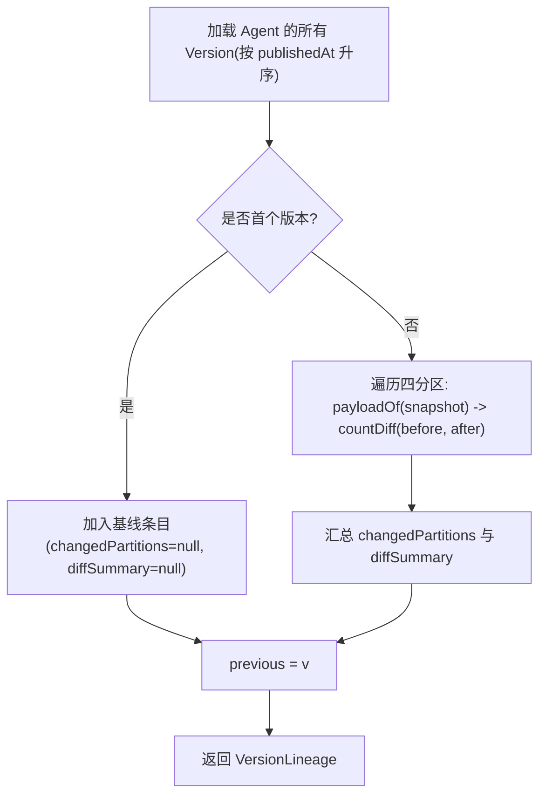
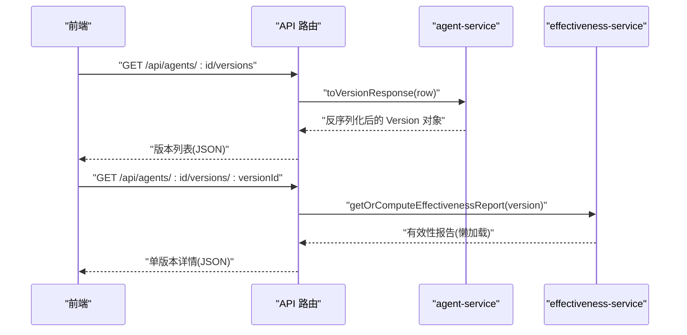
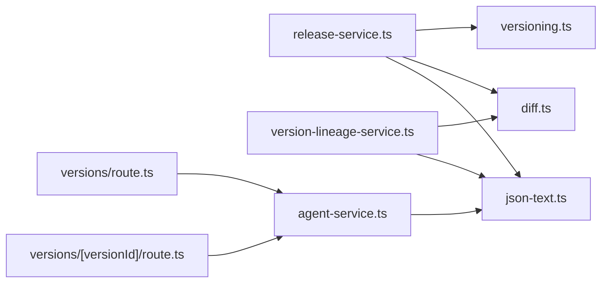

# 版本快照管理

<cite>
**本文引用的文件**   
- [schema.prisma](file://packages/db/prisma/schema.prisma)
- [json-text.ts](file://packages/db/src/json-text.ts)
- [versioning.ts](file://apps/web/lib/versioning.ts)
- [release-service.ts](file://apps/web/lib/services/release-service.ts)
- [agent-service.ts](file://apps/web/lib/services/agent-service.ts)
- [version-lineage-service.ts](file://apps/web/lib/services/version-lineage-service.ts)
- [diff.ts](file://apps/web/lib/diff.ts)
- [versions/route.ts](file://apps/web/app/api/agents/[id]/versions/route.ts)
- [versions/[versionId]/route.ts](file://apps/web/app/api/agents/[id]/versions/[versionId]/route.ts)
</cite>

## 目录
1. [引言](#引言)
2. [项目结构](#项目结构)
3. [核心组件](#核心组件)
4. [架构总览](#架构总览)
5. [详细组件分析](#详细组件分析)
6. [依赖关系分析](#依赖关系分析)
7. [性能与存储优化](#性能与存储优化)
8. [故障排查指南](#故障排查指南)
9. [结论](#结论)

## 引言
本技术文档聚焦“版本快照管理”，围绕不可变 AgentVersion 表、四分区快照字段（promptSnapshot、knowledgeSnapshot、toolsSnapshot、routingSnapshot）、版本创建时机、数据完整性保证、快照压缩与序列化策略、版本演进线与历史追踪、以及快照查询对比分析方法展开。目标是帮助开发者理解现有实现，并在扩展或排障时具备清晰的定位能力。

## 项目结构
版本快照相关代码分布在数据库模型、JSON 编解码工具、发布与版本服务、版本演进线聚合、差异计算工具以及 API 路由中：

图表来源
- [schema.prisma:294-318](file://packages/db/prisma/schema.prisma#L294-L318)
- [json-text.ts:12-31](file://packages/db/src/json-text.ts#L12-L31)
- [release-service.ts:235-265](file://apps/web/lib/services/release-service.ts#L235-L265)
- [agent-service.ts:186-208](file://apps/web/lib/services/agent-service.ts#L186-L208)
- [version-lineage-service.ts:76-124](file://apps/web/lib/services/version-lineage-service.ts#L76-L124)
- [diff.ts:9-34](file://apps/web/lib/diff.ts#L9-L34)
- [versioning.ts:46-69](file://apps/web/lib/versioning.ts#L46-L69)
- [versions/route.ts:18-31](file://apps/web/app/api/agents/[id]/versions/route.ts#L18-L31)
- [versions/[versionId]/route.ts:15-39](file://apps/web/app/api/agents/[id]/versions/[versionId]/route.ts#L15-L39)

章节来源
- [schema.prisma:294-318](file://packages/db/prisma/schema.prisma#L294-L318)
- [release-service.ts:235-265](file://apps/web/lib/services/release-service.ts#L235-L265)
- [agent-service.ts:186-208](file://apps/web/lib/services/agent-service.ts#L186-L208)
- [version-lineage-service.ts:76-124](file://apps/web/lib/services/version-lineage-service.ts#L76-L124)
- [diff.ts:9-34](file://apps/web/lib/diff.ts#L9-L34)
- [versioning.ts:46-69](file://apps/web/lib/versioning.ts#L46-L69)
- [versions/route.ts:18-31](file://apps/web/app/api/agents/[id]/versions/route.ts#L18-L31)
- [versions/[versionId]/route.ts:15-39](file://apps/web/app/api/agents/[id]/versions/[versionId]/route.ts#L15-L39)

## 核心组件
- AgentVersion 模型：定义不可变版本记录，包含语义化版本号、四分区 JSON 文本快照、发布元信息、关联 Release 等。
- JSON 编解码器：统一 packJson/unpackJson，确保 SQLite 下 JSON 列以 String 存储且解析失败不抛错。
- 版本计算：bumpVersion/formatVersion/parseVersion 提供 SemVer 规则与格式化。
- 发布与版本生成：submitRelease/reviewRelease/createVersionFromRelease 负责变更检测、审批与不可变版本落库。
- 版本演进线：getVersionLineage 按时间顺序聚合相邻版本的分区级 diff 摘要。
- 差异计算：computeJsonDiff 输出 added/removed/changed 的结构化差异。
- API 路由：暴露版本列表与单版本详情，并触发有效性报告懒加载。

章节来源
- [schema.prisma:294-318](file://packages/db/prisma/schema.prisma#L294-L318)
- [json-text.ts:12-31](file://packages/db/src/json-text.ts#L12-L31)
- [versioning.ts:28-69](file://apps/web/lib/versioning.ts#L28-L69)
- [release-service.ts:77-265](file://apps/web/lib/services/release-service.ts#L77-L265)
- [version-lineage-service.ts:76-124](file://apps/web/lib/services/version-lineage-service.ts#L76-L124)
- [diff.ts:9-34](file://apps/web/lib/diff.ts#L9-L34)
- [versions/route.ts:18-31](file://apps/web/app/api/agents/[id]/versions/route.ts#L18-L31)
- [versions/[versionId]/route.ts:15-39](file://apps/web/app/api/agents/[id]/versions/[versionId]/route.ts#L15-L39)

## 架构总览
版本快照的生命周期从“配置变更”到“发布审批”，再到“不可变版本落库”，最后通过“版本列表/详情/演进线”对外暴露。

图表来源
- [release-service.ts:77-149](file://apps/web/lib/services/release-service.ts#L77-L149)
- [release-service.ts:159-217](file://apps/web/lib/services/release-service.ts#L159-L217)
- [release-service.ts:235-265](file://apps/web/lib/services/release-service.ts#L235-L265)

## 详细组件分析

### AgentVersion 表结构与四分区快照
AgentVersion 是版本快照的不可变载体，关键字段包括：
- 标识与归属：id、agentId、releaseId（唯一）。
- 语义化版本：version、major、minor、patch。
- 四分区快照：promptSnapshot、knowledgeSnapshot、toolsSnapshot、routingSnapshot，均为 JSON 文本字符串。
- 发布元信息：publishedAt、publishedBy、changeNote、wikiCommitSha。
- 可选评测结果：effectivenessReport（JSON 文本）。

约束与索引：
- (agentId, version) 唯一，避免重复版本。
- (agentId, publishedAt) 索引，加速按 Agent 的时间序列查询。

图表来源
- [schema.prisma:294-318](file://packages/db/prisma/schema.prisma#L294-L318)

章节来源
- [schema.prisma:294-318](file://packages/db/prisma/schema.prisma#L294-L318)

### 快照压缩与序列化策略（packJson/unpackJson）
- 存储格式：所有 JSON 列在 SQLite 中以 String 存储，使用 JSON.stringify 产物。
- 写入路径：packJson(value) → null 或 JSON 文本；对 undefined/null 归一为 null。
- 读取路径：unpackJson(text, fallback) → 解析失败一律返回 fallback，不抛错，避免脏数据导致请求崩溃。
- 数组专用：unpackJsonArray 非数组文本回落 fallback，防止对象被当数组展开。

该策略确保：
- 一致性：所有 JSON 读写经统一入口，避免直接 JSON.parse 导致的静默错误。
- 健壮性：坏数据降级为空值，不影响整体流程。
- 可观测性：diff/evidence-chain 等下游逻辑获得稳定输入。

章节来源
- [json-text.ts:12-37](file://packages/db/src/json-text.ts#L12-L37)
- [release-service.ts:249-263](file://apps/web/lib/services/release-service.ts#L249-L263)
- [agent-service.ts:194-197](file://apps/web/lib/services/agent-service.ts#L194-L197)

### 版本创建时机与数据完整性保证
版本创建的触发点：
- 正常发布：submitRelease 先比较当前配置与最近已发布版本的四分区快照，若存在变更则创建 Release；reviewRelease(APPROVED) 在事务内调用 createVersionFromRelease 生成不可变 AgentVersion。
- 整版本回滚：createRollbackRelease 覆盖 Agent 四分区为某目标 Version 的快照，随后立即派生新 Version，审计 action=agent.rollback。

完整性保证：
- 事务原子性：reviewRelease 与 createVersionFromRelease 在同一 $transaction 中，Release 状态与 Version 同生共死。
- 唯一性约束：(agentId, version) 唯一，避免重复版本。
- 变更检测：partitionChanged 基于 computeJsonDiff 判断是否真正有变更，无变更拒绝提交。
- 审计与溯源：每次发布/回滚均记录审计日志，Version 保留 changeNote、publishedBy、wikiCommitSha 等元信息。

图表来源
- [release-service.ts:77-149](file://apps/web/lib/services/release-service.ts#L77-L149)
- [release-service.ts:159-217](file://apps/web/lib/services/release-service.ts#L159-L217)
- [release-service.ts:235-265](file://apps/web/lib/services/release-service.ts#L235-L265)

章节来源
- [release-service.ts:77-265](file://apps/web/lib/services/release-service.ts#L77-L265)

### 版本演进线与依赖关系维护
版本演进线（Version Lineage）是对 Agent 所有已发布 Version 的只读聚合：
- 按 publishedAt 升序排列，首版本为基线（changedPartitions/diffSummary 为 null）。
- 相邻两版本做四分区结构化 diff，剥离快照中的 version/lastModifiedAt 元数据键后比较真实配置内容。
- 每版本输出 changedPartitions（受影响分区列表）与 diffSummary（added/removed/changed 计数）。

依赖关系：
- 依赖 computeJsonDiff 进行键级差异统计。
- 依赖 unpackJson 安全解析 JSON 文本。
- 依赖 AgentVersion 表与 Agent 实体。

图表来源
- [version-lineage-service.ts:76-124](file://apps/web/lib/services/version-lineage-service.ts#L76-L124)
- [diff.ts:9-34](file://apps/web/lib/diff.ts#L9-L34)
- [json-text.ts:22-31](file://packages/db/src/json-text.ts#L22-L31)

章节来源
- [version-lineage-service.ts:76-124](file://apps/web/lib/services/version-lineage-service.ts#L76-L124)
- [diff.ts:9-34](file://apps/web/lib/diff.ts#L9-L34)

### 语义化版本与分区影响面
bumpVersion 根据当前最高版本与本次 changedPartitions 决定下一个 SemVer：
- 首次发布：0.1.0。
- ROUTING 分区变更或 ≥2 个分区变更：minor+1，patch=0。
- 单个非路由分区变更：patch+1。
- 同时变更全部 4 个分区：minor+1（避免轻易 major）。

这使版本号能表达影响面大小，便于运维与回滚决策。

章节来源
- [versioning.ts:46-69](file://apps/web/lib/versioning.ts#L46-L69)
- [release-service.ts:239-246](file://apps/web/lib/services/release-service.ts#L239-L246)

### 快照查询、对比与分析方法
- 版本列表：GET /api/agents/:id/versions 返回所有已发布 Version，按 publishedAt 倒序；每个 Version 含四分区 snapshot，供前端展示与一键回滚。
- 单版本详情：GET /api/agents/:id/versions/:versionId 返回指定 Version 的全部字段，含四分区 snapshot、changeNote 等；effectivenessReport 走懒加载（≥7 天自动计算）。
- 反序列化：toVersionResponse 将 JSON 文本快照通过 unpackJson 转为对象，便于前端消费。
- 演进线：GET /api/agents/:id/version-lineage（由 service 提供）返回按时间排序的 lineage，附带分区级 diff 摘要。

图表来源
- [versions/route.ts:18-31](file://apps/web/app/api/agents/[id]/versions/route.ts#L18-L31)
- [versions/[versionId]/route.ts:15-39](file://apps/web/app/api/agents/[id]/versions/[versionId]/route.ts#L15-L39)
- [agent-service.ts:186-208](file://apps/web/lib/services/agent-service.ts#L186-L208)

章节来源
- [versions/route.ts:18-31](file://apps/web/app/api/agents/[id]/versions/route.ts#L18-L31)
- [versions/[versionId]/route.ts:15-39](file://apps/web/app/api/agents/[id]/versions/[versionId]/route.ts#L15-L39)
- [agent-service.ts:186-208](file://apps/web/lib/services/agent-service.ts#L186-L208)

## 依赖关系分析
- AgentVersion 与 Release：一对零或一关系（一个 Release 产生一个 Version），通过 releaseId 关联。
- AgentVersion 与 Agent：多对一关系，通过 agentId 关联。
- JSON 编解码：所有 JSON 列读写经 json-text.ts，避免直接 JSON.parse。
- 版本计算：release-service.ts 依赖 versioning.ts 的 bumpVersion/formatVersion。
- 差异计算：release-service.ts 与 version-lineage-service.ts 均依赖 diff.ts 的 computeJsonDiff。
- API 路由：依赖 agent-service.ts 的 toVersionResponse 完成反序列化。

图表来源
- [release-service.ts:235-265](file://apps/web/lib/services/release-service.ts#L235-L265)
- [version-lineage-service.ts:76-124](file://apps/web/lib/services/version-lineage-service.ts#L76-L124)
- [agent-service.ts:186-208](file://apps/web/lib/services/agent-service.ts#L186-L208)
- [diff.ts:9-34](file://apps/web/lib/diff.ts#L9-L34)
- [json-text.ts:12-31](file://packages/db/src/json-text.ts#L12-L31)
- [versions/route.ts:18-31](file://apps/web/app/api/agents/[id]/versions/route.ts#L18-L31)
- [versions/[versionId]/route.ts:15-39](file://apps/web/app/api/agents/[id]/versions/[versionId]/route.ts#L15-L39)

章节来源
- [release-service.ts:235-265](file://apps/web/lib/services/release-service.ts#L235-L265)
- [version-lineage-service.ts:76-124](file://apps/web/lib/services/version-lineage-service.ts#L76-L124)
- [agent-service.ts:186-208](file://apps/web/lib/services/agent-service.ts#L186-L208)
- [diff.ts:9-34](file://apps/web/lib/diff.ts#L9-L34)
- [json-text.ts:12-31](file://packages/db/src/json-text.ts#L12-L31)
- [versions/route.ts:18-31](file://apps/web/app/api/agents/[id]/versions/route.ts#L18-L31)
- [versions/[versionId]/route.ts:15-39](file://apps/web/app/api/agents/[id]/versions/[versionId]/route.ts#L15-L39)

## 性能与存储优化
- 存储格式优化：JSON 文本列减少数据库类型转换开销，但需注意大对象体积增长；建议定期归档旧版本或限制保留窗口。
- 索引利用：(agentId, publishedAt) 索引加速按 Agent 的时间序列查询；(agentId, version) 唯一索引保障版本唯一性。
- 懒加载评测报告：effectivenessReport 仅在必要时计算并写回，避免频繁重算。
- 差异计算复杂度：computeJsonDiff 为 O(n+m) 键级比较，建议在 UI 层分页/分页渲染 lineage，避免一次性渲染大量版本。
- 序列化成本：packJson/unpackJson 统一入口带来少量额外开销，但换取稳定性；对于高频读取场景可考虑应用层缓存（如短期内存缓存最近 N 个 Version 的反序列化结果）。
- 分区粒度控制：通过 partitionChanged 精确识别变更分区，避免无效发布；在 UI 上提示用户哪些分区发生变化，提升体验。

[本节为通用指导，不直接分析具体文件]

## 故障排查指南
- JSON 解析异常：若 unpackJson 返回 fallback，检查数据库中对应列是否为合法 JSON 文本；确认写入路径是否经过 packJson。
- 版本未递增：检查 bumpVersion 的 changedPartitions 是否正确传入；确认 compareSemVer 与 sort 逻辑是否按数值比较。
- 版本列表为空：确认 API 路由查询条件 agentId 是否正确；检查是否有已发布 Version。
- 单版本详情报错：检查 NotFoundError/ValidationError 分支；确认 versionId 属于该 Agent。
- 演进线 diff 异常：检查 payloadOf 是否剥离了 version/lastModifiedAt；确认 computeJsonDiff 输入为对象而非数组。
- 回滚失败：检查权限校验、目标 Version 是否存在且属于该 Agent；确认事务内 Release 与 Version 是否一致。

章节来源
- [json-text.ts:22-31](file://packages/db/src/json-text.ts#L22-L31)
- [versioning.ts:46-69](file://apps/web/lib/versioning.ts#L46-L69)
- [versions/route.ts:18-31](file://apps/web/app/api/agents/[id]/versions/route.ts#L18-L31)
- [versions/[versionId]/route.ts:15-39](file://apps/web/app/api/agents/[id]/versions/[versionId]/route.ts#L15-L39)
- [version-lineage-service.ts:58-74](file://apps/web/lib/services/version-lineage-service.ts#L58-L74)
- [release-service.ts:275-354](file://apps/web/lib/services/release-service.ts#L275-L354)

## 结论
本系统通过 AgentVersion 表与四分区 JSON 文本快照实现了不可变的版本管理；借助 packJson/unpackJson 保证数据健壮性，通过 bumpVersion 表达分区影响面，通过 release 审批流与事务保证一致性；version-lineage-service 提供按时间顺序的演进线与分区级 diff 摘要，便于分析与回滚决策。建议在后续迭代中关注大对象存储优化、缓存策略与 UI 层分页渲染，以提升性能与用户体验。