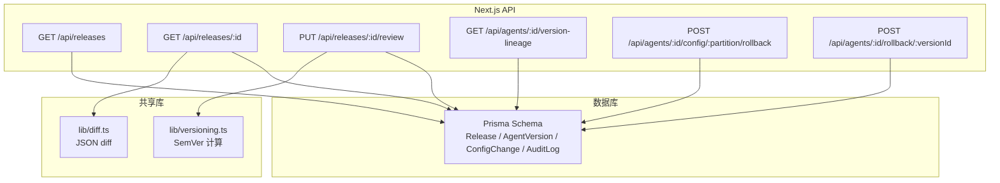
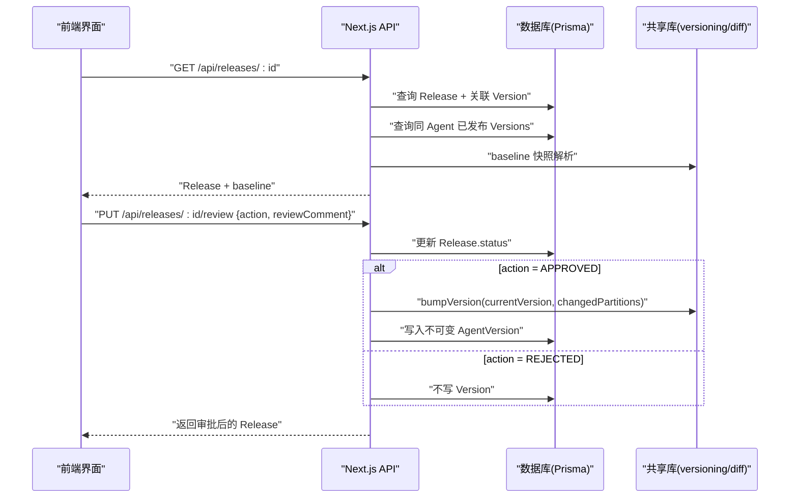
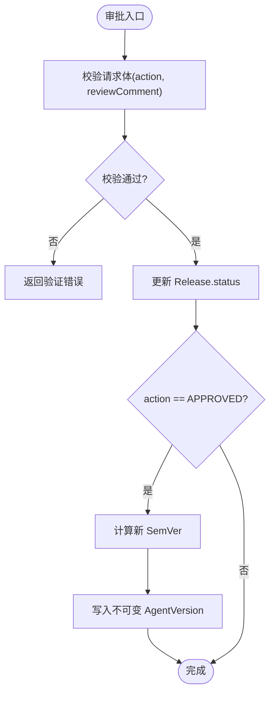
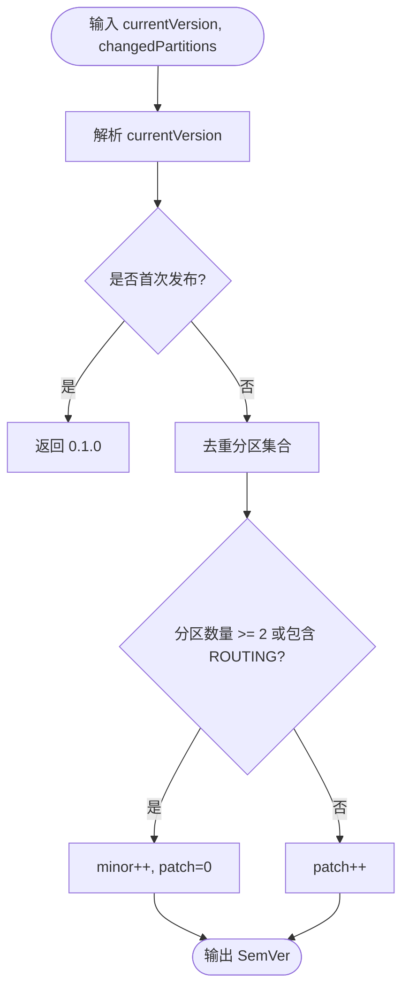
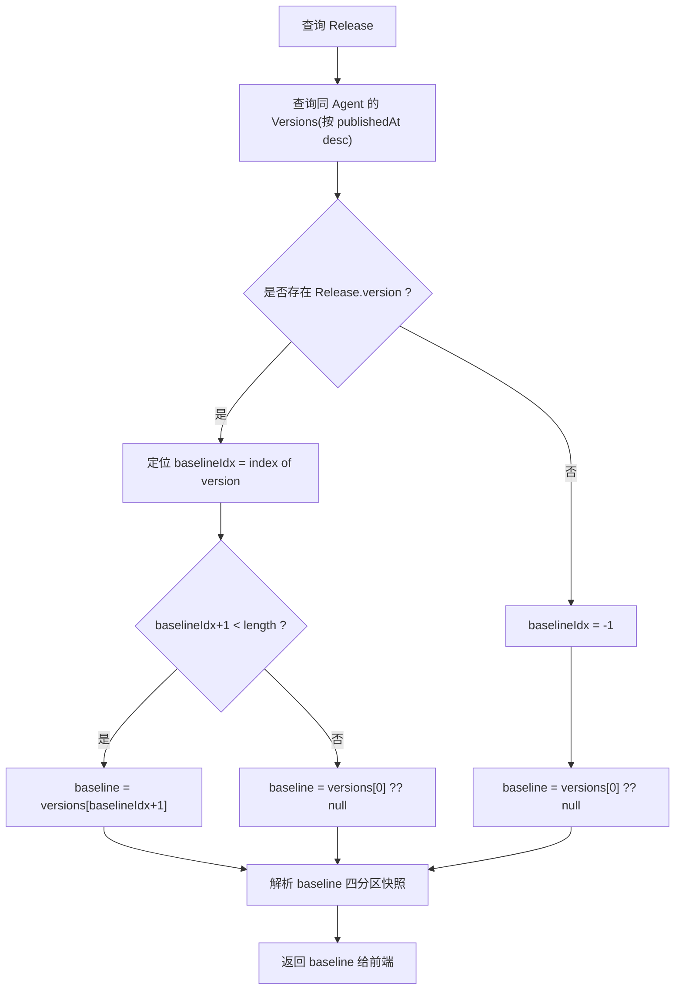
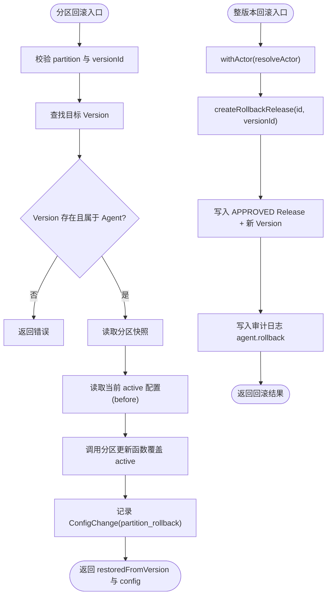
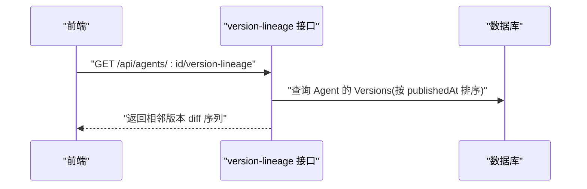
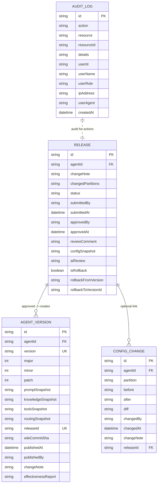
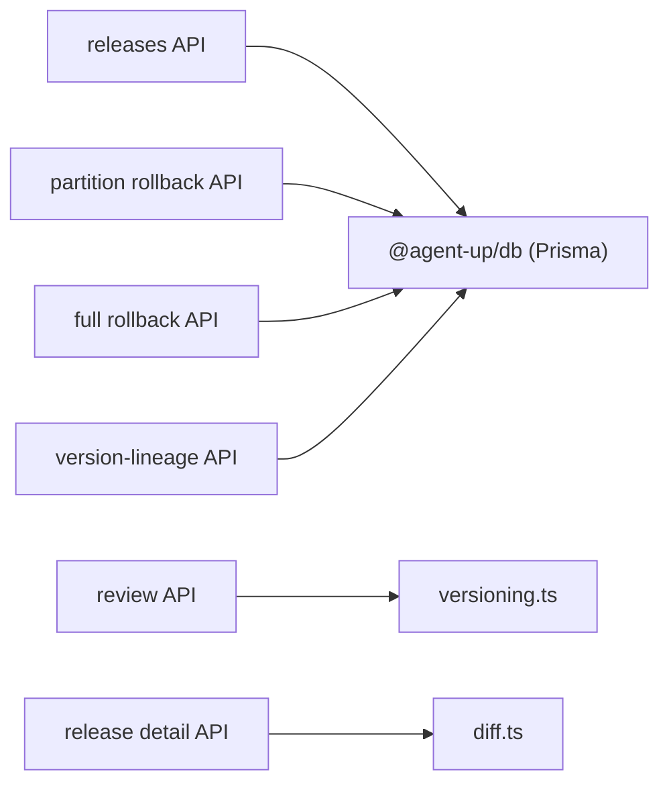

# 版本控制系统

<cite>
**本文引用的文件**   
- [apps/web/lib/versioning.ts](file://apps/web/lib/versioning.ts)
- [apps/web/lib/diff.ts](file://apps/web/lib/diff.ts)
- [apps/web/app/api/releases/route.ts](file://apps/web/app/api/releases/route.ts)
- [apps/web/app/api/releases/[id]/route.ts](file://apps/web/app/api/releases/[id]/route.ts)
- [apps/web/app/api/releases/[id]/review/route.ts](file://apps/web/app/api/releases/[id]/review/route.ts)
- [apps/web/app/api/agents/[id]/version-lineage/route.ts](file://apps/web/app/api/agents/[id]/version-lineage/route.ts)
- [apps/web/app/api/agents/[id]/config/[partition]/rollback/route.ts](file://apps/web/app/api/agents/[id]/config/[partition]/rollback/route.ts)
- [apps/web/app/api/agents/[id]/rollback/[versionId]/route.ts](file://apps/web/app/api/agents/[id]/rollback/[versionId]/route.ts)
- [packages/db/prisma/schema.prisma](file://packages/db/prisma/schema.prisma)
</cite>

## 目录
1. [引言](#引言)
2. [项目结构](#项目结构)
3. [核心组件](#核心组件)
4. [架构总览](#架构总览)
5. [详细组件分析](#详细组件分析)
6. [依赖关系分析](#依赖关系分析)
7. [性能与一致性](#性能与一致性)
8. [故障排查指南](#故障排查指南)
9. [结论](#结论)
10. [附录：API 契约与前端交互](#附录api-契约与前端交互)

## 引言
本技术文档聚焦于“版本控制系统”的完整实现，覆盖以下关键主题：
- 发布审批流程：Release 创建、diff 计算、语义化版本号（SemVer）生成、审批状态机。
- 版本快照管理：不可变版本存储、配置快照对比、基线管理。
- 双粒度回滚机制：分区级回滚与整版本回滚的技术实现。
- 版本演进线（Version Lineage）的概念与实现。
- API 端点、前端交互流程与错误处理策略。
- 与审计日志、效果报告的集成方式。

该版本控制系统围绕 Agent 的四分区配置（Prompt、Knowledge、Tools、Routing）展开，通过 Release 作为变更提案，经审批后生成不可变的 Version 快照；同时提供两种回滚能力，确保在出现问题时能快速恢复。

## 项目结构
版本控制相关代码主要分布在 Next.js App Router 的 API 路由与共享库中，数据模型由 Prisma Schema 定义。

图表来源
- [apps/web/app/api/releases/route.ts:7-46](file://apps/web/app/api/releases/route.ts#L7-L46)
- [apps/web/app/api/releases/[id]/route.ts:14-59](file://apps/web/app/api/releases/[id]/route.ts#L14-L59)
- [apps/web/app/api/releases/[id]/review/route.ts:11-28](file://apps/web/app/api/releases/[id]/review/route.ts#L11-L28)
- [apps/web/app/api/agents/[id]/version-lineage/route.ts:9-19](file://apps/web/app/api/agents/[id]/version-lineage/route.ts#L9-L19)
- [apps/web/app/api/agents/[id]/config/[partition]/rollback/route.ts:42-117](file://apps/web/app/api/agents/[id]/config/[partition]/rollback/route.ts#L42-L117)
- [apps/web/app/api/agents/[id]/rollback/[versionId]/route.ts:21-36](file://apps/web/app/api/agents/[id]/rollback/[versionId]/route.ts#L21-L36)
- [packages/db/prisma/schema.prisma:257-318](file://packages/db/prisma/schema.prisma#L257-L318)

章节来源
- [apps/web/app/api/releases/route.ts:7-46](file://apps/web/app/api/releases/route.ts#L7-L46)
- [apps/web/app/api/releases/[id]/route.ts:14-59](file://apps/web/app/api/releases/[id]/route.ts#L14-L59)
- [apps/web/app/api/releases/[id]/review/route.ts:11-28](file://apps/web/app/api/releases/[id]/review/route.ts#L11-L28)
- [apps/web/app/api/agents/[id]/version-lineage/route.ts:9-19](file://apps/web/app/api/agents/[id]/version-lineage/route.ts#L9-L19)
- [apps/web/app/api/agents/[id]/config/[partition]/rollback/route.ts:42-117](file://apps/web/app/api/agents/[id]/config/[partition]/rollback/route.ts#L42-L117)
- [apps/web/app/api/agents/[id]/rollback/[versionId]/route.ts:21-36](file://apps/web/app/api/agents/[id]/rollback/[versionId]/route.ts#L21-L36)
- [packages/db/prisma/schema.prisma:257-318](file://packages/db/prisma/schema.prisma#L257-L318)

## 核心组件
- 语义化版本（SemVer）模块：负责解析、格式化与根据分区变更集合计算下一个版本号。
- JSON Diff 模块：对 before/after 两个对象进行增删改差异计算，用于展示变更内容。
- 发布 API：列出 Release、获取 Release 详情（含 baseline 快照）、审批 Release。
- 版本演进线 API：按时间顺序聚合相邻版本的四分区 diff。
- 回滚 API：分区级回滚与整版本回滚。
- 数据模型：Release、AgentVersion、ConfigChange、AuditLog 等持久化实体。

章节来源
- [apps/web/lib/versioning.ts:1-70](file://apps/web/lib/versioning.ts#L1-L70)
- [apps/web/lib/diff.ts:1-35](file://apps/web/lib/diff.ts#L1-L35)
- [packages/db/prisma/schema.prisma:257-318](file://packages/db/prisma/schema.prisma#L257-L318)

## 架构总览
版本控制的核心流程如下：
- 变更提交形成 Release（包含 changedPartitions 与 configSnapshot）。
- 审批通过后，系统基于当前最高版本与 changedPartitions 计算 SemVer，并写入不可变的 AgentVersion。
- 前端可查询 Release 详情，结合 baseline 快照与 diff 工具展示变更。
- 支持两种回滚：单分区回滚直接覆盖 active 配置；整版本回滚一次性还原四个分区，并生成新的 Release 与 Version。
- 所有关键动作记录到审计日志，Version 可关联效果报告字段。

图表来源
- [apps/web/app/api/releases/[id]/route.ts:14-59](file://apps/web/app/api/releases/[id]/route.ts#L14-L59)
- [apps/web/app/api/releases/[id]/review/route.ts:11-28](file://apps/web/app/api/releases/[id]/review/route.ts#L11-L28)
- [apps/web/lib/versioning.ts:46-69](file://apps/web/lib/versioning.ts#L46-L69)
- [packages/db/prisma/schema.prisma:257-318](file://packages/db/prisma/schema.prisma#L257-L318)

## 详细组件分析

### 发布审批流程与状态机
- Release 列表接口支持分页与按 status/agentId 过滤，未知 status 返回空结果而非全量。
- Release 详情接口返回 release 全字段、agent 信息、version 关联以及 baseline 快照（上一个已发布 Version 的四分区快照），供前端 diff viewer 使用。
- 审批接口 PUT /api/releases/:id/review 接收 action（APPROVED/REJECTED/CHANGES_REQUESTED）与 reviewComment，调用服务层完成状态迁移与后续逻辑。

图表来源
- [apps/web/app/api/releases/[id]/review/route.ts:11-28](file://apps/web/app/api/releases/[id]/review/route.ts#L11-L28)
- [apps/web/lib/versioning.ts:46-69](file://apps/web/lib/versioning.ts#L46-L69)
- [packages/db/prisma/schema.prisma:257-318](file://packages/db/prisma/schema.prisma#L257-L318)

章节来源
- [apps/web/app/api/releases/route.ts:7-46](file://apps/web/app/api/releases/route.ts#L7-L46)
- [apps/web/app/api/releases/[id]/route.ts:14-59](file://apps/web/app/api/releases/[id]/route.ts#L14-L59)
- [apps/web/app/api/releases/[id]/review/route.ts:11-28](file://apps/web/app/api/releases/[id]/review/route.ts#L11-L28)

### 语义化版本号（SemVer）生成规则
- 首次发布为 0.1.0。
- ROUTING 分区变更或任意 ≥2 个分区变更 → minor++，patch=0。
- 单个非路由分区变更 → patch++。
- 全部 4 个分区同时变更仍走 minor（避免 major 膨胀，major 留给人工显式标注）。
- 无变更保守地 patch++（防御性逻辑）。

图表来源
- [apps/web/lib/versioning.ts:28-69](file://apps/web/lib/versioning.ts#L28-L69)

章节来源
- [apps/web/lib/versioning.ts:1-70](file://apps/web/lib/versioning.ts#L1-L70)

### 配置快照与基线管理
- Release 详情接口会查询同 Agent 的所有已发布 Version，找到与 Release.version 对应的索引，取其后一个 Version 作为 baseline；若无则取最新 Version；若均不存在则 baseline 为空。
- baseline 的四分区快照以 JSON 文本形式从 AgentVersion 读取并反序列化，配合 diff 工具展示本次发布的变更。

图表来源
- [apps/web/app/api/releases/[id]/route.ts:29-49](file://apps/web/app/api/releases/[id]/route.ts#L29-L49)
- [packages/db/prisma/schema.prisma:294-318](file://packages/db/prisma/schema.prisma#L294-L318)

章节来源
- [apps/web/app/api/releases/[id]/route.ts:14-59](file://apps/web/app/api/releases/[id]/route.ts#L14-L59)

### 双粒度回滚机制
- 分区级回滚 POST /api/agents/:id/config/:partition/rollback：
  - 校验 partition 合法性与 versionId。
  - 从目标 Version 的对应分区快照中取出配置，先读取当前 active 配置作为 before。
  - 调用对应分区更新函数（updatePromptConfig/updateKnowledgeConfig/updateToolsConfig/updateRoutingConfig）覆盖 active 配置。
  - 记录 ConfigChange（partition_rollback），changeNote 包含回滚目标版本。
- 整版本回滚 POST /api/agents/:id/rollback/:versionId：
  - 一次还原四个分区，保证组合与历史快照完全一致。
  - 写入一个 status=APPROVED 的 Release（含 configSnapshot）做追溯。
  - 派生新 Version（版本号自增），确保历史快照不可变。
  - 写入审计日志 action="agent.rollback"。

图表来源
- [apps/web/app/api/agents/[id]/config/[partition]/rollback/route.ts:42-117](file://apps/web/app/api/agents/[id]/config/[partition]/rollback/route.ts#L42-L117)
- [apps/web/app/api/agents/[id]/rollback/[versionId]/route.ts:21-36](file://apps/web/app/api/agents/[id]/rollback/[versionId]/route.ts#L21-L36)
- [packages/db/prisma/schema.prisma:188-205](file://packages/db/prisma/schema.prisma#L188-L205)

章节来源
- [apps/web/app/api/agents/[id]/config/[partition]/rollback/route.ts:42-117](file://apps/web/app/api/agents/[id]/config/[partition]/rollback/route.ts#L42-L117)
- [apps/web/app/api/agents/[id]/rollback/[versionId]/route.ts:21-36](file://apps/web/app/api/agents/[id]/rollback/[versionId]/route.ts#L21-L36)

### 版本演进线（Version Lineage）
- GET /api/agents/:id/version-lineage 返回 Harness 资产演进历史（只读聚合）。
- 按 publishedAt 升序相邻版本进行四分区 diff，首版本为基线。
- 该接口便于前端绘制版本演进图与查看每次变更的影响面。

图表来源
- [apps/web/app/api/agents/[id]/version-lineage/route.ts:9-19](file://apps/web/app/api/agents/[id]/version-lineage/route.ts#L9-L19)

章节来源
- [apps/web/app/api/agents/[id]/version-lineage/route.ts:9-19](file://apps/web/app/api/agents/[id]/version-lineage/route.ts#L9-L19)

### 数据模型与不可变版本存储
- Release：记录变更提案、状态、提交者、审批者、AI 评测结果、是否为回滚单、关联 Version。
- AgentVersion：不可变版本快照，包含四分区快照、版本号（major/minor/patch）、发布时间与作者、可选效果报告。
- ConfigChange：记录每个分区的 before/after/diff/changedBy/changedAt/changeNote/releaseId。
- AuditLog：统一审计日志，记录 action/resource/resourceId/details/actor 等信息。

图表来源
- [packages/db/prisma/schema.prisma:257-318](file://packages/db/prisma/schema.prisma#L257-L318)
- [packages/db/prisma/schema.prisma:188-205](file://packages/db/prisma/schema.prisma#L188-L205)
- [packages/db/prisma/schema.prisma:530-550](file://packages/db/prisma/schema.prisma#L530-L550)

章节来源
- [packages/db/prisma/schema.prisma:257-318](file://packages/db/prisma/schema.prisma#L257-L318)
- [packages/db/prisma/schema.prisma:188-205](file://packages/db/prisma/schema.prisma#L188-L205)
- [packages/db/prisma/schema.prisma:530-550](file://packages/db/prisma/schema.prisma#L530-L550)

## 依赖关系分析
- API 层依赖 Prisma Client 访问数据库，并通过 withActor/resolveActor 注入操作者上下文。
- 共享库 versioning.ts 与 diff.ts 被 API 层与服务层复用，保证版本号与 diff 的一致性。
- 回滚逻辑复用现有分区更新函数，减少重复实现并确保审计与变更记录一致。

图表来源
- [apps/web/app/api/releases/route.ts:1-46](file://apps/web/app/api/releases/route.ts#L1-L46)
- [apps/web/app/api/releases/[id]/route.ts:1-59](file://apps/web/app/api/releases/[id]/route.ts#L1-L59)
- [apps/web/app/api/releases/[id]/review/route.ts:1-28](file://apps/web/app/api/releases/[id]/review/route.ts#L1-L28)
- [apps/web/app/api/agents/[id]/config/[partition]/rollback/route.ts:1-117](file://apps/web/app/api/agents/[id]/config/[partition]/rollback/route.ts#L1-L117)
- [apps/web/app/api/agents/[id]/rollback/[versionId]/route.ts:1-36](file://apps/web/app/api/agents/[id]/rollback/[versionId]/route.ts#L1-L36)
- [apps/web/app/api/agents/[id]/version-lineage/route.ts:1-19](file://apps/web/app/api/agents/[id]/version-lineage/route.ts#L1-L19)
- [apps/web/lib/versioning.ts:1-70](file://apps/web/lib/versioning.ts#L1-L70)
- [apps/web/lib/diff.ts:1-35](file://apps/web/lib/diff.ts#L1-L35)

章节来源
- [apps/web/app/api/releases/route.ts:1-46](file://apps/web/app/api/releases/route.ts#L1-L46)
- [apps/web/app/api/releases/[id]/route.ts:1-59](file://apps/web/app/api/releases/[id]/route.ts#L1-L59)
- [apps/web/app/api/releases/[id]/review/route.ts:1-28](file://apps/web/app/api/releases/[id]/review/route.ts#L1-L28)
- [apps/web/app/api/agents/[id]/config/[partition]/rollback/route.ts:1-117](file://apps/web/app/api/agents/[id]/config/[partition]/rollback/route.ts#L1-L117)
- [apps/web/app/api/agents/[id]/rollback/[versionId]/route.ts:1-36](file://apps/web/app/api/agents/[id]/rollback/[versionId]/route.ts#L1-L36)
- [apps/web/app/api/agents/[id]/version-lineage/route.ts:1-19](file://apps/web/app/api/agents/[id]/version-lineage/route.ts#L1-L19)
- [apps/web/lib/versioning.ts:1-70](file://apps/web/lib/versioning.ts#L1-L70)
- [apps/web/lib/diff.ts:1-35](file://apps/web/lib/diff.ts#L1-L35)

## 性能与一致性
- 列表接口采用 Promise.all 并行查询 rows 与 total，提升吞吐。
- 版本详情接口一次性加载 baseline 快照，避免多次往返。
- 分区回滚复用已有更新函数，减少重复逻辑与潜在不一致。
- 不可变 Version 快照确保历史可回溯，避免覆盖导致的数据漂移。
- 审计日志与 ConfigChange 记录变更轨迹，便于问题定位与合规审查。

[本节为通用指导，不直接分析具体文件]

## 故障排查指南
- 审批失败：检查 action 与 reviewComment 是否符合 schema；CHANGES_REQUESTED 需要 reviewComment。
- 找不到 Release：确认 id 有效且未被删除。
- 分区回滚失败：确认 partition 合法、versionId 存在且属于目标 Agent；检查分区快照是否存在。
- 整版本回滚失败：确认 versionId 有效；检查 createRollbackRelease 是否成功写入 Release 与 Version。
- 版本演进线为空：确认 Agent 是否存在已发布 Version；检查 publishedAt 排序是否正确。

章节来源
- [apps/web/app/api/releases/[id]/review/route.ts:11-28](file://apps/web/app/api/releases/[id]/review/route.ts#L11-L28)
- [apps/web/app/api/agents/[id]/config/[partition]/rollback/route.ts:42-117](file://apps/web/app/api/agents/[id]/config/[partition]/rollback/route.ts#L42-L117)
- [apps/web/app/api/agents/[id]/rollback/[versionId]/route.ts:21-36](file://apps/web/app/api/agents/[id]/rollback/[versionId]/route.ts#L21-L36)

## 结论
本版本控制系统通过 Release 审批流程与不可变 Version 快照，实现了 Agent 四分区配置的受控演进。SemVer 生成规则将变更影响面映射到版本号，便于团队理解变更规模。双粒度回滚机制兼顾灵活性与一致性，既能快速修复局部问题，也能一键恢复到历史稳定状态。版本演进线与审计日志为排障与合规提供了坚实基础。

[本节为总结性内容，不直接分析具体文件]

## 附录：API 契约与前端交互

### API 端点清单
- GET /api/releases
  - 功能：分页列出 Release，支持 status 与 agentId 过滤。
  - 响应：items 数组 + pagination 元信息。
- GET /api/releases/:id
  - 功能：获取 Release 详情，包含 baseline 快照（上一已发布 Version 的四分区快照）。
  - 响应：Release 全字段 + agent + baseline。
- PUT /api/releases/:id/review
  - 功能：审批 Release，action ∈ {APPROVED, REJECTED, CHANGES_REQUESTED}，reviewComment 可选但 CHANGES_REQUESTED 必填。
  - 响应：审批后的 Release；APPROVED 时生成新版本。
- GET /api/agents/:id/version-lineage
  - 功能：返回相邻版本的四分区 diff 序列，首版本为基线。
  - 响应：版本演进线数据。
- POST /api/agents/:id/config/:partition/rollback
  - 功能：分区级回滚，从指定 Version 的快照恢复该分区配置。
  - 请求体：{ versionId: string }。
  - 响应：partition、restoredFromVersion、config。
- POST /api/agents/:id/rollback/:versionId
  - 功能：整版本回滚，一次性还原四个分区，生成 APPROVED Release 与新 Version。
  - 响应：回滚结果。

章节来源
- [apps/web/app/api/releases/route.ts:7-46](file://apps/web/app/api/releases/route.ts#L7-L46)
- [apps/web/app/api/releases/[id]/route.ts:14-59](file://apps/web/app/api/releases/[id]/route.ts#L14-L59)
- [apps/web/app/api/releases/[id]/review/route.ts:11-28](file://apps/web/app/api/releases/[id]/review/route.ts#L11-L28)
- [apps/web/app/api/agents/[id]/version-lineage/route.ts:9-19](file://apps/web/app/api/agents/[id]/version-lineage/route.ts#L9-L19)
- [apps/web/app/api/agents/[id]/config/[partition]/rollback/route.ts:42-117](file://apps/web/app/api/agents/[id]/config/[partition]/rollback/route.ts#L42-L117)
- [apps/web/app/api/agents/[id]/rollback/[versionId]/route.ts:21-36](file://apps/web/app/api/agents/[id]/rollback/[versionId]/route.ts#L21-L36)

### 前端交互流程建议
- 发布详情页：
  - 调用 GET /api/releases/:id 获取 baseline 与 Release 详情。
  - 使用 diff 工具渲染 added/removed/changed 三列，突出显示受影响分区。
- 审批页：
  - 调用 PUT /api/releases/:id/review 提交审批；根据返回状态刷新页面。
  - 若 APPROVED，显示生成的版本号与发布时间。
- 回滚页：
  - 分区回滚：选择分区与目标 Version，调用分区回滚接口，成功后刷新配置。
  - 整版本回滚：选择目标 Version，调用整版本回滚接口，成功后提示已生成新 Release 与 Version。
- 版本演进线：
  - 调用 GET /api/agents/:id/version-lineage，渲染时间轴与 diff 摘要。

[本节为概念性说明，不直接分析具体文件]

### 错误处理策略
- 参数校验失败：返回 400 与明确错误消息（如无效分区、缺少 versionId）。
- 资源不存在：返回 404（如 Release 不存在、Version 不属于 Agent）。
- 业务异常：统一通过 handleApiError 包装错误，返回标准错误结构。
- 审计与追踪：所有关键操作应记录审计日志，便于事后复盘。

章节来源
- [apps/web/app/api/releases/[id]/route.ts:14-59](file://apps/web/app/api/releases/[id]/route.ts#L14-L59)
- [apps/web/app/api/agents/[id]/config/[partition]/rollback/route.ts:42-117](file://apps/web/app/api/agents/[id]/config/[partition]/rollback/route.ts#L42-L117)
- [apps/web/app/api/agents/[id]/rollback/[versionId]/route.ts:21-36](file://apps/web/app/api/agents/[id]/rollback/[versionId]/route.ts#L21-L36)