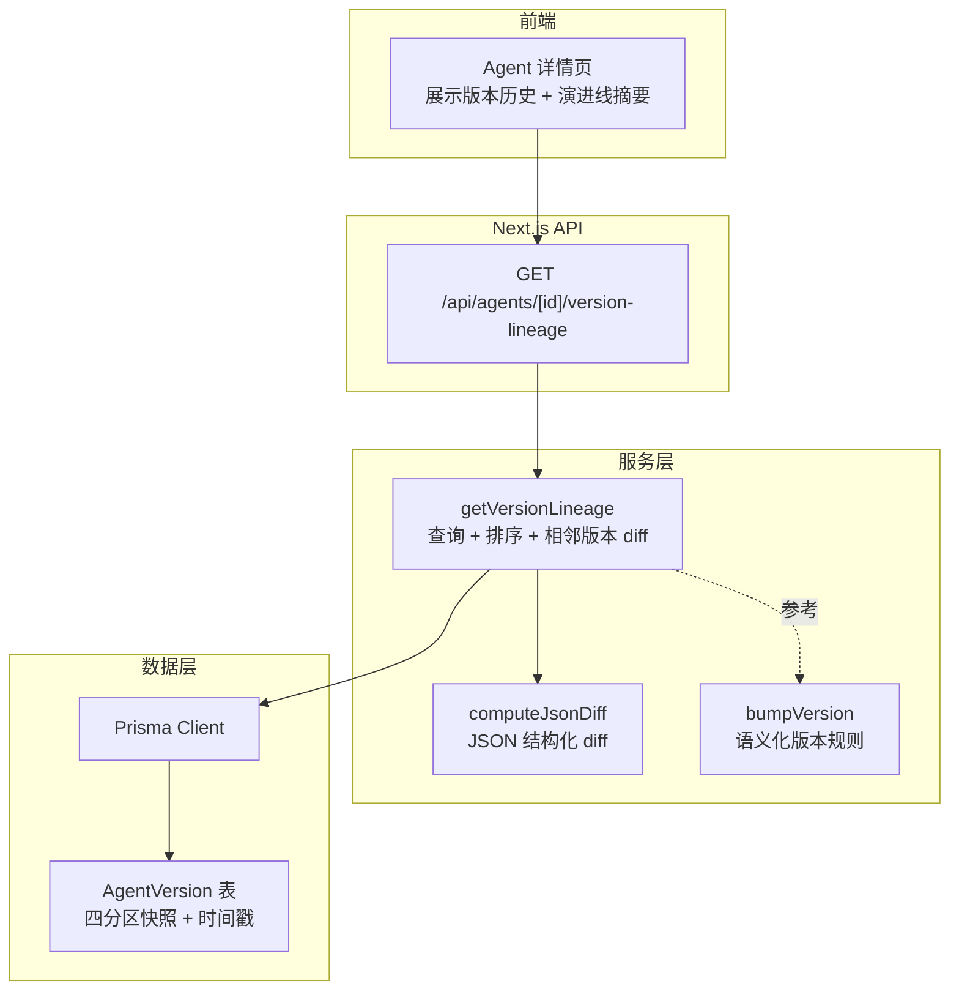
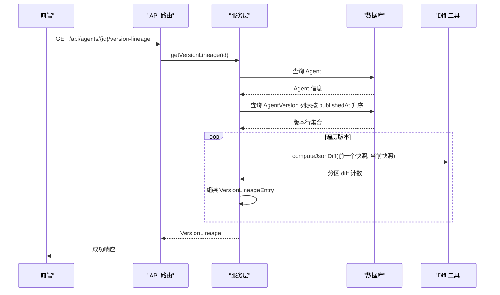
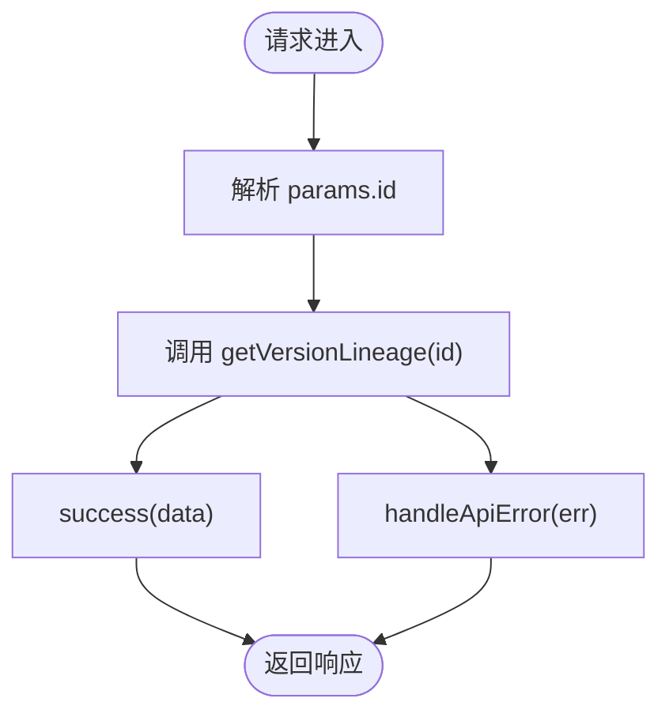
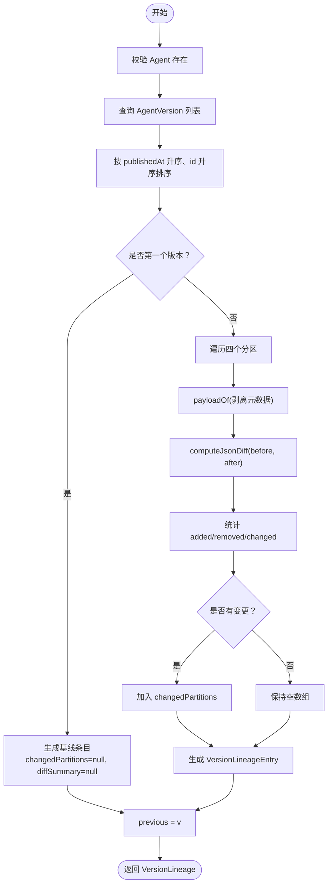
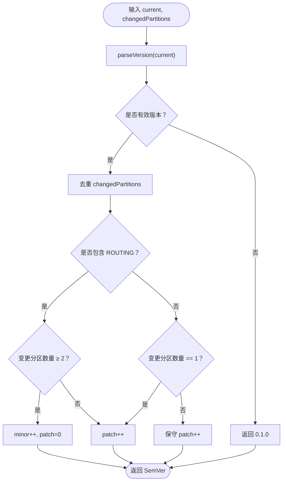
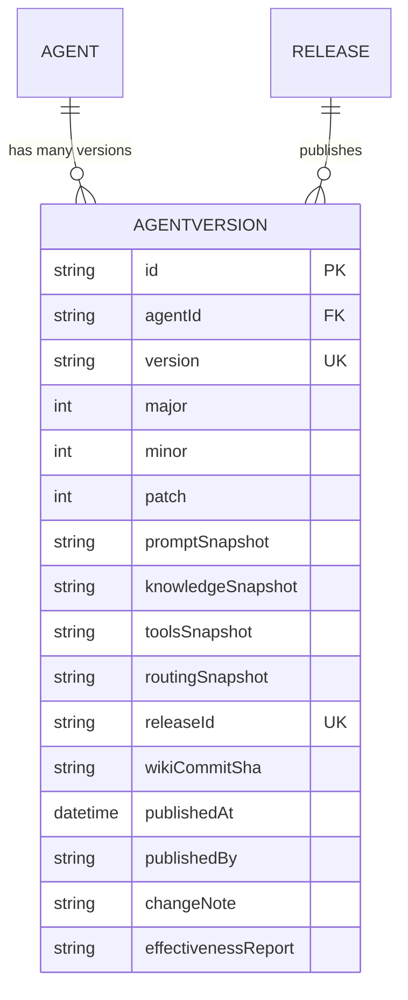
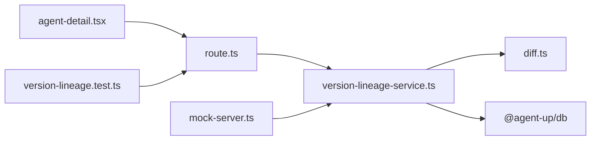
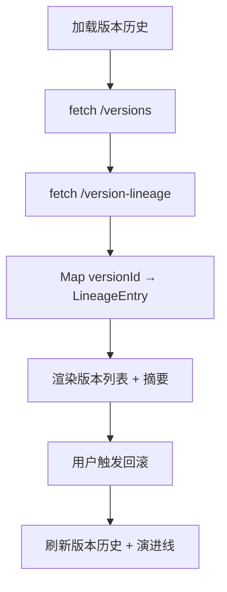
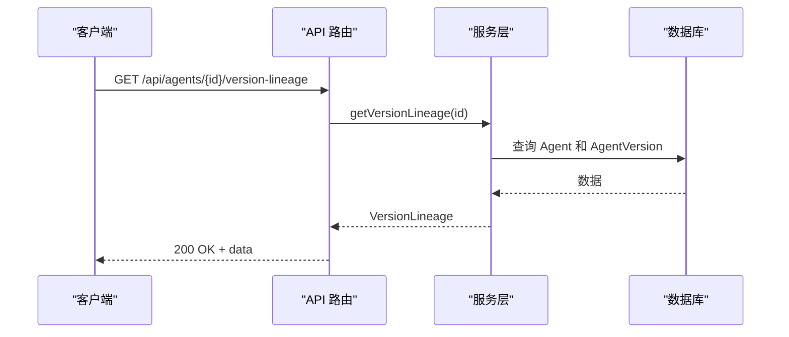

# 版本演进线

<cite>
**本文引用的文件**   
- [apps/web/app/api/agents/[id]/version-lineage/route.ts](file://apps/web/app/api/agents/[id]/version-lineage/route.ts)
- [apps/web/lib/services/version-lineage-service.ts](file://apps/web/lib/services/version-lineage-service.ts)
- [apps/web/lib/diff.ts](file://apps/web/lib/diff.ts)
- [apps/web/lib/versioning.ts](file://apps/web/lib/versioning.ts)
- [packages/db/prisma/schema.prisma](file://packages/db/prisma/schema.prisma)
- [apps/web/lib/services/agent-service.ts](file://apps/web/lib/services/agent-service.ts)
- [apps/web/app/(dashboard)/agents/[id]/agent-detail.tsx](file://apps/web/app/(dashboard)/agents/[id]/agent-detail.tsx)
- [apps/web/app/api/__tests__/version-lineage.test.ts](file://apps/web/app/api/__tests__/version-lineage.test.ts)
- [apps/web/demo/mock-server.ts](file://apps/web/demo/mock-server.ts)
- [docs/api/api-reference.md](file://docs/api/api-reference.md)
</cite>

## 目录
1. [引言](#引言)
2. [项目结构](#项目结构)
3. [核心概念与数据结构](#核心概念与数据结构)
4. [架构总览](#架构总览)
5. [详细组件分析](#详细组件分析)
6. [依赖关系分析](#依赖关系分析)
7. [性能与扩展性](#性能与扩展性)
8. [可视化与前端交互设计](#可视化与前端交互设计)
9. [版本分支、合并与复杂拓扑](#版本分支合并与复杂拓扑)
10. [版本演进分析方法](#版本演进分析方法)
11. [API 使用指南](#api-使用指南)
12. [故障排查](#故障排查)
13. [结论](#结论)

## 引言
本技术文档围绕“版本演进线”展开，目标是帮助开发者理解：
- 版本演进线的概念：以 Agent 的已发布版本为节点，按发布时间顺序形成一条可追溯的资产演化路径。
- 数据结构设计：每个版本包含语义化版本号、四个配置分区快照、变更说明和效果报告等；演进线在此基础上输出相邻版本的分区级差异摘要。
- 构建算法：从 Release 历史推导版本演进路径，对相邻版本做结构化 diff，剥离元数据键后统计新增、删除、修改键数。
- 分支与合并：当前实现是单条时间线；未来可扩展到多分支、合并、基线选择等复杂拓扑。
- 可视化与交互：在 Agent 详情页中展示版本历史，并叠加“较上一版本”的分区级变更摘要。
- API 与性能：提供只读聚合接口，支持分页、缓存、增量计算等优化策略。
- 分析方法：通过 diff 计数、分区影响面、回滚链路和影响范围分析，辅助版本治理。

## 项目结构
版本演进线相关代码主要分布在以下位置：
- API 路由层：暴露 `/api/agents/[id]/version-lineage` 只读接口。
- 服务层：封装查询、排序、diff 计算和结果组装逻辑。
- 工具层：JSON diff 计算、语义化版本计算。
- 数据模型：Prisma schema 中的 `AgentVersion` 表。
- 前端页面：Agent 详情页加载版本历史与演进线摘要。
- 测试与 Mock：覆盖边界条件、乱序写入、空快照、元数据剥离等场景。

**图表来源**
- [apps/web/app/api/agents/[id]/version-lineage/route.ts:1-20](file://apps/web/app/api/agents/[id]/version-lineage/route.ts#L1-L20)
- [apps/web/lib/services/version-lineage-service.ts:1-125](file://apps/web/lib/services/version-lineage-service.ts#L1-L125)
- [apps/web/lib/diff.ts:1-35](file://apps/web/lib/diff.ts#L1-L35)
- [apps/web/lib/versioning.ts:1-70](file://apps/web/lib/versioning.ts#L1-L70)
- [packages/db/prisma/schema.prisma:294-318](file://packages/db/prisma/schema.prisma#L294-L318)

**章节来源**
- [apps/web/app/api/agents/[id]/version-lineage/route.ts:1-20](file://apps/web/app/api/agents/[id]/version-lineage/route.ts#L1-L20)
- [apps/web/lib/services/version-lineage-service.ts:1-125](file://apps/web/lib/services/version-lineage-service.ts#L1-L125)
- [apps/web/lib/diff.ts:1-35](file://apps/web/lib/diff.ts#L1-L35)
- [apps/web/lib/versioning.ts:1-70](file://apps/web/lib/versioning.ts#L1-L70)
- [packages/db/prisma/schema.prisma:294-318](file://packages/db/prisma/schema.prisma#L294-L318)

## 核心概念与数据结构
### 版本演进线概念
- 版本演进线是以 Agent 为单位，按发布时间升序排列的已发布版本序列。
- 每条演进线表示该 Agent 的资产（Prompt、Knowledge、Tools、Routing）随时间的演化轨迹。
- 首个版本作为基线，后续每个版本记录与上一个版本的分区级差异摘要。

### 关键数据结构
- **PartitionDiffCount**：分区差异计数，包含 added、removed、changed。
- **VersionLineageEntry**：演进线单条记录，包含 versionId、version、publishedAt、changeNote、changedPartitions、diffSummary。
- **VersionLineage**：整体响应体，包含 agentId、agentName、computedAt、lineage。
- **AgentVersion**：数据库实体，包含 id、agentId、version、major/minor/patch、四分区快照、releaseId、wikiCommitSha、publishedAt、publishedBy、changeNote、effectivenessReport。

```mermaid
classDiagram
class PartitionDiffCount {
+number added
+number removed
+number changed
}
class VersionLineageEntry {
+string versionId
+string version
+string publishedAt
+string changeNote
+string[]|null changedPartitions
+Record~string, PartitionDiffCount~|null diffSummary
}
class VersionLineage {
+string agentId
+string|null agentName
+string computedAt
+VersionLineageEntry[] lineage
}
class AgentVersion {
+string id
+string agentId
+string version
+int major
+int minor
+int patch
+string promptSnapshot
+string knowledgeSnapshot
+string toolsSnapshot
+string routingSnapshot
+string releaseId
+string wikiCommitSha
+DateTime publishedAt
+string publishedBy
+string changeNote
+string effectivenessReport
}
VersionLineage --> VersionLineageEntry : "包含"
VersionLineageEntry --> PartitionDiffCount : "引用"
```

**图表来源**
- [apps/web/lib/services/version-lineage-service.ts:32-55](file://apps/web/lib/services/version-lineage-service.ts#L32-L55)
- [packages/db/prisma/schema.prisma:294-318](file://packages/db/prisma/schema.prisma#L294-L318)

**章节来源**
- [apps/web/lib/services/version-lineage-service.ts:32-55](file://apps/web/lib/services/version-lineage-service.ts#L32-L55)
- [packages/db/prisma/schema.prisma:294-318](file://packages/db/prisma/schema.prisma#L294-L318)

## 架构总览
版本演进线采用分层架构：
- 路由层负责参数解析、错误处理、统一成功包装。
- 服务层负责业务逻辑：查询 Agent、查询版本列表、排序、相邻版本 diff、组装响应。
- 工具层提供 JSON diff 和语义化版本计算。
- 数据层通过 Prisma 访问 PostgreSQL，读取 AgentVersion 的四分区快照。

**图表来源**
- [apps/web/app/api/agents/[id]/version-lineage/route.ts:1-20](file://apps/web/app/api/agents/[id]/version-lineage/route.ts#L1-L20)
- [apps/web/lib/services/version-lineage-service.ts:76-124](file://apps/web/lib/services/version-lineage-service.ts#L76-L124)
- [apps/web/lib/diff.ts:9-34](file://apps/web/lib/diff.ts#L9-L34)

**章节来源**
- [apps/web/app/api/agents/[id]/version-lineage/route.ts:1-20](file://apps/web/app/api/agents/[id]/version-lineage/route.ts#L1-L20)
- [apps/web/lib/services/version-lineage-service.ts:76-124](file://apps/web/lib/services/version-lineage-service.ts#L76-L124)
- [apps/web/lib/diff.ts:9-34](file://apps/web/lib/diff.ts#L9-L34)

## 详细组件分析

### API 路由层
- 暴露 GET `/api/agents/[id]/version-lineage`。
- 解析动态参数 `id`。
- 调用服务层获取演进线数据。
- 统一成功包装和错误处理。

**图表来源**
- [apps/web/app/api/agents/[id]/version-lineage/route.ts:1-20](file://apps/web/app/api/agents/[id]/version-lineage/route.ts#L1-L20)

**章节来源**
- [apps/web/app/api/agents/[id]/version-lineage/route.ts:1-20](file://apps/web/app/api/agents/[id]/version-lineage/route.ts#L1-L20)

### 服务层：版本演进线构建
- 校验 Agent 是否存在。
- 查询 AgentVersion 并按 `publishedAt` 升序、`id` 升序排序。
- 首版本为基线，changedPartitions 和 diffSummary 为 null。
- 后续版本对四个分区分别做 payload 剥离（去除 version/lastModifiedAt），再执行 JSON diff，统计 added/removed/changed。
- 将存在变更的分区加入 changedPartitions。
- 组装 VersionLineage 响应。

**图表来源**
- [apps/web/lib/services/version-lineage-service.ts:57-124](file://apps/web/lib/services/version-lineage-service.ts#L57-L124)
- [apps/web/lib/diff.ts:9-34](file://apps/web/lib/diff.ts#L9-L34)

**章节来源**
- [apps/web/lib/services/version-lineage-service.ts:57-124](file://apps/web/lib/services/version-lineage-service.ts#L57-L124)
- [apps/web/lib/diff.ts:9-34](file://apps/web/lib/diff.ts#L9-L34)

### 工具层：JSON Diff 与语义化版本
- **computeJsonDiff**：比较两个对象，输出 added、removed、changed 三个映射。
- **bumpVersion**：根据当前最高版本和变更分区集合计算下一个版本号，遵循 SemVer 规则：
  - 首次发布：0.1.0
  - ROUTING 分区变更或 ≥2 个分区变更：minor++，patch=0
  - 单个非 ROUTING 分区变更：patch++

**图表来源**
- [apps/web/lib/versioning.ts:28-69](file://apps/web/lib/versioning.ts#L28-L69)

**章节来源**
- [apps/web/lib/diff.ts:9-34](file://apps/web/lib/diff.ts#L9-L34)
- [apps/web/lib/versioning.ts:28-69](file://apps/web/lib/versioning.ts#L28-L69)

### 数据模型：AgentVersion
- 主键 id，唯一约束 (agentId, version)。
- 四分区快照列存储 JSON 文本，需 unpack 后参与 diff。
- 索引 (agentId, publishedAt) 用于高效查询演进线。
- 关联 Release，保证发布链路的完整性。

**图表来源**
- [packages/db/prisma/schema.prisma:294-318](file://packages/db/prisma/schema.prisma#L294-L318)

**章节来源**
- [packages/db/prisma/schema.prisma:294-318](file://packages/db/prisma/schema.prisma#L294-L318)

## 依赖关系分析
- 路由层依赖服务层和通用工具（success/handleApiError）。
- 服务层依赖 Prisma、NotFoundError、computeJsonDiff。
- 前端依赖 API 响应形状，并在本地 Map 中缓存 lineage 以便快速查找。
- 测试依赖 seed 夹具，确保 AgentVersion 与 Release 外键关系正确。

**图表来源**
- [apps/web/app/api/agents/[id]/version-lineage/route.ts:1-20](file://apps/web/app/api/agents/[id]/version-lineage/route.ts#L1-L20)
- [apps/web/lib/services/version-lineage-service.ts:1-125](file://apps/web/lib/services/version-lineage-service.ts#L1-L125)
- [apps/web/lib/diff.ts:1-35](file://apps/web/lib/diff.ts#L1-L35)
- [apps/web/app/(dashboard)/agents/[id]/agent-detail.tsx:462-578](file://apps/web/app/(dashboard)/agents/[id]/agent-detail.tsx#L462-L578)
- [apps/web/app/api/__tests__/version-lineage.test.ts:1-139](file://apps/web/app/api/__tests__/version-lineage.test.ts#L1-L139)
- [apps/web/demo/mock-server.ts:366-409](file://apps/web/demo/mock-server.ts#L366-L409)

**章节来源**
- [apps/web/app/api/agents/[id]/version-lineage/route.ts:1-20](file://apps/web/app/api/agents/[id]/version-lineage/route.ts#L1-L20)
- [apps/web/lib/services/version-lineage-service.ts:1-125](file://apps/web/lib/services/version-lineage-service.ts#L1-L125)
- [apps/web/lib/diff.ts:1-35](file://apps/web/lib/diff.ts#L1-L35)
- [apps/web/app/(dashboard)/agents/[id]/agent-detail.tsx:462-578](file://apps/web/app/(dashboard)/agents/[id]/agent-detail.tsx#L462-L578)
- [apps/web/app/api/__tests__/version-lineage.test.ts:1-139](file://apps/web/app/api/__tests__/version-lineage.test.ts#L1-L139)
- [apps/web/demo/mock-server.ts:366-409](file://apps/web/demo/mock-server.ts#L366-L409)

## 性能与扩展性
- 查询复杂度：O(n) 遍历版本列表，n 为 Agent 的版本数。
- Diff 复杂度：取决于分区快照的键数量，通常为 O(k)，k 为键总数。
- 内存占用：每次请求会构造 lineage 数组和 diffSummary，建议对大版本集进行分页或增量计算。
- 缓存策略：可对常见 Agent 的 lineage 结果做短期缓存（如 Redis），避免重复计算。
- 索引优化：利用 (agentId, publishedAt) 索引提升排序效率。
- 扩展方向：
  - 支持分页：按时间窗口或版本号区间返回部分 lineage。
  - 增量计算：仅对最近 N 个版本重新计算 diff。
  - 并行 diff：对多个分区并行计算 diff，减少串行开销。

[本节为通用性能讨论，不直接分析具体文件]

## 可视化与前端交互设计
- 前端在 Agent 详情页加载版本历史和演进线摘要。
- 演进线失败时静默降级，不影响主流程。
- 对每个版本显示“较上一版本”摘要：
  - 基线版本：显示“资产基线（首个版本）”。
  - 无变更：显示“与上一版本配置一致”。
  - 有变更：列出受影响分区及新增/删除/修改键数。
- 支持分区级回滚和整版本回滚，回滚后刷新版本历史和演进线。

**图表来源**
- [apps/web/app/(dashboard)/agents/[id]/agent-detail.tsx:540-578](file://apps/web/app/(dashboard)/agents/[id]/agent-detail.tsx#L540-L578)
- [apps/web/app/(dashboard)/agents/[id]/agent-detail.tsx:583-630](file://apps/web/app/(dashboard)/agents/[id]/agent-detail.tsx#L583-L630)

**章节来源**
- [apps/web/app/(dashboard)/agents/[id]/agent-detail.tsx:462-578](file://apps/web/app/(dashboard)/agents/[id]/agent-detail.tsx#L462-L578)
- [apps/web/app/(dashboard)/agents/[id]/agent-detail.tsx:583-630](file://apps/web/app/(dashboard)/agents/[id]/agent-detail.tsx#L583-L630)

## 版本分支、合并与复杂拓扑
当前实现是单条时间线，没有显式的分支和合并字段。若需要支持复杂拓扑：
- 引入 branch 字段标识不同演进线（如 main、feature-x）。
- 引入 mergeFrom 字段记录合并来源版本。
- 引入 baseVersion 字段定义基线版本。
- 构建算法调整为图遍历（DAG），而非线性遍历。
- 可视化改为分支图或泳道图，支持点击分支切换。

[本节为概念性扩展，不直接分析具体文件]

## 版本演进分析方法
- 分区影响面分析：统计哪些分区频繁变更，识别高风险区域。
- 变更密度分析：按时间窗口统计 added/removed/changed 总量，评估版本稳定性。
- 回滚链路分析：结合回滚 API，追踪从目标版本到当前版本的变更路径。
- 效果关联分析：结合 effectivenessReport，观察版本变更与反馈质量的关系。
- 自动化报告：定期生成版本演进报告，推送给维护者。

[本节为方法论指导，不直接分析具体文件]

## API 使用指南
- 接口：GET `/api/agents/[id]/version-lineage`
- 功能：只读聚合，按 publishedAt 升序对相邻版本快照做结构化 diff，输出每版本的 changedPartitions 与分区级 added/removed/changed 计数；首个版本为基线（changedPartitions 与 diffSummary 为 null）；快照缺失按空对象计入 added。
- 响应体：VersionLineage，包含 agentId、agentName、computedAt、lineage。
- 错误码：Agent 不存在返回 404。

**图表来源**
- [docs/api/api-reference.md:92-92](file://docs/api/api-reference.md#L92-L92)
- [apps/web/app/api/agents/[id]/version-lineage/route.ts:1-20](file://apps/web/app/api/agents/[id]/version-lineage/route.ts#L1-L20)
- [apps/web/lib/services/version-lineage-service.ts:76-124](file://apps/web/lib/services/version-lineage-service.ts#L76-L124)

**章节来源**
- [docs/api/api-reference.md:92-92](file://docs/api/api-reference.md#L92-L92)
- [apps/web/app/api/agents/[id]/version-lineage/route.ts:1-20](file://apps/web/app/api/agents/[id]/version-lineage/route.ts#L1-L20)
- [apps/web/lib/services/version-lineage-service.ts:76-124](file://apps/web/lib/services/version-lineage-service.ts#L76-L124)

## 故障排查
- Agent 不存在：检查 id 是否正确，确认 Agent 已创建。
- 版本历史为空：确认是否有已发布的 Version，检查 Release 状态。
- 演进线摘要缺失：检查网络请求是否成功，前端是否捕获异常并降级。
- 快照为空：确认 AgentVersion 的快照列是否填充，必要时重新发布。
- 元数据键干扰：确认 payloadOf 是否正确剥离 version/lastModifiedAt。

**章节来源**
- [apps/web/lib/services/version-lineage-service.ts:76-124](file://apps/web/lib/services/version-lineage-service.ts#L76-L124)
- [apps/web/app/(dashboard)/agents/[id]/agent-detail.tsx:560-578](file://apps/web/app/(dashboard)/agents/[id]/agent-detail.tsx#L560-L578)

## 结论
版本演进线为 Agent 的资产演化提供了清晰、可追溯的结构化视图。通过相邻版本 diff 和分区级变更摘要，开发者可以快速理解版本变化和影响范围。当前实现简洁可靠，未来可扩展分支、合并、分页、缓存等能力，以支撑更复杂的版本治理需求。

[本节为总结性内容，不直接分析具体文件]