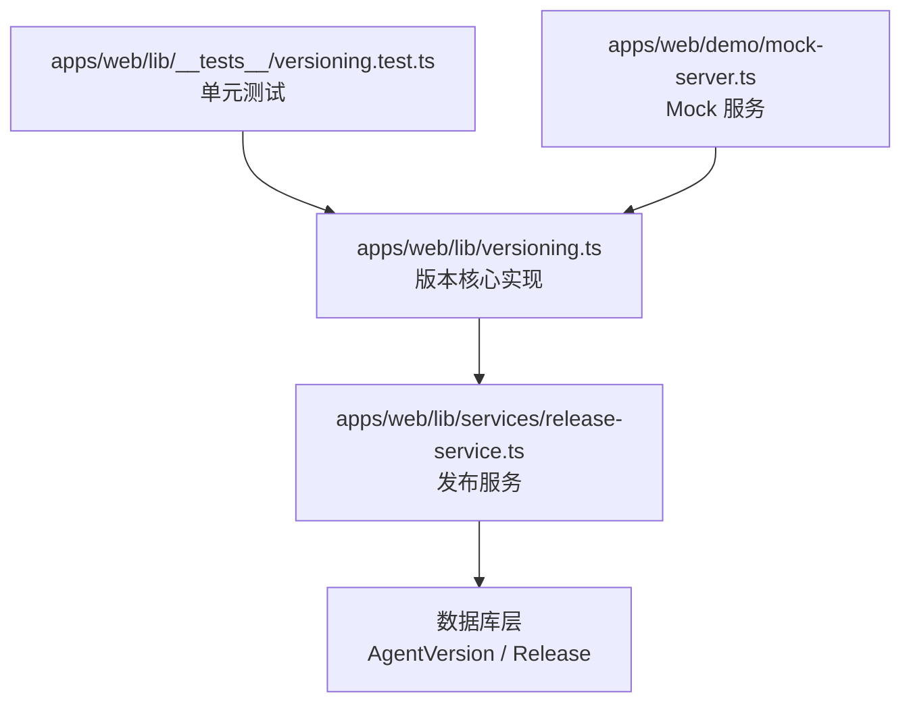
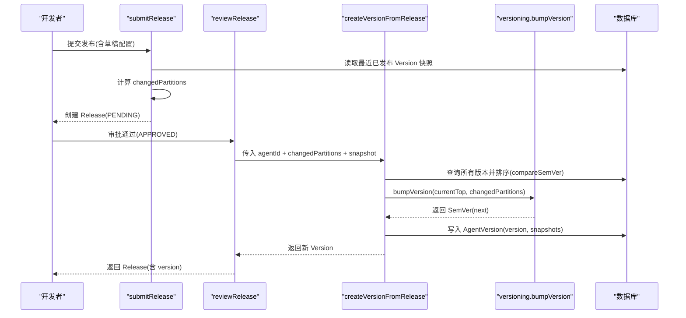
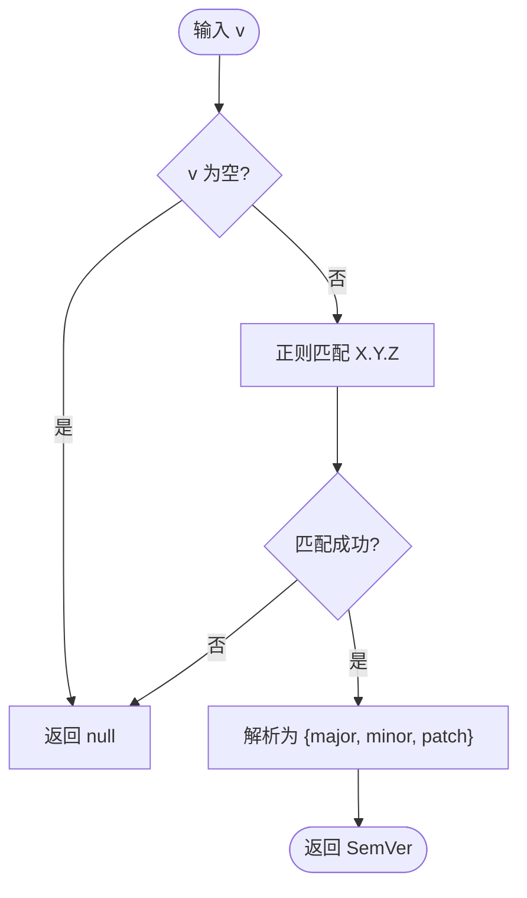
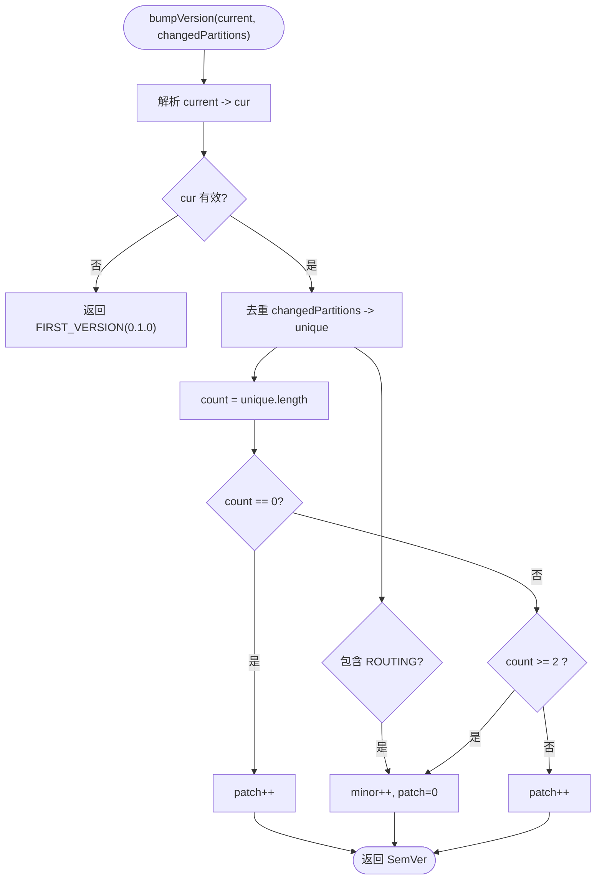
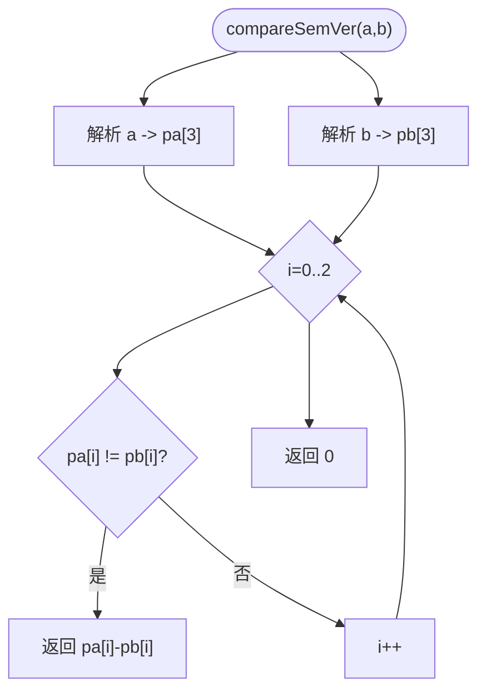
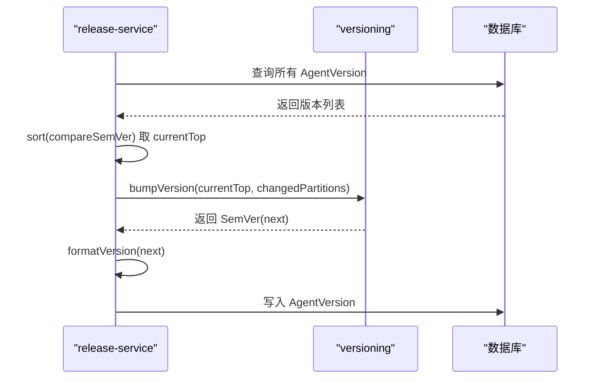

# 语义化版本策略

<cite>
**本文引用的文件**   
- [apps/web/lib/versioning.ts](file://apps/web/lib/versioning.ts)
- [apps/web/lib/__tests__/versioning.test.ts](file://apps/web/lib/__tests__/versioning.test.ts)
- [apps/web/lib/services/release-service.ts](file://apps/web/lib/services/release-service.ts)
- [apps/web/demo/mock-server.ts](file://apps/web/demo/mock-server.ts)
</cite>

## 目录
1. [引言](#引言)
2. [项目结构中的版本相关位置](#项目结构中的版本相关位置)
3. [核心组件](#核心组件)
4. [架构总览](#架构总览)
5. [详细组件分析](#详细组件分析)
6. [依赖关系分析](#依赖关系分析)
7. [性能与复杂度](#性能与复杂度)
8. [故障排查指南](#故障排查指南)
9. [结论](#结论)
10. [附录：版本号计算示例与边界情况](#附录版本号计算示例与边界情况)

## 引言
本文面向 AgentUp 的语义化版本（SemVer）策略，聚焦以下目标：
- 解释 `bumpVersion` 的算法逻辑与基于变更分区（changedPartitions）的版本号递增规则。
- 说明 `compareSemVer` 的比较与排序逻辑。
- 描述版本号的解析、格式化机制。
- 给出设计原则、向后兼容性建议与升级路径规划。
- 提供具体计算示例与边界处理说明。

AgentUp 的版本策略将“变更影响面”映射到 SemVer 的 major/minor/patch 上，但 MVP 阶段不自动提升 major，以避免版本号膨胀；major 留给人工显式标注的破坏性重写场景。

## 项目结构中的版本相关位置
- 版本核心实现位于前端应用库中：`apps/web/lib/versioning.ts`。
- 发布服务在审批通过时调用版本生成逻辑：`apps/web/lib/services/release-service.ts`。
- 单元测试覆盖版本解析、格式化与 bump 规则：`apps/web/lib/__tests__/versioning.test.ts`。
- Mock 服务端包含与核心逻辑镜像的 SemVer 比较与 bump 实现，用于演示和测试：`apps/web/demo/mock-server.ts`。

**图表来源**
- [apps/web/lib/versioning.ts:1-69](file://apps/web/lib/versioning.ts#L1-L69)
- [apps/web/lib/services/release-service.ts:15-20](file://apps/web/lib/services/release-service.ts#L15-L20)
- [apps/web/lib/services/release-service.ts:61-69](file://apps/web/lib/services/release-service.ts#L61-L69)
- [apps/web/lib/services/release-service.ts:235-265](file://apps/web/lib/services/release-service.ts#L235-L265)
- [apps/web/lib/__tests__/versioning.test.ts:1-85](file://apps/web/lib/__tests__/versioning.test.ts#L1-L85)
- [apps/web/demo/mock-server.ts:412-431](file://apps/web/demo/mock-server.ts#L412-L431)

**章节来源**
- [apps/web/lib/versioning.ts:1-69](file://apps/web/lib/versioning.ts#L1-L69)
- [apps/web/lib/services/release-service.ts:15-20](file://apps/web/lib/services/release-service.ts#L15-L20)
- [apps/web/lib/services/release-service.ts:61-69](file://apps/web/lib/services/release-service.ts#L61-L69)
- [apps/web/lib/services/release-service.ts:235-265](file://apps/web/lib/services/release-service.ts#L235-L265)
- [apps/web/lib/__tests__/versioning.test.ts:1-85](file://apps/web/lib/__tests__/versioning.test.ts#L1-L85)
- [apps/web/demo/mock-server.ts:412-431](file://apps/web/demo/mock-server.ts#L412-L431)

## 核心组件
- 类型与常量
  - `Partition`：四分区枚举，包括 PROMPT、KNOWLEDGE、TOOLS、ROUTING。
  - `SemVer`：语义化版本对象，包含 major、minor、patch。
  - `FIRST_VERSION`：首次发布默认版本为 0.1.0。
- 函数
  - `parseVersion`：解析 "X.Y.Z" 字符串为 SemVer；非法或空返回 null。
  - `formatVersion`：将 SemVer 格式化为 "X.Y.Z" 字符串。
  - `bumpVersion`：根据当前最高版本与 changedPartitions 计算下一个 SemVer。
  - `compareSemVer`：比较两个 SemVer 字符串的大小，用于排序与取最高版本。

**章节来源**
- [apps/web/lib/versioning.ts:18-69](file://apps/web/lib/versioning.ts#L18-L69)
- [apps/web/lib/services/release-service.ts:61-69](file://apps/web/lib/services/release-service.ts#L61-L69)

## 架构总览
版本策略贯穿“提交发布 → 审批通过 → 生成不可变 Version”的流程：
- 提交发布时，系统对比当前草稿与最近已发布版本的四个分区快照，得到 changedPartitions。
- 审批通过后，系统查询该 Agent 所有历史版本，按 compareSemVer 排序取最高版本 currentTop。
- 使用 bumpVersion(currentTop, changedPartitions) 计算 next SemVer，并用 formatVersion 输出字符串。
- 最终写入 AgentVersion 记录，同时保存各分区快照与元数据。

**图表来源**
- [apps/web/lib/services/release-service.ts:77-149](file://apps/web/lib/services/release-service.ts#L77-L149)
- [apps/web/lib/services/release-service.ts:159-217](file://apps/web/lib/services/release-service.ts#L159-L217)
- [apps/web/lib/services/release-service.ts:235-265](file://apps/web/lib/services/release-service.ts#L235-L265)
- [apps/web/lib/versioning.ts:46-69](file://apps/web/lib/versioning.ts#L46-L69)

## 详细组件分析

### 版本解析与格式化
- parseVersion
  - 输入：字符串、null、undefined。
  - 行为：仅接受严格匹配 "数字.数字.数字" 的格式；否则返回 null。
  - 用途：作为 bumpVersion 的前置解析，确保后续逻辑基于合法 SemVer。
- formatVersion
  - 输入：SemVer 对象。
  - 行为：拼接为 "X.Y.Z" 字符串。
  - 用途：写入数据库 version 字段，以及对外展示。

**图表来源**
- [apps/web/lib/versioning.ts:28-34](file://apps/web/lib/versioning.ts#L28-L34)

**章节来源**
- [apps/web/lib/versioning.ts:28-38](file://apps/web/lib/versioning.ts#L28-L38)
- [apps/web/lib/__tests__/versioning.test.ts:4-24](file://apps/web/lib/__tests__/versioning.test.ts#L4-L24)

### 版本号递增策略：bumpVersion
bumpVersion 的核心决策树如下：
- 若 current 为空或非法：视为首次发布，返回 FIRST_VERSION（0.1.0）。
- 对 changedPartitions 去重，统计唯一分区数量 count，并判断是否包含 ROUTING。
- 分支规则：
  - count == 0：保守补丁，patch++。
  - count >= 2 或包含 ROUTING：次版本升级，minor++，patch=0。
  - 单个非路由分区变更：补丁升级，patch++。

**图表来源**
- [apps/web/lib/versioning.ts:46-69](file://apps/web/lib/versioning.ts#L46-L69)

**章节来源**
- [apps/web/lib/versioning.ts:46-69](file://apps/web/lib/versioning.ts#L46-L69)
- [apps/web/lib/__tests__/versioning.test.ts:26-84](file://apps/web/lib/__tests__/versioning.test.ts#L26-L84)

### 版本比较与排序：compareSemVer
- 行为：
  - 分别解析 a、b 为三个数字数组；若解析失败则回退为 [0,0,0]。
  - 从左到右逐位比较 major、minor、patch，遇到不同即返回差值。
  - 完全相等返回 0。
- 用途：
  - 在 release-service 中用于对所有历史版本排序，取最高版本 currentTop。
  - 保证版本号数值大小顺序正确，避免字符串排序错误。

**图表来源**
- [apps/web/lib/services/release-service.ts:61-69](file://apps/web/lib/services/release-service.ts#L61-L69)
- [apps/web/demo/mock-server.ts:414-418](file://apps/web/demo/mock-server.ts#L414-L418)

**章节来源**
- [apps/web/lib/services/release-service.ts:61-69](file://apps/web/lib/services/release-service.ts#L61-L69)
- [apps/web/demo/mock-server.ts:414-418](file://apps/web/demo/mock-server.ts#L414-L418)

### 发布流程中的版本生成
- submitRelease：
  - 读取最近已发布 Version 的四分区快照作为基线。
  - 与当前草稿做 JSON diff，得到 changedPartitions。
  - 若无变更则拒绝提交。
- reviewRelease：
  - 校验状态与权限，必要时要求 reviewComment。
  - 审批通过时调用 createVersionFromRelease。
- createVersionFromRelease：
  - 查询该 Agent 的所有版本，按 compareSemVer 降序取 currentTop。
  - 调用 bumpVersion(currentTop, changedPartitions) 得到 next SemVer。
  - 使用 formatVersion 输出字符串，写入 AgentVersion。

**图表来源**
- [apps/web/lib/services/release-service.ts:235-265](file://apps/web/lib/services/release-service.ts#L235-L265)
- [apps/web/lib/versioning.ts:46-69](file://apps/web/lib/versioning.ts#L46-L69)

**章节来源**
- [apps/web/lib/services/release-service.ts:77-149](file://apps/web/lib/services/release-service.ts#L77-L149)
- [apps/web/lib/services/release-service.ts:159-217](file://apps/web/lib/services/release-service.ts#L159-L217)
- [apps/web/lib/services/release-service.ts:235-265](file://apps/web/lib/services/release-service.ts#L235-L265)

## 依赖关系分析
- versioning.ts 被 release-service.ts 导入并使用，负责纯函数式的版本计算。
- release-service.ts 负责业务编排：diff 分区、事务内创建 Release 与 Version、审计记录。
- mock-server.ts 包含与 versioning.ts 行为一致的 compareSemVer 与 bumpVersion 镜像实现，便于演示与测试。

**图表来源**
- [apps/web/lib/versioning.ts:1-69](file://apps/web/lib/versioning.ts#L1-L69)
- [apps/web/lib/services/release-service.ts:15-20](file://apps/web/lib/services/release-service.ts#L15-L20)
- [apps/web/demo/mock-server.ts:412-431](file://apps/web/demo/mock-server.ts#L412-L431)

**章节来源**
- [apps/web/lib/versioning.ts:1-69](file://apps/web/lib/versioning.ts#L1-L69)
- [apps/web/lib/services/release-service.ts:15-20](file://apps/web/lib/services/release-service.ts#L15-L20)
- [apps/web/demo/mock-server.ts:412-431](file://apps/web/demo/mock-server.ts#L412-L431)

## 性能与复杂度
- parseVersion：正则匹配一次，时间复杂度 O(1)。
- formatVersion：字符串拼接，时间复杂度 O(1)。
- bumpVersion：Set 去重 O(k)，k 为 changedPartitions 长度（最多 4），常数级开销。
- compareSemVer：固定三位比较，O(1)。
- createVersionFromRelease：查询所有版本后排序，时间复杂度 O(n log n)，n 为该 Agent 的历史版本数；通常较小，可接受。

优化建议：
- 若历史版本规模增长，可在数据库层维护最大版本号索引或使用缓存，减少全量排序。
- 对频繁调用的 compareSemVer 可考虑轻量缓存（键为 (a,b) 三元组），但需权衡一致性。

[本节为通用性能讨论，不直接分析具体代码行]

## 故障排查指南
常见问题与定位要点：
- 版本号解析失败
  - 现象：parseVersion 返回 null，bumpVersion 走首次发布逻辑。
  - 排查：检查传入的 current 是否为合法 "X.Y.Z" 字符串。
  - 参考：[apps/web/lib/versioning.ts:28-34](file://apps/web/lib/versioning.ts#L28-L34)
- 未检测到任何分区变更
  - 现象：submitRelease 抛出“没有任何配置变更，无法提交发布”。
  - 排查：确认 baseline 与 after 的 JSON diff 是否确实存在新增、删除或修改。
  - 参考：[apps/web/lib/services/release-service.ts:50-59](file://apps/web/lib/services/release-service.ts#L50-L59), [apps/web/lib/services/release-service.ts:119-125](file://apps/web/lib/services/release-service.ts#L119-L125)
- 版本号未按预期递增
  - 现象：期望 minor 升级却只 patch 升级。
  - 排查：检查 changedPartitions 是否包含 ROUTING 或数量 ≥2；确认去重逻辑。
  - 参考：[apps/web/lib/versioning.ts:53-69](file://apps/web/lib/versioning.ts#L53-L69)
- 版本排序异常
  - 现象：currentTop 不是最新版本。
  - 排查：确认 compareSemVer 实现是否正确；避免字符串排序。
  - 参考：[apps/web/lib/services/release-service.ts:61-69](file://apps/web/lib/services/release-service.ts#L61-L69)

**章节来源**
- [apps/web/lib/versioning.ts:28-34](file://apps/web/lib/versioning.ts#L28-L34)
- [apps/web/lib/versioning.ts:53-69](file://apps/web/lib/versioning.ts#L53-L69)
- [apps/web/lib/services/release-service.ts:50-59](file://apps/web/lib/services/release-service.ts#L50-L59)
- [apps/web/lib/services/release-service.ts:119-125](file://apps/web/lib/services/release-service.ts#L119-L125)
- [apps/web/lib/services/release-service.ts:61-69](file://apps/web/lib/services/release-service.ts#L61-L69)

## 结论
AgentUp 的语义化版本策略以“变更分区”为核心驱动，将影响面映射到 minor/patch 升级：
- ROUTING 变更或 ≥2 个分区变更触发 minor 升级。
- 单个非路由分区变更触发 patch 升级。
- 首次发布统一为 0.1.0。
- MVP 阶段不自动 major，避免版本号膨胀；major 留给人工显式标注的破坏性重写。
- compareSemVer 提供稳定的数值比较，确保历史版本排序正确。
该策略具备明确的规则、良好的可测性与可扩展性，适合在持续集成与发布流水线中稳定运行。

[本节为总结性内容，不直接分析具体代码行]

## 附录：版本号计算示例与边界情况
以下为典型用例与边界处理（基于单元测试与实现逻辑归纳）：
- 首次发布
  - 输入：current=null/undefined，任意 changedPartitions。
  - 输出：{major:0, minor:1, patch:0}。
  - 参考：[apps/web/lib/__tests__/versioning.test.ts:26-38](file://apps/web/lib/__tests__/versioning.test.ts#L26-L38)
- 单个非路由分区变更
  - 输入：current="0.1.0", changed=["PROMPT"]。
  - 输出：{major:0, minor:1, patch:1}。
  - 参考：[apps/web/lib/__tests__/versioning.test.ts:40-44](file://apps/web/lib/__tests__/versioning.test.ts#L40-L44)
- ROUTING 分区变更
  - 输入：current="0.1.0", changed=["ROUTING"]。
  - 输出：{major:0, minor:2, patch:0}。
  - 参考：[apps/web/lib/__tests__/versioning.test.ts:46-49](file://apps/web/lib/__tests__/versioning.test.ts#L46-L49)
- 多个分区变更
  - 输入：current="0.1.0", changed=["PROMPT","KNOWLEDGE"]。
  - 输出：{major:0, minor:2, patch:0}。
  - 参考：[apps/web/lib/__tests__/versioning.test.ts:51-62](file://apps/web/lib/__tests__/versioning.test.ts#L51-L62)
- 全部四个分区变更
  - 输入：current="0.1.0", changed=["PROMPT","KNOWLEDGE","TOOLS","ROUTING"]。
  - 输出：{major:0, minor:2, patch:0}（不自动 major）。
  - 参考：[apps/web/lib/__tests__/versioning.test.ts:64-67](file://apps/web/lib/__tests__/versioning.test.ts#L64-L67)
- 去重
  - 输入：current="0.1.0", changed=["PROMPT","PROMPT"]。
  - 输出：{major:0, minor:1, patch:1}。
  - 参考：[apps/web/lib/__tests__/versioning.test.ts:69-75](file://apps/web/lib/__tests__/versioning.test.ts#L69-L75)
- 零分区变更（防御路径）
  - 输入：current="0.1.0", changed=[]。
  - 输出：{major:0, minor:1, patch:1}（保守 patch）。
  - 参考：[apps/web/lib/__tests__/versioning.test.ts:77-79](file://apps/web/lib/__tests__/versioning.test.ts#L77-L79)
- 非法 current
  - 输入：current="garbage", changed=["PROMPT"]。
  - 输出：{major:0, minor:1, patch:0}（视为首次发布）。
  - 参考：[apps/web/lib/__tests__/versioning.test.ts:81-83](file://apps/web/lib/__tests__/versioning.test.ts#L81-L83)

最佳实践与设计原则：
- 向后兼容性
  - 优先使用 patch 表达小修小补；minor 表达功能增强但不破坏既有行为。
  - 谨慎使用 major；仅在破坏性重写时由人工显式标注。
- 升级路径规划
  - 明确每个分区的变更影响面：ROUTING 影响工单路由与阈值，应更谨慎。
  - 多分区变更合并为一次 minor 升级，避免碎片化版本号。
- 可观测性与审计
  - 每次发布记录 changedPartitions 与 configSnapshot，便于回溯与回滚。
  - 回滚操作同样生成新版本，保持历史不可变。

**章节来源**
- [apps/web/lib/__tests__/versioning.test.ts:26-84](file://apps/web/lib/__tests__/versioning.test.ts#L26-L84)
- [apps/web/lib/versioning.ts:1-69](file://apps/web/lib/versioning.ts#L1-L69)
- [apps/web/lib/services/release-service.ts:275-354](file://apps/web/lib/services/release-service.ts#L275-L354)