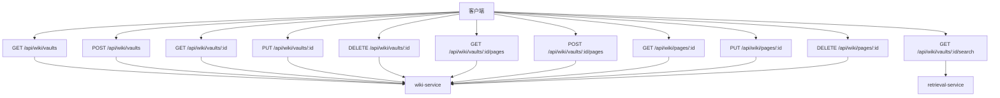
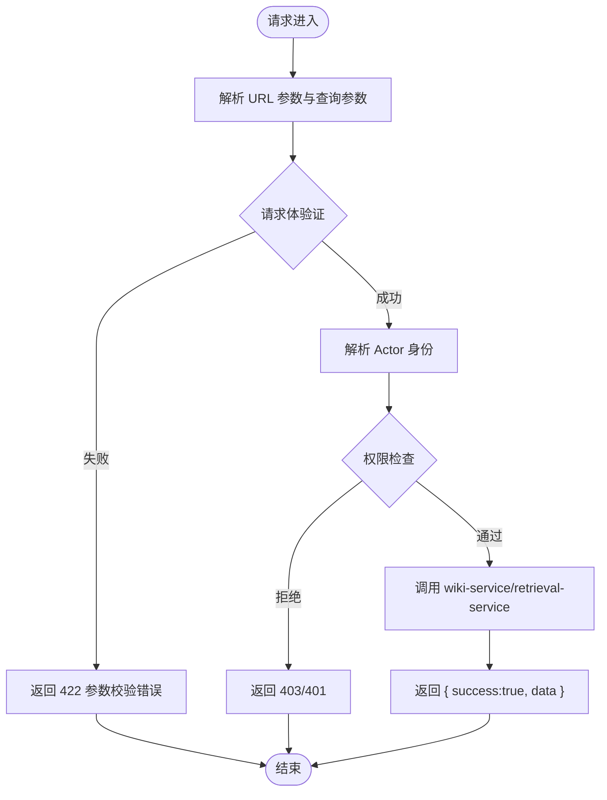
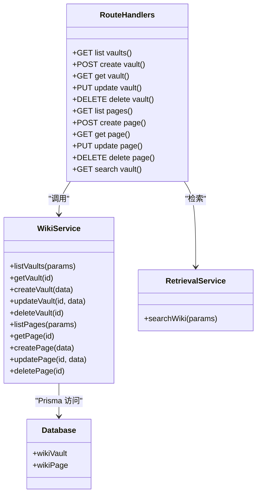

# API 接口参考

<cite>
**本文引用的文件**   
- [apps/web/app/api/wiki/vaults/route.ts](file://apps/web/app/api/wiki/vaults/route.ts)
- [apps/web/app/api/wiki/vaults/[id]/route.ts](file://apps/web/app/api/wiki/vaults/[id]/route.ts)
- [apps/web/app/api/wiki/vaults/[id]/pages/route.ts](file://apps/web/app/api/wiki/vaults/[id]/pages/route.ts)
- [apps/web/app/api/wiki/pages/[id]/route.ts](file://apps/web/app/api/pages/[id]/route.ts)
- [apps/web/app/api/wiki/vaults/[id]/search/route.ts](file://apps/web/app/api/wiki/vaults/[id]/search/route.ts)
- [apps/web/lib/schemas.ts](file://apps/web/lib/schemas.ts)
- [apps/web/lib/utils.ts](file://apps/web/lib/utils.ts)
- [apps/web/lib/context.ts](file://apps/web/lib/context.ts)
- [apps/web/lib/services/wiki-service.ts](file://apps/web/lib/services/wiki-service.ts)
</cite>

## 目录
1. [简介](#简介)
2. [项目结构与入口](#项目结构与入口)
3. [核心组件与通用约定](#核心组件与通用约定)
4. [架构总览](#架构总览)
5. [Wiki Vault 管理接口](#wiki-vault-管理接口)
6. [Wiki Page 管理接口](#wiki-page-管理接口)
7. [Vault 检索接口](#vault-检索接口)
8. [认证、权限与错误模型](#认证权限与错误模型)
9. [分页、过滤与搜索规范](#分页过滤与搜索规范)
10. [API 版本控制与兼容性](#api-版本控制与兼容性)
11. [客户端集成指南与 SDK 示例](#客户端集成指南与-sdk-示例)
12. [限流、缓存与性能建议](#限流缓存与性能建议)
13. [故障排查](#故障排查)
14. [结论](#结论)

## 简介
本文件是知识库系统的完整 API 接口参考，覆盖以下能力：
- Vault 管理：创建、查询、更新、删除知识库。
- Page 管理：在指定 Vault 下创建、查询、更新、删除知识页面。
- Vault 检索：按关键词、置信度阈值对 Vault 内页面进行检索。
- 统一成功/错误响应格式、分页元数据、参数校验、认证与权限控制。

所有端点均位于 Next.js App Router 的 `apps/web/app/api/wiki` 路径下，采用 RESTful 风格设计。

## 项目结构与入口
Wiki 相关 API 路由组织如下：
- `/api/wiki/vaults`：Vault 列表与创建。
- `/api/wiki/vaults/:id`：单个 Vault 的查询、更新、删除。
- `/api/wiki/vaults/:id/pages`：Vault 下的页面列表与创建。
- `/api/wiki/pages/:id`：跨 Vault 的单个页面查询、更新、删除。
- `/api/wiki/vaults/:id/search`：Vault 级全文检索。



**图表来源**
- [apps/web/app/api/wiki/vaults/route.ts:7-29](file://apps/web/app/api/wiki/vaults/route.ts#L7-L29)
- [apps/web/app/api/wiki/vaults/[id]/route.ts:7-37](file://apps/web/app/api/wiki/vaults/[id]/route.ts#L7-L37)
- [apps/web/app/api/wiki/vaults/[id]/pages/route.ts:7-33](file://apps/web/app/api/wiki/vaults/[id]/pages/route.ts#L7-L33)
- [apps/web/app/api/wiki/pages/[id]/route.ts:7-37](file://apps/web/app/api/pages/[id]/route.ts#L7-L37)
- [apps/web/app/api/wiki/vaults/[id]/search/route.ts:8-34](file://apps/web/app/api/wiki/vaults/[id]/search/route.ts#L8-L34)

**章节来源**
- [apps/web/app/api/wiki/vaults/route.ts:1-30](file://apps/web/app/api/wiki/vaults/route.ts#L1-L30)
- [apps/web/app/api/wiki/vaults/[id]/route.ts:1-38](file://apps/web/app/api/wiki/vaults/[id]/route.ts#L1-L38)
- [apps/web/app/api/wiki/vaults/[id]/pages/route.ts:1-34](file://apps/web/app/api/wiki/vaults/[id]/pages/route.ts#L1-L34)
- [apps/web/app/api/wiki/pages/[id]/route.ts:1-38](file://apps/web/app/api/pages/[id]/route.ts#L1-L38)
- [apps/web/app/api/wiki/vaults/[id]/search/route.ts:1-35](file://apps/web/app/api/wiki/vaults/[id]/search/route.ts#L1-L35)

## 核心组件与通用约定
- 成功响应：`{ success: true, data }`，HTTP 状态码默认 200，创建类操作返回 201。
- 错误响应：`{ success: false, error }`，必要时附带 `errors` 数组；由统一错误处理函数映射业务异常为 HTTP 状态码。
- 请求体校验：使用 Zod schema 校验，失败返回 422，并携带字段级错误消息。
- 分页参数：`page`、`pageSize`；服务端自动计算 `skip`、`take`，并返回分页元数据。
- Actor 上下文：写操作通过 `withActor(resolveActor(headers), ...)` 注入当前主体，用于审计与权限判断。



**图表来源**
- [apps/web/lib/utils.ts:5-25](file://apps/web/lib/utils.ts#L5-L25)
- [apps/web/lib/utils.ts:27-47](file://apps/web/lib/utils.ts#L27-L47)
- [apps/web/lib/context.ts:65-89](file://apps/web/lib/context.ts#L65-L89)

**章节来源**
- [apps/web/lib/utils.ts:1-86](file://apps/web/lib/utils.ts#L1-L86)
- [apps/web/lib/context.ts:1-97](file://apps/web/lib/context.ts#L1-L97)

## 架构总览
Wiki API 层负责路由、参数解析、请求体验证与 Actor 注入；领域逻辑集中在 `wiki-service`，检索能力委托给 `retrieval-service`。数据库访问通过 Prisma 完成，Vault 与 Page 实体分别对应 `wikiVault` 与 `wikiPage`。



**图表来源**
- [apps/web/app/api/wiki/vaults/route.ts:7-29](file://apps/web/app/api/wiki/vaults/route.ts#L7-L29)
- [apps/web/app/api/wiki/vaults/[id]/route.ts:7-37](file://apps/web/app/api/wiki/vaults/[id]/route.ts#L7-L37)
- [apps/web/app/api/wiki/vaults/[id]/pages/route.ts:7-33](file://apps/web/app/api/wiki/vaults/[id]/pages/route.ts#L7-L33)
- [apps/web/app/api/wiki/pages/[id]/route.ts:7-37](file://apps/web/app/api/pages/[id]/route.ts#L7-L37)
- [apps/web/app/api/wiki/vaults/[id]/search/route.ts:8-34](file://apps/web/app/api/wiki/vaults/[id]/search/route.ts#L8-L34)
- [apps/web/lib/services/wiki-service.ts:65-297](file://apps/web/lib/services/wiki-service.ts#L65-L297)

## Wiki Vault 管理接口

### 列出 Vault
- 方法：`GET`
- URL：`/api/wiki/vaults`
- 认证：读操作不强制 Actor；写操作需要权限。
- 查询参数：
  - `page`：页码，默认 1，最小值 1。
  - `pageSize`：每页数量，默认 20，最大值 100。
  - `agentId`：可选，按 Agent 过滤。
  - `shared`：可选，值为 `true` 时仅返回共享 Vault。
- 响应体：
  - `data.items`：Vault 列表。
  - `data.pagination`：分页元数据。

成功响应示例（JSON）：
```json
{
  "success": true,
  "data": {
    "items": [],
    "pagination": {
      "page": 1,
      "pageSize": 20,
      "total": 0,
      "totalPages": 0,
      "hasMore": false
    }
  }
}
```

**章节来源**
- [apps/web/app/api/wiki/vaults/route.ts:7-15](file://apps/web/app/api/wiki/vaults/route.ts#L7-L15)
- [apps/web/lib/utils.ts:27-47](file://apps/web/lib/utils.ts#L27-L47)
- [apps/web/lib/services/wiki-service.ts:65-86](file://apps/web/lib/services/wiki-service.ts#L65-L86)

### 创建 Vault
- 方法：`POST`
- URL：`/api/wiki/vaults`
- 认证：需要 Actor，且具备 `wiki.write` 权限。
- 请求体：
  - `name`：必填，字符串，长度 1-200。
  - `description`：可选，字符串，最大 2000。
  - `agentId`：可选，可为空。
  - `gitRepoUrl`：可选，合法 URL 或空字符串。
  - `gitBranch`：可选，最大 200。
  - `isShared`：可选，布尔。
- 响应体：创建的 Vault 对象。

成功响应示例（JSON）：
```json
{
  "success": true,
  "data": {
    "id": "vault-uuid",
    "name": "新知识库",
    "description": null,
    "agentId": null,
    "isShared": false,
    "gitRepoUrl": null,
    "gitBranch": "main",
    "pageCount": 0,
    "avgConfidence": null,
    "orphanCount": 0,
    "createdAt": "2026-01-01T00:00:00Z",
    "updatedAt": "2026-01-01T00:00:00Z",
    "_count": { "pages": 0, "ingestJobs": 0 },
    "agent": null
  }
}
```

**章节来源**
- [apps/web/app/api/wiki/vaults/route.ts:17-29](file://apps/web/app/api/wiki/vaults/route.ts#L17-L29)
- [apps/web/lib/schemas.ts:192-207](file://apps/web/lib/schemas.ts#L192-L207)
- [apps/web/lib/services/wiki-service.ts:96-119](file://apps/web/lib/services/wiki-service.ts#L96-L119)

### 获取 Vault
- 方法：`GET`
- URL：`/api/wiki/vaults/:id`
- 路径参数：`id`（Vault ID）。
- 响应体：Vault 详情。

成功响应示例（JSON）：
```json
{
  "success": true,
  "data": {
    "id": "vault-uuid",
    "name": "知识库名称",
    "description": "描述",
    "agentId": "agent-uuid",
    "isShared": true,
    "gitRepoUrl": "https://github.com/example/repo",
    "gitBranch": "main",
    "pageCount": 10,
    "avgConfidence": 0.75,
    "orphanCount": 0,
    "createdAt": "2026-01-01T00:00:00Z",
    "updatedAt": "2026-01-01T00:00:00Z",
    "_count": { "pages": 10, "ingestJobs": 0 },
    "agent": { "id": "agent-uuid", "name": "Agent 名称" }
  }
}
```

**章节来源**
- [apps/web/app/api/wiki/vaults/[id]/route.ts:7-12](file://apps/web/app/api/wiki/vaults/[id]/route.ts#L7-L12)
- [apps/web/lib/services/wiki-service.ts:88-94](file://apps/web/lib/services/wiki-service.ts#L88-L94)

### 更新 Vault
- 方法：`PUT`
- URL：`/api/wiki/vaults/:id`
- 认证：需要 Actor，且具备 `wiki.write` 权限。
- 请求体：
  - `name`：可选，长度 1-200。
  - `description`：可选，可为空。
  - `gitRepoUrl`：可选，合法 URL 或空字符串。
  - `gitBranch`：可选，可为空。
  - `isShared`：可选，布尔。
- 响应体：更新后的 Vault。

成功响应示例（JSON）：
```json
{
  "success": true,
  "data": {
    "id": "vault-uuid",
    "name": "更新后的名称",
    "description": "新的描述",
    "agentId": "agent-uuid",
    "isShared": true,
    "gitRepoUrl": "https://github.com/example/repo",
    "gitBranch": "develop",
    "pageCount": 10,
    "avgConfidence": 0.75,
    "orphanCount": 0,
    "createdAt": "2026-01-01T00:00:00Z",
    "updatedAt": "2026-01-01T00:00:00Z",
    "_count": { "pages": 10, "ingestJobs": 0 },
    "agent": { "id": "agent-uuid", "name": "Agent 名称" }
  }
}
```

**章节来源**
- [apps/web/app/api/wiki/vaults/[id]/route.ts:14-27](file://apps/web/app/api/wiki/vaults/[id]/route.ts#L14-L27)
- [apps/web/lib/schemas.ts:201-207](file://apps/web/lib/schemas.ts#L201-L207)
- [apps/web/lib/services/wiki-service.ts:121-133](file://apps/web/lib/services/wiki-service.ts#L121-L133)

### 删除 Vault
- 方法：`DELETE`
- URL：`/api/wiki/vaults/:id`
- 认证：需要 Actor，且具备 `wiki.write` 权限。
- 响应体：
  - `data.message`：删除成功提示。

成功响应示例（JSON）：
```json
{
  "success": true,
  "data": {
    "message": "Vault 已删除"
  }
}
```

**章节来源**
- [apps/web/app/api/wiki/vaults/[id]/route.ts:29-37](file://apps/web/app/api/wiki/vaults/[id]/route.ts#L29-L37)
- [apps/web/lib/services/wiki-service.ts:135-144](file://apps/web/lib/services/wiki-service.ts#L135-L144)

## Wiki Page 管理接口

### 列出 Vault 下的 Page
- 方法：`GET`
- URL：`/api/wiki/vaults/:id/pages`
- 路径参数：`id`（Vault ID）。
- 查询参数：
  - `page`：页码，默认 1。
  - `pageSize`：每页数量，默认 20，最大 100。
  - `lifecycle`：可选，页面生命周期枚举；传 `ALL` 表示不过滤。
  - `tier`：可选，页面层级枚举；传 `ALL` 表示不过滤。
  - `search`：可选，关键字，支持标题与内容模糊匹配。
- 响应体：
  - `data.items`：Page 列表。
  - `data.pagination`：分页元数据。

成功响应示例（JSON）：
```json
{
  "success": true,
  "data": {
    "items": [
      {
        "id": "page-uuid",
        "vaultId": "vault-uuid",
        "title": "页面标题",
        "slug": "page-slug",
        "content": "页面内容",
        "summary": "摘要",
        "provenance": "EXTRACTED",
        "lifecycle": "DRAFT",
        "tier": "SPECIALIZED",
        "baseConfidence": 0.5,
        "tags": ["tag1"],
        "categories": ["cat1"],
        "wikilinks": ["link1"],
        "filePath": "page-slug.md",
        "sourceRefs": [],
        "inboundLinks": [],
        "outboundLinks": [],
        "createdAt": "2026-01-01T00:00:00Z",
        "updatedAt": "2026-01-01T00:00:00Z",
        "reviewedAt": null
      }
    ],
    "pagination": {
      "page": 1,
      "pageSize": 20,
      "total": 1,
      "totalPages": 1,
      "hasMore": false
    }
  }
}
```

**章节来源**
- [apps/web/app/api/wiki/vaults/[id]/pages/route.ts:7-17](file://apps/web/app/api/wiki/vaults/[id]/pages/route.ts#L7-L17)
- [apps/web/lib/services/wiki-service.ts:146-196](file://apps/web/lib/services/wiki-service.ts#L146-L196)

### 创建 Page
- 方法：`POST`
- URL：`/api/wiki/vaults/:id/pages`
- 路径参数：`id`（Vault ID），该值会覆盖请求体中的 `vaultId`。
- 认证：需要 Actor，且具备 `wiki.write` 权限。
- 请求体：
  - `vaultId`：必填，但会被路径参数覆盖。
  - `title`：必填，长度 1-300。
  - `slug`：必填，长度 1-300，同 Vault 下唯一。
  - `content`：必填。
  - `summary`：可选，最大 1000。
  - `provenance`：可选，来源枚举。
  - `lifecycle`：可选，生命周期枚举。
  - `tier`：可选，层级枚举。
  - `baseConfidence`：可选，0-1。
  - `tags`：可选，字符串数组。
  - `categories`：可选，字符串数组。
  - `wikilinks`：可选，字符串数组。
- 响应体：创建的 Page。

成功响应示例（JSON）：
```json
{
  "success": true,
  "data": {
    "id": "page-uuid",
    "vaultId": "vault-uuid",
    "title": "新页面",
    "slug": "new-page",
    "content": "页面正文",
    "summary": null,
    "provenance": "EXTRACTED",
    "lifecycle": "DRAFT",
    "tier": "SPECIALIZED",
    "baseConfidence": 0.5,
    "tags": [],
    "categories": [],
    "wikilinks": [],
    "filePath": "new-page.md",
    "sourceRefs": [],
    "inboundLinks": [],
    "outboundLinks": [],
    "createdAt": "2026-01-01T00:00:00Z",
    "updatedAt": "2026-01-01T00:00:00Z",
    "reviewedAt": null
  }
}
```

**章节来源**
- [apps/web/app/api/wiki/vaults/[id]/pages/route.ts:19-33](file://apps/web/app/api/wiki/vaults/[id]/pages/route.ts#L19-L33)
- [apps/web/lib/schemas.ts:217-243](file://apps/web/lib/schemas.ts#L217-L243)
- [apps/web/lib/services/wiki-service.ts:211-259](file://apps/web/lib/services/wiki-service.ts#L211-L259)

### 获取 Page
- 方法：`GET`
- URL：`/api/wiki/pages/:id`
- 路径参数：`id`（Page ID）。
- 响应体：Page 详情，包含所属 Vault 基本信息。

成功响应示例（JSON）：
```json
{
  "success": true,
  "data": {
    "id": "page-uuid",
    "vaultId": "vault-uuid",
    "title": "页面标题",
    "slug": "page-slug",
    "content": "页面内容",
    "summary": "摘要",
    "provenance": "EXTRACTED",
    "lifecycle": "DRAFT",
    "tier": "SPECIALIZED",
    "baseConfidence": 0.5,
    "tags": [],
    "categories": [],
    "wikilinks": [],
    "filePath": "page-slug.md",
    "sourceRefs": [],
    "inboundLinks": [],
    "outboundLinks": [],
    "createdAt": "2026-01-01T00:00:00Z",
    "updatedAt": "2026-01-01T00:00:00Z",
    "reviewedAt": null,
    "vault": {
      "id": "vault-uuid",
      "name": "知识库名称"
    }
  }
}
```

**章节来源**
- [apps/web/app/api/wiki/pages/[id]/route.ts:7-12](file://apps/web/app/api/wiki/pages/[id]/route.ts#L7-L12)
- [apps/web/lib/services/wiki-service.ts:198-209](file://apps/web/lib/services/wiki-service.ts#L198-L209)

### 更新 Page
- 方法：`PUT`
- URL：`/api/wiki/pages/:id`
- 认证：需要 Actor，且具备 `wiki.write` 权限。
- 请求体：
  - `title`：可选，长度 1-300。
  - `content`：可选。
  - `summary`：可选，可为空。
  - `provenance`：可选，来源枚举。
  - `lifecycle`：可选，生命周期枚举。
  - `tier`：可选，层级枚举。
  - `baseConfidence`：可选，0-1。
  - `tags`：可选，字符串数组。
  - `categories`：可选，字符串数组。
  - `wikilinks`：可选，字符串数组。
- 响应体：更新后的 Page。

成功响应示例（JSON）：
```json
{
  "success": true,
  "data": {
    "id": "page-uuid",
    "vaultId": "vault-uuid",
    "title": "更新后的标题",
    "slug": "page-slug",
    "content": "更新后的内容",
    "summary": "新的摘要",
    "provenance": "AUTHORED",
    "lifecycle": "IN_REVIEW",
    "tier": "CORE",
    "baseConfidence": 0.8,
    "tags": ["tag1", "tag2"],
    "categories": ["cat1"],
    "wikilinks": ["link1"],
    "filePath": "page-slug.md",
    "sourceRefs": [],
    "inboundLinks": [],
    "outboundLinks": [],
    "createdAt": "2026-01-01T00:00:00Z",
    "updatedAt": "2026-01-01T00:00:00Z",
    "reviewedAt": null
  }
}
```

**章节来源**
- [apps/web/app/api/wiki/pages/[id]/route.ts:14-27](file://apps/web/app/api/wiki/pages/[id]/route.ts#L14-L27)
- [apps/web/lib/schemas.ts:232-243](file://apps/web/lib/schemas.ts#L232-L243)
- [apps/web/lib/services/wiki-service.ts:261-284](file://apps/web/lib/services/wiki-service.ts#L261-L284)

### 删除 Page
- 方法：`DELETE`
- URL：`/api/wiki/pages/:id`
- 认证：需要 Actor，且具备 `wiki.write` 权限。
- 响应体：
  - `data.message`：删除成功提示。

成功响应示例（JSON）：
```json
{
  "success": true,
  "data": {
    "message": "Page 已删除"
  }
}
```

**章节来源**
- [apps/web/app/api/wiki/pages/[id]/route.ts:29-37](file://apps/web/app/api/wiki/pages/[id]/route.ts#L29-L37)
- [apps/web/lib/services/wiki-service.ts:286-297](file://apps/web/lib/services/wiki-service.ts#L286-L297)

## Vault 检索接口

### 检索 Vault 内容
- 方法：`GET`
- URL：`/api/wiki/vaults/:id/search`
- 路径参数：`id`（Vault ID）。
- 查询参数：
  - `q`：必填，检索词，长度 1-500。
  - `limit`：可选，结果条数，默认 5，范围 1-20。
  - `threshold`：可选，置信度阈值，默认 0.35，范围 0-1。
- 响应体：检索结果，结构由 `retrieval-service` 决定。

成功响应示例（JSON）：
```json
{
  "success": true,
  "data": {
    "results": []
  }
}
```

**章节来源**
- [apps/web/app/api/wiki/vaults/[id]/search/route.ts:8-34](file://apps/web/app/api/wiki/vaults/[id]/search/route.ts#L8-L34)
- [apps/web/lib/schemas.ts:246-250](file://apps/web/lib/schemas.ts#L246-L250)

## 认证、权限与错误模型

### 认证机制
- 首选可信令牌：Cookie `agentup_session` 或 Header `x-actor-token`。
- 非生产环境可信任明文头：`x-actor-id`、`x-actor-name`、`x-actor-role`。
- 生产环境需显式设置环境变量 `AUTH_TRUST_ACTOR_HEADERS=1` 才采纳明文头。
- 无法提供可信身份时，使用匿名 Actor。

**章节来源**
- [apps/web/lib/context.ts:1-17](file://apps/web/lib/context.ts#L1-L17)
- [apps/web/lib/context.ts:53-80](file://apps/web/lib/context.ts#L53-L80)

### 权限控制
- 写操作（创建、更新、删除 Vault/Page）在服务层调用 `requirePermission("wiki", "write")`。
- 未授权将触发服务层错误，最终被统一错误处理器转换为相应 HTTP 状态码。

**章节来源**
- [apps/web/lib/services/wiki-service.ts:104-144](file://apps/web/lib/services/wiki-service.ts#L104-L144)
- [apps/web/lib/services/wiki-service.ts:225-297](file://apps/web/lib/services/wiki-service.ts#L225-L297)

### 错误响应模型
- 参数校验失败：422，响应体包含 `errors` 数组。
- 资源不存在：404，例如 Vault 或 Page 不存在。
- 业务冲突：409，例如同 Vault 下 slug 重复。
- 其他服务异常：根据异常类型映射为具体状态码。

常见错误响应示例（JSON）：
```json
{
  "success": false,
  "error": "参数校验失败",
  "errors": ["字段不能为空", "URL 格式不正确"]
}
```

**章节来源**
- [apps/web/lib/utils.ts:10-25](file://apps/web/lib/utils.ts#L10-L25)
- [apps/web/lib/utils.ts:63-85](file://apps/web/lib/utils.ts#L63-L85)
- [apps/web/lib/services/wiki-service.ts:121-144](file://apps/web/lib/services/wiki-service.ts#L121-L144)
- [apps/web/lib/services/wiki-service.ts:225-234](file://apps/web/lib/services/wiki-service.ts#L225-L234)

## 分页、过滤与搜索规范

### 分页参数
- `page`：页码，默认 1，最小值 1。
- `pageSize`：每页数量，默认 20，最大值 100。
- 服务端自动计算：
  - `skip = (page - 1) * pageSize`
  - `take = pageSize`
- 分页元数据：
  - `page`
  - `pageSize`
  - `total`
  - `totalPages`
  - `hasMore`

**章节来源**
- [apps/web/lib/utils.ts:27-47](file://apps/web/lib/utils.ts#L27-L47)

### 过滤条件
- Vault 列表：
  - `agentId`：按 Agent 过滤。
  - `shared`：是否共享。
- Page 列表：
  - `lifecycle`：生命周期枚举，`ALL` 表示不过滤。
  - `tier`：层级枚举，`ALL` 表示不过滤。
  - `search`：关键字，支持标题与内容模糊匹配。

**章节来源**
- [apps/web/app/api/wiki/vaults/route.ts:7-15](file://apps/web/app/api/wiki/vaults/route.ts#L7-L15)
- [apps/web/app/api/wiki/vaults/[id]/pages/route.ts:7-17](file://apps/web/app/api/wiki/vaults/[id]/pages/route.ts#L7-L17)
- [apps/web/lib/services/wiki-service.ts:146-196](file://apps/web/lib/services/wiki-service.ts#L146-L196)

### 搜索语法
- 检索接口 `/api/wiki/vaults/:id/search`：
  - `q`：必填，检索词。
  - `limit`：可选，结果条数，默认 5，范围 1-20。
  - `threshold`：可选，置信度阈值，默认 0.35，范围 0-1。
- 检索逻辑委托 `retrieval-service`，返回结果结构由该服务定义。

**章节来源**
- [apps/web/app/api/wiki/vaults/[id]/search/route.ts:8-34](file://apps/web/app/api/wiki/vaults/[id]/search/route.ts#L8-L34)
- [apps/web/lib/schemas.ts:246-250](file://apps/web/lib/schemas.ts#L246-L250)

## API 版本控制与兼容性
- 当前路由以 `/api/wiki/*` 暴露，未引入显式版本号前缀。
- 向后兼容策略：
  - 新增可选字段不影响现有客户端。
  - 新增查询参数不影响现有客户端。
  - 响应体新增字段不影响现有客户端。
  - 变更必填字段或枚举值时需评估破坏性变更并发布新版本。
- 建议在后续演进中引入版本前缀，如 `/api/v1/wiki/*`，以实现明确的版本隔离。

[本节为概念性说明，不涉及具体代码片段]

## 客户端集成指南与 SDK 示例

### 基础请求流程
1. 构造请求 URL，带上必要的路径参数与查询参数。
2. 对于写操作，确保携带可信令牌或受信任的 Actor 头。
3. 发送 JSON 请求体，遵循对应 Schema 的字段约束。
4. 解析响应体：
   - 成功：读取 `data`。
   - 失败：读取 `error` 与 `errors`。

### 示例：创建 Vault
- 请求：
  - 方法：`POST`
  - URL：`/api/wiki/vaults`
  - 头部：携带可信令牌或 Actor 头。
  - 请求体：包含 `name` 等必填字段。
- 响应：
  - 成功：201，返回 Vault 对象。
  - 失败：422 或 403/401。

### 示例：列出 Vault 下的 Page
- 请求：
  - 方法：`GET`
  - URL：`/api/wiki/vaults/:id/pages?page=1&pageSize=20&lifecycle=DRAFT&tier=CORE&search=关键词`
- 响应：
  - 成功：200，返回 Page 列表与分页元数据。
  - 失败：404（Vault 不存在）。

### 示例：检索 Vault
- 请求：
  - 方法：`GET`
  - URL：`/api/wiki/vaults/:id/search?q=关键词&limit=10&threshold=0.5`
- 响应：
  - 成功：200，返回检索结果。
  - 失败：422（参数非法）、404（Vault 不存在）。

[本节为概念性示例，不包含具体代码内容]

## 限流、缓存与性能建议
- 限流：当前路由层未实现内置限流，可在网关或边缘层配置速率限制。
- 缓存：
  - 列表接口适合使用 ETag/Last-Modified 或短期缓存。
  - 检索接口可根据 `q`、`limit`、`threshold` 做键控缓存。
- 性能优化：
  - 合理设置 `pageSize`，避免过大导致响应体积膨胀。
  - 使用 `lifecycle`、`tier` 过滤减少不必要的数据传输。
  - 对高频只读接口启用 CDN 或反向代理缓存。
  - 避免在客户端频繁轮询，改用增量加载或事件驱动更新。

[本节为通用建议，不涉及具体代码片段]

## 故障排查
- 422 参数校验失败：
  - 检查请求体字段是否符合 Schema。
  - 关注 `errors` 数组中的字段级错误信息。
- 404 资源不存在：
  - 确认 Vault 或 Page ID 正确。
  - 确认资源未被删除。
- 409 冲突：
  - 同 Vault 下 slug 重复，更换 slug。
- 403/401 权限不足：
  - 检查 Actor 身份与权限。
  - 确认写操作具备 `wiki.write` 权限。

**章节来源**
- [apps/web/lib/utils.ts:63-85](file://apps/web/lib/utils.ts#L63-L85)
- [apps/web/lib/services/wiki-service.ts:121-144](file://apps/web/lib/services/wiki-service.ts#L121-L144)
- [apps/web/lib/services/wiki-service.ts:225-234](file://apps/web/lib/services/wiki-service.ts#L225-L234)

## 结论
本 API 参考覆盖了 Wiki Vault 与 Wiki Page 的核心 CRUD 能力以及 Vault 检索能力。系统通过统一的响应格式、参数校验、Actor 上下文与权限控制，提供了清晰、可扩展的知识库管理能力。客户端应严格遵循参数规范与认证要求，并结合分页、过滤与搜索能力构建高效的用户体验。后续演进建议引入显式 API 版本前缀，并在网关层补充限流与缓存策略，以提升稳定性与性能。