# Vault 管理

<cite>
**本文引用的文件**   
- [apps/web/app/api/wiki/vaults/route.ts](file://apps/web/app/api/wiki/vaults/route.ts)
- [apps/web/app/api/wiki/vaults/[id]/route.ts](file://apps/web/app/api/wiki/vaults/[id]/route.ts)
- [apps/web/app/api/wiki/vaults/[id]/pages/route.ts](file://apps/web/app/api/wiki/vaults/[id]/pages/route.ts)
- [apps/web/app/api/wiki/vaults/[id]/search/route.ts](file://apps/web/app/api/wiki/vaults/[id]/search/route.ts)
- [apps/web/lib/services/wiki-service.ts](file://apps/web/lib/services/wiki-service.ts)
- [apps/web/lib/schemas.ts](file://apps/web/lib/schemas.ts)
- [packages/db/prisma/schema.prisma](file://packages/db/prisma/schema.prisma)
- [apps/web/app/(dashboard)/wiki/page.tsx](file://apps/web/app/(dashboard)/wiki/page.tsx)
- [apps/web/app/api/__tests__/feedback-skills-wiki.test.ts](file://apps/web/app/api/__tests__/feedback-skills-wiki.test.ts)
- [apps/web/app/api/__tests__/wiki-crud.test.ts](file://apps/web/app/api/__tests__/wiki-crud.test.ts)
</cite>

## 目录
1. [简介](#简介)
2. [项目结构](#项目结构)
3. [核心组件](#核心组件)
4. [架构总览](#架构总览)
5. [详细组件分析](#详细组件分析)
6. [依赖关系分析](#依赖关系分析)
7. [性能与统计字段说明](#性能与统计字段说明)
8. [API 端点规范](#api-端点规范)
9. [生命周期管理与数据迁移](#生命周期管理与数据迁移)
10. [故障排查指南](#故障排查指南)
11. [最佳实践](#最佳实践)
12. [结论](#结论)

## 简介
本文件面向 Wiki Vault 作为“知识容器”的管理能力，系统性说明 Vault 的创建、更新、删除、查询、页面管理、搜索、权限控制、统计指标含义、API 契约以及生命周期和数据迁移策略。读者无需深入代码即可理解 Vault 在系统中的角色：它聚合 Wiki 页面、可选关联 Agent、支持 Git 仓库同步配置，并通过 isShared 参与共享与权限控制。

## 项目结构
Wiki Vault 相关能力集中在 Next.js API Routes 与领域服务中，数据库模型由 Prisma 定义：
- API 路由层：负责参数解析、校验、权限上下文注入和错误包装。
- 领域服务层：封装 Prisma 查询、审计记录、权限检查与业务规则。
- 数据模型层：Prisma schema 定义 WikiVault、WikiPage、WikiIngestJob 等实体及关系。
- 前端展示层：Dashboard 中的 Wiki 页面消费 Vault 统计信息并展示。

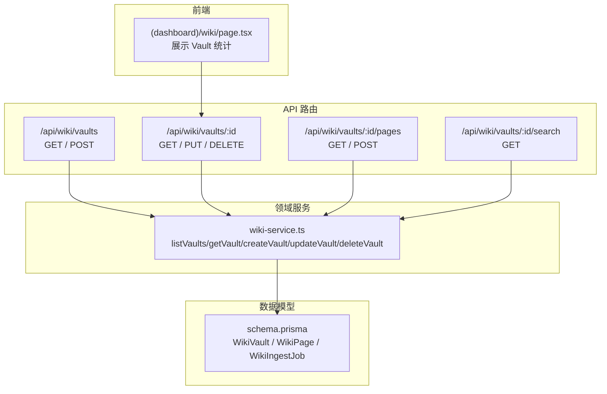

**图表来源**
- [apps/web/app/api/wiki/vaults/route.ts:7-29](file://apps/web/app/api/wiki/vaults/route.ts#L7-L29)
- [apps/web/app/api/wiki/vaults/[id]/route.ts:7-37](file://apps/web/app/api/wiki/vaults/[id]/route.ts#L7-L37)
- [apps/web/app/api/wiki/vaults/[id]/pages/route.ts:7-33](file://apps/web/app/api/wiki/vaults/[id]/pages/route.ts#L7-L33)
- [apps/web/app/api/wiki/vaults/[id]/search/route.ts:8-34](file://apps/web/app/api/wiki/vaults/[id]/search/route.ts#L8-L34)
- [apps/web/lib/services/wiki-service.ts:65-144](file://apps/web/lib/services/wiki-service.ts#L65-L144)
- [packages/db/prisma/schema.prisma:397-419](file://packages/db/prisma/schema.prisma#L397-L419)
- [apps/web/app/(dashboard)/wiki/page.tsx:324-344](file://apps/web/app/(dashboard)/wiki/page.tsx#L324-L344)

**章节来源**
- [apps/web/app/api/wiki/vaults/route.ts:1-30](file://apps/web/app/api/wiki/vaults/route.ts#L1-L30)
- [apps/web/app/api/wiki/vaults/[id]/route.ts:1-38](file://apps/web/app/api/wiki/vaults/[id]/route.ts#L1-L38)
- [apps/web/lib/services/wiki-service.ts:1-37](file://apps/web/lib/services/wiki-service.ts#L1-L37)
- [packages/db/prisma/schema.prisma:397-419](file://packages/db/prisma/schema.prisma#L397-L419)

## 核心组件
- WikiVault（知识库）
  - 标识与元数据：id、name、description、createdAt、updatedAt。
  - 关联 Agent：agentId（唯一约束），Agent 侧 KnowledgeConfig 可反向引用 wikiVaultId。
  - Git 同步配置：gitRepoUrl、gitBranch、lastCommitSha。
  - 统计字段：pageCount、avgConfidence、orphanCount。
  - 共享控制：isShared、sharedBy。
  - 关联实体：WikiPage（级联删除）、WikiIngestJob（级联删除）、KnowledgeConfig（可选）。
- WikiPage（知识页）
  - 归属 vaultId（强外键，级联删除）。
  - 内容、标签、分类、链接、置信度、来源、生命周期、层级等。
- WikiIngestJob（入库任务）
  - 记录从不同来源导入页面的任务状态与结果。

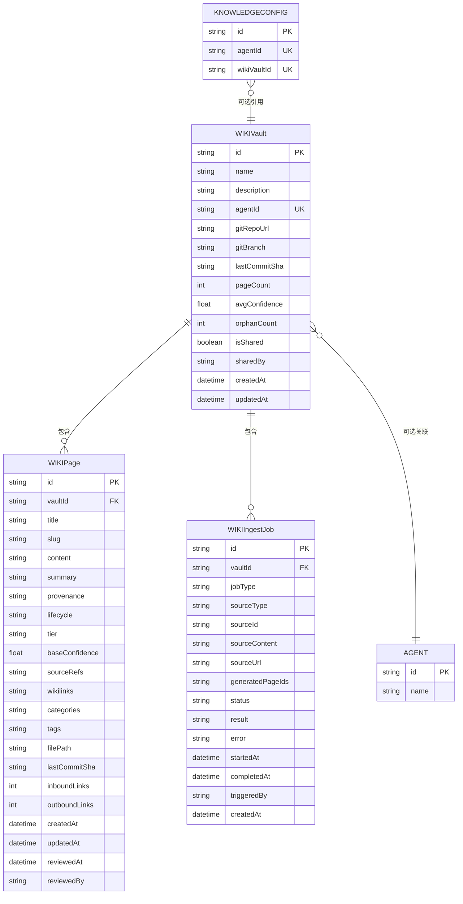

**图表来源**
- [packages/db/prisma/schema.prisma:66-99](file://packages/db/prisma/schema.prisma#L66-L99)
- [packages/db/prisma/schema.prisma:119-136](file://packages/db/prisma/schema.prisma#L119-L136)
- [packages/db/prisma/schema.prisma:397-419](file://packages/db/prisma/schema.prisma#L397-L419)
- [packages/db/prisma/schema.prisma:421-454](file://packages/db/prisma/schema.prisma#L421-L454)
- [packages/db/prisma/schema.prisma:456-480](file://packages/db/prisma/schema.prisma#L456-L480)

**章节来源**
- [packages/db/prisma/schema.prisma:397-480](file://packages/db/prisma/schema.prisma#L397-L480)

## 架构总览
Vault 管理的请求处理链路如下：
1. 客户端调用 Next.js API Route。
2. 路由层解析分页、校验请求体、解析 Actor（认证上下文）。
3. 调用领域服务执行具体业务逻辑（CRUD、计数、审计）。
4. 通过 Prisma 访问 SQLite 数据库。
5. 返回统一成功响应或结构化错误。

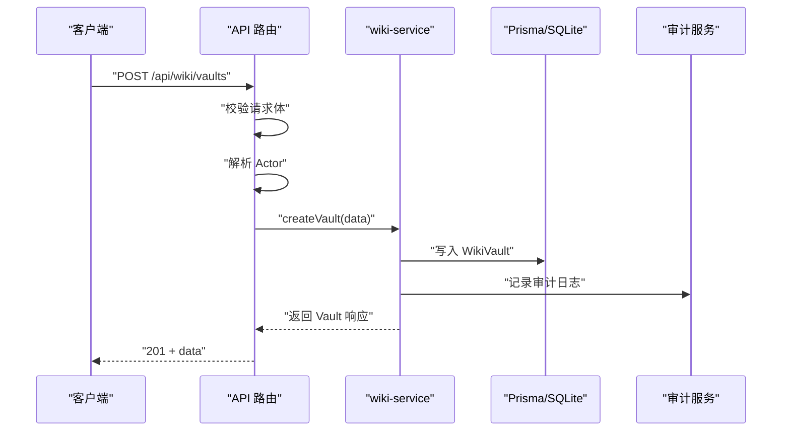

**图表来源**
- [apps/web/app/api/wiki/vaults/route.ts:17-29](file://apps/web/app/api/wiki/vaults/route.ts#L17-L29)
- [apps/web/lib/services/wiki-service.ts:96-119](file://apps/web/lib/services/wiki-service.ts#L96-L119)

**章节来源**
- [apps/web/app/api/wiki/vaults/route.ts:1-30](file://apps/web/app/api/wiki/vaults/route.ts#L1-L30)
- [apps/web/lib/services/wiki-service.ts:96-119](file://apps/web/lib/services/wiki-service.ts#L96-L119)

## 详细组件分析

### Vault 列表与筛选
- 支持分页：page、pageSize、skip、take。
- 支持按 Agent 过滤：agentId。
- 支持按共享状态过滤：shared=true 表示只返回共享库；当前实现未暴露 false 分支，因此“只看私有库”无法通过 API 表达。
- 返回列表包含 _count.pages 与 _count.ingestJobs，以及 agent 摘要。

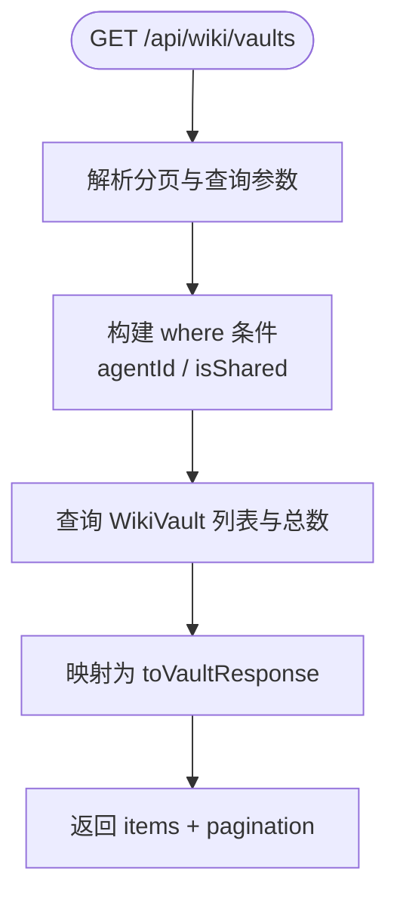

**图表来源**
- [apps/web/app/api/wiki/vaults/route.ts:7-15](file://apps/web/app/api/wiki/vaults/route.ts#L7-L15)
- [apps/web/lib/services/wiki-service.ts:65-86](file://apps/web/lib/services/wiki-service.ts#L65-L86)

**章节来源**
- [apps/web/app/api/wiki/vaults/route.ts:7-15](file://apps/web/app/api/wiki/vaults/route.ts#L7-L15)
- [apps/web/lib/services/wiki-service.ts:65-86](file://apps/web/lib/services/wiki-service.ts#L65-L86)

### Vault 详情、更新与删除
- GET：返回单个 Vault 及其 _count、agent 摘要；不存在时返回 404。
- PUT：部分更新，字段受 updateWikiVaultSchema 限制；存在性校验失败抛 NotFoundError。
- DELETE：级联删除 WikiPage 与 WikiIngestJob；成功后返回已删除消息。

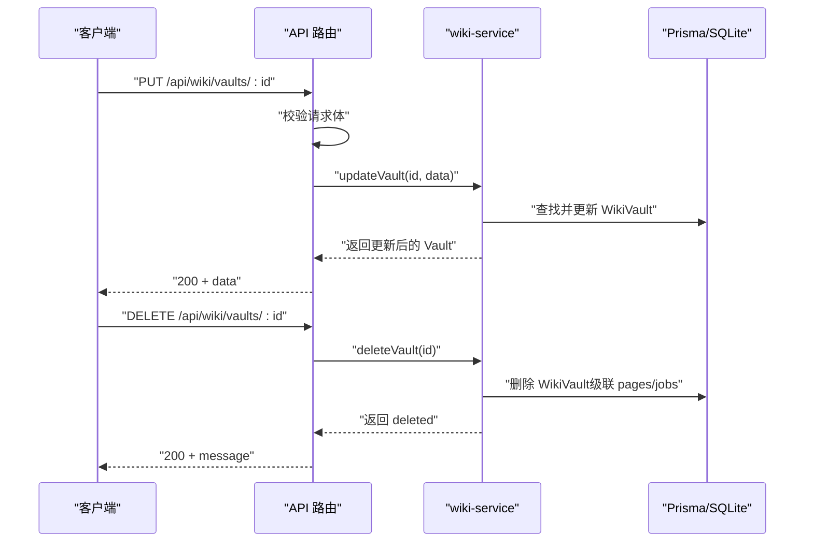

**图表来源**
- [apps/web/app/api/wiki/vaults/[id]/route.ts:7-37](file://apps/web/app/api/wiki/vaults/[id]/route.ts#L7-L37)
- [apps/web/lib/services/wiki-service.ts:121-144](file://apps/web/lib/services/wiki-service.ts#L121-L144)

**章节来源**
- [apps/web/app/api/wiki/vaults/[id]/route.ts:7-37](file://apps/web/app/api/wiki/vaults/[id]/route.ts#L7-L37)
- [apps/web/lib/services/wiki-service.ts:121-144](file://apps/web/lib/services/wiki-service.ts#L121-L144)

### Vault 页面管理
- GET /vaults/:id/pages：分页列出页面，支持 lifecycle、tier、search 过滤。
- POST /vaults/:id/pages：创建页面，path 上的 id 是权威 vaultId，会覆盖 body 中的 vaultId。

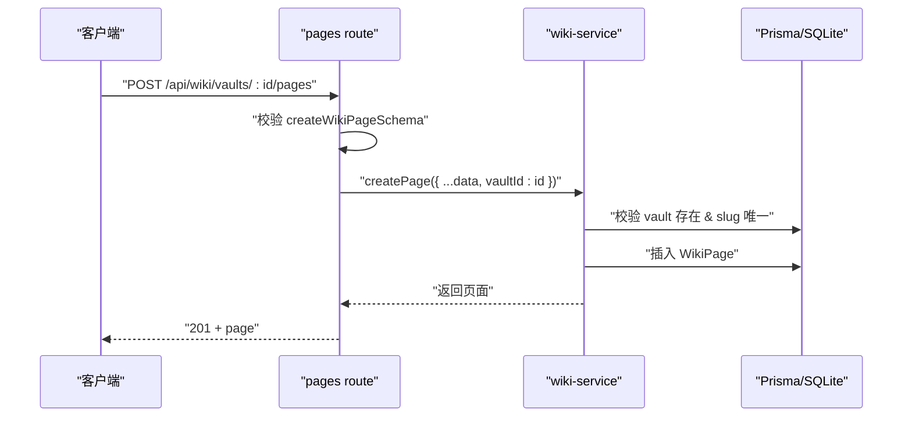

**图表来源**
- [apps/web/app/api/wiki/vaults/[id]/pages/route.ts:19-33](file://apps/web/app/api/wiki/vaults/[id]/pages/route.ts#L19-L33)
- [apps/web/lib/services/wiki-service.ts:211-259](file://apps/web/lib/services/wiki-service.ts#L211-L259)

**章节来源**
- [apps/web/app/api/wiki/vaults/[id]/pages/route.ts:7-33](file://apps/web/app/api/wiki/vaults/[id]/pages/route.ts#L7-L33)
- [apps/web/lib/services/wiki-service.ts:211-259](file://apps/web/lib/services/wiki-service.ts#L211-L259)

### Vault 搜索
- GET /vaults/:id/search：基于检索服务进行语义/关键词搜索，支持 limit 与 threshold。
- 若 Vault 不存在，返回 404。

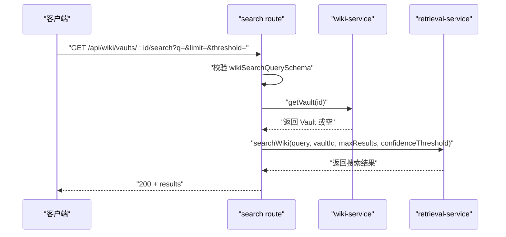

**图表来源**
- [apps/web/app/api/wiki/vaults/[id]/search/route.ts:8-34](file://apps/web/app/api/wiki/vaults/[id]/search/route.ts#L8-L34)
- [apps/web/lib/services/wiki-service.ts:88-94](file://apps/web/lib/services/wiki-service.ts#L88-L94)

**章节来源**
- [apps/web/app/api/wiki/vaults/[id]/search/route.ts:8-34](file://apps/web/app/api/wiki/vaults/[id]/search/route.ts#L8-L34)
- [apps/web/lib/services/wiki-service.ts:88-94](file://apps/web/lib/services/wiki-service.ts#L88-L94)

## 依赖关系分析
- 路由层依赖：
  - 校验器：createWikiVaultSchema、updateWikiVaultSchema、createWikiPageSchema、wikiSearchQuerySchema。
  - 工具函数：success、error、validateBody、parsePagination、paginationMeta、handleApiError。
  - 上下文：withActor、resolveActor。
- 服务层依赖：
  - Prisma 客户端与类型。
  - RBAC：requirePermission("wiki", "write")。
  - 审计：recordAudit。
- 数据层依赖：
  - WikiVault、WikiPage、WikiIngestJob、Agent、KnowledgeConfig。

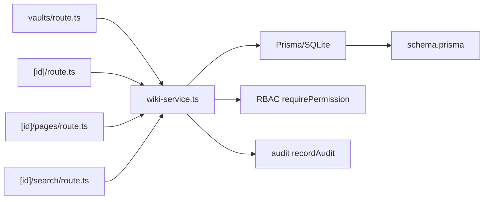

**图表来源**
- [apps/web/app/api/wiki/vaults/route.ts:1-30](file://apps/web/app/api/wiki/vaults/route.ts#L1-L30)
- [apps/web/app/api/wiki/vaults/[id]/route.ts:1-38](file://apps/web/app/api/wiki/vaults/[id]/route.ts#L1-L38)
- [apps/web/app/api/wiki/vaults/[id]/pages/route.ts:1-34](file://apps/web/app/api/wiki/vaults/[id]/pages/route.ts#L1-L34)
- [apps/web/app/api/wiki/vaults/[id]/search/route.ts:1-35](file://apps/web/app/api/wiki/vaults/[id]/search/route.ts#L1-L35)
- [apps/web/lib/services/wiki-service.ts:1-144](file://apps/web/lib/services/wiki-service.ts#L1-L144)
- [packages/db/prisma/schema.prisma:397-480](file://packages/db/prisma/schema.prisma#L397-L480)

**章节来源**
- [apps/web/lib/services/wiki-service.ts:1-144](file://apps/web/lib/services/wiki-service.ts#L1-L144)
- [packages/db/prisma/schema.prisma:397-480](file://packages/db/prisma/schema.prisma#L397-L480)

## 性能与统计字段说明
- 列表查询使用 orderBy updatedAt desc、id desc，避免不稳定排序。
- 列表与总数并行查询，减少往返延迟。
- 统计字段：
  - pageCount：WikiVault 表字段，默认 0。
  - avgConfidence：WikiVault 表字段，默认 0.0。
  - orphanCount：WikiVault 表字段，默认 0。
  - _count.pages 与 _count.ingestJobs：通过 Prisma 的 _count 聚合获取。
- 注意：当前实现中，pageCount、avgConfidence、orphanCount 在建库时初始化后并未在页面增删改时回写；_count.pages/_count.ingestJobs 由 Prisma 聚合提供，但 UI 展示的孤立页数量来自 Vault 表的 orphancount 字段，该字段在运行时不会自动维护。

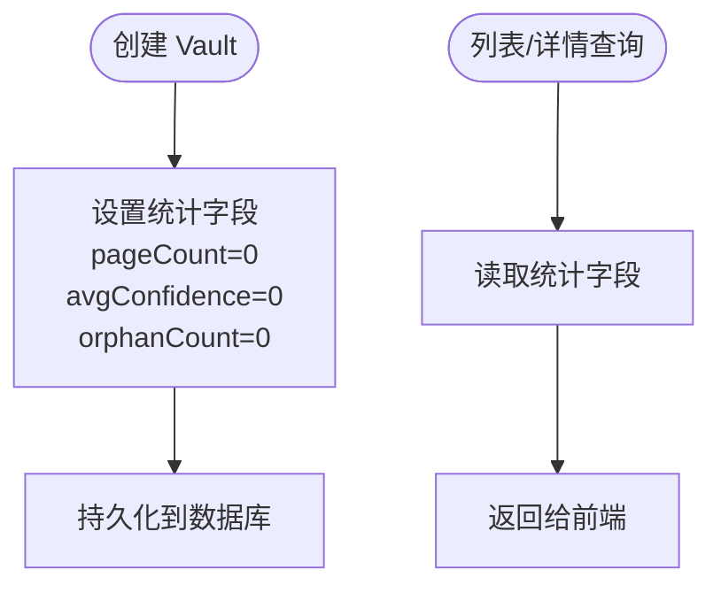

**图表来源**
- [apps/web/lib/services/wiki-service.ts:96-119](file://apps/web/lib/services/wiki-service.ts#L96-L119)
- [apps/web/lib/services/wiki-service.ts:20-37](file://apps/web/lib/services/wiki-service.ts#L20-L37)
- [apps/web/app/(dashboard)/wiki/page.tsx:324-344](file://apps/web/app/(dashboard)/wiki/page.tsx#L324-L344)

**章节来源**
- [apps/web/lib/services/wiki-service.ts:20-37](file://apps/web/lib/services/wiki-service.ts#L20-L37)
- [apps/web/lib/services/wiki-service.ts:96-119](file://apps/web/lib/services/wiki-service.ts#L96-L119)
- [apps/web/app/(dashboard)/wiki/page.tsx:324-344](file://apps/web/app/(dashboard)/wiki/page.tsx#L324-L344)

## API 端点规范

### 通用约定
- 成功响应统一包裹在 data 字段中，错误响应包含 error 字段。
- 分页参数：page、pageSize、skip、take。
- 所有写操作需具备 wiki.write 权限。

### 列表与创建
- GET /api/wiki/vaults
  - 查询参数：
    - page: number
    - pageSize: number
    - skip: number
    - take: number
    - agentId: string（可选）
    - shared: string（可选，"true" 表示只返回共享库）
  - 响应：
    - data.items: Vault 数组
    - data.pagination: 分页元信息
- POST /api/wiki/vaults
  - 请求体：
    - name: string（必填，长度 1-200）
    - description: string（可选，最大 2000）
    - agentId: string|null（可选）
    - gitRepoUrl: string|""|null（可选，URL 格式）
    - gitBranch: string（可选，最大 200）
    - isShared: boolean（可选）
  - 响应：201 + data.Vault

**章节来源**
- [apps/web/app/api/wiki/vaults/route.ts:7-29](file://apps/web/app/api/wiki/vaults/route.ts#L7-L29)
- [apps/web/lib/schemas.ts:192-207](file://apps/web/lib/schemas.ts#L192-L207)
- [apps/web/app/api/__tests__/feedback-skills-wiki.test.ts:134-165](file://apps/web/app/api/__tests__/feedback-skills-wiki.test.ts#L134-L165)

### 详情、更新、删除
- GET /api/wiki/vaults/:id
  - 响应：data.Vault 或 404
- PUT /api/wiki/vaults/:id
  - 请求体：
    - name: string（可选，长度 1-200）
    - description: string|null（可选，最大 2000）
    - gitRepoUrl: string|""|null（可选，URL 格式）
    - gitBranch: string|null（可选，最大 200）
    - isShared: boolean（可选）
  - 响应：data.Vault
- DELETE /api/wiki/vaults/:id
  - 响应：data.message（如“Vault 已删除”）

**章节来源**
- [apps/web/app/api/wiki/vaults/[id]/route.ts:7-37](file://apps/web/app/api/wiki/vaults/[id]/route.ts#L7-L37)
- [apps/web/lib/schemas.ts:201-207](file://apps/web/lib/schemas.ts#L201-L207)
- [apps/web/app/api/__tests__/wiki-crud.test.ts:74-105](file://apps/web/app/api/__tests__/wiki-crud.test.ts#L74-L105)

### 页面管理
- GET /api/wiki/vaults/:id/pages
  - 查询参数：
    - page、pageSize、skip、take
    - lifecycle: string（可选）
    - tier: string（可选）
    - search: string（可选）
  - 响应：data.items（页面数组）、data.pagination
- POST /api/wiki/vaults/:id/pages
  - 请求体：
    - vaultId: string（必填，会被 path 上的 id 覆盖）
    - title: string（必填，最大 300）
    - slug: string（必填，最大 300）
    - content: string（必填）
    - summary: string（可选，最大 1000）
    - provenance: enum（可选）
    - lifecycle: enum（可选）
    - tier: enum（可选）
    - baseConfidence: number（可选，0-1）
    - tags: string[]（可选）
    - categories: string[]（可选）
    - wikilinks: string[]（可选）
  - 响应：201 + data.page

**章节来源**
- [apps/web/app/api/wiki/vaults/[id]/pages/route.ts:7-33](file://apps/web/app/api/wiki/vaults/[id]/pages/route.ts#L7-L33)
- [apps/web/lib/schemas.ts:217-243](file://apps/web/lib/schemas.ts#L217-L243)

### 搜索
- GET /api/wiki/vaults/:id/search
  - 查询参数：
    - q: string（必填，最大 500）
    - limit: number（可选，1-20，默认 5）
    - threshold: number（可选，0-1，默认 0.35）
  - 响应：data.results（搜索结果）

**章节来源**
- [apps/web/app/api/wiki/vaults/[id]/search/route.ts:8-34](file://apps/web/app/api/wiki/vaults/[id]/search/route.ts#L8-L34)
- [apps/web/lib/schemas.ts:246-250](file://apps/web/lib/schemas.ts#L246-L250)

## 生命周期管理与数据迁移

### 生命周期
- 创建：
  - 校验 name 必填且长度合法。
  - gitRepoUrl 为空串时归一化为 null。
  - gitBranch 默认 "main"。
  - isShared 默认 false。
  - 记录审计日志。
- 更新：
  - 仅允许更新 schema 定义的字段。
  - 不存在则抛 NotFoundError。
- 删除：
  - 级联删除 WikiPage 与 WikiIngestJob。
  - 记录审计日志。

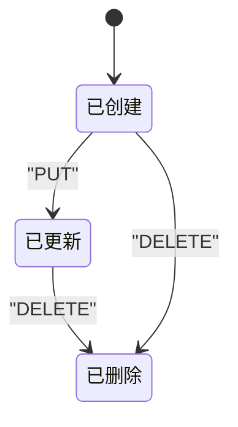

**图表来源**
- [apps/web/lib/services/wiki-service.ts:96-144](file://apps/web/lib/services/wiki-service.ts#L96-L144)

**章节来源**
- [apps/web/lib/services/wiki-service.ts:96-144](file://apps/web/lib/services/wiki-service.ts#L96-L144)

### 数据迁移策略
- 数据库引擎：SQLite（schema 注释说明从 PostgreSQL 迁移而来，枚举与 JSON 列以 String 存储并由 Zod 校验）。
- WikiVault 与 WikiPage 的关系采用 ON DELETE CASCADE，确保删除 Vault 时页面与入库任务一并清理。
- Agent 与 WikiVault 的双向关联：
  - WikiVault.agentId 唯一约束。
  - KnowledgeConfig.wikiVaultId 唯一约束，用于将 Agent 的知识源指向某个 Vault。

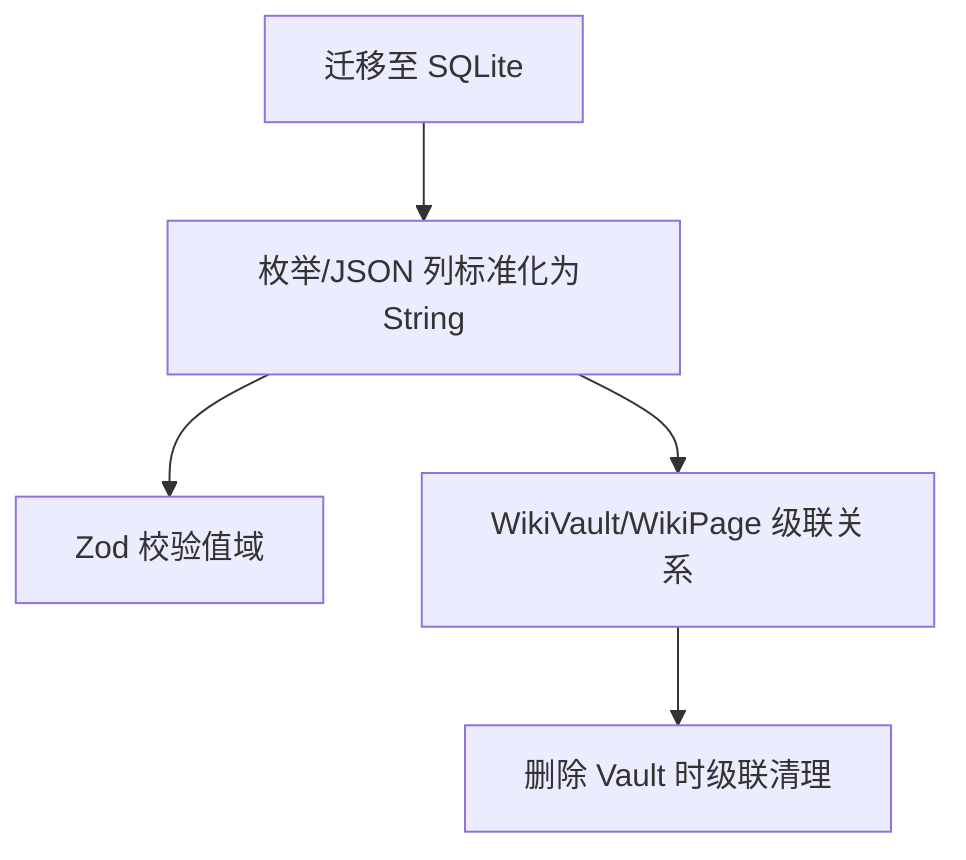

**图表来源**
- [packages/db/prisma/schema.prisma:1-10](file://packages/db/prisma/schema.prisma#L1-L10)
- [packages/db/prisma/schema.prisma:397-419](file://packages/db/prisma/schema.prisma#L397-L419)
- [packages/db/prisma/schema.prisma:421-454](file://packages/db/prisma/schema.prisma#L421-L454)

**章节来源**
- [packages/db/prisma/schema.prisma:1-10](file://packages/db/prisma/schema.prisma#L1-L10)
- [packages/db/prisma/schema.prisma:397-480](file://packages/db/prisma/schema.prisma#L397-L480)

## 故障排查指南
- 404 “Vault 不存在”
  - 触发场景：GET /vaults/:id 不存在；UPDATE/DELETE 时先查不到记录。
  - 处理建议：确认 id 是否正确；检查是否已被删除。
- 422 校验失败
  - 触发场景：POST /vaults 缺少 name；gitRepoUrl 不是合法 URL。
  - 处理建议：根据 Zod 错误提示修正请求体。
- 共享过滤行为
  - 现象：shared=true 有效；shared=false 不可达。
  - 原因：路由层仅将字符串 "true" 映射为 true，其余变 undefined。
  - 处理建议：如需“只看私有库”，可在服务端扩展 shared 参数解析。
- 统计字段不更新
  - 现象：pageCount、avgConfidence、orphanCount 始终为初始值。
  - 原因：建库后未在页面增删改时回写这些字段。
  - 处理建议：在页面变更时增量计算并更新 Vault 统计字段。

**章节来源**
- [apps/web/app/api/wiki/vaults/[id]/route.ts:7-12](file://apps/web/app/api/wiki/vaults/[id]/route.ts#L7-L12)
- [apps/web/app/api/wiki/vaults/route.ts:17-29](file://apps/web/app/api/wiki/vaults/route.ts#L17-L29)
- [apps/web/lib/services/wiki-service.ts:121-144](file://apps/web/lib/services/wiki-service.ts#L121-L144)

## 最佳实践
- 命名与描述
  - name 应简洁明确，便于在列表中快速识别。
  - description 用于补充用途与范围，帮助协作者理解。
- 关联 Agent
  - 若 Vault 专供某 Agent 使用，设置 agentId；否则保持 null。
  - 注意 Agent 侧 KnowledgeConfig 也可反向引用 wikiVaultId，避免重复绑定。
- 共享设置
  - isShared=true 表示共享库；谨慎开启，避免敏感知识扩散。
  - 当前 API 不支持直接查询“私有库”，如需该能力请扩展路由参数解析。
- Git 仓库配置
  - gitRepoUrl 必须为合法 URL；为空时留 null。
  - gitBranch 建议固定为稳定分支（如 main），避免频繁变动影响同步。
- 页面管理
  - slug 在同一 Vault 内唯一，避免冲突。
  - 合理使用 lifecycle 与 tier 标记页面状态与重要性。
  - 使用 tags/categories 提升检索命中率。
- 统计与维护
  - 关注 orphanCount，孤立页通常缺乏上下文，建议补充链接或合并。
  - 定期审查 avgConfidence，低置信度页面可能需要优化内容或来源。

**章节来源**
- [apps/web/lib/schemas.ts:192-207](file://apps/web/lib/schemas.ts#L192-L207)
- [apps/web/lib/services/wiki-service.ts:96-144](file://apps/web/lib/services/wiki-service.ts#L96-L144)
- [apps/web/app/(dashboard)/wiki/page.tsx:324-344](file://apps/web/app/(dashboard)/wiki/page.tsx#L324-L344)

## 结论
Wiki Vault 作为知识容器，提供了完整的 CRUD、页面管理与搜索能力，并与 Agent 和 Git 仓库形成联动。其权限控制通过 RBAC 与 isShared 共同作用，统计数据字段目前为静态快照，建议在后续迭代中完善增量维护。API 设计遵循统一的校验与错误处理机制，便于前端集成与问题定位。在生产环境中，建议谨慎启用共享库，合理配置 Git 仓库与分支，并持续优化页面质量以提升检索效果。