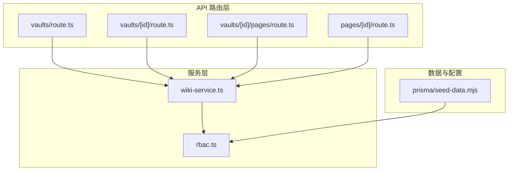
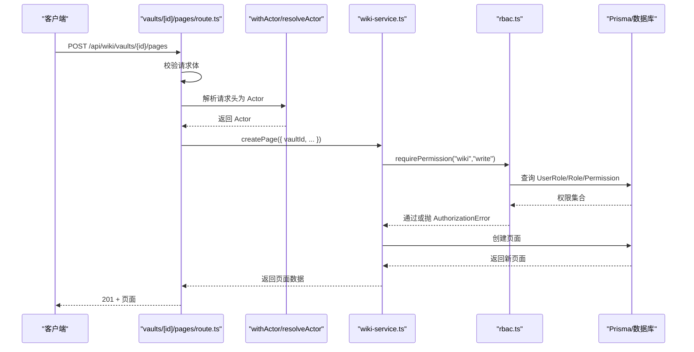
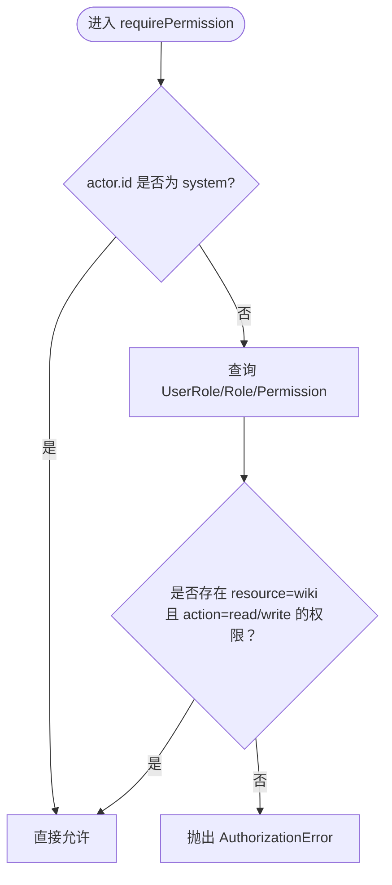
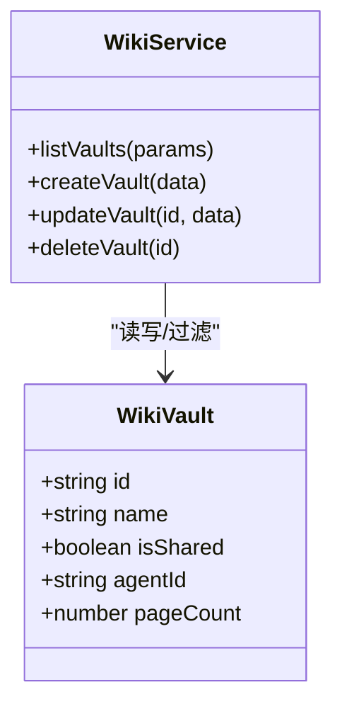
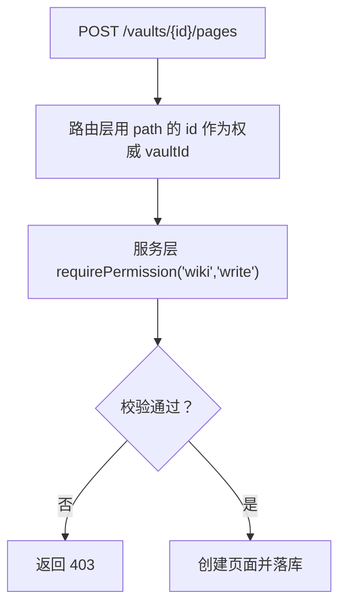
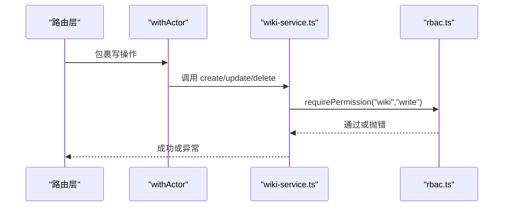
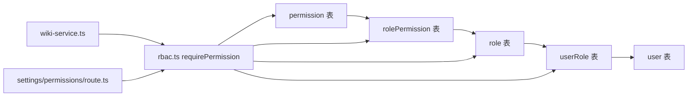
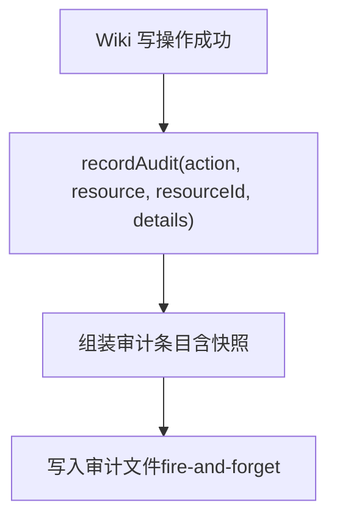
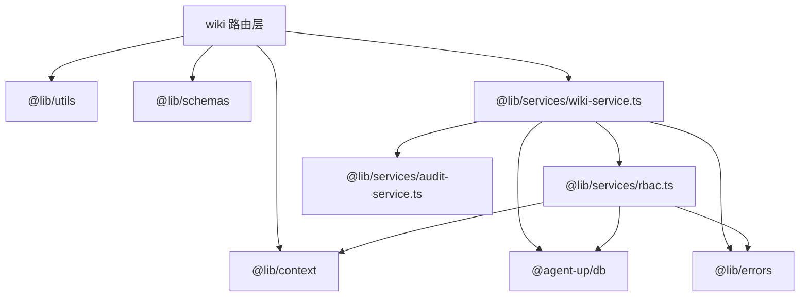

# 权限控制

<cite>
**本文引用的文件**   
- [apps/web/lib/services/wiki-service.ts](file://apps/web/lib/services/wiki-service.ts)
- [apps/web/lib/services/rbac.ts](file://apps/web/lib/services/rbac.ts)
- [apps/web/app/api/wiki/vaults/route.ts](file://apps/web/app/api/wiki/vaults/route.ts)
- [apps/web/app/api/wiki/vaults/[id]/route.ts](file://apps/web/app/api/wiki/vaults/[id]/route.ts)
- [apps/web/app/api/wiki/vaults/[id]/pages/route.ts](file://apps/web/app/api/wiki/vaults/[id]/pages/route.ts)
- [apps/web/app/api/wiki/pages/[id]/route.ts](file://apps/web/app/api/wiki/pages/[id]/route.ts)
- [apps/web/app/api/__tests__/rbac.test.ts](file://apps/web/app/api/__tests__/rbac.test.ts)
- [apps/web/app/api/__tests__/wiki-crud.test.ts](file://apps/web/app/api/__tests__/wiki-crud.test.ts)
- [packages/db/prisma/seed-data.mjs](file://packages/db/prisma/seed-data.mjs)
- [apps/web/app/api/settings/permissions/route.ts](file://apps/web/app/api/settings/permissions/route.ts)
- [docs/distilled/audit-service.md](file://docs/distilled/audit-service.md)
</cite>

## 目录
1. [引言](#引言)
2. [项目结构](#项目结构)
3. [核心组件](#核心组件)
4. [架构总览](#架构总览)
5. [详细组件分析](#详细组件分析)
6. [依赖关系分析](#依赖关系分析)
7. [性能与可扩展性](#性能与可扩展性)
8. [故障排查指南](#故障排查指南)
9. [结论](#结论)
10. [附录：最佳实践与安全清单](#附录最佳实践与安全清单)

## 引言
本文聚焦 Wiki 模块的权限控制，系统性说明基于 RBAC 的 wiki:read 与 wiki:write 权限模型、Vault 级别的 isShared 字段对访问的影响、页面级权限继承与细粒度控制、CRUD 操作中的 requirePermission 强制校验、审计日志记录机制，以及与全局权限系统的集成方式。同时给出测试用例定位、调试方法与常见安全问题防护建议。

## 项目结构
Wiki 权限相关代码主要分布在以下位置：
- API 路由层：Next.js App Router 下的 wiki 路由，负责参数解析、请求体校验、Actor 注入与错误统一处理。
- 服务层：wiki-service.ts 实现 Vault 与 Page 的 CRUD，并在写操作中调用 requirePermission 进行资源级权限校验。
- 权限服务：rbac.ts 提供 requirePermission，从数据库角色-权限关系中计算当前 Actor 是否具备指定 resource:action。
- 测试：rbac.test.ts 与 wiki-crud.test.ts 覆盖权限矩阵与 Wiki CRUD 的行为契约。
- 种子数据：seed-data.mjs 定义 wiki:read 与 wiki:write 等基础权限。
- 审计文档：audit-service.md 描述审计写入语义与限制。

**图表来源** 
- [apps/web/app/api/wiki/vaults/route.ts:1-30](file://apps/web/app/api/wiki/vaults/route.ts#L1-L30)
- [apps/web/app/api/wiki/vaults/[id]/route.ts:1-38](file://apps/web/app/api/wiki/vaults/[id]/route.ts#L1-L38)
- [apps/web/app/api/wiki/vaults/[id]/pages/route.ts:1-34](file://apps/web/app/api/wiki/vaults/[id]/pages/route.ts#L1-L34)
- [apps/web/app/api/wiki/pages/[id]/route.ts:1-38](file://apps/web/app/api/wiki/pages/[id]/route.ts#L1-L38)
- [apps/web/lib/services/wiki-service.ts:1-298](file://apps/web/lib/services/wiki-service.ts#L1-L298)
- [apps/web/lib/services/rbac.ts:1-52](file://apps/web/lib/services/rbac.ts#L1-L52)
- [packages/db/prisma/seed-data.mjs:71-92](file://packages/db/prisma/seed-data.mjs#L71-L92)

**章节来源**
- [apps/web/app/api/wiki/vaults/route.ts:1-30](file://apps/web/app/api/wiki/vaults/route.ts#L1-L30)
- [apps/web/app/api/wiki/vaults/[id]/route.ts:1-38](file://apps/web/app/api/wiki/vaults/[id]/route.ts#L1-L38)
- [apps/web/app/api/wiki/vaults/[id]/pages/route.ts:1-34](file://apps/web/app/api/wiki/vaults/[id]/pages/route.ts#L1-L34)
- [apps/web/app/api/wiki/pages/[id]/route.ts:1-38](file://apps/web/app/api/wiki/pages/[id]/route.ts#L1-L38)
- [apps/web/lib/services/wiki-service.ts:1-298](file://apps/web/lib/services/wiki-service.ts#L1-L298)
- [apps/web/lib/services/rbac.ts:1-52](file://apps/web/lib/services/rbac.ts#L1-L52)
- [packages/db/prisma/seed-data.mjs:71-92](file://packages/db/prisma/seed-data.mjs#L71-L92)

## 核心组件
- RBAC 权限服务 requirePermission：根据当前 Actor 查询 UserRole → Role → RolePermission → Permission，多角色取并集；system actor 豁免；匿名或未知用户拒绝。
- Wiki 服务层：对 Vault 与 Page 的写操作（创建、更新、删除）均调用 requirePermission("wiki", "write") 进行强制校验；读操作不强制 wiki:read。
- API 路由层：通过 withActor(resolveActor(...)) 将请求头解析出的 Actor 注入到服务层执行上下文，确保 requirePermission 能读取到当前身份。
- 种子数据：预置 wiki:read 与 wiki:write 权限，供角色分配使用。

**章节来源**
- [apps/web/lib/services/rbac.ts:1-52](file://apps/web/lib/services/rbac.ts#L1-L52)
- [apps/web/lib/services/wiki-service.ts:96-144](file://apps/web/lib/services/wiki-service.ts#L96-L144)
- [apps/web/lib/services/wiki-service.ts:211-297](file://apps/web/lib/services/wiki-service.ts#L211-L297)
- [apps/web/app/api/wiki/vaults/route.ts:17-29](file://apps/web/app/api/wiki/vaults/route.ts#L17-L29)
- [apps/web/app/api/wiki/vaults/[id]/route.ts:14-37](file://apps/web/app/api/wiki/vaults/[id]/route.ts#L14-L37)
- [apps/web/app/api/wiki/vaults/[id]/pages/route.ts:19-33](file://apps/web/app/api/wiki/vaults/[id]/pages/route.ts#L19-L33)
- [apps/web/app/api/wiki/pages/[id]/route.ts:14-37](file://apps/web/app/api/wiki/pages/[id]/route.ts#L14-L37)
- [packages/db/prisma/seed-data.mjs:71-92](file://packages/db/prisma/seed-data.mjs#L71-L92)

## 架构总览
下图展示一次 Wiki 页面创建的端到端流程，包括路由层校验、Actor 注入、服务层权限检查与数据持久化。

**图表来源**
- [apps/web/app/api/wiki/vaults/[id]/pages/route.ts:19-33](file://apps/web/app/api/wiki/vaults/[id]/pages/route.ts#L19-L33)
- [apps/web/lib/services/wiki-service.ts:211-258](file://apps/web/lib/services/wiki-service.ts#L211-L258)
- [apps/web/lib/services/rbac.ts:21-51](file://apps/web/lib/services/rbac.ts#L21-L51)

## 详细组件分析

### RBAC 权限模型与 wiki:read / wiki:write
- 权限定义：种子数据中定义了 wiki:read 与 wiki:write 两个权限条目，供角色分配。
- 权限判定：requirePermission 从 Actor.id 出发，查询该用户的所有 UserRole，再遍历其 Role 与 RolePermission，最终匹配 Permission.resource 与 Permission.action。
- 豁免与失败关闭：actor.id === "system" 直接放行；未找到 UserRole 或无匹配权限则抛出 AuthorizationError。
- 多角色并集：用户可拥有多个角色，任一角色包含所需权限即通过。

**图表来源**
- [apps/web/lib/services/rbac.ts:21-51](file://apps/web/lib/services/rbac.ts#L21-L51)

**章节来源**
- [apps/web/lib/services/rbac.ts:1-52](file://apps/web/lib/services/rbac.ts#L1-L52)
- [packages/db/prisma/seed-data.mjs:71-92](file://packages/db/prisma/seed-data.mjs#L71-L92)
- [apps/web/app/api/__tests__/rbac.test.ts:59-111](file://apps/web/app/api/__tests__/rbac.test.ts#L59-L111)

### Vault 级别权限与 isShared 字段
- isShared 字段用于标记 Vault 是否为共享库。服务层 listVaults 支持按 shared 过滤；createVault/updateVault 支持设置 isShared。
- 当前 Wiki 服务层并未在 read 路径上依据 isShared 做额外权限拦截；isShared 更多作为业务属性参与列表过滤与响应展示。
- 若需“仅共享库可读”或“非共享库需额外授权”，应在服务层增加相应逻辑，或在路由层结合 Actor 与 Vault 归属做二次校验。

**图表来源**
- [apps/web/lib/services/wiki-service.ts:65-144](file://apps/web/lib/services/wiki-service.ts#L65-L144)

**章节来源**
- [apps/web/lib/services/wiki-service.ts:65-144](file://apps/web/lib/services/wiki-service.ts#L65-L144)
- [apps/web/lib/__tests__/wiki-service.test.ts:75-85](file://apps/web/lib/__tests__/wiki-service.test.ts#L75-L85)

### 页面级权限继承与细粒度访问控制
- 页面属于某个 Vault，创建时由路由层以 path 上的 vaultId 为准覆盖 body 中的 vaultId，避免越权写入其他库。
- 当前 Wiki 服务层对页面读操作未强制 wiki:read；写操作（创建、更新、删除）均强制 wiki:write。
- 如需更细粒度控制（例如仅允许编辑自己创建的页面），可在服务层扩展：读取页面后比较 authorId 或基于 Vault 的 owner 策略进行二次判断。

**图表来源**
- [apps/web/app/api/wiki/vaults/[id]/pages/route.ts:19-33](file://apps/web/app/api/wiki/vaults/[id]/pages/route.ts#L19-L33)
- [apps/web/lib/services/wiki-service.ts:211-258](file://apps/web/lib/services/wiki-service.ts#L211-L258)

**章节来源**
- [apps/web/app/api/wiki/vaults/[id]/pages/route.ts:1-34](file://apps/web/app/api/wiki/vaults/[id]/pages/route.ts#L1-L34)
- [apps/web/lib/services/wiki-service.ts:211-297](file://apps/web/lib/services/wiki-service.ts#L211-L297)

### CRUD 中的权限检查与 requirePermission 中间件
- 路由层通过 withActor(resolveActor(request.headers), ...) 将 Actor 注入到服务层执行上下文。
- 所有写操作在服务层内部调用 requirePermission("wiki", "write")，未持有权限将抛出 AuthorizationError，被统一错误处理器转换为 403。
- 读操作（GET）不强制 wiki:read，保持开放；如需收紧，应显式在服务层添加 requirePermission("wiki", "read")。

**图表来源**
- [apps/web/app/api/wiki/vaults/route.ts:17-29](file://apps/web/app/api/wiki/vaults/route.ts#L17-L29)
- [apps/web/app/api/wiki/vaults/[id]/route.ts:14-37](file://apps/web/app/api/wiki/vaults/[id]/route.ts#L14-L37)
- [apps/web/app/api/wiki/pages/[id]/route.ts:14-37](file://apps/web/app/api/wiki/pages/[id]/route.ts#L14-L37)
- [apps/web/lib/services/wiki-service.ts:96-144](file://apps/web/lib/services/wiki-service.ts#L96-L144)
- [apps/web/lib/services/wiki-service.ts:211-297](file://apps/web/lib/services/wiki-service.ts#L211-L297)
- [apps/web/lib/services/rbac.ts:21-51](file://apps/web/lib/services/rbac.ts#L21-L51)

**章节来源**
- [apps/web/app/api/wiki/vaults/route.ts:1-30](file://apps/web/app/api/wiki/vaults/route.ts#L1-L30)
- [apps/web/app/api/wiki/vaults/[id]/route.ts:1-38](file://apps/web/app/api/wiki/vaults/[id]/route.ts#L1-L38)
- [apps/web/app/api/wiki/pages/[id]/route.ts:1-38](file://apps/web/app/api/wiki/pages/[id]/route.ts#L1-L38)
- [apps/web/lib/services/wiki-service.ts:96-297](file://apps/web/lib/services/wiki-service.ts#L96-L297)
- [apps/web/lib/services/rbac.ts:1-52](file://apps/web/lib/services/rbac.ts#L1-L52)

### 与全局权限系统的集成
- 全局权限系统通过 prisma.permission、role、userRole、rolePermission 表维护资源与动作的授权关系。
- settings/permissions/route.ts 暴露权限管理接口，要求 settings:admin 权限，体现全局权限与模块权限的解耦。
- Wiki 模块通过 requirePermission("wiki", "read|write") 复用同一套 RBAC 引擎，无需重复实现鉴权逻辑。

**图表来源**
- [apps/web/lib/services/rbac.ts:21-51](file://apps/web/lib/services/rbac.ts#L21-L51)
- [apps/web/app/api/settings/permissions/route.ts:25-65](file://apps/web/app/api/settings/permissions/route.ts#L25-L65)
- [apps/web/lib/services/wiki-service.ts:96-297](file://apps/web/lib/services/wiki-service.ts#L96-L297)

**章节来源**
- [apps/web/app/api/settings/permissions/route.ts:1-65](file://apps/web/app/api/settings/permissions/route.ts#L1-L65)
- [apps/web/lib/services/rbac.ts:1-52](file://apps/web/lib/services/rbac.ts#L1-L52)

### 权限审计日志记录机制
- Wiki 服务层在每次写操作成功后调用 recordAudit，记录 action、resource、resourceId 与关键变更细节。
- 审计采用 fire-and-forget 语义，失败不影响业务主流程；记录快照 userName 与 userRole，便于追溯。
- 审计日志存储于单一文件，存在并发写竞态风险，生产环境需关注完整性监控。

**图表来源**
- [apps/web/lib/services/wiki-service.ts:117-143](file://apps/web/lib/services/wiki-service.ts#L117-L143)
- [apps/web/lib/services/wiki-service.ts:254-296](file://apps/web/lib/services/wiki-service.ts#L254-L296)
- [docs/distilled/audit-service.md:24-39](file://docs/distilled/audit-service.md#L24-L39)

**章节来源**
- [apps/web/lib/services/wiki-service.ts:117-143](file://apps/web/lib/services/wiki-service.ts#L117-L143)
- [apps/web/lib/services/wiki-service.ts:254-296](file://apps/web/lib/services/wiki-service.ts#L254-L296)
- [docs/distilled/audit-service.md:24-39](file://docs/distilled/audit-service.md#L24-L39)

## 依赖关系分析
- 路由层依赖 utils（success/error/validateBody）、schemas（校验规则）、context（withActor/resolveActor）与 wiki-service。
- wiki-service 依赖 @agent-up/db（Prisma）、errors、rbac、audit-service。
- rbac 依赖 context（getActor）、@agent-up/db（权限查询）、errors（AuthorizationError）。
- 测试依赖 seed-db 辅助函数与 _resetDb 清理环境。

**图表来源**
- [apps/web/app/api/wiki/vaults/route.ts:1-30](file://apps/web/app/api/wiki/vaults/route.ts#L1-L30)
- [apps/web/lib/services/wiki-service.ts:1-13](file://apps/web/lib/services/wiki-service.ts#L1-L13)
- [apps/web/lib/services/rbac.ts:1-4](file://apps/web/lib/services/rbac.ts#L1-L4)

**章节来源**
- [apps/web/app/api/wiki/vaults/route.ts:1-30](file://apps/web/app/api/wiki/vaults/route.ts#L1-L30)
- [apps/web/lib/services/wiki-service.ts:1-13](file://apps/web/lib/services/wiki-service.ts#L1-L13)
- [apps/web/lib/services/rbac.ts:1-4](file://apps/web/lib/services/rbac.ts#L1-L4)

## 性能与可扩展性
- 列表查询：listPages 在 SQLite 环境下对 tag/search 采用内存过滤，total 为过滤后口径；适合演示规模，生产大数据量建议引入全文检索或后端过滤优化。
- 审计写入：单文件追加存在并发竞态与写放大，生产环境建议引入队列或数据库表，并增加幂等与并发保护。
- 权限查询：requirePermission 每次写操作都会查 UserRole/Role/Permission，建议在热点路径引入缓存（如基于 actorId 的短期缓存）以降低数据库压力。

[本节为通用指导，不直接分析具体文件]

## 故障排查指南
- 403 权限不足：确认请求头是否携带 Actor 信息；检查数据库中用户是否被分配了 wiki:write 权限；查看 rbac.test.ts 中的矩阵用例。
- 404 不存在：Vault 或 Page 不存在时返回 404；确认 ID 是否正确、是否已被级联删除。
- 409 冲突：同 Vault 下 slug 重复；检查唯一约束与业务键设计。
- 422 校验失败：请求体不符合 schema；检查必填字段与取值范围。
- 审计缺失：审计写入失败不会回滚业务；检查审计文件是否损坏或并发覆盖；参考 audit-service 文档的已知坑。

**章节来源**
- [apps/web/app/api/__tests__/wiki-crud.test.ts:127-142](file://apps/web/app/api/__tests__/wiki-crud.test.ts#L127-L142)
- [apps/web/app/api/__tests__/wiki-crud.test.ts:256-305](file://apps/web/app/api/__tests__/wiki-crud.test.ts#L256-L305)
- [apps/web/app/api/__tests__/wiki-crud.test.ts:380-391](file://apps/web/app/api/__tests__/wiki-crud.test.ts#L380-L391)
- [docs/distilled/audit-service.md:56-61](file://docs/distilled/audit-service.md#L56-L61)

## 结论
Wiki 模块采用服务层强化的 RBAC 权限模型，通过 requirePermission("wiki", "read|write") 对写操作进行统一校验；Vault 的 isShared 字段目前主要用于业务过滤与展示，未作为读权限的强制条件。页面级权限继承自 Vault 归属，路由层以 path 上的 vaultId 为权威来源防止越权。审计日志采用 fire-and-forget 模式记录关键变更，便于追溯但需注意并发与完整性风险。整体方案清晰、可测试性强，适合在生产环境中逐步增强细粒度控制与性能优化。

[本节为总结性内容，不直接分析具体文件]

## 附录：最佳实践与安全清单
- 明确区分读与写权限：对敏感读操作也应显式调用 requirePermission("wiki", "read")。
- 最小权限原则：为用户分配必要的 wiki:read 或 wiki:write，避免过度授权。
- 资源边界校验：除路径权威外，必要时在服务层二次校验资源归属（如 authorId、ownerId）。
- 审计完备性：为审计写入增加监控告警，避免静默丢失；在高并发场景考虑异步队列与幂等写入。
- 测试覆盖：使用 rbac.test.ts 与 wiki-crud.test.ts 验证权限矩阵与 CRUD 行为契约，持续回归。
- 安全加固：禁止前端信任服务端返回的 isShared 作为访问控制依据；服务端必须独立校验。

[本节为通用指导，不直接分析具体文件]