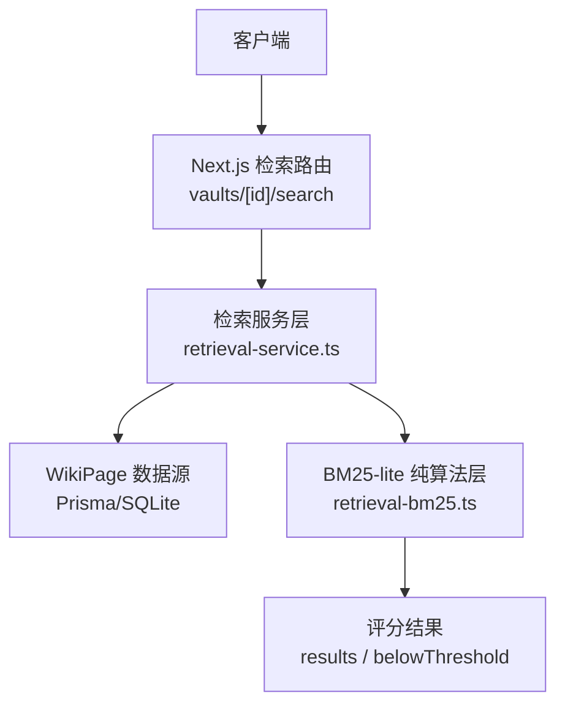
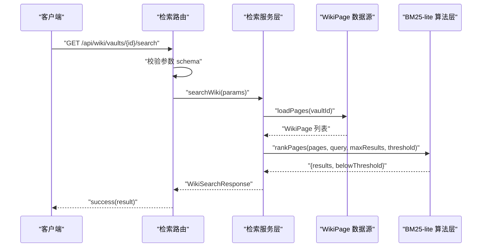
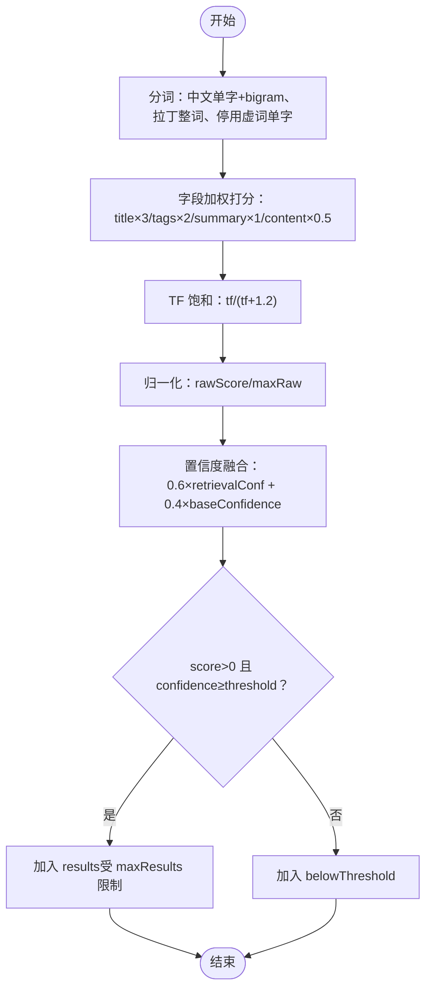
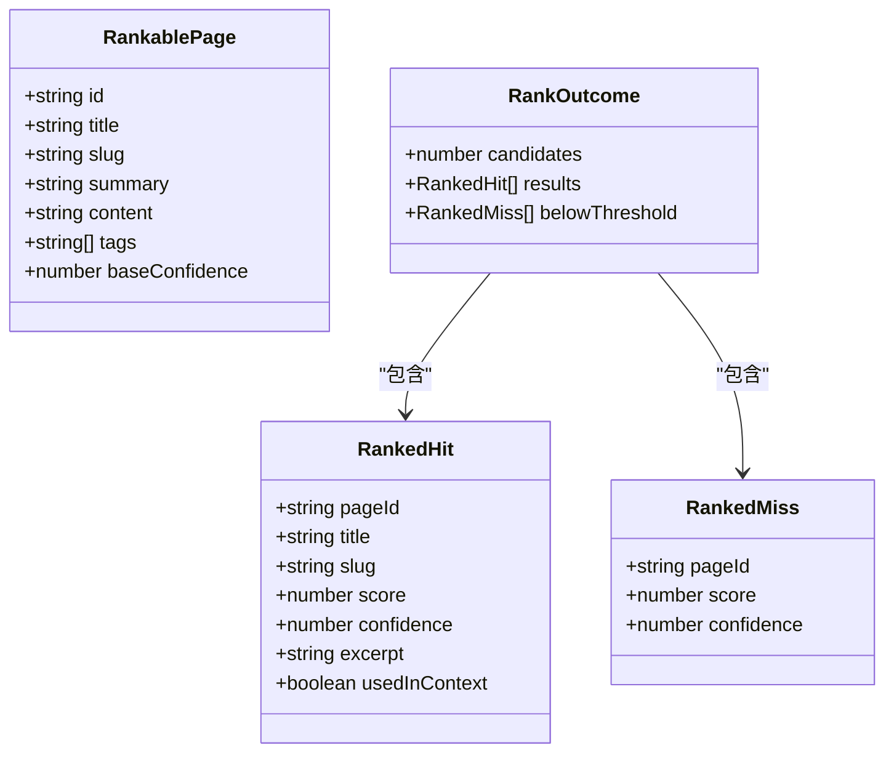
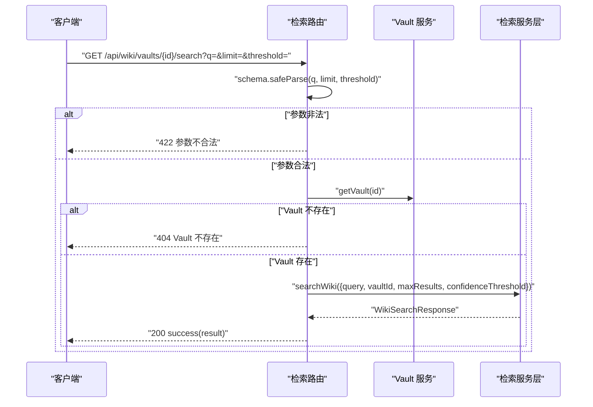
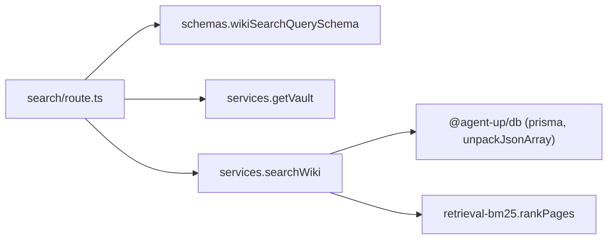

# 检索引擎

<cite>
**本文引用的文件**   
- [retrieval-bm25.ts](file://apps/web/lib/retrieval-bm25.ts)
- [retrieval-service.ts](file://apps/web/lib/services/retrieval-service.ts)
- [search/route.ts](file://apps/web/app/api/wiki/vaults/[id]/search/route.ts)
- [retrieval-bm25.test.ts](file://apps/web/lib/__tests__/retrieval-bm25.test.ts)
- [wiki-search.test.ts](file://apps/web/app/api/__tests__/wiki-search.test.ts)
- [wiki-crud.test.ts](file://apps/web/app/api/__tests__/wiki-crud.test.ts)
- [retrieval-service-component.md](file://docs/skills/agent-up-services/references/retrieval-service-component.md)
- [retrieval-service.md](file://docs/distilled/retrieval-service.md)
</cite>

## 目录
1. [引言](#引言)
2. [项目结构](#项目结构)
3. [核心组件](#核心组件)
4. [架构总览](#架构总览)
5. [详细组件分析](#详细组件分析)
6. [依赖关系分析](#依赖关系分析)
7. [性能与扩展性](#性能与扩展性)
8. [故障排查指南](#故障排查指南)
9. [结论](#结论)
10. [附录：查询语法与参数](#附录查询语法与参数)

## 引言
本技术文档聚焦知识库检索引擎，围绕 BM25-lite 算法、全文搜索实现、置信度门限机制、SQLite 环境限制与内存过滤策略、评分与排序、分页处理，以及与 Agent Knowledge 分区的集成方式展开。该检索引擎以 Next.js API 路由为入口，通过服务层加载 Wiki 页面数据，调用纯函数算法层进行打分与排序，最终返回结构化结果。

当前实现的关键现状是：BM25-lite 检索逻辑已建成并具备完整测试基线，但在生产代码中尚未被实际业务调用；API 路由与服务层的契约定义完备，便于后续接入。

## 项目结构
检索相关代码主要分布在以下位置：
- 纯算法层：`apps/web/lib/retrieval-bm25.ts`
- 服务层（数据库取数与响应契约）：`apps/web/lib/services/retrieval-service.ts`
- API 路由（请求校验与调度）：`apps/web/app/api/wiki/vaults/[id]/search/route.ts`
- 单元测试：`apps/web/lib/__tests__/retrieval-bm25.test.ts`、`apps/web/app/api/__tests__/wiki-search.test.ts`
- 组件视图与蒸馏文档：`docs/skills/agent-up-services/references/retrieval-service-component.md`、`docs/distilled/retrieval-service.md`

**图示来源**
- [search/route.ts:8-34](file://apps/web/app/api/wiki/vaults/[id]/search/route.ts#L8-L34)
- [retrieval-service.ts:59-119](file://apps/web/lib/services/retrieval-service.ts#L59-L119)
- [retrieval-bm25.ts:143-197](file://apps/web/lib/retrieval-bm25.ts#L143-L197)

**章节来源**
- [retrieval-service.ts:1-15](file://apps/web/lib/services/retrieval-service.ts#L1-L15)
- [retrieval-service-component.md:17-21](file://docs/skills/agent-up-services/references/retrieval-service-component.md#L17-L21)

## 核心组件
- 纯算法层 `retrieval-bm25.ts`：提供分词、词频统计、字段加权打分、归一化与置信度融合、阈值切分等能力，零外部依赖，可在浏览器与服务端复用。
- 服务层 `retrieval-service.ts`：负责从 Prisma 读取 WikiPage 数据、解析 tags JSON、调用算法层打分、封装统一响应契约。
- API 路由 `search/route.ts`：接收查询参数、校验 schema、校验 vault 存在、调用服务层并返回成功或错误响应。

关键职责边界：
- 路由只负责参数校验与异常处理。
- 服务层负责数据加载与响应契约。
- 算法层专注打分与排序语义，保证跨环境一致性。

**章节来源**
- [retrieval-bm25.ts:1-17](file://apps/web/lib/retrieval-bm25.ts#L1-L17)
- [retrieval-service.ts:1-15](file://apps/web/lib/services/retrieval-service.ts#L1-L15)
- [search/route.ts:1-7](file://apps/web/app/api/wiki/vaults/[id]/search/route.ts#L1-L7)

## 架构总览
检索流程如下：
1. 客户端发起 GET `/api/wiki/vaults/{id}/search?q=...&limit=&threshold=`。
2. 路由解析并校验参数，检查 vault 是否存在。
3. 服务层按 vaultId 加载所有 WikiPage，解析 tags JSON。
4. 算法层对候选页集合进行分词、打分、归一化、置信度融合与阈值切分。
5. 返回 results（进入上下文的结果）与 belowThreshold（未达阈值的候选）。

**图示来源**
- [search/route.ts:8-34](file://apps/web/app/api/wiki/vaults/[id]/search/route.ts#L8-L34)
- [retrieval-service.ts:91-119](file://apps/web/lib/services/retrieval-service.ts#L91-L119)
- [retrieval-bm25.ts:143-197](file://apps/web/lib/retrieval-bm25.ts#L143-L197)

## 详细组件分析

### BM25-lite 算法层
- 分词策略：
  - 中文：单字 + 相邻双字 bigram；虚词单字停用（如“的、了、在”等），但 bigram 保留短语信息。
  - 拉丁/数字：整词切分，全小写。
  - 单字权重降权：CJK 单字 token 权重乘以 UNIGRAM_WEIGHT（默认 0.5），抑制高频单字污染。
- 词频计算：
  - 短 token（长度 ≤2）采用子串计数；长 token（长度 >2）使用词边界匹配。
  - 注意：CJK 长 token 走词边界匹配时恒不成立，因此内部不可达路径会返回 0；模块设计保证不会向该路径输入长 CJK token。
- 字段加权打分：
  - title ×3、tags ×2、summary ×1、content ×0.5。
  - 每个 token 的 tf 经过饱和函数 tfSat(tf/(tf+1.2))，避免高频词无限放大。
- 归一化与置信度融合：
  - 将 rawScore 归一化为 0-1（榜首归一化分恒为 1）。
  - confidence = 0.6 × retrievalConf + 0.4 × baseConfidence。
- 阈值切分与截断：
  - 仅 score > 0 且 confidence ≥ confidenceThreshold 且未超过 maxResults 的条目进入 results。
  - 其余条目进入 belowThreshold，用于完整性清单与调试。

**图示来源**
- [retrieval-bm25.ts:77-96](file://apps/web/lib/retrieval-bm25.ts#L77-L96)
- [retrieval-bm25.ts:98-133](file://apps/web/lib/retrieval-bm25.ts#L98-L133)
- [retrieval-bm25.ts:143-197](file://apps/web/lib/retrieval-bm25.ts#L143-L197)

**章节来源**
- [retrieval-bm25.ts:1-17](file://apps/web/lib/retrieval-bm25.ts#L1-L17)
- [retrieval-bm25.ts:60-75](file://apps/web/lib/retrieval-bm25.ts#L60-L75)
- [retrieval-bm25.ts:77-133](file://apps/web/lib/retrieval-bm25.ts#L77-L133)
- [retrieval-bm25.ts:143-197](file://apps/web/lib/retrieval-bm25.ts#L143-L197)
- [retrieval-bm25.test.ts:43-97](file://apps/web/lib/__tests__/retrieval-bm25.test.ts#L43-L97)
- [retrieval-bm25.test.ts:99-128](file://apps/web/lib/__tests__/retrieval-bm25.test.ts#L99-L128)
- [retrieval-bm25.test.ts:130-156](file://apps/web/lib/__tests__/retrieval-bm25.test.ts#L130-L156)
- [retrieval-bm25.test.ts:158-217](file://apps/web/lib/__tests__/retrieval-bm25.test.ts#L158-L217)
- [retrieval-bm25.test.ts:219-254](file://apps/web/lib/__tests__/retrieval-bm25.test.ts#L219-L254)

### 服务层与数据加载
- 数据加载：
  - 按 vaultId 查询 WikiPage，选择 id/title/slug/summary/content/tags/baseConfidence。
  - tags 列在 SQLite 迁移下为 JSON 文本，需先反序列化为数组，否则整段 JSON 会被当作单个 tag 参与分词，导致打分失真。
- 响应契约：
  - candidates：候选集大小（通常等于该 vault 的页面总数）。
  - results：进入上下文的页面，usedInContext=true。
  - belowThreshold：未达阈值的页面，包含 score 与 confidence。
  - fallbackTriggered：results 为空时为 true。

**图示来源**
- [retrieval-bm25.ts:19-50](file://apps/web/lib/retrieval-bm25.ts#L19-L50)

**章节来源**
- [retrieval-service.ts:59-83](file://apps/web/lib/services/retrieval-service.ts#L59-L83)
- [retrieval-service.ts:91-119](file://apps/web/lib/services/retrieval-service.ts#L91-L119)
- [retrieval-service.ts:1-15](file://apps/web/lib/services/retrieval-service.ts#L1-L15)

### API 路由与参数校验
- 查询参数：
  - q：检索关键词。
  - limit：最大返回结果数。
  - threshold：置信度门限。
- 校验与错误处理：
  - 使用 wikiSearchQuerySchema 校验参数，非法则返回 422。
  - 若 vault 不存在则返回 404。
  - 其他异常由 handleApiError 统一处理。

**图示来源**
- [search/route.ts:8-34](file://apps/web/app/api/wiki/vaults/[id]/search/route.ts#L8-L34)

**章节来源**
- [search/route.ts:1-34](file://apps/web/app/api/wiki/vaults/[id]/search/route.ts#L1-L34)
- [wiki-search.test.ts:46-130](file://apps/web/app/api/__tests__/wiki-search.test.ts#L46-L130)

### 置信度门限机制
- 置信度计算公式：confidence = 0.6 × retrievalConf + 0.4 × baseConfidence。
- 门限过滤：
  - 仅当 score > 0 且 confidence ≥ confidenceThreshold 时进入 results。
  - 零分页（无任何词面重叠）即使 baseConfidence 很高也不会进入 results，防止高置信但不相关页面混入上下文。
- 动态调整：
  - 可通过 threshold 参数调高或降低门限，影响 results 规模与质量。
  - baseConfidence 来自页面元数据，反映页面自评可信度。

**章节来源**
- [retrieval-bm25.ts:143-197](file://apps/web/lib/retrieval-bm25.ts#L143-L197)
- [retrieval-bm25.test.ts:167-188](file://apps/web/lib/__tests__/retrieval-bm25.test.ts#L167-L188)

### 全文搜索与模糊搜索
- 关键词匹配：
  - 基于分词后的 token 在四个字段中进行词频统计与加权打分。
  - 支持中英文混合文本，拉丁词按整词匹配，CJK 按单字与 bigram 匹配。
- 模糊搜索：
  - 当前实现未引入编辑距离或向量相似度，所谓“模糊”主要体现在 bigram 与单字组合带来的部分匹配能力。
  - 对于长 token（长度 >2）使用词边界匹配，避免子串误匹配。

**章节来源**
- [retrieval-bm25.ts:77-133](file://apps/web/lib/retrieval-bm25.ts#L77-L133)
- [retrieval-bm25.test.ts:43-97](file://apps/web/lib/__tests__/retrieval-bm25.test.ts#L43-L97)
- [retrieval-bm25.test.ts:108-128](file://apps/web/lib/__tests__/retrieval-bm25.test.ts#L108-L128)

### SQLite 环境下的搜索限制与内存过滤
- SQLite 限制：
  - 不支持 insensitive 模式搜索。
  - 不支持标量列表 has 过滤（tags 列为 JSON 文本）。
- 内存过滤策略：
  - 服务层先加载全部 WikiPage，再在内存中进行分词、打分与阈值切分。
  - 列表页 search 同样采用取数后内存过滤，total 为过滤后口径。

**章节来源**
- [retrieval-service.ts:72-83](file://apps/web/lib/services/retrieval-service.ts#L72-L83)
- [wiki-crud.test.ts:211-232](file://apps/web/app/api/__tests__/wiki-crud.test.ts#L211-L232)

### 评分算法、相关性排序与分页处理
- 评分算法：
  - 字段加权 + TF 饱和 + 归一化 + 置信度融合。
- 相关性排序：
  - 按 score 降序排列，确保最相关页面靠前。
- 分页处理：
  - 当前 rankPages 不提供分页，仅提供 maxResults 截断。
  - candidates 透传候选集大小，可用于上层构建分页 UI。

**章节来源**
- [retrieval-bm25.ts:143-197](file://apps/web/lib/retrieval-bm25.ts#L143-L197)
- [retrieval-bm25.test.ts:190-211](file://apps/web/lib/__tests__/retrieval-bm25.test.ts#L190-L211)

### 与 Agent Knowledge 分区的集成与数据同步
- 集成方式：
  - 检索服务层按 vaultId 加载 WikiPage，vault 即 Agent Knowledge 分区。
  - 服务层对外暴露 searchWiki，供 Agent 试聊与评测重放使用（尽管当前生产代码未调用）。
- 数据同步：
  - WikiPage 数据由 Prisma 管理，tags 列为 JSON 文本，需在服务层反序列化。
  - baseConfidence 作为页面元数据参与置信度融合。

**章节来源**
- [retrieval-service.ts:1-15](file://apps/web/lib/services/retrieval-service.ts#L1-L15)
- [retrieval-service.ts:59-83](file://apps/web/lib/services/retrieval-service.ts#L59-L83)
- [retrieval-service-component.md:17-21](file://docs/skills/agent-up-services/references/retrieval-service-component.md#L17-L21)

### 扩展点与自定义搜索逻辑
- 扩展点：
  - 可替换分词器（tokenize）以适配特定领域语言。
  - 可扩展字段权重（scorePage）以强化标题、标签或摘要的重要性。
  - 可调整置信度融合权重（0.6/0.4）以平衡检索相关性与页面自评可信度。
  - 可增加更多过滤条件（如时间范围、作者、标签白名单）在 service 层实现。
- 自定义搜索逻辑：
  - 保持算法层零依赖特性，便于在服务端与浏览器复用。
  - 通过 rankPages 的 candidates 参数传入 DB 侧预筛的候选集大小，优化性能。

**章节来源**
- [retrieval-bm25.ts:1-17](file://apps/web/lib/retrieval-bm25.ts#L1-L17)
- [retrieval-bm25.ts:118-133](file://apps/web/lib/retrieval-bm25.ts#L118-L133)
- [retrieval-bm25.ts:143-197](file://apps/web/lib/retrieval-bm25.ts#L143-L197)

## 依赖关系分析
- 路由依赖：
  - NextRequest、utils.success/handleApiError、schemas.wikiSearchQuerySchema、services.getVault、services.searchWiki、errors.NotFoundError/ValidationError。
- 服务层依赖：
  - @agent-up/db（prisma、unpackJsonArray）、lib.retrieval-bm25.rankPages。
- 算法层依赖：
  - 无外部依赖，纯函数实现。

**图示来源**
- [search/route.ts:1-6](file://apps/web/app/api/wiki/vaults/[id]/search/route.ts#L1-L6)
- [retrieval-service.ts:16-17](file://apps/web/lib/services/retrieval-service.ts#L16-L17)

**章节来源**
- [search/route.ts:1-34](file://apps/web/app/api/wiki/vaults/[id]/search/route.ts#L1-L34)
- [retrieval-service.ts:16-17](file://apps/web/lib/services/retrieval-service.ts#L16-L17)

## 性能与扩展性
- 性能特征：
  - 每页对查询 token 逐一扫描四个字段，时间复杂度 O(N × T × F)，其中 N 为页面数，T 为 token 数，F 为字段数。
  - 无倒排索引与 IDF，适合小规模演示场景；大规模数据建议引入倒排索引与预计算统计。
- 优化建议：
  - 在 DB 层增加轻量预筛（如按 vaultId 与 tags 白名单），减少候选集大小。
  - 缓存热门查询的分词结果与得分。
  - 调整字段权重与置信度融合权重以平衡召回与精度。
  - 考虑引入向量检索或近似最近邻以提升模糊匹配能力。

[本节为通用指导，无需具体文件引用]

## 故障排查指南
- 常见问题：
  - 参数非法：检查 q、limit、threshold 是否满足 schema 约束。
  - Vault 不存在：确认 vaultId 有效。
  - 结果为空：检查 confidenceThreshold 是否过高；确认 query 是否与页面内容有词面重叠。
  - tags 分词异常：确认 tags 已从 JSON 文本正确反序列化为数组。
- 调试建议：
  - 查看 belowThreshold 中的 score 与 confidence，定位未达阈值原因。
  - 使用单元测试基线验证分词与打分行为是否符合预期。

**章节来源**
- [search/route.ts:11-18](file://apps/web/app/api/wiki/vaults/[id]/search/route.ts#L11-L18)
- [retrieval-service.ts:72-83](file://apps/web/lib/services/retrieval-service.ts#L72-L83)
- [retrieval-bm25.test.ts:158-217](file://apps/web/lib/__tests__/retrieval-bm25.test.ts#L158-L217)

## 结论
该检索引擎以 BM25-lite 为核心，实现了轻量、可复用的知识库检索能力。其优势在于算法层零依赖、语义清晰、测试完备；局限在于无 IDF 与倒排索引，不适合超大规模语料。通过 API 路由与服务层的解耦，便于后续接入生产业务与扩展自定义搜索逻辑。建议在数据规模增长时引入更高效的索引结构与向量检索能力，同时保持置信度门限机制的可配置性。

[本节为总结性内容，无需具体文件引用]

## 附录：查询语法与参数
- 查询语法：
  - 自然语言关键词，支持中英文混合。
  - 中文自动分词为单字与 bigram，拉丁词按整词匹配。
- 参数说明：
  - q：检索关键词（必填）。
  - limit：最大返回结果数（可选）。
  - threshold：置信度门限（可选，默认值由 schema 定义）。
- 响应字段：
  - strategy：检索策略（BM25_LITE）。
  - candidates：候选集大小。
  - results：命中结果列表。
  - belowThreshold：未达阈值结果列表。
  - fallbackTriggered：是否触发回退（results 为空）。

**章节来源**
- [search/route.ts:11-15](file://apps/web/app/api/wiki/vaults/[id]/search/route.ts#L11-L15)
- [retrieval-service.ts:42-49](file://apps/web/lib/services/retrieval-service.ts#L42-L49)