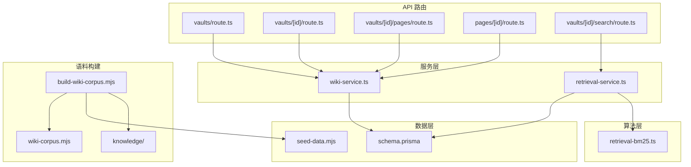
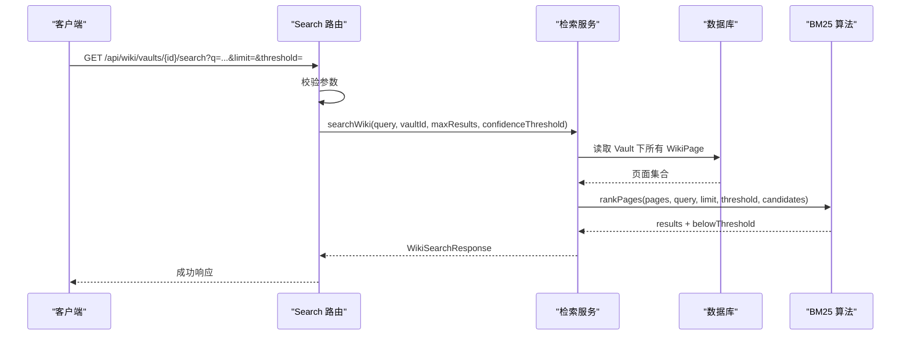
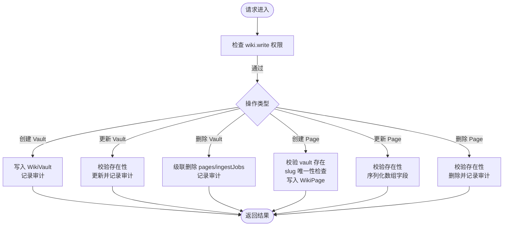
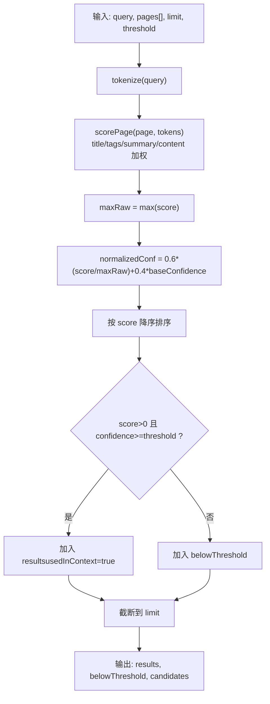
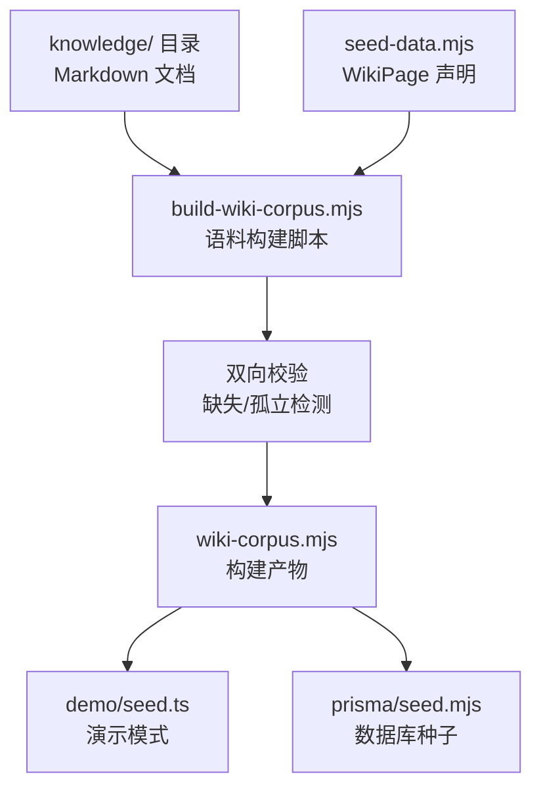
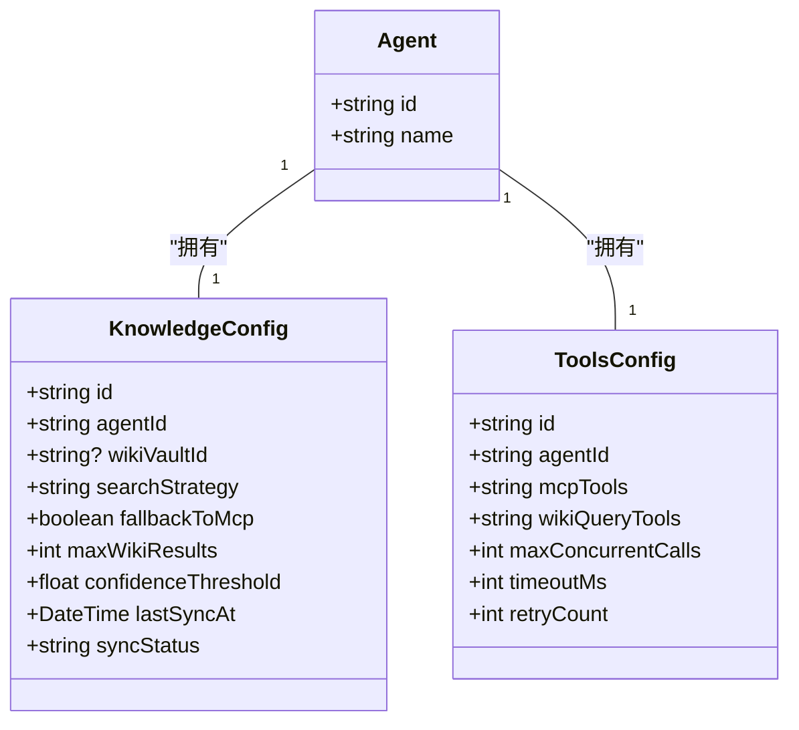
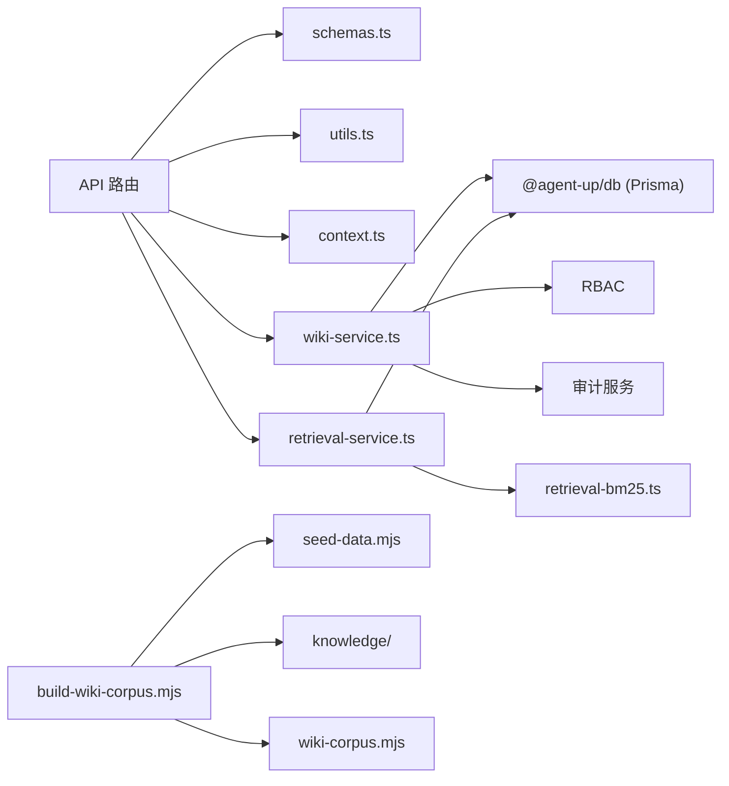

# 知识库系统

<cite>
**本文引用的文件**   
- [apps/web/app/api/wiki/vaults/route.ts](file://apps/web/app/api/wiki/vaults/route.ts)
- [apps/web/app/api/wiki/vaults/[id]/route.ts](file://apps/web/app/api/wiki/vaults/[id]/route.ts)
- [apps/web/app/api/wiki/vaults/[id]/pages/route.ts](file://apps/web/app/api/wiki/vaults/[id]/pages/route.ts)
- [apps/web/app/api/wiki/pages/[id]/route.ts](file://apps/web/app/api/wiki/pages/[id]/route.ts)
- [apps/web/app/api/wiki/vaults/[id]/search/route.ts](file://apps/web/app/api/wiki/vaults/[id]/search/route.ts)
- [apps/web/lib/services/wiki-service.ts](file://apps/web/lib/services/wiki-service.ts)
- [apps/web/lib/retrieval-bm25.ts](file://apps/web/lib/retrieval-bm25.ts)
- [apps/web/lib/services/retrieval-service.ts](file://apps/web/lib/services/retrieval-service.ts)
- [packages/db/prisma/schema.prisma](file://packages/db/prisma/schema.prisma)
- [apps/web/lib/schemas.ts](file://apps/web/lib/schemas.ts)
- [apps/web/lib/context.ts](file://apps/web/lib/context.ts)
- [apps/web/lib/utils.ts](file://apps/web/lib/utils.ts)
- [apps/web/lib/services/agent-service.ts](file://apps/web/lib/services/agent-service.ts)
- [packages/db/scripts/build-wiki-corpus.mjs](file://packages/db/scripts/build-wiki-corpus.mjs)
- [apps/web/demo/seed.ts](file://apps/web/demo/seed.ts)
- [packages/db/prisma/seed-data.mjs](file://packages/db/prisma/seed-data.mjs)
</cite>

## 更新摘要
**变更内容**   
- 新增 Wiki 语料自动化生成流程说明，反映 knowledge 目录下的 Markdown 文档编译机制
- 更新文档结构重组说明，移除已删除的中文文档文件引用
- 强化 Wiki 正文单一事实源与构建产物的双向校验机制
- 补充演示模式与种子数据的 wiki-corpus 集成方式

## 目录
1. [引言](#引言)
2. [项目结构](#项目结构)
3. [核心组件](#核心组件)
4. [架构总览](#架构总览)
5. [详细组件分析](#详细组件分析)
6. [依赖关系分析](#依赖关系分析)
7. [性能与优化建议](#性能与优化建议)
8. [故障排查指南](#故障排查指南)
9. [结论](#结论)
10. [附录：API 规范与查询语法](#附录api-规范与查询语法)

## 引言
本文件面向"知识库系统"的完整功能文档，围绕 Wiki Vault 与 Page 两级知识层管理、BM25-lite 检索算法、Agent Knowledge 分区与 MCP 活数据混合架构、Git 同步预留设计、权限控制、版本管理与协作能力展开。文档同时给出 API 端点规范、搜索查询语法、集成方式与性能优化建议，帮助开发者快速理解并正确使用该子系统。

**更新** 本次更新重点反映了 Repo Wiki 自动化生成流程和文档结构重组，新增了 knowledge 目录下的 Markdown 文档编译机制和 wiki-corpus 构建流程。

## 项目结构
知识库相关代码主要分布在以下位置：
- API 路由层：Next.js Route Handler，负责参数校验、权限注入、调用服务层。
- 服务层：wiki-service.ts 实现 Vault/Page 的 CRUD；retrieval-service.ts 封装 BM25 检索流程。
- 算法层：retrieval-bm25.ts 提供零依赖的 BM25-lite 打分与置信度门限逻辑。
- 数据模型：Prisma schema 定义 WikiVault、WikiPage、KnowledgeConfig 等实体及关系。
- 公共工具：schemas.ts（Zod 校验）、utils.ts（统一响应与分页）、context.ts（Actor 身份上下文）。
- **新增** 语料构建：build-wiki-corpus.mjs 将 knowledge 目录下的 Markdown 编译为 wiki-corpus.mjs 构建产物。

**图表来源**
- [apps/web/app/api/wiki/vaults/route.ts:1-30](file://apps/web/app/api/wiki/vaults/route.ts#L1-L30)
- [apps/web/app/api/wiki/vaults/[id]/route.ts:1-38](file://apps/web/app/api/wiki/vaults/[id]/route.ts#L1-L38)
- [apps/web/app/api/wiki/vaults/[id]/pages/route.ts:1-34](file://apps/web/app/api/wiki/vaults/[id]/pages/route.ts#L1-L34)
- [apps/web/app/api/wiki/pages/[id]/route.ts:1-38](file://apps/web/app/api/wiki/pages/[id]/route.ts#L1-L38)
- [apps/web/app/api/wiki/vaults/[id]/search/route.ts:1-35](file://apps/web/app/api/wiki/vaults/[id]/search/route.ts#L1-L35)
- [apps/web/lib/services/wiki-service.ts:1-298](file://apps/web/lib/services/wiki-service.ts#L1-L298)
- [apps/web/lib/services/retrieval-service.ts:1-120](file://apps/web/lib/services/retrieval-service.ts#L1-L120)
- [apps/web/lib/retrieval-bm25.ts:1-198](file://apps/web/lib/retrieval-bm25.ts#L1-L198)
- [packages/db/prisma/schema.prisma:397-480](file://packages/db/prisma/schema.prisma#L397-L480)
- [packages/db/scripts/build-wiki-corpus.mjs:1-87](file://packages/db/scripts/build-wiki-corpus.mjs#L1-L87)

**章节来源**
- [apps/web/app/api/wiki/vaults/route.ts:1-30](file://apps/web/app/api/wiki/vaults/route.ts#L1-L30)
- [apps/web/lib/services/wiki-service.ts:1-298](file://apps/web/lib/services/wiki-service.ts#L1-L298)
- [apps/web/lib/retrieval-bm25.ts:1-198](file://apps/web/lib/retrieval-bm25.ts#L1-L198)
- [packages/db/prisma/schema.prisma:397-480](file://packages/db/prisma/schema.prisma#L397-L480)
- [packages/db/scripts/build-wiki-corpus.mjs:1-87](file://packages/db/scripts/build-wiki-corpus.mjs#L1-L87)

## 核心组件
- Wiki Vault 容器管理：创建、更新、删除、列表，支持按 Agent 过滤与共享标记，审计记录写入。
- Wiki Page 页面管理：在指定 Vault 下创建、更新、删除、分页列表，支持生命周期与层级过滤、内存级标签与关键字筛选。
- BM25-lite 检索：中英混合分词、字段加权、TF 饱和、归一化与 baseConfidence 加权、置信度门限切分。
- Agent Knowledge 分区：配置 wikiVaultId、检索策略、MCP 回退开关、最大结果数与置信度阈值。
- Git 同步预留：Vault 与 Page 均保留 gitRepoUrl/gitBranch/lastCommitSha 等字段，为后续 Git 同步留接口。
- 权限与协作：写操作需 wiki.write 权限，Actor 上下文贯穿异步链路，审计日志记录变更主体。
- **新增** Wiki 语料构建：knowledge 目录下的 Markdown 文档通过 build-wiki-corpus.mjs 编译为 wiki-corpus.mjs，确保正文单一事实源。

**章节来源**
- [apps/web/lib/services/wiki-service.ts:96-144](file://apps/web/lib/services/wiki-service.ts#L96-L144)
- [apps/web/lib/services/wiki-service.ts:146-298](file://apps/web/lib/services/wiki-service.ts#L146-L298)
- [apps/web/lib/retrieval-bm25.ts:19-198](file://apps/web/lib/retrieval-bm25.ts#L19-L198)
- [packages/db/prisma/schema.prisma:119-136](file://packages/db/prisma/schema.prisma#L119-L136)
- [packages/db/prisma/schema.prisma:397-480](file://packages/db/prisma/schema.prisma#L397-L480)
- [apps/web/lib/context.ts:1-97](file://apps/web/lib/context.ts#L1-L97)
- [packages/db/scripts/build-wiki-corpus.mjs:1-87](file://packages/db/scripts/build-wiki-corpus.mjs#L1-L87)

## 架构总览
知识库系统采用"两层知识 + 混合检索"的架构：
- 上层：蒸馏态 Wiki（高质量、可溯源、带质量元数据）。
- 下层：MCP 活数据（实时但未经蒸馏）。
- 检索策略：WIKI_FIRST / WIKI_ONLY / MCP_FIRST / HYBRID，由 Agent 的 knowledge 分区决定。
- 数据流：API 路由 → 服务层 → Prisma 存储；检索路径额外经过 BM25-lite 打分与置信度门限。
- **新增** 语料流：knowledge/Markdown → build-wiki-corpus.mjs → wiki-corpus.mjs → seed-data.mjs → 数据库/演示模式。

**图表来源**
- [apps/web/app/api/wiki/vaults/[id]/search/route.ts:1-35](file://apps/web/app/api/wiki/vaults/[id]/search/route.ts#L1-L35)
- [apps/web/lib/services/retrieval-service.ts:1-120](file://apps/web/lib/services/retrieval-service.ts#L1-L120)
- [apps/web/lib/retrieval-bm25.ts:143-198](file://apps/web/lib/retrieval-bm25.ts#L143-L198)

## 详细组件分析

### Wiki Vault 与 Page 的 CRUD 与层级关系
- Vault 列表支持 agentId 与 isShared 过滤，返回计数与关联 Agent 信息。
- Vault 增删改查均走 requirePermission("wiki","write")，并记录审计日志。
- Page 列表支持 lifecycle、tier、tag、search 过滤；SQLite 环境下 tag 与 search 取数后内存过滤。
- Page 创建时 slug 在 vault 内唯一，filePath 默认 slug.md。
- Vault 删除级联删除其 pages 与 ingestJobs，保持文件系统递归删除语义。

**图表来源**
- [apps/web/lib/services/wiki-service.ts:96-144](file://apps/web/lib/services/wiki-service.ts#L96-L144)
- [apps/web/lib/services/wiki-service.ts:211-298](file://apps/web/lib/services/wiki-service.ts#L211-L298)

**章节来源**
- [apps/web/lib/services/wiki-service.ts:65-144](file://apps/web/lib/services/wiki-service.ts#L65-L144)
- [apps/web/lib/services/wiki-service.ts:146-298](file://apps/web/lib/services/wiki-service.ts#L146-L298)
- [packages/db/prisma/schema.prisma:397-480](file://packages/db/prisma/schema.prisma#L397-L480)

### BM25-lite 检索算法
- 分词：中文单字 + bigram（虚词单字停用），拉丁整词，全小写。
- 打分：title×3、tags×2、summary×1、content×0.5；CJK 单字 token 权重减半。
- TF 饱和：tf/(tf+1.2)。
- 置信度：confidence = 0.6 × 检索分归一化 + 0.4 × page.baseConfidence。
- 门限：score>0 且 confidence≥threshold 才进入 results；否则进入 belowThreshold。
- 零分页（无词面重叠）不会仅凭 baseConfidence 底数混入上下文。

**图表来源**
- [apps/web/lib/retrieval-bm25.ts:77-133](file://apps/web/lib/retrieval-bm25.ts#L77-L133)
- [apps/web/lib/retrieval-bm25.ts:143-198](file://apps/web/lib/retrieval-bm25.ts#L143-L198)

**章节来源**
- [apps/web/lib/retrieval-bm25.ts:1-198](file://apps/web/lib/retrieval-bm25.ts#L1-L198)
- [apps/web/lib/services/retrieval-service.ts:59-119](file://apps/web/lib/services/retrieval-service.ts#L59-L119)

### Wiki 语料自动化生成流程
- knowledge 目录下的 Markdown 文档作为 Wiki 正文的唯一事实源。
- build-wiki-corpus.mjs 脚本递归收集 .md 文件，生成 wiki-corpus.mjs 构建产物。
- 双向校验：seed-data.mjs 声明的 filePath 缺 markdown 会报错，knowledge/ 下多出的 markdown 同样报错。
- 演示模式与种子数据共享同一份 wiki-corpus.mjs，确保正文一致性。
- 运行命令：pnpm --filter @agent-up/db wiki:corpus

**图表来源**
- [packages/db/scripts/build-wiki-corpus.mjs:1-87](file://packages/db/scripts/build-wiki-corpus.mjs#L1-L87)
- [apps/web/demo/seed.ts:25-77](file://apps/web/demo/seed.ts#L25-L77)
- [packages/db/prisma/seed-data.mjs:339-385](file://packages/db/prisma/seed-data.mjs#L339-L385)

**章节来源**
- [packages/db/scripts/build-wiki-corpus.mjs:1-87](file://packages/db/scripts/build-wiki-corpus.mjs#L1-L87)
- [apps/web/demo/seed.ts:25-77](file://apps/web/demo/seed.ts#L25-L77)

### Agent Knowledge 分区与 MCP 活数据混合架构
- KnowledgeConfig 保存 wikiVaultId、searchStrategy、fallbackToMcp、maxWikiResults、confidenceThreshold。
- 策略枚举：WIKI_FIRST、WIKI_ONLY、MCP_FIRST、HYBRID。
- ToolsConfig 中 mcpTools 与 wikiQueryTools 分别承载底层工具与 Wiki 查询工具。
- 运行时行为：优先使用 Wiki 蒸馏知识；若未命中或策略允许，则回退至 MCP 活数据。

**图表来源**
- [packages/db/prisma/schema.prisma:119-168](file://packages/db/prisma/schema.prisma#L119-L168)
- [apps/web/lib/schemas.ts:30-52](file://apps/web/lib/schemas.ts#L30-L52)
- [apps/web/lib/services/agent-service.ts:418-481](file://apps/web/lib/services/agent-service.ts#L418-L481)

**章节来源**
- [packages/db/prisma/schema.prisma:119-168](file://packages/db/prisma/schema.prisma#L119-L168)
- [apps/web/lib/schemas.ts:30-52](file://apps/web/lib/schemas.ts#L30-L52)
- [apps/web/lib/services/agent-service.ts:418-481](file://apps/web/lib/services/agent-service.ts#L418-L481)

### Git 同步机制预留设计
- WikiVault 包含 gitRepoUrl、gitBranch、lastCommitSha、pageCount、avgConfidence、orphanCount 等字段，便于后续与 Git 仓库状态对齐。
- WikiPage 包含 filePath、lastCommitSha、inboundLinks/outboundLinks 计数，便于追踪文件级变更与链接拓扑。
- 当前 API 与服务层已暴露 gitRepoUrl/gitBranch 设置入口，但未实现自动拉取/推送逻辑，属于预留扩展点。

**章节来源**
- [packages/db/prisma/schema.prisma:397-480](file://packages/db/prisma/schema.prisma#L397-L480)
- [apps/web/lib/services/wiki-service.ts:96-118](file://apps/web/lib/services/wiki-service.ts#L96-L118)

### 权限控制、版本管理与协作
- 权限：所有写操作通过 requirePermission("wiki","write") 拦截；Actor 来自签名令牌或受信任明文头。
- 审计：Vault/Page 的增删改均调用 recordAudit，记录动作、资源与主体。
- 版本：Agent 配置有 version 字段与 ConfigChange 表，用于发布与回滚；Wiki 侧可通过 lastCommitSha 与 filePath 配合未来 Git 版本化。
- 协作：isShared/sharedBy 支持 Vault 共享；Page 的 provenance/lifecycle/tier/baseConfidence 体现质量与来源协作。

**章节来源**
- [apps/web/lib/context.ts:1-97](file://apps/web/lib/context.ts#L1-L97)
- [apps/web/lib/services/wiki-service.ts:96-144](file://apps/web/lib/services/wiki-service.ts#L96-L144)
- [apps/web/lib/services/wiki-service.ts:211-298](file://apps/web/lib/services/wiki-service.ts#L211-L298)
- [packages/db/prisma/schema.prisma:188-205](file://packages/db/prisma/schema.prisma#L188-L205)

## 依赖关系分析
- API 路由依赖 schemas.ts 做参数校验，依赖 utils.ts 做统一响应与分页，依赖 context.ts 注入 Actor。
- wiki-service.ts 依赖 @agent-up/db 的 Prisma 客户端与 JSON 编解码工具，依赖 RBAC 与审计服务。
- retrieval-service.ts 依赖 Prisma 取数与 BM25 算法模块。
- 数据模型集中在 schema.prisma，Wiki 与 Agent 配置通过外键关联。
- **新增** 语料构建依赖 seed-data.mjs 中的 WikiPage 声明，确保 knowledge 目录与数据库模型的一致性。

**图表来源**
- [apps/web/app/api/wiki/vaults/route.ts:1-30](file://apps/web/app/api/wiki/vaults/route.ts#L1-L30)
- [apps/web/lib/services/wiki-service.ts:1-13](file://apps/web/lib/services/wiki-service.ts#L1-L13)
- [apps/web/lib/services/retrieval-service.ts:1-17](file://apps/web/lib/services/retrieval-service.ts#L1-L17)
- [apps/web/lib/retrieval-bm25.ts:1-17](file://apps/web/lib/retrieval-bm25.ts#L1-L17)
- [packages/db/scripts/build-wiki-corpus.mjs:1-87](file://packages/db/scripts/build-wiki-corpus.mjs#L1-L87)

**章节来源**
- [apps/web/lib/services/wiki-service.ts:1-13](file://apps/web/lib/services/wiki-service.ts#L1-L13)
- [apps/web/lib/services/retrieval-service.ts:1-17](file://apps/web/lib/services/retrieval-service.ts#L1-L17)
- [packages/db/scripts/build-wiki-corpus.mjs:1-87](file://packages/db/scripts/build-wiki-corpus.mjs#L1-L87)

## 性能与优化建议
- 检索性能：当前检索对单个 Vault 进行全页扫描，时间复杂度 O(N×T)，N 为页面数，T 为分词与匹配成本。小规模场景可接受；大规模时应考虑：
  - 对 title/tags/summary 建立全文索引或倒排索引。
  - 预计算 tags 数组列（避免 SQLite JSON 文本解析开销）。
  - 缓存热门查询结果（按 vaultId+query+threshold 维度）。
- 列表过滤：当 tag/search 触发内存过滤时，total 口径基于过滤后结果，适合演示规模；生产环境建议引入后端过滤或搜索引擎。
- 置信度门限：合理设置 threshold，避免高 baseConfidence 但不相关的页面混入上下文。
- 并发与超时：ToolsConfig 中的 maxConcurrentCalls、timeoutMs、retryCount 可用于限制外部工具调用开销。
- **新增** 语料构建性能：build-wiki-corpus.mjs 逐字节读取 Markdown 文件，对于大型知识库应考虑增量构建和并行处理。

[本节为通用指导，不直接分析具体文件]

## 故障排查指南
- 检索不到页面：
  - 确认 vaultId 与 query 非空；为空将触发 fallbackTriggered。
  - 检查页面 tags 是否为有效 JSON 数组（SQLite 迁移后以字符串存储）。
- 结果异常：
  - 注意 score 与 confidence 的区别：排序按 score，准入按 confidence。
  - 零分页（无词面重叠）不会进入 results，即使 confidence 达标。
- 大 Vault 检索慢：
  - 线性扫描导致耗时增长；考虑引入索引或缓存。
- 权限错误：
  - 写操作需要 wiki.write 权限；确保 Actor 身份正确且具备角色权限。
- **新增** 语料构建问题：
  - 如果 demo 模式启动时报错缺少 wiki-corpus，运行 pnpm --filter @agent-up/db wiki:corpus 重新生成。
  - 检查 knowledge 目录下的 Markdown 文件是否与 seed-data.mjs 中的 filePath 声明一致。

**章节来源**
- [apps/web/lib/services/retrieval-service.ts:91-119](file://apps/web/lib/services/retrieval-service.ts#L91-L119)
- [apps/web/lib/retrieval-bm25.ts:143-198](file://apps/web/lib/retrieval-bm25.ts#L143-L198)
- [apps/web/lib/services/wiki-service.ts:96-144](file://apps/web/lib/services/wiki-service.ts#L96-L144)
- [apps/web/demo/seed.ts:67-77](file://apps/web/demo/seed.ts#L67-L77)
- [packages/db/scripts/build-wiki-corpus.mjs:46-52](file://packages/db/scripts/build-wiki-corpus.mjs#L46-L52)

## 结论
知识库系统以 Wiki Vault/Page 两级结构组织知识，结合 BM25-lite 检索与置信度门限，形成稳定可控的知识上下文供给。Agent Knowledge 分区与 MCP 工具共同构成"蒸馏态 + 活数据"的混合架构，满足高质量知识与实时数据的互补需求。权限、审计与预留的 Git 同步字段为协作与版本化打下基础。新增的 Wiki 语料自动化生成流程确保了 knowledge 目录下 Markdown 文档与数据库内容的严格一致性。建议在数据规模增长时引入索引与缓存，进一步优化检索性能与稳定性。

[本节为总结性内容，不直接分析具体文件]

## 附录：API 规范与查询语法

### Vault 管理 API
- 列表 Vault
  - 方法：GET
  - 路径：/api/wiki/vaults
  - 查询参数：page、pageSize、agentId、shared
  - 响应：{ items, pagination }
- 创建 Vault
  - 方法：POST
  - 路径：/api/wiki/vaults
  - 请求体：name、description、agentId、gitRepoUrl、gitBranch、isShared
  - 响应：创建的 Vault 对象
- 获取 Vault
  - 方法：GET
  - 路径：/api/wiki/vaults/{id}
  - 响应：Vault 对象或 404
- 更新 Vault
  - 方法：PUT
  - 路径：/api/wiki/vaults/{id}
  - 请求体：name、description、gitRepoUrl、gitBranch、isShared
  - 响应：更新的 Vault 对象
- 删除 Vault
  - 方法：DELETE
  - 路径：/api/wiki/vaults/{id}
  - 响应：删除成功消息

**章节来源**
- [apps/web/app/api/wiki/vaults/route.ts:1-30](file://apps/web/app/api/wiki/vaults/route.ts#L1-L30)
- [apps/web/app/api/wiki/vaults/[id]/route.ts:1-38](file://apps/web/app/api/wiki/vaults/[id]/route.ts#L1-L38)
- [apps/web/lib/schemas.ts:192-207](file://apps/web/lib/schemas.ts#L192-L207)

### Page 管理 API
- 列表 Page
  - 方法：GET
  - 路径：/api/wiki/vaults/{id}/pages
  - 查询参数：page、pageSize、lifecycle、tier、search
  - 响应：{ items, pagination }
- 创建 Page
  - 方法：POST
  - 路径：/api/wiki/vaults/{id}/pages
  - 请求体：vaultId、title、slug、content、summary、provenance、lifecycle、tier、baseConfidence、tags、categories、wikilinks
  - 响应：创建的 Page 对象
- 获取 Page
  - 方法：GET
  - 路径：/api/wiki/pages/{id}
  - 响应：Page 对象或 404
- 更新 Page
  - 方法：PUT
  - 路径：/api/wiki/pages/{id}
  - 请求体：title、content、summary、provenance、lifecycle、tier、baseConfidence、tags、categories、wikilinks
  - 响应：更新的 Page 对象
- 删除 Page
  - 方法：DELETE
  - 路径：/api/wiki/pages/{id}
  - 响应：删除成功消息

**章节来源**
- [apps/web/app/api/wiki/vaults/[id]/pages/route.ts:1-34](file://apps/web/app/api/wiki/vaults/[id]/pages/route.ts#L1-L34)
- [apps/web/app/api/wiki/pages/[id]/route.ts:1-38](file://apps/web/app/api/wiki/pages/[id]/route.ts#L1-L38)
- [apps/web/lib/schemas.ts:217-243](file://apps/web/lib/schemas.ts#L217-L243)

### 搜索 API
- 搜索 Vault 内页面
  - 方法：GET
  - 路径：/api/wiki/vaults/{id}/search
  - 查询参数：q、limit、threshold
  - 响应：{ query, strategy, candidates, results, belowThreshold, fallbackTriggered }

**章节来源**
- [apps/web/app/api/wiki/vaults/[id]/search/route.ts:1-35](file://apps/web/app/api/wiki/vaults/[id]/search/route.ts#L1-L35)
- [apps/web/lib/schemas.ts:245-250](file://apps/web/lib/schemas.ts#L245-L250)
- [apps/web/lib/services/retrieval-service.ts:91-119](file://apps/web/lib/services/retrieval-service.ts#L91-L119)

### 搜索查询语法与行为约定
- 分词：中文单字 + bigram（虚词单字停用），拉丁整词，全小写。
- 字段权重：title > tags > summary > content。
- 置信度：confidence = 0.6 × 检索分归一化 + 0.4 × baseConfidence。
- 门限：score>0 且 confidence≥threshold 才进入 results；否则进入 belowThreshold。
- 候选集：candidates 为该 Vault 页面总数；belowThreshold 包含未进入上下文的全部页面。

**章节来源**
- [apps/web/lib/retrieval-bm25.ts:77-133](file://apps/web/lib/retrieval-bm25.ts#L77-L133)
- [apps/web/lib/retrieval-bm25.ts:143-198](file://apps/web/lib/retrieval-bm25.ts#L143-L198)
- [apps/web/lib/services/retrieval-service.ts:11-15](file://apps/web/lib/services/retrieval-service.ts#L11-L15)

### Wiki 语料构建命令
- 生成 wiki-corpus 构建产物
  - 命令：pnpm --filter @agent-up/db wiki:corpus
  - 输入：knowledge 目录下的 Markdown 文件
  - 输出：packages/db/prisma/wiki-corpus.mjs
  - 校验：检查 seed-data.mjs 声明的 filePath 与磁盘文件的对应关系

**章节来源**
- [packages/db/scripts/build-wiki-corpus.mjs:13-14](file://packages/db/scripts/build-wiki-corpus.mjs#L13-L14)
- [packages/db/scripts/build-wiki-corpus.mjs:46-52](file://packages/db/scripts/build-wiki-corpus.mjs#L46-L52)