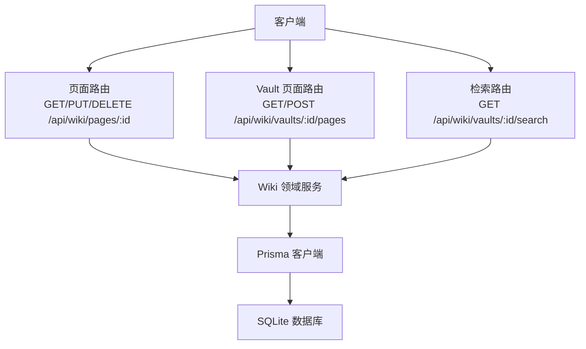
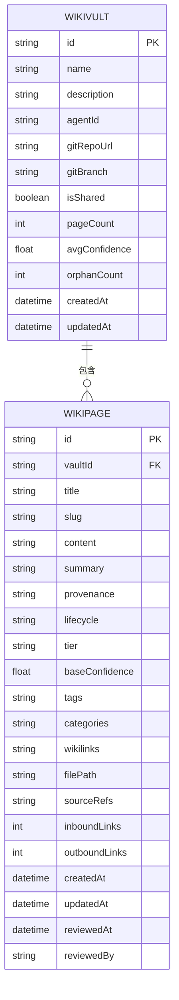
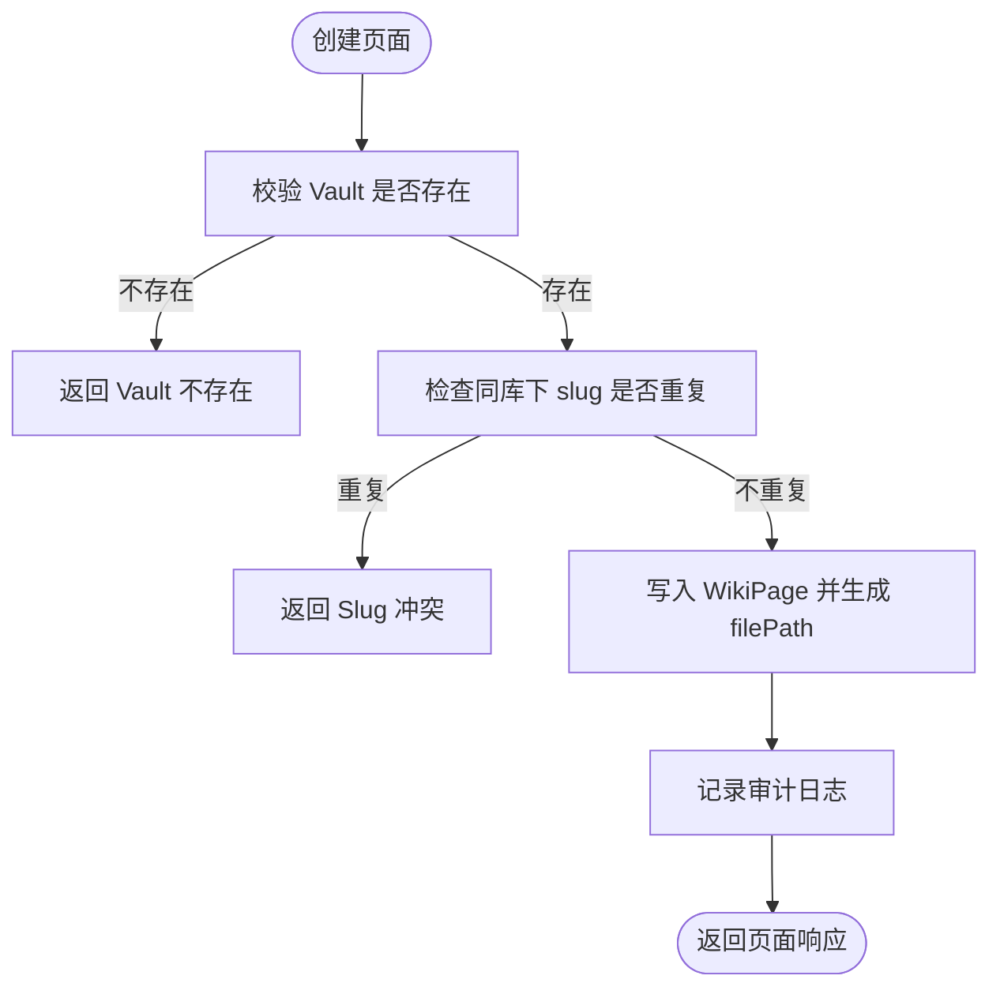
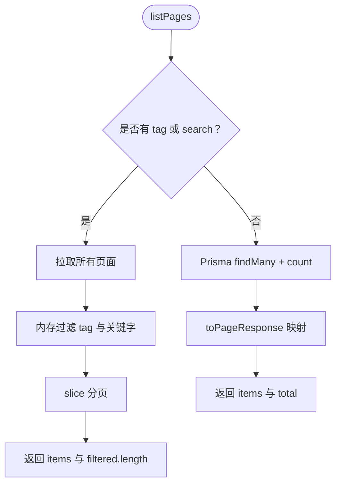
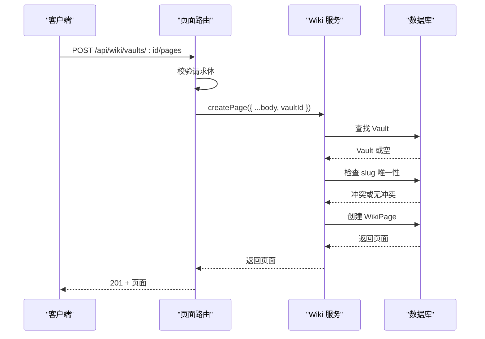
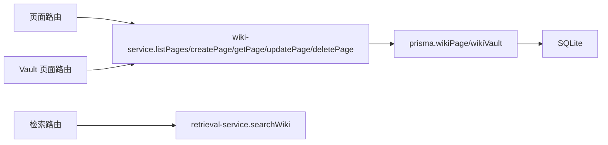

# 页面管理

<cite>
**本文引用的文件**   
- [schema.prisma](file://packages/db/prisma/schema.prisma)
- [enums.ts](file://packages/db/src/enums.ts)
- [wiki-service.ts](file://apps/web/lib/services/wiki-service.ts)
- [schemas.ts](file://apps/web/lib/schemas.ts)
- [路由：按 id 获取/更新/删除页面](file://apps/web/app/api/wiki/pages/[id]/route.ts)
- [路由：Vault 下的页面列表与创建](file://apps/web/app/api/wiki/vaults/[id]/pages/route.ts)
- [路由：Vault 全文检索](file://apps/web/app/api/wiki/vaults/[id]/search/route.ts)
- [Wiki 服务文档](file://docs/distilled/wiki-service.md)
</cite>

## 目录
1. [引言](#引言)
2. [项目结构与职责边界](#项目结构与职责边界)
3. [核心数据模型](#核心数据模型)
4. [生命周期、分类与元数据](#生命周期分类与元数据)
5. [文件路径映射与 Slug 唯一性](#文件路径映射与-slug-唯一性)
6. [分页查询与过滤实现](#分页查询与过滤实现)
7. [页面 CRUD API 规范](#页面-crud-api-规范)
8. [页面与 Vault 的父子关系与完整性](#页面与-vault-的父子关系与完整性)
9. [依赖与调用链分析](#依赖与调用链分析)
10. [性能特征与优化建议](#性能特征与优化建议)
11. [故障排查指南](#故障排查指南)
12. [最佳实践](#最佳实践)
13. [结论](#结论)

## 引言
本文面向 Wiki Page（知识页）的管理能力，覆盖数据模型、生命周期状态、元数据字段、分类体系、文件路径映射、Slug 唯一性约束、分页与过滤实现、CRUD API 契约、Vault 父子关系、错误处理、性能特征以及最佳实践。读者无需深入代码即可理解页面在系统中的建模方式、读写流程与使用限制；开发者可据此定位具体实现位置并评估扩展点。

## 项目结构与职责边界
Wiki 页面管理由三层组成：
- 接口层：Next.js Route Handler 暴露 REST 风格接口，负责参数解析、请求体校验、权限上下文注入和统一错误包装。
- 领域服务层：`wiki-service.ts` 封装 Vault 与 Page 的业务逻辑，包括权限校验、数据库访问、审计记录、默认值填充、Slug 冲突检测等。
- 持久化层：Prisma Schema 定义 `WikiVault` 与 `WikiPage` 表结构及索引、外键、级联删除等约束；枚举类型以 TypeScript 常量 + union type 形式重建。

**图表来源**
- [路由：按 id 获取/更新/删除页面:7-37](file://apps/web/app/api/wiki/pages/[id]/route.ts#L7-L37)
- [路由：Vault 下的页面列表与创建:7-33](file://apps/web/app/api/wiki/vaults/[id]/pages/route.ts#L7-L33)
- [路由：Vault 全文检索:8-34](file://apps/web/app/api/wiki/vaults/[id]/search/route.ts#L8-L34)
- [wiki-service.ts:146-297](file://apps/web/lib/services/wiki-service.ts#L146-L297)

**章节来源**
- [wiki-service.ts:1-13](file://apps/web/lib/services/wiki-service.ts#L1-L13)
- [Wiki 服务文档:15-28](file://docs/distilled/wiki-service.md#L15-L28)

## 核心数据模型
Wiki 的核心实体是 `WikiVault`（知识库）与 `WikiPage`（知识页）。

| 维度 | 说明 |
|---|---|
| 主键 | `WikiPage.id`、`WikiVault.id` |
| 父关系 | `WikiPage.vaultId` 指向 `WikiVault.id`，删除 Vault 时级联删除页面 |
| 唯一约束 | `WikiPage` 在 `(vaultId, slug)` 上唯一，保证同一知识库内 slug 不重复 |
| 常用索引 | `(vaultId, lifecycle)`、`(vaultId, tier)`、`(vaultId, isShared)` |
| 时间戳 | `createdAt`、`updatedAt`；`reviewedAt` 表示审核完成时间 |
| 存储形态 | 数组类字段（tags、categories、wikilinks、sourceRefs）以 JSON 文本列存储，通过 pack/unpack 工具序列化 |

**图表来源**
- [schema.prisma:397-454](file://packages/db/prisma/schema.prisma#L397-L454)

**章节来源**
- [schema.prisma:397-454](file://packages/db/prisma/schema.prisma#L397-L454)

## 生命周期、分类与元数据
### 生命周期状态
数据库中 `lifecycle` 为字符串列，TypeScript 侧通过 `PageLifecycle` 枚举维护合法值。当前枚举包含以下状态：
- DRAFT：草稿
- IN_REVIEW：审核中
- REVIEWED：已审核
- VERIFIED：已验证
- STALE：陈旧
- DEPRECATED：已废弃
- DISPUTED：有争议
- ARCHIVED：归档

注意：API 校验层 `pageLifecycleEnum` 只允许部分子集，因此“写入”时只能传入该白名单内的值；但数据库与运行时枚举仍保留更完整集合，用于兼容历史数据或内部系统流转。

| 状态 | 含义 | 是否写入白名单 |
|---|---|---:|
| DRAFT | 初始草稿 | 是 |
| IN_REVIEW | 进入审核流程 | 是 |
| REVIEWED | 审核通过 | 否（仅数据库/运行时枚举） |
| VERIFIED | 内容已验证 | 是 |
| STALE | 信息可能过时 | 是 |
| DEPRECATED | 已被替代 | 是 |
| DISPUTED | 存在争议 | 否（仅数据库/运行时枚举） |
| ARCHIVED | 归档保存 | 否（仅数据库/运行时枚举） |

**章节来源**
- [enums.ts:141-152](file://packages/db/src/enums.ts#L141-L152)
- [schemas.ts:212-215](file://apps/web/lib/schemas.ts#L212-L215)

### 页面层级（tier）
`tier` 表示页面重要程度，默认值为 `SPECIALIZED`。当前 API 校验层允许 `CORE`、`SPECIALIZED`、`EDGE_CASE`；数据库与运行时枚举还包含 `SUPPORTING`、`PERIPHERAL`。

| 层级 | 含义 |
|---|---|
| CORE | 核心知识 |
| SUPPORTING | 支撑知识 |
| PERIPHERAL | 边缘知识 |
| SPECIALIZED | 专业/细分知识 |
| EDGE_CASE | 特殊场景知识 |

**章节来源**
- [enums.ts:154-161](file://packages/db/src/enums.ts#L154-L161)
- [schemas.ts:215](file://apps/web/lib/schemas.ts#L215)

### 来源证明（provenance）
`provenance` 描述页面内容的来源可信度与生成方式。API 校验层允许 `AUTHORED`、`EXTRACTED`、`DISTILLED`、`IMPORTED`、`SYNTHESIZED`；数据库与运行时枚举还包含 `INFERRED`、`AMBIGUOUS`。

| 来源 | 含义 |
|---|---|
| AUTHORED | 人工编写 |
| EXTRACTED | 从外部材料提取 |
| DISTILLED | 提炼合成 |
| IMPORTED | 导入 |
| SYNTHESIZED | 多源综合 |
| INFERRED | 推断得出 |
| AMBIGUOUS | 来源模糊 |

**章节来源**
- [enums.ts:130-139](file://packages/db/src/enums.ts#L130-L139)
- [schemas.ts:209-211](file://apps/web/lib/schemas.ts#L209-L211)

### 基础置信度（baseConfidence）
`baseConfidence` 是页面自身的置信度评分，取值范围 `[0, 1]`，默认 `0.5`。它参与检索评分门限判断，并与检索结果归一化分数共同决定最终候选是否进入结果集。

**章节来源**
- [schema.prisma:421-454](file://packages/db/prisma/schema.prisma#L421-L454)
- [schemas.ts:226](file://apps/web/lib/schemas.ts#L226)
- [schemas.ts:245-250](file://apps/web/lib/schemas.ts#L245-L250)

### 摘要（summary）
`summary` 是可选摘要字段，最大长度 1000 字符，可用于列表预览、检索摘要展示或下游消费方快速理解页面主题。

**章节来源**
- [schema.prisma:429](file://packages/db/prisma/schema.prisma#L429)
- [schemas.ts:222](file://apps/web/lib/schemas.ts#L222)

## 文件路径映射与 Slug 唯一性
### 文件路径映射
新建页面时，`filePath` 由 `slug` 推导，固定格式为 `<slug>.md`。这意味着 slug 不仅是数据库唯一标识的一部分，也直接决定页面在文件系统或 Git 仓库中的命名约定。

| 输入 | 输出 |
|---|---|
| slug = `agent-setup` | filePath = `agent-setup.md` |
| slug = `knowledge-base` | filePath = `knowledge-base.md` |

**章节来源**
- [wiki-service.ts:249](file://apps/web/lib/services/wiki-service.ts#L249)
- [schema.prisma:442](file://packages/db/prisma/schema.prisma#L442)

### Slug 唯一性约束
- 数据库层：`WikiPage` 在 `(vaultId, slug)` 上建立唯一约束。
- 业务层：创建页面前先检查同 vault 下是否存在相同 slug，若存在返回冲突错误。
- 影响：同一知识库内不允许两个页面共享 slug；跨知识库可以重复。

**图表来源**
- [wiki-service.ts:225-258](file://apps/web/lib/services/wiki-service.ts#L225-L258)
- [schema.prisma:451](file://packages/db/prisma/schema.prisma#L451)

**章节来源**
- [wiki-service.ts:225-258](file://apps/web/lib/services/wiki-service.ts#L225-L258)
- [schema.prisma:451](file://packages/db/prisma/schema.prisma#L451)

## 分页查询与过滤实现
### 支持的分页参数
- `page`、`pageSize`：前端页码与每页大小。
- `skip`、`take`：底层数据库偏移与条数。
- 当未显式传 `skip`/`take` 时，由通用分页解析函数转换为数据库可用参数。

### 支持的过滤条件
| 参数 | 类型 | 行为 |
|---|---|---|
| `lifecycle` | 字符串 | 精确匹配生命周期；传 `ALL` 时跳过该过滤 |
| `tier` | 字符串 | 精确匹配层级；传 `ALL` 时跳过该过滤 |
| `tag` | 字符串 | 当前 service 签名支持，但路由未暴露该参数 |
| `search` | 字符串 | 对 `title` 与 `content` 做内存大小写不敏感匹配 |

### 过滤实现细节
- 当存在 `tag` 或 `search` 时，服务先拉取全部符合条件的页面，再在内存中过滤标签与关键字，最后执行 `slice` 分页。
- 当没有 `tag` 且没有 `search` 时，使用 Prisma 的 `skip`/`take` 与 `count` 实现高效分页。
- `total` 在有内存过滤时等于过滤后总数，否则来自数据库 count。

**图表来源**
- [wiki-service.ts:146-196](file://apps/web/lib/services/wiki-service.ts#L146-L196)

**章节来源**
- [wiki-service.ts:146-196](file://apps/web/lib/services/wiki-service.ts#L146-L196)

## 页面 CRUD API 规范
### 获取单个页面
- 方法：`GET`
- 路径：`/api/wiki/pages/:id`
- 成功响应：返回页面对象，包含 `vault` 快照。
- 失败响应：页面不存在时返回 404。

| 字段 | 类型 | 说明 |
|---|---|---|
| `id` | 字符串 | 页面 ID |
| `vaultId` | 字符串 | 所属知识库 ID |
| `title` | 字符串 | 标题 |
| `slug` | 字符串 | 唯一 slug |
| `content` | 字符串 | 正文内容 |
| `summary` | 字符串或空 | 摘要 |
| `provenance` | 字符串 | 来源证明 |
| `lifecycle` | 字符串 | 生命周期 |
| `tier` | 字符串 | 层级 |
| `baseConfidence` | 数字 | 基础置信度 |
| `tags` | 字符串数组 | 标签 |
| `categories` | 字符串数组 | 类别 |
| `wikilinks` | 字符串数组 | 维基链接 |
| `filePath` | 字符串 | 文件路径 |
| `sourceRefs` | 任意数组 | 来源引用 |
| `inboundLinks` | 数组 | 入链（当前响应固定为空数组） |
| `outboundLinks` | 数组 | 出链（当前响应固定为空数组） |
| `createdAt` | 字符串 | 创建时间 |
| `updatedAt` | 字符串 | 更新时间 |
| `reviewedAt` | 字符串或空 | 审核时间 |
| `vault` | 对象或空 | 关联 Vault 快照 |

**章节来源**
- [路由：按 id 获取/更新/删除页面:7-12](file://apps/web/app/api/wiki/pages/[id]/route.ts#L7-L12)
- [wiki-service.ts:198-209](file://apps/web/lib/services/wiki-service.ts#L198-L209)
- [wiki-service.ts:40-63](file://apps/web/lib/services/wiki-service.ts#L40-L63)

### 更新页面
- 方法：`PUT`
- 路径：`/api/wiki/pages/:id`
- 请求体：遵循 `updateWikiPageSchema`。
- 成功响应：返回更新后的页面对象。
- 失败响应：
  - 参数校验失败：返回结构化校验错误。
  - 页面不存在：返回 404。
  - 其他异常：由统一错误处理器包装。

| 字段 | 类型 | 必填 | 说明 |
|---|---|---:|---|
| `title` | 字符串 | 否 | 最大 300 字符 |
| `content` | 字符串 | 否 | 至少 1 字符 |
| `summary` | 字符串或空 | 否 | 最大 1000 字符 |
| `provenance` | 枚举 | 否 | 来源证明 |
| `lifecycle` | 枚举 | 否 | 生命周期 |
| `tier` | 枚举 | 否 | 层级 |
| `baseConfidence` | 数字 | 否 | 范围 `[0, 1]` |
| `tags` | 字符串数组 | 否 | 标签 |
| `categories` | 字符串数组 | 否 | 类别 |
| `wikilinks` | 字符串数组 | 否 | 维基链接 |

**章节来源**
- [路由：按 id 获取/更新/删除页面:14-27](file://apps/web/app/api/wiki/pages/[id]/route.ts#L14-L27)
- [schemas.ts:232-243](file://apps/web/lib/schemas.ts#L232-L243)
- [wiki-service.ts:261-284](file://apps/web/lib/services/wiki-service.ts#L261-L284)

### 删除页面
- 方法：`DELETE`
- 路径：`/api/wiki/pages/:id`
- 成功响应：返回删除确认消息。
- 失败响应：页面不存在时返回 404。

**章节来源**
- [路由：按 id 获取/更新/删除页面:29-37](file://apps/web/app/api/wiki/pages/[id]/route.ts#L29-L37)
- [wiki-service.ts:286-297](file://apps/web/lib/services/wiki-service.ts#L286-L297)

### 列出 Vault 下的页面
- 方法：`GET`
- 路径：`/api/wiki/vaults/:id/pages`
- 查询参数：
  - `page`、`pageSize`、`skip`、`take`
  - `lifecycle`
  - `tier`
  - `search`
- 成功响应：返回 `{ items, pagination }`。
- 失败响应：由统一错误处理器包装。

| 参数 | 类型 | 说明 |
|---|---|---|
| `page` | 数字 | 页码 |
| `pageSize` | 数字 | 每页条数 |
| `skip` | 数字 | 跳过条数 |
| `take` | 数字 | 返回条数 |
| `lifecycle` | 字符串 | 生命周期过滤；`ALL` 不过滤 |
| `tier` | 字符串 | 层级过滤；`ALL` 不过滤 |
| `search` | 字符串 | 标题与内容关键字搜索 |

**章节来源**
- [路由：Vault 下的页面列表与创建:7-17](file://apps/web/app/api/wiki/vaults/[id]/pages/route.ts#L7-L17)
- [wiki-service.ts:146-196](file://apps/web/lib/services/wiki-service.ts#L146-L196)

### 创建页面
- 方法：`POST`
- 路径：`/api/wiki/vaults/:id/pages`
- 请求体：遵循 `createWikiPageSchema`。
- 成功响应：返回新创建的页面对象，HTTP 状态码 201。
- 失败响应：
  - 参数校验失败：返回结构化校验错误。
  - Vault 不存在：返回 404。
  - Slug 冲突：返回冲突错误。

| 字段 | 类型 | 必填 | 说明 |
|---|---|---:|---|
| `vaultId` | 字符串 | 是 | 知识库 ID；路由会覆盖 body 中的 vaultId |
| `title` | 字符串 | 是 | 最大 300 字符 |
| `slug` | 字符串 | 是 | 最大 300 字符 |
| `content` | 字符串 | 是 | 至少 1 字符 |
| `summary` | 字符串 | 否 | 最大 1000 字符 |
| `provenance` | 枚举 | 否 | 来源证明 |
| `lifecycle` | 枚举 | 否 | 生命周期 |
| `tier` | 枚举 | 否 | 层级 |
| `baseConfidence` | 数字 | 否 | 范围 `[0, 1]` |
| `tags` | 字符串数组 | 否 | 标签 |
| `categories` | 字符串数组 | 否 | 类别 |
| `wikilinks` | 字符串数组 | 否 | 维基链接 |

**章节来源**
- [路由：Vault 下的页面列表与创建:19-33](file://apps/web/app/api/wiki/vaults/[id]/pages/route.ts#L19-L33)
- [schemas.ts:217-230](file://apps/web/lib/schemas.ts#L217-L230)
- [wiki-service.ts:211-258](file://apps/web/lib/services/wiki-service.ts#L211-L258)

### Vault 页面检索
- 方法：`GET`
- 路径：`/api/wiki/vaults/:id/search`
- 查询参数：
  - `q`：检索词，必填，最大 500 字符。
  - `limit`：最大结果数，默认 5，范围 `[1, 20]`。
  - `threshold`：置信度门限，默认 0.35，范围 `[0, 1]`。
- 行为：先校验 Vault 是否存在，再调用检索服务进行语义/混合检索。

**章节来源**
- [路由：Vault 全文检索:8-34](file://apps/web/app/api/wiki/vaults/[id]/search/route.ts#L8-L34)
- [schemas.ts:245-250](file://apps/web/lib/schemas.ts#L245-L250)

## 页面与 Vault 的父子关系与完整性
### 父子关系
- `WikiPage.vaultId` 是外键，指向 `WikiVault.id`。
- 删除 Vault 时启用级联删除，页面与相关任务一并消失。
- 创建页面前必须校验 Vault 存在，否则返回 404。

### 数据完整性保证
- 数据库唯一约束保证同一 Vault 内 slug 不重复。
- 业务层在创建前再次检查 slug 冲突，返回明确冲突错误。
- 数组字段通过 pack/unpack 工具统一序列化，避免直接存原始 JSON 导致的类型不一致。
- 审计记录记录页面增删改的关键上下文，便于追踪。

**图表来源**
- [路由：Vault 下的页面列表与创建:19-33](file://apps/web/app/api/wiki/vaults/[id]/pages/route.ts#L19-L33)
- [wiki-service.ts:211-258](file://apps/web/lib/services/wiki-service.ts#L211-L258)
- [schema.prisma:421-454](file://packages/db/prisma/schema.prisma#L421-L454)

**章节来源**
- [wiki-service.ts:211-258](file://apps/web/lib/services/wiki-service.ts#L211-L258)
- [schema.prisma:421-454](file://packages/db/prisma/schema.prisma#L421-L454)

## 依赖与调用链分析
### 主要依赖
- Next.js 路由：负责 HTTP 入口、参数解析、校验、错误包装。
- `wiki-service.ts`：领域逻辑、权限校验、数据库操作、审计。
- `schemas.ts`：Zod 校验规则，定义页面与 Vault 的输入契约。
- `enums.ts`：运行时枚举定义，与数据库字符串列对齐。
- Prisma Schema：持久化模型、索引、外键、级联删除。

### 调用链

**图表来源**
- [wiki-service.ts:1-13](file://apps/web/lib/services/wiki-service.ts#L1-L13)
- [路由：按 id 获取/更新/删除页面:1-5](file://apps/web/app/api/wiki/pages/[id]/route.ts#L1-L5)
- [路由：Vault 下的页面列表与创建:1-5](file://apps/web/app/api/wiki/vaults/[id]/pages/route.ts#L1-L5)
- [路由：Vault 全文检索:1-6](file://apps/web/app/api/wiki/vaults/[id]/search/route.ts#L1-L6)

**章节来源**
- [wiki-service.ts:146-297](file://apps/web/lib/services/wiki-service.ts#L146-L297)
- [schemas.ts:188-250](file://apps/web/lib/schemas.ts#L188-L250)

## 性能特征与优化建议
### 当前特征
- 列表分页在无 `tag`/`search` 时使用数据库 `skip`/`take` 与 `count`，性能较好。
- 有 `tag`/`search` 时先全量拉取再内存过滤，适合演示规模；随着页面数量增长，延迟与内存占用会线性上升。
- `filePath` 由 `slug` 推导，不涉及额外查询。
- 数组字段以 JSON 文本存储，读取时需 unpack，写入时需 pack。

### 优化建议
- 将 `tag` 与 `search` 下沉到数据库层：
  - 为 `tags`、`categories`、`wikilinks` 增加合适的索引或使用全文索引。
  - 对 `title`、`content` 使用数据库全文检索或向量检索。
- 缓存热点 Vault 的页面计数与平均置信度，避免静态值误导。
- 对高频读取的 Vault 元数据加缓存，减少重复查询。
- 对 `listPages` 的内存过滤增加分页前置条件，避免大结果集一次性加载。

[本节为通用性能建议，不直接分析具体代码行]

## 故障排查指南
| 症状 | 可能原因 | 处理建议 |
|---|---|---|
| 创建页面报 Slug 冲突 | 同 Vault 下已有相同 slug | 更换 slug 或检查历史页面 |
| 更新页面报 404 | 页面不存在 | 检查页面 ID 是否正确 |
| 删除页面报 404 | 页面不存在 | 检查页面 ID 与权限 |
| 列表接口返回空 | Vault 下无页面或过滤条件过严 | 检查 `lifecycle`、`tier`、`search` |
| 列表接口慢 | 使用了 `tag` 或 `search` 触发内存过滤 | 减少结果集或优化过滤逻辑 |
| 检索接口报参数非法 | `q`、`limit`、`threshold` 不符合 schema | 调整查询参数 |
| Vault 统计字段始终为 0 | 统计字段未增量维护 | 重新计算或引入后台任务回写 |

**章节来源**
- [wiki-service.ts:225-297](file://apps/web/lib/services/wiki-service.ts#L225-L297)
- [schemas.ts:217-250](file://apps/web/lib/schemas.ts#L217-L250)

## 最佳实践
- 使用 `DRAFT` 作为初始生命周期，审核通过后改为 `REVIEWED` 或 `VERIFIED`。
- 合理设置 `tier`，核心知识使用 `CORE`，普通知识使用 `SPECIALIZED`。
- 明确填写 `provenance`，区分人工编写、提取、导入、合成等不同来源。
- 控制 `baseConfidence`，避免过高导致误判或过低导致检索被过滤。
- 使用 `tags` 与 `categories` 组织页面，但注意当前路由未暴露 `tag` 过滤参数。
- 使用 `wikilinks` 建立页面间引用，便于后续构建入链/出链统计。
- 保持 `slug` 稳定且具语义，因为它是文件路径映射的基础。
- 在批量创建页面时，优先确保 Vault 存在并避免 slug 冲突。
- 对高频查询的 Vault 启用缓存，降低数据库压力。
- 定期清理 `ARCHIVED` 或 `DEPRECATED` 页面，保持知识库整洁。

[本节为通用最佳实践，不直接分析具体代码行]

## 结论
Wiki Page 的数据模型围绕 `WikiVault` 与 `WikiPage` 构建，通过字符串列与 TypeScript 枚举共同表达生命周期、层级与来源证明。页面管理在接口层完成参数校验与错误包装，在服务层完成权限、唯一性、默认值与审计，在持久化层通过 Prisma 保证外键与唯一约束。当前实现适合中小规模知识库；若页面数量增长，应重点优化 `tag`/`search` 过滤、数组字段索引、统计字段回写与缓存策略。