# 三层 Loop 设计

<cite>
**本文引用的文件**   
- [README.md](file://README.md)
- [架构总览页](file://apps/web/app/(dashboard)/architecture/page.tsx)
- [Loop 工程页](file://apps/web/app/(dashboard)/architecture/loop/page.tsx)
- [Harness 工程页](file://apps/web/app/(dashboard)/architecture/harness/page.tsx)
- [改进路线图页](file://apps/web/app/(dashboard)/architecture/roadmap/page.tsx)
- [项目评估报告](file://docs/reports/2026-07-31-project-evaluation-and-industry-gap-analysis.md)
- [Harness / Loop 参考评估](file://docs/evaluation/2026-07-21-project-evaluation-and-harness-loop-reference.md)
</cite>

## 目录
1. [引言](#引言)
2. [项目结构](#项目结构)
3. [核心组件](#核心组件)
4. [架构总览](#架构总览)
5. [详细组件分析](#详细组件分析)
6. [依赖关系分析](#依赖关系分析)
7. [性能与可观测性](#性能与可观测性)
8. [失败模式诊断](#失败模式诊断)
9. [行业框架对照表](#行业框架对照表)
10. [代码级实现示例](#代码级实现示例)
11. [改进路线图](#改进路线图)
12. [结论](#结论)

## 引言
本文件围绕 agent-up 的「三层 Loop」设计理念展开，目标是让读者既能理解 L1 即时交互环、L2 产品改进环、L3 智能进化环的设计动机与当前实现状态，也能看到它们在仓库中的具体落点：哪些是已实现的 L2 核心能力，哪些仍是规划中的 L3 扩展。

agent-up 的定位不是“又一个 Agent 运行时”，而是“Agent 持续改进平台”。它不构建 L1 Agent 本身，而是治理 Model 之外的各层——Prompt、Context、Harness、Loop、Graph，并通过四分区配置（Prompt / Knowledge / Tools / Routing）、Release → Version 版本快照、审批回滚、效果报告与证据链，把“反馈 → 归因 → 改配置 → 发布 → 验证”的产品改进过程变成可审计、可回滚、可度量的工程流程。

**章节来源**
- [README.md:7-10](file://README.md#L7-L10)
- [README.md:234-267](file://README.md#L234-L267)

## 项目结构
从文档与页面组织看，三层 Loop 的概念并非只存在于 README 中，而是被拆成一组面向不同读者的架构参考页面：

| 位置 | 职责 | 与三层 Loop 的关系 |
|---|---|---|
| `apps/web/app/(dashboard)/architecture/page.tsx` | 架构总览 | 给出三层 Loop 数据流全景、六层技术栈模型、四分区配置、功能完整性评分 |
| `apps/web/app/(dashboard)/architecture/loop/page.tsx` | Loop 工程 | 解释 ReAct / Anthropic / Manus / OpenAI Swarm 等业界 loop，并映射到 L1/L2/L3 |
| `apps/web/app/(dashboard)/architecture/harness/page.tsx` | Harness 工程 | 解释 harness 五子系统、OpenAI 七大决策、Anthropic 三体设计，并映射到 AgentUp |
| `apps/web/app/(dashboard)/architecture/roadmap/page.tsx` | 改进路线图 | 把 Harness / Loop 经验转化为 P0/P1/P2/P3 改进项 |
| `docs/reports/...` | 评估报告 | 记录 MVP 设计成熟度 vs 实现成熟度、行业差距、关键缺口 |
| `docs/evaluation/...` | Harness / Loop 参考评估 | 明确 L1 不在本平台构建，L2 是核心，L3 规划中 |

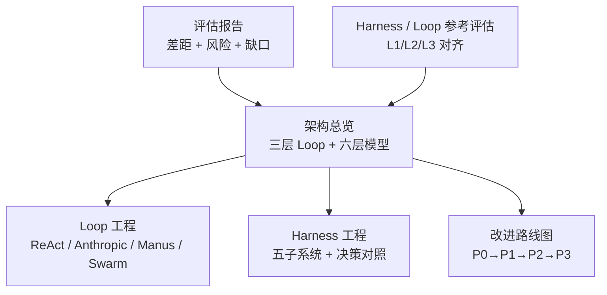

**图示来源**
- [架构总览页:148-184](file://apps/web/app/(dashboard)/architecture/page.tsx#L148-L184)
- [Loop 工程页:312-345](file://apps/web/app/(dashboard)/architecture/loop/page.tsx#L312-L345)
- [Harness 工程页:139-156](file://apps/web/app/(dashboard)/architecture/harness/page.tsx#L139-L156)
- [改进路线图页:67-93](file://apps/web/app/(dashboard)/architecture/roadmap/page.tsx#L67-L93)

**章节来源**
- [架构总览页:95-159](file://apps/web/app/(dashboard)/architecture/page.tsx#L95-L159)
- [Loop 工程页:158-175](file://apps/web/app/(dashboard)/architecture/loop/page.tsx#L158-L175)
- [Harness 工程页:130-156](file://apps/web/app/(dashboard)/architecture/harness/page.tsx#L130-L156)
- [改进路线图页:67-93](file://apps/web/app/(dashboard)/architecture/roadmap/page.tsx#L67-L93)

## 核心组件
三层 Loop 的核心不是三个独立程序，而是一套按时间尺度分层、通过数据管道耦合的流程抽象：

| 层 | 时间尺度 | 谁在运行 | 平台角色 | 当前状态 |
|---|---|---|---|---|
| L1 即时交互环 | 分钟级 | Agent 运行时（不在本平台构建） | 消费产物：会话、评分、反馈 | 未实现；平台只消费其输出 |
| L2 产品改进环 | 小时~天级 | 产品组 / 工单团队 | 平台核心：反馈 → AI 归因 → 分区编辑 → Release → 审批 → Version → 回滚 → 效果报告 | 已实现为主流程 |
| L3 智能进化环 | 天~周级 | 跨 Agent 洞察系统 | 自动蒸馏、共享概念池、熵清理、L1 自动采集 | 规划中 |

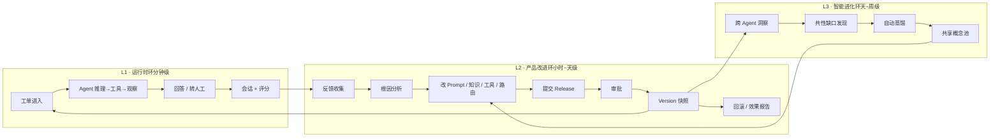

**图示来源**
- [架构总览页:19-44](file://apps/web/app/(dashboard)/architecture/page.tsx#L19-L44)
- [Loop 工程页:71-104](file://apps/web/app/(dashboard)/architecture/loop/page.tsx#L71-L104)

**章节来源**
- [README.md:269-275](file://README.md#L269-L275)
- [架构总览页:148-159](file://apps/web/app/(dashboard)/architecture/page.tsx#L148-L159)
- [项目评估报告:30-38](file://docs/reports/2026-07-31-project-evaluation-and-industry-gap-analysis.md#L30-L38)

## 架构总览
agent-up 的架构总览页给出了两个关键视图：

1. **三层 Loop 数据流**：L1 产出反馈，L2 消费反馈并生产新版本，新版本回到 L1 生效；同时 L2 沉淀的数据供 L3 做跨 Agent 洞察，L3 反哺 L2 的知识库。
2. **六层技术栈模型**：Model 在最内层，外面依次包 Prompt、Context、Harness、Loop、Graph。agent-up 不造模型，治理的是 Model 之外的各层。

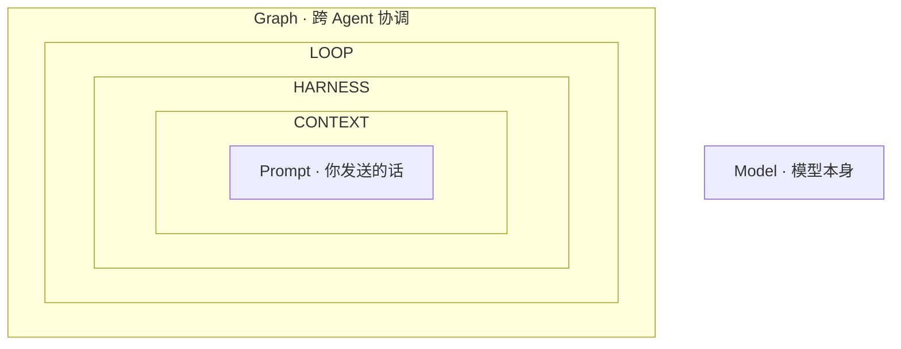

**图示来源**
- [架构总览页:46-65](file://apps/web/app/(dashboard)/architecture/page.tsx#L46-L65)
- [README.md:238-256](file://README.md#L238-L256)

**章节来源**
- [架构总览页:161-184](file://apps/web/app/(dashboard)/architecture/page.tsx#L161-L184)
- [README.md:234-267](file://README.md#L234-L267)

## 详细组件分析

### L1 即时交互环：分钟级 Agent 运行时
L1 是 Agent 在岗解决工单的运行时环。它的典型骨架来自 ReAct：Thought → Action → Observation，并在 Anthropic、Manus、OpenAI Swarm 等系统中收敛为“while 未完成 → 推理 → 行动 → 观察”。

在本项目中，L1 并不由 agent-up 构建；平台只消费 L1 的产物：会话、评分、反馈。这意味着 L1 的实现可以来自外部 Agent 运行时，只要它能把结果写入平台的 trace / feedback / eval-case 数据结构即可。

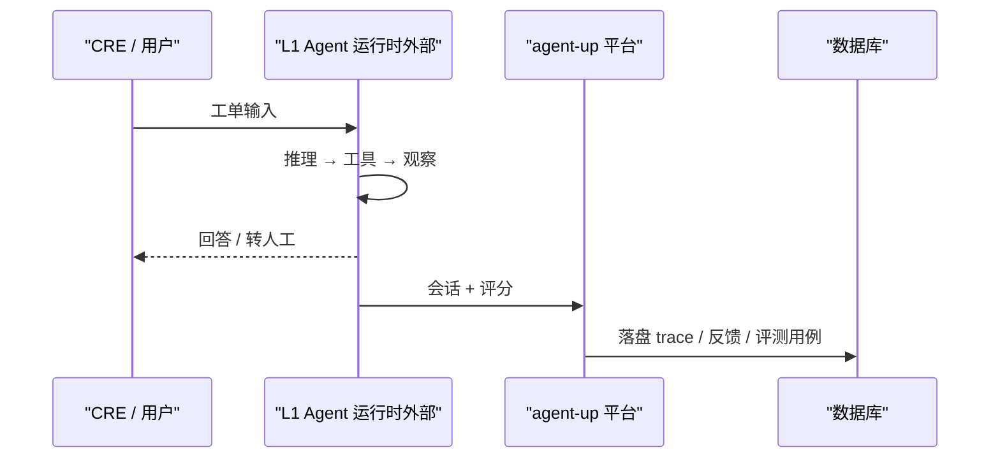

**图示来源**
- [Loop 工程页:10-23](file://apps/web/app/(dashboard)/architecture/loop/page.tsx#L10-L23)
- [Loop 工程页:71-104](file://apps/web/app/(dashboard)/architecture/loop/page.tsx#L71-L104)

**章节来源**
- [Loop 工程页:177-192](file://apps/web/app/(dashboard)/architecture/loop/page.tsx#L177-L192)
- [Loop 工程页:312-345](file://apps/web/app/(dashboard)/architecture/loop/page.tsx#L312-L345)
- [Harness / Loop 参考评估:21-46](file://docs/evaluation/2026-07-21-project-evaluation-and-harness-loop-reference.md#L21-L46)

### L2 产品改进环：小时~天级平台核心
L2 是 agent-up 真正构建的部分。它把“产品组如何改进 Agent”的过程标准化为：

1. 反馈收集（手填或未来自动采集）
2. AI 归因（真实 LLM 辅助定位问题）
3. 修改四分区配置（Prompt / Knowledge / Tools / Routing）
4. 提交 Release（自动 diff + SemVer）
5. 工单团队审批
6. 生成不可变 Version 快照
7. 支持分区级 / 整版本回滚
8. 发布 7 天后懒计算效果报告

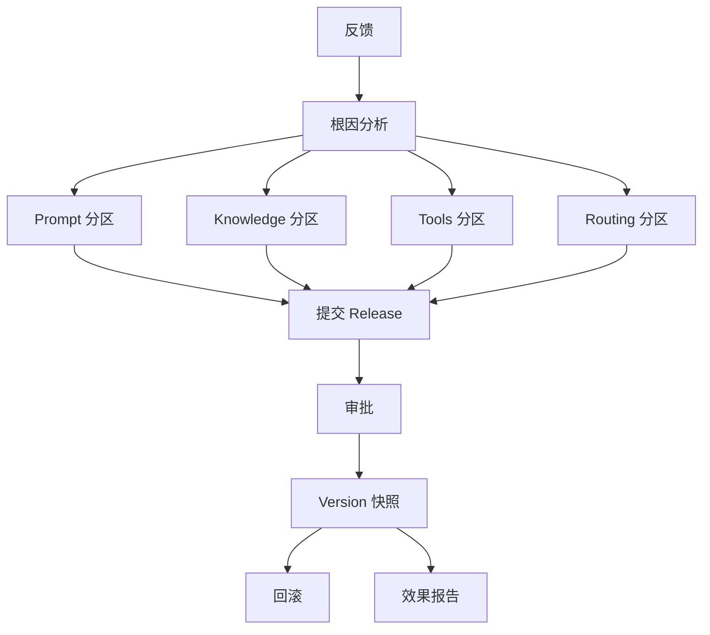

**图示来源**
- [Loop 工程页:71-104](file://apps/web/app/(dashboard)/architecture/loop/page.tsx#L71-L104)
- [架构总览页:19-44](file://apps/web/app/(dashboard)/architecture/page.tsx#L19-L44)

**章节来源**
- [README.md:50-58](file://README.md#L50-L58)
- [README.md:286-288](file://README.md#L286-L288)
- [Loop 工程页:312-345](file://apps/web/app/(dashboard)/architecture/loop/page.tsx#L312-L345)

### L3 智能进化环：天~周级预留扩展
L3 的目标是让平台从“改进工具”升级为“自进化系统”。它包括：

- 跨 Agent 洞察
- 共性知识缺口发现
- 自动蒸馏（WikiIngestJob 接 LLM）
- 共享概念池
- L1 反馈自动采集管道
- 熵清理 agent

当前这些能力大多处于规划阶段，路线图将其放在 P2 及以后。

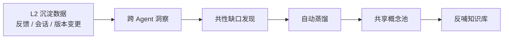

**图示来源**
- [Loop 工程页:71-104](file://apps/web/app/(dashboard)/architecture/loop/page.tsx#L71-L104)
- [改进路线图页:175-213](file://apps/web/app/(dashboard)/architecture/roadmap/page.tsx#L175-L213)

**章节来源**
- [Loop 工程页:312-345](file://apps/web/app/(dashboard)/architecture/loop/page.tsx#L312-L345)
- [改进路线图页:175-213](file://apps/web/app/(dashboard)/architecture/roadmap/page.tsx#L175-L213)

### Loop 工程与 Harness 工程的区别
这是理解 agent-up 的关键区分：

| 维度 | Loop 工程 | Harness 工程 |
|---|---|---|
| 关注点 | Agent 的推理-行动-观察循环骨架 | 包裹 LLM 的执行层：编排、工具、记忆、上下文、终止控制 |
| 主要问题 | 单 loop 健壮性、多 Agent 扩展、持久化与可恢复 | Scaffold vs Harness、五子系统、终止条件、护栏 |
| 代表系统 | ReAct、Anthropic while+tools、Manus、OpenAI Swarm | smolagents、Anthropic Planner/Generator/Evaluator、OpenAI Codex 实践 |
| agent-up 对应物 | L1 运行时骨架（不在此平台实现） | L2 改进流程 = 给 Agent 配置迭代提供 harness 纪律 |
| 一句话 | “Agent 怎么跑一次任务” | “怎么安全、可控、可观测地驱动 LLM 和工具” |

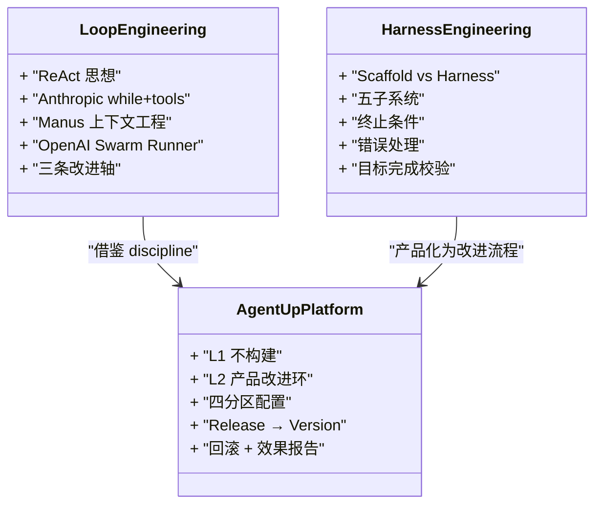

**图示来源**
- [Loop 工程页:158-175](file://apps/web/app/(dashboard)/architecture/loop/page.tsx#L158-L175)
- [Harness 工程页:130-156](file://apps/web/app/(dashboard)/architecture/harness/page.tsx#L130-L156)
- [Harness 工程页:158-216](file://apps/web/app/(dashboard)/architecture/harness/page.tsx#L158-L216)

**章节来源**
- [Loop 工程页:158-175](file://apps/web/app/(dashboard)/architecture/loop/page.tsx#L158-L175)
- [Harness 工程页:130-156](file://apps/web/app/(dashboard)/architecture/harness/page.tsx#L130-L156)
- [Harness 工程页:158-216](file://apps/web/app/(dashboard)/architecture/harness/page.tsx#L158-L216)

### agent-up 如何治理 Model 之外的各层
根据架构总览与 README 的分层模型，agent-up 对 Model 之外各层的治理如下：

| 层级 | agent-up 对应能力 | 说明 |
|---|---|---|
| Model | MaaS 模型服务 | 小米 MiMo 已真实接入；百炼 / 专有云是下一份网关配置 |
| Prompt | Prompt 分区 | 角色、约束、输出格式；分区编辑 + 独立回滚 |
| Context | Knowledge 分区 | 两层知识架构：蒸馏态优先，MCP 活数据兜底 |
| Harness | Tools 分区 + 结构化错误体系 | MCP 工具配置 + 全站统一错误分类 |
| Loop | 反馈 → AI 归因 → 审批发布 → 效果报告 → 一键回滚 | L2 产品改进环，平台核心 |
| Graph | 跨 Agent 洞察 | L3 智能进化环，预留 |

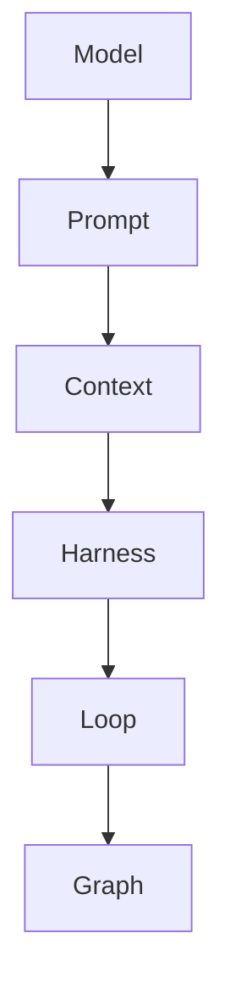

**图示来源**
- [架构总览页:46-65](file://apps/web/app/(dashboard)/architecture/page.tsx#L46-L65)
- [README.md:238-256](file://README.md#L238-L256)

**章节来源**
- [架构总览页:161-184](file://apps/web/app/(dashboard)/architecture/page.tsx#L161-L184)
- [README.md:234-267](file://README.md#L234-L267)

## 依赖关系分析
三层 Loop 之间的依赖不是紧耦合的程序调用，而是数据流依赖：

1. L1 依赖外部 Agent 运行时，但向平台输出会话、评分、反馈。
2. L2 依赖 L1 的反馈数据，并依赖平台自身的 Release / Version / Audit / Trace / EvalCase 等数据模型。
3. L3 依赖 L2 沉淀的配置变更、反馈、版本历史，以及未来的 Wiki 蒸馏引擎。

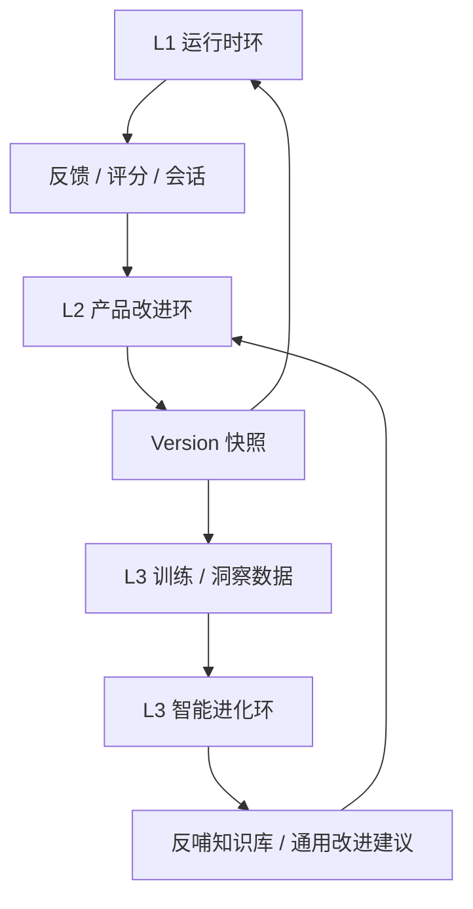

**图示来源**
- [架构总览页:19-44](file://apps/web/app/(dashboard)/architecture/page.tsx#L19-L44)
- [Loop 工程页:71-104](file://apps/web/app/(dashboard)/architecture/loop/page.tsx#L71-L104)

**章节来源**
- [项目评估报告:30-38](file://docs/reports/2026-07-31-project-evaluation-and-industry-gap-analysis.md#L30-L38)
- [Harness / Loop 参考评估:21-46](file://docs/evaluation/2026-07-21-project-evaluation-and-harness-loop-reference.md#L21-L46)

## 性能与可观测性
虽然本节不直接分析具体代码文件，但从文档可见，agent-up 的可观测性与效果度量已经覆盖 L2 的主要闭环：

- 试聊 trace 落盘 + 👍/👎 打分
- 发布前 AI 评测回放（确定性断言 + LLM 判官）
- 发布 7 天后懒计算效果报告
- MaaS 每 Agent 真实用量聚合
- 任务证据链与版本演进线只读视图

这些能力让 L2 改进环至少具备“observation（观察结果）”这一环，避免“改了不知道值不值”。

**章节来源**
- [README.md:50-60](file://README.md#L50-L60)
- [架构总览页:275-280](file://apps/web/app/(dashboard)/architecture/page.tsx#L275-L280)

## 失败模式诊断
Loop 工程页总结了四类常见失败模式，并给出对应修复思路；同时指出这些模式在 L2 改进环中也有对应症状：

| 失败模式 | 症状 | 根因 | 修复方向 | L2 对应症状 |
|---|---|---|---|---|
| 过早终止 | 模型说完成了但目标没达成 | 只检查“模型停没停”，不检查“目标达没达” | L3 目标完成校验；sprint contract | Release 通过了但效果没改善 |
| 跑飞 / runaway | 同一工具反复调用、永不收敛 | 无循环检测、无 max_turns、无预算上限 | max_turns + 预算 + 循环检测 | 同一类反馈反复提交 |
| 上下文膨胀 | 跑到一半质量骤降 | context window 填满，无压缩或外置记忆 | compaction / reset / 文件系统即上下文 | 配置越改越乱 |
| 重复 rut | 批量任务陷入相同输出模式 | few-shot 过强、模板单一 | 结构化变异 | 改进没有多样性信号 |

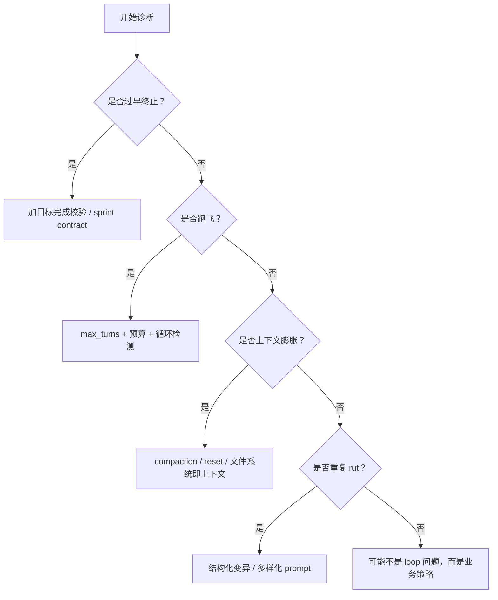

**图示来源**
- [Loop 工程页:347-383](file://apps/web/app/(dashboard)/architecture/loop/page.tsx#L347-L383)

**章节来源**
- [Loop 工程页:347-383](file://apps/web/app/(dashboard)/architecture/loop/page.tsx#L347-L383)

## 行业框架对照表
Loop 工程页与评估报告共同提供了以下对照：

| 框架 / 系统 | loop 原语 | 多 Agent | 终止 / 控制 | 亮点 | 与 agent-up 的对齐 |
|---|---|---|---|---|---|
| ReAct | Thought → Action → Observation | 否 | Finish[] / max-iter | 奠基范式 | L1 运行时骨架 |
| Anthropic 最小 | while + tools | subagent fan-out | 7 种终止条件 | 反对过度工程 | L2 的“人工中断门”= Release 审批 |
| OpenAI Agents SDK | Runner loop | handoff 一等公民 | max_turns / final | 单 loop 即多 Agent | L3 多 Agent 协作预留 |
| Manus | VM 内 loop | minimal | todo 完成 / 预算 | 上下文工程最深 | KV-cache、append-only、保留失败 |
| Claude Research | orchestrator-worker | fan-out 3-5+ | 信息充分 | 比单 Agent +90.2% | L3 跨 Agent 洞察 |
| LangGraph | cyclic StateGraph | map-reduce | END / 递归限 | 可检查点 / 可恢复 | Version 快照 ≈ 配置级 checkpoint |

**章节来源**
- [Loop 工程页:402-416](file://apps/web/app/(dashboard)/architecture/loop/page.tsx#L402-L416)
- [Harness / Loop 参考评估:143-153](file://docs/evaluation/2026-07-21-project-evaluation-and-harness-loop-reference.md#L143-L153)

## 代码级实现示例
为避免直接粘贴代码，这里用“路径 + 行为描述”的方式展示如何在系统中实现三个循环的协调工作。

### L1 协调入口：试聊 Playground 与 trace 落盘
- 前端入口：Agent 详情页的试聊 Playground
- 后端端点：`POST /api/agents/[id]/chat`
- 行为：
  - 加载当前 Agent 的 Prompt 配置
  - 调用 LLM 网关（小米 MiMo）
  - 将回复落盘为 trace
  - 支持后续 👍/👎 打分并沉淀为评测用例

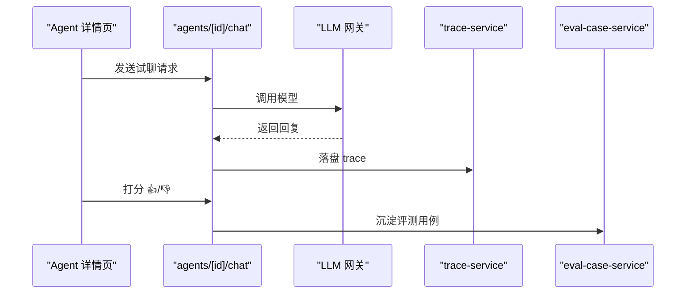

**图示来源**
- [README.md:338-347](file://README.md#L338-L347)
- [README.md:374-378](file://README.md#L374-L378)

**章节来源**
- [README.md:333-347](file://README.md#L333-L347)
- [README.md:374-378](file://README.md#L374-L378)

### L2 协调入口：反馈 → 归因 → 发布 → 回滚 → 效果报告
- 反馈入口：反馈管理页 + Chrome 插件 PoC
- 归因入口：`POST /api/feedback/[id]/insight`
- 发布入口：`POST /api/agents/[id]/release`
- 审批入口：`PUT /api/releases/[id]/review`
- 回滚入口：分区级 `/api/agents/[id]/config/[partition]/rollback` 与整版本 `/api/agents/[id]/rollback/[versionId]`
- 效果报告：发布 7 天后懒计算

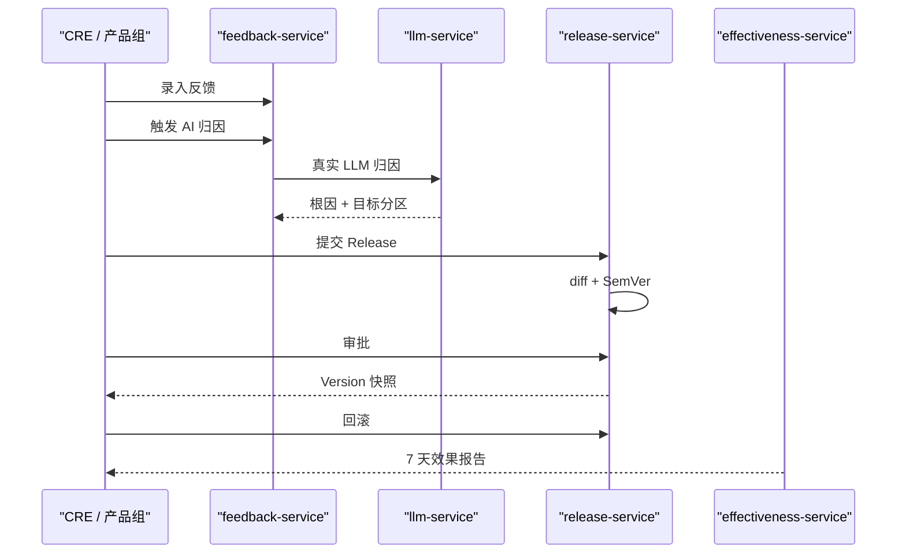

**图示来源**
- [README.md:50-60](file://README.md#L50-L60)
- [README.md:351-378](file://README.md#L351-L378)

**章节来源**
- [README.md:50-60](file://README.md#L50-L60)
- [README.md:351-378](file://README.md#L351-L378)

### L3 协调入口：未来蒸馏与自动采集
- 规划入口：WikiIngestJob 接 LLM，把反馈 / 会话转为草稿 wiki 页
- 自动采集：L1 会话结束 → 自动抽取问题 / 解决路径 / 评分 → 入反馈表
- 共享概念池：跨 vault 知识共享，减少每个 Agent 重复学基础知识

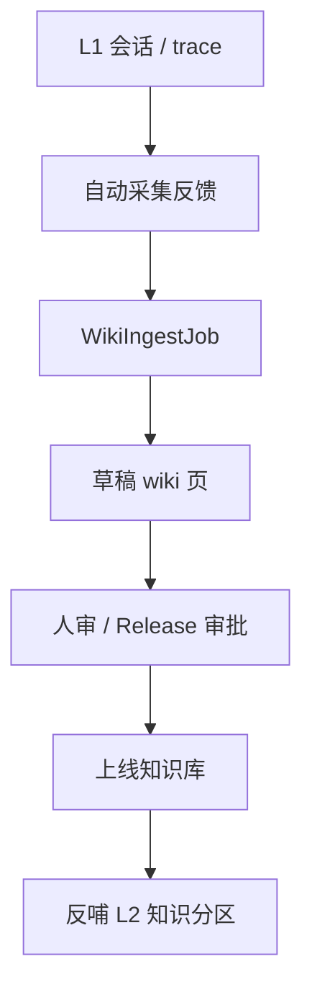

**图示来源**
- [改进路线图页:175-213](file://apps/web/app/(dashboard)/architecture/roadmap/page.tsx#L175-L213)

**章节来源**
- [改进路线图页:175-213](file://apps/web/app/(dashboard)/architecture/roadmap/page.tsx#L175-L213)

## 改进路线图
路线图页把 Harness / Loop 的业界经验转化为 agent-up 的优先级矩阵与分阶段路线：

- P0：可上线基线（鉴权 + RBAC 强制、Prisma 落地、审计真写、草稿态启用）
- P1：Harness 纪律（外部怀疑式 Evaluator、目标完成校验、diff 查看器 + 分区回滚、效果报告、灰度发布）
- P2：L3 智能化（Wiki 蒸馏引擎、L1 自动采集管道、熵清理 agent、Skill 沙箱执行、改进看板）
- P3：规模化（共享概念池、多租户、开放 API + Webhook、Skill 市场）

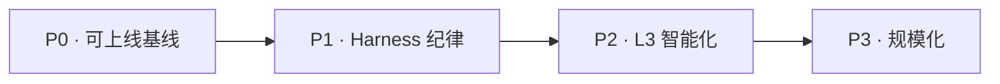

**图示来源**
- [改进路线图页:35-47](file://apps/web/app/(dashboard)/architecture/roadmap/page.tsx#L35-L47)

**章节来源**
- [改进路线图页:67-93](file://apps/web/app/(dashboard)/architecture/roadmap/page.tsx#L67-L93)
- [改进路线图页:95-229](file://apps/web/app/(dashboard)/architecture/roadmap/page.tsx#L95-L229)

## 结论
三层 Loop 在 agent-up 中的真实含义是：

- L1 是 Agent 的运行时环，负责分钟级的工单解答，但不由本平台构建。
- L2 是平台的核心，负责把“反馈 → 归因 → 改配置 → 审批 → 发布 → 回滚 → 效果报告”变成可审计、可回滚、可度量的产品流程。
- L3 是预留的智能进化环，负责跨 Agent 洞察、自动蒸馏、共享概念池和 L1 自动采集，把平台从“改进工具”升级为“自进化系统”。

agent-up 的真正差异化不在于“又一个 Agent 运行时”，而在于把 Harness 工程的机械约束、外部评估、可观测性和版本化，产品化给非开发者——让产品组和工单团队也能像 OpenAI / Anthropic 的 harness 工程师一样，持续改进 Agent。

**章节来源**
- [README.md:269-288](file://README.md#L269-L288)
- [架构总览页:325-358](file://apps/web/app/(dashboard)/architecture/page.tsx#L325-L358)
- [改进路线图页:324-358](file://apps/web/app/(dashboard)/architecture/roadmap/page.tsx#L324-L358)