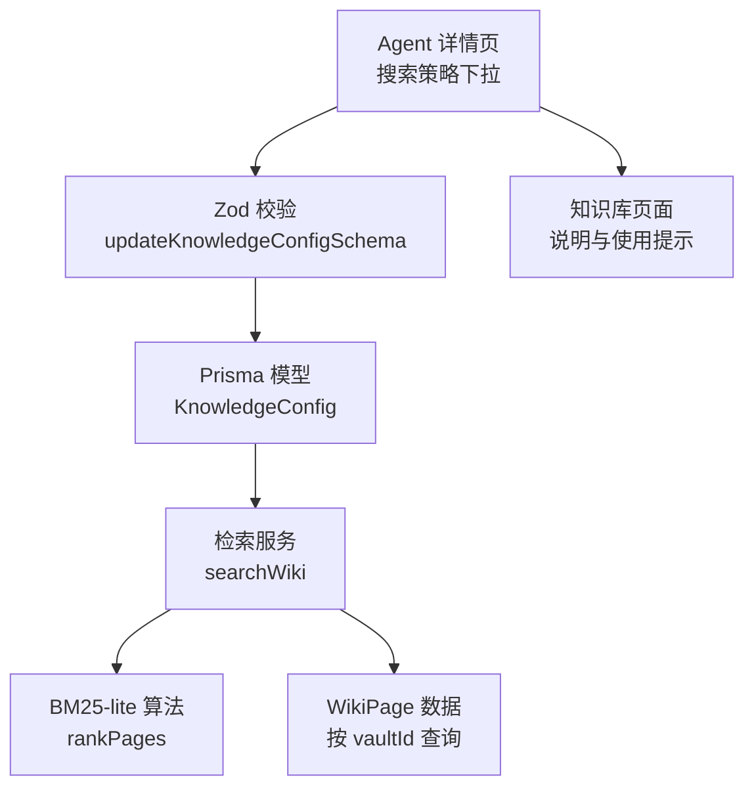
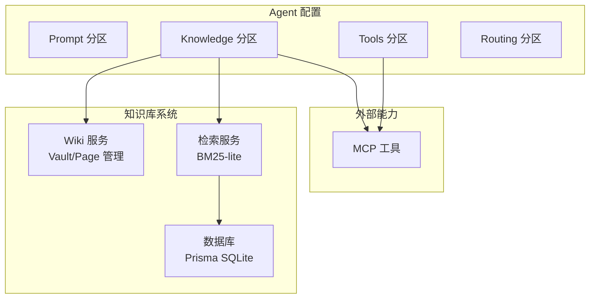
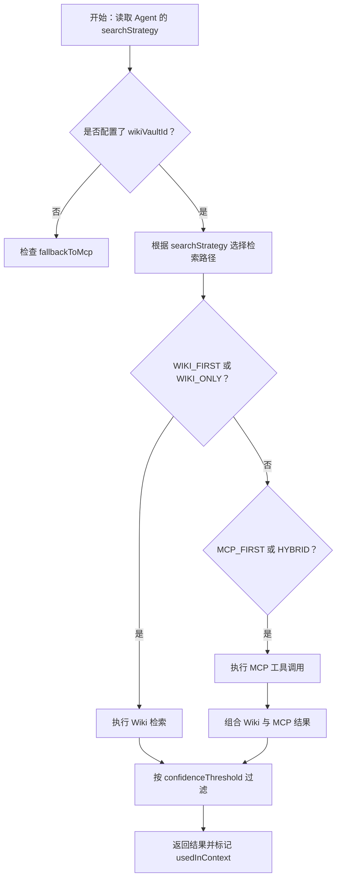
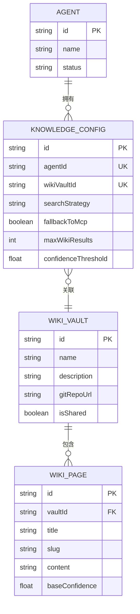
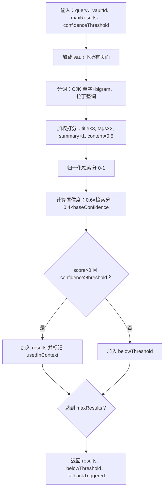
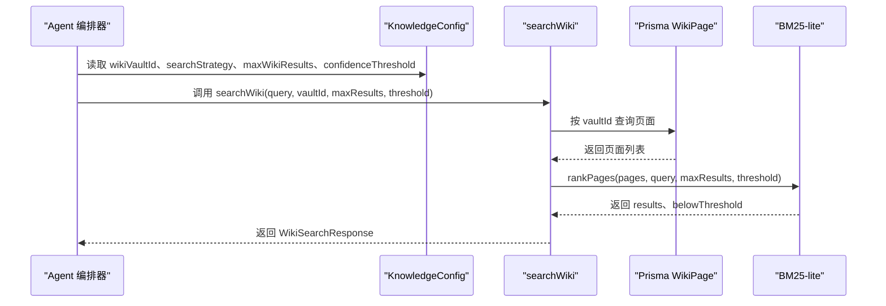
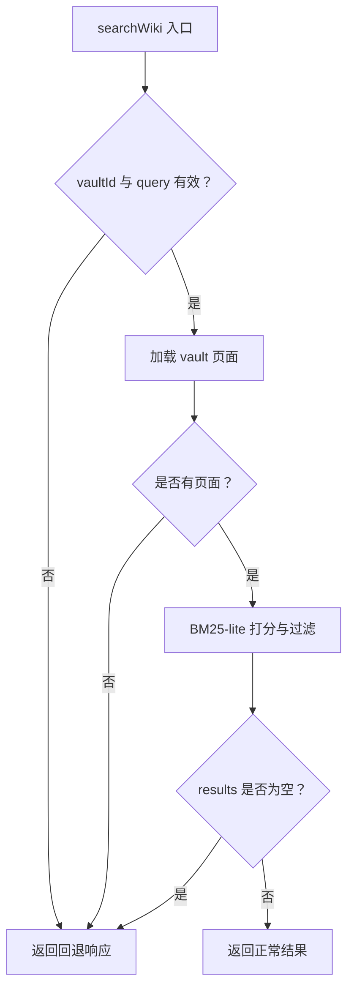

# Knowledge 分区（知识库配置）

<cite>
**本文引用的文件**   
- [apps/web/lib/schemas.ts](file://apps/web/lib/schemas.ts)
- [packages/db/src/enums.ts](file://packages/db/src/enums.ts)
- [packages/db/prisma/schema.prisma](file://packages/db/prisma/schema.prisma)
- [apps/web/lib/services/retrieval-service.ts](file://apps/web/lib/services/retrieval-service.ts)
- [apps/web/lib/retrieval-bm25.ts](file://apps/web/lib/retrieval-bm25.ts)
- [apps/web/app/(dashboard)/agents/[id]/agent-detail.tsx](file://apps/web/app/(dashboard)/agents/[id]/agent-detail.tsx)
- [apps/web/app/(dashboard)/wiki/page.tsx](file://apps/web/app/(dashboard)/wiki/page.tsx)
- [docs/skills/agent-up-services/references/wiki-service-component.md](file://docs/skills/agent-up-services/references/wiki-service-component.md)
</cite>

## 目录
1. [引言](#引言)
2. [项目结构定位](#项目结构定位)
3. [核心组件总览](#核心组件总览)
4. [架构总览](#架构总览)
5. [Knowledge 分区配置详解](#knowledge-分区配置详解)
6. [SearchStrategy 枚举与检索策略选择逻辑](#searchstrategy-枚举与检索策略选择逻辑)
7. [知识库与 Agent 的绑定关系](#知识库与-agent-的绑定关系)
8. [BM25-lite 检索算法与置信度机制](#bm25-lite-检索算法与置信度机制)
9. [配置示例与性能调优建议](#配置示例与性能调优建议)
10. [与知识库服务的集成模式](#与知识库服务的集成模式)
11. [错误处理与回退机制](#错误处理与回退机制)
12. [故障排查指南](#故障排查指南)
13. [结论](#结论)

## 引言
本文聚焦 Agent 四分区模型中的 **Knowledge 分区**，即“知识库配置”。它决定一个 Agent 在回答问题时如何访问、筛选和排序知识库内容，并决定是否在 Wiki 检索失败或结果不足时回退到 MCP 工具。文档从数据模型、运行时配置、搜索策略、检索算法、Agent 绑定关系、集成方式和错误处理等维度展开，帮助开发者理解“知识库配置”的设计意图与落地实现。

## 项目结构定位
Knowledge 分区不是单一文件，而是由以下层次共同构成：
- **输入校验层**：定义 `updateKnowledgeConfigSchema`，约束 `wikiVaultId`、`searchStrategy`、`fallbackToMcp`、`maxWikiResults`、`confidenceThreshold` 等字段类型与取值范围。
- **持久化层**：Prisma schema 中 `KnowledgeConfig` 模型将配置落库，并与 `Agent`、`WikiVault` 建立关联。
- **运行时检索层**：`retrieval-service.ts` 负责按 `vaultId` 加载页面、调用 BM25-lite 打分、组装搜索结果。
- **算法层**：`retrieval-bm25.ts` 提供零依赖的分词、打分、归一化和阈值切分逻辑。
- **前端交互层**：Agent 详情页提供搜索策略下拉框；Wiki 页面说明知识库与 Agent 的关系及检索语义。

**图表来源**
- [apps/web/lib/schemas.ts:30-36](file://apps/web/lib/schemas.ts#L30-L36)
- [packages/db/prisma/schema.prisma:119-136](file://packages/db/prisma/schema.prisma#L119-L136)
- [apps/web/lib/services/retrieval-service.ts:91-119](file://apps/web/lib/services/retrieval-service.ts#L91-L119)
- [apps/web/lib/retrieval-bm25.ts:143-197](file://apps/web/lib/retrieval-bm25.ts#L143-L197)
- [apps/web/app/(dashboard)/agents/[id]/agent-detail.tsx:924-951](file://apps/web/app/(dashboard)/agents/[id]/agent-detail.tsx#L924-L951)
- [apps/web/app/(dashboard)/wiki/page.tsx:181-193](file://apps/web/app/(dashboard)/wiki/page.tsx#L181-L193)

**章节来源**
- [apps/web/lib/schemas.ts:30-36](file://apps/web/lib/schemas.ts#L30-L36)
- [packages/db/prisma/schema.prisma:119-136](file://packages/db/prisma/schema.prisma#L119-L136)

## 核心组件总览
- **Knowledge 配置校验**：通过 Zod 定义可更新的字段集合，确保传入值合法。
- **Knowledge 配置存储**：`KnowledgeConfig` 表保存每个 Agent 的知识库偏好。
- **Wiki Vault 与 Page**：知识库元数据与知识页分别建模，支持 Git 同步、生命周期、层级、置信度等属性。
- **检索服务**：根据 `vaultId` 拉取页面，执行 BM25-lite 打分，返回结构化结果。
- **BM25-lite 算法**：对标题、标签、摘要、正文加权打分，结合 `baseConfidence` 计算最终置信度。

**章节来源**
- [apps/web/lib/schemas.ts:30-36](file://apps/web/lib/schemas.ts#L30-L36)
- [packages/db/prisma/schema.prisma:119-136](file://packages/db/prisma/schema.prisma#L119-L136)
- [packages/db/prisma/schema.prisma:397-454](file://packages/db/prisma/schema.prisma#L397-L454)
- [apps/web/lib/services/retrieval-service.ts:1-119](file://apps/web/lib/services/retrieval-service.ts#L1-L119)
- [apps/web/lib/retrieval-bm25.ts:1-197](file://apps/web/lib/retrieval-bm25.ts#L1-L197)

## 架构总览
Knowledge 分区在整体系统中的位置如下：

**图表来源**
- [packages/db/prisma/schema.prisma:66-99](file://packages/db/prisma/schema.prisma#L66-L99)
- [packages/db/prisma/schema.prisma:119-136](file://packages/db/prisma/schema.prisma#L119-L136)
- [apps/web/lib/services/retrieval-service.ts:1-15](file://apps/web/lib/services/retrieval-service.ts#L1-L15)
- [docs/skills/agent-up-services/references/wiki-service-component.md:17-32](file://docs/skills/agent-up-services/references/wiki-service-component.md#L17-L32)

## Knowledge 分区配置详解
Knowledge 分区的核心是“让 Agent 知道去哪里查资料、怎么查、查到多少、多可信才可用”。

| 配置项 | 类型 | 是否必填 | 默认值 | 作用说明 |
|---|---|---:|---|---|
| `wikiVaultId` | 字符串 | 否 | 空 | 关联的具体知识库实例 ID。为空表示该 Agent 没有绑定知识库。 |
| `searchStrategy` | 枚举 | 否 | `WIKI_FIRST` | 决定回答前优先走 Wiki 还是 MCP，以及是否混合。 |
| `fallbackToMcp` | 布尔 | 否 | 真 | 当 Wiki 检索无效或无结果时，是否允许回退到 MCP 工具。 |
| `maxWikiResults` | 整数 | 否 | 5 | 最大返回 Wiki 结果数，取值范围 1-50。 |
| `confidenceThreshold` | 浮点数 | 否 | 0.6 | 置信度阈值，低于该值的候选不进入上下文。 |

这些字段的权威校验定义位于更新知识库配置的 Zod schema 中，同时 Prisma 模型也保留了对应列，保证前端、后端、数据库三层一致。

**章节来源**
- [apps/web/lib/schemas.ts:30-36](file://apps/web/lib/schemas.ts#L30-L36)
- [packages/db/prisma/schema.prisma:119-136](file://packages/db/prisma/schema.prisma#L119-L136)

## SearchStrategy 枚举与检索策略选择逻辑
`SearchStrategy` 是 Knowledge 分区的关键决策点，当前支持四种策略：

| 策略值 | 含义 | 典型行为 |
|---|---|---|
| `WIKI_FIRST` | Wiki 优先 | 先尝试从绑定的 Wiki 知识库检索；若未命中或触发回退条件，再考虑 MCP。 |
| `WIKI_ONLY` | 仅 Wiki | 只使用 Wiki 知识库检索，不主动走 MCP。 |
| `MCP_FIRST` | MCP 优先 | 优先使用 MCP 工具；Wiki 作为补充或兜底。 |
| `HYBRID` | 混合模式 | 同时协调 Wiki 与 MCP，通常用于需要外部工具能力与内部知识结合的复杂场景。 |

枚举常量与类型定义集中在数据库枚举重建模块中，而前端 Agent 详情页的“搜索策略”下拉框直接暴露这四个选项，便于运营或管理员调整。

**图表来源**
- [packages/db/src/enums.ts:26-33](file://packages/db/src/enums.ts#L26-L33)
- [apps/web/app/(dashboard)/agents/[id]/agent-detail.tsx:924-951](file://apps/web/app/(dashboard)/agents/[id]/agent-detail.tsx#L924-L951)
- [apps/web/lib/services/retrieval-service.ts:91-119](file://apps/web/lib/services/retrieval-service.ts#L91-L119)

**章节来源**
- [packages/db/src/enums.ts:26-33](file://packages/db/src/enums.ts#L26-L33)
- [apps/web/app/(dashboard)/agents/[id]/agent-detail.tsx:924-951](file://apps/web/app/(dashboard)/agents/[id]/agent-detail.tsx#L924-L951)

## 知识库与 Agent 的绑定关系
Knowledge 分区通过 `wikiVaultId` 把 Agent 与具体知识库实例关联起来。数据库层面存在两条关键关系：

1. **Agent 到 KnowledgeConfig**：每个 Agent 最多一条 `KnowledgeConfig`，其中包含 `wikiVaultId`。
2. **KnowledgeConfig 到 WikiVault**：`wikiVaultId` 外键指向 `WikiVault.id`，从而确定 Agent 实际使用的知识库。
3. **WikiVault 到 Agent**：`WikiVault` 也有可选的 `agentId`，形成双向可读关系，但运行时以 `KnowledgeConfig.wikiVaultId` 为权威。

此外，Wiki 页面说明知识库对应四分区模型中的“知识”分区，共享知识库可以被多个 Agent 同时绑定，修改会影响所有绑定方。

**图表来源**
- [packages/db/prisma/schema.prisma:66-99](file://packages/db/prisma/schema.prisma#L66-L99)
- [packages/db/prisma/schema.prisma:119-136](file://packages/db/prisma/schema.prisma#L119-L136)
- [packages/db/prisma/schema.prisma:397-454](file://packages/db/prisma/schema.prisma#L397-L454)

**章节来源**
- [packages/db/prisma/schema.prisma:119-136](file://packages/db/prisma/schema.prisma#L119-L136)
- [packages/db/prisma/schema.prisma:397-454](file://packages/db/prisma/schema.prisma#L397-L454)
- [apps/web/app/(dashboard)/wiki/page.tsx:181-193](file://apps/web/app/(dashboard)/wiki/page.tsx#L181-L193)

## BM25-lite 检索算法与置信度机制
Knowledge 分区的 Wiki 检索并非简单关键词匹配，而是基于 BM25-lite 的本地文本检索。其核心流程包括：

1. **分词**：中文按单字与相邻双字 bigram 生成 token，拉丁字符按整词处理，停用虚词单字被丢弃以降低噪声。
2. **加权打分**：标题权重最高，其次是标签、摘要、正文；同时对 tf 做饱和处理，避免高频词过度放大。
3. **置信度计算**：检索得分归一化为 0-1，再与页面自身的 `baseConfidence` 加权合并，默认权重为 0.6 检索分 + 0.4 基础置信度。
4. **阈值过滤**：只有分数大于 0 且置信度不低于 `confidenceThreshold` 的结果才会进入 `results`，其余放入 `belowThreshold`。
5. **结果截断**：最多返回 `maxWikiResults` 条结果，超过阈值的页面会被标记为未进入上下文。

**图表来源**
- [apps/web/lib/retrieval-bm25.ts:77-133](file://apps/web/lib/retrieval-bm25.ts#L77-L133)
- [apps/web/lib/retrieval-bm25.ts:143-197](file://apps/web/lib/retrieval-bm25.ts#L143-L197)
- [apps/web/lib/services/retrieval-service.ts:59-119](file://apps/web/lib/services/retrieval-service.ts#L59-L119)

**章节来源**
- [apps/web/lib/retrieval-bm25.ts:1-197](file://apps/web/lib/retrieval-bm25.ts#L1-L197)
- [apps/web/lib/services/retrieval-service.ts:1-119](file://apps/web/lib/services/retrieval-service.ts#L1-L119)

## 配置示例与性能调优建议
以下示例展示不同搜索策略的使用场景与调优方向。为避免泄露具体代码，这里以配置结构和行为描述为主。

### 示例一：技术排障 Agent（Wiki 优先）
- `wikiVaultId`：绑定到“运维排障知识库”
- `searchStrategy`：`WIKI_FIRST`
- `fallbackToMcp`：`true`
- `maxWikiResults`：`5`
- `confidenceThreshold`：`0.6`

适用场景：Agent 主要依赖内部知识库回答常见问题，但在 Wiki 无法覆盖时允许调用 MCP 工具获取实时信息。

### 示例二：合规问答 Agent（仅 Wiki）
- `wikiVaultId`：绑定到“合规制度知识库”
- `searchStrategy`：`WIKI_ONLY`
- `fallbackToMcp`：`false`
- `maxWikiResults`：`3`
- `confidenceThreshold`：`0.7`

适用场景：答案必须来自已审核的内部知识，不允许外部工具干扰。

### 示例三：产品咨询 Agent（混合模式）
- `wikiVaultId`：绑定到“产品手册知识库”
- `searchStrategy`：`HYBRID`
- `fallbackToMcp`：`true`
- `maxWikiResults`：`5`
- `confidenceThreshold`：`0.5`

适用场景：既需要产品文档，又需要调用外部 API 查询库存、价格等动态数据。

### 性能调优建议
- 提高 `confidenceThreshold`：减少低质量结果进入上下文，提升答案稳定性，但可能降低召回率。
- 调整 `maxWikiResults`：知识库较大时可适当降低以减少 LLM 上下文压力；知识库较小时可适当提高以提升信息完整度。
- 优化页面质量：给高价值页面设置更高的 `baseConfidence`，有助于在混合置信度计算中胜出。
- 控制 Wiki 规模：Wiki 越大，BM25-lite 扫描成本越高；建议按业务域拆分知识库，并通过 `wikiVaultId` 精准绑定。

**章节来源**
- [apps/web/lib/schemas.ts:30-36](file://apps/web/lib/schemas.ts#L30-L36)
- [apps/web/lib/retrieval-bm25.ts:143-197](file://apps/web/lib/retrieval-bm25.ts#L143-L197)
- [apps/web/lib/services/retrieval-service.ts:91-119](file://apps/web/lib/services/retrieval-service.ts#L91-L119)

## 与知识库服务的集成模式
Knowledge 分区与知识库服务的集成分为两层：

1. **配置层**：Agent 的 `KnowledgeConfig` 保存 `wikiVaultId` 与检索策略，供上层编排器决定调用顺序。
2. **检索层**：`searchWiki` 直接读取 Prisma 中的 `WikiPage`，按 `vaultId` 过滤后执行 BM25-lite 打分。

Wiki 服务本身还承担 Vault 与 Page 的生命周期管理，包括创建、更新、删除、列表、分页、Git 同步等。需要注意的是，Wiki 服务对 page 的物理存储采用嵌套目录方式，删除语义为物理删除，这与 Agent 配置层的软删约定不同。

**图表来源**
- [packages/db/prisma/schema.prisma:119-136](file://packages/db/prisma/schema.prisma#L119-L136)
- [apps/web/lib/services/retrieval-service.ts:91-119](file://apps/web/lib/services/retrieval-service.ts#L91-L119)
- [apps/web/lib/retrieval-bm25.ts:143-197](file://apps/web/lib/retrieval-bm25.ts#L143-L197)

**章节来源**
- [apps/web/lib/services/retrieval-service.ts:1-119](file://apps/web/lib/services/retrieval-service.ts#L1-L119)
- [docs/skills/agent-up-services/references/wiki-service-component.md:17-36](file://docs/skills/agent-up-services/references/wiki-service-component.md#L17-L36)

## 错误处理与回退机制
Knowledge 分区的错误处理围绕“Wiki 不可用或无结果时如何处理”展开：

- 如果 `vaultId` 为空或查询为空，检索服务直接返回回退响应。
- 如果指定 `vaultId` 下没有页面，同样返回回退响应。
- 如果所有页面都低于 `confidenceThreshold`，`results` 为空，`fallbackTriggered` 为真。
- 非存在的 `vaultId` 也会被视为无结果，触发回退。

回退响应的关键字段包括：
- `strategy`：标识当前使用的检索策略。
- `candidates`：候选页面数量。
- `results`：进入上下文的页面。
- `belowThreshold`：未达阈值的页面清单。
- `fallbackTriggered`：是否触发了回退。

**图表来源**
- [apps/web/lib/services/retrieval-service.ts:51-57](file://apps/web/lib/services/retrieval-service.ts#L51-L57)
- [apps/web/lib/services/retrieval-service.ts:91-119](file://apps/web/lib/services/retrieval-service.ts#L91-L119)

**章节来源**
- [apps/web/lib/services/retrieval-service.ts:51-57](file://apps/web/lib/services/retrieval-service.ts#L51-L57)
- [apps/web/lib/services/retrieval-service.ts:91-119](file://apps/web/lib/services/retrieval-service.ts#L91-L119)

## 故障排查指南
当 Knowledge 分区出现异常时，可按以下思路排查：

1. **Agent 没有绑定知识库**
   - 检查 `wikiVaultId` 是否为空。
   - 确认 `KnowledgeConfig` 是否存在且关联正确的 `WikiVault`。
   - 预期行为：检索应触发回退，`fallbackTriggered` 为真。

2. **Wiki 检索结果为空**
   - 检查 `vaultId` 是否存在。
   - 检查该 vault 下是否有 `WikiPage`。
   - 检查 `confidenceThreshold` 是否过高。
   - 检查页面 `baseConfidence` 是否过低。

3. **搜索结果不符合预期**
   - 检查 `maxWikiResults` 是否过小。
   - 检查页面标题、标签、摘要、正文是否包含查询关键词。
   - 检查 BM25-lite 分词是否因中文停用词或单字权重导致偏差。

4. **Wiki 服务删除行为异常**
   - 注意 Wiki 服务对 Vault 和 Page 是物理删除。
   - 注意跨 vault 定位 page 会全量扫描，性能随 vault 数量线性增长。
   - 注意统计字段如 `pageCount`、`avgConfidence` 不会自动回写。

**章节来源**
- [apps/web/lib/services/retrieval-service.ts:91-119](file://apps/web/lib/services/retrieval-service.ts#L91-L119)
- [apps/web/lib/retrieval-bm25.ts:77-133](file://apps/web/lib/retrieval-bm25.ts#L77-L133)
- [docs/skills/agent-up-services/references/wiki-service-component.md:83-91](file://docs/skills/agent-up-services/references/wiki-service-component.md#L83-L91)

## 结论
Knowledge 分区是 Agent 知识能力的核心开关。它通过 `wikiVaultId` 绑定具体知识库，通过 `searchStrategy` 决定 Wiki 与 MCP 的调用顺序，通过 `fallbackToMcp` 控制回退行为，通过 `maxWikiResults` 控制结果规模，通过 `confidenceThreshold` 控制结果质量。底层检索使用 BM25-lite 对标题、标签、摘要、正文进行加权打分，并结合页面基础置信度形成最终评分。

在实际使用中，建议：
- 明确每个 Agent 的知识边界，避免跨库误配。
- 根据业务稳定性选择 `WIKI_ONLY` 或 `WIKI_FIRST`，仅在必要时启用 `HYBRID`。
- 合理设置置信度阈值与最大结果数，平衡召回率与上下文长度。
- 维护高质量 Wiki 页面，尤其是高价值页面的 `baseConfidence`。
- 关注 Wiki 服务的物理删除与统计字段不回写等已知限制，在生产环境中谨慎操作。