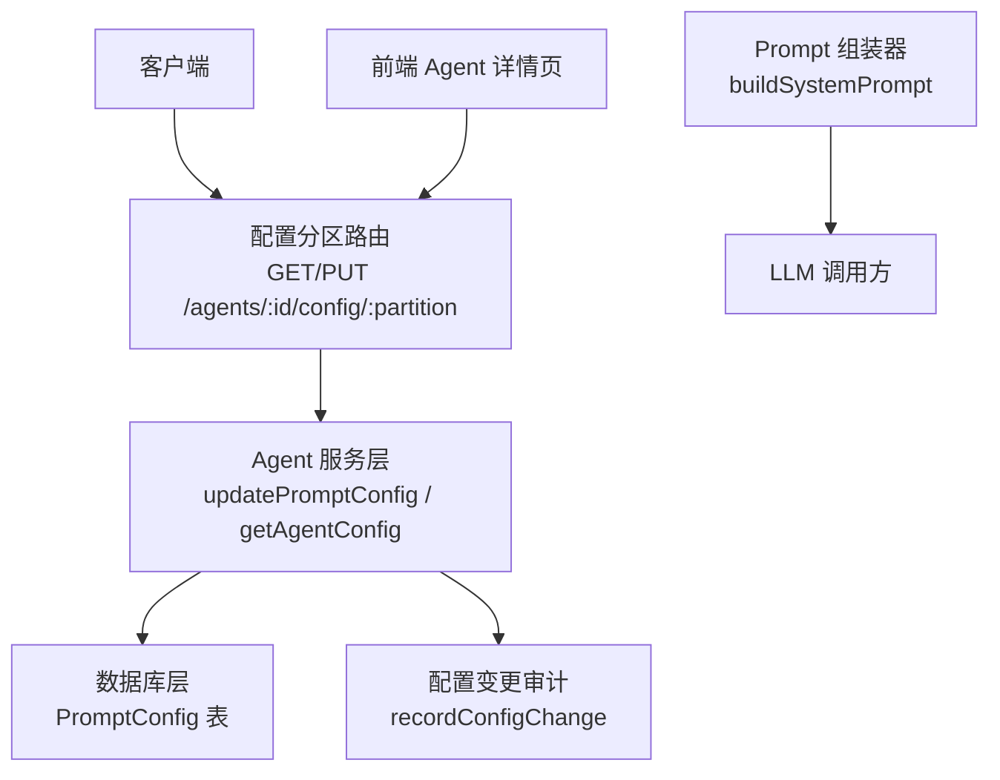
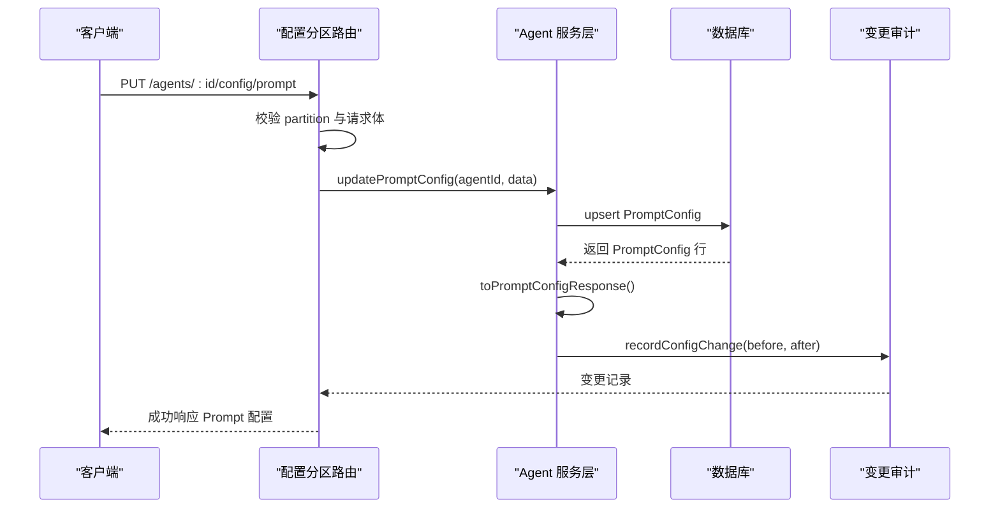
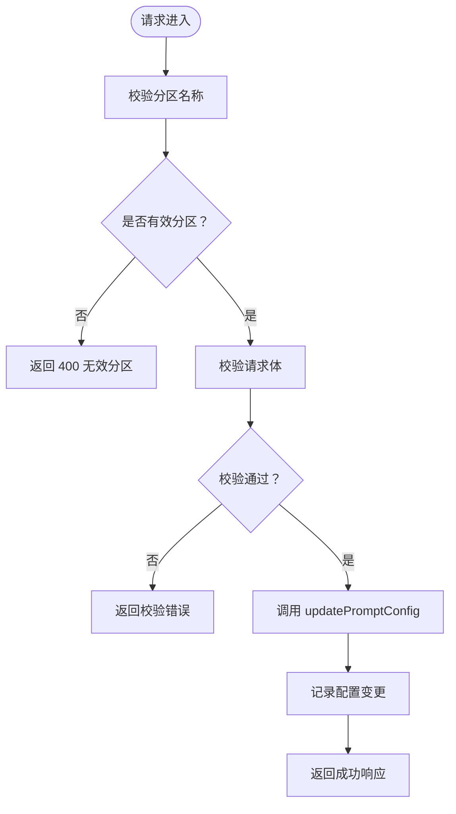
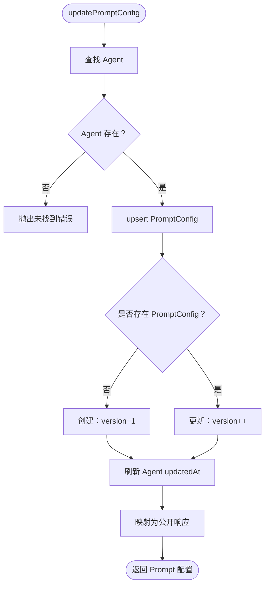
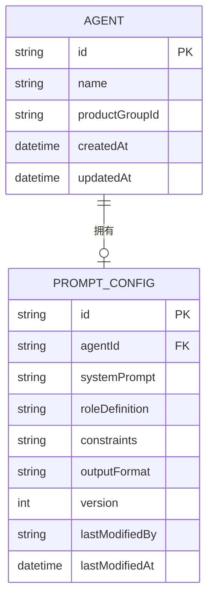
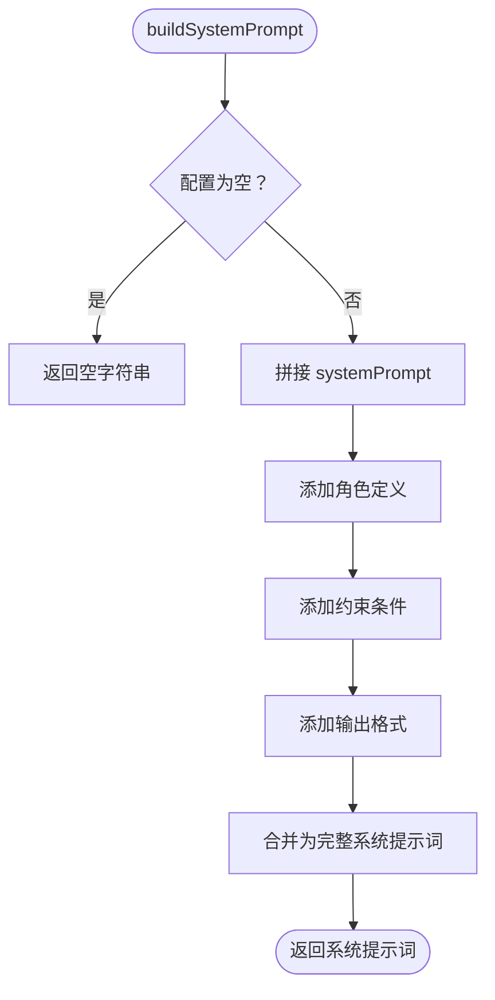
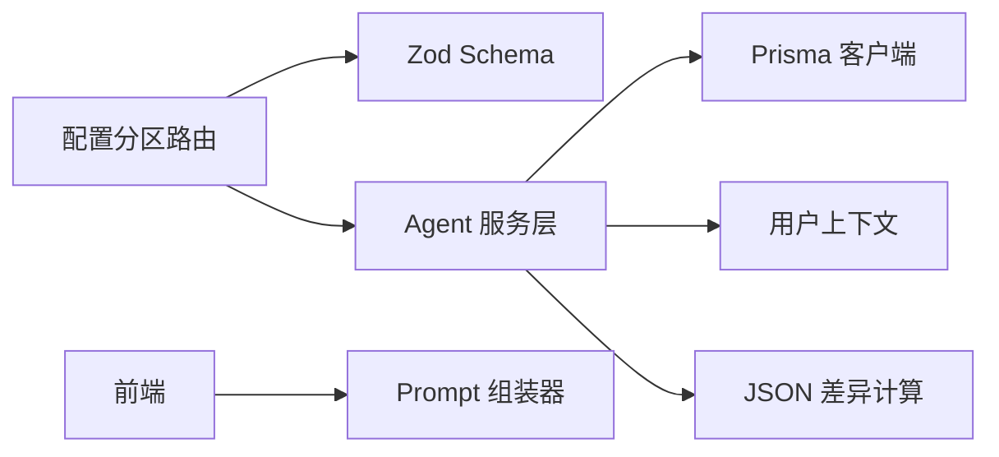

# Prompt 分区（系统提示词）

<cite>
**本文引用的文件**   
- [apps/web/app/api/agents/[id]/config/[partition]/route.ts](file://apps/web/app/api/agents/[id]/config/[partition]/route.ts)
- [apps/web/lib/services/agent-service.ts](file://apps/web/lib/services/agent-service.ts)
- [apps/web/lib/schemas.ts](file://apps/web/lib/schemas.ts)
- [packages/db/prisma/schema.prisma](file://packages/db/prisma/schema.prisma)
- [apps/web/lib/services/prompt-builder.ts](file://apps/web/lib/services/prompt-builder.ts)
- [apps/web/app/(dashboard)/agents/[id]/agent-detail.tsx](file://apps/web/app/(dashboard)/agents/[id]/agent-detail.tsx)
- [apps/web/lib/__tests__/agent-service.test.ts](file://apps/web/lib/__tests__/agent-service.test.ts)
</cite>

## 目录
1. [引言](#引言)
2. [项目结构定位](#项目结构定位)
3. [核心数据模型：PromptConfig](#核心数据模型promptconfig)
4. [架构总览](#架构总览)
5. [详细组件分析](#详细组件分析)
6. [依赖关系分析](#依赖关系分析)
7. [性能与一致性特征](#性能与一致性特征)
8. [API 调用示例](#api-调用示例)
9. [与 LLM 交互的使用场景与最佳实践](#与-llm-交互的使用场景与最佳实践)
10. [故障排查指南](#故障排查指南)
11. [结论](#结论)

## 引言
本文件聚焦 Agent 的 **Prompt 分区**，即“系统提示词”配置。该分区负责定义大语言模型在对话中使用的系统级指令、角色定义、约束条件以及期望的输出格式。它既是 Agent 行为控制的核心入口，也是评测、回滚、版本发布等流程的重要基线。

Prompt 分区的设计目标是：
- 将“系统提示词”拆分为可维护、可验证、可追踪的结构化配置。
- 通过 Zod Schema 做输入校验，通过 Prisma 持久化，并通过响应映射层屏蔽内部字段。
- 提供自动递增的版本号与修改人、修改时间审计能力。
- 为 LLM 组装稳定、可复现的系统提示词。

## 项目结构定位
Prompt 分区涉及四层：
- API 路由层：接收并校验请求，分发到服务层。
- 服务层：实现 upsert、版本递增、审计记录、响应映射。
- 数据模型层：Prisma schema 定义 PromptConfig 表结构。
- 使用层：前端表单编辑、Prompt 组装器生成最终 system prompt。



**图表来源**
- [apps/web/app/api/agents/[id]/config/[partition]/route.ts:28-85](file://apps/web/app/api/agents/[id]/config/[partition]/route.ts#L28-L85)
- [apps/web/lib/services/agent-service.ts:341-416](file://apps/web/lib/services/agent-service.ts#L341-L416)
- [packages/db/prisma/schema.prisma:105-117](file://packages/db/prisma/schema.prisma#L105-L117)
- [apps/web/lib/services/prompt-builder.ts:9-27](file://apps/web/lib/services/prompt-builder.ts#L9-L27)

**章节来源**
- [apps/web/app/api/agents/[id]/config/[partition]/route.ts:1-86](file://apps/web/app/api/agents/[id]/config/[partition]/route.ts#L1-L86)
- [apps/web/lib/services/agent-service.ts:341-416](file://apps/web/lib/services/agent-service.ts#L341-L416)
- [packages/db/prisma/schema.prisma:105-117](file://packages/db/prisma/schema.prisma#L105-L117)
- [apps/web/lib/services/prompt-builder.ts:1-27](file://apps/web/lib/services/prompt-builder.ts#L1-L27)

## 核心数据模型：PromptConfig
PromptConfig 是 Prompt 分区的持久化数据模型，对应数据库中的 `PromptConfig` 表。

| 字段 | 类型 | 是否必填 | 默认值 | 用途说明 | 验证规则 |
|---|---|---:|---:|---|---|
| `id` | 字符串 | 是 | 自动生成 | 主键 | 由 Prisma 生成 |
| `agentId` | 字符串 | 是 | 无 | 所属 Agent 外键 | 唯一约束，保证一个 Agent 一条 Prompt 配置 |
| `systemPrompt` | 字符串 | 是 | 无 | 系统提示词正文 | API 层要求非空字符串；数据库列不允许为空 |
| `roleDefinition` | 字符串或空 | 否 | 空 | 角色定义，用于帮助模型锁定人称与专业领域 | 可选，可为 null |
| `constraints` | JSON 文本 | 是 | `"[]"` | 约束条件数组，保存为 JSON 字符串 | 运行时为字符串数组；入库前序列化为 JSON |
| `outputFormat` | 字符串或空 | 否 | 空 | 输出格式约定，例如 Markdown、结构化 JSON 等 | 可选，可为 null |
| `version` | 整数 | 是 | `1` | 配置版本号，每次更新自增 | 创建时设为 1，更新时使用原子自增 |
| `lastModifiedBy` | 字符串或空 | 否 | 空 | 最后修改人标识 | 落库但不对外暴露 |
| `lastModifiedAt` | 时间戳 | 是 | 当前时间 | 最后修改时间 | 创建和更新时刷新 |

### 字段设计意图
- `systemPrompt` 是 Prompt 分区的核心，必须存在且非空。
- `roleDefinition` 作为补充信息，帮助模型更快理解自身身份与服务对象。
- `constraints` 以清单形式注入系统提示词，强调“绝对不能做”的行为边界。
- `outputFormat` 用于约束模型输出结构，便于下游解析或评测。
- `version` 提供轻量级配置版本追踪。
- `lastModifiedBy` 和 `lastModifiedAt` 提供审计线索，但 `lastModifiedBy` 不在公开响应中返回。

**章节来源**
- [packages/db/prisma/schema.prisma:105-117](file://packages/db/prisma/schema.prisma#L105-L117)
- [apps/web/lib/schemas.ts:23-28](file://apps/web/lib/schemas.ts#L23-L28)
- [apps/web/lib/services/agent-service.ts:77-86](file://apps/web/lib/services/agent-service.ts#L77-L86)

## 架构总览
Prompt 分区的数据流从 API 进入，经过校验、权限检查、upsert、响应映射，最终落库并记录变更。



**图表来源**
- [apps/web/app/api/agents/[id]/config/[partition]/route.ts:46-85](file://apps/web/app/api/agents/[id]/config/[partition]/route.ts#L46-L85)
- [apps/web/lib/services/agent-service.ts:360-416](file://apps/web/lib/services/agent-service.ts#L360-L416)
- [apps/web/lib/services/agent-service.ts:571-614](file://apps/web/lib/services/agent-service.ts#L571-L614)

## 详细组件分析

### API 路由：配置分区统一入口
路由 `/agents/:id/config/:partition` 同时支持 GET 和 PUT：
- GET：获取指定 Agent 的指定分区配置。
- PUT：更新指定分区配置，并记录变更。

对 Prompt 分区而言：
- 路由先校验 `partition` 是否为合法值。
- 使用 `PARTITION_SCHEMA.prompt` 校验请求体。
- 调用 `updatePromptConfig` 执行 upsert。
- 调用 `recordConfigChange` 记录 before/after 差异。



**图表来源**
- [apps/web/app/api/agents/[id]/config/[partition]/route.ts:28-85](file://apps/web/app/api/agents/[id]/config/[partition]/route.ts#L28-L85)
- [apps/web/lib/schemas.ts:23-60](file://apps/web/lib/schemas.ts#L23-L60)

**章节来源**
- [apps/web/app/api/agents/[id]/config/[partition]/route.ts:1-86](file://apps/web/app/api/agents/[id]/config/[partition]/route.ts#L1-L86)
- [apps/web/lib/schemas.ts:23-60](file://apps/web/lib/schemas.ts#L23-L60)

### 服务层：Prompt 配置 upsert 与版本控制
服务层 `updatePromptConfig` 复用通用分区更新逻辑 `updateConfigPartition`。对于 Prompt 分区：
- 如果不存在 PromptConfig 记录，则创建，初始 version 为 1。
- 如果已存在，则更新传入字段，并使用原子自增 version。
- 每次更新都会刷新 `lastModifiedAt` 和 `lastModifiedBy`。
- 同时将 Agent 的 `updatedAt` 刷新，便于列表排序。



**图表来源**
- [apps/web/lib/services/agent-service.ts:360-416](file://apps/web/lib/services/agent-service.ts#L360-L416)

**章节来源**
- [apps/web/lib/services/agent-service.ts:341-416](file://apps/web/lib/services/agent-service.ts#L341-L416)

### 数据模型层：PromptConfig 表结构
Prisma 中 PromptConfig 表的关键约束：
- `agentId` 唯一，确保每个 Agent 最多一条 Prompt 配置。
- `systemPrompt` 非空。
- `constraints` 默认值为空数组 JSON 字符串。
- `version` 默认值为 1。
- `lastModifiedBy` 和 `lastModifiedAt` 用于审计。



**图表来源**
- [packages/db/prisma/schema.prisma:66-99](file://packages/db/prisma/schema.prisma#L66-L99)
- [packages/db/prisma/schema.prisma:105-117](file://packages/db/prisma/schema.prisma#L105-L117)

**章节来源**
- [packages/db/prisma/schema.prisma:66-117](file://packages/db/prisma/schema.prisma#L66-L117)

### 输入校验：Zod Schema
Prompt 分区的输入校验由 `updatePromptConfigSchema` 定义：
- `systemPrompt`：必填字符串，最小长度 1。
- `roleDefinition`：可选字符串，可为 null。
- `constraints`：可选字符串数组。
- `outputFormat`：可选字符串，可为 null。

这保证了 API 层不会接受非法结构，避免脏数据进入数据库。

**章节来源**
- [apps/web/lib/schemas.ts:23-28](file://apps/web/lib/schemas.ts#L23-L28)

### 响应映射：隐藏内部字段
服务层 `toPromptConfigResponse` 将数据库行转换为公开响应：
- 保留 `systemPrompt`、`roleDefinition`、`constraints`、`outputFormat`、`version`、`lastModifiedAt`。
- 将 `constraints` 从 JSON 文本反序列化为字符串数组。
- 不返回 `lastModifiedBy` 和 `agentId`，避免泄露内部状态。

**章节来源**
- [apps/web/lib/services/agent-service.ts:77-86](file://apps/web/lib/services/agent-service.ts#L77-L86)

### Prompt 组装器：构建最终系统提示词
`buildSystemPrompt` 将 Prompt 分区配置拼接成完整系统提示词：
- 基础部分：`systemPrompt`。
- 可选部分：`roleDefinition`、`constraints`、`outputFormat`。
- 若某字段为空，则跳过对应段落。
- 最终结果是一个可直接发送给 LLM 的字符串。



**图表来源**
- [apps/web/lib/services/prompt-builder.ts:9-27](file://apps/web/lib/services/prompt-builder.ts#L9-L27)

**章节来源**
- [apps/web/lib/services/prompt-builder.ts:1-27](file://apps/web/lib/services/prompt-builder.ts#L1-L27)

### 前端编辑界面：用户如何填写 Prompt 分区
前端 Agent 详情页提供：
- “角色定义”文本框。
- “约束条件”多行文本框，每行一条约束。
- 保存时将多行文本按换行分割为数组，并过滤空行。

这使非技术用户也能直观维护 Prompt 分区。

**章节来源**
- [apps/web/app/(dashboard)/agents/[id]/agent-detail.tsx:863-893](file://apps/web/app/(dashboard)/agents/[id]/agent-detail.tsx#L863-L893)

## 依赖关系分析
Prompt 分区的依赖关系如下：
- API 路由依赖 Zod Schema 进行请求体验证。
- 服务层依赖 Prisma 客户端进行数据读写。
- 服务层依赖上下文获取当前操作人。
- 服务层依赖 diff 工具计算配置变更差异。
- 前端依赖 Prompt 组装器生成系统提示词。



**图表来源**
- [apps/web/app/api/agents/[id]/config/[partition]/route.ts:1-12](file://apps/web/app/api/agents/[id]/config/[partition]/route.ts#L1-L12)
- [apps/web/lib/services/agent-service.ts:1-20](file://apps/web/lib/services/agent-service.ts#L1-L20)
- [apps/web/lib/services/prompt-builder.ts:1-27](file://apps/web/lib/services/prompt-builder.ts#L1-L27)

**章节来源**
- [apps/web/app/api/agents/[id]/config/[partition]/route.ts:1-12](file://apps/web/app/api/agents/[id]/config/[partition]/route.ts#L1-L12)
- [apps/web/lib/services/agent-service.ts:1-20](file://apps/web/lib/services/agent-service.ts#L1-L20)

## 性能与一致性特征
- **upsert 语义**：首次写入创建记录，后续写入更新记录，避免重复插入。
- **原子版本递增**：使用数据库层的 `increment` 保证并发安全。
- **JSON 序列化**：`constraints` 以 JSON 文本存储，读取时反序列化为数组。
- **响应裁剪**：只返回必要字段，减少网络负载并隐藏内部字段。
- **审计记录**：每次更新记录 before/after/diff，便于回溯。

这些设计在保证一致性的同时，尽量降低复杂度，适合演示规模与中等规模部署。

[本节为通用性能讨论，不直接分析具体代码片段]

## API 调用示例

### 获取 Prompt 配置
- 方法：GET
- 路径：`/api/agents/:id/config/prompt`
- 成功响应包含：`systemPrompt`、`roleDefinition`、`constraints`、`outputFormat`、`version`、`lastModifiedAt`。
- 失败情况：
  - 分区无效：返回 400。
  - Agent 不存在：返回未找到错误。

### 创建 Prompt 配置
当某个 Agent 尚未有 Prompt 配置时，第一次 PUT 会创建记录，并将 `version` 设为 1。

- 方法：PUT
- 路径：`/api/agents/:id/config/prompt`
- 请求体关键字段：
  - `systemPrompt`：必填字符串。
  - `roleDefinition`：可选字符串或 null。
  - `constraints`：可选字符串数组。
  - `outputFormat`：可选字符串或 null。

### 更新 Prompt 配置
第二次及之后的 PUT 会更新传入字段，并将 `version` 自增。

- 方法：PUT
- 路径：`/api/agents/:id/config/prompt`
- 行为：
  - 未传入字段保持不变。
  - `version` 自动递增。
  - `lastModifiedAt` 刷新为当前时间。
  - `lastModifiedBy` 落库但不返回。

### 典型请求体示例
以下示例仅展示字段结构，不包含敏感内容：

- 创建 Prompt 配置：
  ```json
  {
    "systemPrompt": "你是一个专业的技术支持助手",
    "roleDefinition": "面向中小企业运维人员的云产品答疑助手",
    "constraints": ["不要回答与产品无关的问题", "涉及价格时提醒用户查看官网"],
    "outputFormat": "Markdown"
  }
  ```

- 更新 Prompt 配置：
  ```json
  {
    "systemPrompt": "你是 ECS 助手",
    "constraints": ["不回答无关问题"]
  }
  ```

**章节来源**
- [apps/web/app/api/agents/[id]/config/[partition]/route.ts:28-85](file://apps/web/app/api/agents/[id]/config/[partition]/route.ts#L28-L85)
- [apps/web/lib/schemas.ts:23-28](file://apps/web/lib/schemas.ts#L23-L28)
- [apps/web/lib/__tests__/agent-service.test.ts:81-117](file://apps/web/lib/__tests__/agent-service.test.ts#L81-L117)

## 与 LLM 交互的使用场景与最佳实践

### 使用场景
- **试聊 Playground**：用户编辑 Prompt 分区后，系统使用 `buildSystemPrompt` 生成系统提示词，并与用户消息一起发送给 LLM。
- **发布评测**：发布快照中包含 Prompt 分区配置，评测 replay 使用相同组装逻辑，保证行为一致性。
- **回滚与版本管理**：Prompt 分区的 `version` 与发布版本配合，便于定位历史行为。

### 最佳实践
- 将“系统提示词”放在 `systemPrompt`，明确任务目标、语气、范围。
- 使用 `roleDefinition` 快速锁定模型身份和服务对象。
- 使用 `constraints` 列出硬性禁止项，避免模型越界。
- 使用 `outputFormat` 规范输出结构，便于解析和评测。
- 保持 `systemPrompt` 简洁清晰，复杂规则放入 `constraints`。
- 频繁迭代时关注 `version` 变化，结合发布记录和审计日志定位问题。

[本节为概念性指导，不直接分析具体代码片段]

## 故障排查指南

### 常见错误
- **系统提示词为空**：Zod 校验失败，因为 `systemPrompt` 必填。
- **分区名称错误**：路由拒绝非 `prompt`、`knowledge`、`tools`、`routing` 的值。
- **Agent 不存在**：服务层抛出未找到错误。
- **constraints 不是数组**：虽然 API 层允许传入数组，但服务层会将其序列化为 JSON 文本；若外部系统直接写库，需遵循该约定。

### 调试建议
- 检查 API 请求体是否符合 `updatePromptConfigSchema`。
- 查看响应中是否包含 `version` 和 `lastModifiedAt`。
- 确认 `lastModifiedBy` 未出现在公开响应中。
- 使用配置变更审计接口查看 before/after/diff。

**章节来源**
- [apps/web/lib/schemas.ts:23-28](file://apps/web/lib/schemas.ts#L23-L28)
- [apps/web/app/api/agents/[id]/config/[partition]/route.ts:28-57](file://apps/web/app/api/agents/[id]/config/[partition]/route.ts#L28-L57)
- [apps/web/lib/services/agent-service.ts:341-416](file://apps/web/lib/services/agent-service.ts#L341-L416)
- [apps/web/lib/services/agent-service.ts:571-614](file://apps/web/lib/services/agent-service.ts#L571-L614)

## 结论
Prompt 分区是 Agent 系统提示词的核心配置单元。它通过结构化字段、严格校验、原子版本控制和审计记录，提供了稳定、可追溯、可发布的系统提示词管理能力。对于 LLM 交互，建议将任务目标、角色定义、约束条件和输出格式分别放在合适字段中，以获得更可控、更可评测的模型行为。

[本节为总结性内容，不直接分析具体代码片段]