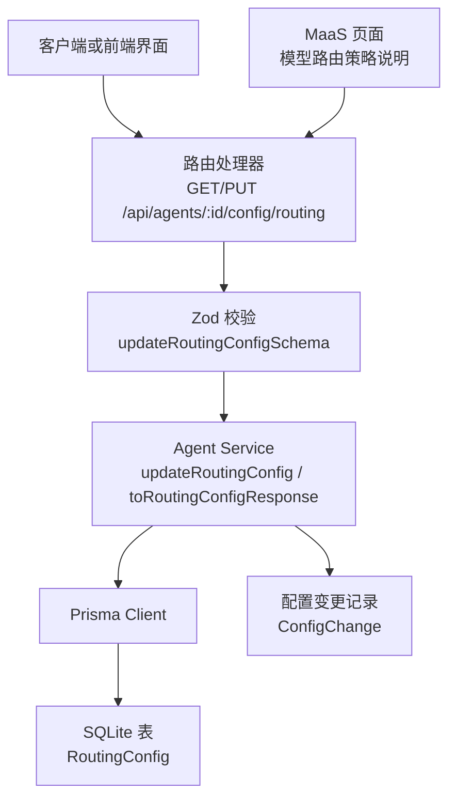
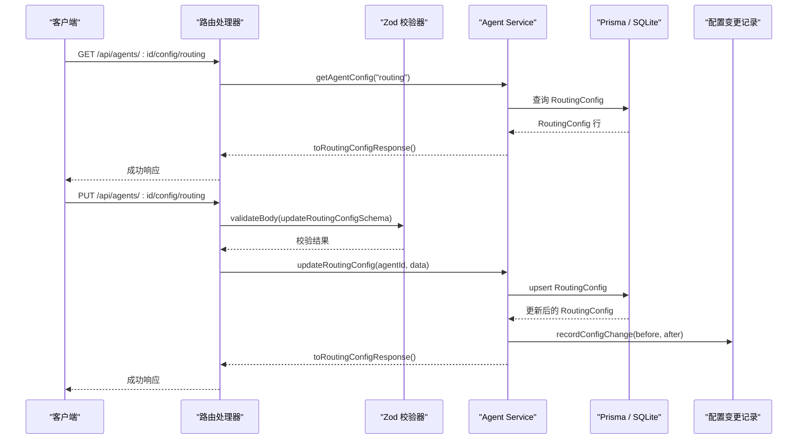
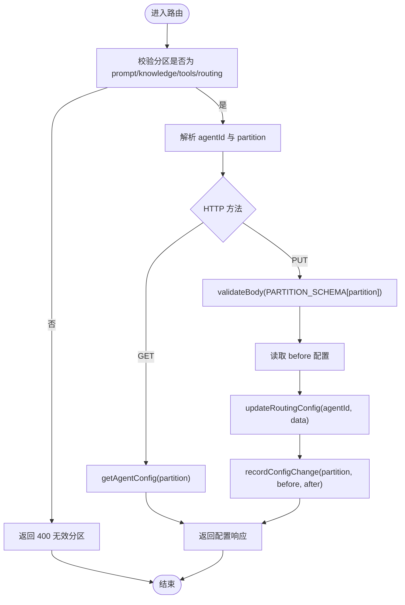
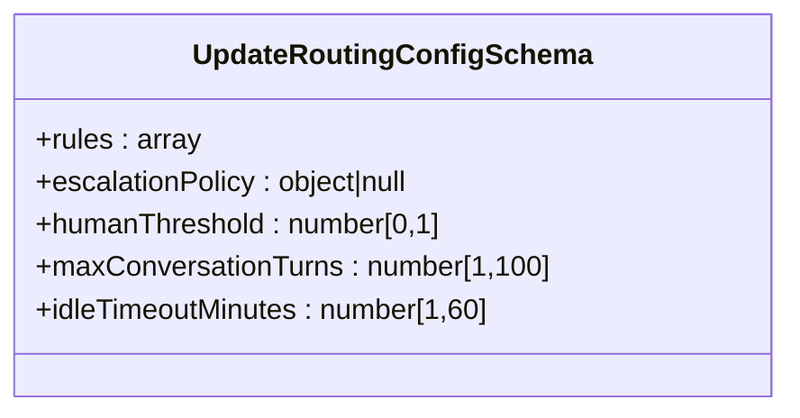
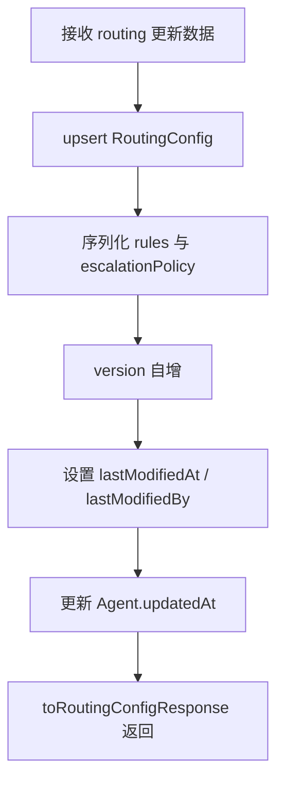
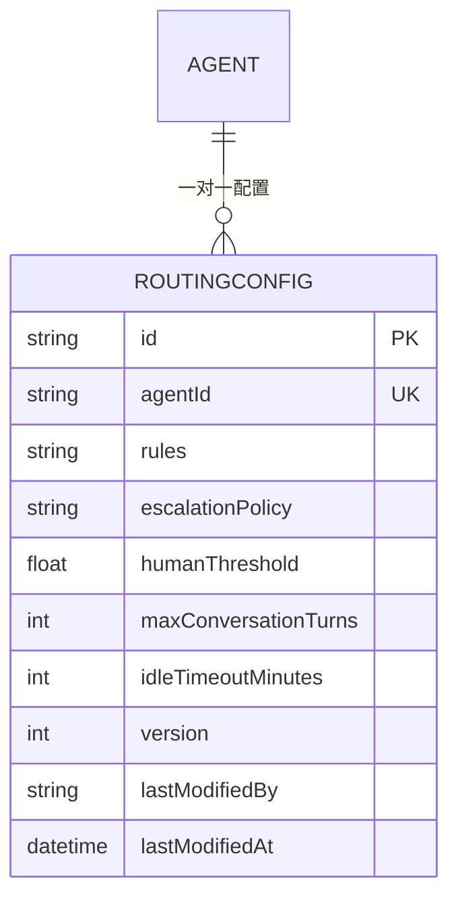
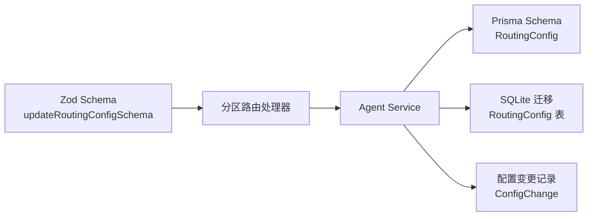

# Routing 分区（路由配置）

<cite>
**本文引用的文件**   
- [apps/web/lib/schemas.ts](file://apps/web/lib/schemas.ts)
- [apps/web/app/api/agents/[id]/config/[partition]/route.ts](file://apps/web/app/api/agents/[id]/config/[partition]/route.ts)
- [apps/web/lib/services/agent-service.ts](file://apps/web/lib/services/agent-service.ts)
- [packages/db/prisma/schema.prisma](file://packages/db/prisma/schema.prisma)
- [packages/db/prisma/migrations/20261005033611_init_sqlite/migration.sql](file://packages/db/prisma/migrations/20261005033611_init_sqlite/migration.sql)
- [docs/superpowers/plans/2026-09-11-prisma-persistence-batch3.md](file://docs/superpowers/plans/2026-09-11-prisma-persistence-batch3.md)
- [apps/web/app/(dashboard)/maas/page.tsx](file://apps/web/app/(dashboard)/maas/page.tsx)
</cite>

## 目录
1. [简介](#简介)
2. [项目结构中的 Routing 分区定位](#项目结构中的-routing-分区定位)
3. [核心概念与配置项](#核心概念与配置项)
4. [架构总览](#架构总览)
5. [详细组件分析](#详细组件分析)
6. [依赖关系分析](#依赖关系分析)
7. [性能与可扩展性](#性能与可扩展性)
8. [故障排查指南](#故障排查指南)
9. [结论](#结论)

## 简介
Routing 分区是 Agent 配置的四大分区之一，负责把“模型路由策略”从代码中解耦出来，变成可发布、可回滚、可审计的配置。它通过 `rules` 描述规则集合，通过 `escalationPolicy` 定义升级策略，并通过 `humanThreshold`、`maxConversationTurns`、`idleTimeoutMinutes` 控制人机协作和会话生命周期。当前仓库中，Routing 分区的运行时匹配逻辑尚未实现；现有代码主要完成：
- 输入校验
- 持久化存储
- API 暴露
- 版本快照与变更审计
- 前端展示语义说明

因此，本文在解释“设计意图”时，会明确区分“已实现部分”和“待实现部分”。

## 项目结构中的 Routing 分区定位
Routing 分区贯穿以下层次：
- 接口层：Next.js Route Handler 接收 `/api/agents/:id/config/routing` 请求。
- 校验层：Zod schema 限定字段类型与取值范围。
- 服务层：Agent Service 负责 upsert、JSON 序列化、版本号递增、审计记录。
- 数据层：Prisma Schema 与 SQLite 迁移定义 `RoutingConfig` 表结构。
- 文档与演示层：计划文档与 MaaS 页面说明 Routing 的业务价值。

**图表来源**
- [apps/web/app/api/agents/[id]/config/[partition]/route.ts:14-80](file://apps/web/app/api/agents/[id]/config/[partition]/route.ts#L14-L80)
- [apps/web/lib/schemas.ts:46-60](file://apps/web/lib/schemas.ts#L46-L60)
- [apps/web/lib/services/agent-service.ts:502-546](file://apps/web/lib/services/agent-service.ts#L502-L546)
- [packages/db/prisma/schema.prisma:154-168](file://packages/db/prisma/schema.prisma#L154-L168)
- [packages/db/prisma/migrations/20261005033611_init_sqlite/migration.sql:93-106](file://packages/db/prisma/migrations/20261005033611_init_sqlite/migration.sql#L93-L106)

**章节来源**
- [apps/web/app/api/agents/[id]/config/[partition]/route.ts:14-80](file://apps/web/app/api/agents/[id]/config/[partition]/route.ts#L14-L80)
- [apps/web/lib/schemas.ts:46-60](file://apps/web/lib/schemas.ts#L46-L60)
- [apps/web/lib/services/agent-service.ts:502-546](file://apps/web/lib/services/agent-service.ts#L502-L546)
- [packages/db/prisma/schema.prisma:154-168](file://packages/db/prisma/schema.prisma#L154-L168)
- [packages/db/prisma/migrations/20261005033611_init_sqlite/migration.sql:93-106](file://packages/db/prisma/migrations/20261005033611_init_sqlite/migration.sql#L93-L106)

## 核心概念与配置项
Routing 分区的配置对象由 Zod schema 定义，并在响应层原样返回。关键字段如下：

| 配置项 | 类型与约束 | 默认值 | 含义与设计意图 |
|---|---|---:|---|
| `rules` | 数组，允许任意元素，可选 | 未传时服务端落库为空数组 | 路由规则集合。当前 schema 使用 `z.array(z.any())`，表示规则的具体结构由业务约定而非强类型约束；实际运行时匹配逻辑尚未实现。 |
| `escalationPolicy` | 任意对象或 null，可选 | 未传时服务端落库为 null | 升级策略对象。用于定义当机器无法处理或置信度低于阈值时的升级路径，例如升级到更贵模型、人工介入或外部系统。 |
| `humanThreshold` | 数值，范围 `[0, 1]`，可选 | 数据库默认 `0.3` | 人机协作阈值。当模型判断的解决信心低于该阈值时，应触发升级或转人工。 |
| `maxConversationTurns` | 整数，范围 `[1, 100]`，可选 | 数据库默认 `10` | 最大对话轮次。超过该轮次后应结束自动对话，避免无限循环。 |
| `idleTimeoutMinutes` | 整数，范围 `[1, 60]`，可选 | 数据库默认 `5` | 空闲超时时间。会话长时间无交互时应清理资源并结束会话。 |

这些字段在 schema 层只做轻量校验，真正的业务语义由上层运行时代码实现。当前仓库中，routing 的运行时匹配、升级决策、会话状态机均未出现具体实现，但 schema 与存储已经为后续扩展预留了完整契约。

**章节来源**
- [apps/web/lib/schemas.ts:46-52](file://apps/web/lib/schemas.ts#L46-L52)
- [packages/db/prisma/schema.prisma:154-168](file://packages/db/prisma/schema.prisma#L154-L168)
- [packages/db/prisma/migrations/20261005033611_init_sqlite/migration.sql:93-106](file://packages/db/prisma/migrations/20261005033611_init_sqlite/migration.sql#L93-L106)
- [docs/superpowers/plans/2026-09-11-prisma-persistence-batch3.md:93-100](file://docs/superpowers/plans/2026-09-11-prisma-persistence-batch3.md#L93-L100)

## 架构总览
Routing 分区的整体调用链如下：

**图表来源**
- [apps/web/app/api/agents/[id]/config/[partition]/route.ts:28-80](file://apps/web/app/api/agents/[id]/config/[partition]/route.ts#L28-L80)
- [apps/web/lib/services/agent-service.ts:341-357](file://apps/web/lib/services/agent-service.ts#L341-L357)
- [apps/web/lib/services/agent-service.ts:502-546](file://apps/web/lib/services/agent-service.ts#L502-L546)
- [apps/web/lib/services/agent-service.ts:571-614](file://apps/web/lib/services/agent-service.ts#L571-L614)

## 详细组件分析

### 接口层：分区配置路由
路由处理器统一处理四个分区，其中 routing 分区与其他分区共享相同流程：
- 校验分区名是否合法。
- GET 请求读取配置。
- PUT 请求先读取 before 快照，再写入 after，最后记录变更。
- 所有写操作都通过 `withActor` 注入审计上下文。

**图表来源**
- [apps/web/app/api/agents/[id]/config/[partition]/route.ts:14-80](file://apps/web/app/api/agents/[id]/config/[partition]/route.ts#L14-L80)

**章节来源**
- [apps/web/app/api/agents/[id]/config/[partition]/route.ts:14-80](file://apps/web/app/api/agents/[id]/config/[partition]/route.ts#L14-L80)

### 校验层：updateRoutingConfigSchema
Zod schema 对 routing 配置做了边界保护：
- `rules` 允许空数组或任意规则对象数组。
- `escalationPolicy` 允许 null，便于显式清空升级策略。
- `humanThreshold` 限制在 0 到 1 之间，适合概率型阈值。
- `maxConversationTurns` 限制 1 到 100，防止极端轮次。
- `idleTimeoutMinutes` 限制 1 到 60，避免过短或过长空闲时间。

**图表来源**
- [apps/web/lib/schemas.ts:46-52](file://apps/web/lib/schemas.ts#L46-L52)

**章节来源**
- [apps/web/lib/schemas.ts:46-52](file://apps/web/lib/schemas.ts#L46-L52)

### 服务层：Routing 配置读写
服务层是 Routing 分区的核心编排点：
- `toRoutingConfigResponse` 将数据库行转换为对外响应对象。
- `updateRoutingConfig` 使用 upsert 合并语义，未传入字段保留旧值。
- JSON 字段通过 `packJson` / `unpackJson` 安全序列化。
- 每次更新都会递增 version，并记录 lastModifiedAt 与 lastModifiedBy。
- 最终还会更新 Agent 的 updatedAt，使 Agent 列表能感知配置变化。

**图表来源**
- [apps/web/lib/services/agent-service.ts:112-121](file://apps/web/lib/services/agent-service.ts#L112-L121)
- [apps/web/lib/services/agent-service.ts:502-546](file://apps/web/lib/services/agent-service.ts#L502-L546)

**章节来源**
- [apps/web/lib/services/agent-service.ts:112-121](file://apps/web/lib/services/agent-service.ts#L112-L121)
- [apps/web/lib/services/agent-service.ts:502-546](file://apps/web/lib/services/agent-service.ts#L502-L546)

### 数据层：RoutingConfig 表结构
数据库层定义了 Routing 分区的物理存储结构。关键字段包括：
- `rules`：存储路由规则数组的 JSON 文本。
- `escalationPolicy`：存储升级策略对象的 JSON 文本，可为 null。
- `humanThreshold`：浮点数，默认 0.3。
- `maxConversationTurns`：整数，默认 10。
- `idleTimeoutMinutes`：整数，默认 5。
- `version`：配置版本，用于乐观锁与发布快照。
- `lastModifiedBy` / `lastModifiedAt`：审计追踪。

**图表来源**
- [packages/db/prisma/schema.prisma:154-168](file://packages/db/prisma/schema.prisma#L154-L168)
- [packages/db/prisma/migrations/20261005033611_init_sqlite/migration.sql:93-106](file://packages/db/prisma/migrations/20261005033611_init_sqlite/migration.sql#L93-L106)

**章节来源**
- [packages/db/prisma/schema.prisma:154-168](file://packages/db/prisma/schema.prisma#L154-L168)
- [packages/db/prisma/migrations/20261005033611_init_sqlite/migration.sql:93-106](file://packages/db/prisma/migrations/20261005033611_init_sqlite/migration.sql#L93-L106)

### 业务语义与文档说明
MaaS 页面明确表达了 Routing 分区的业务价值：模型路由策略不是写死在代码里，而是通过分类用不同模型、降级用其他模型的方式，把质量、成本、时延三角变成可配置的路由规则。这解释了为什么 `rules` 和 `escalationPolicy` 需要作为独立分区存在，而不是嵌入 prompt 或 tools 配置。

**章节来源**
- [apps/web/app/(dashboard)/maas/page.tsx:82-89](file://apps/web/app/(dashboard)/maas/page.tsx#L82-L89)

## 依赖关系分析
Routing 分区的依赖关系如下：

**图表来源**
- [apps/web/lib/schemas.ts:46-60](file://apps/web/lib/schemas.ts#L46-L60)
- [apps/web/app/api/agents/[id]/config/[partition]/route.ts:14-80](file://apps/web/app/api/agents/[id]/config/[partition]/route.ts#L14-L80)
- [apps/web/lib/services/agent-service.ts:502-546](file://apps/web/lib/services/agent-service.ts#L502-L546)
- [packages/db/prisma/schema.prisma:154-168](file://packages/db/prisma/schema.prisma#L154-L168)
- [packages/db/prisma/migrations/20261005033611_init_sqlite/migration.sql:93-106](file://packages/db/prisma/migrations/20261005033611_init_sqlite/migration.sql#L93-L106)

**章节来源**
- [apps/web/lib/schemas.ts:46-60](file://apps/web/lib/schemas.ts#L46-L60)
- [apps/web/app/api/agents/[id]/config/[partition]/route.ts:14-80](file://apps/web/app/api/agents/[id]/config/[partition]/route.ts#L14-L80)
- [apps/web/lib/services/agent-service.ts:502-546](file://apps/web/lib/services/agent-service.ts#L502-L546)
- [packages/db/prisma/schema.prisma:154-168](file://packages/db/prisma/schema.prisma#L154-L168)
- [packages/db/prisma/migrations/20261005033611_init_sqlite/migration.sql:93-106](file://packages/db/prisma/migrations/20261005033611_init_sqlite/migration.sql#L93-L106)

## 性能与可扩展性
从现有实现看，Routing 分区在性能上具有以下特点：
- 配置读取与更新走单表 upsert，复杂度低。
- JSON 字段以字符串形式存储，序列化/反序列化开销较小。
- version 字段支持未来做乐观并发控制。
- 配置变更会记录 diff，便于审计与回滚。

可扩展方向包括：
- 为 `rules` 引入结构化 schema，替代 `z.any()`，提升规则校验能力。
- 在 service 层增加路由匹配引擎，按优先级顺序执行规则。
- 在会话层实现 `humanThreshold`、`maxConversationTurns`、`idleTimeoutMinutes` 的状态机。
- 将 `escalationPolicy` 与外部升级通道集成，例如人工工单、更高级模型、外部系统。

**章节来源**
- [apps/web/lib/services/agent-service.ts:502-546](file://apps/web/lib/services/agent-service.ts#L502-L546)
- [apps/web/lib/services/agent-service.ts:571-614](file://apps/web/lib/services/agent-service.ts#L571-L614)
- [apps/web/lib/schemas.ts:46-52](file://apps/web/lib/schemas.ts#L46-L52)

## 故障排查指南
常见问题与排查建议：

| 问题现象 | 可能原因 | 排查方式 |
|---|---|---|
| 更新 routing 配置时报参数错误 | `humanThreshold`、`maxConversationTurns`、`idleTimeoutMinutes` 超出 schema 范围 | 检查 Zod schema 约束，确认数值在允许范围内 |
| 升级策略丢失 | `escalationPolicy` 被设置为 null | 确认 PUT 请求体是否正确传递对象，而非 null |
| 规则不生效 | 运行时匹配逻辑尚未实现 | 检查是否有路由引擎实现；当前仅完成配置存储 |
| 配置变更后未看到审计记录 | `recordConfigChange` 未执行或审计服务异常 | 查看路由处理器是否在更新后调用变更记录 |
| 数据库字段异常 | JSON 序列化失败或字段类型不符 | 检查 `packJson` / `unpackJson` 行为及 Prisma 字段类型 |

**章节来源**
- [apps/web/lib/schemas.ts:46-52](file://apps/web/lib/schemas.ts#L46-L52)
- [apps/web/app/api/agents/[id]/config/[partition]/route.ts:56-80](file://apps/web/app/api/agents/[id]/config/[partition]/route.ts#L56-L80)
- [apps/web/lib/services/agent-service.ts:502-546](file://apps/web/lib/services/agent-service.ts#L502-L546)
- [apps/web/lib/services/agent-service.ts:571-614](file://apps/web/lib/services/agent-service.ts#L571-L614)

## 结论
Routing 分区在当前仓库中是一个“配置先行、运行时待实现”的关键模块。它已经具备完整的输入校验、持久化、版本管理与审计能力，并为未来的路由匹配、升级策略、人机协作阈值控制和会话生命周期管理打下基础。下一步的重点是：
- 明确 `rules` 的结构契约，替换弱类型数组。
- 实现基于优先级的路由匹配引擎。
- 实现 `escalationPolicy` 的升级流程。
- 实现 `humanThreshold`、`maxConversationTurns`、`idleTimeoutMinutes` 的会话状态机。
- 将路由配置与发布、回滚、效果评估闭环打通。