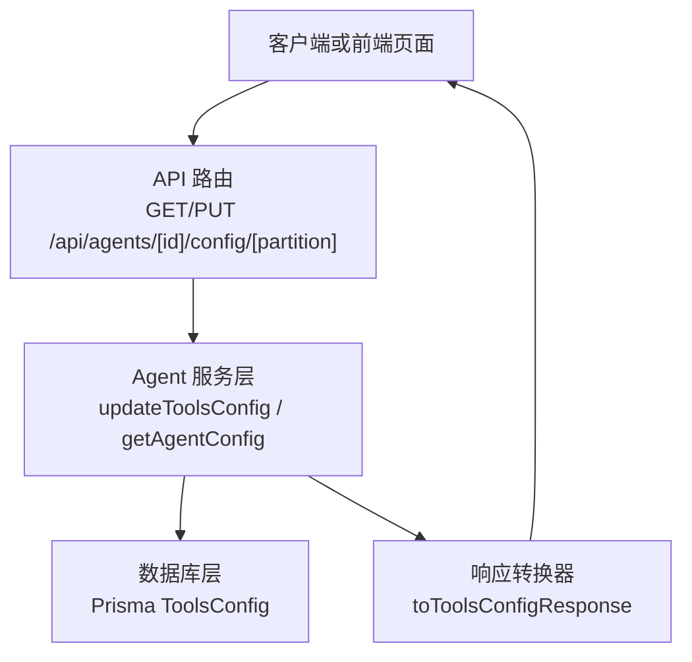
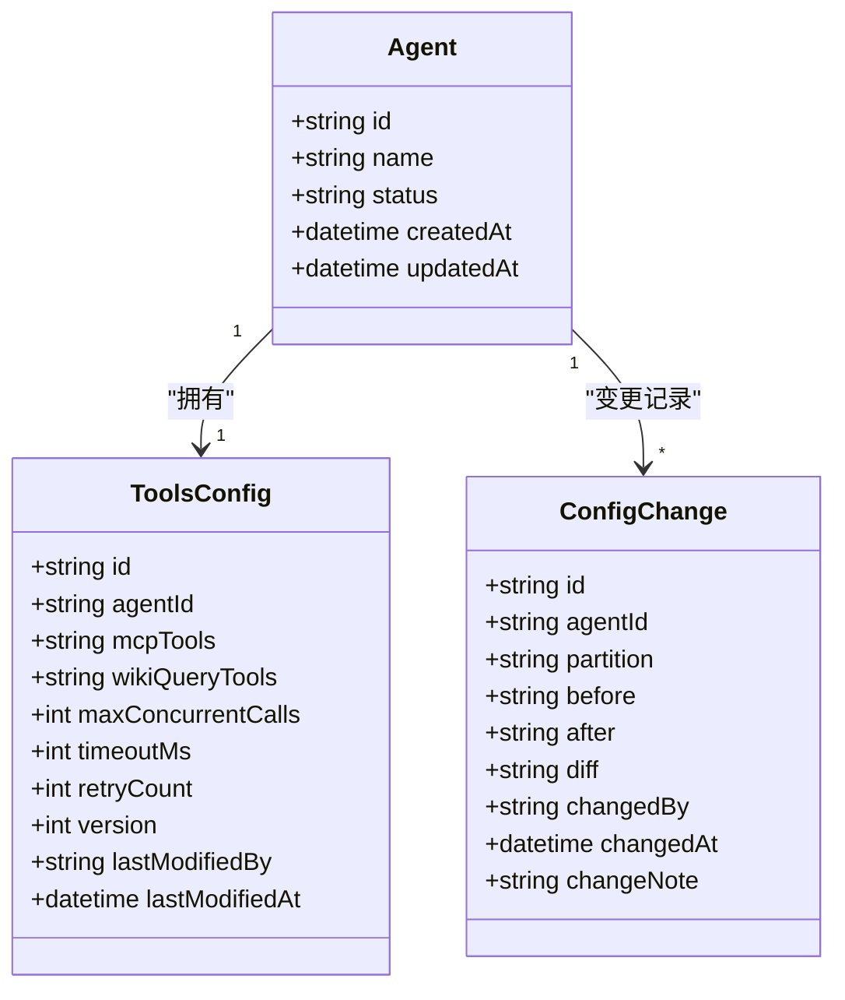
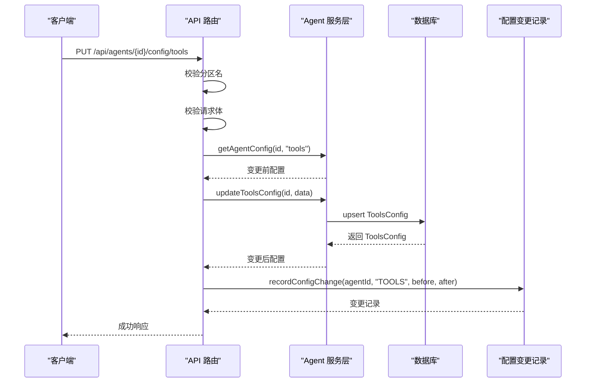
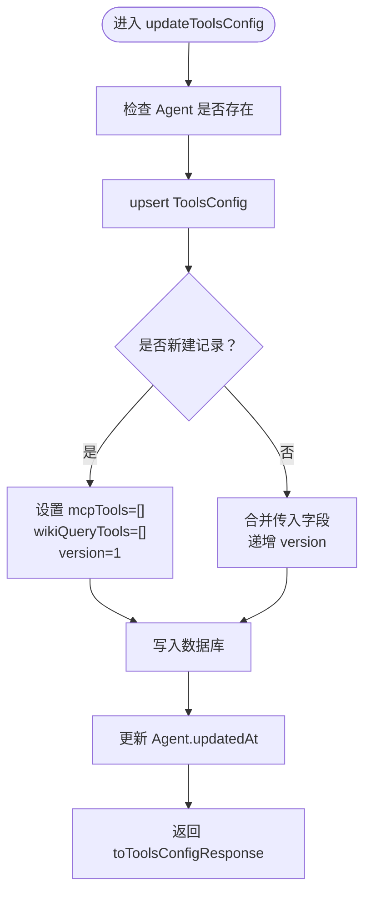
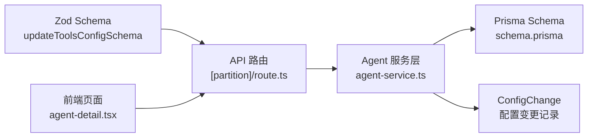
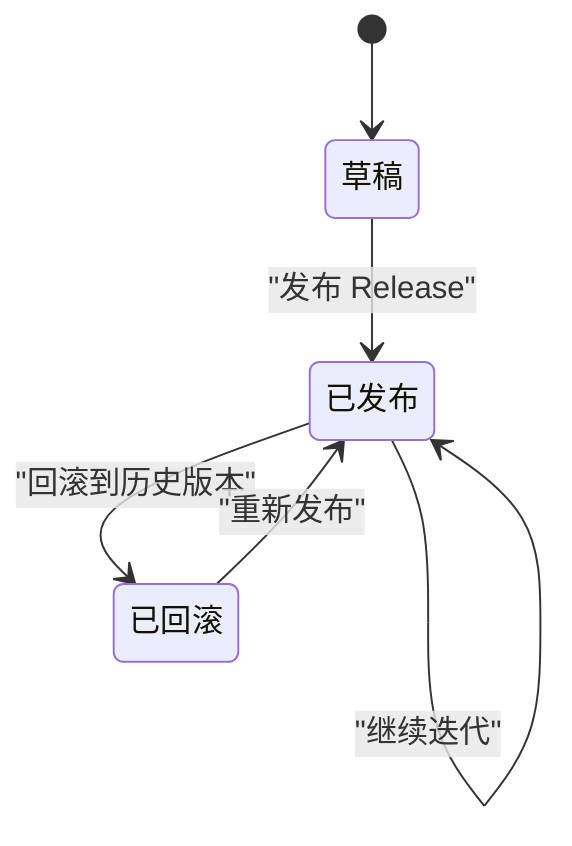

# Tools 分区（工具配置）

<cite>
**本文引用的文件**   
- [apps/web/lib/schemas.ts](file://apps/web/lib/schemas.ts)
- [apps/web/app/api/agents/[id]/config/[partition]/route.ts](file://apps/web/app/api/agents/[id]/config/[partition]/route.ts)
- [apps/web/lib/services/agent-service.ts](file://apps/web/lib/services/agent-service.ts)
- [packages/db/prisma/schema.prisma](file://packages/db/prisma/schema.prisma)
- [apps/web/app/(dashboard)/agents/[id]/agent-detail.tsx](file://apps/web/app/(dashboard)/agents/[id]/agent-detail.tsx)
- [apps/web/lib/__tests__/agent-service.test.ts](file://apps/web/lib/__tests__/agent-service.test.ts)
</cite>

## 目录
1. [引言](#引言)
2. [项目结构定位](#项目结构定位)
3. [核心组件总览](#核心组件总览)
4. [架构总览](#架构总览)
5. [详细组件分析](#详细组件分析)
6. [依赖关系分析](#依赖关系分析)
7. [性能与并发控制策略](#性能与并发控制策略)
8. [错误处理、超时重试与监控建议](#错误处理超时重试与监控建议)
9. [版本化与回滚支持](#版本化与回滚支持)
10. [故障排查指南](#故障排查指南)
11. [结论](#结论)

## 引言
本文聚焦 **Tools 分区**，即 Agent 的工具配置能力。该分区负责声明两类工具集合：
- `mcpTools`：MCP 工具列表。
- `wikiQueryTools`：Wiki 查询工具列表。

同时，该分区提供运行时执行所需的并发与可靠性参数：
- `maxConcurrentCalls`：最大并发调用数。
- `timeoutMs`：单次工具调用的超时时间。
- `retryCount`：失败后的重试次数。

文档将解释这些字段在请求校验、持久化、响应转换、版本记录以及前端展示中的完整生命周期，并给出可操作的配置建议、错误处理方案和性能优化思路。

## 项目结构定位
Tools 分区属于 Agent 四分区配置之一，与 Prompt、Knowledge、Routing 并列。其数据流贯穿以下层次：
- 前端 API 路由层：接收 `/api/agents/[id]/config/[partition]` 的 GET/PUT 请求，校验分区名和请求体。
- 服务层：根据分区名分发到具体更新逻辑，对 tools 分区进行 upsert 写入。
- 数据库层：Prisma schema 定义 `ToolsConfig` 表，JSON 数组以字符串形式存储。
- 响应层：统一把 JSON 文本反序列化为对象数组返回给前端。

**图表来源**
- [apps/web/app/api/agents/[id]/config/[partition]/route.ts:28-85](file://apps/web/app/api/agents/[id]/config/[partition]/route.ts#L28-L85)
- [apps/web/lib/services/agent-service.ts:341-500](file://apps/web/lib/services/agent-service.ts#L341-L500)
- [packages/db/prisma/schema.prisma:138-152](file://packages/db/prisma/schema.prisma#L138-L152)

**章节来源**
- [apps/web/app/api/agents/[id]/config/[partition]/route.ts:14-85](file://apps/web/app/api/agents/[id]/config/[partition]/route.ts#L14-L85)
- [apps/web/lib/services/agent-service.ts:341-500](file://apps/web/lib/services/agent-service.ts#L341-L500)
- [packages/db/prisma/schema.prisma:138-152](file://packages/db/prisma/schema.prisma#L138-L152)

## 核心组件总览
Tools 分区的核心由四个部分组成：

| 层级 | 职责 | 关键实现位置 |
|---|---|---|
| 请求校验层 | 使用 Zod 校验 `mcpTools`、`wikiQueryTools`、`maxConcurrentCalls`、`timeoutMs`、`retryCount` | [apps/web/lib/schemas.ts:38-44](file://apps/web/lib/schemas.ts#L38-L44) |
| API 路由层 | 校验分区名、读取请求体、调用服务层、记录变更日志 | [apps/web/app/api/agents/[id]/config/[partition]/route.ts:28-85](file://apps/web/app/api/agents/[id]/config/[partition]/route.ts#L28-L85) |
| 服务层 | 按分区分发更新逻辑；tools 分区使用 upsert 合并语义，递增 version | [apps/web/lib/services/agent-service.ts:466-500](file://apps/web/lib/services/agent-service.ts#L466-L500) |
| 数据模型层 | Prisma 定义 `ToolsConfig`，JSON 数组以 String 存储，默认值明确 | [packages/db/prisma/schema.prisma:138-152](file://packages/db/prisma/schema.prisma#L138-L152) |

**章节来源**
- [apps/web/lib/schemas.ts:38-44](file://apps/web/lib/schemas.ts#L38-L44)
- [apps/web/app/api/agents/[id]/config/[partition]/route.ts:28-85](file://apps/web/app/api/agents/[id]/config/[partition]/route.ts#L28-L85)
- [apps/web/lib/services/agent-service.ts:466-500](file://apps/web/lib/services/agent-service.ts#L466-L500)
- [packages/db/prisma/schema.prisma:138-152](file://packages/db/prisma/schema.prisma#L138-L152)

## 架构总览
Tools 分区的配置架构采用“分区化 + JSON 列 + 版本递增”的设计模式：

- **分区化**：Prompt、Knowledge、Tools、Routing 各自独立，便于单独更新、单独发布、单独回滚。
- **JSON 列**：`mcpTools` 和 `wikiQueryTools` 是任意结构的工具数组，通过 `packJson`/`unpackJsonArray` 安全序列化与反序列化。
- **版本递增**：每次更新都会递增 `version`，并记录 `lastModifiedBy` 与 `lastModifiedAt`，配合配置变更记录表形成审计轨迹。
- **并发与可靠性参数**：`maxConcurrentCalls`、`timeoutMs`、`retryCount` 作为工具运行时的全局约束，由上层执行器消费。

**图表来源**
- [packages/db/prisma/schema.prisma:66-99](file://packages/db/prisma/schema.prisma#L66-L99)
- [packages/db/prisma/schema.prisma:138-152](file://packages/db/prisma/schema.prisma#L138-L152)
- [packages/db/prisma/schema.prisma:188-205](file://packages/db/prisma/schema.prisma#L188-L205)

## 详细组件分析

### 请求校验：Zod Schema 与默认行为
Tools 分区请求体由 `updateToolsConfigSchema` 校验，关键字段如下：

| 字段 | 类型 | 校验规则 | 说明 |
|---|---|---|---|
| `mcpTools` | 任意数组 | 可选 | MCP 工具列表，结构由业务侧约定 |
| `wikiQueryTools` | 任意数组 | 可选 | Wiki 查询工具列表，结构由业务侧约定 |
| `maxConcurrentCalls` | 整数 | 1 到 20 | 限制同一时刻最多并行执行的工具调用数量 |
| `timeoutMs` | 整数 | 1000 到 120000 | 单位毫秒，最小 1 秒，最大 120 秒 |
| `retryCount` | 整数 | 0 到 5 | 失败后额外重试次数，0 表示不重试 |

当前 schema 对 `mcpTools` 和 `wikiQueryTools` 使用 `z.array(z.any())`，意味着**工具内部结构没有强类型约束**。这是有意为之：工具类型可能随 MCP 服务器、Wiki 插件或业务扩展而变化，因此校验层只保证它们是数组，具体字段由调用方和业务契约约定。

**章节来源**
- [apps/web/lib/schemas.ts:38-44](file://apps/web/lib/schemas.ts#L38-L44)

### API 路由：分区路由与变更审计
API 路由 `/api/agents/[id]/config/[partition]` 承担以下职责：

1. 校验 `partition` 是否为 `prompt`、`knowledge`、`tools`、`routing` 之一。
2. GET 请求返回对应分区的当前配置。
3. PUT 请求先读取变更前快照，再调用服务层更新，最后记录配置变更。
4. 所有异常通过统一错误处理器返回。

对于 tools 分区，PUT 流程会调用 `updateToolsConfig`，并在成功后调用 `recordConfigChange`，把变更前后的 JSON 快照和 diff 写入 `ConfigChange` 表。

**图表来源**
- [apps/web/app/api/agents/[id]/config/[partition]/route.ts:46-85](file://apps/web/app/api/agents/[id]/config/[partition]/route.ts#L46-L85)
- [apps/web/lib/services/agent-service.ts:571-614](file://apps/web/lib/services/agent-service.ts#L571-L614)

**章节来源**
- [apps/web/app/api/agents/[id]/config/[partition]/route.ts:14-85](file://apps/web/app/api/agents/[id]/config/[partition]/route.ts#L14-L85)
- [apps/web/lib/services/agent-service.ts:571-614](file://apps/web/lib/services/agent-service.ts#L571-L614)

### 服务层：upsert 合并语义与版本递增
`updateToolsConfig` 的核心逻辑位于 `updateConfigPartition` 的 `tools` 分支：

- 如果不存在该 Agent 的 Tools 配置，则创建新记录，初始 `version` 为 1。
- 如果已存在，则使用传入字段进行合并更新，未传字段保留原值。
- 每次更新都会递增 `version`。
- `mcpTools` 和 `wikiQueryTools` 通过 `packJson` 转为 JSON 字符串；若为空或未传，则落库空数组字符串。
- 更新完成后，同步更新 Agent 的 `updatedAt`，确保列表排序和缓存失效可用。

**图表来源**
- [apps/web/lib/services/agent-service.ts:364-500](file://apps/web/lib/services/agent-service.ts#L364-L500)

**章节来源**
- [apps/web/lib/services/agent-service.ts:364-500](file://apps/web/lib/services/agent-service.ts#L364-L500)

### 数据模型：ToolsConfig 表结构
`ToolsConfig` 表直接体现 Tools 分区的持久化形态：

| 字段 | 类型 | 默认值 | 含义 |
|---|---|---:|---|
| `id` | 字符串主键 | cuid() | 配置行唯一标识 |
| `agentId` | 字符串唯一键 | — | 所属 Agent |
| `mcpTools` | 字符串（JSON） | — | MCP 工具数组的 JSON 文本 |
| `wikiQueryTools` | 字符串（JSON） | — | Wiki 查询工具数组的 JSON 文本 |
| `maxConcurrentCalls` | 整数 | 3 | 最大并发调用数 |
| `timeoutMs` | 整数 | 30000 | 超时毫秒数 |
| `retryCount` | 整数 | 2 | 重试次数 |
| `version` | 整数 | 1 | 配置版本号 |
| `lastModifiedBy` | 字符串可空 | — | 最后修改人 |
| `lastModifiedAt` | 时间戳 | 当前时间 | 最后修改时间 |

**章节来源**
- [packages/db/prisma/schema.prisma:138-152](file://packages/db/prisma/schema.prisma#L138-L152)

### 响应转换：JSON 文本到对象数组
`toToolsConfigResponse` 负责把数据库中的 JSON 字符串转换为前端可用的对象结构：

- `mcpTools` 和 `wikiQueryTools` 使用 `unpackJsonArray` 解析为对象数组，解析失败时回退为空数组。
- `maxConcurrentCalls`、`timeoutMs`、`retryCount` 直接透传。
- `version` 和 `lastModifiedAt` 暴露给前端用于版本对比和缓存控制。

这种设计保证了即使底层 JSON 格式发生变化，只要解析函数能兼容旧格式，就不会破坏现有接口。

**章节来源**
- [apps/web/lib/services/agent-service.ts:100-110](file://apps/web/lib/services/agent-service.ts#L100-L110)

### 前端展示与示例
前端在 Agent 详情页中提供了 Tools 配置的 JSON 编辑器，并附带示例提示。虽然示例展示了较早期的 `enabledTools` 和 `mcpServers` 字段，但当前后端契约已经收敛为 `mcpTools` 和 `wikiQueryTools` 两个数组字段。

这意味着：
- 前端示例可以作为“工具配置长什么样”的参考。
- 实际保存时必须遵循后端 schema：`mcpTools`、`wikiQueryTools`、`maxConcurrentCalls`、`timeoutMs`、`retryCount`。
- 如果前端仍提交旧字段，会被 Zod 校验忽略或拒绝，取决于字段是否在 schema 中声明。

**章节来源**
- [apps/web/app/(dashboard)/agents/[id]/agent-detail.tsx:381-386](file://apps/web/app/(dashboard)/agents/[id]/agent-detail.tsx#L381-L386)

## 依赖关系分析
Tools 分区的依赖关系可以概括为：

- **Schemas → Route**：Zod schema 决定哪些字段允许进入系统。
- **Route → Service**：路由只做校验和编排，不直接操作数据库。
- **Service → DB**：服务层通过 Prisma 读写 `ToolsConfig`。
- **Service → Audit**：每次更新都记录变更，便于审计和回滚。
- **Frontend → Route**：前端通过 REST API 读写配置。

**图表来源**
- [apps/web/lib/schemas.ts:38-44](file://apps/web/lib/schemas.ts#L38-L44)
- [apps/web/app/api/agents/[id]/config/[partition]/route.ts:28-85](file://apps/web/app/api/agents/[id]/config/[partition]/route.ts#L28-L85)
- [apps/web/lib/services/agent-service.ts:466-500](file://apps/web/lib/services/agent-service.ts#L466-L500)
- [packages/db/prisma/schema.prisma:138-152](file://packages/db/prisma/schema.prisma#L138-L152)

**章节来源**
- [apps/web/lib/schemas.ts:38-44](file://apps/web/lib/schemas.ts#L38-L44)
- [apps/web/app/api/agents/[id]/config/[partition]/route.ts:28-85](file://apps/web/app/api/agents/[id]/config/[partition]/route.ts#L28-L85)
- [apps/web/lib/services/agent-service.ts:466-500](file://apps/web/lib/services/agent-service.ts#L466-L500)
- [packages/db/prisma/schema.prisma:138-152](file://packages/db/prisma/schema.prisma#L138-L152)

## 性能与并发控制策略

### 并发控制：`maxConcurrentCalls`
- 默认值为 3。
- 校验范围限制在 1 到 20。
- 作用：防止大量工具同时调用外部 MCP 服务或 Wiki 查询接口导致资源耗尽。
- 建议：
  - 轻量工具：可设置为 5–10。
  - 重量级工具（如大模型调用、复杂搜索）：建议 1–3。
  - 高延迟外部依赖：优先降低并发，提高稳定性。

### 超时控制：`timeoutMs`
- 默认值为 30000 毫秒，即 30 秒。
- 校验范围限制在 1000 到 120000 毫秒。
- 作用：避免单个工具调用长期阻塞整个 Agent 执行流程。
- 建议：
  - 快速查询类工具：1–5 秒。
  - 网络依赖型工具：5–30 秒。
  - 批处理或生成类工具：30–120 秒。

### 重试控制：`retryCount`
- 默认值为 2。
- 校验范围限制在 0 到 5。
- 作用：对瞬时失败进行有限恢复，提升鲁棒性。
- 建议：
  - 幂等且稳定的工具：0 或 1。
  - 网络抖动敏感工具：1–3。
  - 非幂等写操作：谨慎重试，避免重复副作用。

### 性能影响矩阵
| 参数 | 增大倾向 | 风险 | 适用场景 |
|---|---|---|---|
| `maxConcurrentCalls` | 更高吞吐 | 内存、连接池、下游限流压力上升 | 高并发、低延迟工具 |
| `timeoutMs` | 更长等待 | 请求堆积、用户体验变慢 | 重型任务、外部慢服务 |
| `retryCount` | 更多重试 | 放大下游负载、可能掩盖真实错误 | 瞬时失败、网络抖动 |

**章节来源**
- [apps/web/lib/schemas.ts:38-44](file://apps/web/lib/schemas.ts#L38-L44)
- [packages/db/prisma/schema.prisma:146-148](file://packages/db/prisma/schema.prisma#L146-L148)

## 错误处理、超时重试与监控建议

### 错误处理路径
当前代码的错误处理集中在 API 路由层：
- 无效分区：返回 400。
- 请求体验证失败：返回校验错误。
- 服务层异常：通过 `handleApiError` 统一处理。

需要注意的是，当前 `updateToolsConfig` 本身没有显式捕获工具执行错误，因为该函数只负责配置持久化。真正的工具调用错误应由上层执行器捕获，并结合 `timeoutMs` 和 `retryCount` 做重试或降级。

### 超时与重试机制现状
- 配置层：`timeoutMs` 和 `retryCount` 被持久化并可被读取。
- 执行层：仓库中存在 LLM 服务使用 `AbortSignal.timeout` 的超时模式，说明系统具备基于超时的中断能力。
- 工具层：Tools 分区目前更像“配置开关”，而不是直接执行器。因此，超时和重试应由调用 MCP/Wiki 的执行器消费这些字段。

### 监控建议
建议在工具执行层增加以下指标：
- 每个工具的调用次数、成功次数、失败次数。
- 平均耗时、P95/P99 耗时。
- 超时次数、重试次数、最终失败原因。
- 并发峰值与队列长度。
- 配置版本变更频率，用于评估配置稳定性。

**章节来源**
- [apps/web/app/api/agents/[id]/config/[partition]/route.ts:28-85](file://apps/web/app/api/agents/[id]/config/[partition]/route.ts#L28-L85)
- [apps/web/lib/services/agent-service.ts:466-500](file://apps/web/lib/services/agent-service.ts#L466-L500)

## 版本化与回滚支持

### 配置版本化
Tools 分区通过 `version` 字段实现简单版本化：
- 新建时初始版本为 1。
- 每次更新递增 1。
- 响应中包含 `version` 和 `lastModifiedAt`，可用于前端缓存失效和差异对比。

### 配置变更记录
每次 PUT 更新都会调用 `recordConfigChange`，记录：
- `before`：变更前配置。
- `after`：变更后配置。
- `diff`：结构化 diff。
- `changedBy`：操作人。
- `changeNote`：可选变更说明。

这为审计、复盘和回滚提供了基础数据。

### 回滚支持
回滚通常基于已发布的版本快照。系统中存在 `Release` 和 `AgentVersion` 模型，其中 `AgentVersion` 包含 `toolsSnapshot`，说明工具配置在发布时被快照保存。回滚时可将历史 `toolsSnapshot` 恢复到当前 `ToolsConfig`。

**图表来源**
- [packages/db/prisma/schema.prisma:257-318](file://packages/db/prisma/schema.prisma#L257-L318)

**章节来源**
- [apps/web/lib/services/agent-service.ts:571-614](file://apps/web/lib/services/agent-service.ts#L571-L614)
- [packages/db/prisma/schema.prisma:257-318](file://packages/db/prisma/schema.prisma#L257-L318)

## 故障排查指南

### 常见问题
| 现象 | 可能原因 | 排查步骤 |
|---|---|---|
| 保存 Tools 配置时报错 | 请求体不是合法 JSON 或字段超出校验范围 | 检查 `mcpTools`、`wikiQueryTools` 是否为数组；检查 `maxConcurrentCalls`、`timeoutMs`、`retryCount` 是否在允许范围内 |
| 前端显示空数组 | 数据库中 JSON 解析失败或字段缺失 | 查看 `ToolsConfig.mcpTools`、`ToolsConfig.wikiQueryTools` 是否为有效 JSON 字符串 |
| 工具调用超时 | `timeoutMs` 过小或下游服务慢 | 调整 `timeoutMs`，并观察下游服务延迟 |
| 工具频繁失败 | 下游不稳定但未启用重试 | 适当提高 `retryCount`，并增加错误分类 |
| 配置变更后无迹可循 | 未记录变更或审计关闭 | 检查 `ConfigChange` 表是否有对应记录 |

### 测试用例参考
单元测试中验证了 Tools 配置的默认值和字段映射，包括：
- `mcpTools` 默认为空数组。
- `wikiQueryTools` 默认为空数组。
- `maxConcurrentCalls`、`timeoutMs`、`retryCount` 的默认值。

这些用例可作为回归测试基线。

**章节来源**
- [apps/web/lib/__tests__/agent-service.test.ts:133-139](file://apps/web/lib/__tests__/agent-service.test.ts#L133-L139)

## 结论
Tools 分区是一个以“配置为中心”的能力模块：它不直接执行工具，而是声明 Agent 可调用的 MCP 工具和 Wiki 查询工具，并提供并发、超时、重试等运行时约束。其设计优点包括：
- 分区隔离，便于独立演进。
- JSON 列灵活，适应不同工具结构。
- 版本化和变更记录，支持审计与回滚。
- 明确的校验边界，避免非法配置进入系统。

未来改进方向可包括：
- 为 `mcpTools` 和 `wikiQueryTools` 引入更细粒度的 schema 校验。
- 在执行层实现基于 `maxConcurrentCalls`、`timeoutMs`、`retryCount` 的统一调度器。
- 增加工具级元数据，如依赖关系、权限范围、健康状态。
- 完善前端表单，减少手写 JSON 的配置成本。