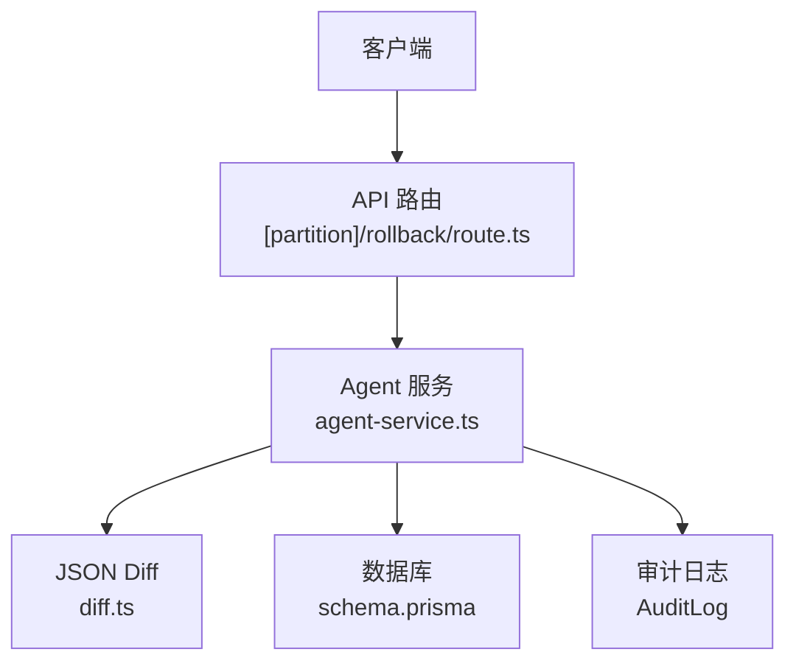
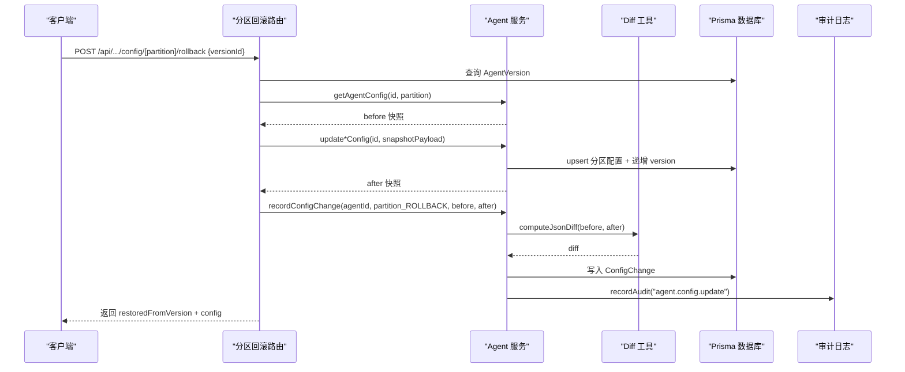
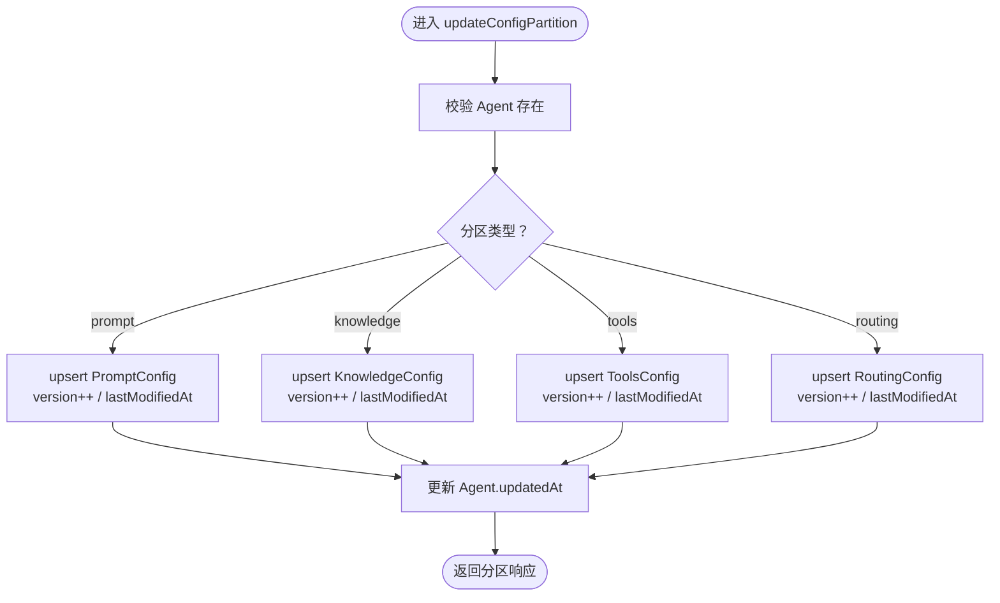
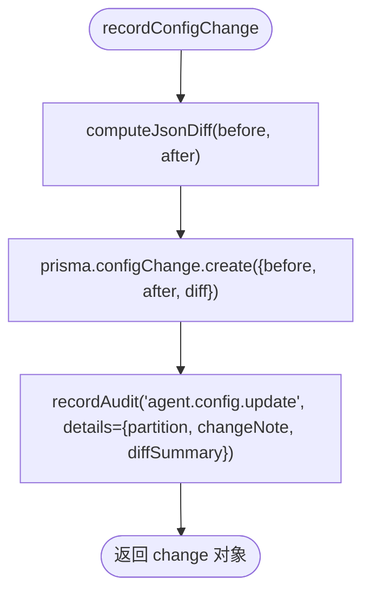
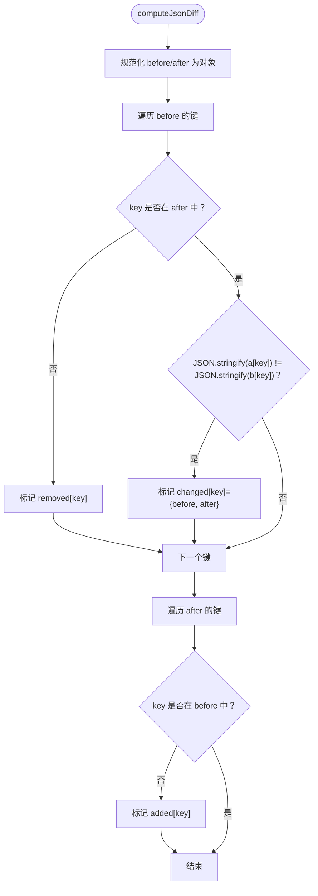
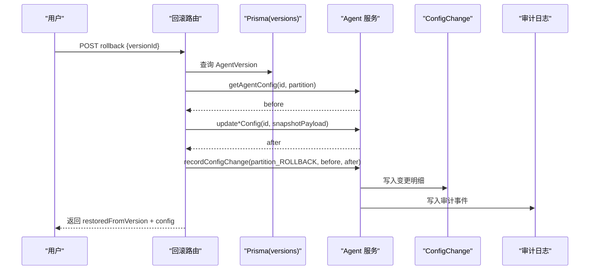
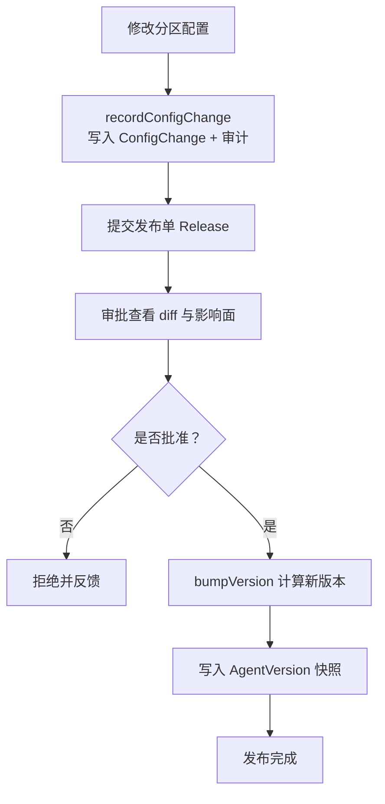
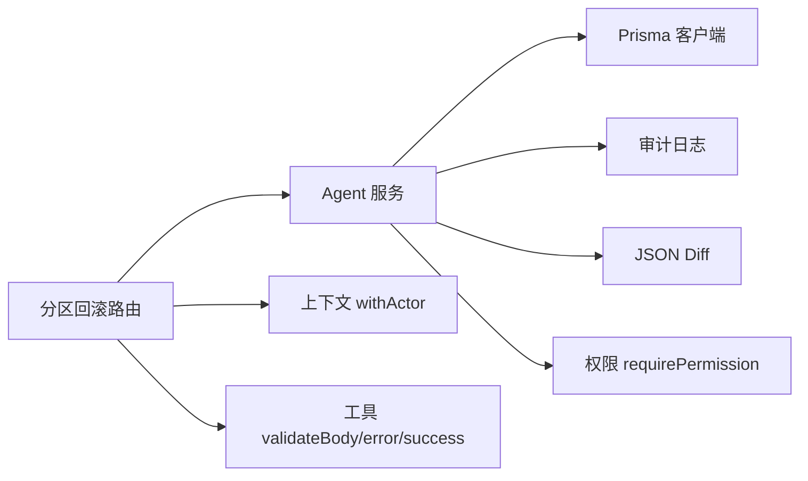

# 分区管理与变更追踪

<cite>
**本文引用的文件**   
- [apps/web/lib/services/agent-service.ts](file://apps/web/lib/services/agent-service.ts)
- [apps/web/lib/diff.ts](file://apps/web/lib/diff.ts)
- [apps/web/lib/versioning.ts](file://apps/web/lib/versioning.ts)
- [apps/web/app/api/agents/[id]/config/[partition]/rollback/route.ts](file://apps/web/app/api/agents/[id]/config/[partition]/rollback/route.ts)
- [packages/db/prisma/schema.prisma](file://packages/db/prisma/schema.prisma)
- [apps/web/app/(dashboard)/releases/page.tsx](file://apps/web/app/(dashboard)/releases/page.tsx)
</cite>

## 目录
1. [引言](#引言)
2. [项目结构](#项目结构)
3. [核心组件](#核心组件)
4. [架构总览](#架构总览)
5. [详细组件分析](#详细组件分析)
6. [依赖关系分析](#依赖关系分析)
7. [性能与一致性考量](#性能与一致性考量)
8. [故障排查指南](#故障排查指南)
9. [结论](#结论)

## 引言
本文聚焦 Agent 配置系统的“分区管理”和“变更追踪”能力，围绕以下目标展开：
- 解释分区隔离机制与统一更新入口 updateConfigPartition 的设计。
- 说明分区特定的 upsert 语义、版本递增与审计留痕。
- 深入解析 recordConfigChange 的 before/after 快照与 diff 计算流程。
- 阐述 JSON diff 算法的实现细节与使用场景。
- 说明分区级回滚如何通过版本快照恢复历史状态。
- 梳理分区间依赖处理策略与一致性保证。
- 展示从修改、提交审批到发布的完整工作流。

## 项目结构
本功能涉及三层：
- API 路由层：负责参数校验、权限上下文注入、编排读取 before → 调用分区更新 → 记录变更。
- 服务层：封装分区 upsert、版本递增、审计日志写入等原子能力。
- 数据层：Prisma schema 定义 Agent、四分区配置表、变更记录、版本快照与发布单。

图表来源
- [apps/web/app/api/agents/[id]/config/[partition]/rollback/route.ts:42-117](file://apps/web/app/api/agents/[id]/config/[partition]/rollback/route.ts#L42-L117)
- [apps/web/lib/services/agent-service.ts:364-549](file://apps/web/lib/services/agent-service.ts#L364-L549)
- [apps/web/lib/diff.ts:9-34](file://apps/web/lib/diff.ts#L9-L34)
- [packages/db/prisma/schema.prisma:188-205](file://packages/db/prisma/schema.prisma#L188-L205)

章节来源
- [apps/web/lib/services/agent-service.ts:1-615](file://apps/web/lib/services/agent-service.ts#L1-L615)
- [packages/db/prisma/schema.prisma:66-168](file://packages/db/prisma/schema.prisma#L66-L168)

## 核心组件
- 分区枚举与类型：prompt / knowledge / tools / routing。
- 统一分区更新函数：updateConfigPartition，按分区分支执行 Prisma upsert，并递增 version、刷新 lastModifiedAt。
- 变更追踪函数：recordConfigChange，计算 diff、落库 ConfigChange、写入审计日志。
- JSON Diff 工具：computeJsonDiff，输出 added / removed / changed 三集合。
- 版本号计算：bumpVersion，根据受影响分区集合决定 minor/patch。
- 分区回滚路由：POST /api/agents/[id]/config/[partition]/rollback，基于 Version 快照恢复指定分区。

章节来源
- [apps/web/lib/services/agent-service.ts:22-22](file://apps/web/lib/services/agent-service.ts#L22-L22)
- [apps/web/lib/services/agent-service.ts:364-549](file://apps/web/lib/services/agent-service.ts#L364-L549)
- [apps/web/lib/services/agent-service.ts:571-614](file://apps/web/lib/services/agent-service.ts#L571-L614)
- [apps/web/lib/diff.ts:9-34](file://apps/web/lib/diff.ts#L9-L34)
- [apps/web/lib/versioning.ts:46-69](file://apps/web/lib/versioning.ts#L46-L69)
- [apps/web/app/api/agents/[id]/config/[partition]/rollback/route.ts:34-117](file://apps/web/app/api/agents/[id]/config/[partition]/rollback/route.ts#L34-L117)

## 架构总览
分区管理的核心思想是“分区隔离 + 统一入口 + 双写留痕”。

图表来源
- [apps/web/app/api/agents/[id]/config/[partition]/rollback/route.ts:42-117](file://apps/web/app/api/agents/[id]/config/[partition]/rollback/route.ts#L42-L117)
- [apps/web/lib/services/agent-service.ts:341-358](file://apps/web/lib/services/agent-service.ts#L341-L358)
- [apps/web/lib/services/agent-service.ts:364-549](file://apps/web/lib/services/agent-service.ts#L364-L549)
- [apps/web/lib/services/agent-service.ts:571-614](file://apps/web/lib/services/agent-service.ts#L571-L614)
- [apps/web/lib/diff.ts:9-34](file://apps/web/lib/diff.ts#L9-L34)

## 详细组件分析

### 分区隔离与统一更新：updateConfigPartition
- 分区隔离：每个分区（prompt/knowledge/tools/routing）对应独立的 Prisma 模型，字段映射清晰，互不干扰。
- 统一入口：四个 updateXxxConfig 方法均委托 updateConfigPartition，避免重复逻辑。
- upsert 语义：
  - create：首次写入时设置 version=1，填充默认值或传入字段。
  - update：仅 spread data 中存在的键，未传字段保留原值；version 自增 1；lastModifiedAt 刷新为当前时间；lastModifiedBy 记录操作者。
- 副作用：每次分区更新后，刷新 Agent.updatedAt，确保列表排序与最后修改时间一致。

图表来源
- [apps/web/lib/services/agent-service.ts:364-549](file://apps/web/lib/services/agent-service.ts#L364-L549)

章节来源
- [apps/web/lib/services/agent-service.ts:364-549](file://apps/web/lib/services/agent-service.ts#L364-L549)
- [packages/db/prisma/schema.prisma:105-168](file://packages/db/prisma/schema.prisma#L105-L168)

### 变更追踪：recordConfigChange 与审计日志
- before/after 快照：由路由层在调用分区更新前读取 before，更新后得到 after。
- diff 计算：调用 computeJsonDiff(before, after)，生成 added/removed/changed 三个集合。
- 持久化：
  - 写入 ConfigChange 表，包含 agentId、partition、before、after、diff、changedBy、changeNote、changedAt。
  - 同时通过 recordAudit 写入全局审计流，details 中包含 partition、changeNote 与 diffSummary（仅键名摘要）。
- 返回值：返回 change 对象，便于上层 UI 展示 diff 详情。

图表来源
- [apps/web/lib/services/agent-service.ts:571-614](file://apps/web/lib/services/agent-service.ts#L571-L614)
- [apps/web/lib/diff.ts:9-34](file://apps/web/lib/diff.ts#L9-L34)
- [packages/db/prisma/schema.prisma:188-205](file://packages/db/prisma/schema.prisma#L188-L205)

章节来源
- [apps/web/lib/services/agent-service.ts:571-614](file://apps/web/lib/services/agent-service.ts#L571-L614)
- [packages/db/prisma/schema.prisma:188-205](file://packages/db/prisma/schema.prisma#L188-L205)

### JSON Diff 算法：computeJsonDiff
- 输入：before 与 after 两个任意对象（非数组）。
- 输出：DiffResult = { added, removed, changed }。
- 实现要点：
  - 对 before 的 key 遍历：若不在 after 中，标记为 removed；若值不同（JSON.stringify 比较），标记为 changed。
  - 对 after 的 key 遍历：若不在 before 中，标记为 added。
- 复杂度：O(n+m)，n、m 分别为 before/after 顶层键数量；深层嵌套采用浅比较（以 JSON.stringify 结果判断相等性）。
- 使用场景：变更审计、发布审批页 diff 展示、回滚前后对比。

图表来源
- [apps/web/lib/diff.ts:9-34](file://apps/web/lib/diff.ts#L9-L34)

章节来源
- [apps/web/lib/diff.ts:1-35](file://apps/web/lib/diff.ts#L1-L35)

### 分区级回滚：基于版本快照恢复
- 入口：POST /api/agents/[id]/config/[partition]/rollback。
- 步骤：
  1) 校验分区合法性与请求体 versionId。
  2) 在 withActor 作用域内查询 AgentVersion，校验归属。
  3) 从 AgentVersion 的对应分区快照列（如 promptSnapshot）取出并反序列化。
  4) 读取当前分区配置作为 before。
  5) 调用对应 updateXxxConfig 将快照覆盖为 after（去除 snapshot 中的 version/lastModifiedAt，让服务重新计算）。
  6) 调用 recordConfigChange 记录变更，partition 后缀为 _ROLLBACK，changeNote 标注目标版本。
- 语义：本质是用历史快照 PUT 一次配置，复用现有更新与留痕流程。

图表来源
- [apps/web/app/api/agents/[id]/config/[partition]/rollback/route.ts:42-117](file://apps/web/app/api/agents/[id]/config/[partition]/rollback/route.ts#L42-L117)
- [apps/web/lib/services/agent-service.ts:341-358](file://apps/web/lib/services/agent-service.ts#L341-L358)
- [apps/web/lib/services/agent-service.ts:571-614](file://apps/web/lib/services/agent-service.ts#L571-L614)

章节来源
- [apps/web/app/api/agents/[id]/config/[partition]/rollback/route.ts:1-118](file://apps/web/app/api/agents/[id]/config/[partition]/rollback/route.ts#L1-L118)

### 版本号计算：bumpVersion
- 规则：
  - 首次发布：0.1.0。
  - ROUTING 分区变更：minor。
  - 任意 ≥2 个分区变更：minor。
  - 单个非路由分区变更：patch。
  - 全部 4 个分区变更：minor（不自动 major，major 留给破坏性重写的人工显式标注）。
- 用途：发布审批通过后，根据本次实际发生变更的分区集合计算新版本号。

章节来源
- [apps/web/lib/versioning.ts:1-70](file://apps/web/lib/versioning.ts#L1-L70)

### 分区间依赖关系与一致性保证
- 分区隔离：每个分区独立 upsert，互不影响；但共享同一个 Agent.updatedAt，保证整体“最近修改时间”一致。
- 版本控制：每个分区维护自身 version 字段，表示该分区内的修改次数；AgentVersion 快照保存各分区在发布时的完整状态。
- 一致性：
  - 分区更新与审计记录在同一事务边界外，但通过 Actor 上下文与时间戳保证可追溯。
  - 回滚路径复用标准更新流程，确保审计与 diff 一致性。
- 依赖处理：
  - 知识分区依赖 WikiVault（外键关联），工具与路由分区依赖 JSON 文本字段（rules、escalationPolicy 等）。
  - 发布流程通过 AgentVersion 快照解耦运行时依赖，避免直接依赖活跃配置。

章节来源
- [packages/db/prisma/schema.prisma:105-168](file://packages/db/prisma/schema.prisma#L105-L168)
- [packages/db/prisma/schema.prisma:294-318](file://packages/db/prisma/schema.prisma#L294-L318)
- [apps/web/lib/services/agent-service.ts:364-549](file://apps/web/lib/services/agent-service.ts#L364-L549)

### 完整配置变更工作流：修改 → 提交审批 → 发布
- 修改：
  - 前端调用分区更新接口（例如 updatePromptConfig）。
  - 路由层在 withActor 作用域内读取 before，调用 updateConfigPartition，再调用 recordConfigChange。
- 提交审批：
  - 创建 Release，携带 changeNote、changedPartitions、configSnapshot。
  - 审批页面展示 diff（基于 configSnapshot 与 baseline 比对）。
- 发布：
  - 审批通过后，根据 changedPartitions 调用 bumpVersion 计算新版本。
  - 写入 AgentVersion 快照（prompt/knowledge/tools/routing 四列）。
  - 关联 Release.version，形成不可变发布事实。

图表来源
- [apps/web/lib/services/agent-service.ts:571-614](file://apps/web/lib/services/agent-service.ts#L571-L614)
- [apps/web/lib/versioning.ts:46-69](file://apps/web/lib/versioning.ts#L46-L69)
- [apps/web/app/(dashboard)/releases/page.tsx:324-653](file://apps/web/app/(dashboard)/releases/page.tsx#L324-L653)

章节来源
- [apps/web/lib/services/agent-service.ts:571-614](file://apps/web/lib/services/agent-service.ts#L571-L614)
- [apps/web/lib/versioning.ts:46-69](file://apps/web/lib/versioning.ts#L46-L69)
- [apps/web/app/(dashboard)/releases/page.tsx:324-653](file://apps/web/app/(dashboard)/releases/page.tsx#L324-L653)

## 依赖关系分析
- 路由层依赖：
  - agent-service：getAgentConfig、updateXxxConfig、recordConfigChange。
  - context：withActor、resolveActor。
  - utils：success/error/validateBody/handleApiError。
  - errors：NotFoundError、ValidationError。
- 服务层依赖：
  - prisma：访问 Agent、四分区配置、ConfigChange、AgentVersion、Release。
  - audit-service：recordAudit。
  - diff：computeJsonDiff。
  - rbac：requirePermission。
- 数据层依赖：
  - Prisma schema 定义所有实体与索引。

图表来源
- [apps/web/app/api/agents/[id]/config/[partition]/rollback/route.ts:1-15](file://apps/web/app/api/agents/[id]/config/[partition]/rollback/route.ts#L1-L15)
- [apps/web/lib/services/agent-service.ts:1-21](file://apps/web/lib/services/agent-service.ts#L1-L21)

章节来源
- [apps/web/app/api/agents/[id]/config/[partition]/rollback/route.ts:1-118](file://apps/web/app/api/agents/[id]/config/[partition]/rollback/route.ts#L1-L118)
- [apps/web/lib/services/agent-service.ts:1-615](file://apps/web/lib/services/agent-service.ts#L1-L615)

## 性能与一致性考量
- 分区 upsert 的性能：
  - 每个分区独立 upsert，避免跨分区锁竞争。
  - version 自增与 lastModifiedAt 更新开销极小。
- Diff 计算的性能：
  - 浅层键遍历 O(n+m)，适合配置对象规模。
  - 深层值比较使用 JSON.stringify，注意大对象可能带来额外开销。
- 审计与变更记录：
  - ConfigChange 与 AuditLog 写入为追加型，适合高并发写入。
  - 建议在查询侧按需分页与过滤（已建索引：agentId+partition、changedAt、resource+resourceId 等）。
- 一致性：
  - 分区更新与审计记录不在同一事务中，但通过 Actor 上下文与时间戳保证可追溯性与顺序性。
  - 发布快照（AgentVersion）提供强一致的发布点，支持回滚与审计回溯。

[本节为通用指导，不直接分析具体文件]

## 故障排查指南
- 分区无效：
  - 现象：回滚路由返回“无效的分区”。
  - 原因：partition 不在 VALID_PARTITIONS 白名单。
  - 处理：检查 URL 路径与枚举映射。
- Version 不存在或不属于 Agent：
  - 现象：抛出 NotFoundError 或 ValidationError。
  - 原因：versionId 错误或跨 Agent 引用。
  - 处理：确认 versionId 与 Agent 关联关系。
- 快照缺失：
  - 现象：提示某分区无快照。
  - 原因：AgentVersion 对应快照列为空或未正确填充。
  - 处理：检查发布流程是否正确写入 AgentVersion 快照列。
- Diff 为空或异常：
  - 现象：UI 无法展示差异。
  - 原因：before/after 数据结构不一致或 JSON 序列化失败。
  - 处理：检查 packJson/unpackJson 的使用与 fallback 行为。

章节来源
- [apps/web/app/api/agents/[id]/config/[partition]/rollback/route.ts:48-74](file://apps/web/app/api/agents/[id]/config/[partition]/rollback/route.ts#L48-L74)
- [packages/db/prisma/schema.prisma:294-318](file://packages/db/prisma/schema.prisma#L294-L318)

## 结论
本系统通过“分区隔离 + 统一更新入口 + 双写留痕”实现了安全可控的配置管理。updateConfigPartition 提供一致的 upsert 语义与版本递增；recordConfigChange 结合 computeJsonDiff 提供完整的变更审计；分区回滚复用标准流程，确保一致性；bumpVersion 将分区影响面映射为语义化版本。配合 AgentVersion 快照与 Release 审批流，形成了从修改到发布的闭环，满足生产环境的可追溯、可回滚与可审计需求。