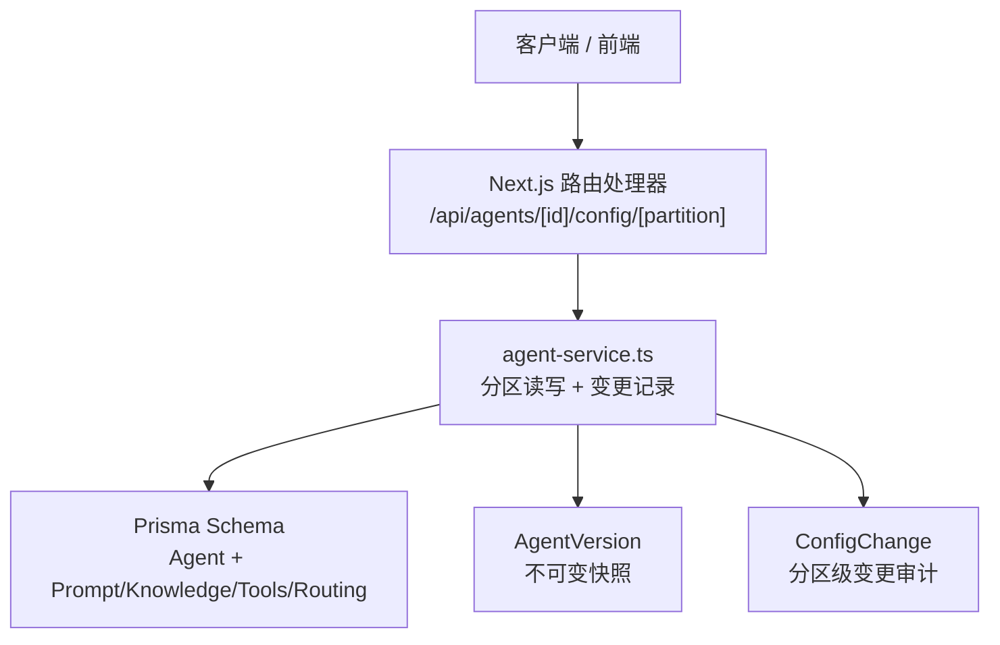
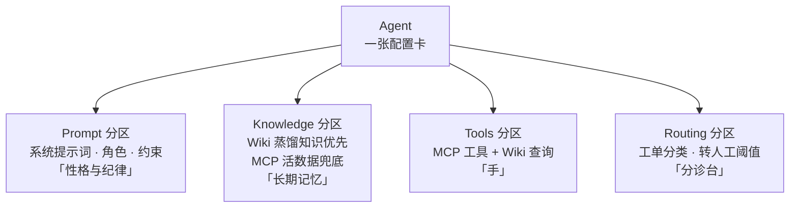
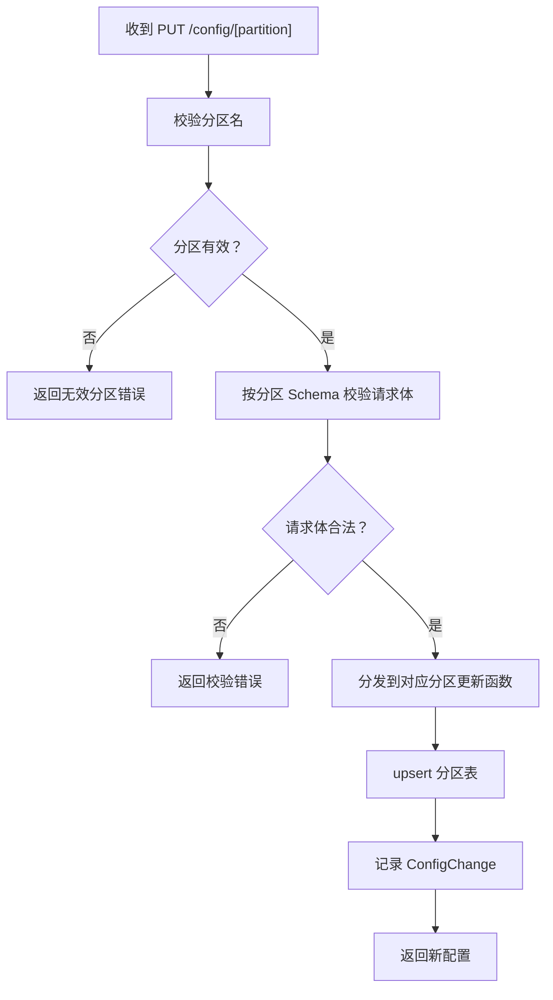
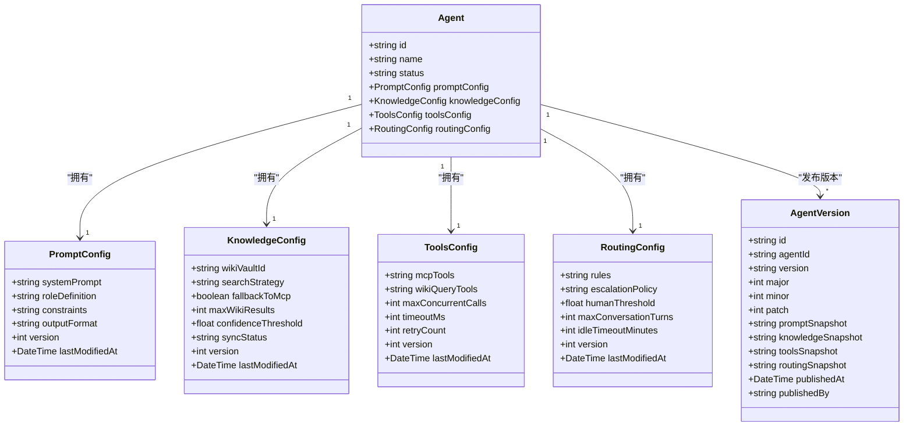
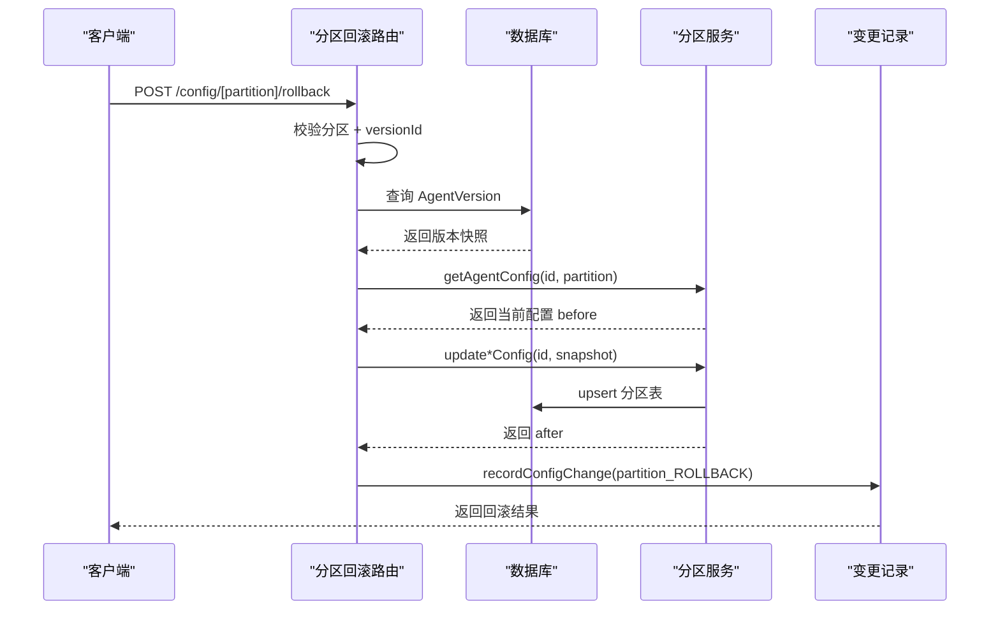
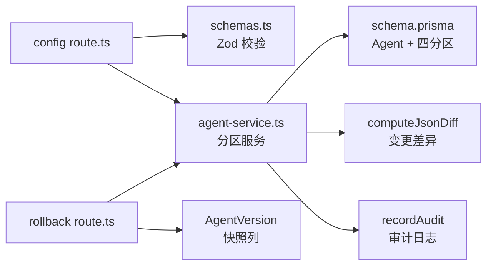
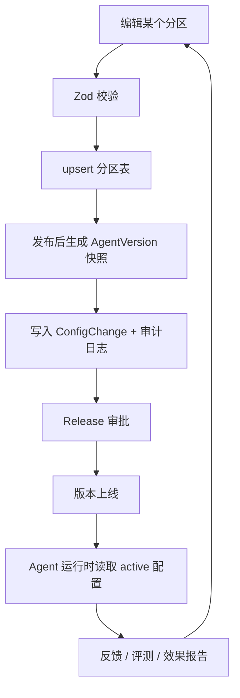

# 四分区配置架构

<cite>
**本文引用的文件**   
- [apps/web/app/api/agents/[id]/config/[partition]/route.ts](file://apps/web/app/api/agents/[id]/config/[partition]/route.ts)
- [apps/web/app/api/agents/[id]/config/[partition]/rollback/route.ts](file://apps/web/app/api/agents/[id]/config/[partition]/rollback/route.ts)
- [apps/web/lib/services/agent-service.ts](file://apps/web/lib/services/agent-service.ts)
- [apps/web/lib/schemas.ts](file://apps/web/lib/schemas.ts)
- [packages/db/prisma/schema.prisma](file://packages/db/prisma/schema.prisma)
- [apps/web/app/(dashboard)/architecture/page.tsx](file://apps/web/app/(dashboard)/architecture/page.tsx)
</cite>

## 目录
1. [引言](#引言)
2. [项目结构定位](#项目结构定位)
3. [核心组件总览](#核心组件总览)
4. [架构总览](#架构总览)
5. [分区设计详解](#分区设计详解)
6. [分区隔离机制](#分区隔离机制)
7. [版本控制、变更追踪与回滚机制](#版本控制变更追踪与回滚机制)
8. [API 调用示例](#api-调用示例)
9. [依赖关系图与配置流转图](#依赖关系图与配置流转图)
10. [性能与工程特性](#性能与工程特性)
11. [故障排查指南](#故障排查指南)
12. [结论](#结论)

## 引言
本技术文档聚焦 AgentUp 平台的“四分区配置架构”，即把每个 Agent 的可变行为收敛为四个独立分区：**Prompt（系统提示词、角色定义、约束）**、**Knowledge（Wiki 知识层，llm-wiki 蒸馏态优先）**、**Tools（MCP 工具 + Wiki 查询工具）**、**Routing（路由规则、升级策略）**。

该设计不仅是配置模型，也是失败归因分类学：一条失败工单最终会落到某个分区，从而决定修复动作是改提示词、补知识、加工具还是调路由阈值。四分区同时承担关注点分离、团队协作边界、版本粒度控制和可回滚性四大职责。

## 项目结构定位
四分区配置在代码中的落点分为三层：
- **接口层**：Next.js Route Handler 暴露 `/api/agents/[id]/config/[partition]` 和 `/api/agents/[id]/config/[partition]/rollback`。
- **服务层**：`agent-service.ts` 提供分区读取、分区更新、变更记录写入等能力。
- **数据层**：Prisma Schema 中 `Agent` 聚合四个分区表，并关联 `ConfigChange`、`AgentVersion`、`Release` 等版本资产。

**图表来源**
- [apps/web/app/api/agents/[id]/config/[partition]/route.ts:1-86](file://apps/web/app/api/agents/[id]/config/[partition]/route.ts#L1-L86)
- [apps/web/lib/services/agent-service.ts:341-614](file://apps/web/lib/services/agent-service.ts#L341-L614)
- [packages/db/prisma/schema.prisma:66-168](file://packages/db/prisma/schema.prisma#L66-L168)

**章节来源**
- [apps/web/app/api/agents/[id]/config/[partition]/route.ts:1-86](file://apps/web/app/api/agents/[id]/config/[partition]/route.ts#L1-L86)
- [apps/web/lib/services/agent-service.ts:1-22](file://apps/web/lib/services/agent-service.ts#L1-L22)
- [packages/db/prisma/schema.prisma:66-168](file://packages/db/prisma/schema.prisma#L66-L168)

## 核心组件总览
| 组件 | 职责 | 关键实现位置 |
|---|---|---|
| 分区路由处理器 | 校验分区名、校验请求体、调用服务层、记录变更 | `apps/web/app/api/agents/[id]/config/[partition]/route.ts` |
| 分区回滚处理器 | 从指定 Version 快照恢复某分区，复用分区更新流程 | `apps/web/app/api/agents/[id]/config/[partition]/rollback/route.ts` |
| 分区服务 | 读取分区、upsert 分区、计算 diff、写 ConfigChange | `apps/web/lib/services/agent-service.ts` |
| 分区校验 Schema | Zod 定义 Prompt/Knowledge/Tools/Routing 输入契约 | `apps/web/lib/schemas.ts` |
| 数据模型 | Agent 聚合四分区；Version 存四列快照；Change 记录 before/after/diff | `packages/db/prisma/schema.prisma` |

**章节来源**
- [apps/web/app/api/agents/[id]/config/[partition]/route.ts:14-85](file://apps/web/app/api/agents/[id]/config/[partition]/route.ts#L14-L85)
- [apps/web/app/api/agents/[id]/config/[partition]/rollback/route.ts:16-117](file://apps/web/app/api/agents/[id]/config/[partition]/rollback/route.ts#L16-L117)
- [apps/web/lib/services/agent-service.ts:341-614](file://apps/web/lib/services/agent-service.ts#L341-L614)
- [apps/web/lib/schemas.ts:23-60](file://apps/web/lib/schemas.ts#L23-L60)
- [packages/db/prisma/schema.prisma:66-168](file://packages/db/prisma/schema.prisma#L66-L168)

## 架构总览
四分区配置不是四个并列字段，而是四个具有不同语义、不同风险等级、不同回滚粒度的“行为面”。

**图表来源**
- [apps/web/app/(dashboard)/architecture/page.tsx:67-76](file://apps/web/app/(dashboard)/architecture/page.tsx#L67-L76)

### 为什么采用四分区而非单一配置文件
1. **关注点分离**：Prompt 影响回答风格与越界风险；Knowledge 影响事实准确性；Tools 影响执行能力；Routing 影响分派与升级。
2. **归因分类学**：失败工单复盘时，问题类型直接映射到分区，便于自动建议目标分区。
3. **版本粒度更细**：只改提示词不必触发大版本；只加 MCP 工具也不必动路由策略。
4. **回滚更安全**：分区级回滚避免整 Agent 配置被历史快照覆盖。
5. **团队协作清晰**：产品组可专注 Prompt 和 Routing，知识库运营专注 Knowledge，平台工程专注 Tools。

**章节来源**
- [apps/web/app/(dashboard)/architecture/page.tsx:186-224](file://apps/web/app/(dashboard)/architecture/page.tsx#L186-L224)

## 分区设计详解

### Prompt 分区
Prompt 分区承载 Agent 的“性格与纪律”，包括系统提示词、角色定义、约束条件和输出格式。它是最直接影响 LLM 生成行为的配置面。

| 字段 | 含义 | 默认值或约束 |
|---|---|---|
| `systemPrompt` | 系统提示词 | 必填字符串 |
| `roleDefinition` | 角色定义 | 可选字符串 |
| `constraints` | 约束列表 | JSON 文本数组 |
| `outputFormat` | 输出格式 | 可选字符串 |
| `version` | 分区版本号 | 自增整数 |
| `lastModifiedAt` | 最后修改时间 | 自动时间戳 |

**章节来源**
- [apps/web/lib/schemas.ts:23-28](file://apps/web/lib/schemas.ts#L23-L28)
- [packages/db/prisma/schema.prisma:105-117](file://packages/db/prisma/schema.prisma#L105-L117)
- [apps/web/lib/services/agent-service.ts:77-86](file://apps/web/lib/services/agent-service.ts#L77-L86)

### Knowledge 分区
Knowledge 分区指向一个 Wiki vault，并定义两层知识检索策略：**先查蒸馏态知识，再回退到 MCP 活数据**。这是 llm-wiki 蒸馏态的核心入口。

| 字段 | 含义 | 默认值或约束 |
|---|---|---|
| `wikiVaultId` | 关联的 Wiki vault | 可选 |
| `searchStrategy` | 检索策略 | `WIKI_FIRST` 等枚举 |
| `fallbackToMcp` | 是否允许回退 MCP | 默认 true |
| `maxWikiResults` | 最大 Wiki 结果数 | 1–50 |
| `confidenceThreshold` | 置信度门限 | 0–1 |
| `syncStatus` | 同步状态 | 默认 SYNCED |

**章节来源**
- [apps/web/lib/schemas.ts:30-36](file://apps/web/lib/schemas.ts#L30-L36)
- [packages/db/prisma/schema.prisma:119-136](file://packages/db/prisma/schema.prisma#L119-L136)
- [apps/web/lib/services/agent-service.ts:88-98](file://apps/web/lib/services/agent-service.ts#L88-L98)

### Tools 分区
Tools 分区管理 MCP 工具配置和 Wiki 查询工具配置，同时控制并发、超时、重试等运行时参数。

| 字段 | 含义 | 默认值或约束 |
|---|---|---|
| `mcpTools` | MCP 工具列表 | JSON 文本数组 |
| `wikiQueryTools` | Wiki 查询工具列表 | JSON 文本数组 |
| `maxConcurrentCalls` | 最大并发调用 | 1–20 |
| `timeoutMs` | 超时毫秒 | 1000–120000 |
| `retryCount` | 重试次数 | 0–5 |

**章节来源**
- [apps/web/lib/schemas.ts:38-44](file://apps/web/lib/schemas.ts#L38-L44)
- [packages/db/prisma/schema.prisma:138-152](file://packages/db/prisma/schema.prisma#L138-L152)
- [apps/web/lib/services/agent-service.ts:100-110](file://apps/web/lib/services/agent-service.ts#L100-L110)

### Routing 分区
Routing 分区定义工单分类规则、升级策略、转人工阈值、对话轮次上限和空闲超时。它是 Agent 的“分诊台”。

| 字段 | 含义 | 默认值或约束 |
|---|---|---|
| `rules` | 路由规则列表 | JSON 文本数组 |
| `escalationPolicy` | 升级策略 | 可选 JSON |
| `humanThreshold` | 转人工阈值 | 0–1 |
| `maxConversationTurns` | 最大对话轮次 | 1–100 |
| `idleTimeoutMinutes` | 空闲超时分钟 | 1–60 |

**章节来源**
- [apps/web/lib/schemas.ts:46-52](file://apps/web/lib/schemas.ts#L46-L52)
- [packages/db/prisma/schema.prisma:154-168](file://packages/db/prisma/schema.prisma#L154-L168)
- [apps/web/lib/services/agent-service.ts:112-122](file://apps/web/lib/services/agent-service.ts#L112-L122)

## 分区隔离机制
四分区隔离体现在三个层面：

1. **路由级隔离**：分区名必须属于 `prompt`、`knowledge`、`tools`、`routing` 之一，非法分区直接返回错误。
2. **Schema 级隔离**：每个分区有独立的 Zod schema，PUT 请求体会按分区校验。
3. **服务层隔离**：`updateConfigPartition` 根据分区分发到对应 upsert 逻辑，不会跨分区污染字段。

**图表来源**
- [apps/web/app/api/agents/[id]/config/[partition]/route.ts:14-85](file://apps/web/app/api/agents/[id]/config/[partition]/route.ts#L14-L85)
- [apps/web/lib/services/agent-service.ts:364-549](file://apps/web/lib/services/agent-service.ts#L364-L549)

**章节来源**
- [apps/web/app/api/agents/[id]/config/[partition]/route.ts:14-85](file://apps/web/app/api/agents/[id]/config/[partition]/route.ts#L14-L85)
- [apps/web/lib/schemas.ts:23-60](file://apps/web/lib/schemas.ts#L23-L60)
- [apps/web/lib/services/agent-service.ts:364-549](file://apps/web/lib/services/agent-service.ts#L364-L549)

## 版本控制、变更追踪与回滚机制

### 版本控制策略
- 每个分区维护独立 `version` 整数，创建时初始化为 1，更新时递增。
- 发布流程生成不可变的 `AgentVersion`，包含四个分区的快照列：`promptSnapshot`、`knowledgeSnapshot`、`toolsSnapshot`、`routingSnapshot`。
- 快照以 JSON 文本存储，通过 `packJson`/`unpackJson` 安全读写。

**图表来源**
- [packages/db/prisma/schema.prisma:66-168](file://packages/db/prisma/schema.prisma#L66-L168)
- [packages/db/prisma/schema.prisma:294-318](file://packages/db/prisma/schema.prisma#L294-L318)

### 变更追踪机制
每次分区更新都会调用 `recordConfigChange`，记录：
- `partition`：分区名或带 `_ROLLBACK` 后缀的回滚标记。
- `before`：变更前配置。
- `after`：变更后配置。
- `diff`：结构化 diff，包含 added/removed/changed 键集合。
- `changeNote`：可选变更说明。
- `changedBy`：操作者。

**章节来源**
- [apps/web/lib/services/agent-service.ts:567-614](file://apps/web/lib/services/agent-service.ts#L567-L614)
- [packages/db/prisma/schema.prisma:188-205](file://packages/db/prisma/schema.prisma#L188-L205)

### 分区级回滚机制
分区级回滚不是简单覆盖当前配置，而是复用现有分区更新流程，保证审计链完整：

1. 校验分区名。
2. 校验 `versionId`。
3. 查询 `AgentVersion`，确认属于目标 Agent。
4. 从对应 snapshot 列取出该分区快照。
5. 读取当前配置作为 `before`。
6. 调用对应分区更新函数写入快照内容。
7. 记录变更，分区名追加 `_ROLLBACK`，变更说明包含目标版本。

**图表来源**
- [apps/web/app/api/agents/[id]/config/[partition]/rollback/route.ts:42-117](file://apps/web/app/api/agents/[id]/config/[partition]/rollback/route.ts#L42-L117)
- [apps/web/lib/services/agent-service.ts:341-549](file://apps/web/lib/services/agent-service.ts#L341-L549)

**章节来源**
- [apps/web/app/api/agents/[id]/config/[partition]/rollback/route.ts:16-117](file://apps/web/app/api/agents/[id]/config/[partition]/rollback/route.ts#L16-L117)
- [packages/db/prisma/schema.prisma:294-318](file://packages/db/prisma/schema.prisma#L294-L318)

## API 调用示例

### 读取分区配置
- **方法**：GET
- **路径**：`/api/agents/{id}/config/{partition}`
- **分区取值**：`prompt`、`knowledge`、`tools`、`routing`
- **成功响应**：返回对应分区配置对象
- **失败场景**：
  - 分区名非法：返回 400。
  - Agent 不存在：由服务层抛出未找到错误。

**章节来源**
- [apps/web/app/api/agents/[id]/config/[partition]/route.ts:28-44](file://apps/web/app/api/agents/[id]/config/[partition]/route.ts#L28-L44)
- [apps/web/lib/services/agent-service.ts:341-358](file://apps/web/lib/services/agent-service.ts#L341-L358)

### 更新分区配置
- **方法**：PUT
- **路径**：`/api/agents/{id}/config/{partition}`
- **请求体**：按分区 Zod schema 校验
- **行为**：
  - 读取 before。
  - 调用对应分区更新函数。
  - 记录 ConfigChange。
  - 返回 after。

**章节来源**
- [apps/web/app/api/agents/[id]/config/[partition]/route.ts:46-85](file://apps/web/app/api/agents/[id]/config/[partition]/route.ts#L46-L85)
- [apps/web/lib/schemas.ts:23-60](file://apps/web/lib/schemas.ts#L23-L60)
- [apps/web/lib/services/agent-service.ts:364-549](file://apps/web/lib/services/agent-service.ts#L364-L549)

### 分区级回滚
- **方法**：POST
- **路径**：`/api/agents/{id}/config/{partition}/rollback`
- **请求体**：`{ versionId: string }`
- **行为**：
  - 校验分区和 versionId。
  - 从 `AgentVersion` 对应 snapshot 列取分区快照。
  - 复用分区更新函数写入。
  - 记录 `_ROLLBACK` 变更。

**章节来源**
- [apps/web/app/api/agents/[id]/config/[partition]/rollback/route.ts:26-117](file://apps/web/app/api/agents/[id]/config/[partition]/rollback/route.ts#L26-L117)

## 依赖关系图与配置流转图

### 组件依赖图

**图表来源**
- [apps/web/app/api/agents/[id]/config/[partition]/route.ts:1-12](file://apps/web/app/api/agents/[id]/config/[partition]/route.ts#L1-L12)
- [apps/web/app/api/agents/[id]/config/[partition]/rollback/route.ts:1-14](file://apps/web/app/api/agents/[id]/config/[partition]/rollback/route.ts#L1-L14)
- [apps/web/lib/services/agent-service.ts:1-21](file://apps/web/lib/services/agent-service.ts#L1-L21)
- [packages/db/prisma/schema.prisma:66-168](file://packages/db/prisma/schema.prisma#L66-L168)

### 配置流转图

**图表来源**
- [apps/web/lib/services/agent-service.ts:364-614](file://apps/web/lib/services/agent-service.ts#L364-L614)
- [packages/db/prisma/schema.prisma:257-318](file://packages/db/prisma/schema.prisma#L257-L318)

## 性能与工程特性
- **JSON 文本存储**：由于 SQLite 连接器限制，原 Json 字段改为 String，并通过 `packJson`/`unpackJson` 包装，解析失败回落 fallback，不抛异常。
- **分区 upsert 语义**：未传字段保留，已传字段覆盖，符合“部分更新”预期。
- **版本自增**：每个分区独立 `version`，避免跨分区耦合。
- **变更 diff**：结构化 diff 便于 UI 展示和自动化分析。
- **审计贯穿**：配置变更同时写入 `ConfigChange` 和审计日志，支持事后追溯。

**章节来源**
- [packages/db/prisma/schema.prisma:1-9](file://packages/db/prisma/schema.prisma#L1-L9)
- [apps/web/lib/services/agent-service.ts:364-549](file://apps/web/lib/services/agent-service.ts#L364-L549)
- [apps/web/lib/services/agent-service.ts:567-614](file://apps/web/lib/services/agent-service.ts#L567-L614)

## 故障排查指南
| 现象 | 可能原因 | 排查建议 |
|---|---|---|
| 分区更新返回 400 | 分区名不在允许集合 | 检查 URL 中 partition 是否为 `prompt/knowledge/tools/routing` |
| 分区更新返回校验错误 | 请求体不符合 Zod schema | 对照 `PARTITION_SCHEMA` 检查字段类型和范围 |
| 回滚失败提示 Version 不存在 | `versionId` 错误或不属于该 Agent | 检查 `AgentVersion.id` 和 `agentId` 匹配关系 |
| 回滚后配置未变化 | 目标 Version 对应分区快照为空 | 检查 `promptSnapshot/knowledgeSnapshot/toolsSnapshot/routingSnapshot` |
| 变更无法追溯 | ConfigChange 未写入 | 检查 `recordConfigChange` 是否被调用，以及审计日志是否写入 |

**章节来源**
- [apps/web/app/api/agents/[id]/config/[partition]/route.ts:24-57](file://apps/web/app/api/agents/[id]/config/[partition]/route.ts#L24-L57)
- [apps/web/app/api/agents/[id]/config/[partition]/rollback/route.ts:48-74](file://apps/web/app/api/agents/[id]/config/[partition]/rollback/route.ts#L48-L74)
- [apps/web/lib/services/agent-service.ts:567-614](file://apps/web/lib/services/agent-service.ts#L567-L614)

## 结论
四分区配置架构是 AgentUp 平台的核心设计之一。它将 Agent 的可变行为拆分为 Prompt、Knowledge、Tools、Routing 四个关注点明确、版本独立、可回滚的配置面，既降低非开发者用户的认知负担，也为失败归因、版本管理和团队协作提供了稳定基础。

在实际工程中，这一设计通过 Next.js 路由处理器、Zod 校验、Prisma 数据模型、不可变 Version 快照和 ConfigChange 审计共同落地。未来若引入灰度发布、RBAC 强制、蒸馏引擎和 L1 自动采集，四分区仍可作为稳定的扩展基座。