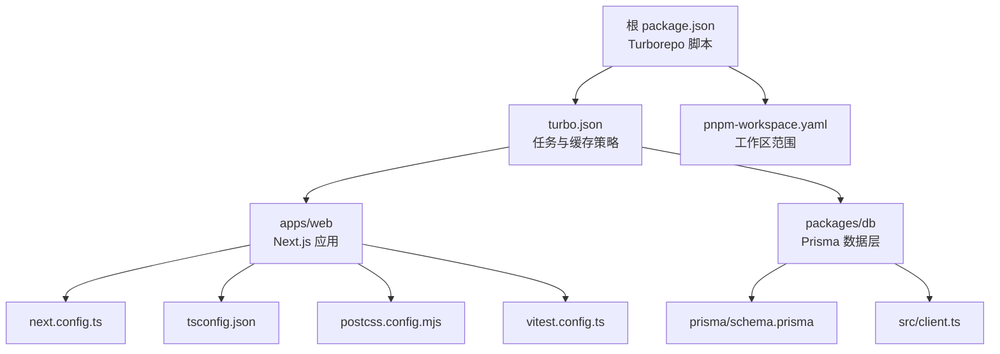
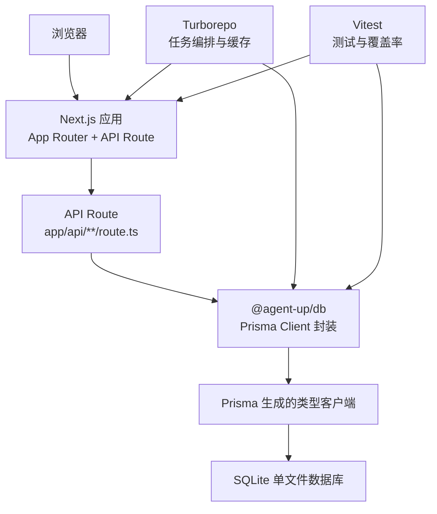
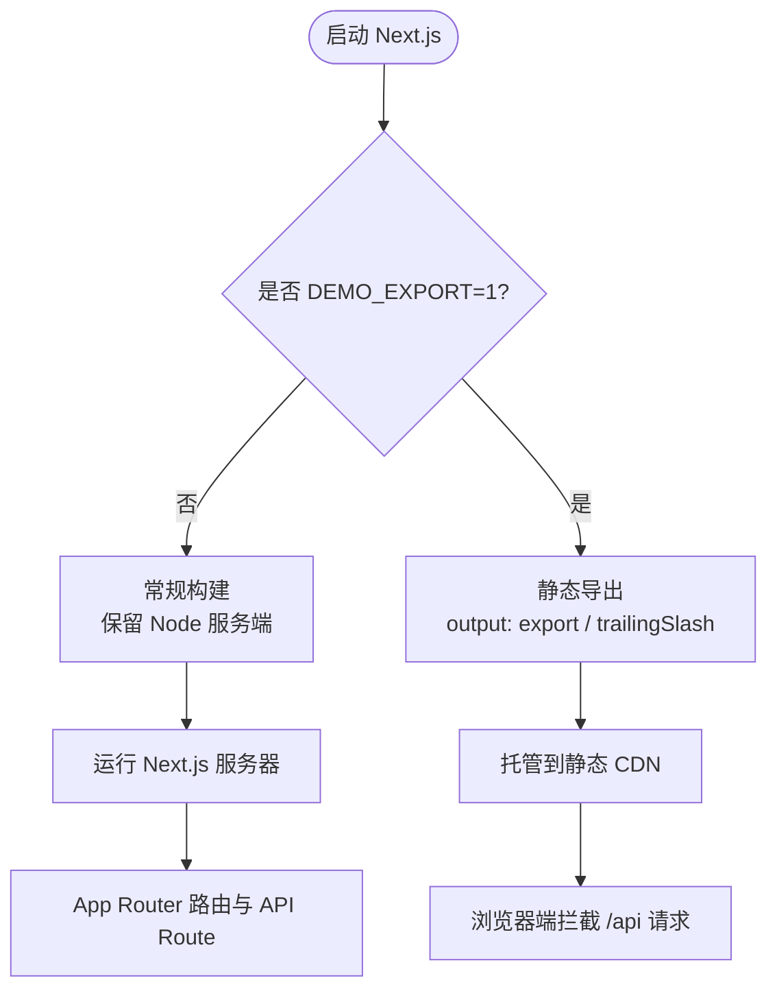
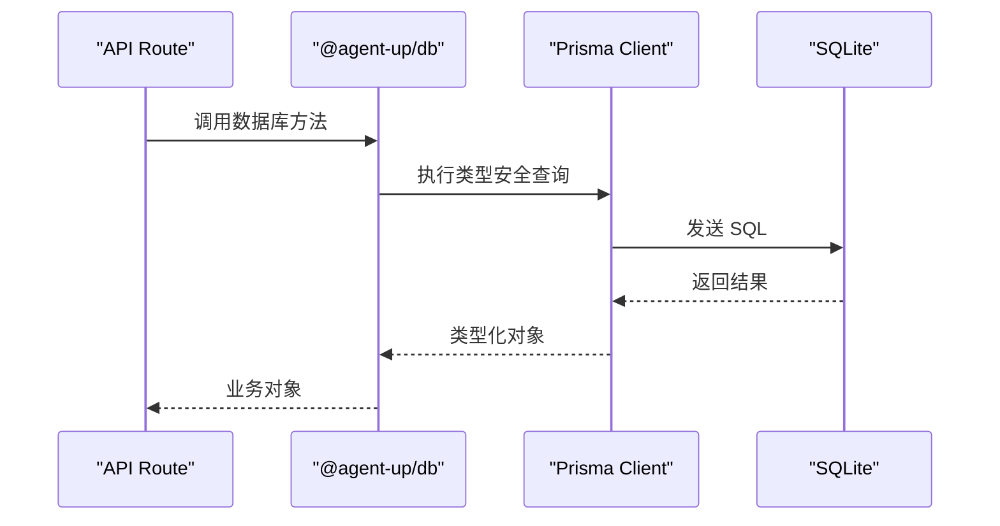
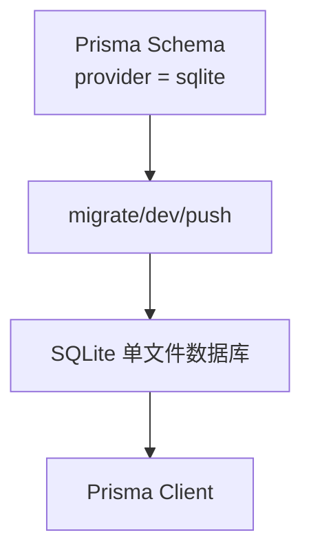
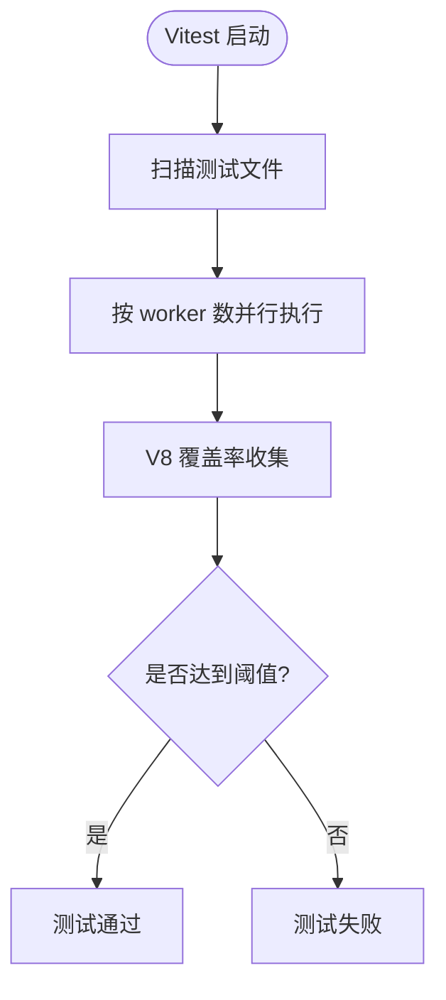
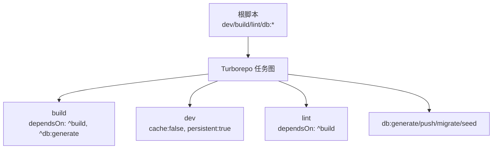
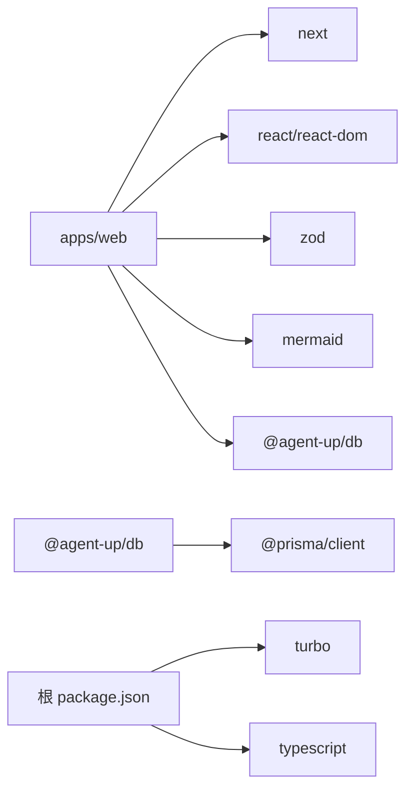

# 技术选型说明

<cite>
**本文引用的文件**   
- [package.json](file://package.json)
- [turbo.json](file://turbo.json)
- [pnpm-workspace.yaml](file://pnpm-workspace.yaml)
- [apps/web/package.json](file://apps/web/package.json)
- [apps/web/next.config.ts](file://apps/web/next.config.ts)
- [apps/web/tsconfig.json](file://apps/web/tsconfig.json)
- [apps/web/postcss.config.mjs](file://apps/web/postcss.config.mjs)
- [apps/web/vitest.config.ts](file://apps/web/vitest.config.ts)
- [apps/web/app/layout.tsx](file://apps/web/app/layout.tsx)
- [packages/db/package.json](file://packages/db/package.json)
- [packages/db/prisma/schema.prisma](file://packages/db/prisma/schema.prisma)
- [packages/db/src/client.ts](file://packages/db/src/client.ts)
- [packages/db/src/index.ts](file://packages/db/src/index.ts)
- [README.md](file://README.md)
- [2026-10-04-project-evaluation-and-remediation.md](file://docs/reports/2026-10-04-project-evaluation-and-remediation.md)
</cite>

## 目录
1. [引言](#引言)
2. [项目结构](#项目结构)
3. [核心组件](#核心组件)
4. [架构总览](#架构总览)
5. [详细组件分析](#详细组件分析)
6. [依赖关系分析](#依赖关系分析)
7. [性能与构建特性](#性能与构建特性)
8. [兼容性矩阵与迁移指南](#兼容性矩阵与迁移指南)
9. [配置示例与最佳实践](#配置示例与最佳实践)
10. [故障排查](#故障排查)
11. [结论](#结论)

## 引言
本技术选型说明面向工程团队，解释当前仓库在 Next.js、TypeScript、Tailwind CSS、Prisma、SQLite、Vitest 与 Turborepo 上的选择理由、权衡取舍、协同方式与性能表现，并给出版本兼容矩阵、迁移路径和可操作的最佳实践。文档同时结合仓库实际代码与报告中的评估结论，避免空泛描述。

## 项目结构
仓库采用 pnpm workspace + Turborepo 的 monorepo 组织：
- `apps/web`：Next.js 应用，包含 App Router 路由、页面、API Route、UI 组件、测试与构建配置。
- `packages/db`：共享数据库包，封装 Prisma Client、枚举与 JSON 文本序列化逻辑，对外暴露类型安全的数据库访问入口。
- 根级 `package.json` 统一编排脚本，`turbo.json` 定义任务缓存与依赖顺序，`pnpm-workspace.yaml` 声明工作区范围。



**图表来源**
- [package.json:1-22](file://package.json#L1-L22)
- [turbo.json:1-35](file://turbo.json#L1-L35)
- [pnpm-workspace.yaml:1-4](file://pnpm-workspace.yaml#L1-L4)
- [apps/web/next.config.ts:1-22](file://apps/web/next.config.ts#L1-L22)
- [apps/web/tsconfig.json:1-35](file://apps/web/tsconfig.json#L1-L35)
- [apps/web/postcss.config.mjs:1-8](file://apps/web/postcss.config.mjs#L1-L8)
- [apps/web/vitest.config.ts:1-64](file://apps/web/vitest.config.ts#L1-L64)
- [packages/db/prisma/schema.prisma:1-18](file://packages/db/prisma/schema.prisma#L1-L18)
- [packages/db/src/client.ts:1-18](file://packages/db/src/client.ts#L1-L18)

**章节来源**
- [package.json:1-22](file://package.json#L1-L22)
- [turbo.json:1-35](file://turbo.json#L1-L35)
- [pnpm-workspace.yaml:1-4](file://pnpm-workspace.yaml#L1-L4)

## 核心组件
- **Next.js 16（App Router）**：提供路由、服务端渲染、静态导出与 API Route；当前开发脚本启用 Turbopack 加速开发体验。
- **TypeScript strict mode**：开启严格类型检查，配合 Next 插件与 bundler 模块解析，提升工程纪律与重构安全性。
- **Tailwind CSS 4**：通过 `@tailwindcss/postcss` 接入 PostCSS，使用原子化样式方案，减少自定义 CSS 维护成本。
- **Prisma ORM**：以 SQLite 为默认数据源，生成类型安全的客户端；对不支持的特性做运行时降级（如 enum/Json/String[]）。
- **SQLite 单文件数据库**：轻量、零运维、适合本地开发与演示环境；复杂查询能力弱于 PostgreSQL，但满足当前业务规模。
- **Vitest**：Node 环境下运行单元测试与 API 测试，集成 V8 覆盖率门禁，按 worker 隔离独立测试库。
- **Turborepo monorepo**：统一脚本、任务缓存、跨包依赖顺序，提升多包协作效率。

**章节来源**
- [apps/web/package.json:1-37](file://apps/web/package.json#L1-L37)
- [apps/web/tsconfig.json:1-35](file://apps/web/tsconfig.json#L1-L35)
- [apps/web/postcss.config.mjs:1-8](file://apps/web/postcss.config.mjs#L1-L8)
- [packages/db/package.json:1-29](file://packages/db/package.json#L1-L29)
- [packages/db/prisma/schema.prisma:1-18](file://packages/db/prisma/schema.prisma#L1-L18)
- [apps/web/vitest.config.ts:1-64](file://apps/web/vitest.config.ts#L1-L64)
- [turbo.json:1-35](file://turbo.json#L1-L35)

## 架构总览
系统由前端 UI、Next.js API Route、共享数据库包与 SQLite 组成。Next.js 负责页面渲染与接口路由；API Route 调用 `@agent-up/db` 提供的 Prisma Client；Prisma 根据 schema 生成类型安全的客户端，连接 SQLite 单文件数据库。Turborepo 协调 dev/build/lint/db 等任务，Vitest 覆盖核心逻辑与 API 路由。



**图表来源**
- [apps/web/app/layout.tsx:1-32](file://apps/web/app/layout.tsx#L1-L32)
- [apps/web/next.config.ts:1-22](file://apps/web/next.config.ts#L1-L22)
- [packages/db/src/client.ts:1-18](file://packages/db/src/client.ts#L1-L18)
- [packages/db/prisma/schema.prisma:1-18](file://packages/db/prisma/schema.prisma#L1-L18)
- [turbo.json:1-35](file://turbo.json#L1-L35)
- [apps/web/vitest.config.ts:1-64](file://apps/web/vitest.config.ts#L1-L64)

## 详细组件分析

### Next.js 16（App Router, Turbopack）
- 选择理由：
  - App Router 提供更强的路由语义与服务端渲染能力；当前仓库已基于 App Router 组织页面与 API Route。
  - 开发脚本使用 `--turbopack`，提升热更新与构建速度。
  - 支持静态导出模式（`DEMO_EXPORT=1`），便于纯前端演示托管。
- 权衡考虑：
  - 报告指出当前大量组件是 client component，且 API 调用集中在浏览器端 fetch，未充分利用 server component 的数据获取优势；这是后续优化方向。
  - 静态导出模式下无 Node 服务端，需依赖内存态 mock 与拦截层支撑演示。



**图表来源**
- [apps/web/next.config.ts:1-22](file://apps/web/next.config.ts#L1-L22)
- [apps/web/app/layout.tsx:1-32](file://apps/web/app/layout.tsx#L1-L32)
- [README.md:198-208](file://README.md#L198-L208)

**章节来源**
- [apps/web/package.json:1-37](file://apps/web/package.json#L1-L37)
- [apps/web/next.config.ts:1-22](file://apps/web/next.config.ts#L1-L22)
- [apps/web/app/layout.tsx:1-32](file://apps/web/app/layout.tsx#L1-L32)
- [2026-10-04-project-evaluation-and-remediation.md:195-212](file://docs/reports/2026-10-04-project-evaluation-and-remediation.md#L195-L212)
- [README.md:198-208](file://README.md#L198-L208)

### TypeScript strict mode（工程纪律）
- 选择理由：
  - 开启 `strict: true`，强制类型安全，减少运行时错误。
  - 使用 `moduleResolution: "bundler"` 与 Next 插件，适配现代打包器与路径别名。
- 权衡考虑：
  - 严格模式提高编译门槛，需要逐步修复第三方类型缺失或宽松类型；但长期收益显著。
  - 与 Vitest 的 alias 配置一致，保证测试环境与生产环境类型行为一致。

```mermaid
classDiagram
class TSConfig {
+target : "ES2017"
+lib : ["dom", "dom.iterable", "esnext"]
+strict : true
+noEmit : true
+module : "esnext"
+moduleResolution : "bundler"
+isolatedModules : true
+jsx : "react-jsx"
+paths : {"@/*" : ["./*"]}
}
```

**图表来源**
- [apps/web/tsconfig.json:1-35](file://apps/web/tsconfig.json#L1-L35)

**章节来源**
- [apps/web/tsconfig.json:1-35](file://apps/web/tsconfig.json#L1-L35)

### Tailwind CSS 4（原子化样式）
- 选择理由：
  - 通过 `@tailwindcss/postcss` 接入 PostCSS，保持与 Next.js 生态兼容。
  - 原子化样式降低样式耦合，提升可维护性与一致性。
- 权衡考虑：
  - 原子类名较多，模板可读性下降；需配合组件抽象与命名规范。
  - 与全局样式（`globals.css`）共存时需注意优先级与冲突。


**图表来源**
- [apps/web/postcss.config.mjs:1-8](file://apps/web/postcss.config.mjs#L1-L8)

**章节来源**
- [apps/web/postcss.config.mjs:1-8](file://apps/web/postcss.config.mjs#L1-L8)

### Prisma ORM（类型安全优势）
- 选择理由：
  - 生成类型安全的 Prisma Client，提升查询与写入的类型保障。
  - 通过 `@agent-up/db` 包集中管理数据库访问、枚举与 JSON 文本序列化。
- 权衡考虑：
  - SQLite 连接器不支持 enum/Json/String[]，因此将枚举移至运行时校验（Zod），JSON 字段以 String 存储并通过 pack/unpack 收口。
  - 这种设计牺牲了部分数据库层面的约束，换取 SQLite 的轻量与可移植性。



**图表来源**
- [packages/db/src/client.ts:1-18](file://packages/db/src/client.ts#L1-L18)
- [packages/db/prisma/schema.prisma:1-18](file://packages/db/prisma/schema.prisma#L1-L18)

**章节来源**
- [packages/db/package.json:1-29](file://packages/db/package.json#L1-L29)
- [packages/db/prisma/schema.prisma:1-597](file://packages/db/prisma/schema.prisma#L1-L597)
- [packages/db/src/client.ts:1-18](file://packages/db/src/client.ts#L1-L18)
- [packages/db/src/index.ts:1-4](file://packages/db/src/index.ts#L1-L4)

### SQLite 单文件数据库（轻量特性）
- 选择理由：
  - 单文件数据库，无需额外服务进程，适合本地开发与演示环境。
  - 与 Prisma 集成简单，schema 变更可通过 migrate/push 管理。
- 权衡考虑：
  - 并发写与复杂查询能力弱于 PostgreSQL；当前业务以读为主，影响有限。
  - 需要将原 PostgreSQL 特性（enum/Json）降级为字符串与运行时校验。



**图表来源**
- [packages/db/prisma/schema.prisma:1-18](file://packages/db/prisma/schema.prisma#L1-L18)

**章节来源**
- [packages/db/prisma/schema.prisma:1-597](file://packages/db/prisma/schema.prisma#L1-L597)

### Vitest（测试框架）
- 选择理由：
  - Node 环境测试，覆盖 API Route 与核心逻辑。
  - 集成 V8 覆盖率，设置行/函数/语句/分支阈值门禁。
  - 通过 worker 数与独立测试库隔离，避免测试间污染。
- 权衡考虑：
  - 覆盖率门禁较严格，新增代码需同步补测；某些兜底分支因引入 mock 成本高暂未覆盖。



**图表来源**
- [apps/web/vitest.config.ts:1-64](file://apps/web/vitest.config.ts#L1-L64)

**章节来源**
- [apps/web/vitest.config.ts:1-64](file://apps/web/vitest.config.ts#L1-L64)

### Turborepo monorepo（构建优化）
- 选择理由：
  - 统一脚本与任务编排，支持缓存与依赖顺序。
  - `build` 依赖 `^db:generate`，确保数据库类型先于应用构建。
  - `dev` 禁用缓存并标记 persistent，适合长时间开发。
- 权衡考虑：
  - 任务缓存可能掩盖环境变量变化，需关注 `globalDependencies` 与任务输入输出。



**图表来源**
- [turbo.json:1-35](file://turbo.json#L1-L35)
- [package.json:1-22](file://package.json#L1-L22)

**章节来源**
- [turbo.json:1-35](file://turbo.json#L1-L35)
- [package.json:1-22](file://package.json#L1-L22)

## 依赖关系分析
- 应用层依赖：
  - `apps/web` 依赖 `next`、`react`、`zod`、`mermaid` 与 `@agent-up/db`。
  - 开发依赖包括 Tailwind CSS 4、Vitest、ESLint、TypeScript。
- 数据层依赖：
  - `packages/db` 依赖 `@prisma/client` 与 `prisma`，对外暴露类型安全的数据库访问。
- 工具链依赖：
  - Turborepo 与 pnpm workspace 协调多包构建与脚本。



**图表来源**
- [apps/web/package.json:1-37](file://apps/web/package.json#L1-L37)
- [packages/db/package.json:1-29](file://packages/db/package.json#L1-L29)
- [package.json:1-22](file://package.json#L1-L22)

**章节来源**
- [apps/web/package.json:1-37](file://apps/web/package.json#L1-L37)
- [packages/db/package.json:1-29](file://packages/db/package.json#L1-L29)
- [package.json:1-22](file://package.json#L1-L22)

## 性能与构建特性
- Next.js + Turbopack：
  - 开发阶段启用 Turbopack，提升热更新与构建速度。
  - 静态导出模式适用于演示托管，无 Node 服务端开销。
- TypeScript：
  - `noEmit: true` 与 `incremental: true` 提升编译性能。
- Tailwind CSS 4：
  - 原子化样式减少 CSS 体积，但需关注模板复杂度。
- Prisma + SQLite：
  - 单文件数据库减少运维成本；复杂查询性能受限，但当前业务以读为主。
- Vitest：
  - Worker 并行与 V8 覆盖率提升测试效率与质量。
- Turborepo：
  - 任务缓存与依赖顺序提升多包协作效率。

[本节为通用性能讨论，不直接分析具体文件]

## 兼容性矩阵与迁移指南

### 技术栈版本兼容矩阵
- Node.js：>=20（根 `engines`）
- pnpm：9.15.0（根 `packageManager`）
- TypeScript：~5.x（根与应用均使用）
- Next.js：16.2.10（应用）
- React：19.2.4（应用）
- Tailwind CSS：^4（应用）
- Prisma：^6.10.0（数据库包）
- Vitest：^3.0.0（应用）

**章节来源**
- [package.json:14-21](file://package.json#L14-L21)
- [apps/web/package.json:15-35](file://apps/web/package.json#L15-L35)
- [packages/db/package.json:17-24](file://packages/db/package.json#L17-L24)

### 迁移指南
- 从 PostgreSQL 迁移至 SQLite：
  - 将 enum 移至运行时校验（Zod），列改为 String。
  - Json 字段改为 String，读写经 pack/unpack 收口。
  - 标量数组改为 String（JSON 文本）。
- 从传统 CSS 迁移至 Tailwind CSS 4：
  - 安装 `@tailwindcss/postcss` 与 `tailwindcss@^4`。
  - 在 PostCSS 配置中启用插件。
- 从旧版 Next.js 迁移至 App Router：
  - 使用 App Router 组织页面与 API Route。
  - 逐步将 client component 的数据获取迁移至 server component。
- 从旧版 Prisma 迁移至 v6：
  - 升级 `prisma` 与 `@prisma/client`。
  - 重新生成客户端并修复类型错误。
- 从旧版 Vitest 迁移至 v3：
  - 升级 `vitest` 与 `@vitest/coverage-v8`。
  - 调整覆盖率阈值与 include/exclude 配置。

**章节来源**
- [packages/db/prisma/schema.prisma:1-10](file://packages/db/prisma/schema.prisma#L1-L10)
- [apps/web/postcss.config.mjs:1-8](file://apps/web/postcss.config.mjs#L1-L8)
- [apps/web/vitest.config.ts:1-64](file://apps/web/vitest.config.ts#L1-L64)

## 配置示例与最佳实践

### Next.js 配置要点
- 静态导出模式：
  - 设置 `output: "export"` 与 `trailingSlash: true`。
  - 通过环境变量 `NEXT_PUBLIC_DEMO_MODE` 控制演示模式。
- App Router：
  - 使用 `app/layout.tsx` 定义根布局与元数据。
  - API Route 位于 `app/api/**/route.ts`。

**章节来源**
- [apps/web/next.config.ts:1-22](file://apps/web/next.config.ts#L1-L22)
- [apps/web/app/layout.tsx:1-32](file://apps/web/app/layout.tsx#L1-L32)

### TypeScript 配置要点
- 严格模式：
  - 开启 `strict: true`。
  - 使用 `moduleResolution: "bundler"` 与 Next 插件。
- 路径别名：
  - 配置 `@/*` 指向根目录。

**章节来源**
- [apps/web/tsconfig.json:1-35](file://apps/web/tsconfig.json#L1-L35)

### Tailwind CSS 配置要点
- PostCSS 插件：
  - 启用 `@tailwindcss/postcss`。
- 原子化样式：
  - 在模板中使用原子类名，避免自定义 CSS 冲突。

**章节来源**
- [apps/web/postcss.config.mjs:1-8](file://apps/web/postcss.config.mjs#L1-L8)

### Prisma 配置要点
- SQLite 数据源：
  - 设置 `provider = "sqlite"` 与 `url = env("DATABASE_URL")`。
- 类型安全：
  - 通过 `prisma generate` 生成客户端。
  - 使用 `@agent-up/db` 包暴露类型安全的数据库访问。

**章节来源**
- [packages/db/prisma/schema.prisma:1-18](file://packages/db/prisma/schema.prisma#L1-L18)
- [packages/db/src/client.ts:1-18](file://packages/db/src/client.ts#L1-L18)
- [packages/db/src/index.ts:1-4](file://packages/db/src/index.ts#L1-L4)

### Vitest 配置要点
- 测试环境：
  - 设置 `environment: "node"`。
  - 指定测试文件包含路径。
- 覆盖率门禁：
  - 使用 V8 提供者，设置行/函数/语句/分支阈值。
- Worker 隔离：
  - 通过 `maxWorkers` 与 `globalSetup` 实现独立测试库隔离。

**章节来源**
- [apps/web/vitest.config.ts:1-64](file://apps/web/vitest.config.ts#L1-L64)

### Turborepo 配置要点
- 任务定义：
  - `build` 依赖 `^build` 与 `^db:generate`。
  - `dev` 禁用缓存并标记 persistent。
- 缓存策略：
  - 设置 `globalDependencies` 与任务输入输出。

**章节来源**
- [turbo.json:1-35](file://turbo.json#L1-L35)

## 故障排查
- Next.js 静态导出问题：
  - 确认 `DEMO_EXPORT=1` 与 `NEXT_PUBLIC_DEMO_MODE=1` 环境变量正确设置。
  - 检查 `next.config.ts` 的 `output` 与 `trailingSlash` 配置。
- TypeScript 类型错误：
  - 检查 `tsconfig.json` 的 `strict` 与 `moduleResolution`。
  - 确保路径别名与 Next 插件配置正确。
- Tailwind CSS 样式不生效：
  - 检查 PostCSS 配置是否正确启用 `@tailwindcss/postcss`。
  - 确认模板中使用的原子类名有效。
- Prisma 类型不匹配：
  - 重新运行 `prisma generate`。
  - 检查 schema 中字段类型与运行时校验逻辑。
- Vitest 覆盖率不达标：
  - 检查 `include` 与 `exclude` 配置。
  - 补充缺失的测试用例，尤其是 API Route 与核心逻辑。

**章节来源**
- [apps/web/next.config.ts:1-22](file://apps/web/next.config.ts#L1-L22)
- [apps/web/tsconfig.json:1-35](file://apps/web/tsconfig.json#L1-L35)
- [apps/web/postcss.config.mjs:1-8](file://apps/web/postcss.config.mjs#L1-L8)
- [packages/db/prisma/schema.prisma:1-597](file://packages/db/prisma/schema.prisma#L1-L597)
- [apps/web/vitest.config.ts:1-64](file://apps/web/vitest.config.ts#L1-L64)

## 结论
本项目在 Next.js、TypeScript、Tailwind CSS、Prisma、SQLite、Vitest 与 Turborepo 上做出了务实的技术选型：以 App Router 与 Turbopack 提升开发体验，以 strict TypeScript 强化工程纪律，以原子化样式简化样式维护，以 Prisma 与 SQLite 提供轻量且类型安全的数据库访问，以 Vitest 保障代码质量，以 Turborepo 提升多包协作效率。未来可进一步优化 server component 的数据获取、扩展覆盖率门禁与增强复杂查询能力。