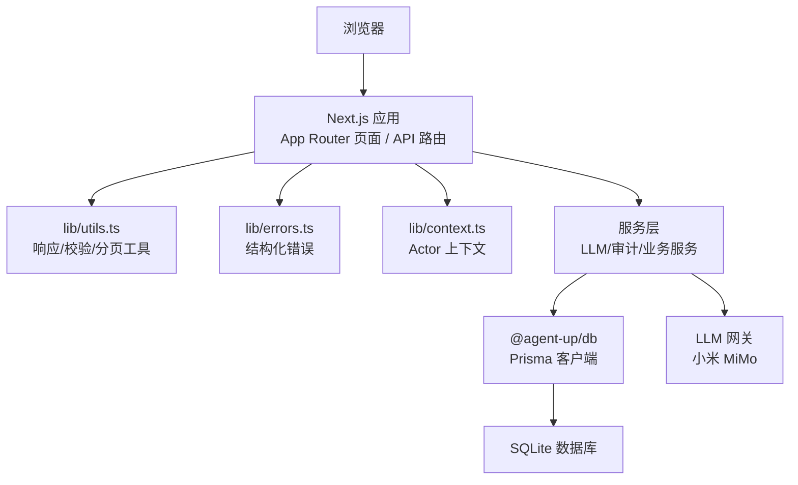
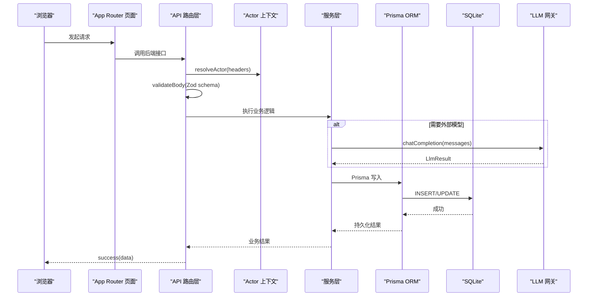
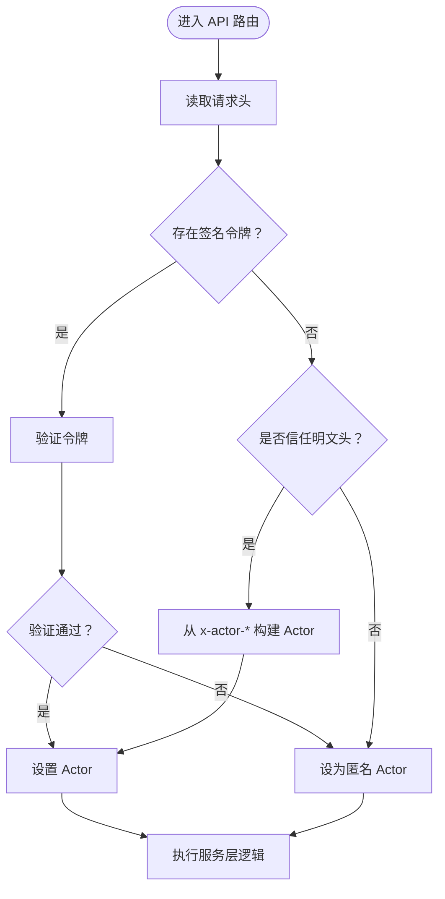
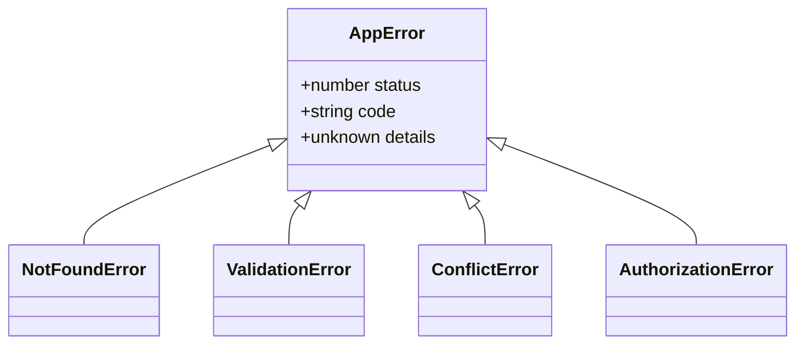
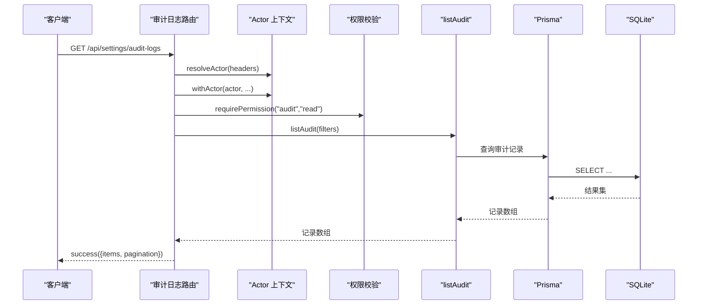
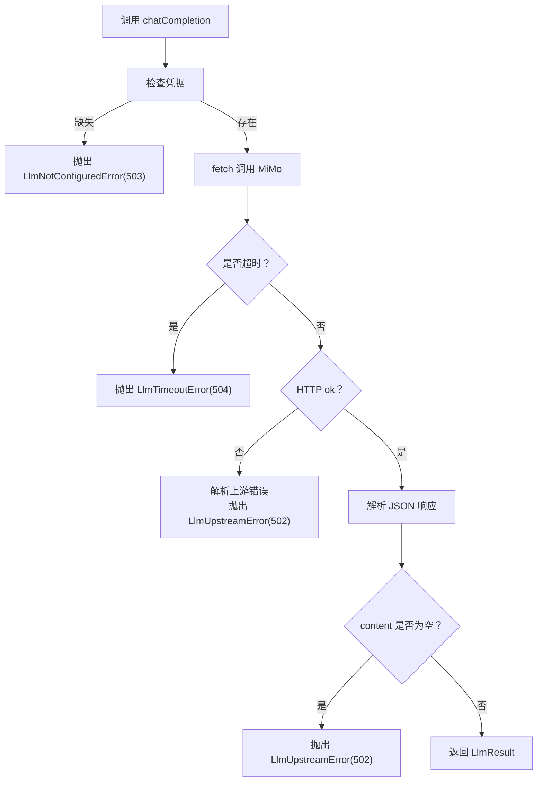
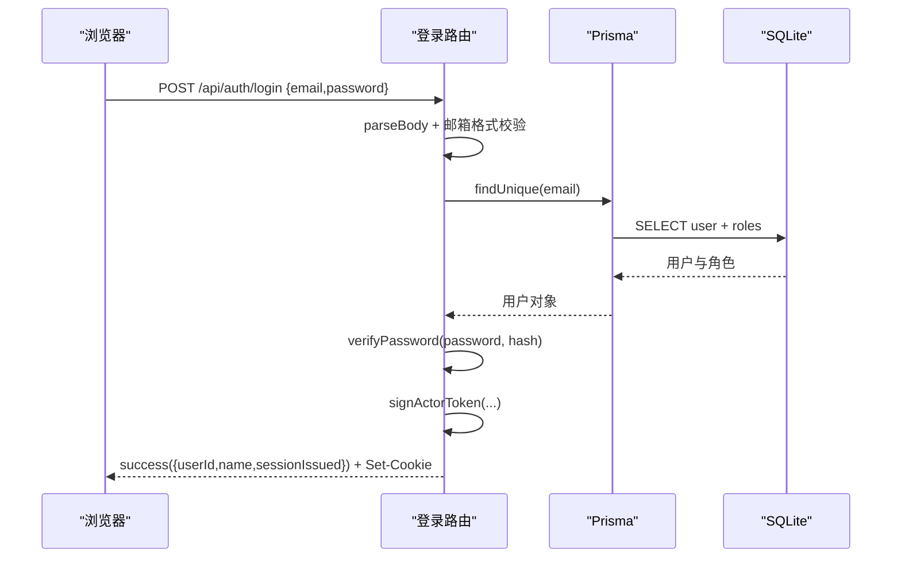
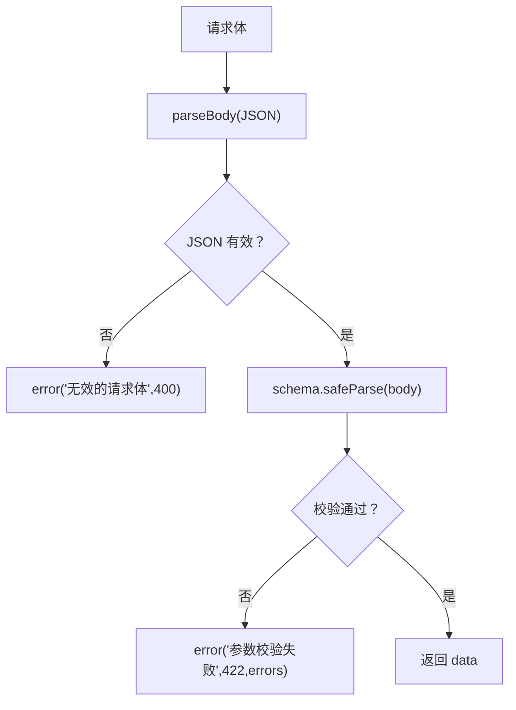
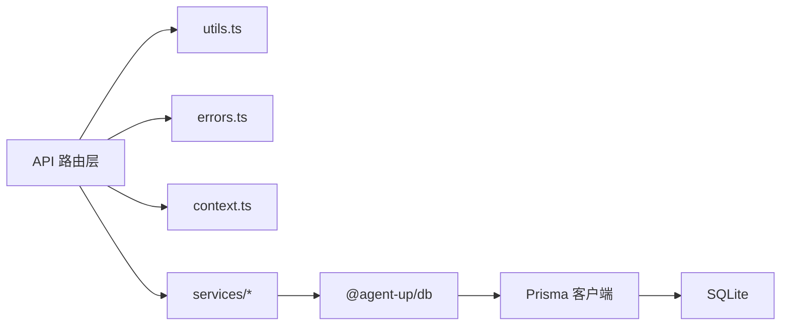

# 数据流设计

<cite>
**本文引用的文件**   
- [apps/web/lib/errors.ts](file://apps/web/lib/errors.ts)
- [apps/web/lib/utils.ts](file://apps/web/lib/utils.ts)
- [apps/web/lib/context.ts](file://apps/web/lib/context.ts)
- [apps/web/app/api/auth/login/route.ts](file://apps/web/app/api/auth/login/route.ts)
- [apps/web/app/api/settings/audit-logs/route.ts](file://apps/web/app/api/settings/audit-logs/route.ts)
- [apps/web/lib/services/llm-service.ts](file://apps/web/lib/services/llm-service.ts)
- [packages/db/src/index.ts](file://packages/db/src/index.ts)
</cite>

## 目录
1. [引言](#引言)
2. [项目结构](#项目结构)
3. [核心组件](#核心组件)
4. [架构总览](#架构总览)
5. [详细组件分析](#详细组件分析)
6. [依赖关系分析](#依赖关系分析)
7. [性能考虑](#性能考虑)
8. [故障排查指南](#故障排查指南)
9. [结论](#结论)

## 引言
本文面向“从浏览器请求到数据库存储”的完整数据流，聚焦以下关键设计：
- App Router 页面与 API 路由层：Zod 校验、结构化错误、Actor 上下文。
- 服务层：业务逻辑封装与对外契约。
- Prisma ORM → SQLite：持久化路径与类型安全。
- Actor 请求上下文机制：身份来源优先级与异步传播。
- 结构化错误体系：AppError 层级与统一映射。
- 审计日志 append-only 设计：只追加、可追溯。
- LLM 网关统一出站：小米 MiMo 集成、超时处理、错误映射。

## 项目结构
本仓库采用 Next.js App Router + monorepo 组织方式：
- `apps/web`：Web 应用，包含页面、API 路由、共享库与服务层。
- `packages/db`：Prisma 客户端与枚举导出，供上层复用。
- `docs`：产品与设计文档（含 LLM 集成报告）。

**图表来源**
- [apps/web/app/api/auth/login/route.ts:18-68](file://apps/web/app/api/auth/login/route.ts#L18-L68)
- [apps/web/lib/utils.ts:1-85](file://apps/web/lib/utils.ts#L1-L85)
- [apps/web/lib/errors.ts:1-95](file://apps/web/lib/errors.ts#L1-L95)
- [apps/web/lib/context.ts:1-97](file://apps/web/lib/context.ts#L1-L97)
- [apps/web/lib/services/llm-service.ts:1-140](file://apps/web/lib/services/llm-service.ts#L1-L140)
- [packages/db/src/index.ts:1-5](file://packages/db/src/index.ts#L1-L5)

**章节来源**
- [apps/web/app/api/auth/login/route.ts:18-68](file://apps/web/app/api/auth/login/route.ts#L18-L68)
- [apps/web/lib/utils.ts:1-85](file://apps/web/lib/utils.ts#L1-L85)
- [apps/web/lib/errors.ts:1-95](file://apps/web/lib/errors.ts#L1-L95)
- [apps/web/lib/context.ts:1-97](file://apps/web/lib/context.ts#L1-L97)
- [apps/web/lib/services/llm-service.ts:1-140](file://apps/web/lib/services/llm-service.ts#L1-L140)
- [packages/db/src/index.ts:1-5](file://packages/db/src/index.ts#L1-L5)

## 核心组件
- 结构化错误体系：定义 AppError 及其子类，提供 toErrorBody 将任意异常映射为 HTTP 响应体。
- 请求工具：success/error 标准响应、handleApiError 统一错误映射、parseBody/validateBody Zod 校验、分页解析。
- Actor 上下文：基于 AsyncLocalStorage 的请求级身份传播，支持签名令牌与受控明文头，默认生产关闭明文头信任。
- LLM 网关：统一调用小米 MiMo，封装凭据、超时、上游错误与空内容检测，返回标准化结果。
- Prisma 客户端导出：集中暴露 prisma 实例与枚举，供服务层使用。

**章节来源**
- [apps/web/lib/errors.ts:1-95](file://apps/web/lib/errors.ts#L1-L95)
- [apps/web/lib/utils.ts:1-85](file://apps/web/lib/utils.ts#L1-L85)
- [apps/web/lib/context.ts:1-97](file://apps/web/lib/context.ts#L1-L97)
- [apps/web/lib/services/llm-service.ts:1-140](file://apps/web/lib/services/llm-service.ts#L1-L140)
- [packages/db/src/index.ts:1-5](file://packages/db/src/index.ts#L1-L5)

## 架构总览
下图展示一次典型写操作的端到端数据流：浏览器 → App Router 页面 → API 路由层（Zod 校验、Actor 上下文）→ 服务层 → Prisma → SQLite；同时体现 LLM 网关作为统一出站通道。

**图表来源**
- [apps/web/app/api/auth/login/route.ts:18-68](file://apps/web/app/api/auth/login/route.ts#L18-L68)
- [apps/web/lib/utils.ts:58-85](file://apps/web/lib/utils.ts#L58-L85)
- [apps/web/lib/context.ts:65-90](file://apps/web/lib/context.ts#L65-L90)
- [apps/web/lib/services/llm-service.ts:67-139](file://apps/web/lib/services/llm-service.ts#L67-L139)
- [packages/db/src/index.ts:1-5](file://packages/db/src/index.ts#L1-L5)

## 详细组件分析

### Actor 请求上下文机制
- 身份来源优先级：
  1) 签名会话令牌（cookie 或 x-actor-token），唯一不可伪造来源；
  2) 明文 x-actor-* 头，仅在显式信任时采纳；
  3) 均不可信则回退为匿名主体。
- 生产环境默认不信任明文头，需通过环境变量显式开启。
- 使用 AsyncLocalStorage 保证 await 后仍携带 Actor，避免审计署名错乱。
- getActor() 在 service 层获取当前 Actor，未处于请求作用域时回退为系统主体。

**图表来源**
- [apps/web/lib/context.ts:1-97](file://apps/web/lib/context.ts#L1-L97)

**章节来源**
- [apps/web/lib/context.ts:1-97](file://apps/web/lib/context.ts#L1-L97)

### 结构化错误体系（AppError 层级）
- AppError 基类携带 status、code、details，toErrorBody 将其映射为标准 JSON 响应体。
- 子类约定语义与状态码：
  - NotFoundError → 404 NOT_FOUND
  - ValidationError → 422 VALIDATION
  - ConflictError → 409 CONFLICT
  - AuthorizationError → 403 AUTHORIZATION
- handleApiError 统一捕获并返回正确状态码与 code，未知错误一律 500 INTERNAL，且不在生产环境泄露堆栈。

**图表来源**
- [apps/web/lib/errors.ts:15-62](file://apps/web/lib/errors.ts#L15-L62)

**章节来源**
- [apps/web/lib/errors.ts:1-95](file://apps/web/lib/errors.ts#L1-L95)
- [apps/web/lib/utils.ts:22-25](file://apps/web/lib/utils.ts#L22-L25)

### 审计日志的 append-only 设计
- 审计日志用于问责，读权限严格限制（如 audit:read）。
- 查询入口通过 withActor(resolveActor(...)) 包裹，确保审计记录署名来自可信 Actor。
- 列表接口仅做过滤与分页，不修改历史数据，符合 append-only 原则。

**图表来源**
- [apps/web/app/api/settings/audit-logs/route.ts:7-32](file://apps/web/app/api/settings/audit-logs/route.ts#L7-L32)
- [apps/web/lib/context.ts:82-90](file://apps/web/lib/context.ts#L82-L90)

**章节来源**
- [apps/web/app/api/settings/audit-logs/route.ts:1-33](file://apps/web/app/api/settings/audit-logs/route.ts#L1-L33)
- [apps/web/lib/context.ts:1-97](file://apps/web/lib/context.ts#L1-L97)

### LLM 网关的统一出站设计（小米 MiMo）
- 凭据与环境：
  - MIMO_API_KEY、MIMO_BASE_URL、MIMO_MODEL 由环境变量注入，代码零硬编码。
- 超时与健壮性：
  - 默认超时 120s，适配推理模型慢响应；AbortSignal.timeout 统一拦截。
  - 非 ok 响应捕获上游状态与截断 body，抛出 LlmUpstreamError。
  - 空内容检测，提示可能因 max_completion_tokens 不足导致 content 为空。
- 错误映射：
  - LlmNotConfiguredError → 503（未配置凭据）
  - LlmUpstreamError → 502（上游错误，携带 status/body）
  - LlmTimeoutError → 504（调用超时）
- 返回值：
  - 标准化 LlmResult，包含 content、model、usage、latencyMs，便于前端统一展示。

**图表来源**
- [apps/web/lib/services/llm-service.ts:55-139](file://apps/web/lib/services/llm-service.ts#L55-L139)

**章节来源**
- [apps/web/lib/services/llm-service.ts:1-140](file://apps/web/lib/services/llm-service.ts#L1-L140)

### 登录流程中的数据转换示例（路径参考）
- 输入校验：parseBody 解析 JSON，邮箱格式正则校验。
- 用户查询：prisma.user.findUnique 包含角色信息。
- 口令校验：verifyPassword 比对密码哈希。
- 令牌签发：signActorToken 生成会话令牌，Set-Cookie 下发。
- 响应构造：success 返回 userId/name/sessionIssued 等字段。

**图表来源**
- [apps/web/app/api/auth/login/route.ts:18-68](file://apps/web/app/api/auth/login/route.ts#L18-L68)
- [packages/db/src/index.ts:1-5](file://packages/db/src/index.ts#L1-L5)

**章节来源**
- [apps/web/app/api/auth/login/route.ts:1-69](file://apps/web/app/api/auth/login/route.ts#L1-L69)
- [packages/db/src/index.ts:1-5](file://packages/db/src/index.ts#L1-L5)

### Zod 校验与分页工具
- validateBody：基于 Zod schema 校验请求体，失败直接返回 422 响应，携带错误消息数组。
- parsePagination：规范化 page/pageSize，计算 skip/take，防止越界与过大页大小。
- success/error：统一响应体结构，便于前端一致处理。

**图表来源**
- [apps/web/lib/utils.ts:49-85](file://apps/web/lib/utils.ts#L49-L85)

**章节来源**
- [apps/web/lib/utils.ts:1-85](file://apps/web/lib/utils.ts#L1-L85)

## 依赖关系分析
- API 路由层依赖：
  - lib/utils.ts：响应与校验工具。
  - lib/errors.ts：结构化错误。
  - lib/context.ts：Actor 上下文。
  - services/*：业务服务（如 llm-service、audit-service）。
- 服务层依赖：
  - @agent-up/db：Prisma 客户端与枚举。
  - lib/errors.ts：统一错误类型。
- 数据库层：
  - packages/db/src/index.ts：导出 prisma 与枚举。

**图表来源**
- [apps/web/lib/utils.ts:1-85](file://apps/web/lib/utils.ts#L1-L85)
- [apps/web/lib/errors.ts:1-95](file://apps/web/lib/errors.ts#L1-L95)
- [apps/web/lib/context.ts:1-97](file://apps/web/lib/context.ts#L1-L97)
- [apps/web/lib/services/llm-service.ts:1-140](file://apps/web/lib/services/llm-service.ts#L1-L140)
- [packages/db/src/index.ts:1-5](file://packages/db/src/index.ts#L1-L5)

**章节来源**
- [apps/web/lib/utils.ts:1-85](file://apps/web/lib/utils.ts#L1-L85)
- [apps/web/lib/errors.ts:1-95](file://apps/web/lib/errors.ts#L1-L95)
- [apps/web/lib/context.ts:1-97](file://apps/web/lib/context.ts#L1-L97)
- [apps/web/lib/services/llm-service.ts:1-140](file://apps/web/lib/services/llm-service.ts#L1-L140)
- [packages/db/src/index.ts:1-5](file://packages/db/src/index.ts#L1-L5)

## 性能考虑
- LLM 网关默认 120s 超时，适合推理模型慢响应场景；可根据业务调整 timeoutMs。
- max_completion_tokens 需预留余量，避免 content 为空导致重试与额外开销。
- 审计日志查询走 Prisma 分页，skip/take 控制内存占用与网络传输。
- 结构化错误减少无效日志与调试成本，提升排障效率。

[本节为通用指导，不直接分析具体文件]

## 故障排查指南
- 登录失败：
  - 检查邮箱格式与密码哈希匹配；确认 AUTH_SECRET 已配置以便签发会话令牌。
  - 参考路径：[apps/web/app/api/auth/login/route.ts:18-68](file://apps/web/app/api/auth/login/route.ts#L18-L68)
- 审计日志无数据或权限报错：
  - 确认 Actor 已通过 withActor(resolveActor(...)) 设置；检查 RBAC 权限（audit:read）。
  - 参考路径：[apps/web/app/api/settings/audit-logs/route.ts:7-32](file://apps/web/app/api/settings/audit-logs/route.ts#L7-L32)
- LLM 调用失败：
  - 503：检查 MIMO_API_KEY 是否配置。
  - 502：查看上游状态码与截断 body，定位限流或服务异常。
  - 504：增加 timeoutMs 或优化消息长度。
  - 参考路径：[apps/web/lib/services/llm-service.ts:55-139](file://apps/web/lib/services/llm-service.ts#L55-L139)
- 统一错误映射：
  - 确认 service 层抛出 AppError 子类，API 层使用 handleApiError 统一处理。
  - 参考路径：[apps/web/lib/errors.ts:15-95](file://apps/web/lib/errors.ts#L15-L95), [apps/web/lib/utils.ts:22-25](file://apps/web/lib/utils.ts#L22-L25)

**章节来源**
- [apps/web/app/api/auth/login/route.ts:18-68](file://apps/web/app/api/auth/login/route.ts#L18-L68)
- [apps/web/app/api/settings/audit-logs/route.ts:7-32](file://apps/web/app/api/settings/audit-logs/route.ts#L7-L32)
- [apps/web/lib/services/llm-service.ts:55-139](file://apps/web/lib/services/llm-service.ts#L55-L139)
- [apps/web/lib/errors.ts:15-95](file://apps/web/lib/errors.ts#L15-L95)
- [apps/web/lib/utils.ts:22-25](file://apps/web/lib/utils.ts#L22-L25)

## 结论
本设计以 App Router 为入口，结合 Zod 校验、Actor 上下文与结构化错误体系，形成清晰的数据流边界与可观测性。服务层封装业务逻辑，Prisma 提供类型安全的 ORM 能力，SQLite 作为轻量持久化后端。LLM 网关统一出站，屏蔽上游差异并提供一致的超时与错误映射。审计日志遵循 append-only 原则，确保可追溯与合规。整体架构兼顾可维护性、可扩展性与安全性，适合快速迭代与稳定运行。