# 整体架构概览

<cite>
**本文引用的文件**   
- [README.md](file://README.md)
- [package.json](file://package.json)
- [apps/web/package.json](file://apps/web/package.json)
- [packages/db/package.json](file://packages/db/package.json)
- [turbo.json](file://turbo.json)
- [pnpm-workspace.yaml](file://pnpm-workspace.yaml)
- [apps/web/app/layout.tsx](file://apps/web/app/layout.tsx)
- [apps/web/app/(dashboard)/layout.tsx](file://apps/web/app/(dashboard)/layout.tsx)
- [apps/web/lib/context.ts](file://apps/web/lib/context.ts)
- [apps/web/lib/errors.ts](file://apps/web/lib/errors.ts)
- [packages/db/src/index.ts](file://packages/db/src/index.ts)
- [packages/db/prisma/schema.prisma](file://packages/db/prisma/schema.prisma)
</cite>

## 目录
1. [引言](#引言)
2. [项目结构](#项目结构)
3. [核心组件](#核心组件)
4. [架构总览](#架构总览)
5. [详细组件分析](#详细组件分析)
6. [依赖关系分析](#依赖关系分析)
7. [性能与可维护性考量](#性能与可维护性考量)
8. [故障排查指南](#故障排查指南)
9. [结论](#结论)

## 引言
AgentUp 是一个面向专有云工单场景的 Agent 持续改进管理平台。它以「三层 Loop」为设计主线：L1 即时交互环由 Agent 运行时承担，L2 产品改进环在本平台落地（反馈 → AI 归因 → 配置改进 → 审批发布 → 效果报告 → 回滚），L3 智能进化环预留跨 Agent 洞察能力。平台坚持「模型可换，闭环不变」：底层 LLM 可替换，但围绕 Prompt / Knowledge / Tools / Routing 四分区配置的治理闭环保持不变。

当前运行形态是「数据库即真相源」：浏览器页面通过 Next.js App Router 进入 API 路由层，再下沉到服务层，最终统一经 Prisma 访问 SQLite；所有外部 LLM 调用统一走 `llm-service` 网关出站。项目同时支持本地全栈运行与纯静态 Demo 双轨形态。

**章节来源**
- [README.md:50-74](file://README.md#L50-L74)
- [README.md:137-153](file://README.md#L137-L153)
- [README.md:198-207](file://README.md#L198-L207)
- [README.md:232-288](file://README.md#L232-L288)

## 项目结构
仓库采用 Turborepo + pnpm workspaces 的 Monorepo 组织方式：根 `package.json` 暴露 `dev/build/lint/db:*` 等聚合脚本，`turbo.json` 定义任务缓存与依赖顺序，`pnpm-workspace.yaml` 声明 `apps/*` 与 `packages/*` 两个工作区。

| 区域 | 职责 | 关键文件 |
|---|---|---|
| `apps/web` | Next.js 16 全栈应用：App Router 页面、API route handler、业务服务层、演示模式与测试 | `apps/web/package.json`、`apps/web/app/layout.tsx`、`apps/web/app/(dashboard)/layout.tsx` |
| `packages/db` | Prisma 数据库包：schema、迁移、种子、Prisma Client 导出 | `packages/db/package.json`、`packages/db/src/index.ts`、`packages/db/prisma/schema.prisma` |
| 根工程 | Monorepo 编排、Turborepo 任务、Node/pnpm 版本约束 | `package.json`、`turbo.json`、`pnpm-workspace.yaml` |

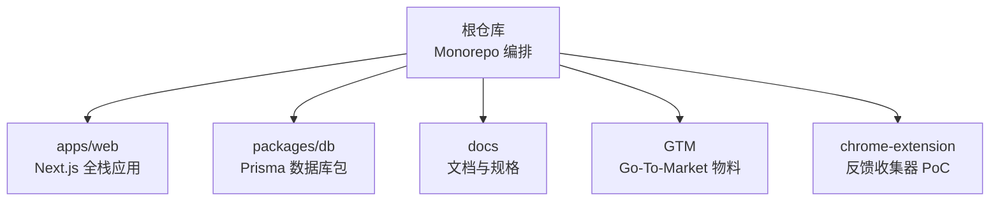

**图表来源**
- [package.json:1-22](file://package.json#L1-L22)
- [turbo.json:1-35](file://turbo.json#L1-L35)
- [pnpm-workspace.yaml:1-4](file://pnpm-workspace.yaml#L1-L4)

**章节来源**
- [package.json:1-22](file://package.json#L1-L22)
- [turbo.json:1-35](file://turbo.json#L1-L35)
- [pnpm-workspace.yaml:1-4](file://pnpm-workspace.yaml#L1-L4)
- [apps/web/package.json:1-37](file://apps/web/package.json#L1-L37)
- [packages/db/package.json:1-29](file://packages/db/package.json#L1-L29)

## 核心组件
AgentUp 的核心由四层组成：

1. **页面与布局层**：Next.js App Router 页面与全局布局负责导航、Demo 模式注入、侧边栏与错误边界。
2. **API 路由层**：按领域划分 route handler，只做协议适配、Zod 校验、Actor 上下文注入与结构化错误映射。
3. **服务层**：`lib/services` 下每个 service 封装一条业务闭环，如 agent、release、feedback、skill、wiki、effectiveness、trace、eval-case、ai-review、audit、llm 等。
4. **数据与 LLM 层**：Prisma Client 统一访问 SQLite；LLM 调用统一走 `llm-service`，凭据来自环境变量，零硬编码。

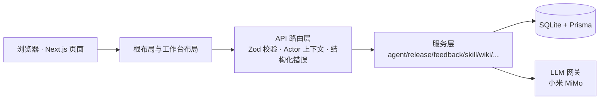

**图表来源**
- [apps/web/app/layout.tsx:1-32](file://apps/web/app/layout.tsx#L1-L32)
- [apps/web/app/(dashboard)/layout.tsx:1-273](file://apps/web/app/(dashboard)/layout.tsx#L1-L273)
- [README.md:137-153](file://README.md#L137-L153)

**章节来源**
- [README.md:76-135](file://README.md#L76-L135)
- [README.md:137-153](file://README.md#L137-L153)
- [apps/web/app/layout.tsx:1-32](file://apps/web/app/layout.tsx#L1-L32)
- [apps/web/app/(dashboard)/layout.tsx:1-273](file://apps/web/app/(dashboard)/layout.tsx#L1-L273)

## 架构总览
### 系统上下文图
AgentUp 在用户视角中提供 Agent 配置编辑、反馈管理、发布审批、知识库与技能管理、设置与审计、MaaS 集成展示；在运行时则把请求落库，并把需要模型能力的环节交给 LLM 网关。

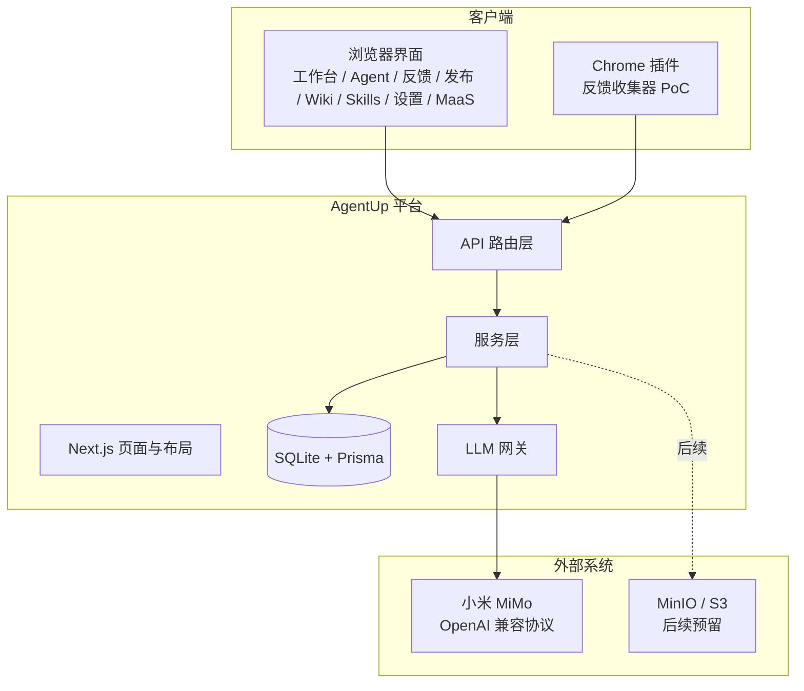

**图表来源**
- [README.md:137-153](file://README.md#L137-L153)
- [README.md:209-217](file://README.md#L209-L217)
- [README.md:333-347](file://README.md#L333-L347)

### 组件交互图
API 路由与服务层的解耦体现在：route 不写业务规则，service 不关心 HTTP 协议；Actor 身份通过 `context.ts` 的 AsyncLocalStorage 贯穿异步调用链；错误通过 `errors.ts` 的 AppError 层级映射到 HTTP 状态码。

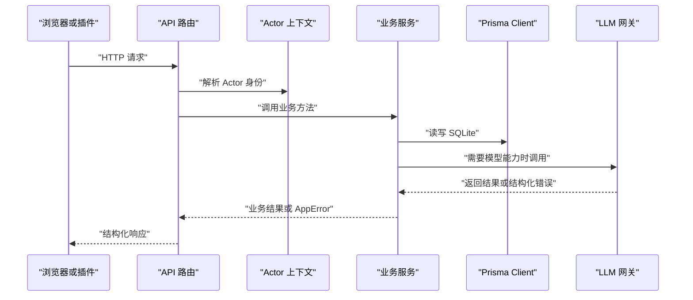

**图表来源**
- [apps/web/lib/context.ts:1-97](file://apps/web/lib/context.ts#L1-L97)
- [apps/web/lib/errors.ts:1-95](file://apps/web/lib/errors.ts#L1-L95)
- [packages/db/src/index.ts:1-5](file://packages/db/src/index.ts#L1-L5)
- [README.md:137-153](file://README.md#L137-L153)

### 数据流图：API Routes → Services → Database
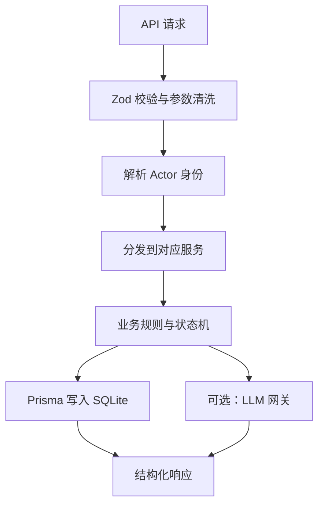

**图表来源**
- [README.md:137-153](file://README.md#L137-L153)
- [apps/web/lib/context.ts:61-90](file://apps/web/lib/context.ts#L61-L90)
- [apps/web/lib/errors.ts:64-95](file://apps/web/lib/errors.ts#L64-L95)

## 详细组件分析

### 三层 Loop 设计理念
AgentUp 把 Agent 技术栈拆成 Model 之外的多层治理空间：Model 在最内层，外层依次是 Prompt、Context、Harness、Loop、Graph。平台不造模型，而是治理 Model 之上的配置与流程。

| Loop | 时间尺度 | 平台体现 |
|---|---|---|
| L1 即时交互环 | 分钟级 | Agent 运行时与用户对话，不在本平台实现 |
| L2 产品改进环 | 小时~天级 | 反馈 → AI 归因 → 分区改进 → 审批发布 → 效果报告 → 回滚 |
| L3 智能进化环 | 天~周级 | 跨 Agent 洞察，代码中预留扩展点 |

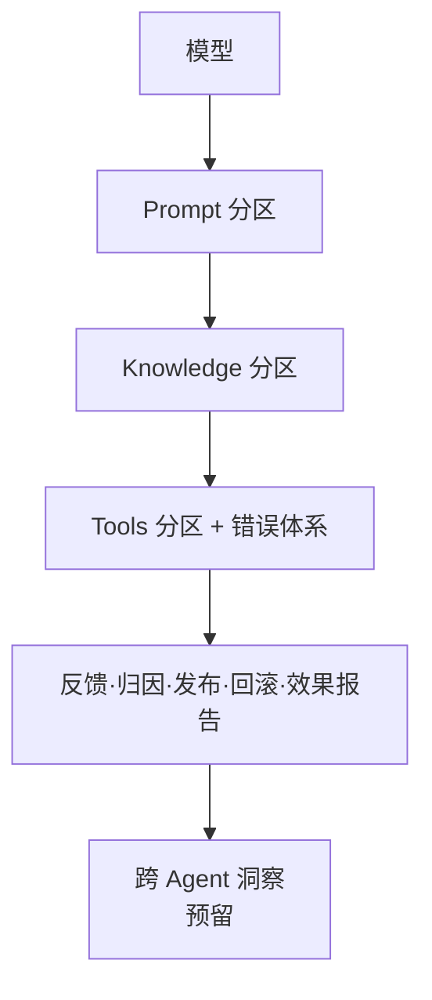

**图表来源**
- [README.md:234-267](file://README.md#L234-L267)
- [README.md:269-288](file://README.md#L269-L288)

**章节来源**
- [README.md:232-288](file://README.md#L232-L288)

### 「模型可换，闭环不变」的设计哲学
换的是最内层 LLM，外层的四分区配置、版本快照、审批流、效果报告、回滚机制保持不变。这意味着未来接入百炼、DashScope 或其他 OpenAI 兼容 Provider 时，只需要调整 LLM 网关配置，而不必重写 Agent 配置与发布流程。

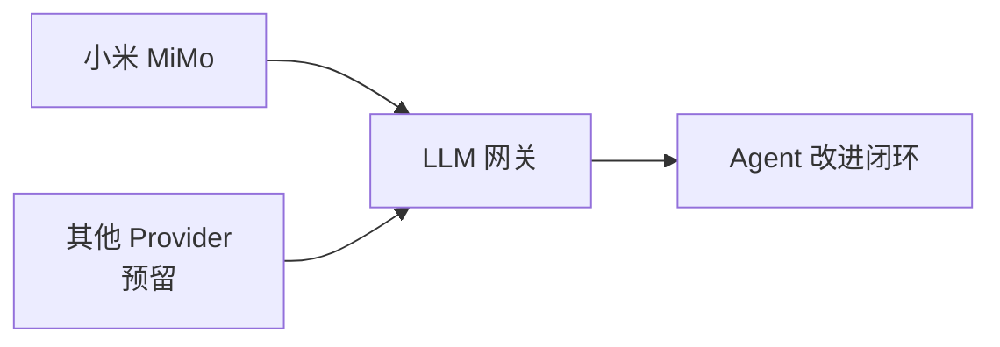

**图表来源**
- [README.md:234-267](file://README.md#L234-L267)
- [README.md:333-347](file://README.md#L333-L347)

**章节来源**
- [README.md:234-267](file://README.md#L234-L267)
- [README.md:333-347](file://README.md#L333-L347)

### API Routes → Services → Database 分层
- API 路由层：按领域组织 route handler，承担协议适配、入参校验、Actor 注入、错误映射。
- 服务层：每条业务线一个 service，封装状态机、版本计算、diff、审计副作用。
- 数据层：Prisma Client 从 `@agent-up/db` 导出，统一访问 SQLite。

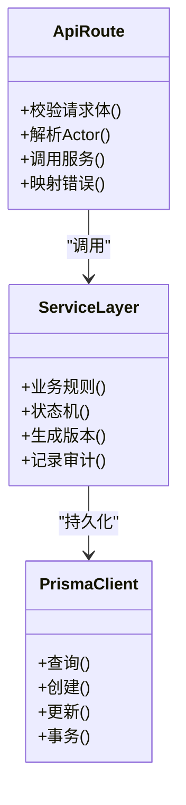

**图表来源**
- [README.md:137-153](file://README.md#L137-L153)
- [packages/db/src/index.ts:1-5](file://packages/db/src/index.ts#L1-L5)

**章节来源**
- [README.md:137-153](file://README.md#L137-L153)
- [packages/db/src/index.ts:1-5](file://packages/db/src/index.ts#L1-L5)

### LLM 网关的统一出站设计
LLM 网关集中处理凭据、超时、上游错误与结构化响应；五个真实集成点包括连通性探测、反馈 AI 归因、发布变更摘要、Agent 试聊、发布前 AI 评测。未配置凭据时返回明确 503，不影响其他功能。

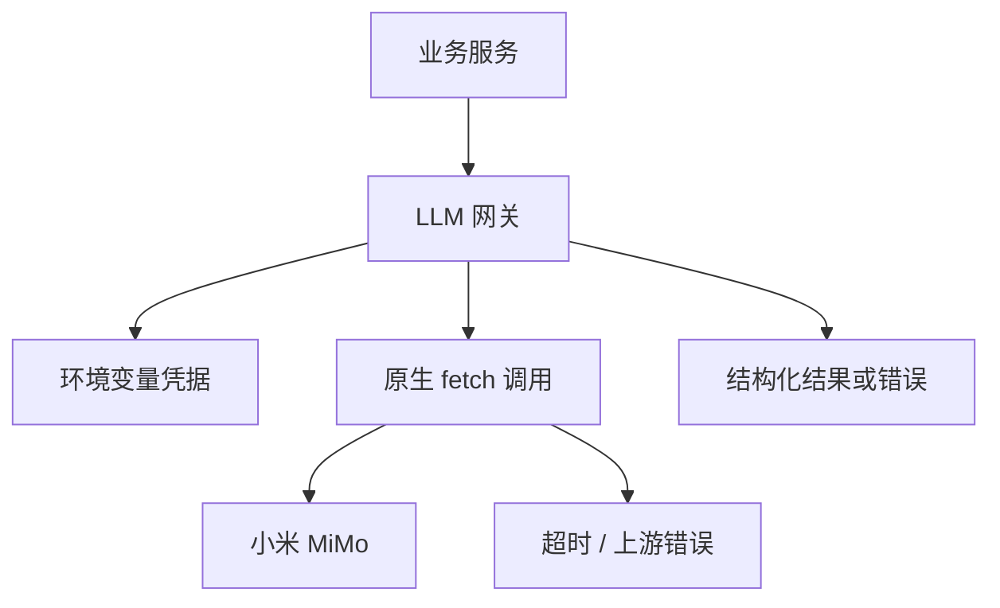

**图表来源**
- [README.md:333-347](file://README.md#L333-L347)
- [README.md:425-432](file://README.md#L425-L432)

**章节来源**
- [README.md:333-347](file://README.md#L333-L347)
- [README.md:425-432](file://README.md#L425-L432)

### Monorepo 架构：Turborepo + pnpm workspaces
根仓库通过 `turbo.json` 定义 `build/dev/lint/db:*` 等任务，并让 `build` 依赖 `^db:generate`，保证数据库类型先于应用构建；`pnpm-workspace.yaml` 将 `apps/web` 与 `packages/db` 纳入同一工作区，`apps/web/package.json` 通过 `workspace:*` 引用 `@agent-up/db`。

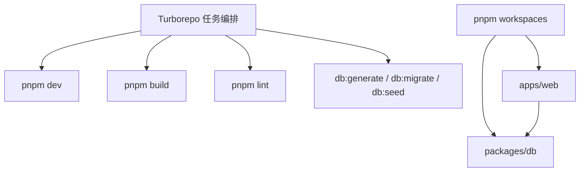

**图表来源**
- [package.json:1-22](file://package.json#L1-L22)
- [turbo.json:1-35](file://turbo.json#L1-L35)
- [pnpm-workspace.yaml:1-4](file://pnpm-workspace.yaml#L1-L4)
- [apps/web/package.json:15-22](file://apps/web/package.json#L15-L22)

**章节来源**
- [package.json:1-22](file://package.json#L1-L22)
- [turbo.json:1-35](file://turbo.json#L1-L35)
- [pnpm-workspace.yaml:1-4](file://pnpm-workspace.yaml#L1-L4)
- [apps/web/package.json:1-37](file://apps/web/package.json#L1-L37)
- [packages/db/package.json:1-29](file://packages/db/package.json#L1-L29)

### apps/web 主应用与 packages/db 数据库包的职责划分
- `apps/web`：Next.js 应用入口、页面路由、布局、UI、服务层、测试、Demo 模式与构建脚本。
- `packages/db`：Prisma schema、迁移、种子、Prisma Client 导出、枚举与 JSON 文本包装工具。

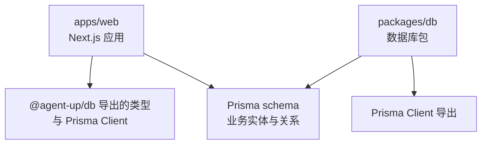

**图表来源**
- [apps/web/package.json:15-22](file://apps/web/package.json#L15-L22)
- [packages/db/package.json:1-29](file://packages/db/package.json#L1-L29)
- [packages/db/src/index.ts:1-5](file://packages/db/src/index.ts#L1-L5)

**章节来源**
- [apps/web/package.json:1-37](file://apps/web/package.json#L1-L37)
- [packages/db/package.json:1-29](file://packages/db/package.json#L1-L29)
- [packages/db/src/index.ts:1-5](file://packages/db/src/index.ts#L1-L5)

### 部署形态：本地全栈与静态 Demo 双轨
- 本地全栈：`pnpm dev` 启动 Next.js 开发服务器，使用 SQLite 与 Prisma，可选择接入真实 LLM。
- 静态 Demo：`DEMO_EXPORT=1 next build` 输出纯静态产物，浏览器端通过 `demo/mock-server.ts` 拦截 `/api/*` 请求，使用内存态镜像 API 响应形状。

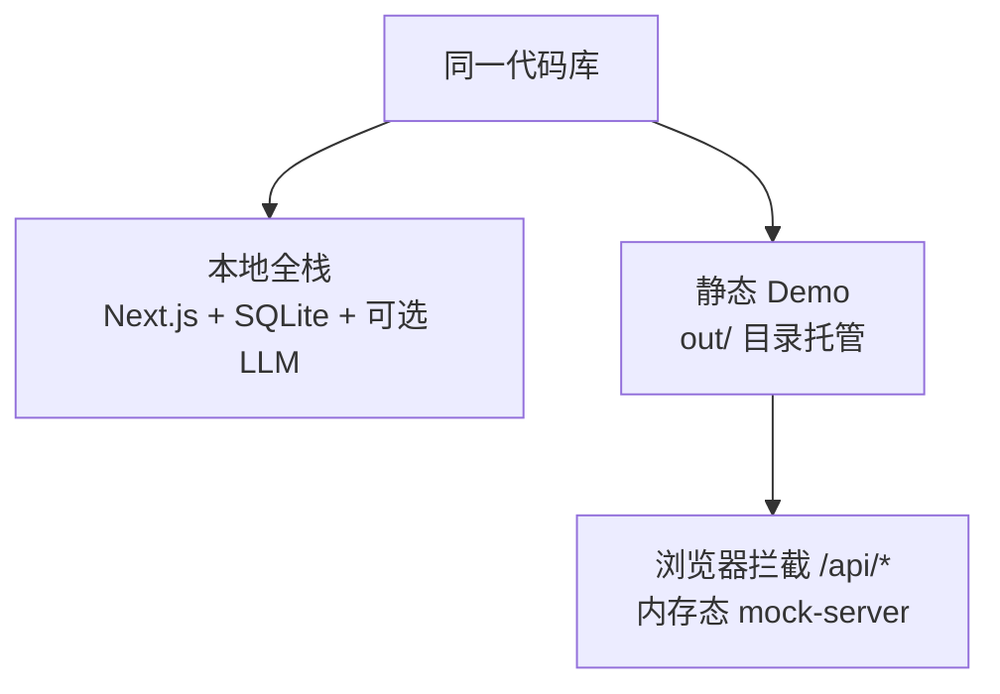

**图表来源**
- [README.md:198-207](file://README.md#L198-L207)
- [apps/web/app/layout.tsx:11-31](file://apps/web/app/layout.tsx#L11-L31)

**章节来源**
- [README.md:198-207](file://README.md#L198-L207)
- [apps/web/app/layout.tsx:11-31](file://apps/web/app/layout.tsx#L11-L31)

## 依赖关系分析
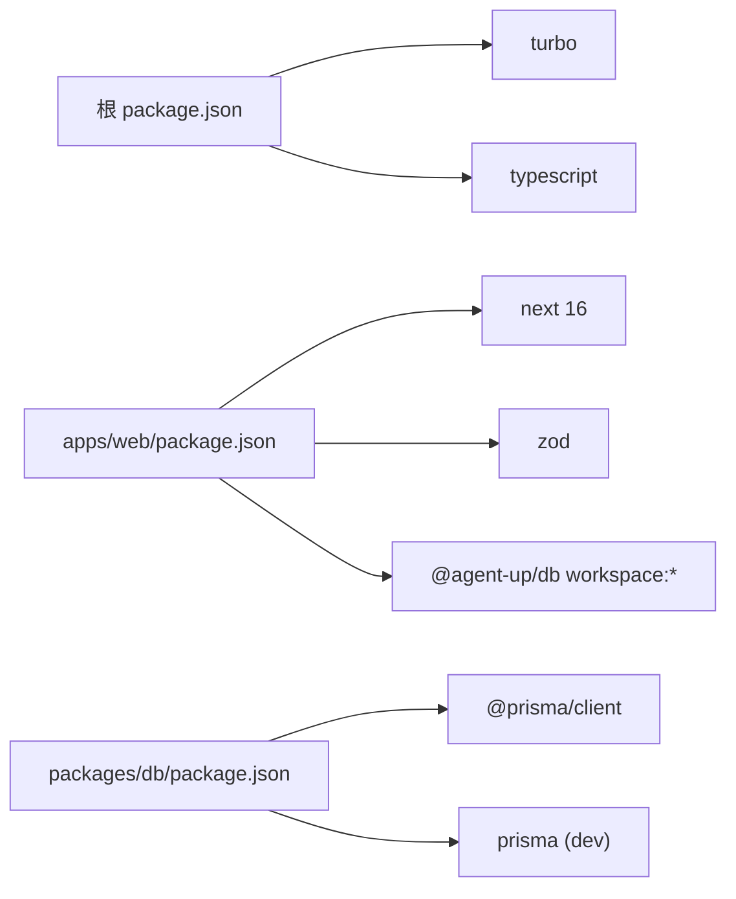

**图表来源**
- [package.json:14-21](file://package.json#L14-L21)
- [apps/web/package.json:15-35](file://apps/web/package.json#L15-L35)
- [packages/db/package.json:17-24](file://packages/db/package.json#L17-L24)

**章节来源**
- [package.json:14-21](file://package.json#L14-L21)
- [apps/web/package.json:15-35](file://apps/web/package.json#L15-L35)
- [packages/db/package.json:17-24](file://packages/db/package.json#L17-L24)

## 性能与可维护性考量
- 分层清晰：route 不写业务逻辑，service 不关心 HTTP，降低耦合。
- 错误可控：AppError 层级替代字符串匹配，避免脆弱判断。
- 身份可控：Actor 通过 AsyncLocalStorage 贯穿异步续体，审计署名稳定。
- 数据一致：Prisma 统一管理 schema、迁移与种子，SQLite 单文件降低运维成本。
- 可演进：LLM 网关屏蔽 Provider 差异，便于未来多模型切换。

**章节来源**
- [apps/web/lib/errors.ts:1-95](file://apps/web/lib/errors.ts#L1-L95)
- [apps/web/lib/context.ts:1-97](file://apps/web/lib/context.ts#L1-L97)
- [README.md:380-393](file://README.md#L380-L393)

## 故障排查指南
- 未配置 LLM 凭据：真实 LLM 集成点返回 503，其余功能正常；检查 `MIMO_API_KEY`、`MIMO_BASE_URL`、`MIMO_MODEL`。
- 认证与会话：生产环境缺失 `AUTH_SECRET` 会阻止启动；非生产环境可通过 `AUTH_TRUST_ACTOR_HEADERS` 接受明文 actor 头用于联调。
- 数据库初始化：需执行 `pnpm db:generate`、`npx prisma migrate deploy`、`pnpm db:seed`；测试通过 `_resetDb` 清库隔离。
- Demo 模式：确认 `NEXT_PUBLIC_DEMO_MODE=1` 时挂载 DemoProvider，刷新页面重置内存数据。

**章节来源**
- [README.md:425-444](file://README.md#L425-L444)
- [README.md:446-466](file://README.md#L446-L466)
- [apps/web/lib/context.ts:53-90](file://apps/web/lib/context.ts#L53-L90)

## 结论
AgentUp 以三层 Loop 为骨架，以「模型可换，闭环不变」为核心哲学，用 Next.js 16 + TypeScript + Tailwind CSS 4 构建前端与 API，用 Prisma + SQLite 作为当前数据库真相源，并通过 Turborepo + pnpm workspaces 组织 Monorepo。API Routes → Services → Database 的分层保证了职责清晰，LLM 网关统一出站保证了模型可替换。平台既可作为本地全栈 Agent 改进系统，也可作为静态 Demo 展示「与客户一起持续迭代 Agent」的完整闭环。