# 系统架构

<cite>
**本文引用的文件**   
- [README.md](file://README.md)
- [apps/web/package.json](file://apps/web/package.json)
- [packages/db/package.json](file://packages/db/package.json)
- [packages/db/prisma/schema.prisma](file://packages/db/prisma/schema.prisma)
- [packages/db/src/index.ts](file://packages/db/src/index.ts)
- [apps/web/lib/services/llm-service.ts](file://apps/web/lib/services/llm-service.ts)
- [apps/web/lib/errors.ts](file://apps/web/lib/errors.ts)
- [apps/web/lib/context.ts](file://apps/web/lib/context.ts)
- [apps/web/app/api/agents/[id]/config/[partition]/route.ts](file://apps/web/app/api/agents/[id]/config/[partition]/route.ts)
- [apps/web/lib/services/agent-service.ts](file://apps/web/lib/services/agent-service.ts)
- [apps/web/lib/services/release-service.ts](file://apps/web/lib/services/release-service.ts)
- [apps/web/lib/services/feedback-service.ts](file://apps/web/lib/services/feedback-service.ts)
- [apps/web/lib/services/maas-usage-service.ts](file://apps/web/lib/services/maas-usage-service.ts)
- [apps/web/app/(dashboard)/architecture/page.tsx](file://apps/web/app/(dashboard)/architecture/page.tsx)
- [apps/web/app/(dashboard)/architecture/loop/page.tsx](file://apps/web/app/(dashboard)/architecture/loop/page.tsx)
- [apps/web/app/page.tsx](file://apps/web/app/page.tsx)
- [apps/web/demo/mock-server.ts](file://apps/web/demo/mock-server.ts)
- [apps/web/lib/__tests__/setup/prepare-worker-dbs.ts](file://apps/web/lib/__tests__/setup/prepare-worker-dbs.ts)
- [apps/web/lib/__tests__/setup/worker-db-path.ts](file://apps/web/lib/__tests__/setup/worker-db-path.ts)
- [docs/reports/2026-10-04-project-evaluation-and-remediation.md](file://docs/reports/2026-10-04-project-evaluation-and-remediation.md)
</cite>

## 目录
1. [引言](#引言)
2. [项目结构](#项目结构)
3. [核心组件](#核心组件)
4. [架构总览](#架构总览)
5. [详细组件分析](#详细组件分析)
6. [依赖关系分析](#依赖关系分析)
7. [性能与可扩展性](#性能与可扩展性)
8. [安全与横切关注点](#安全与横切关注点)
9. [故障排查指南](#故障排查指南)
10. [结论](#结论)

## 引言
AgentUp 是一个面向专有云工单场景的 Agent 持续改进管理平台。它以三层 Loop 为设计骨架：L1 即时交互环（分钟级，由外部 Agent 运行时承担）、L2 产品改进环（小时~天级，平台核心）、L3 智能进化环（天~周级，跨 Agent 洞察预留）。平台通过四分区配置（Prompt、Knowledge、Tools、Routing）把 Agent 的可变部分收敛到一张“配置卡”，并以 Release → Version 的不可变版本机制实现可审计、可回滚的发布流程。

当前运行形态是“数据库即真相源”：浏览器 → Next.js App Router 页面 → API 路由层 → 服务层 → Prisma → SQLite；LLM 调用统一走 LLM 网关出站。SQLite 用于演示与本地开发，Prisma 作为 ORM 屏蔽底层差异；JSON 字段在 SQLite 下以 String 存储，读写经 `packJson` / `unpackJson` 收口。

**章节来源**
- [README.md:7-10](file://README.md#L7-L10)
- [README.md:64-74](file://README.md#L64-L74)
- [README.md:137-153](file://README.md#L137-L153)

## 项目结构
仓库采用 Turborepo monorepo + pnpm workspaces：
- `apps/web`：Next.js 全栈应用，包含 App Router 页面、API 路由、业务服务层、错误体系、Actor 上下文、Zod schema、测试等。
- `packages/db`：Prisma 数据库层，包含 schema、迁移、种子脚本、枚举与 JSON 文本封装导出。
- `docs`：文档体系（API 参考、部署指南、评估报告、规格书）。
- `chrome-extension`：Chrome 插件 PoC，作为反馈收集器接入 `/api/feedback/ingest`。

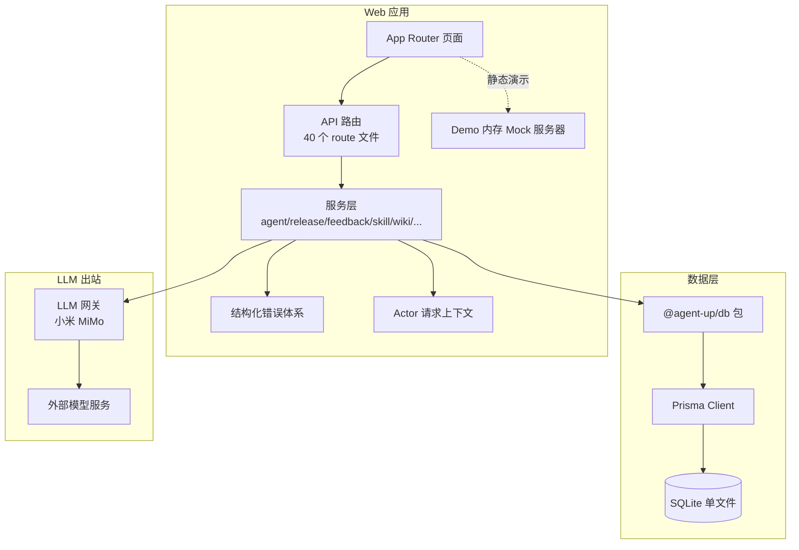

**图表来源**
- [README.md:76-135](file://README.md#L76-L135)
- [apps/web/package.json:15-21](file://apps/web/package.json#L15-L21)
- [packages/db/package.json:17-19](file://packages/db/package.json#L17-L19)
- [packages/db/src/index.ts:1-4](file://packages/db/src/index.ts#L1-L4)

**章节来源**
- [README.md:76-135](file://README.md#L76-L135)
- [apps/web/package.json:1-37](file://apps/web/package.json#L1-L37)
- [packages/db/package.json:1-29](file://packages/db/package.json#L1-L29)

## 核心组件
- **API 路由层**：负责协议适配、Zod 校验、Actor 上下文注入、结构化错误映射。例如四分区配置路由对 partition 做白名单校验，再委托 agent-service 完成 upsert。
- **服务层**：承载全部业务逻辑，包括 Agent CRUD、四分区配置管理、Release 审批流、Version 快照生成、Feedback 状态机、Skill/Wiki/Trace/Eval/Effectiveness/Audit/MaaS 用量聚合等。
- **数据库层**：Prisma Schema 定义 Agent、四分区配置、DraftConfig、Release、Version、Feedback、Skill、Wiki、Role/Permission/UserRole、AuditLog、Trace、EvalCase 等实体；SQLite 连接器下所有 enum/Json/数组列转为 String，值域校验下沉到 Zod。
- **LLM 网关**：唯一出站通道，读取 env 凭据，原生 fetch 调用 OpenAI 兼容协议，统一超时、三档结构化错误，返回 content/model/usage/latencyMs。
- **结构化错误体系**：AppError 及其子类（NotFoundError、ValidationError、ConflictError、AuthorizationError），配合 toErrorBody 统一映射 HTTP status 与 code，避免字符串匹配脆弱模式。
- **Actor 上下文**：基于 AsyncLocalStorage，按优先级解析签名令牌或受信任明文头，提供 getActor() 供 service 层署名审计。

**章节来源**
- [apps/web/app/api/agents/[id]/config/[partition]/route.ts:14-43](file://apps/web/app/api/agents/[id]/config/[partition]/route.ts#L14-L43)
- [apps/web/lib/services/agent-service.ts:341-549](file://apps/web/lib/services/agent-service.ts#L341-L549)
- [packages/db/prisma/schema.prisma:1-18](file://packages/db/prisma/schema.prisma#L1-L18)
- [apps/web/lib/services/llm-service.ts:55-93](file://apps/web/lib/services/llm-service.ts#L55-L93)
- [apps/web/lib/errors.ts:15-94](file://apps/web/lib/errors.ts#L15-L94)
- [apps/web/lib/context.ts:22-89](file://apps/web/lib/context.ts#L22-L89)

## 架构总览
AgentUp 的分层架构遵循“API Routes → Services → Database”的数据流向，LLM 调用统一从服务层经 llm-service 出站。

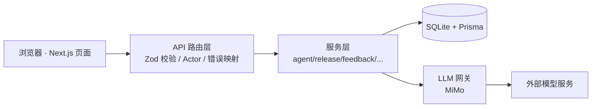

**图表来源**
- [README.md:137-153](file://README.md#L137-L153)
- [apps/web/lib/services/llm-service.ts:67-139](file://apps/web/lib/services/llm-service.ts#L67-L139)

### 三层 Loop 设计理念
- L1 即时交互环：Agent 在岗解决工单，产出会话日志、评分、失败标记；本平台不直接实现 L1，只承接其产物。
- L2 产品改进环：反馈收集 → AI 归因 → 修改四分区配置 → Release 审批 → Version 不可变快照 → 支持分区级与整版本回滚 → 效果报告。
- L3 智能进化环：跨 Agent 洞察、共性缺口发现、知识自动蒸馏、共享概念池；当前为规划扩展点。

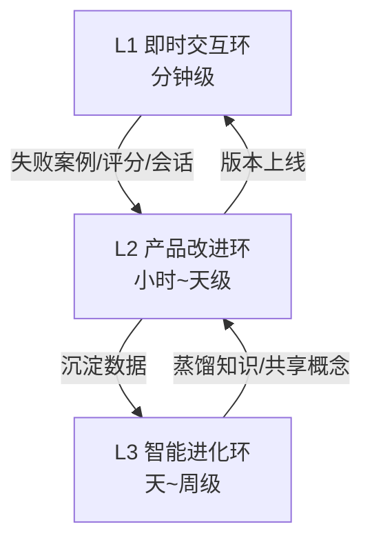

**图表来源**
- [README.md:269-275](file://README.md#L269-L275)
- [apps/web/app/(dashboard)/architecture/page.tsx:148-159](file://apps/web/app/(dashboard)/architecture/page.tsx#L148-L159)
- [apps/web/app/(dashboard)/architecture/loop/page.tsx:167-175](file://apps/web/app/(dashboard)/architecture/loop/page.tsx#L167-L175)

**章节来源**
- [README.md:269-288](file://README.md#L269-L288)
- [apps/web/app/(dashboard)/architecture/page.tsx:148-159](file://apps/web/app/(dashboard)/architecture/page.tsx#L148-L159)

### 四分区配置架构
每个 Agent 包含四个可编辑分区：
- Prompt：系统提示词、角色定义、约束、输出格式。
- Knowledge：Wiki vault 关联、检索策略、置信度阈值、MCP 兜底。
- Tools：MCP 工具清单、Wiki 查询工具、并发/超时/重试参数。
- Routing：规则、升级策略、人工阈值、对话轮次与空闲超时。

Schema 中四分区对应独立表，并维护 version、lastModifiedBy/At；DraftConfig 保存正在编辑的草稿，线上生效由 Release → Version 控制。

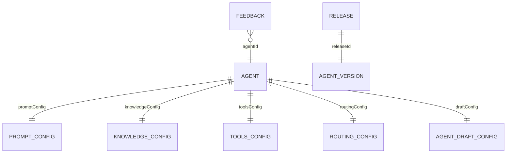

**图表来源**
- [packages/db/prisma/schema.prisma:66-182](file://packages/db/prisma/schema.prisma#L66-L182)
- [packages/db/prisma/schema.prisma:257-318](file://packages/db/prisma/schema.prisma#L257-L318)
- [packages/db/prisma/schema.prisma:211-251](file://packages/db/prisma/schema.prisma#L211-L251)

**章节来源**
- [README.md:277-284](file://README.md#L277-L284)
- [apps/web/app/page.tsx:92-131](file://apps/web/app/page.tsx#L92-L131)
- [apps/web/app/(dashboard)/architecture/page.tsx:186-224](file://apps/web/app/(dashboard)/architecture/page.tsx#L186-L224)
- [packages/db/prisma/schema.prisma:66-182](file://packages/db/prisma/schema.prisma#L66-L182)

## 详细组件分析

### API 路由层与四分区配置端点
四分区配置路由对 partition 做白名单校验，GET 委托 agent-service.getAgentConfig，PUT 委托 update*Config 函数；所有写操作通过 requirePermission 与 recordAudit 落审计。

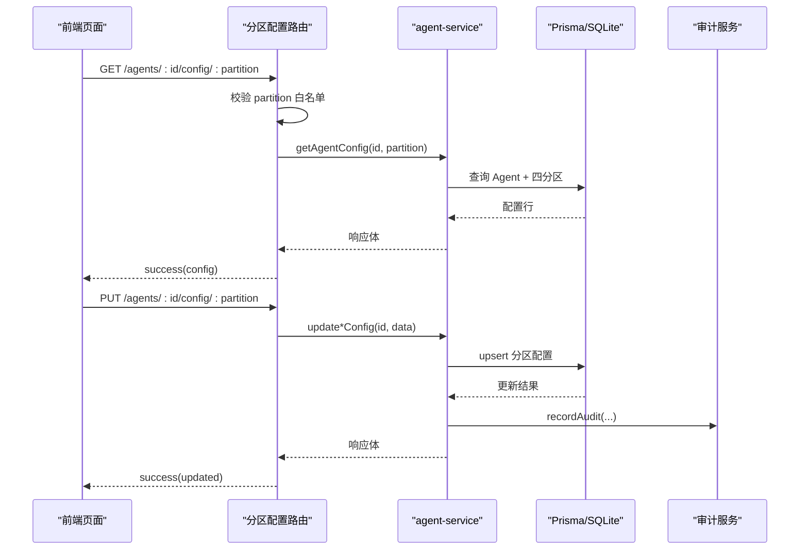

**图表来源**
- [apps/web/app/api/agents/[id]/config/[partition]/route.ts:14-50](file://apps/web/app/api/agents/[id]/config/[partition]/route.ts#L14-L50)
- [apps/web/lib/services/agent-service.ts:341-549](file://apps/web/lib/services/agent-service.ts#L341-L549)

**章节来源**
- [apps/web/app/api/agents/[id]/config/[partition]/route.ts:1-50](file://apps/web/app/api/agents/[id]/config/[partition]/route.ts#L1-L50)
- [apps/web/lib/services/agent-service.ts:341-549](file://apps/web/lib/services/agent-service.ts#L341-L549)

### 发布审批与版本快照
submitRelease 对比最近已发布 Version 的 snapshot 计算 changedPartitions，拒绝无变更提交；reviewRelease 在事务内创建 Version，保证 release 状态与 version 同生共死；createRollbackRelease 覆盖四分区并立即派生新版本。

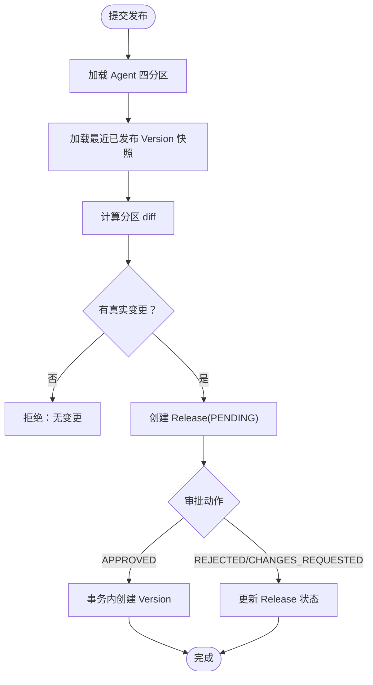

**图表来源**
- [apps/web/lib/services/release-service.ts:77-149](file://apps/web/lib/services/release-service.ts#L77-L149)
- [apps/web/lib/services/release-service.ts:159-217](file://apps/web/lib/services/release-service.ts#L159-L217)
- [apps/web/lib/services/release-service.ts:235-265](file://apps/web/lib/services/release-service.ts#L235-L265)

**章节来源**
- [apps/web/lib/services/release-service.ts:77-217](file://apps/web/lib/services/release-service.ts#L77-L217)
- [apps/web/lib/services/release-service.ts:275-354](file://apps/web/lib/services/release-service.ts#L275-L354)

### 反馈状态机与多渠道接入
feedback-service 定义合法状态转移表，updateFeedback 强制校验；ingestFeedback 支持 generic 与 ticket-webhook 渠道，按 channel + externalRefId 幂等写入，防止 webhook 重试造成重复工单。

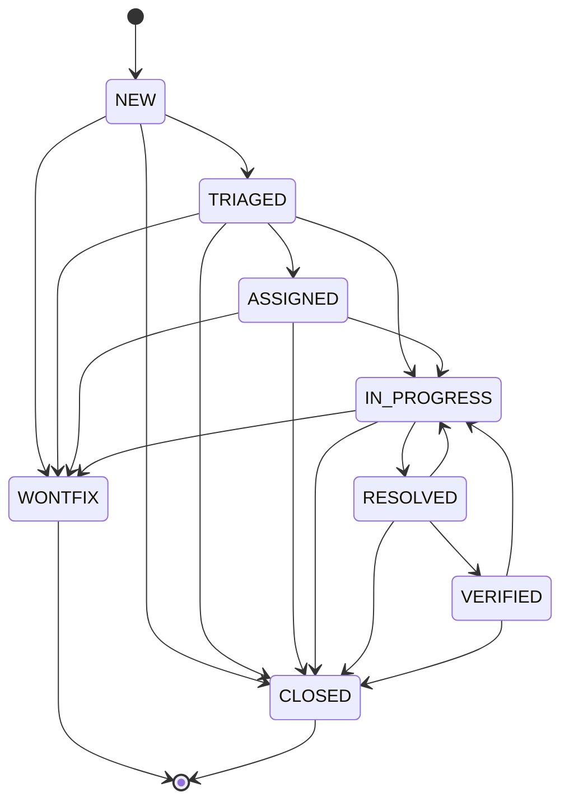

**图表来源**
- [apps/web/lib/services/feedback-service.ts:21-41](file://apps/web/lib/services/feedback-service.ts#L21-L41)

**章节来源**
- [apps/web/lib/services/feedback-service.ts:16-41](file://apps/web/lib/services/feedback-service.ts#L16-L41)
- [apps/web/lib/services/feedback-service.ts:176-294](file://apps/web/lib/services/feedback-service.ts#L176-L294)
- [apps/web/lib/services/feedback-service.ts:296-337](file://apps/web/lib/services/feedback-service.ts#L296-L337)

### LLM 网关统一出站
llm-service 是唯一 LLM 出站通道：读取 MIMO_API_KEY/BASE_URL/MODEL，原生 fetch 调用 chat/completions，统一超时（默认 120s），三档错误（未配置 503、上游 502、超时 504），返回 content/model/usage/latencyMs。

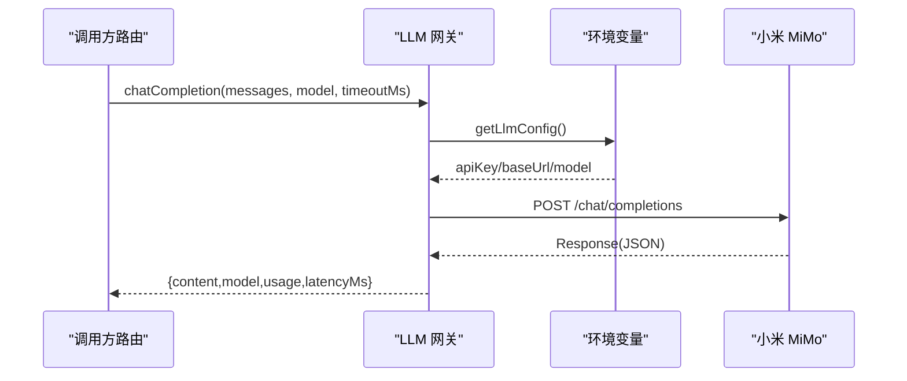

**图表来源**
- [apps/web/lib/services/llm-service.ts:55-93](file://apps/web/lib/services/llm-service.ts#L55-L93)
- [apps/web/lib/services/llm-service.ts:94-139](file://apps/web/lib/services/llm-service.ts#L94-L139)

**章节来源**
- [apps/web/lib/services/llm-service.ts:1-139](file://apps/web/lib/services/llm-service.ts#L1-L139)

### 结构化错误体系
AppError 层级消除字符串匹配脆弱模式；toErrorBody 将任意 thrown 值映射为结构化错误体，未知错误一律 500 INTERNAL 并脱敏。

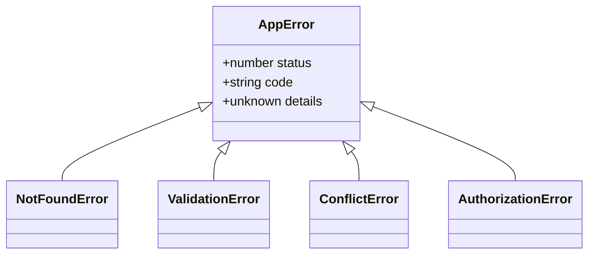

**图表来源**
- [apps/web/lib/errors.ts:15-62](file://apps/web/lib/errors.ts#L15-L62)

**章节来源**
- [apps/web/lib/errors.ts:1-94](file://apps/web/lib/errors.ts#L1-L94)

### 数据库与 Prisma ORM
Prisma Schema 使用 SQLite 连接器；enum/Json/数组列转为 String，值域校验下沉到 Zod；@agent-up/db 包导出 prisma、enums、json-text 封装与 Prisma client 类型。

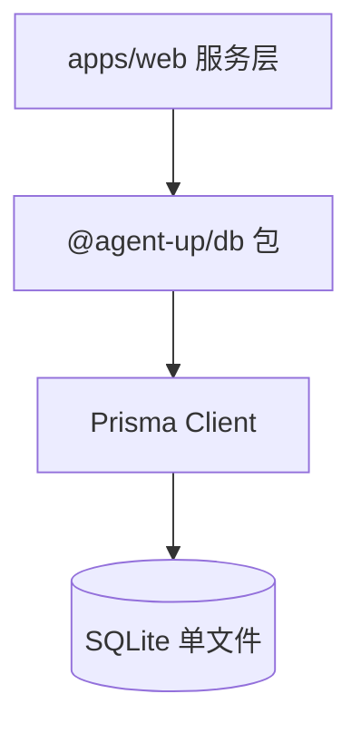

**图表来源**
- [packages/db/prisma/schema.prisma:1-18](file://packages/db/prisma/schema.prisma#L1-L18)
- [packages/db/src/index.ts:1-4](file://packages/db/src/index.ts#L1-L4)

**章节来源**
- [packages/db/prisma/schema.prisma:1-18](file://packages/db/prisma/schema.prisma#L1-L18)
- [packages/db/src/index.ts:1-4](file://packages/db/src/index.ts#L1-L4)

## 依赖关系分析
- 低耦合：API 路由仅做协议适配，业务逻辑集中在服务层；服务层通过 @agent-up/db 访问数据库，不直接 import Prisma。
- 高内聚：每个服务围绕一个领域（agent/release/feedback/skill/wiki/trace/eval/effectiveness/audit/maas-usage/llm）组织。
- 外部依赖：Next.js 16、TypeScript、Tailwind、Zod、Vitest、Mermaid；数据库层依赖 Prisma；LLM 出站依赖外部模型服务。
- 潜在循环：未发现明显循环导入；服务层依赖 errors/context/audit/versioning/diff 等基础设施模块。

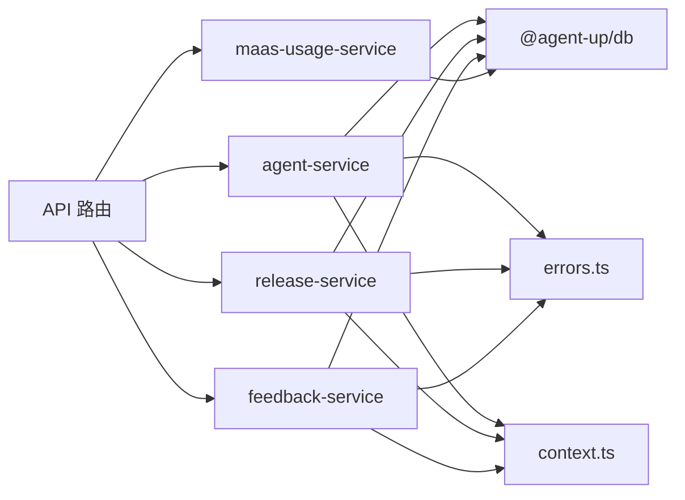

**图表来源**
- [apps/web/lib/services/agent-service.ts:1-20](file://apps/web/lib/services/agent-service.ts#L1-L20)
- [apps/web/lib/services/release-service.ts:1-32](file://apps/web/lib/services/release-service.ts#L1-L32)
- [apps/web/lib/services/feedback-service.ts:1-14](file://apps/web/lib/services/feedback-service.ts#L1-L14)
- [apps/web/lib/services/maas-usage-service.ts:40-58](file://apps/web/lib/services/maas-usage-service.ts#L40-L58)

**章节来源**
- [apps/web/lib/services/agent-service.ts:1-615](file://apps/web/lib/services/agent-service.ts#L1-L615)
- [apps/web/lib/services/release-service.ts:1-373](file://apps/web/lib/services/release-service.ts#L1-L373)
- [apps/web/lib/services/feedback-service.ts:1-337](file://apps/web/lib/services/feedback-service.ts#L1-L337)
- [apps/web/lib/services/maas-usage-service.ts:40-58](file://apps/web/lib/services/maas-usage-service.ts#L40-L58)

## 性能与可扩展性
- SQLite 选择权衡：零守护进程、无需 Docker，适合演示与本地开发；但缺乏 PG 的并发写入优势与高级索引能力。当前规模下列表搜索退化为内存过滤，demo/mock-server 行为一致。
- Prisma ORM：统一类型与查询构建，SQLite 下用 String 模拟 Json/enum，降低迁移成本；未来切换 PG 时只需调整连接与索引策略。
- LLM 网关：原生 fetch 直连，避免 SDK 开销；统一超时与结构化错误，便于监控与降级。
- 可扩展点：多 Provider 路由（DashScope/百炼）可通过 LLM 网关扩展；RBAC 授权拦截位点已在 context/rbac 预留；MinIO/S3 对象存储为后续预留。

**章节来源**
- [README.md:176-178](file://README.md#L176-L178)
- [apps/web/lib/services/agent-service.ts:218-247](file://apps/web/lib/services/agent-service.ts#L218-L247)
- [apps/web/lib/services/llm-service.ts:50-53](file://apps/web/lib/services/llm-service.ts#L50-L53)

## 安全与横切关注点
- 身份与授权：resolveActor 优先签名令牌，其次受信任明文头；生产默认拒绝明文头。AUTH_SECRET 缺失时生产启动期退出；审计署名来自 actor.id，非 userId。
- 结构化错误：toErrorBody 统一脱敏，未知错误 500 INTERNAL，不泄漏堆栈。
- 审计日志：所有写操作记录 action/resource/resourceId/details，按 createdAt 倒序；mock-server 镜像审计查询语义。
- 测试隔离：每个 worker 独立 SQLite 文件，globalSetup 清理并 apply 迁移；_resetDb 清库后灌入测试数据。

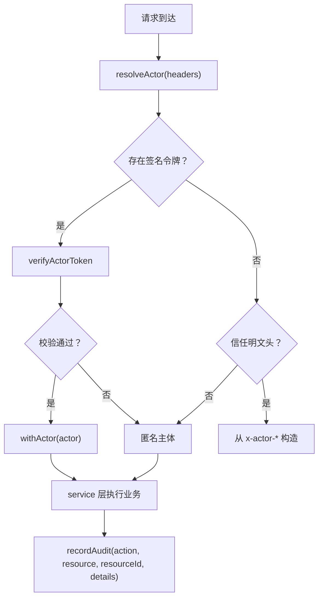

**图表来源**
- [apps/web/lib/context.ts:54-89](file://apps/web/lib/context.ts#L54-L89)
- [apps/web/lib/errors.ts:68-94](file://apps/web/lib/errors.ts#L68-L94)
- [apps/web/demo/mock-server.ts:1740-1759](file://apps/web/demo/mock-server.ts#L1740-L1759)

**章节来源**
- [apps/web/lib/context.ts:1-97](file://apps/web/lib/context.ts#L1-L97)
- [apps/web/lib/errors.ts:1-94](file://apps/web/lib/errors.ts#L1-L94)
- [apps/web/demo/mock-server.ts:1737-1760](file://apps/web/demo/mock-server.ts#L1737-L1760)
- [apps/web/lib/__tests__/setup/prepare-worker-dbs.ts:1-39](file://apps/web/lib/__tests__/setup/prepare-worker-dbs.ts#L1-L39)
- [apps/web/lib/__tests__/setup/worker-db-path.ts:1-21](file://apps/web/lib/__tests__/setup/worker-db-path.ts#L1-L21)

## 故障排查指南
- LLM 未配置：检查 MIMO_API_KEY；网关返回 503。
- LLM 上游错误：检查网络/DNS/baseUrl；details.status/body 携带原始错误。
- LLM 超时：默认 120s，长输出场景传更大 timeoutMs。
- 测试数据库污染：确认 _resetDb 与 worker 独立 .db 文件；CI 使用 PG 容器，本地 SQLite 自动创建。
- 授权缺口：当前 RBAC 授权拦截缺席，任何有效令牌者可读写任意资源；多人使用前必须补授权中间件或服务层守卫。

**章节来源**
- [docs/reports/2026-10-04-project-evaluation-and-remediation.md:468-496](file://docs/reports/2026-10-04-project-evaluation-and-remediation.md#L468-L496)
- [apps/web/lib/services/llm-service.ts:81-109](file://apps/web/lib/services/llm-service.ts#L81-L109)
- [apps/web/lib/__tests__/setup/prepare-worker-dbs.ts:14-39](file://apps/web/lib/__tests__/setup/prepare-worker-dbs.ts#L14-L39)

## 结论
AgentUp 以三层 Loop 为理念骨架，聚焦 L2 产品改进环，通过四分区配置与 Release/Version 机制实现 Agent 配置的受控迭代。分层架构清晰：API 路由负责协议适配，服务层承载业务逻辑，数据库层由 Prisma 抽象；LLM 网关统一出站，保障凭据安全与错误可控。SQLite + Prisma 的组合在当前演示阶段提供了低运维成本与良好可移植性；未来可按需切换到 PG 并增强索引与并发能力。安全方面，身份可信已落地，授权拦截仍需补齐；结构化错误与审计日志为可观测性与合规性打下基础。整体而言，AgentUp 在“模型可换，闭环不变”的设计目标下，形成了可解释、可回溯、可回滚的 Agent 改进平台。