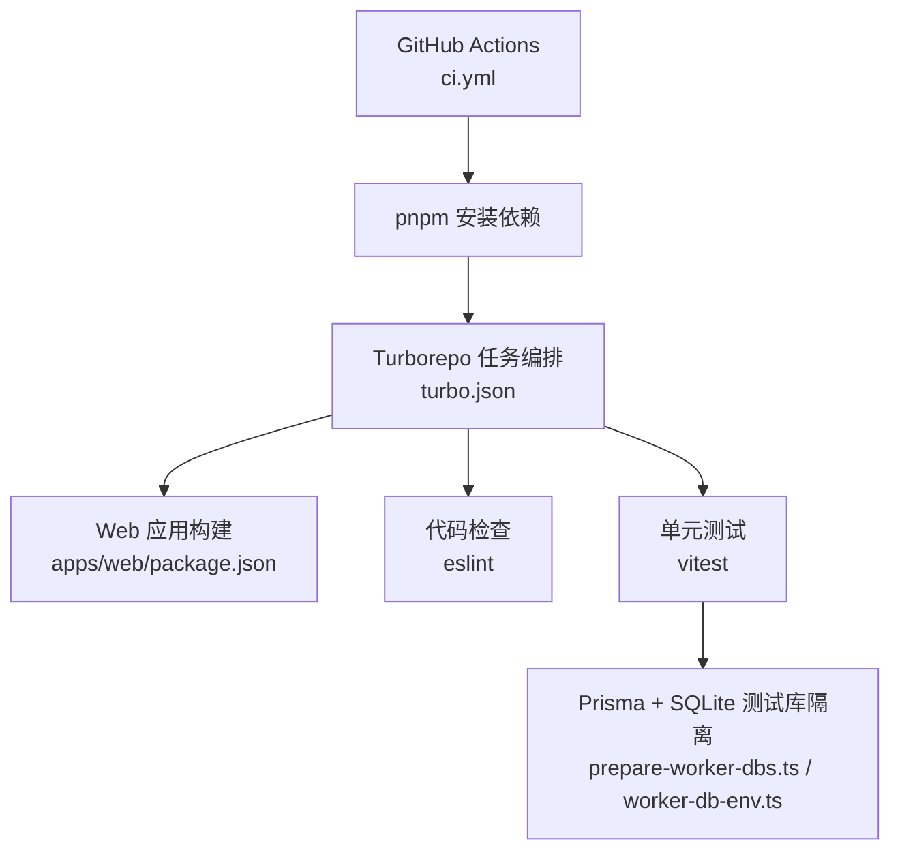
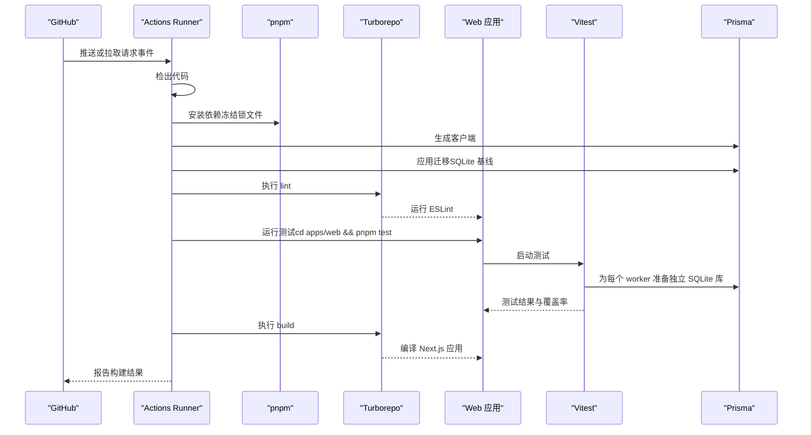
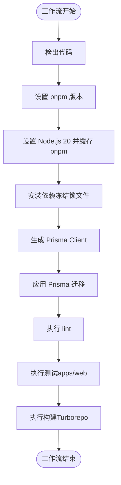
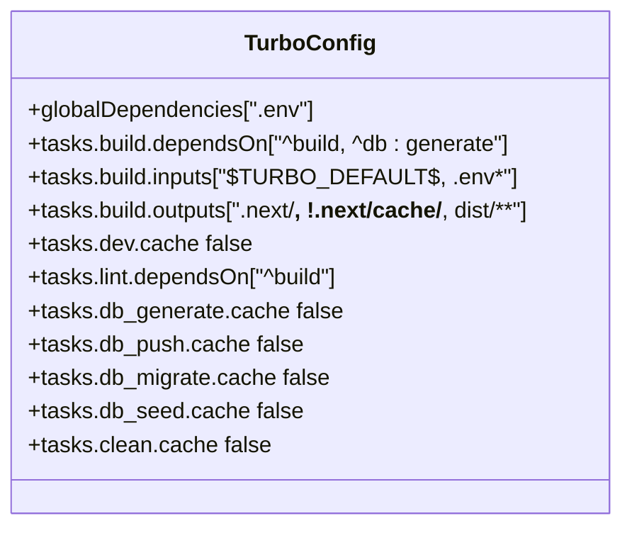
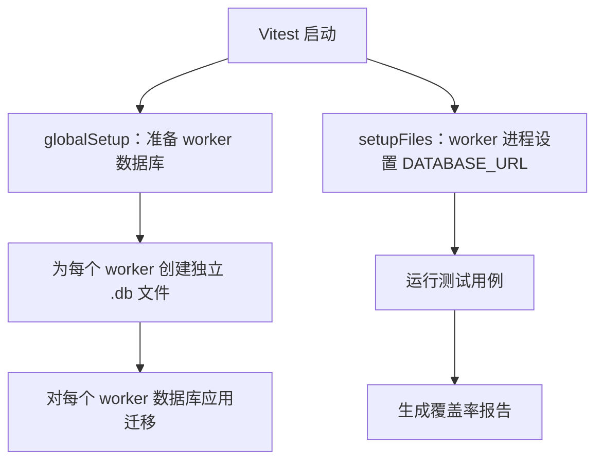
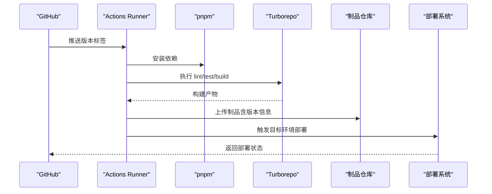
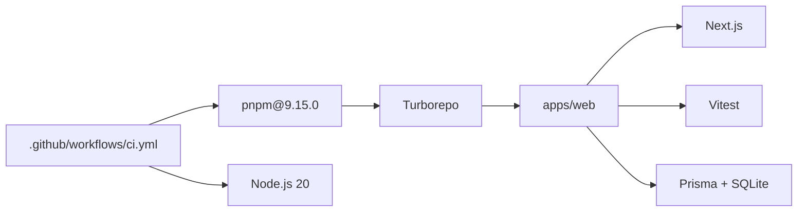

# CI/CD 自动化

<cite>
**本文引用的文件**   
- [ci.yml](file://.github/workflows/ci.yml)
- [package.json](file://package.json)
- [turbo.json](file://turbo.json)
- [apps/web/package.json](file://apps/web/package.json)
- [apps/web/vitest.config.ts](file://apps/web/vitest.config.ts)
- [apps/web/lib/__tests__/setup/prepare-worker-dbs.ts](file://apps/web/lib/__tests__/setup/prepare-worker-dbs.ts)
- [apps/web/lib/__tests__/setup/worker-db-env.ts](file://apps/web/lib/__tests__/setup/worker-db-env.ts)
- [apps/web/lib/__tests__/setup/worker-db-path.ts](file://apps/web/lib/__tests__/setup/worker-db-path.ts)
- [apps/web/lib/__tests__/setup/worker-count.ts](file://apps/web/lib/__tests__/setup/worker-count.ts)
</cite>

## 目录
1. [引言](#引言)
2. [项目结构](#项目结构)
3. [核心组件](#核心组件)
4. [架构总览](#架构总览)
5. [详细组件分析](#详细组件分析)
6. [依赖关系分析](#依赖关系分析)
7. [性能与缓存优化](#性能与缓存优化)
8. [发布流水线建议](#发布流水线建议)
9. [多环境部署策略](#多环境部署策略)
10. [构建产物与制品管理](#构建产物与制品管理)
11. [监控、告警与故障排查](#监控告警与故障排查)
12. [结论](#结论)

## 引言
本仓库采用 GitHub Actions 作为持续集成入口，结合 Turborepo 进行任务编排与缓存，使用 pnpm 管理依赖，Next.js 作为前端应用，Vitest 执行单元测试，Prisma + SQLite 提供数据层。当前工作流在 push 到 main 分支和所有 pull request 时触发，依次完成依赖安装、Prisma Client 生成与迁移、代码检查、测试与构建。文档将围绕这些实现展开，并给出发布、多环境部署、制品管理与监控告警的落地建议。

## 项目结构
CI/CD 相关的关键位置如下：
- GitHub Actions 工作流定义位于 `.github/workflows/ci.yml`。
- Monorepo 根脚本通过 `package.json` 调用 Turborepo。
- Turborepo 任务配置位于 `turbo.json`，定义了 build、lint、dev 等任务的依赖、输入输出与缓存策略。
- Web 应用脚本与测试配置位于 `apps/web/package.json` 与 `apps/web/vitest.config.ts`。
- 测试数据库隔离逻辑位于 `apps/web/lib/__tests__/setup/*`。

**图表来源**
- [ci.yml:1-58](file://.github/workflows/ci.yml#L1-L58)
- [turbo.json:1-35](file://turbo.json#L1-L35)
- [apps/web/package.json:1-37](file://apps/web/package.json#L1-L37)
- [apps/web/vitest.config.ts:1-64](file://apps/web/vitest.config.ts#L1-L64)

**章节来源**
- [ci.yml:1-58](file://.github/workflows/ci.yml#L1-L58)
- [package.json:1-23](file://package.json#L1-L23)
- [turbo.json:1-35](file://turbo.json#L1-L35)
- [apps/web/package.json:1-37](file://apps/web/package.json#L1-L37)

## 核心组件
- GitHub Actions 工作流：负责触发条件、环境准备、依赖安装、Prisma 初始化、代码质量检查、测试与构建。
- Turborepo：统一 monorepo 任务，定义任务依赖、输入输出与缓存策略，提升并行构建效率。
- Vitest：运行 Next.js API 路由与业务逻辑的单元测试，支持覆盖率阈值门禁。
- Prisma + SQLite：测试阶段使用本地 SQLite 文件数据库，按 worker 隔离，避免并发冲突。

**章节来源**
- [ci.yml:1-58](file://.github/workflows/ci.yml#L1-L58)
- [turbo.json:1-35](file://turbo.json#L1-L35)
- [apps/web/vitest.config.ts:1-64](file://apps/web/vitest.config.ts#L1-L64)
- [apps/web/lib/__tests__/setup/prepare-worker-dbs.ts:1-39](file://apps/web/lib/__tests__/setup/prepare-worker-dbs.ts#L1-L39)

## 架构总览
下图展示从代码提交到构建产物的端到端流程，包括触发条件、环境准备、依赖安装、Prisma 初始化、代码检查、测试与构建。

**图表来源**
- [ci.yml:1-58](file://.github/workflows/ci.yml#L1-L58)
- [turbo.json:1-35](file://turbo.json#L1-L35)
- [apps/web/vitest.config.ts:1-64](file://apps/web/vitest.config.ts#L1-L64)
- [apps/web/lib/__tests__/setup/prepare-worker-dbs.ts:1-39](file://apps/web/lib/__tests__/setup/prepare-worker-dbs.ts#L1-L39)

## 详细组件分析

### GitHub Actions 工作流
- 触发条件：push 到 main 分支；所有 pull request。
- 运行环境：Ubuntu 最新镜像，Node.js 20，pnpm 9.15.0。
- 环境变量：DATABASE_URL 指向本地 SQLite 文件，便于测试无需外部数据库服务。
- 关键步骤：
  - 安装依赖：使用冻结锁文件确保可重复构建。
  - Prisma 初始化：生成客户端与应用迁移。
  - 代码检查：通过 Turborepo 执行 lint。
  - 测试：进入 apps/web 执行 vitest run。
  - 构建：通过 Turborepo 执行 build。

**图表来源**
- [ci.yml:1-58](file://.github/workflows/ci.yml#L1-L58)

**章节来源**
- [ci.yml:1-58](file://.github/workflows/ci.yml#L1-L58)

### Turborepo 任务与缓存
- 根脚本：build、lint、db:* 等命令均通过 turbo 分发到子包。
- 任务定义：
  - build：依赖上游包的 build 与 db:generate；输入包含默认源与环境变量；输出包含 .next 与 dist。
  - dev：禁用缓存且持久运行。
  - lint：依赖上游包的 build。
  - db:* 与 clean：禁用缓存。
- 缓存策略：通过 inputs 与 outputs 控制缓存命中；全局依赖包含 .env。

**图表来源**
- [turbo.json:1-35](file://turbo.json#L1-L35)

**章节来源**
- [package.json:1-23](file://package.json#L1-L23)
- [turbo.json:1-35](file://turbo.json#L1-L35)

### 单元测试（Vitest）集成
- 测试入口：apps/web/package.json 中 test 脚本为 vitest run。
- 配置文件：apps/web/vitest.config.ts 指定测试目录、worker 数量、覆盖率阈值与覆盖范围。
- 测试数据库隔离：
  - globalSetup：主进程为每个 worker 准备独立 SQLite 文件，清理旧文件并应用迁移。
  - setupFiles：每个 worker 进程内设置 DATABASE_URL 指向专属文件。
  - worker-db-path：计算绝对路径以避免相对路径解析问题。
  - worker-count：定义 worker 数与 TEST_WORKER_DBS 一致。

**图表来源**
- [apps/web/vitest.config.ts:1-64](file://apps/web/vitest.config.ts#L1-L64)
- [apps/web/lib/__tests__/setup/prepare-worker-dbs.ts:1-39](file://apps/web/lib/__tests__/setup/prepare-worker-dbs.ts#L1-L39)
- [apps/web/lib/__tests__/setup/worker-db-env.ts:1-18](file://apps/web/lib/__tests__/setup/worker-db-env.ts#L1-L18)
- [apps/web/lib/__tests__/setup/worker-db-path.ts:1-22](file://apps/web/lib/__tests__/setup/worker-db-path.ts#L1-L22)
- [apps/web/lib/__tests__/setup/worker-count.ts:1-2](file://apps/web/lib/__tests__/setup/worker-count.ts#L1-L2)

**章节来源**
- [apps/web/package.json:1-37](file://apps/web/package.json#L1-L37)
- [apps/web/vitest.config.ts:1-64](file://apps/web/vitest.config.ts#L1-L64)
- [apps/web/lib/__tests__/setup/prepare-worker-dbs.ts:1-39](file://apps/web/lib/__tests__/setup/prepare-worker-dbs.ts#L1-L39)
- [apps/web/lib/__tests__/setup/worker-db-env.ts:1-18](file://apps/web/lib/__tests__/setup/worker-db-env.ts#L1-L18)
- [apps/web/lib/__tests__/setup/worker-db-path.ts:1-22](file://apps/web/lib/__tests__/setup/worker-db-path.ts#L1-L22)
- [apps/web/lib/__tests__/setup/worker-count.ts:1-2](file://apps/web/lib/__tests__/setup/worker-count.ts#L1-L2)

### 代码质量检查与安全扫描
- 代码检查：通过 Turborepo 执行 lint，web 包使用 ESLint。
- 安全扫描：当前工作流未集成第三方安全扫描工具（如 npm audit、Snyk、GitHub Advanced Security）。建议在 CI 中添加依赖漏洞扫描与静态安全分析步骤，并在失败时阻断合并。

**章节来源**
- [ci.yml:45-47](file://.github/workflows/ci.yml#L45-L47)
- [apps/web/package.json:10-10](file://apps/web/package.json#L10-L10)

### 发布流水线建议
当前工作流仅包含质量门禁与构建，不包含发布、版本标记与制品上传。建议新增 release 作业：
- 触发条件：tag 匹配语义化版本（如 v*）。
- 步骤：
  - 检出代码与安装依赖。
  - 生成 Prisma Client 与应用迁移。
  - 执行 lint、test、build。
  - 根据 tag 生成版本号并写入制品元数据。
  - 打包 Next.js 构建产物（.next 与 dist）。
  - 上传制品到 GitHub Releases 或对象存储。
  - 触发部署作业（开发、测试、生产）。

[此图为概念性流程图，不直接映射具体源码文件]

### 多环境部署策略
- 开发环境：基于 feature 分支自动构建与预览部署，便于快速验证。
- 测试环境：main 分支合并后自动部署，用于集成测试与验收。
- 生产环境：仅允许带语义化版本的 tag 触发，需人工审批或变更窗口。
- 回滚机制：
  - 保留历史制品与对应数据库迁移快照。
  - 通过部署系统一键回滚到上一稳定版本。
  - 数据库迁移应向前兼容，避免回滚导致数据不一致。

[本节为策略性说明，不涉及具体源码文件]

### 构建产物与制品管理
- 构建产物：Next.js 应用的 .next 与 dist 目录由 Turborepo 输出。
- 制品归档：建议将构建产物压缩并上传至制品仓库，附带版本、commit、构建时间与依赖清单。
- 依赖更新自动化：
  - 使用 Dependabot 或 Renovate 定期更新依赖并提交 PR。
  - CI 中对依赖更新 PR 执行完整质量门禁。
  - 对重大版本升级进行灰度发布与回归测试。

**章节来源**
- [turbo.json:5-9](file://turbo.json#L5-L9)

## 依赖关系分析
- 工作流依赖 Node.js 20 与 pnpm 9.15.0。
- Turborepo 协调各子任务，确保依赖顺序与缓存命中。
- Web 应用依赖 Next.js、React、Zod 等运行时依赖，以及 Vitest、ESLint 等开发依赖。
- 测试依赖 @agent-up/db 并通过 Prisma 访问 SQLite。

**图表来源**
- [ci.yml:1-58](file://.github/workflows/ci.yml#L1-L58)
- [apps/web/package.json:1-37](file://apps/web/package.json#L1-L37)

**章节来源**
- [ci.yml:1-58](file://.github/workflows/ci.yml#L1-L58)
- [apps/web/package.json:1-37](file://apps/web/package.json#L1-L37)

## 性能与缓存优化
- Turborepo 缓存：
  - build 任务通过 inputs 与 outputs 控制缓存命中，减少重复构建。
  - dev 任务禁用缓存以保证实时性。
  - db:* 与 clean 任务禁用缓存避免状态污染。
- 并行构建：
  - Turborepo 自动并行执行无依赖的任务。
  - Vitest 通过 maxWorkers 与独立 SQLite 文件避免并发冲突。
- 依赖缓存：
  - GitHub Actions 缓存 pnpm 依赖，加速安装。
  - 建议使用 actions/cache 或 GitHub Packages 缓存构建产物。

**章节来源**
- [turbo.json:1-35](file://turbo.json#L1-L35)
- [apps/web/vitest.config.ts:17-20](file://apps/web/vitest.config.ts#L17-L20)
- [ci.yml:26-34](file://.github/workflows/ci.yml#L26-L34)

## 发布流水线建议
- 版本标记：遵循语义化版本（SemVer），使用 git tag 触发发布。
- 制品打包：
  - 打包 Next.js 构建产物。
  - 生成依赖清单与构建日志。
  - 上传至制品仓库并关联版本。
- 部署自动化：
  - 开发环境：自动部署到预览域名。
  - 测试环境：自动部署到测试集群。
  - 生产环境：人工审批后部署到生产集群。
- 回滚机制：
  - 保留历史制品与数据库迁移快照。
  - 提供一键回滚到上一稳定版本的能力。

[本节为策略性说明，不涉及具体源码文件]

## 多环境部署策略
- 开发环境：
  - 触发：feature 分支推送。
  - 目的：快速验证功能与 UI。
  - 风险：低，允许不稳定。
- 测试环境：
  - 触发：main 分支合并。
  - 目的：集成测试与验收。
  - 风险：中等，需保证基本稳定性。
- 生产环境：
  - 触发：语义化版本 tag。
  - 目的：面向用户稳定版本。
  - 风险：高，需严格审批与回滚能力。

[本节为策略性说明，不涉及具体源码文件]

## 构建产物与制品管理
- 产物内容：
  - Next.js 构建产物（.next 与 dist）。
  - 依赖清单与构建日志。
- 制品存储：
  - 使用 GitHub Releases 或对象存储（如 S3、OSS）。
  - 命名规范：应用名_版本号_构建号。
- 依赖更新自动化：
  - 使用 Dependabot 或 Renovate 提交依赖更新 PR。
  - CI 对依赖更新 PR 执行完整质量门禁。
  - 对重大版本升级进行灰度发布与回归测试。

**章节来源**
- [turbo.json:5-9](file://turbo.json#L5-L9)

## 监控、告警与故障排查
- 构建状态监控：
  - GitHub Actions 页面查看工作流状态与日志。
  - 可通过 webhook 或 Slack 通知构建结果。
- 失败告警：
  - 对 lint、test、build 失败发送告警。
  - 对依赖漏洞扫描失败阻断合并。
- 故障排查：
  - 检查 Prisma 迁移是否成功。
  - 确认测试数据库隔离是否正常。
  - 查看覆盖率阈值是否满足要求。

**章节来源**
- [ci.yml:1-58](file://.github/workflows/ci.yml#L1-L58)
- [apps/web/vitest.config.ts:21-56](file://apps/web/vitest.config.ts#L21-L56)

## 结论
当前 CI/CD 已具备代码提交触发、自动化测试与构建的基础能力，结合 Turborepo 实现了任务编排与缓存优化。下一步建议完善发布流水线、多环境部署策略、制品管理与监控告警，以提升交付效率与稳定性。同时，引入依赖更新自动化与安全扫描，进一步强化质量门禁与风险控制。