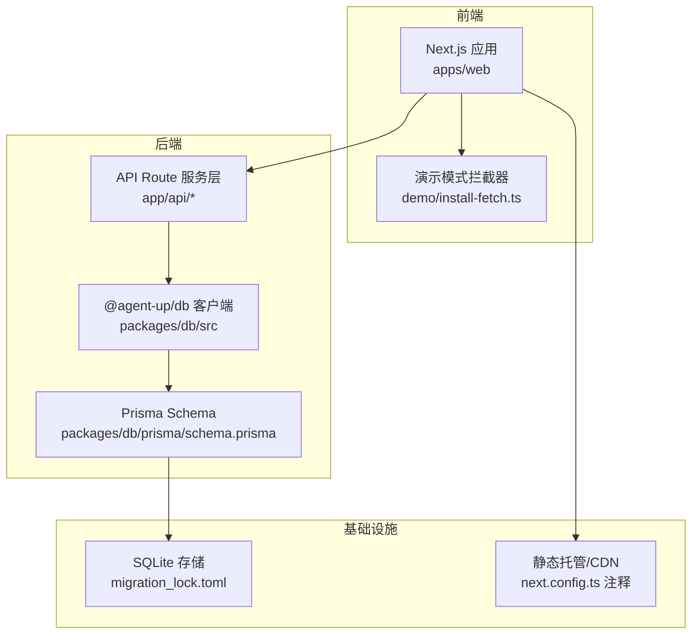
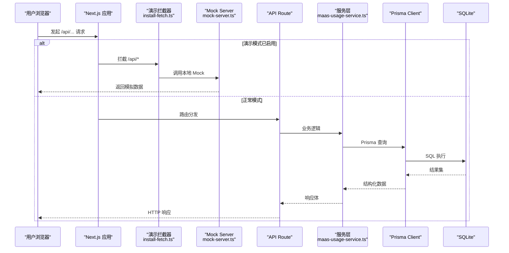
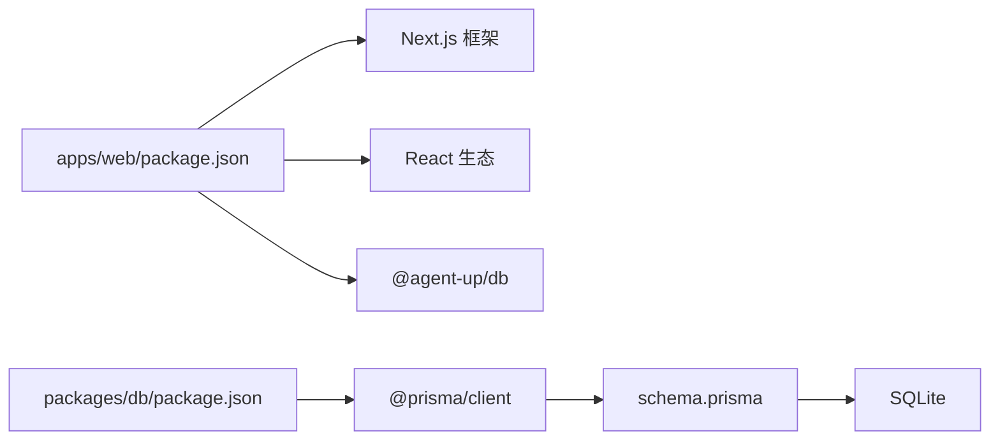

# 性能优化

<cite>
**本文引用的文件**   
- [apps/web/next.config.ts](file://apps/web/next.config.ts)
- [apps/web/package.json](file://apps/web/package.json)
- [apps/web/instrumentation.ts](file://apps/web/instrumentation.ts)
- [apps/web/lib/auth-token.ts](file://apps/web/lib/auth-token.ts)
- [apps/web/demo/install-fetch.ts](file://apps/web/demo/install-fetch.ts)
- [apps/web/demo/mock-server.ts](file://apps/web/demo/mock-server.ts)
- [apps/web/lib/services/maas-usage-service.ts](file://apps/web/lib/services/maas-usage-service.ts)
- [packages/db/package.json](file://packages/db/package.json)
- [packages/db/prisma/schema.prisma](file://packages/db/prisma/schema.prisma)
- [packages/db/prisma/migrations/migration_lock.toml](file://packages/db/prisma/migrations/migration_lock.toml)
- [apps/web/eslint.config.mjs](file://apps/web/eslint.config.mjs)
- [knowledge/troubleshooting/connection-troubleshooting.md](file://knowledge/troubleshooting/connection-troubleshooting.md)
- [docs/superpowers/plans/2026-09-11-prisma-persistence-batch1.md](file://docs/superpowers/plans/2026-09-11-prisma-persistence-batch1.md)
- [docs/superpowers/plans/2026-09-09-prisma-persistence-batch0.md](file://docs/superpowers/plans/2026-09-09-prisma-persistence-batch0.md)
</cite>

## 目录
1. [引言](#引言)
2. [项目结构](#项目结构)
3. [核心组件](#核心组件)
4. [架构总览](#架构总览)
5. [详细组件分析](#详细组件分析)
6. [依赖关系分析](#依赖关系分析)
7. [性能考量](#性能考量)
8. [故障排查指南](#故障排查指南)
9. [结论](#结论)
10. [附录](#附录)

## 引言
本指南面向 agent-up 项目的性能优化实践，覆盖前端构建与资源、数据库索引与连接池、缓存策略、内存管理、并发处理、带宽与网络请求优化、基准测试与监控指标，以及容量规划与水平扩展。文档以仓库现有实现为依据，结合通用最佳实践给出可操作建议，并附带可视化图示帮助理解。

## 项目结构
本项目采用多包工作区：
- apps/web：Next.js 应用（页面、API Route、演示模式）。
- packages/db：Prisma 数据模型与客户端封装。
- docs/knowledge：运维与排障知识。

**图表来源**
- [apps/web/next.config.ts:3-9](file://apps/web/next.config.ts#L3-L9)
- [packages/db/prisma/migrations/migration_lock.toml:1-3](file://packages/db/prisma/migrations/migration_lock.toml#L1-L3)

**章节来源**
- [apps/web/package.json:5-13](file://apps/web/package.json#L5-L13)
- [apps/web/next.config.ts:1-22](file://apps/web/next.config.ts#L1-L22)
- [packages/db/package.json:1-29](file://packages/db/package.json#L1-L29)

## 核心组件
- Next.js 构建与导出：支持生产构建与 DEMO_EXPORT=1 的纯静态导出，便于通过 CDN 直接托管 out 目录。
- 运行时安全探针：instrumentation.ts 在 Node 运行时启动时校验关键配置，缺失则主动退出进程，避免“假存活”。
- 演示模式 fetch 拦截：仅在浏览器且开启演示模式时拦截 /api/* 同源请求，走 mock-server 返回，降低外部依赖与网络开销。
- 数据库访问：Prisma Client 基于 SQLite（开发/演示），Schema 中大量使用复合索引与唯一约束支撑查询。
- 质量与工程化：ESLint 集成 next-vitals 规则，忽略构建产物，避免对压缩 chunk 误报。

**章节来源**
- [apps/web/next.config.ts:3-19](file://apps/web/next.config.ts#L3-L19)
- [apps/web/instrumentation.ts:1-23](file://apps/web/instrumentation.ts#L1-L23)
- [apps/web/demo/install-fetch.ts:1-38](file://apps/web/demo/install-fetch.ts#L1-L38)
- [apps/web/eslint.config.mjs:1-34](file://apps/web/eslint.config.mjs#L1-L34)
- [packages/db/prisma/schema.prisma:15-18](file://packages/db/prisma/schema.prisma#L15-L18)

## 架构总览
下图展示一次典型的前端请求到数据库读取的数据流，以及演示模式下的替代路径。

**图表来源**
- [apps/web/demo/install-fetch.ts:17-38](file://apps/web/demo/install-fetch.ts#L17-L38)
- [apps/web/demo/mock-server.ts:153-188](file://apps/web/demo/mock-server.ts#L153-L188)
- [apps/web/lib/services/maas-usage-service.ts:46-58](file://apps/web/lib/services/maas-usage-service.ts#L46-L58)

## 详细组件分析

### Next.js 构建与资源优化
- 静态导出能力：当 DEMO_EXPORT=1 时输出 out 目录，trailingSlash=true 适配静态托管子路径直连 index.html；NEXT_PUBLIC_DEMO_MODE 注入给前端拦截器。
- 脚本入口：dev 使用 Turbopack，build/start 为标准 Next 命令；提供 build:demo 一键构建演示站点。
- Lint 规则：启用 next-vitals，忽略 .next/out/dist/coverage 等产物，避免对压缩 chunk 误报。

优化建议
- 生产环境启用 Next.js 内置代码分割与 Tree Shaking；按需引入第三方库（如 mermaid）以减少首屏体积。
- 将静态资源（图片、字体、视频）上云对象存储并通过 CDN 分发，配合强缓存与版本化文件名。
- 对大型 UI 库或图表库使用动态 import() 延迟加载，减少主包体积。
- 利用 Next Image 与 WebP/AVIF 自动转换，设置合理的 sizes/priority。

**章节来源**
- [apps/web/next.config.ts:3-19](file://apps/web/next.config.ts#L3-L19)
- [apps/web/package.json:5-13](file://apps/web/package.json#L5-L13)
- [apps/web/eslint.config.mjs:1-34](file://apps/web/eslint.config.mjs#L1-L34)

### 运行时健壮性与启动保护
- instrumentation.ts 在 Node 运行时注册钩子，校验 AUTH_SECRET 是否存在；缺失则打印错误并 process.exit(1)，避免“端口监听但功能不可用”的假活状态。
- auth-token.ts 根据 NODE_ENV 控制 Cookie Secure 属性，确保生产环境仅 HTTPS 传输会话。

优化建议
- 在容器编排层对 exit code 非 0 进行重启告警，缩短不可用窗口。
- 将敏感配置纳入密钥管理服务，启动前拉取并校验，失败即终止。

**章节来源**
- [apps/web/instrumentation.ts:1-23](file://apps/web/instrumentation.ts#L1-L23)
- [apps/web/lib/auth-token.ts:145-163](file://apps/web/lib/auth-token.ts#L145-L163)

### 演示模式与网络请求优化
- install-fetch.ts 在浏览器侧 patch window.fetch，仅对 /api/* 同源请求生效，其他透传；幂等保护避免重复包裹。
- mock-server.ts 提供本地数据聚合与排序，用于演示场景下无需真实后端即可渲染页面。

优化建议
- 演示模式默认关闭，仅在 NEXT_PUBLIC_DEMO_MODE=1 时启用，避免生产误开。
- 对真实 API 增加重试与退避策略，结合超时与取消令牌提升用户体验。
- 对外部接口调用加缓存层（见后文“应用层缓存”）。

**章节来源**
- [apps/web/demo/install-fetch.ts:1-38](file://apps/web/demo/install-fetch.ts#L1-L38)
- [apps/web/demo/mock-server.ts:153-188](file://apps/web/demo/mock-server.ts#L153-L188)

### 数据库设计与索引优化
- 存储引擎：当前为 SQLite（迁移锁 provider=sqlite），适合开发与演示；生产若迁移至 PostgreSQL，需评估连接池与并发。
- 索引设计：Schema 中对高频查询字段建立复合索引与唯一约束，例如 Agent.status、Feedback.agentId+status、ConfigChange.agentId+partition、WikiPage.vaultId+lifecycle/tier、Trace.agentId+createdAt 等。
- JSON 文本列：由于 SQLite 限制，JSON 字段以 String 存储，读写经 pack/unpack 收口，注意解析失败回退策略。

优化建议
- 针对大表（如 Trace、Feedback、AuditLog）按时间范围分区或归档历史数据，保持热数据规模可控。
- 对全文检索需求，考虑引入搜索引擎（如 Elasticsearch/OpenSearch）或数据库侧 GIN 索引（PostgreSQL pg_trgm）。
- 批量写入优先使用事务与批量插入，减少往返次数。

**章节来源**
- [packages/db/prisma/migrations/migration_lock.toml:1-3](file://packages/db/prisma/migrations/migration_lock.toml#L1-L3)
- [packages/db/prisma/schema.prisma:97-99](file://packages/db/prisma/schema.prisma#L97-L99)
- [packages/db/prisma/schema.prisma:203-205](file://packages/db/prisma/schema.prisma#L203-L205)
- [packages/db/prisma/schema.prisma:248-251](file://packages/db/prisma/schema.prisma#L248-L251)
- [packages/db/prisma/schema.prisma:316-318](file://packages/db/prisma/schema.prisma#L316-L318)
- [packages/db/prisma/schema.prisma:451-454](file://packages/db/prisma/schema.prisma#L451-L454)
- [packages/db/prisma/schema.prisma:574-575](file://packages/db/prisma/schema.prisma#L574-L575)

### 连接池与并发控制
- 测试阶段：vitest 通过 poolOptions.threads.maxThreads 限制 worker 数，避免每个 worker 独立 PrismaClient 耗尽数据库连接上限。
- 生产连接池：Prisma 默认连接池行为受底层驱动影响；若切换 PostgreSQL，应显式配置最大连接数、空闲超时、连接有效性检测等。

优化建议
- 根据实例规格与 QPS 估算连接数，遵循“每进程连接数 × 进程数 < 数据库 max_connections”的原则。
- 开启连接保活与失效检测，避免拿到已断开的连接导致间歇性失败。
- 对长耗时任务使用队列与限流，避免突发流量打满连接池。

**章节来源**
- [docs/superpowers/plans/2026-09-09-prisma-persistence-batch0.md:315-374](file://docs/superpowers/plans/2026-09-09-prisma-persistence-batch0.md#L315-L374)
- [docs/superpowers/plans/2026-09-11-prisma-persistence-batch1.md:133-335](file://docs/superpowers/plans/2026-09-11-prisma-persistence-batch1.md#L133-L335)
- [knowledge/troubleshooting/connection-troubleshooting.md:61-79](file://knowledge/troubleshooting/connection-troubleshooting.md#L61-L79)

### 缓存策略
- 浏览器缓存：静态资源使用强缓存 + 版本化文件名；Cookie 区分生产/开发环境的安全属性。
- CDN 缓存：静态导出站点可直接由 CDN 托管，开启 gzip/brotli 压缩与边缘缓存；对动态 API 使用短 TTL 或按条件缓存。
- 应用层缓存：对热点数据（如 Agent 列表、Skill 元信息）使用内存缓存（LRU），设置过期时间与更新策略；对计算密集型报告（如效果评估）采用懒填充与磁盘落盘。

优化建议
- 对读多写少的配置型数据（Agent/Skill/Routing 配置）做多级缓存：内存 → 分布式缓存 → 数据库。
- 对大数据量报表（如 MaasUsageReport）采用异步生成 + 定时刷新，避免每次请求全量扫描。

**章节来源**
- [apps/web/lib/auth-token.ts:145-163](file://apps/web/lib/auth-token.ts#L145-L163)
- [apps/web/next.config.ts:3-19](file://apps/web/next.config.ts#L3-L19)
- [apps/web/lib/services/maas-usage-service.ts:46-58](file://apps/web/lib/services/maas-usage-service.ts#L46-L58)

### 内存管理与垃圾回收调优
- 内存占用热点：全量拉取 WikiPage content 进行线性打分会导致高内存消耗；未来可通过反规范化字段与数据库侧预筛降低内存压力。
- 垃圾回收：Node.js 默认 GC 通常足够；在高并发长驻进程中，关注堆增长趋势，必要时调整 --max-old-space-size 与 GC 日志。

优化建议
- 分页与流式处理：对大结果集使用分页游标或流式读取，避免一次性载入内存。
- 及时释放引用：避免全局大对象长期持有；使用 WeakMap/WeakRef 缓存临时对象。
- 监控堆快照与 GC 事件，定位泄漏点（闭包、定时器、未清理订阅）。

**章节来源**
- [docs/reports/2026-10-04-project-evaluation-and-remediation.md:391-405](file://docs/reports/2026-10-04-project-evaluation-and-remediation.md#L391-L405)

### 并发处理与异步任务调度
- Worker 线程：vitest 通过 threads.maxThreads 限制并发 worker，避免连接风暴。
- 异步任务：对耗时任务（如 AI 评测、知识库同步）采用后台任务队列（如 BullMQ/Redis），支持重试、优先级与死信队列。

优化建议
- 合理设置并发度：CPU 密集任务使用 Worker Threads；IO 密集任务使用事件循环 + 队列。
- 任务去重与幂等：通过唯一键保证重复提交不产生副作用。
- 监控队列积压与消费延迟，动态扩缩容消费者。

**章节来源**
- [docs/superpowers/plans/2026-09-09-prisma-persistence-batch0.md:315-374](file://docs/superpowers/plans/2026-09-09-prisma-persistence-batch0.md#L315-L374)

### 带宽优化与网络请求优化
- 前端资源：启用 Brotli/Gzip，图片转 WebP/AVIF，字体子集化与预加载关键字体。
- 接口优化：合并小请求、使用 GraphQL 或自定义 DTO 减少冗余字段；对 SSE/WebSocket 推送场景复用连接。
- 重试与降级：对不稳定外部接口实施指数退避重试与熔断降级，保障整体可用性。

优化建议
- 对静态资源开启 CDN 边缘缓存与预取；对动态接口使用 HTTP/2 多路复用。
- 对移动端网络差场景，提供低清图与精简版数据。

[本节为通用指导，不直接分析具体文件]

### 性能基准测试与监控指标
- 基准测试：使用 k6/Locust 对关键 API 进行压测，关注 P95/P99 延迟、吞吐、错误率与资源利用率。
- 前端性能：通过 Web Vitals（FCP、LCP、CLS、TBT）与 RUM 采集真实用户体验。
- 后端指标：暴露健康检查与指标端点（QPS、延迟分布、连接池使用率、GC 次数、堆大小）。

优化建议
- 将压测纳入 CI，设定性能回归阈值；对慢查询与热点接口持续优化。
- 建立告警规则：延迟突增、错误率上升、连接池耗尽、内存持续增长。

[本节为通用指导，不直接分析具体文件]

### 容量规划与水平扩展
- 单节点容量：根据 CPU/内存/IO 瓶颈确定单机 QPS 上限；数据库连接数与磁盘 IO 是常见瓶颈。
- 水平扩展：无状态服务多副本部署，负载均衡分发；有状态组件（数据库、缓存）采用主从/分片/集群。
- 弹性伸缩：基于 CPU/内存/队列长度触发 HPA；冷启动预热与连接池预热减少抖动。

优化建议
- 灰度发布与蓝绿部署，降低变更风险。
- 定期演练扩容与故障转移，验证预案有效性。

[本节为通用指导，不直接分析具体文件]

## 依赖关系分析

**图表来源**
- [apps/web/package.json:15-22](file://apps/web/package.json#L15-L22)
- [packages/db/package.json:17-23](file://packages/db/package.json#L17-L23)
- [packages/db/prisma/schema.prisma:15-18](file://packages/db/prisma/schema.prisma#L15-L18)

**章节来源**
- [apps/web/package.json:1-37](file://apps/web/package.json#L1-L37)
- [packages/db/package.json:1-29](file://packages/db/package.json#L1-L29)

## 性能考量
- 构建期：使用 Turbopack 加速开发；生产构建启用代码分割与 Tree Shaking。
- 运行期：最小化主包体积，延迟加载重型模块；对热点数据加缓存；对慢查询加索引与分页。
- 资源：静态资源上 CDN，启用压缩与缓存；动态接口限流与降级。
- 稳定性：启动时校验关键配置；连接池与队列参数按容量规划调优；监控与告警闭环。

[本节为通用指导，不直接分析具体文件]

## 故障排查指南
- 连接数不足：Too many connections 表示并发额度已满，先查实际占用与连接池配置，再考虑提升 max_connections。
- 连接泄漏：Sleep 状态连接过多说明未归还连接，检查连接池 idle timeout 与有效性检测。
- 失效连接：RDS wait_timeout 断开空闲连接，客户端池不知情导致首次请求慢或丢连接，需开启 testOnBorrow 或定期探活，并将池空闲时间小于 wait_timeout。

**章节来源**
- [knowledge/troubleshooting/connection-troubleshooting.md:61-79](file://knowledge/troubleshooting/connection-troubleshooting.md#L61-L79)

## 结论
通过对 Next.js 构建与资源、数据库索引与连接池、缓存策略、内存管理、并发处理、带宽与网络、基准测试与监控、容量规划的系统性优化，可在不同负载阶段持续提升性能与稳定性。建议以指标驱动迭代，结合压测与监控持续调优，逐步达到目标 SLA。

[本节为总结，不直接分析具体文件]

## 附录
- 快速检查清单
  - 是否启用静态导出与 CDN？
  - 是否对热点数据加缓存？
  - 是否为大表添加必要索引？
  - 连接池参数是否与实例规格匹配？
  - 是否对重型模块延迟加载？
  - 是否接入性能监控与告警？

[本节为补充内容，不直接分析具体文件]