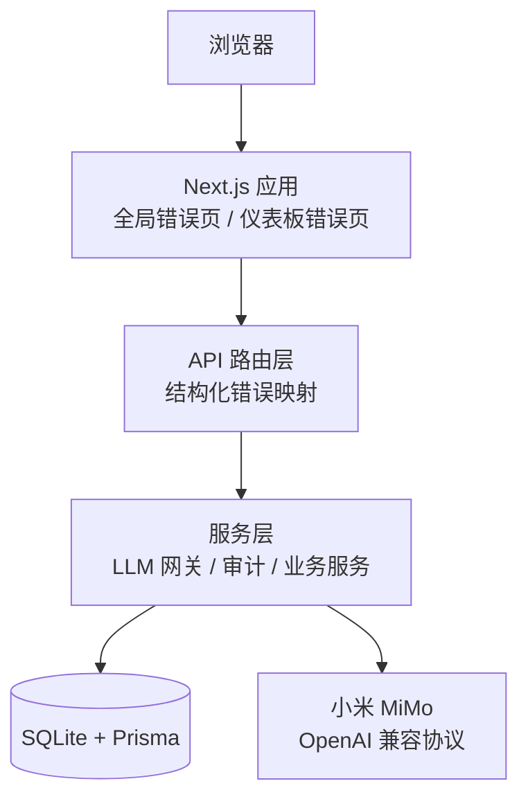
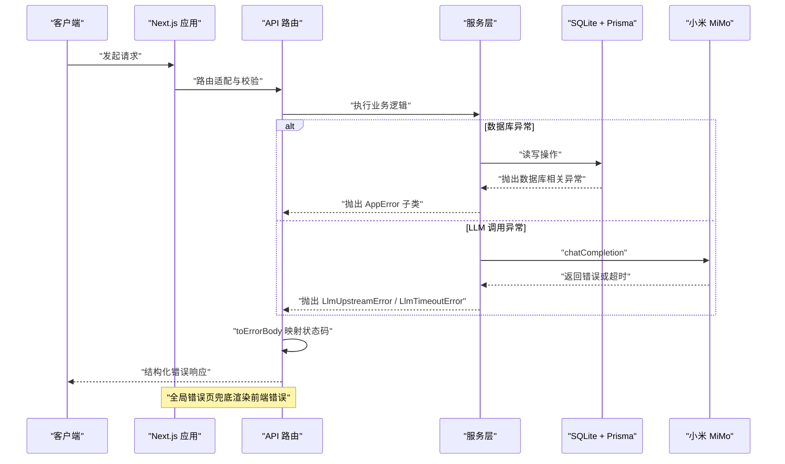
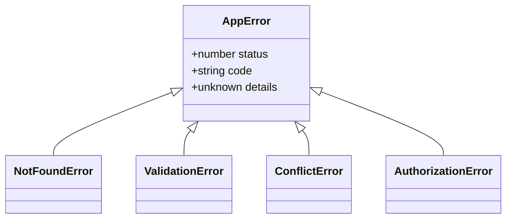
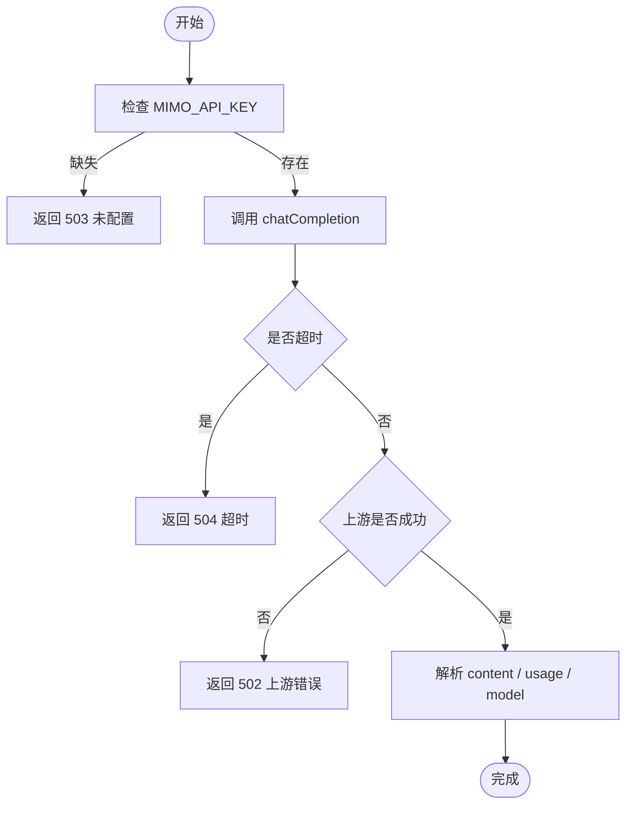
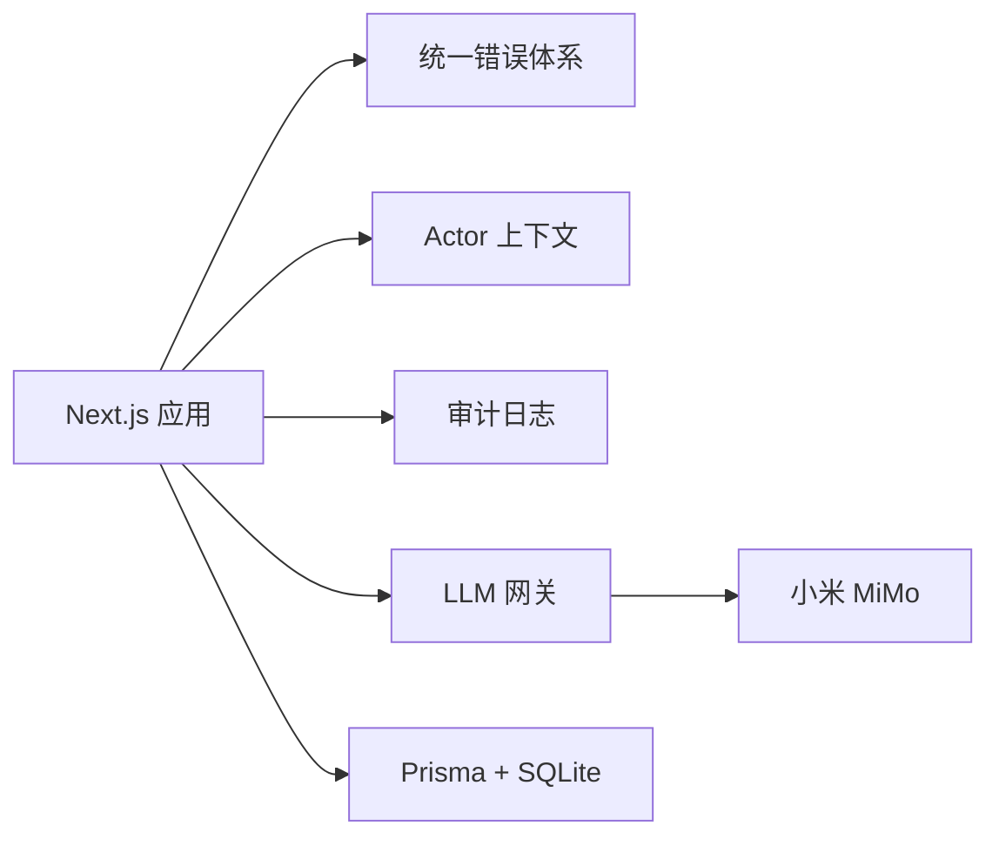

# 故障排查

<cite>
**本文引用的文件**   
- [README.md](file://README.md)
- [部署指南](file://docs/guides/deployment.md)
- [RDS 连接问题排查](file://knowledge/troubleshooting/connection-troubleshooting.md)
- [SSH 无法连接 ECS 实例的排查流程](file://knowledge/troubleshooting/ssh-troubleshooting.md)
- [统一错误体系](file://apps/web/lib/errors.ts)
- [Next.js 启动钩子](file://apps/web/instrumentation.ts)
- [请求级 actor 上下文](file://apps/web/lib/context.ts)
- [审计日志服务](file://apps/web/lib/services/audit-service.ts)
- [LLM 网关实现](file://apps/web/lib/services/llm-service.ts)
- [LLM 组件参考](file://docs/skills/agent-up-services/references/llm-service-component.md)
- [全局客户端错误页](file://apps/web/app/global-error.tsx)
- [仪表板页面错误页](file://apps/web/app/(dashboard)/error.tsx)
- [Prisma 客户端封装](file://packages/db/src/client.ts)
- [测试 worker 数据库路径](file://apps/web/lib/__tests__/setup/worker-db-path.ts)
- [测试 worker 环境变量注入](file://apps/web/lib/__tests__/setup/worker-db-env.ts)
- [测试 worker 数据库准备](file://apps/web/lib/__tests__/setup/prepare-worker-dbs.ts)
</cite>

## 目录
1. [引言](#引言)
2. [项目结构](#项目结构)
3. [核心组件](#核心组件)
4. [架构总览](#架构总览)
5. [详细组件分析](#详细组件分析)
6. [依赖关系分析](#依赖关系分析)
7. [性能注意事项](#性能注意事项)
8. [故障排查手册](#故障排查手册)
9. [结论](#结论)
10. [附录](#附录)

## 引言
本手册面向 agent-up 平台的运维、开发与交付人员，聚焦“快速定位、可执行恢复、可预防复发”的目标。平台当前以 Next.js 应用 + SQLite + Prisma 为主运行形态，并包含真实 LLM（小米 MiMo）集成点；同时仓库内也保留了 RDS / SSH 等通用基础设施排查知识，便于现场环境扩展使用。

## 项目结构
从故障视角看，需要重点关注的代码与文档位置如下：
- 应用入口与启动校验：Next.js instrumentation、全局错误页、仪表板错误页。
- 运行时错误映射：统一错误体系、审计日志、actor 上下文。
- 外部依赖：LLM 网关、Prisma 客户端、SQLite 文件库。
- 运维文档：部署指南、RDS 连接排查、SSH 排查。

**图示来源**
- [全局客户端错误页:1-33](file://apps/web/app/global-error.tsx#L1-L33)
- [仪表板页面错误页:43-76](file://apps/web/app/(dashboard)/error.tsx#L43-L76)
- [统一错误体系:1-95](file://apps/web/lib/errors.ts#L1-L95)
- [审计日志服务:1-120](file://apps/web/lib/services/audit-service.ts#L1-L120)
- [LLM 网关实现:1-76](file://apps/web/lib/services/llm-service.ts#L1-L76)
- [Prisma 客户端封装:1-18](file://packages/db/src/client.ts#L1-L18)

**章节来源**
- [README.md:137-154](file://README.md#L137-L154)
- [部署指南:1-36](file://docs/guides/deployment.md#L1-L36)

## 核心组件
- 统一错误体系：所有 API 异常通过 AppError 及其子类表达，并由 toErrorBody 映射为 HTTP 状态码与结构化响应体；未知错误统一返回 500，避免堆栈泄露。
- 启动期安全校验：instrumentation 在 Node 运行时检查认证配置，缺失时主动退出进程，防止“看起来启动成功但令牌不可用”的静默降级。
- Actor 上下文：基于 AsyncLocalStorage 的请求级身份解析，支持签名会话令牌与受控明文头，审计日志据此署名。
- 审计日志：append-only 写入，失败不阻塞主业务，仅记录控制台错误。
- LLM 网关：读取 MIMO_API_KEY / MIMO_BASE_URL / MIMO_MODEL，原生 fetch 调用，超时默认 120 秒，错误分为未配置、上游错误、超时三类。
- 数据库访问：Prisma 客户端按环境控制日志级别；测试阶段每个 worker 使用独立 SQLite 文件。

**章节来源**
- [统一错误体系:1-95](file://apps/web/lib/errors.ts#L1-L95)
- [Next.js 启动钩子:1-23](file://apps/web/instrumentation.ts#L1-L23)
- [请求级 actor 上下文:1-97](file://apps/web/lib/context.ts#L1-L97)
- [审计日志服务:1-120](file://apps/web/lib/services/audit-service.ts#L1-L120)
- [LLM 网关实现:1-76](file://apps/web/lib/services/llm-service.ts#L1-L76)
- [Prisma 客户端封装:1-18](file://packages/db/src/client.ts#L1-L18)

## 架构总览
下图展示一次典型 API 请求的错误处理与外部依赖交互路径，适用于端口冲突、权限问题、依赖缺失、网络异常、数据库连接异常等场景的定位。

**图示来源**
- [统一错误体系:64-95](file://apps/web/lib/errors.ts#L64-L95)
- [LLM 网关实现:29-76](file://apps/web/lib/services/llm-service.ts#L29-L76)
- [全局客户端错误页:1-33](file://apps/web/app/global-error.tsx#L1-L33)

## 详细组件分析

### 统一错误体系与 API 错误映射
- 设计要点：AppError 基类携带 status、code、details；NotFoundError、ValidationError、ConflictError、AuthorizationError 分别对应常见 HTTP 语义；未知错误统一走 INTERNAL 500。
- 排障价值：通过 code 与 details 可区分参数校验失败、资源不存在、并发冲突、权限不足与服务器内部错误，避免字符串匹配导致的脆弱判断。
- 建议实践：新增业务异常优先定义 AppError 子类，并在路由层统一捕获；对敏感消息脱敏，避免将堆栈或凭据暴露给客户端。

**图示来源**
- [统一错误体系:8-63](file://apps/web/lib/errors.ts#L8-L63)

**章节来源**
- [统一错误体系:1-95](file://apps/web/lib/errors.ts#L1-L95)

### 启动期安全校验与进程退出策略
- 行为说明：instrumentation.register 仅在 nodejs 运行时执行，调用认证配置断言；若生产环境缺少 AUTH_SECRET，则打印错误并 process.exit(1)，由进程管理器负责重启与告警。
- 排障价值：避免“端口已监听但令牌不可用”的假健康；配合容器编排或 PM2 等进程管理工具可实现自动恢复。
- 建议实践：在 CI 中注入临时密钥进行构建期检查；在生产部署脚本中先验证 .env 再启动服务。

**章节来源**
- [Next.js 启动钩子:1-23](file://apps/web/instrumentation.ts#L1-L23)
- [部署指南:37-64](file://docs/guides/deployment.md#L37-L64)

### Actor 上下文与审计署名
- 行为说明：resolveActor 优先解析签名会话令牌；在未信任明文头的生产环境下拒绝 x-actor-* 自述身份；getActor 通过 AsyncLocalStorage 贯穿异步续体。
- 排障价值：审计日志 userName/userRole 能准确反映实际写操作主体；当出现匿名审计条目时，应检查会话令牌是否失效或明文头被禁用。
- 建议实践：对外部调用方明确 AUTH_TRUST_ACTOR_HEADERS 的使用边界；对自动化任务使用系统主体署名。

**章节来源**
- [请求级 actor 上下文:1-97](file://apps/web/lib/context.ts#L1-L97)
- [审计日志服务:1-120](file://apps/web/lib/services/audit-service.ts#L1-L120)

### LLM 网关与外部服务连通性
- 行为说明：isLlmConfigured 仅检查 MIMO_API_KEY；chatCompletion 使用 AbortSignal.timeout 控制超时；非 2xx、空内容、网络不可达统一归为上游错误；超时单独分类。
- 排障价值：503 表示本地未配置凭据；502 表示上游鉴权失败、限流或服务异常；504 表示推理模型响应过慢。
- 建议实践：在 /maas 连通性探针中先测 isLlmConfigured，再发真实请求；对上游错误记录截断后的响应体与原始 cause；根据 usage 字段监控 token 消耗。

**图示来源**
- [LLM 网关实现:29-76](file://apps/web/lib/services/llm-service.ts#L29-L76)
- [LLM 组件参考:21-47](file://docs/skills/agent-up-services/references/llm-service-component.md#L21-L47)

**章节来源**
- [LLM 网关实现:1-76](file://apps/web/lib/services/llm-service.ts#L1-L76)
- [LLM 组件参考:21-47](file://docs/skills/agent-up-services/references/llm-service-component.md#L21-L47)

### 数据库与 Prisma 客户端
- 行为说明：Prisma 客户端在开发环境输出 query/error/warn，生产仅 error；测试阶段通过 worker-db-path 与 worker-db-env 为每个 vitest worker 分配独立 SQLite 文件。
- 排障价值：可通过 Prisma 日志观察慢查询与 SQL 错误；测试失败时可确认是否因共享数据库导致数据污染。
- 建议实践：生产环境关闭 query 日志以减少 I/O；测试前确保 prepare-worker-dbs 已清理旧 .db 与 journal/wal 文件。

**章节来源**
- [Prisma 客户端封装:1-18](file://packages/db/src/client.ts#L1-L18)
- [测试 worker 数据库路径:1-21](file://apps/web/lib/__tests__/setup/worker-db-path.ts#L1-L21)
- [测试 worker 环境变量注入:1-18](file://apps/web/lib/__tests__/setup/worker-db-env.ts#L1-L18)
- [测试 worker 数据库准备:1-39](file://apps/web/lib/__tests__/setup/prepare-worker-dbs.ts#L1-L39)

## 依赖关系分析
- 应用层依赖：Next.js 应用依赖统一错误体系、actor 上下文、审计日志与 LLM 网关。
- 外部依赖：SQLite 作为运行时存储；小米 MiMo 作为 LLM 上游。
- 风险点：
  - 环境变量缺失：AUTH_SECRET、MIMO_API_KEY、DATABASE_URL。
  - 网络可达：MiMo 域名与端口、VPC 白名单、安全组。
  - 进程健康：instrumentation 退出后需由进程管理器重启。

**图示来源**
- [统一错误体系:1-95](file://apps/web/lib/errors.ts#L1-L95)
- [请求级 actor 上下文:1-97](file://apps/web/lib/context.ts#L1-L97)
- [审计日志服务:1-120](file://apps/web/lib/services/audit-service.ts#L1-L120)
- [LLM 网关实现:1-76](file://apps/web/lib/services/llm-service.ts#L1-L76)
- [Prisma 客户端封装:1-18](file://packages/db/src/client.ts#L1-L18)

**章节来源**
- [README.md:425-444](file://README.md#L425-L444)
- [部署指南:37-64](file://docs/guides/deployment.md#L37-L64)

## 性能注意事项
- LLM 调用：默认 120 秒超时适合推理模型；若频繁 504，应评估上游延迟、token 预算与重试策略。
- 数据库日志：开发环境开启 query 日志有助于定位慢查询，生产环境应谨慎开启以避免额外 I/O。
- 审计写入：recordAudit 采用 fire-and-forget，避免阻塞主流程；高吞吐下关注控制台错误与磁盘空间。
- 测试隔离：每个 worker 独立 SQLite 文件，避免并行测试互相干扰；注意清理残留的 -journal 与 -wal 文件。

## 故障排查手册

### 一、部署相关问题

#### 1. 端口冲突
- 症状：pnpm dev 启动失败或端口占用报错；curl localhost:3000 无响应。
- 原因：其他进程占用 3000 端口；Turborepo 多进程端口竞争。
- 排查步骤：
  1) 查看终端报错信息，确认具体端口；  
  2) 使用系统命令查找占用端口的进程；  
  3) 停止冲突进程或更换端口；  
  4) 重新执行 pnpm dev。
- 解决方案：释放端口后重新启动；如为容器化部署，检查端口映射与 hostPort 配置。

#### 2. 权限问题
- 症状：登录失败、审计署名异常、写操作被拒。
- 原因：AUTH_TRUST_ACTOR_HEADERS 在生产默认拒绝明文头；会话令牌无效；Actor 上下文未正确设置。
- 排查步骤：
  1) 检查 AUTH_TRUST_ACTOR_HEADERS 值；  
  2) 确认会话令牌是否有效；  
  3) 查看审计日志中的 userName/userRole；  
  4) 对自动化调用方确认是否通过可信网关鉴权。
- 解决方案：调整 AUTH_TRUST_ACTOR_HEADERS 至可信内网模式；修复会话令牌生成逻辑；补充可信网关鉴权。

**章节来源**
- [请求级 actor 上下文:53-79](file://apps/web/lib/context.ts#L53-L79)
- [审计日志服务:43-85](file://apps/web/lib/services/audit-service.ts#L43-L85)

#### 3. 依赖缺失
- 症状：服务启动即退出；LLM 功能返回 503；测试报 DATABASE_URL 缺失。
- 原因：AUTH_SECRET、MIMO_API_KEY、DATABASE_URL 未配置或路径错误。
- 排查步骤：
  1) 检查 apps/web/.env 是否存在；  
  2) 核对变量名与值；  
  3) 确认 Next.js 启动日志显示 Environments: .env；  
  4) 测试环境确认 packages/db/.env 与 apps/web/.env 均正确。
- 解决方案：补齐环境变量后重启服务；CI 中增加环境变量校验步骤。

**章节来源**
- [Next.js 启动钩子:12-22](file://apps/web/instrumentation.ts#L12-L22)
- [部署指南:37-64](file://docs/guides/deployment.md#L37-L64)
- [测试 worker 环境变量注入:11-18](file://apps/web/lib/__tests__/setup/worker-db-env.ts#L11-L18)

### 二、运行时错误诊断

#### 1. 内存泄漏
- 症状：进程内存持续增长；GC 频繁；响应变慢。
- 原因：长生命周期对象未释放；异步任务未收口；大量未消费日志。
- 排查步骤：
  1) 采集堆快照对比增长趋势；  
  2) 检查是否有全局缓存未清理；  
  3) 审查异步任务与 Promise 链是否 await 收口；  
  4) 降低日志级别或采样日志。
- 解决方案：引入对象池与 TTL；完善异步任务生命周期；限制日志体积。

#### 2. 性能瓶颈
- 症状：接口 P95/P99 升高；LLM 调用超时增多；数据库慢查询增多。
- 原因：上游延迟；SQL 未优化；连接池配置不当；重试风暴。
- 排查步骤：
  1) 使用链路追踪定位慢环节；  
  2) 查看 LLM 网关 latencyMs 与 usage；  
  3) 打开 Prisma query 日志分析慢查询；  
  4) 检查连接池 idle timeout 与 max lifetime。
- 解决方案：优化索引与查询；调整超时与重试；引入缓存与批量操作。

#### 3. 数据库连接问题
- 症状：连接失败、Too many connections、Lost connection。
- 原因：白名单未加、账号权限不足、网络不可达、连接数打满、连接池未归还。
- 排查步骤：
  1) 读错误码定位四层问题；  
  2) 确认出口 IP 已加白名单；  
  3) 确认账号+来源主机+密码匹配；  
  4) 使用 nslookup 与 nc 验证网络可达；  
  5) 查看 Threads_connected 与 PROCESSLIST；  
  6) 检查连接池有效性检测与空闲时间。
- 解决方案：修正白名单与权限；打通 VPC 或使用外网地址；调整连接池参数；必要时扩容实例。

**章节来源**
- [RDS 连接问题排查:1-90](file://knowledge/troubleshooting/connection-troubleshooting.md#L1-L90)

### 三、日志分析方法

#### 1. 错误日志解读
- 结构化错误：toErrorBody 将 AppError 映射为 success=false、error、code、details；未知错误为 INTERNAL 500。
- LLM 错误：503 未配置、502 上游错误、504 超时；上游错误 details.cause 保留原始错误消息。
- 审计日志：recordAudit 失败仅记录控制台错误，不影响主业务。

**章节来源**
- [统一错误体系:64-95](file://apps/web/lib/errors.ts#L64-L95)
- [LLM 网关实现:29-76](file://apps/web/lib/services/llm-service.ts#L29-L76)
- [审计日志服务:77-83](file://apps/web/lib/services/audit-service.ts#L77-L83)

#### 2. 调试技巧
- 前端错误编号：全局错误页展示 error.digest，反馈问题时附上该编号。
- 仪表板错误页：提供常见原因与排查顺序，包括数据库不可用、记录不存在、开发服务未就绪。
- 测试隔离：worker-db-path 与 worker-db-env 确保每个 worker 独立 SQLite 文件，便于复现与隔离问题。

**章节来源**
- [全局客户端错误页:1-33](file://apps/web/app/global-error.tsx#L1-L33)
- [仪表板页面错误页:43-76](file://apps/web/app/(dashboard)/error.tsx#L43-L76)
- [测试 worker 数据库路径:1-21](file://apps/web/lib/__tests__/setup/worker-db-path.ts#L1-L21)
- [测试 worker 环境变量注入:1-18](file://apps/web/lib/__tests__/setup/worker-db-env.ts#L1-L18)

### 四、网络问题排查

#### 1. API 调用失败
- 症状：前端请求返回 4xx/5xx；UI 显示结构化错误。
- 原因：参数校验失败、资源不存在、权限不足、服务器内部错误。
- 排查步骤：
  1) 查看响应 body 中的 code 与 details；  
  2) 对照 AppError 子类语义；  
  3) 检查审计日志确认写操作主体；  
  4) 复现最小用例并抓取请求头与会话令牌。
- 解决方案：修正入参；修复权限配置；补充缺失资源；修复服务端异常。

#### 2. 外部服务连接问题
- 症状：LLM 连通性测试失败；试聊 Playground 无回复。
- 原因：MIMO_API_KEY 缺失；Base URL 错误；网络不可达；上游限流。
- 排查步骤：
  1) 检查 isLlmConfigured；  
  2) 核对 MIMO_BASE_URL 与 MIMO_MODEL；  
  3) 使用 curl 或 nc 测试域名与端口；  
  4) 查看上游状态码与错误消息。
- 解决方案：补齐凭据；修正 Base URL；打通网络；联系上游获取配额或限流策略。

**章节来源**
- [LLM 组件参考:21-47](file://docs/skills/agent-up-services/references/llm-service-component.md#L21-L47)
- [LLM 网关实现:55-76](file://apps/web/lib/services/llm-service.ts#L55-L76)

#### 3. 安全策略配置
- 症状：SSH 无法连接 ECS；RDS 连接被拒绝。
- 原因：安全组未放行、白名单未加、sshd 未监听、认证方式被禁用。
- 排查步骤：
  1) 使用 nc 区分网络不通与服务未监听；  
  2) 检查安全组入方向规则；  
  3) 登录实例检查 sshd 状态与监听端口；  
  4) 查看认证日志定位密钥或用户名问题。
- 解决方案：开放安全组；修正白名单；重启 sshd；修正密钥权限与用户名。

**章节来源**
- [SSH 无法连接 ECS 实例的排查流程:1-58](file://knowledge/troubleshooting/ssh-troubleshooting.md#L1-L58)
- [RDS 连接问题排查:20-64](file://knowledge/troubleshooting/connection-troubleshooting.md#L20-L64)

### 五、数据库问题诊断

#### 1. 连接池配置
- 症状：间歇性连接丢失；首次请求慢；连接数打满。
- 原因：连接池未归还；wait_timeout 与空闲时间不匹配；max_connections 上限不足。
- 排查步骤：
  1) 查看 Threads_connected 与 PROCESSLIST；  
  2) 检查连接池 pool size、idle timeout、max lifetime；  
  3) 开启连接池有效性检测；  
  4) 对比 wait_timeout 与连接池空闲时间。
- 解决方案：修复连接归还逻辑；调整连接池参数；必要时扩容实例。

**章节来源**
- [RDS 连接问题排查:65-80](file://knowledge/troubleshooting/connection-troubleshooting.md#L65-L80)

#### 2. 查询性能优化
- 症状：接口响应慢；Prisma 日志出现慢查询。
- 原因：缺少索引；N+1 查询；大对象传输。
- 排查步骤：
  1) 打开 Prisma query 日志；  
  2) 分析慢查询 SQL；  
  3) 检查索引与关联表大小；  
  4) 减少不必要字段与 join。
- 解决方案：添加索引；拆分查询；分页与懒加载；缓存热点数据。

#### 3. 数据一致性检查
- 症状：版本历史不一致；审计日志缺失；回滚后数据异常。
- 原因：并发覆盖；审计写入失败；种子数据未重建。
- 排查步骤：
  1) 检查审计日志是否 append-only；  
  2) 确认 recordAudit 失败未影响主业务；  
  3) 使用 db:seed 重建演示数据；  
  4) 比对版本快照与配置分区。
- 解决方案：修复并发控制；增强审计监控；规范种子数据重建流程。

**章节来源**
- [审计日志服务:43-85](file://apps/web/lib/services/audit-service.ts#L43-L85)
- [README.md:446-467](file://README.md#L446-L467)

### 六、恢复步骤与预防措施

#### 1. 恢复步骤
- 服务启动失败：检查 instrumentation 是否退出；确认 AUTH_SECRET 已配置；重启服务。
- LLM 功能不可用：检查 MIMO_API_KEY；在 /maas 页执行连通性测试；必要时重置凭据。
- 数据库不可用：执行 prisma migrate deploy 与 db:seed；确认 DATABASE_URL 指向正确文件。
- 测试失败：清理 worker .db 文件；重新执行 prepare-worker-dbs；确认 VITEST_POOL_ID 唯一。

**章节来源**
- [Next.js 启动钩子:12-22](file://apps/web/instrumentation.ts#L12-L22)
- [部署指南:32-36](file://docs/guides/deployment.md#L32-L36)
- [测试 worker 数据库准备:14-39](file://apps/web/lib/__tests__/setup/prepare-worker-dbs.ts#L14-L39)

#### 2. 预防措施
- 环境变量治理：禁止遗留未使用的键；CI 中校验必要变量；生产环境强制 AUTH_SECRET。
- 错误体系治理：新增异常必须定义 AppError 子类；禁止字符串匹配错误消息。
- 审计与可观测性：启用关键写操作审计；对 LLM 调用记录 usage 与 latency；定期巡检控制台错误。
- 网络与安全：固定白名单分组；安全组最小授权；外部依赖域名与端口纳入变更评审。

### 七、紧急联系人与升级流程
- 紧急联系人：建议在组织内部维护“平台负责人、数据库管理员、网络与安全管理员、LLM 供应商对接人”清单，并随部署文档同步更新。
- 升级流程：
  1) 预检：pnpm lint && cd apps/web && pnpm test && pnpm build；  
  2) 备份：备份 SQLite 文件与审计日志；  
  3) 灰度：先在演示环境验证 LLM 连通性与核心动线；  
  4) 发布：执行迁移与种子；启动新版本；  
  5) 回滚：若关键指标异常，回滚到上一版本快照并恢复数据。

**章节来源**
- [部署指南:66-78](file://docs/guides/deployment.md#L66-L78)
- [README.md:468-474](file://README.md#L468-L474)

## 结论
本手册围绕 agent-up 的运行形态与依赖关系，提供了从部署、运行时、日志、网络到数据库的系统化排查路径。通过统一错误体系、启动期校验、审计日志与 LLM 网关的结构化错误，能够快速收敛问题范围；结合 RDS 与 SSH 通用排查知识，可覆盖更多现场环境。建议将本手册纳入运维知识库，并与部署指南、API 参考、LLM 接入报告联动更新。

## 附录
- 常用命令：pnpm dev、pnpm build、pnpm lint、cd apps/web && pnpm test。
- 关键环境变量：MIMO_API_KEY、MIMO_BASE_URL、MIMO_MODEL、DATABASE_URL、AUTH_SECRET、AUTH_SESSION_TTL_HOURS、AUTH_TRUST_ACTOR_HEADERS。
- 参考文档：API 接口说明、MiMo 交付报告、故障排查手册。