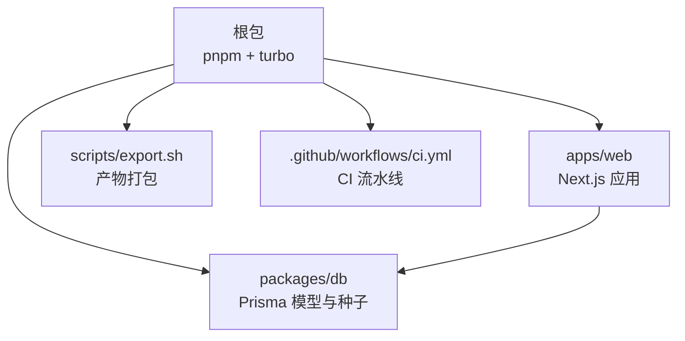
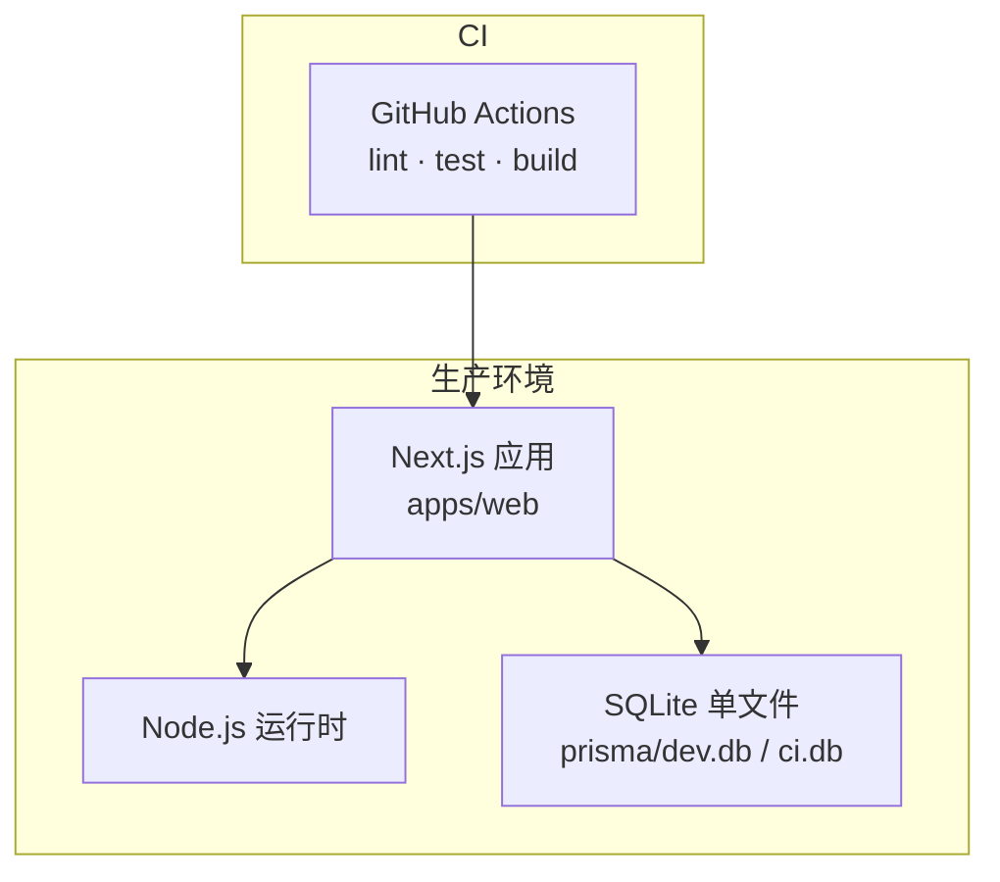
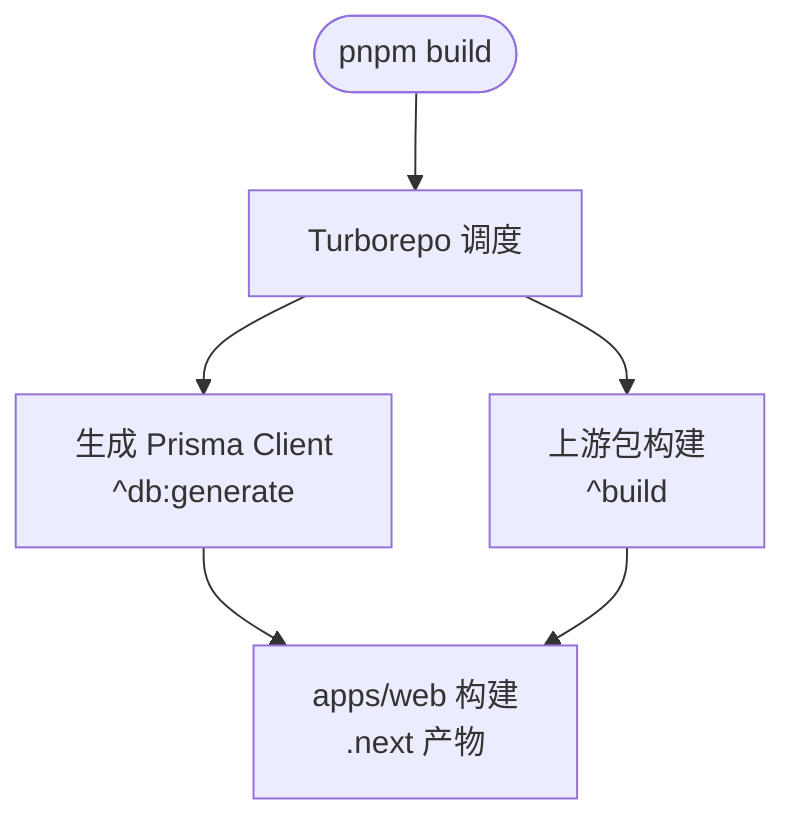
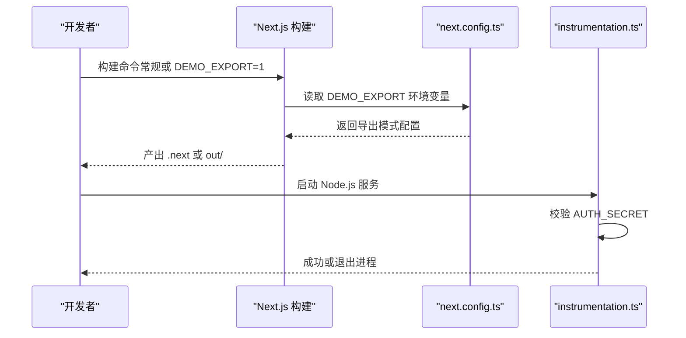
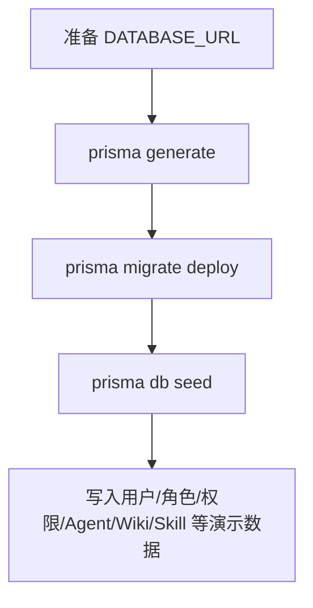
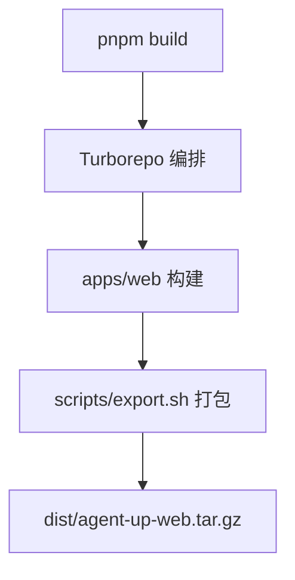
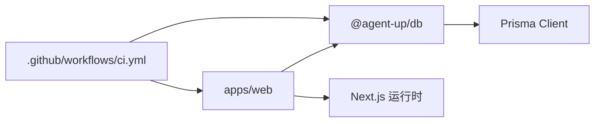

# 环境部署

<cite>
**本文引用的文件**   
- [package.json](file://package.json)
- [pnpm-workspace.yaml](file://pnpm-workspace.yaml)
- [turbo.json](file://turbo.json)
- [apps/web/package.json](file://apps/web/package.json)
- [apps/web/next.config.ts](file://apps/web/next.config.ts)
- [apps/web/instrumentation.ts](file://apps/web/instrumentation.ts)
- [packages/db/package.json](file://packages/db/package.json)
- [packages/db/prisma/schema.prisma](file://packages/db/prisma/schema.prisma)
- [packages/db/prisma/seed.mjs](file://packages/db/prisma/seed.mjs)
- [scripts/export.sh](file://scripts/export.sh)
- [.github/workflows/ci.yml](file://.github/workflows/ci.yml)
- [docs/guides/deployment.md](file://docs/guides/deployment.md)
</cite>

## 目录
1. [简介](#简介)
2. [项目结构](#项目结构)
3. [核心组件](#核心组件)
4. [架构总览](#架构总览)
5. [详细组件分析](#详细组件分析)
6. [依赖关系分析](#依赖关系分析)
7. [性能与构建优化](#性能与构建优化)
8. [故障排查指南](#故障排查指南)
9. [结论](#结论)
10. [附录：部署检查清单与验证步骤](#附录部署检查清单与验证步骤)

## 简介
本指南面向生产环境部署，覆盖系统要求、依赖安装、环境变量配置、Next.js 应用构建（含 DEMO_EXPORT 静态导出）、Monorepo 工作区与 Turborepo 优化、数据库初始化与 Prisma 迁移、数据种子、容器化与编排建议、敏感信息管理策略，以及部署检查清单与验证步骤。

## 项目结构
仓库采用 pnpm workspace + Turborepo 的 Monorepo 组织方式：
- 根包负责统一脚本、Turborepo 任务编排与 Node/pnpm 版本约束。
- apps/web 为唯一 Next.js 应用，提供页面、API 路由与演示模式。
- packages/db 封装 Prisma schema、客户端生成与种子脚本。
- scripts/export.sh 用于打包 Next.js 产物以便分发或容器化。
- .github/workflows/ci.yml 提供 CI 质量门禁。

图表来源
- [package.json:4-12](file://package.json#L4-L12)
- [pnpm-workspace.yaml:1-4](file://pnpm-workspace.yaml#L1-L4)
- [turbo.json:1-35](file://turbo.json#L1-L35)
- [apps/web/package.json:1-37](file://apps/web/package.json#L1-L37)
- [packages/db/package.json:1-29](file://packages/db/package.json#L1-L29)
- [scripts/export.sh:1-66](file://scripts/export.sh#L1-L66)
- [.github/workflows/ci.yml:1-58](file://.github/workflows/ci.yml#L1-L58)

章节来源
- [package.json:1-23](file://package.json#L1-L23)
- [pnpm-workspace.yaml:1-4](file://pnpm-workspace.yaml#L1-L4)
- [turbo.json:1-35](file://turbo.json#L1-L35)

## 核心组件
- 运行时与工具链
  - Node.js >= 20，pnpm@9.15.0。
  - Turborepo 任务：dev/build/lint/db:* 等统一入口。
- 前端应用
  - Next.js 16，支持常规 Node.js 服务与 DEMO_EXPORT 纯静态导出。
  - instrumentation.ts 在 Node.js 运行时启动时校验关键安全配置。
- 数据层
  - Prisma + SQLite（单文件），schema 定义于 packages/db/prisma/schema.prisma。
  - 种子脚本 packages/db/prisma/seed.mjs 提供幂等演示数据。
- 构建与交付
  - scripts/export.sh 打包 .next/public/data 等运行期资源并生成可执行 start.sh。
  - CI 使用 SQLite 文件库，无需外部数据库服务。

章节来源
- [package.json:19-21](file://package.json#L19-L21)
- [apps/web/package.json:5-13](file://apps/web/package.json#L5-L13)
- [apps/web/next.config.ts:1-22](file://apps/web/next.config.ts#L1-L22)
- [apps/web/instrumentation.ts:1-23](file://apps/web/instrumentation.ts#L1-L23)
- [packages/db/package.json:7-16](file://packages/db/package.json#L7-L16)
- [packages/db/prisma/schema.prisma:1-18](file://packages/db/prisma/schema.prisma#L1-L18)
- [packages/db/prisma/seed.mjs:1-36](file://packages/db/prisma/seed.mjs#L1-L36)
- [scripts/export.sh:1-66](file://scripts/export.sh#L1-L66)
- [.github/workflows/ci.yml:14-43](file://.github/workflows/ci.yml#L14-L43)

## 架构总览
下图展示生产环境典型部署形态：Next.js 应用以 Node.js 服务运行，连接 SQLite 单文件数据库；CI 在 GitHub Actions 中完成 lint/test/build；演示模式通过 DEMO_EXPORT 输出静态站点。

图表来源
- [.github/workflows/ci.yml:1-58](file://.github/workflows/ci.yml#L1-L58)
- [apps/web/package.json:5-13](file://apps/web/package.json#L5-L13)
- [packages/db/prisma/schema.prisma:15-18](file://packages/db/prisma/schema.prisma#L15-L18)

## 详细组件分析

### 系统要求与环境准备
- Node.js 版本：>= 20（由根包 engines 字段约束）。
- pnpm 版本：9.15.0（由 packageManager 锁定）。
- 操作系统：Linux/macOS/Windows（CI 使用 ubuntu-latest）。
- 磁盘空间：需容纳 .next 构建产物与 SQLite 数据文件。

章节来源
- [package.json:19-21](file://package.json#L19-L21)
- [.github/workflows/ci.yml:21-30](file://.github/workflows/ci.yml#L21-L30)

### Monorepo 工作区与 Turborepo 优化
- pnpm workspace 将 apps/* 与 packages/* 纳入同一工作区，实现依赖共享与统一安装。
- Turborepo 任务：
  - build 依赖上游包的 build 与 db:generate，确保依赖先构建、Prisma Client 先生成。
  - dev 禁用缓存且持久运行，适合本地开发。
  - db:* 相关任务关闭缓存，保证每次真实执行。
- 全局依赖：.env 变更会触发重新构建，便于环境变量变化及时生效。

图表来源
- [turbo.json:1-35](file://turbo.json#L1-L35)
- [pnpm-workspace.yaml:1-4](file://pnpm-workspace.yaml#L1-L4)

章节来源
- [pnpm-workspace.yaml:1-4](file://pnpm-workspace.yaml#L1-L4)
- [turbo.json:1-35](file://turbo.json#L1-L35)

### Next.js 应用构建配置（DEMO_EXPORT 与常规服务）
- 常规构建：pnpm build 产出 .next，使用 next start 启动 Node.js 服务。
- DEMO_EXPORT 静态导出：
  - 设置 DEMO_EXPORT=1 后，next.config.ts 启用 output:"export"、trailingSlash:true、pageExtensions:["tsx"]，并注入 NEXT_PUBLIC_DEMO_MODE=1。
  - 静态模式下不包含 route.ts API 处理器，需要 demo/mock-server.ts 提供浏览器端拦截。
- instrumentation.ts：
  - 仅在 nodejs 运行时执行，缺失 AUTH_SECRET 时主动退出进程，避免“假启动”。

图表来源
- [apps/web/next.config.ts:1-22](file://apps/web/next.config.ts#L1-L22)
- [apps/web/instrumentation.ts:1-23](file://apps/web/instrumentation.ts#L1-L23)

章节来源
- [apps/web/package.json:5-13](file://apps/web/package.json#L5-L13)
- [apps/web/next.config.ts:1-22](file://apps/web/next.config.ts#L1-L22)
- [apps/web/instrumentation.ts:1-23](file://apps/web/instrumentation.ts#L1-L23)

### 数据库初始化、Prisma 迁移与数据种子
- 数据库类型：SQLite 单文件，连接串来自 DATABASE_URL。
- 迁移与生成：
  - 生成客户端：pnpm --filter @agent-up/db exec prisma generate。
  - 应用迁移：pnpm --filter @agent-up/db exec prisma migrate deploy。
- 数据种子：
  - 脚本路径：packages/db/prisma/seed.mjs。
  - 行为：按逆外键顺序清空业务表，再插入演示数据；幂等可重复执行。
  - 依赖：内联加载 packages/db/.env 中的 DATABASE_URL。

图表来源
- [packages/db/prisma/schema.prisma:15-18](file://packages/db/prisma/schema.prisma#L15-L18)
- [packages/db/package.json:7-16](file://packages/db/package.json#L7-L16)
- [packages/db/prisma/seed.mjs:18-36](file://packages/db/prisma/seed.mjs#L18-L36)
- [packages/db/prisma/seed.mjs:51-79](file://packages/db/prisma/seed.mjs#L51-L79)

章节来源
- [packages/db/prisma/schema.prisma:15-18](file://packages/db/prisma/schema.prisma#L15-L18)
- [packages/db/package.json:7-16](file://packages/db/package.json#L7-L16)
- [packages/db/prisma/seed.mjs:1-36](file://packages/db/prisma/seed.mjs#L1-L36)
- [packages/db/prisma/seed.mjs:51-79](file://packages/db/prisma/seed.mjs#L51-L79)

### Docker 容器化与 Kubernetes 编排建议
- 容器镜像建议：
  - 基础镜像：基于 Node.js 20 的官方镜像。
  - 构建阶段：安装 pnpm 与依赖，执行 pnpm build。
  - 运行阶段：仅复制 apps/web/.next、public、data 与 next.config.ts，暴露 3000 端口，使用 next start 启动。
- 环境变量注入：
  - 通过容器环境变量注入 DATABASE_URL、AUTH_SECRET、MIMO_API_KEY 等。
  - 生产环境必须注入 AUTH_SECRET，否则 instrumentation.ts 会终止进程。
- Kubernetes 编排要点：
  - Deployment：副本数、资源限制、健康检查（/health 或首页可达性）。
  - Service：对外暴露 3000 端口。
  - ConfigMap/Secret：集中管理非敏感与敏感变量（如 MIMO_API_KEY、AUTH_SECRET）。
  - PersistentVolume：如需持久化 SQLite 数据文件，挂载卷保存 dev.db。
- 注意：仓库未包含 Dockerfile 与 K8s YAML，以上为基于现有构建产物的推荐实践。

[本节为概念性说明，不直接分析具体源码文件]

### 环境变量管理策略
- 文件位置与优先级：
  - Next.js 运行时只加载 apps/web/.env；根目录 .env 对应用运行时不生效。
  - 种子脚本会尝试从 packages/db/.env 读取 DATABASE_URL。
- 关键变量：
  - DATABASE_URL：SQLite 连接串（file:./dev.db 或 CI 的 file:./ci.db）。
  - AUTH_SECRET：会话签名密钥，生产环境必填；缺失则进程退出。
  - MIMO_API_KEY/MIMO_BASE_URL/MIMO_MODEL：LLM 集成凭据与模型配置。
  - AUTH_SESSION_TTL_HOURS/AUTH_TRUST_ACTOR_HEADERS：会话与安全头开关。
- 敏感信息保护：
  - 使用 Secret/加密配置中心注入，不提交到代码库。
  - 区分开发、测试、生产环境，避免硬编码。
- 构建期与测试期开关：
  - DEMO_EXPORT：控制静态导出模式。
  - NEXT_PUBLIC_DEMO_MODE：由 next.config.ts 注入，驱动前端拦截逻辑。
  - VITEST_POOL_ID：隔离测试数据库实例。

章节来源
- [docs/guides/deployment.md:37-64](file://docs/guides/deployment.md#L37-L64)
- [apps/web/next.config.ts:10-18](file://apps/web/next.config.ts#L10-L18)
- [packages/db/prisma/seed.mjs:18-31](file://packages/db/prisma/seed.mjs#L18-L31)

### 构建与打包流程
- 根级脚本：
  - pnpm build：调用 Turborepo 构建所有包。
  - pnpm db:generate/db:migrate/db:seed：统一数据库操作入口。
- 应用脚本：
  - apps/web/package.json 提供 dev/build/start 与 build:demo（DEMO_EXPORT=1）。
- 产物打包：
  - scripts/export.sh 复制 .next/public/data 与 next.config.ts，生成可执行的 start.sh 与 tarball。

图表来源
- [package.json:4-12](file://package.json#L4-L12)
- [apps/web/package.json:5-13](file://apps/web/package.json#L5-L13)
- [scripts/export.sh:1-66](file://scripts/export.sh#L1-L66)

章节来源
- [package.json:4-12](file://package.json#L4-L12)
- [apps/web/package.json:5-13](file://apps/web/package.json#L5-L13)
- [scripts/export.sh:1-66](file://scripts/export.sh#L1-L66)

## 依赖关系分析
- 应用依赖数据库包：apps/web 通过 workspace:* 引用 @agent-up/db，确保 schema 与客户端一致。
- Turborepo 任务依赖：
  - build 依赖 ^build 与 ^db:generate，保证依赖包先构建、Prisma Client 先生成。
- CI 依赖：
  - 固定 pnpm 与 Node 版本，安装依赖后生成 Prisma Client 并应用迁移，再执行 lint/test/build。

图表来源
- [apps/web/package.json:15-21](file://apps/web/package.json#L15-L21)
- [turbo.json:4-9](file://turbo.json#L4-L9)
- [.github/workflows/ci.yml:36-57](file://.github/workflows/ci.yml#L36-L57)

章节来源
- [apps/web/package.json:15-21](file://apps/web/package.json#L15-L21)
- [turbo.json:4-9](file://turbo.json#L4-L9)
- [.github/workflows/ci.yml:36-57](file://.github/workflows/ci.yml#L36-L57)

## 性能与构建优化
- Turborepo 缓存：
  - build 任务缓存 .next/** 与 dist/**，加速增量构建。
  - dev 任务禁用缓存并持久运行，提升本地开发体验。
- Next.js 构建：
  - 常规模式按需渲染动态页，静态页预渲染。
  - DEMO_EXPORT 模式输出纯静态站点，减少服务端开销。
- 数据库：
  - SQLite 单文件零守护进程，适合轻量部署与演示场景。
  - 测试使用 per-worker 独立 .db，避免并行污染。

[本节为通用指导，不直接分析具体源码文件]

## 故障排查指南
- 启动即退出：
  - 现象：Node.js 服务启动后立即退出。
  - 原因：生产环境缺少 AUTH_SECRET，instrumentation.ts 主动终止进程。
  - 处理：注入 AUTH_SECRET 后重启服务。
- LLM 功能不可用：
  - 现象：LLM 相关端点返回 503。
  - 原因：缺少 MIMO_API_KEY 或网络不可达。
  - 处理：注入 MIMO_API_KEY 并确保可访问 token-plan-cn.xiaomimimo.com。
- 静态导出后 API 不可用：
  - 现象：DEMO_EXPORT 模式下 API 路由不存在。
  - 原因：静态导出排除 route.ts，需依赖 demo/mock-server.ts。
  - 处理：确认 mock-server 存在并按文档部署。
- 数据库连接失败：
  - 现象：Prisma 无法连接数据库。
  - 原因：DATABASE_URL 未正确设置或文件路径解析异常。
  - 处理：检查 packages/db/.env 或环境变量，确保 file:./dev.db 可写。

章节来源
- [apps/web/instrumentation.ts:12-22](file://apps/web/instrumentation.ts#L12-L22)
- [docs/guides/deployment.md:37-64](file://docs/guides/deployment.md#L37-L64)
- [packages/db/prisma/seed.mjs:18-31](file://packages/db/prisma/seed.mjs#L18-L31)

## 结论
本项目采用 pnpm workspace + Turborepo 的 Monorepo 架构，Next.js 应用支持常规 Node.js 服务与 DEMO_EXPORT 静态导出。数据库使用 SQLite 单文件，配合 Prisma 进行迁移与种子。生产环境需严格管理环境变量，尤其是 AUTH_SECRET 与 LLM 凭据。CI 提供完整的质量门禁，建议在本地提交前执行同样的三件套。

[本节为总结性内容，不直接分析具体源码文件]

## 附录：部署检查清单与验证步骤

### 环境与依赖
- 已安装 Node.js >= 20 与 pnpm@9.15.0。
- 已执行 pnpm install 安装全部 workspace 依赖。

章节来源
- [package.json:19-21](file://package.json#L19-L21)
- [docs/guides/deployment.md:6-18](file://docs/guides/deployment.md#L6-L18)

### 数据库准备
- 已执行 prisma generate 与 prisma migrate deploy。
- 已执行 prisma db seed 灌入演示数据。

章节来源
- [.github/workflows/ci.yml:36-43](file://.github/workflows/ci.yml#L36-L43)
- [packages/db/prisma/seed.mjs:1-36](file://packages/db/prisma/seed.mjs#L1-L36)

### 环境变量配置
- 已在 apps/web/.env 注入必要变量（DATABASE_URL、AUTH_SECRET、MIMO_*）。
- 已在 packages/db/.env 注入 DATABASE_URL（供种子脚本）。

章节来源
- [docs/guides/deployment.md:37-64](file://docs/guides/deployment.md#L37-L64)
- [packages/db/prisma/seed.mjs:18-31](file://packages/db/prisma/seed.mjs#L18-L31)

### 构建与启动
- 常规服务：pnpm build 后 cd apps/web && npx next start。
- 静态导出：pnpm build:demo 产出 out/，托管静态站点。

章节来源
- [apps/web/package.json:5-13](file://apps/web/package.json#L5-L13)
- [apps/web/next.config.ts:10-18](file://apps/web/next.config.ts#L10-L18)
- [docs/guides/deployment.md:66-77](file://docs/guides/deployment.md#L66-L77)

### 验证步骤
- 依赖与构建通过：pnpm install && pnpm build。
- 测试全绿：cd apps/web && pnpm test。
- 服务启动：pnpm dev 后 curl http://localhost:3000 返回 200。
- LLM 凭据：/maas 页 LIVE 区块显示模型与 Base URL，并可发起真实调用。
- 演示动线：连通性 → 反馈 AI 归因 → Agent 试聊 → Releases 查看变更与评测。

章节来源
- [docs/guides/deployment.md:79-90](file://docs/guides/deployment.md#L79-L90)