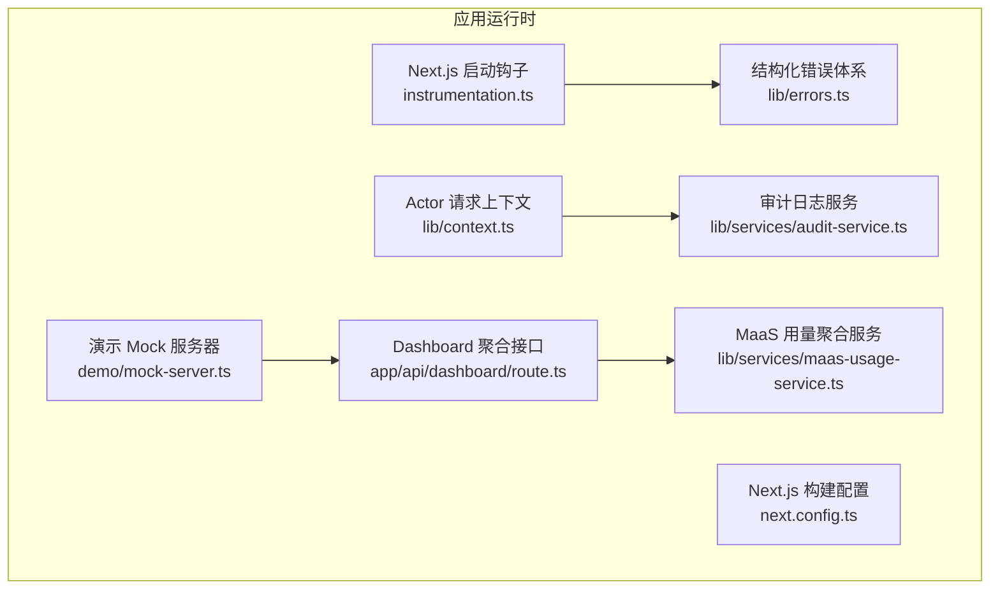
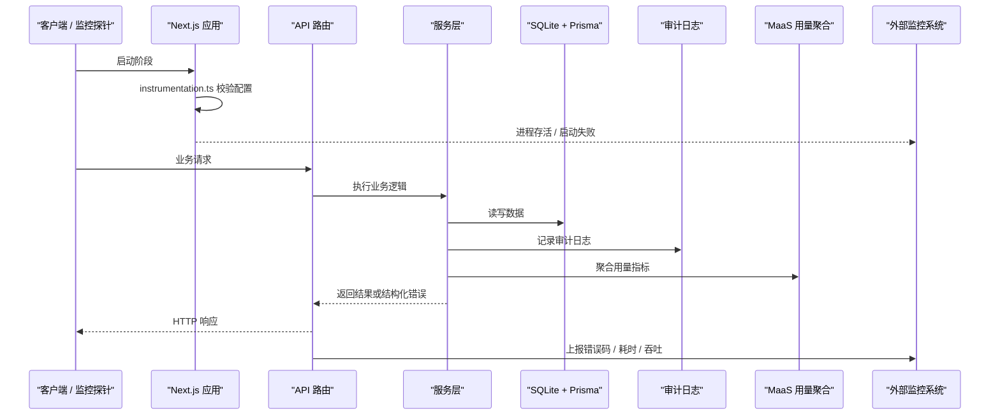
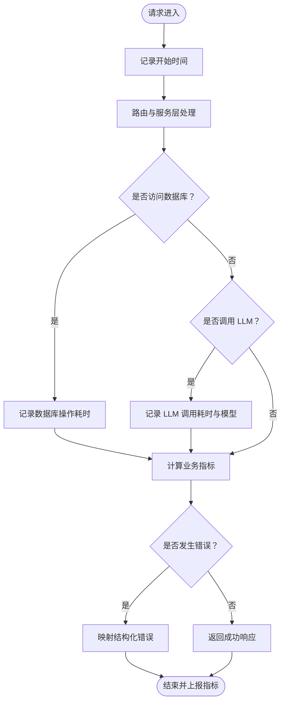
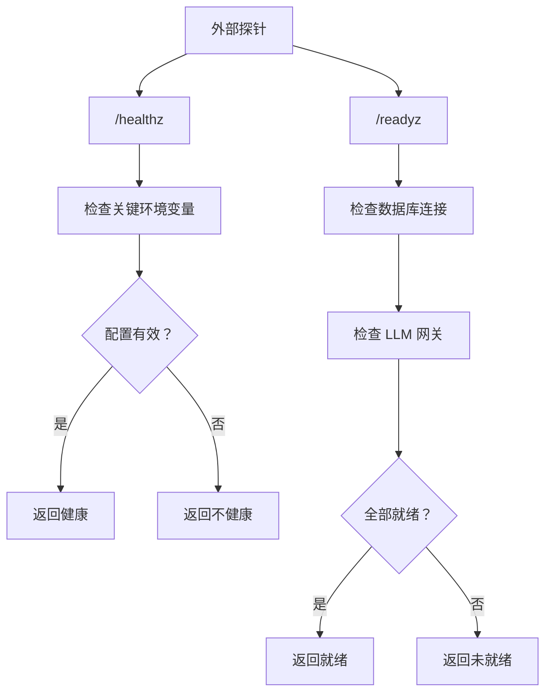
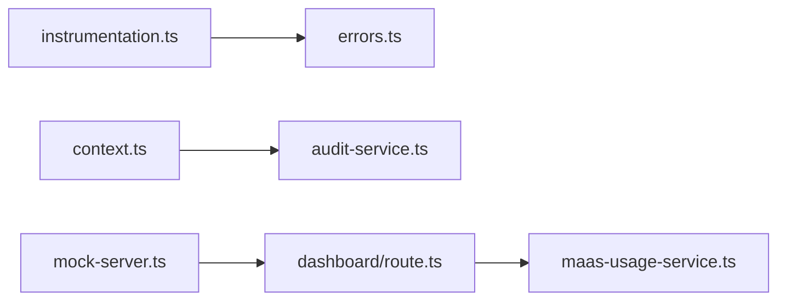

# 监控告警

<cite>
**本文引用的文件**   
- [README.md](file://README.md)
- [instrumentation.ts](file://apps/web/instrumentation.ts)
- [next.config.ts](file://apps/web/next.config.ts)
- [errors.ts](file://apps/web/lib/errors.ts)
- [context.ts](file://apps/web/lib/context.ts)
- [audit-service.ts](file://apps/web/lib/services/audit-service.ts)
- [maas-usage-service.ts](file://apps/web/lib/services/maas-usage-service.ts)
- [dashboard/route.ts](file://apps/web/app/api/dashboard/route.ts)
- [mock-server.ts](file://apps/web/demo/mock-server.ts)
</cite>

## 目录
1. [引言](#引言)
2. [项目结构](#项目结构)
3. [核心组件](#核心组件)
4. [架构总览](#架构总览)
5. [详细组件分析](#详细组件分析)
6. [依赖关系分析](#依赖关系分析)
7. [性能与容量规划](#性能与容量规划)
8. [故障排查指南](#故障排查指南)
9. [结论](#结论)
10. [附录：指标、日志与告警建议清单](#附录指标日志与告警建议清单)

## 引言
本仓库是一个面向 Agent 持续改进的 Next.js 全栈平台，当前运行形态为「页面 → API 路由 → 服务层 → Prisma → SQLite」，并预留 LLM 网关与对象存储接入。就监控与可观测性而言，项目已具备以下基础能力：
- 启动期关键配置校验（进程级健康探针）
- 结构化错误体系与统一错误映射
- 审计日志（append-only）与 Actor 上下文
- 业务聚合统计（Dashboard）与 MaaS 用量聚合
- 演示模式下的 Mock 数据镜像

但仓库尚未内置完整的 APM SDK、集中式日志采集器、外部告警引擎或可视化看板。因此，本文在“现有实现”的基础上，给出面向生产落地的监控告警方案，包括 APM 指标、错误追踪、日志策略、业务指标、告警规则、健康检查、容量规划与可视化报表建议。

## 项目结构
从监控视角看，相关代码主要分布在应用入口钩子、Next.js 配置、错误与上下文基础设施、审计与用量服务，以及 Dashboard 聚合接口中。

**图表来源**
- [instrumentation.ts:1-23](file://apps/web/instrumentation.ts#L1-L23)
- [next.config.ts:1-22](file://apps/web/next.config.ts#L1-L22)
- [errors.ts:1-95](file://apps/web/lib/errors.ts#L1-L95)
- [context.ts:1-97](file://apps/web/lib/context.ts#L1-L97)
- [audit-service.ts:1-120](file://apps/web/lib/services/audit-service.ts#L1-L120)
- [maas-usage-service.ts:1-89](file://apps/web/lib/services/maas-usage-service.ts#L1-L89)
- [dashboard/route.ts:1-61](file://apps/web/app/api/dashboard/route.ts#L1-L61)
- [mock-server.ts:742-775](file://apps/web/demo/mock-server.ts#L742-L775)

**章节来源**
- [README.md:137-153](file://README.md#L137-L153)
- [README.md:425-444](file://README.md#L425-L444)

## 核心组件
本节聚焦与监控告警直接相关的已有实现。

### 启动期健康探针与配置校验
`instrumentation.ts` 是 Next.js 启动钩子，用于在服务进程启动时执行一次关键校验。当前逻辑会跳过非 Node 运行时，动态导入认证模块并调用配置断言；若缺失生产必需的配置（例如 `AUTH_SECRET`），则打印错误并以 `process.exit(1)` 终止进程，交由进程管理器重启并触发外部告警。

该机制可作为最基础的“进程级健康探针”：
- 成功：进程存活且可监听端口
- 失败：进程退出，容器编排或进程管理器可感知并告警

**章节来源**
- [instrumentation.ts:1-23](file://apps/web/instrumentation.ts#L1-L23)
- [README.md:425-444](file://README.md#L425-L444)

### 结构化错误体系
`errors.ts` 定义了统一的错误类型与响应体构造函数：
- 自定义 `AppError` 及其子类（未找到、参数校验、冲突、权限、内部错误）
- `toErrorBody` 将异常映射为包含状态码、错误码和可选详情的结构化体
- 未知异常统一脱敏为 500，并在非测试环境记录日志

这为错误追踪提供了稳定输入：外部监控系统可按 HTTP 状态码与错误码分类统计错误率、Top 错误、影响面等。

**章节来源**
- [errors.ts:1-95](file://apps/web/lib/errors.ts#L1-L95)

### Actor 上下文与审计日志
`context.ts` 提供请求级 Actor 上下文，支持：
- 签名会话令牌优先解析身份
- 明文 `x-actor-*` 头仅在可信环境下采纳
- 通过异步本地存储让 actor 贯穿异步调用链

`audit-service.ts` 基于该上下文写入 append-only 审计日志：
- 不阻塞主流程，失败仅记录日志
- 支持按动作、资源、资源 ID、用户过滤查询
- 提供 flush 方法供测试等待后台写入完成

审计日志可用于安全审计、变更溯源与合规报表。

**章节来源**
- [context.ts:1-97](file://apps/web/lib/context.ts#L1-L97)
- [audit-service.ts:1-120](file://apps/web/lib/services/audit-service.ts#L1-L120)

### 业务指标：Dashboard 与 MaaS 用量
`dashboard/route.ts` 聚合 Agent 数量、活跃 Agent、反馈总数与待处理反馈、待审批发布数，以及最近反馈与发布列表。该接口适合作为系统概览指标的数据源。

`maas-usage-service.ts` 从 Trace 表聚合每个 Agent 的模型调用次数、tokens、平均时延、评分分布与最近调用时间，并按调用次数排序输出报告。该服务明确声明数据口径仅覆盖试聊 Playground 产生的 trace，属于业务指标而非完整生产流量。

**章节来源**
- [dashboard/route.ts:1-61](file://apps/web/app/api/dashboard/route.ts#L1-L61)
- [maas-usage-service.ts:1-89](file://apps/web/lib/services/maas-usage-service.ts#L1-L89)

### 演示模式与 Mock 镜像
`next.config.ts` 控制 DEMO_EXPORT 静态导出行为；`demo/mock-server.ts` 在演示模式下镜像 Dashboard 与 MaaS 用量等接口的响应形状。这对前端可观测性展示很重要：演示态与真实态应保持一致的数据结构，便于监控面板复用。

**章节来源**
- [next.config.ts:1-22](file://apps/web/next.config.ts#L1-L22)
- [mock-server.ts:742-775](file://apps/web/demo/mock-server.ts#L742-L775)

## 架构总览
下图从监控视角描述当前系统的请求路径、错误处理、审计与业务指标聚合，以及可扩展的 APM、日志与告警集成点。

**图表来源**
- [instrumentation.ts:1-23](file://apps/web/instrumentation.ts#L1-L23)
- [errors.ts:1-95](file://apps/web/lib/errors.ts#L1-L95)
- [audit-service.ts:1-120](file://apps/web/lib/services/audit-service.ts#L1-L120)
- [maas-usage-service.ts:1-89](file://apps/web/lib/services/maas-usage-service.ts#L1-L89)
- [dashboard/route.ts:1-61](file://apps/web/app/api/dashboard/route.ts#L1-L61)

## 详细组件分析

### 应用性能监控（APM）配置建议
当前仓库没有内置 APM SDK。建议以 Next.js 中间件或请求包装方式接入 APM，采集以下关键指标：
- 请求维度：HTTP 方法、路径、状态码、耗时、延迟分位、错误率
- 服务维度：Agent 管理、反馈、发布、设置、LLM 网关、Dashboard、MaaS 用量
- 数据库维度：Prisma 查询耗时、慢查询、连接池使用率
- LLM 维度：上游调用成功率、超时率、token 用量、模型名称

推荐采集字段：
- `service_name`、`http.method`、`http.url`、`http.status_code`、`error.code`、`db.operation`、`llm.provider`、`llm.model`、`agent_id`、`trace_id`

复杂度与性能考虑：
- 采样策略：高频端点采用百分比采样，避免指标风暴
- 标签基数控制：对高基数标签（如 user_id、session_id）进行哈希或丢弃
- 异步上报：指标批量发送，失败重试但不阻塞请求

**图表来源**
- [errors.ts:1-95](file://apps/web/lib/errors.ts#L1-L95)
- [maas-usage-service.ts:1-89](file://apps/web/lib/services/maas-usage-service.ts#L1-L89)

**章节来源**
- [errors.ts:1-95](file://apps/web/lib/errors.ts#L1-L95)
- [maas-usage-service.ts:1-89](file://apps/web/lib/services/maas-usage-service.ts#L1-L89)

### 错误追踪与性能分析
错误追踪应围绕 `errors.ts` 的结构化错误展开：
- 所有 AppError 子类携带 `status`、`code`、`details`
- 未知错误统一为 INTERNAL，并记录日志
- 建议在 APM 中按 `error.code` 分组统计 Top 错误

性能分析重点：
- Dashboard 聚合接口涉及多表计数与 join，需关注慢查询
- MaaS 用量聚合遍历 Trace 表并按 Agent 分组，数据量大时需分页或预聚合
- LLM 网关调用存在超时风险，需在 APM 中区分上游错误与业务错误

**章节来源**
- [errors.ts:1-95](file://apps/web/lib/errors.ts#L1-L95)
- [dashboard/route.ts:1-61](file://apps/web/app/api/dashboard/route.ts#L1-L61)
- [maas-usage-service.ts:1-89](file://apps/web/lib/services/maas-usage-service.ts#L1-L89)

### 日志收集策略
当前项目的“日志”主要体现在两类：
- 控制台日志：错误、审计失败、启动校验失败
- 审计日志：append-only 的业务变更记录

建议的日志策略：
- 结构化日志格式：每条日志包含 `timestamp`、`level`、`service`、`trace_id`、`actor.id`、`actor.name`、`actor.role`、`action`、`resource`、`resourceId`、`message`、`meta`
- 日志级别管理：ERROR、WARN、INFO、DEBUG，按环境控制输出
- 日志聚合方案：将控制台日志与审计日志分别接入集中式日志系统，审计日志走独立索引以便合规查询

审计日志字段参考：
- `id`、`action`、`resource`、`resourceId`、`userName`、`userRole`、`userId`、`createdAt`、`details`

**章节来源**
- [audit-service.ts:1-120](file://apps/web/lib/services/audit-service.ts#L1-L120)
- [context.ts:1-97](file://apps/web/lib/context.ts#L1-L97)

### 业务指标监控
业务指标主要包括：
- Agent 使用量：通过 MaaS 用量服务聚合调用次数、tokens、平均时延、评分分布
- API 调用统计：按路由分类统计 QPS、错误率、P95/P99 延迟
- 用户行为分析：结合 Actor 上下文与审计日志，分析写操作热点、高风险操作

Dashboard 指标参考：
- Agent 总数与活跃数
- 反馈总数与待处理反馈数
- 待审批发布数
- 最近反馈与最近发布

**章节来源**
- [maas-usage-service.ts:1-89](file://apps/web/lib/services/maas-usage-service.ts#L1-L89)
- [dashboard/route.ts:1-61](file://apps/web/app/api/dashboard/route.ts#L1-L61)

### 告警规则配置
建议告警规则分为三层：
- 进程级：启动失败、进程退出、内存/CPU 超限
- 服务级：HTTP 错误率、延迟分位、QPS 异常、数据库慢查询
- 业务级：Agent 使用量突增、反馈积压、发布审批积压、LLM 调用失败

阈值设置建议：
- 错误率：超过 1% 持续 5 分钟
- P95 延迟：超过 500ms 持续 10 分钟
- LLM 失败率：超过 5% 持续 5 分钟
- 反馈积压：待处理反馈超过阈值持续 1 小时

通知渠道与升级机制：
- 首次告警：IM 群通知
- 重复告警：邮件 + IM
- 长时间未处理：电话 + 值班升级

**章节来源**
- [instrumentation.ts:1-23](file://apps/web/instrumentation.ts#L1-L23)
- [errors.ts:1-95](file://apps/web/lib/errors.ts#L1-L95)
- [maas-usage-service.ts:1-89](file://apps/web/lib/services/maas-usage-service.ts#L1-L89)

### 健康检查端点设计与可用性监控
当前仓库没有显式的 `/health` 或 `/ready` 端点。建议新增两个端点：
- `/healthz`：进程级健康检查，返回进程状态、关键环境变量是否配置
- `/readyz`：服务级就绪检查，返回数据库连接、LLM 网关连通性、磁盘空间等

可用性监控建议：
- 外部探测：每 30 秒探测 `/healthz` 与 `/readyz`
- 内部探测：定时任务检查数据库连接、LLM 网关连通性
- 降级策略：LLM 不可用时返回明确错误码，不影响其他功能

**图表来源**
- [instrumentation.ts:1-23](file://apps/web/instrumentation.ts#L1-L23)
- [errors.ts:1-95](file://apps/web/lib/errors.ts#L1-L95)

**章节来源**
- [instrumentation.ts:1-23](file://apps/web/instrumentation.ts#L1-L23)
- [errors.ts:1-95](file://apps/web/lib/errors.ts#L1-L95)

### 容量规划与扩容触发条件
容量规划建议：
- 数据库：SQLite 单文件适合开发与小规模生产；生产建议迁移至 PostgreSQL 或托管数据库
- 应用实例：根据 QPS 与 CPU/内存使用率水平扩容
- LLM 网关：根据 token 用量与上游限流策略扩容

扩容触发条件：
- CPU 使用率持续超过 70%
- 内存使用率持续超过 80%
- 数据库连接池使用率持续超过 80%
- LLM 调用失败率持续超过 5%
- 队列积压超过阈值

**章节来源**
- [README.md:176-178](file://README.md#L176-L178)
- [maas-usage-service.ts:1-89](file://apps/web/lib/services/maas-usage-service.ts#L1-L89)

### 监控数据可视化与报表生成
可视化建议：
- 仪表盘：Dashboard 指标、MaaS 用量、错误率、延迟分位
- 趋势图：Agent 使用量、反馈积压、发布审批积压
- 报表：每日/每周错误报告、LLM 用量报告、审计变更报告

报表生成建议：
- 定时任务拉取 Dashboard 与 MaaS 用量数据
- 生成 PDF 或 HTML 报表并归档
- 审计日志导出用于合规审查

**章节来源**
- [dashboard/route.ts:1-61](file://apps/web/app/api/dashboard/route.ts#L1-L61)
- [maas-usage-service.ts:1-89](file://apps/web/lib/services/maas-usage-service.ts#L1-L89)
- [audit-service.ts:1-120](file://apps/web/lib/services/audit-service.ts#L1-L120)

## 依赖关系分析
下图展示监控相关组件之间的依赖关系。

**图表来源**
- [instrumentation.ts:1-23](file://apps/web/instrumentation.ts#L1-L23)
- [errors.ts:1-95](file://apps/web/lib/errors.ts#L1-L95)
- [context.ts:1-97](file://apps/web/lib/context.ts#L1-L97)
- [audit-service.ts:1-120](file://apps/web/lib/services/audit-service.ts#L1-L120)
- [dashboard/route.ts:1-61](file://apps/web/app/api/dashboard/route.ts#L1-L61)
- [maas-usage-service.ts:1-89](file://apps/web/lib/services/maas-usage-service.ts#L1-L89)
- [mock-server.ts:742-775](file://apps/web/demo/mock-server.ts#L742-L775)

**章节来源**
- [instrumentation.ts:1-23](file://apps/web/instrumentation.ts#L1-L23)
- [errors.ts:1-95](file://apps/web/lib/errors.ts#L1-L95)
- [context.ts:1-97](file://apps/web/lib/context.ts#L1-L97)
- [audit-service.ts:1-120](file://apps/web/lib/services/audit-service.ts#L1-L120)
- [dashboard/route.ts:1-61](file://apps/web/app/api/dashboard/route.ts#L1-L61)
- [maas-usage-service.ts:1-89](file://apps/web/lib/services/maas-usage-service.ts#L1-L89)
- [mock-server.ts:742-775](file://apps/web/demo/mock-server.ts#L742-L775)

## 性能与容量规划
- APM 指标采集应避免阻塞主流程，采用异步上报与批量发送
- 日志写入采用 fire-and-forget 语义，失败不阻塞业务
- 数据库查询应加索引，避免全表扫描
- LLM 调用应设置超时与重试上限，避免雪崩

[本节为通用指导，不直接分析具体文件]

## 故障排查指南
常见故障与排查思路：
- 启动失败：检查 `AUTH_SECRET` 等关键环境变量
- 错误率升高：查看结构化错误码与堆栈日志
- 审计日志缺失：检查审计写入失败日志与数据库连接
- MaaS 用量异常：确认 Trace 数据是否产生，检查聚合逻辑
- Dashboard 数据异常：检查数据库连接与聚合接口

**章节来源**
- [instrumentation.ts:1-23](file://apps/web/instrumentation.ts#L1-L23)
- [errors.ts:1-95](file://apps/web/lib/errors.ts#L1-L95)
- [audit-service.ts:1-120](file://apps/web/lib/services/audit-service.ts#L1-L120)
- [maas-usage-service.ts:1-89](file://apps/web/lib/services/maas-usage-service.ts#L1-L89)
- [dashboard/route.ts:1-61](file://apps/web/app/api/dashboard/route.ts#L1-L61)

## 结论
本项目已具备监控告警的基础设施雏形：启动期配置校验、结构化错误、审计日志、业务指标聚合与演示模式镜像。要形成完整的生产级监控告警体系，建议补充 APM 指标采集、集中式日志采集、外部告警引擎与健康检查端点，并结合现有 Dashboard 与 MaaS 用量服务构建可视化看板与自动化报表。

[本节为总结性内容，不直接分析具体文件]

## 附录：指标、日志与告警建议清单
- APM 指标：HTTP 状态码、错误码、延迟分位、QPS、数据库操作、LLM 调用
- 日志字段：时间戳、级别、服务名、追踪 ID、Actor 信息、动作、资源、详情
- 告警规则：进程健康、服务错误率、延迟、LLM 失败率、业务积压
- 健康检查：/healthz、/readyz
- 容量规划：CPU、内存、数据库连接池、LLM 限流
- 可视化：Dashboard、MaaS 用量、错误趋势、审计报表

[本节为建议清单，不直接分析具体文件]