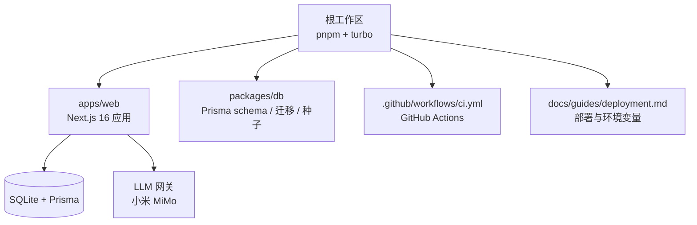
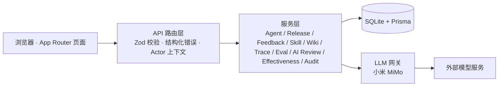
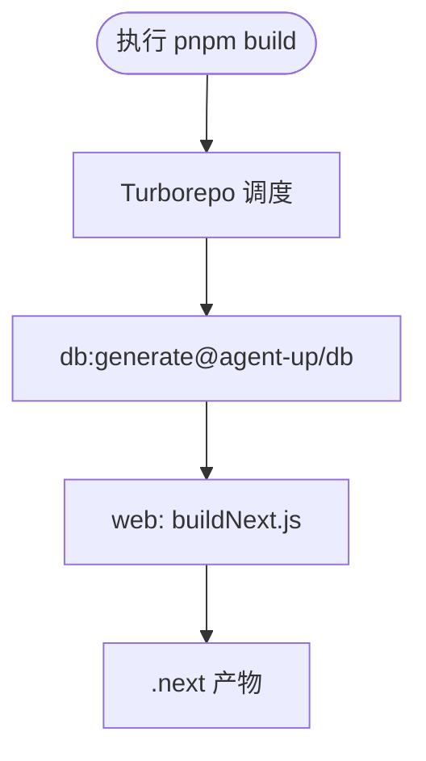
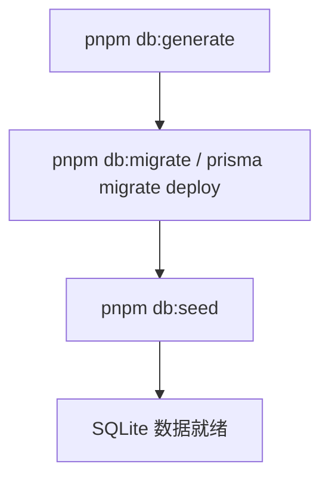
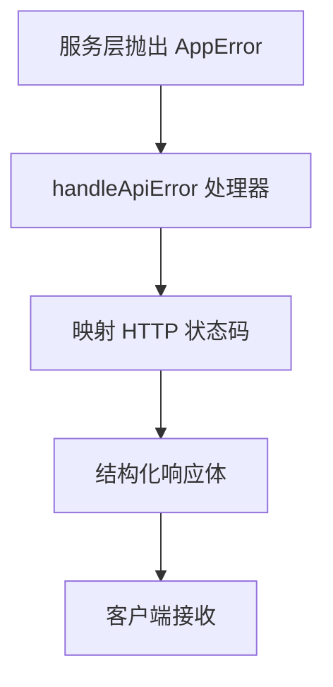
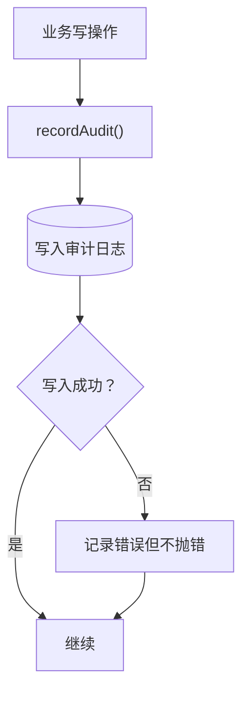
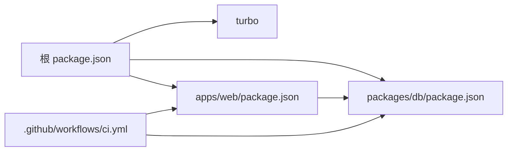
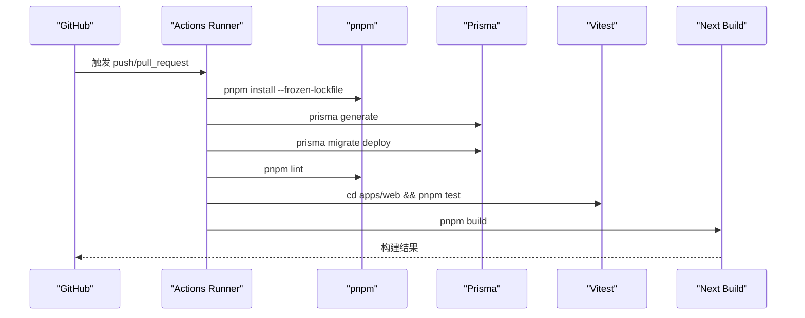

# 部署与运维

<cite>
**本文引用的文件**   
- [README.md](file://README.md)
- [package.json](file://package.json)
- [turbo.json](file://turbo.json)
- [.github/workflows/ci.yml](file://.github/workflows/ci.yml)
- [apps/web/package.json](file://apps/web/package.json)
- [packages/db/package.json](file://packages/db/package.json)
- [docs/guides/deployment.md](file://docs/guides/deployment.md)
- [apps/web/lib/errors.ts](file://apps/web/lib/errors.ts)
- [apps/web/instrumentation.ts](file://apps/web/instrumentation.ts)
- [apps/web/app/global-error.tsx](file://apps/web/app/global-error.tsx)
- [apps/web/components/error-boundary.tsx](file://apps/web/components/error-boundary.tsx)
</cite>

## 更新摘要
**所做更改**   
- 更新了错误处理机制章节，反映新的统一错误体系
- 移除了已删除的Next.js相关文档片段引用
- 更新了console.error处理的相关说明
- 增强了错误边界和全局错误处理的描述

## 目录
1. [引言](#引言)
2. [项目结构](#项目结构)
3. [核心组件](#核心组件)
4. [架构总览](#架构总览)
5. [详细组件分析](#详细组件分析)
6. [依赖关系分析](#依赖关系分析)
7. [性能与容量规划](#性能与容量规划)
8. [监控、日志与问题诊断](#监控日志与问题诊断)
9. [故障排查手册](#故障排查手册)
10. [备份恢复与灾难恢复](#备份恢复与灾难恢复)
11. [生产部署流程](#生产部署流程)
12. [CI/CD 流水线](#cicd-流水线)
13. [结论](#结论)

## 引言
本指南面向生产环境部署与长期运维，覆盖环境准备、依赖安装、数据库迁移、应用构建、Monorepo 构建配置（Turborepo）、环境变量管理与敏感信息保护、CI/CD 流水线（GitHub Actions）、监控告警、日志收集与问题诊断、性能调优、容量规划与扩容策略、备份恢复与灾难恢复，以及运维最佳实践。本项目为 pnpm + Turborepo monorepo，唯一应用为 Next.js 16 的 `apps/web`，运行时存储当前为 SQLite 单文件 + Prisma ORM，LLM 通过小米 MiMo 网关接入。

## 项目结构
仓库采用 Monorepo 组织：根目录管理全局脚本与 Turborepo 任务编排；`apps/web` 为 Next.js 全栈应用；`packages/db` 提供 Prisma schema、迁移、种子与客户端类型；`.github/workflows/ci.yml` 定义 CI 流水线；`docs/guides/deployment.md` 提供部署与环境变量说明。

**图示来源**
- [turbo.json:1-35](file://turbo.json#L1-L35)
- [apps/web/package.json:1-37](file://apps/web/package.json#L1-L37)
- [packages/db/package.json:1-29](file://packages/db/package.json#L1-L29)
- [.github/workflows/ci.yml:1-58](file://.github/workflows/ci.yml#L1-L58)
- [docs/guides/deployment.md:1-96](file://docs/guides/deployment.md#L1-L96)

**章节来源**
- [README.md:64-135](file://README.md#L64-L135)
- [turbo.json:1-35](file://turbo.json#L1-L35)
- [apps/web/package.json:1-37](file://apps/web/package.json#L1-L37)
- [packages/db/package.json:1-29](file://packages/db/package.json#L1-L29)
- [docs/guides/deployment.md:1-96](file://docs/guides/deployment.md#L1-L96)

## 核心组件
- Turborepo 任务编排：统一 dev/build/lint/db:* 命令，缓存与依赖顺序由 `turbo.json` 控制。
- Next.js 应用：API 路由 + App Router 页面，Zod 校验、结构化错误、审计日志、RBAC 上下文。
- Prisma 数据层：schema、迁移、种子、客户端类型生成。
- GitHub Actions：lint → test → build 质量门禁。
- 环境变量：Next.js 仅加载 `apps/web/.env`，敏感凭据集中管理。

**章节来源**
- [package.json:1-23](file://package.json#L1-L23)
- [turbo.json:1-35](file://turbo.json#L1-L35)
- [apps/web/package.json:1-37](file://apps/web/package.json#L1-L37)
- [packages/db/package.json:1-29](file://packages/db/package.json#L1-L29)
- [docs/guides/deployment.md:37-77](file://docs/guides/deployment.md#L37-L77)

## 架构总览
系统以"数据库即真相源"运行：浏览器 → Next.js API 路由 → 服务层 → Prisma → SQLite；LLM 调用统一走网关出站。静态页面预渲染，API 与动态页按需渲染。

**图示来源**
- [README.md:137-153](file://README.md#L137-L153)

**章节来源**
- [README.md:137-153](file://README.md#L137-L153)

## 详细组件分析

### Turborepo 构建配置
- 全局依赖包含 `.env`，确保构建期感知环境变量。
- `build` 依赖上游包的 `^build` 与 `^db:generate`，保证 Prisma Client 在应用构建前就绪。
- `dev` 禁用缓存并标记持久任务，适合开发体验。
- db 相关任务（generate/push/migrate/seed）均关闭缓存，避免状态污染。

**图示来源**
- [turbo.json:1-35](file://turbo.json#L1-L35)
- [packages/db/package.json:7-15](file://packages/db/package.json#L7-L15)
- [apps/web/package.json:5-13](file://apps/web/package.json#L5-L13)

**章节来源**
- [turbo.json:1-35](file://turbo.json#L1-L35)
- [packages/db/package.json:1-29](file://packages/db/package.json#L1-L29)
- [apps/web/package.json:1-37](file://apps/web/package.json#L1-L37)

### 环境变量管理与敏感信息保护
- Next.js 仅加载 `apps/web/.env`，根 `.env` 对应用运行时不生效。
- LLM 凭据（`MIMO_API_KEY`、`MIMO_BASE_URL`、`MIMO_MODEL`）必须配置于 `apps/web/.env`。
- 生产必填 `AUTH_SECRET`，缺失时启动即退出；会话 TTL 与可信 Actor 头可配置。
- 构建期与测试期开关（`DEMO_EXPORT`、`NEXT_PUBLIC_DEMO_MODE`、`VITEST_POOL_ID`）不走 `.env`。

| 类别 | 变量 | 说明 |
|---|---|---|
| LLM | `MIMO_API_KEY` | Token Plan 凭据；缺失时 LLM 端点返回 503 |
| LLM | `MIMO_BASE_URL` | Token Plan Base URL |
| LLM | `MIMO_MODEL` | 模型 ID |
| 数据库 | `DATABASE_URL` | SQLite 连接串（dev/测试必需） |
| 认证 | `AUTH_SECRET` | HMAC-SHA256 签名密钥（生产必填） |
| 认证 | `AUTH_SESSION_TTL_HOURS` | 会话有效期（小时） |
| 认证 | `AUTH_TRUST_ACTOR_HEADERS` | 是否采纳明文 `x-actor-*` 作为身份 |
| 构建/测试 | `DEMO_EXPORT` | 静态导出开关 |
| 构建/测试 | `NEXT_PUBLIC_DEMO_MODE` | 前端 Demo 模式标记 |
| 测试 | `VITEST_POOL_ID` | 并行测试隔离库映射 |

**章节来源**
- [docs/guides/deployment.md:37-64](file://docs/guides/deployment.md#L37-L64)
- [README.md:425-444](file://README.md#L425-L444)

### 数据库迁移与种子
- 使用 Prisma 管理 schema、迁移与种子。
- 根级脚本通过 turbo 分发到 `@agent-up/db`。
- 典型流程：生成 client → 部署迁移 → 灌入种子。

**图示来源**
- [packages/db/package.json:7-15](file://packages/db/package.json#L7-L15)
- [package.json:8-12](file://package.json#L8-L12)
- [docs/guides/deployment.md:32-36](file://docs/guides/deployment.md#L32-L36)

**章节来源**
- [packages/db/package.json:1-29](file://packages/db/package.json#L1-L29)
- [package.json:1-23](file://package.json#L1-L23)
- [docs/guides/deployment.md:32-36](file://docs/guides/deployment.md#L32-L36)

### 应用构建与运行
- 生产构建产物位于 `apps/web/.next`，通过 `next start` 运行。
- 静态页面预渲染，API 与动态页按需渲染。
- 演示形态支持纯静态导出（`DEMO_EXPORT=1`），此时所有 route 处理器被排除，需由 mock server 接管。

**章节来源**
- [docs/guides/deployment.md:66-77](file://docs/guides/deployment.md#L66-L77)
- [apps/web/package.json:5-13](file://apps/web/package.json#L5-L13)

### 统一错误处理机制
**更新** 项目采用了统一的错误处理体系，替代了之前的分散式 console.error 处理方式。

#### 错误类层次结构
- `AppError` 基类：包含 HTTP status、错误代码和详细信息
- `NotFoundError`：404 资源不存在
- `ValidationError`：422 参数或业务规则验证失败  
- `ConflictError`：409 状态冲突
- `AuthorizationError`：403 权限不足

#### 错误处理流程

**图示来源**
- [apps/web/lib/errors.ts:15-94](file://apps/web/lib/errors.ts#L15-L94)

#### 全局错误边界
- **应用级错误边界** (`global-error.tsx`)：捕获整个应用壳层的致命错误
- **组件级错误边界** (`error-boundary.tsx`)：隔离单个组件的错误影响
- **仪表化启动检查** (`instrumentation.ts`)：启动时验证关键配置

#### 错误日志记录
- 未处理的错误通过 `console.error("[unhandled]", err)` 记录
- 审计日志失败时记录 `console.error("[audit] recordAudit failed:", err)`
- 登录失败时记录详细的认证错误信息

**章节来源**
- [apps/web/lib/errors.ts:1-95](file://apps/web/lib/errors.ts#L1-L95)
- [apps/web/instrumentation.ts:1-23](file://apps/web/instrumentation.ts#L1-L23)
- [apps/web/app/global-error.tsx:1-47](file://apps/web/app/global-error.tsx#L1-L47)
- [apps/web/components/error-boundary.tsx:1-53](file://apps/web/components/error-boundary.tsx#L1-L53)

### 审计日志与错误处理
- 审计日志写入 append-only，失败不阻塞业务写操作。
- 全局错误页提供用户友好提示与错误编号，便于反馈定位。

**图示来源**
- [apps/web/lib/services/audit-service.ts:39-85](file://apps/web/lib/services/audit-service.ts#L39-L85)
- [apps/web/app/global-error.tsx:1-33](file://apps/web/app/global-error.tsx#L1-L33)

**章节来源**
- [apps/web/lib/services/audit-service.ts:39-85](file://apps/web/lib/services/audit-service.ts#L39-L85)
- [apps/web/app/global-error.tsx:1-33](file://apps/web/app/global-error.tsx#L1-L33)

## 依赖关系分析
- 根包通过 `turbo` 编排各 workspace 任务。
- `apps/web` 依赖 `@agent-up/db`（workspace 协议）。
- CI 中显式执行 `prisma generate` 与 `prisma migrate deploy`，确保构建与测试一致性。

**图示来源**
- [package.json:1-23](file://package.json#L1-L23)
- [apps/web/package.json:1-37](file://apps/web/package.json#L1-L37)
- [packages/db/package.json:1-29](file://packages/db/package.json#L1-L29)
- [.github/workflows/ci.yml:1-58](file://.github/workflows/ci.yml#L1-L58)

**章节来源**
- [package.json:1-23](file://package.json#L1-L23)
- [apps/web/package.json:1-37](file://apps/web/package.json#L1-L37)
- [packages/db/package.json:1-29](file://packages/db/package.json#L1-L29)
- [.github/workflows/ci.yml:1-58](file://.github/workflows/ci.yml#L1-L58)

## 性能与容量规划
- 构建性能：Turborepo 缓存与依赖顺序优化；db 任务关闭缓存避免状态污染。
- 运行时性能：Next.js App Router + Turbopack；静态页面预渲染减少首屏开销。
- 存储容量：SQLite 单文件随数据增长而增大，建议定期归档历史数据与审计日志。
- 扩展性：当前为单体 Node 进程；若 QPS 或并发显著增长，考虑水平扩容多实例 + 反向代理负载均衡。

[本节为通用指导，无需代码引用]

## 监控、日志与问题诊断
**更新** 基于新的错误处理机制，监控和诊断流程得到增强。

- 监控告警：当前未内置监控与告警，建议在反向代理/容器平台层面采集 HTTP 指标与错误率，设置阈值告警。
- 日志收集：服务端日志（Node/Next.js）与审计日志（数据库表）分离；审计日志用于事后追溯，应用日志用于运行时诊断。
- 问题诊断：
  - 启动失败：检查 `AUTH_SECRET` 是否配置；Next.js 启动日志应显示已加载 `.env`。
  - LLM 不可用：确认 `MIMO_API_KEY` 等变量；缺失时端点返回 503。
  - 审计缺失：检查审计写入是否被异常吞掉；审计失败不会导致业务失败。
  - 前端错误：查看全局错误页的错误编号，结合服务端日志定位。
  - 未处理错误：检查控制台中的 `[unhandled]` 日志条目。

**章节来源**
- [docs/guides/deployment.md:37-64](file://docs/guides/deployment.md#L37-L64)
- [apps/web/lib/errors.ts:86-89](file://apps/web/lib/errors.ts#L86-L89)
- [apps/web/instrumentation.ts:18-20](file://apps/web/instrumentation.ts#L18-L20)

## 故障排查手册
**更新** 新增了基于新错误处理机制的故障排查项。

- 症状：服务启动即退出
  - 原因：生产环境缺少 `AUTH_SECRET`
  - 解决：生成密钥并注入；参考环境变量章节
- 症状：LLM 功能不可用
  - 原因：未配置 `MIMO_API_KEY` 或网络不可达
  - 解决：配置凭据并确保可访问外部模型服务
- 症状：测试失败或数据库冲突
  - 原因：并发测试共享数据库状态
  - 解决：使用 Vitest worker 隔离（`VITEST_POOL_ID`），确保 `_resetDb` 清库
- 症状：静态导出后 API 不可用
  - 原因：`DEMO_EXPORT=1` 下 route 处理器被排除
  - 解决：使用 demo/mock-server 或切换回动态运行模式
- 症状：API 返回 500 内部错误
  - 原因：服务层抛出未预期的异常
  - 解决：检查服务器日志中的 `[unhandled]` 条目，定位具体错误堆栈
- 症状：前端页面显示"应用出错"
  - 原因：应用根层发生致命错误
  - 解决：记录错误编号，检查服务端日志，确认本地开发服务正常运行

**章节来源**
- [docs/guides/deployment.md:54-64](file://docs/guides/deployment.md#L54-L64)
- [README.md:446-467](file://README.md#L446-L467)
- [apps/web/lib/errors.ts:86-94](file://apps/web/lib/errors.ts#L86-L94)
- [apps/web/app/global-error.tsx:26-30](file://apps/web/app/global-error.tsx#L26-L30)

## 备份恢复与灾难恢复
- 备份策略：
  - SQLite 单文件：定期拷贝 `*.db` 文件至安全位置；注意在低峰期备份以避免不一致快照。
  - 审计日志：作为合规与追溯依据，单独归档并保留策略明确。
- 恢复流程：
  - 停止应用 → 替换数据库文件 → 重启应用 → 验证关键数据与审计日志。
- 灾难恢复：
  - 多副本异地备份；演练恢复流程；记录 RTO/RPO 目标。

[本节为通用指导，无需代码引用]

## 生产部署流程
- 环境准备：
  - Node.js >= 20，pnpm >= 9
  - 服务器具备磁盘空间与网络访问（如需 LLM）
- 依赖安装：
  - 根目录执行 `pnpm install`
- 数据库迁移：
  - 生成 client：`pnpm db:generate`
  - 部署迁移：`cd packages/db && npx prisma migrate deploy`
  - 灌入种子：`pnpm db:seed`
- 环境变量：
  - 配置 `apps/web/.env`（LLM 凭据、`DATABASE_URL`、`AUTH_SECRET` 等）
- 应用构建与运行：
  - `pnpm build`
  - `cd apps/web && npx next start`

**章节来源**
- [docs/guides/deployment.md:6-36](file://docs/guides/deployment.md#L6-L36)
- [docs/guides/deployment.md:66-77](file://docs/guides/deployment.md#L66-L77)
- [README.md:155-188](file://README.md#L155-L188)

## CI/CD 流水线
GitHub Actions 质量门禁包含 lint、test、build，使用 SQLite 单文件（无需外部数据库服务），LLM 端点在测试中 mock fetch。

**图示来源**
- [.github/workflows/ci.yml:1-58](file://.github/workflows/ci.yml#L1-L58)

**章节来源**
- [.github/workflows/ci.yml:1-58](file://.github/workflows/ci.yml#L1-L58)

## 结论
本项目以 Turborepo 统一管理 Monorepo 构建与任务，Next.js 应用配合 Prisma 与 SQLite 实现轻量运行时，GitHub Actions 提供稳定质量门禁。生产部署需重点关注环境变量（尤其是 `AUTH_SECRET` 与 LLM 凭据）、数据库迁移与种子、以及审计日志与错误处理的完备性。新的统一错误处理机制提供了更好的错误分类、结构化响应和用户友好的错误界面。后续建议引入监控告警、日志聚合与备份自动化，完善容量规划与扩容策略，提升整体可观测性与韧性。