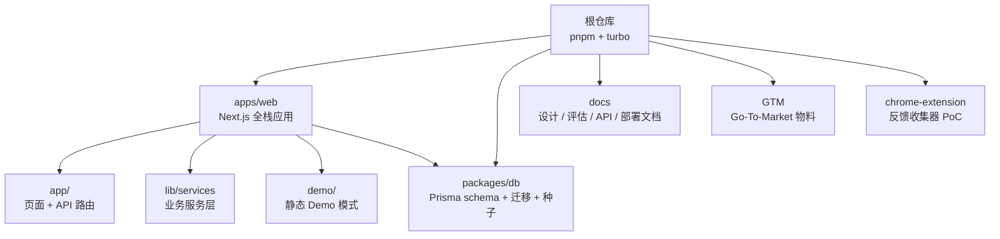
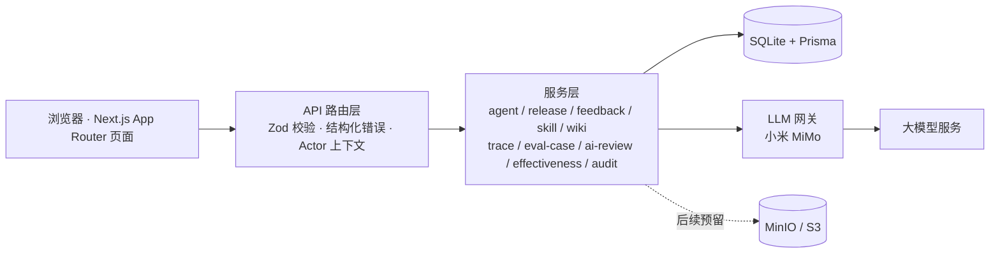
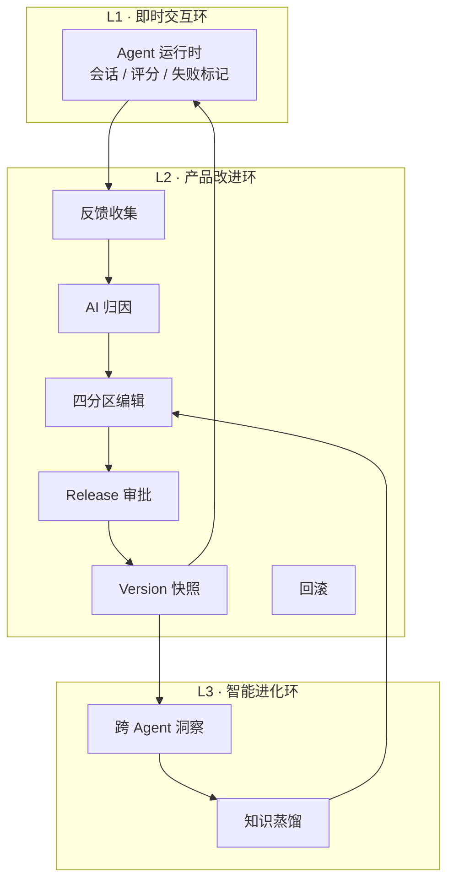
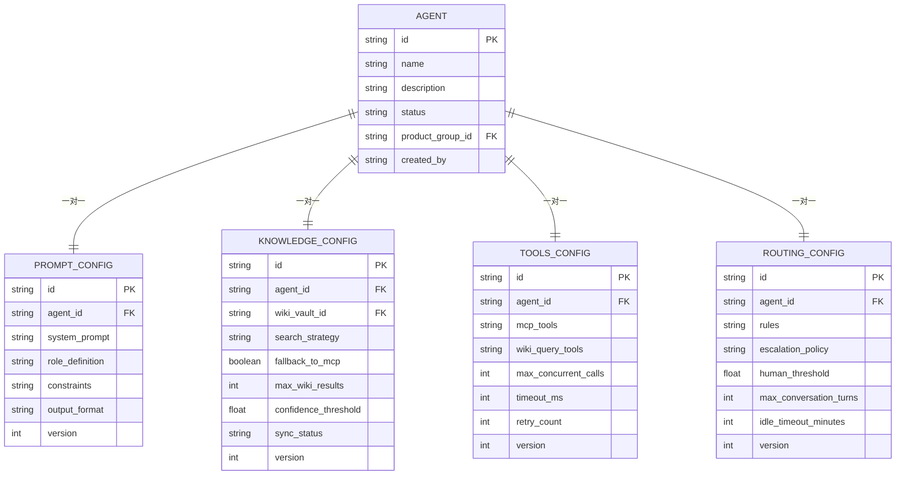
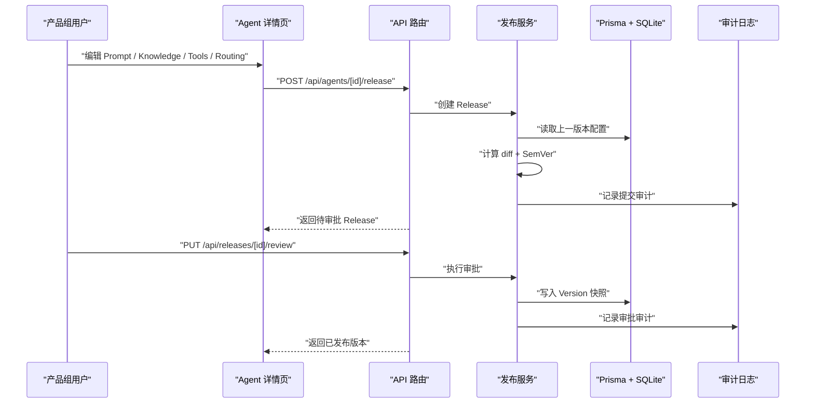
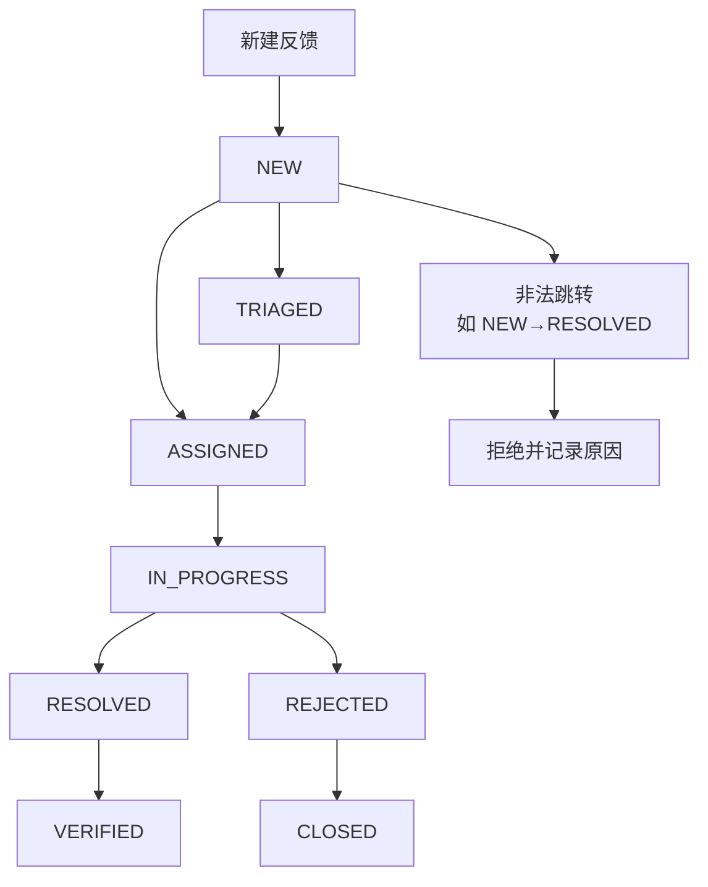
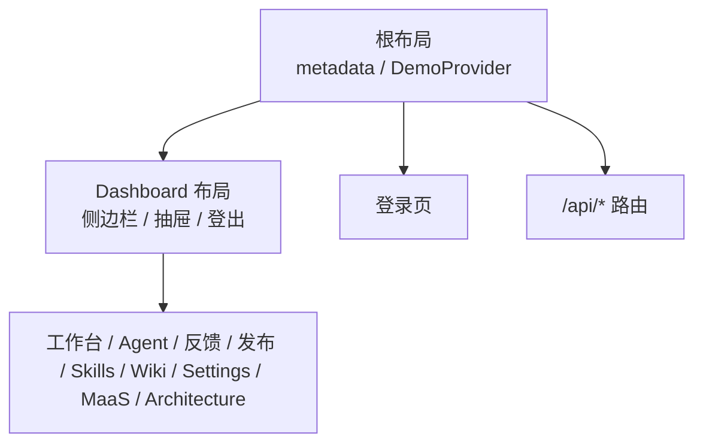
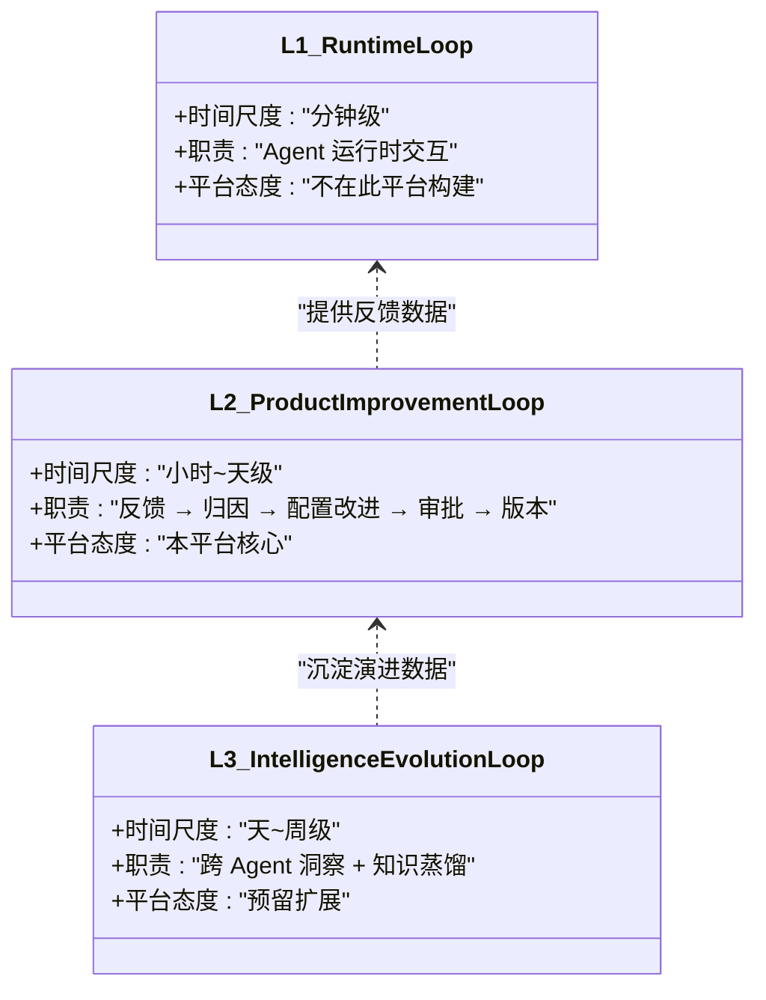
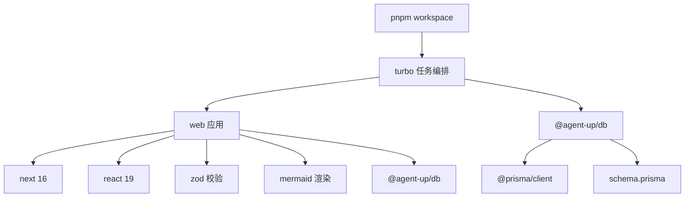

# 项目概述

<cite>
**本文引用的文件**   
- [README.md](file://README.md)
- [package.json](file://package.json)
- [apps/web/package.json](file://apps/web/package.json)
- [packages/db/package.json](file://packages/db/package.json)
- [packages/db/prisma/schema.prisma](file://packages/db/prisma/schema.prisma)
- [apps/web/app/layout.tsx](file://apps/web/app/layout.tsx)
- [apps/web/app/(dashboard)/layout.tsx](file://apps/web/app/(dashboard)/layout.tsx)
- [apps/web/app/(dashboard)/architecture/loop/page.tsx](file://apps/web/app/(dashboard)/architecture/loop/page.tsx)
- [docs/evaluation/2026-07-21-project-evaluation-and-harness-loop-reference.md](file://docs/evaluation/2026-07-21-project-evaluation-and-harness-loop-reference.md)
- [docs/superpowers/specs/2026-07-06-agent-improvement-platform-mvp-design.md](file://docs/superpowers/specs/2026-07-06-agent-improvement-platform-mvp-design.md)
</cite>

## 目录
1. [引言](#引言)
2. [项目结构](#项目结构)
3. [核心组件](#核心组件)
4. [架构总览](#架构总览)
5. [详细组件分析](#详细组件分析)
6. [依赖关系分析](#依赖关系分析)
7. [性能与工程特性](#性能与工程特性)
8. [快速开始指南](#快速开始指南)
9. [产品预览说明](#产品预览说明)
10. [常见问题与排错](#常见问题与排错)
11. [结论](#结论)

## 引言
AgentUp（Agent 改进平台）是一个面向专有云工单场景的 Agent 持续改进管理平台。它的核心目标是：让各产品组在同一个平台上维护和改进各自的 Agent 配置，包括 Prompt、Knowledge、Tools 与 Routing；每次改动通过发布审批流程生成不可变版本快照，并支持分区级或整版本回滚。平台以「三层 Loop」为设计理念，把 Agent 运行时交互、产品改进闭环和跨 Agent 智能进化按时间尺度分层，从而让「模型可换，闭环不变」。

从技术角度看，AgentUp 是 Next.js 16 + TypeScript + Tailwind CSS 4 + Prisma + SQLite 的全栈 Monorepo 应用，使用 Turborepo 与 pnpm workspaces 组织代码，并通过 Chrome 插件 PoC 打通试聊反馈收集入口。它既可作为内部产品迭代平台，也可作为客户现场演示与面试展示工具，直观呈现「与客户一起持续迭代 Agent」的完整闭环。

**章节来源**
- [README.md:1-10](file://README.md#L1-L10)
- [docs/superpowers/specs/2026-07-06-agent-improvement-platform-mvp-design.md:18-30](file://docs/superpowers/specs/2026-07-06-agent-improvement-platform-mvp-design.md#L18-L30)

## 项目结构
AgentUp 采用 Monorepo 结构，根仓库负责脚本编排与依赖管理，业务主应用位于 `apps/web`，数据库层封装在 `packages/db`，文档、GTM 物料、Chrome 插件等放在同级目录。



**图表来源**
- [README.md:76-135](file://README.md#L76-L135)
- [package.json:4-12](file://package.json#L4-L12)
- [apps/web/package.json:15-22](file://apps/web/package.json#L15-L22)
- [packages/db/package.json:7-15](file://packages/db/package.json#L7-L15)

**章节来源**
- [README.md:76-135](file://README.md#76-135)
- [package.json:1-22](file://package.json#L1-L22)
- [apps/web/package.json:1-37](file://apps/web/package.json#L1-L37)
- [packages/db/package.json:1-29](file://packages/db/package.json#L1-L29)

## 核心组件
AgentUp 的核心能力围绕「Agent 四分区配置 + 发布审批流 + 反馈闭环 + 知识库与技能 + MaaS 集成展示」展开。

| 核心组件 | 职责 | 对应实现位置 |
|---------|------|-------------|
| Agent 四分区编辑器 | 编辑 Prompt、Knowledge、Tools、Routing，保存草稿，不改线上配置 | `apps/web/app/(dashboard)/agents/` |
| 发布审批流 | 提交 Release、自动 diff、SemVer、审批后生成 Version 快照 | `apps/web/app/api/releases/`、`lib/services/release-service.ts` |
| 回滚机制 | 分区级回滚与整版本回滚，均生成新版本 | `apps/web/app/api/agents/[id]/config/[partition]/rollback`、`rollback/[versionId]` |
| 反馈闭环 | 反馈录入 → AI 归因 → 定位分区 → 改进 → 发布验证 | `apps/web/app/(dashboard)/feedback/`、`lib/services/feedback-service.ts` |
| 知识库 Wiki | Vault + Page 两级知识管理，BM25-lite 检索 | `apps/web/app/(dashboard)/wiki/`、`lib/services/wiki-service.ts` |
| Skills 管理 | 可复用技能组件与 Agent 绑定 | `apps/web/app/(dashboard)/skills/`、`lib/services/skill-service.ts` |
| 设置与 RBAC | 产品组、角色、权限、审计日志 | `apps/web/app/(dashboard)/settings/`、`lib/services/audit-service.ts` |
| MaaS 集成展示 | 公共云与专有云模型矩阵、路由策略、用量聚合 | `apps/web/app/(dashboard)/maas/` |
| LLM 网关 | 小米 MiMo 真实接入，统一超时与结构化错误 | `lib/services/llm-service.ts` |

这些组件共同构成一个「反馈驱动配置改进」的平台闭环：用户或系统产生反馈，平台辅助归因，产品组修改 Agent 配置，审批通过后上线，效果报告衡量改进价值。

**章节来源**
- [README.md:50-63](file://README.md#L50-L63)
- [README.md:97-121](file://README.md#L97-L121)
- [README.md:349-378](file://README.md#L349-L378)

## 架构总览
当前运行形态是「数据库即真相源」：浏览器通过 Next.js App Router 访问页面，页面调用 `/api/*` 路由，路由层只做协议适配、参数校验和错误映射，真实业务逻辑下沉到 `lib/services` 中的服务层，存储读写统一走 Prisma Client，外部 LLM 调用统一经过 LLM 网关。



**图表来源**
- [README.md:137-153](file://README.md#L137-L153)

这个架构的关键约束是：API 路由不承载复杂业务逻辑；所有写操作应伴随审计；所有入参由 Zod schema 校验；所有枚举值在 SQLite 下用字符串列 + 运行时校验表达；JSON 字段通过 `@agent-up/db` 的 JSON 打包函数安全存取。

**章节来源**
- [README.md:137-153](file://README.md#L137-L153)
- [packages/db/prisma/schema.prisma:1-10](file://packages/db/prisma/schema.prisma#L1-L10)

## 详细组件分析

### 三层 Loop 设计理念
AgentUp 的设计骨架不是某个具体 Agent 框架，而是「不同时间尺度的改进循环」。L1 是 Agent 运行时与用户的即时交互环，L2 是产品组基于反馈改进 Agent 的配置环，L3 是跨 Agent 的智能进化环。平台重点落地的是 L2，并为 L3 预留扩展点。



**图表来源**
- [docs/evaluation/2026-07-21-project-evaluation-and-harness-loop-reference.md:21-45](file://docs/evaluation/2026-07-21-project-evaluation-and-harness-loop-reference.md#L21-L45)
- [README.md:269-288](file://README.md#L269-L288)

L1 不在本平台构建，平台只消费其产物；L2 是 AgentUp 的主战场；L3 目前更多体现在文档与规划中，例如知识库蒸馏、跨 Agent 概念沉淀。

**章节来源**
- [docs/superpowers/specs/2026-07-06-agent-improvement-platform-mvp-design.md:18-30](file://docs/superpowers/specs/2026-07-06-agent-improvement-platform-mvp-design.md#L18-L30)
- [docs/evaluation/2026-07-21-project-evaluation-and-harness-loop-reference.md:21-45](file://docs/evaluation/2026-07-21-project-evaluation-and-harness-loop-reference.md#L21-L45)
- [README.md:269-288](file://README.md#L269-L288)

### Agent 四分区配置模型
每个 Agent 包含四个可编辑分区：Prompt、Knowledge、Tools、Routing。这四个分区在数据库中分别有独立配置表，同时存在 Draft 环境用于暂存未发布的改动。



**图表来源**
- [packages/db/prisma/schema.prisma:66-182](file://packages/db/prisma/schema.prisma#L66-L182)

四分区的设计意义在于：产品组可以只改其中一个分区而不影响其他分区；发布时计算 diff 并生成 SemVer；回滚时可以只还原某个分区，也可以还原整个版本。

**章节来源**
- [packages/db/prisma/schema.prisma:66-182](file://packages/db/prisma/schema.prisma#L66-L182)
- [README.md:277-288](file://README.md#L277-L288)

### 发布审批与版本快照流程
发布流程是 AgentUp 治理能力的核心：编辑配置 → 提交发布 → 自动 diff 与语义化版本号 → 审批 → 生成不可变版本快照 → 可选回滚。



**图表来源**
- [README.md:286-288](file://README.md#L286-L288)
- [packages/db/prisma/schema.prisma:257-318](file://packages/db/prisma/schema.prisma#L257-L318)

这里有两个关键设计点：
1. Release 是「变更申请」，Version 是「不可变快照」。
2. 回滚不会删除历史，而是生成新的 Version，保证演进线可追溯。

**章节来源**
- [packages/db/prisma/schema.prisma:257-318](file://packages/db/prisma/schema.prisma#L257-L318)
- [README.md:286-288](file://README.md#L286-L288)

### 反馈状态机与闭环
反馈不是简单文本，而是带严重程度、渠道、目标分区、状态流转的数据对象。平台要求非法状态转移被拒绝，例如直接从 NEW 跳到 RESOLVED。



**图表来源**
- [README.md:55-56](file://README.md#L55-L56)
- [README.md:389](file://README.md#L389)

反馈闭环的价值在于：它把一次失败体验变成可追踪、可归因、可验证的改进输入，而不是散落在聊天记录里。

**章节来源**
- [README.md:55-56](file://README.md#L55-L56)
- [README.md:389](file://README.md#L389)

### 前端布局与导航结构
前端采用 Next.js App Router，根布局负责全局元信息、Demo 模式开关与浅色模式控制；Dashboard 布局负责侧边栏导航、移动端抽屉、登出流程和 Mock 标注。



**图表来源**
- [apps/web/app/layout.tsx:1-32](file://apps/web/app/layout.tsx#L1-L32)
- [apps/web/app/(dashboard)/layout.tsx:14-30](file://apps/web/app/(dashboard)/layout.tsx#L14-L30)

导航项明确区分操作型页面与架构参考文档：前者会修改数据，后者是只读说明性内容。

**章节来源**
- [apps/web/app/layout.tsx:1-32](file://apps/web/app/layout.tsx#L1-L32)
- [apps/web/app/(dashboard)/layout.tsx:14-30](file://apps/web/app/(dashboard)/layout.tsx#L14-L30)
- [apps/web/app/(dashboard)/layout.tsx:156-176](file://apps/web/app/(dashboard)/layout.tsx#L156-L176)

### 三层 Loop 页面与行业对齐
Architecture 下的 Loop 页面不仅解释 AgentUp 的三层 Loop，还对照业界常见实现，帮助开发者理解「为什么 AgentUp 做 L2/L3，而不是重复造 L1 运行时」。



**图表来源**
- [apps/web/app/(dashboard)/architecture/loop/page.tsx:312-331](file://apps/web/app/(dashboard)/architecture/loop/page.tsx#L312-L331)
- [README.md:269-275](file://README.md#L269-L275)

**章节来源**
- [apps/web/app/(dashboard)/architecture/loop/page.tsx:312-331](file://apps/web/app/(dashboard)/architecture/loop/page.tsx#L312-L331)
- [README.md:269-275](file://README.md#L269-L275)

## 依赖关系分析
AgentUp 的依赖关系可以从三个层面理解：Monorepo 包依赖、运行时模块依赖、外部服务依赖。



**图表来源**
- [package.json:4-18](file://package.json#L4-L18)
- [apps/web/package.json:15-34](file://apps/web/package.json#L15-L34)
- [packages/db/package.json:17-26](file://packages/db/package.json#L17-L26)

关键点：
- 根 `package.json` 暴露 `dev`、`build`、`lint`、`db:*` 等统一脚本。
- `web` 应用通过 `workspace:*` 引用 `@agent-up/db`，避免重复定义 Prisma client。
- 测试、构建、演示导出都集中在 `apps/web/package.json` 的 scripts 中。

**章节来源**
- [package.json:1-22](file://package.json#L1-L22)
- [apps/web/package.json:1-37](file://apps/web/package.json#L1-L37)
- [packages/db/package.json:1-29](file://packages/db/package.json#L1-L29)

## 性能与工程特性
AgentUp 的工程特性与其产品目标一致：强调可观测、可回溯、可回滚、可测试。

| 工程特性 | 说明 | 相关位置 |
|---------|------|---------|
| 结构化错误 | AppError 层级映射 HTTP 状态码，消除字符串匹配 | `lib/errors.ts` |
| 全量参数校验 | 30 个 Zod schema 覆盖 API 入参 | `lib/schemas.ts` |
| Actor 上下文 | 解析请求头身份，为 NextAuth 留接口 | `lib/context.ts` |
| 审计日志 | 所有写操作 append-only | `lib/services/audit-service.ts` |
| 真 SemVer | 按分区变更范围计算 patch/minor | `lib/versioning.ts` |
| 反馈状态机 | 非法状态转移被拒 | `feedback-service.ts` |
| Prisma 持久化 | 全业务运行时走数据库 | `packages/db` |
| MOCK 标注规范 | mock 数据显式标注，真实调用标 LIVE | 多处 UI 与注释 |
| LLM 网关 | env 凭据零硬编码，统一超时 | `lib/services/llm-service.ts` |
| 测试规模 | 371 个测试，35 个测试文件 | `apps/web/app/api/__tests__/` |

这些特性共同降低 Agent 配置管理的风险：改 Prompt 不只是改一段文字，而是进入版本、审计、审批、回滚、效果报告的治理体系。

**章节来源**
- [README.md:380-393](file://README.md#L380-L393)
- [README.md:190-197](file://README.md#L190-L197)

## 快速开始指南

### 前置条件
- Node.js >= 20
- pnpm >= 9

### 安装
在项目根目录执行：
```bash
pnpm install
```

### 初始化数据库
AgentUp 当前使用 SQLite 单文件持久化，无需 Docker 守护进程。推荐顺序：
1. 生成 Prisma Client：`pnpm db:generate`
2. 部署迁移建表：`cd packages/db && npx prisma migrate deploy`
3. 灌入种子数据：`pnpm db:seed`

### 启动开发服务器
```bash
pnpm dev
```
然后访问 `http://localhost:3000`。

### 常用命令
| 命令 | 作用 |
|------|------|
| `pnpm dev` | 启动开发服务器 |
| `pnpm build` | 全量构建 |
| `pnpm lint` | ESLint 检查 |
| `cd apps/web && pnpm test` | 运行全部测试 |
| `cd apps/web && pnpm test -- --coverage` | 带覆盖率报告 |
| `cd apps/web && pnpm build:demo` | 构建纯静态 Demo |

**章节来源**
- [README.md:155-188](file://README.md#L155-L188)
- [README.md:198-207](file://README.md#L198-L207)

## 产品预览说明
README 中提供了三张产品预览图，分别对应工作台、Agent 详情和 MaaS 集成。

| 预览 | 含义 | 对应截图 |
|------|------|---------|
| 工作台 | 全局概况与「反馈 → 归因 → 配置 → 发布」动线入口 | `docs/assets/dashboard.png` |
| Agent 详情 | 四分区编辑器、试聊 Playground、版本历史与一键回滚 | `docs/assets/agent-detail.png` |
| MaaS 集成 | 公共云 + 专有云双形态产品矩阵与模型路由策略 | `docs/assets/maas.png` |

这些截图适合用于产品介绍、客户演示、面试展示或 PR 描述，帮助非技术读者快速理解 AgentUp 解决的是什么问题。

**章节来源**
- [README.md:11-25](file://README.md#L11-L25)

## 常见问题与排错

### 是否需要启动 PostgreSQL 或 MinIO？
不需要。当前存储为 SQLite 单文件，开发前只需完成 Prisma 生成、迁移和种子即可。

### 没有配置 LLM 凭据会怎样？
真实 LLM 集成点会返回 503，并在页面给出明确提示；其余功能不受影响。

### 测试会不会污染开发数据库？
不会。测试通过 `_resetDb` 清库后连接本地 SQLite 文件，并发 worker 使用独立 `.db` 文件，互不干扰。

### 如何重置演示数据？
执行 `pnpm db:seed`，种子脚本会先清空业务表再灌入种子数据。

### 演示账号是什么？
演示账号为邮箱 + 口令组合，来自 seed 预置数据，登录后拥有 mock 管理员权限。

**章节来源**
- [README.md:446-467](file://README.md#L446-L467)

## 结论
AgentUp 不是一个简单的 Agent 配置编辑器，而是一个围绕「三层 Loop」构建的 Agent 持续改进平台。它把 Prompt、Knowledge、Tools、Routing 这些通常散落在不同地方的 Agent 资产，收敛到统一的四分区模型中，并用 Release、Version、审计、回滚、效果报告和反馈闭环把它们串起来。

对初学者来说，AgentUp 提供了一个理解「Agent 改进不只是调模型」的入口：真正决定 Agent 质量的，往往是模型之外的 Prompt、Context、Harness、Loop 和 Graph。对有经验的开发者来说，AgentUp 的价值在于把行业经验中的 Harness 与 Loop 工程纪律，应用到 Agent 配置的迭代流程上，形成可测试、可审计、可回滚、可度量的产品能力。